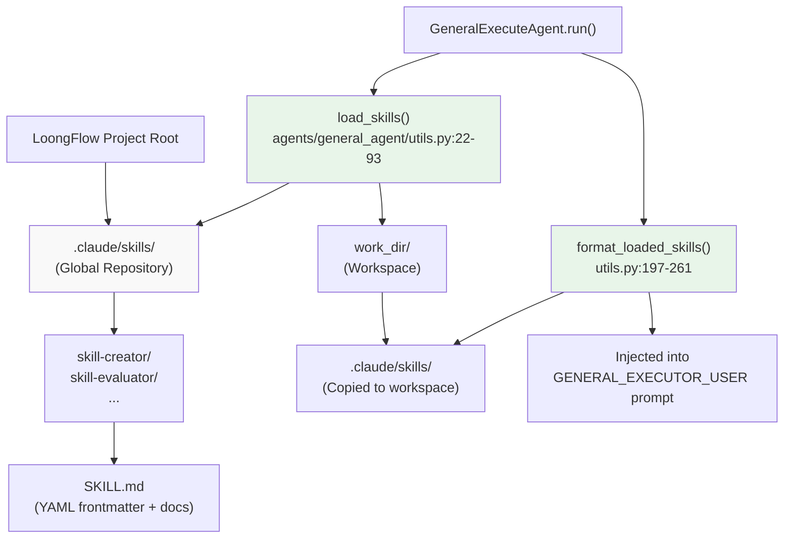
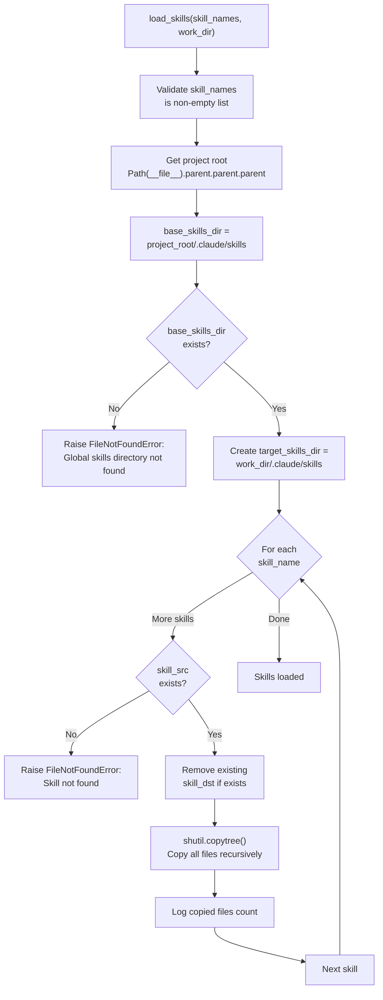
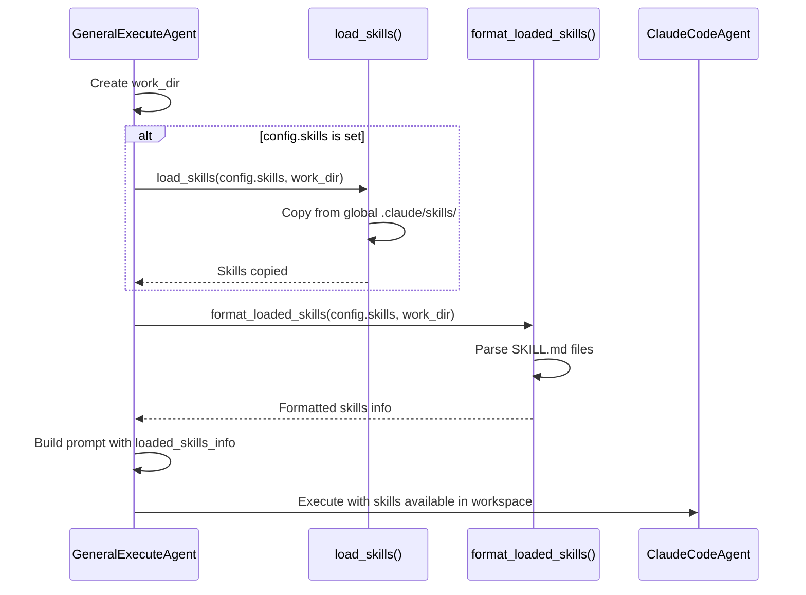
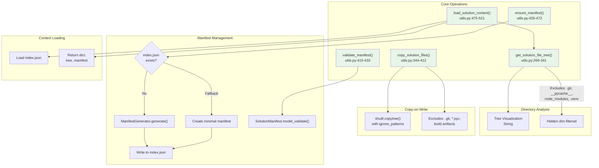
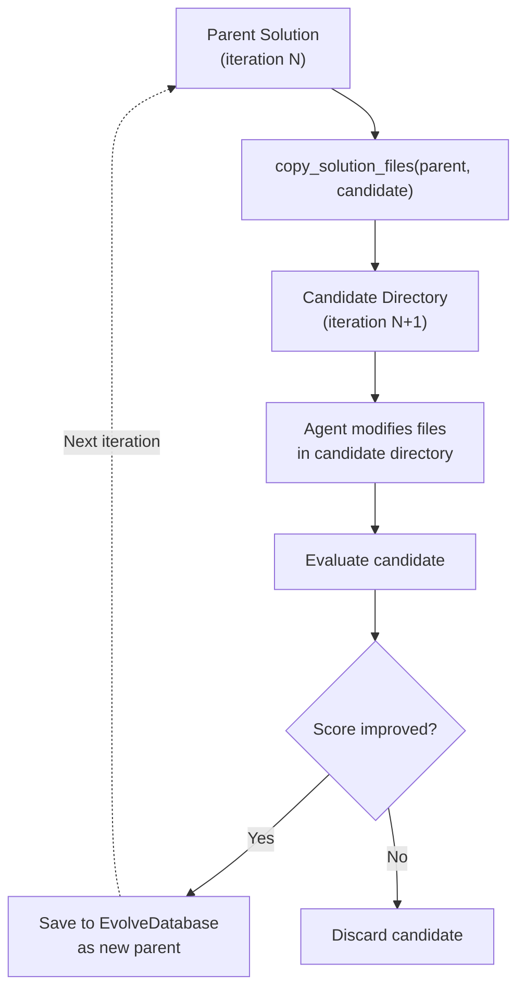
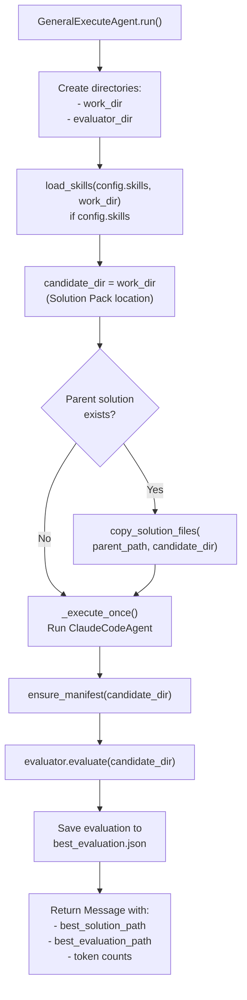
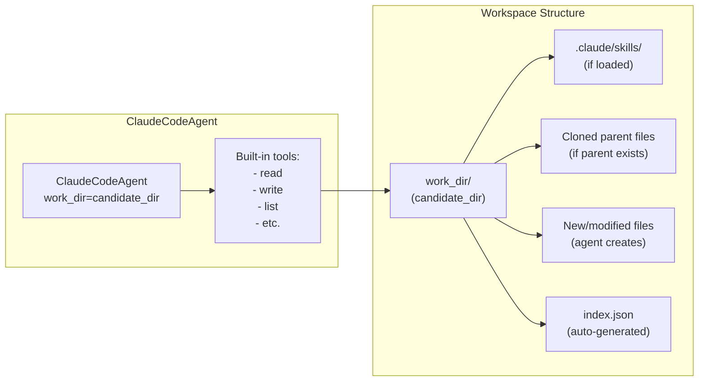

<!-- source: DeepWiki mcp.deepwiki.com · repo baidu-baige/LoongFlow · page 4.5 Skills & Solution Packs · fetched 2026-10-26 -->

# Skills & Solution Packs

<details>
<summary>Relevant source files</summary>

The following files were used as context for generating this wiki page:

- [agents/general_agent/README.md](agents/general_agent/README.md)
- [agents/general_agent/README_zh.md](agents/general_agent/README_zh.md)
- [src/loongflow/framework/claude_code/general_prompt.py](src/loongflow/framework/claude_code/general_prompt.py)

</details>


This document describes the Skills and Solution Packs systems used by the General Agent to provide reusable capabilities and manage multi-file solutions. Skills are pre-built capabilities copied from a global repository into the workspace, while Solution Packs are structured directories containing solution files with manifests that describe their contents.

For information about the General Agent's planning and execution components, see [Planner Component](#4.2) and [Executor Component](#4.3). For configuration details, see [Configuration & Running](#4.5).

---

## Overview

The General Agent uses two key mechanisms to manage code and capabilities:

| System | Purpose | Storage Location | Key File |
|--------|---------|------------------|----------|
| **Skills** | Reusable capabilities and tools | `.claude/skills/` | `SKILL.md` |
| **Solution Packs** | Multi-file solutions with metadata | Workspace directories | `index.json` |

Skills provide pre-built functionality that agents can use (similar to libraries or tools), while Solution Packs represent complete solutions that evolve over iterations through the PES paradigm.

**Sources:** [agents/general_agent/utils.py:1-570](), [agents/general_agent/executor.py:1-325]()

---

## Skills System

### What are Skills?

Skills are pre-packaged capabilities stored in the project root's `.claude/skills/` directory. Each skill is a directory containing a `SKILL.md` file with YAML frontmatter that describes the skill's name and purpose. Skills are copied into the agent's workspace before execution begins.



**Sources:** [agents/general_agent/utils.py:22-93](), [agents/general_agent/executor.py:105-120]()

### Skill Structure

Each skill directory contains at minimum a `SKILL.md` file with YAML frontmatter:

```markdown
---
name: "Skill Name"
description: "Brief description of what this skill provides"
---

# Detailed Documentation

Usage instructions and examples...
```

The `load_skills()` function copies **all files and subdirectories** recursively from the skill directory to the workspace using `shutil.copytree()`.

**Sources:** [agents/general_agent/utils.py:22-93]()

### Loading Mechanism

The `load_skills()` function implements the skill loading workflow:



**Key Implementation Details:**
- Source path: `<project_root>/.claude/skills/<skill_name>/`
- Destination: `<work_dir>/.claude/skills/<skill_name>/`
- Uses `shutil.copy2` to preserve file metadata
- Excludes: None (copies everything)
- Overwrites existing skills in workspace

**Sources:** [agents/general_agent/utils.py:22-93]()

### Skill Formatting for Prompts

The `format_loaded_skills()` function reads `SKILL.md` files and extracts metadata for prompt injection:

```python
# Example extracted information
"""
The following skills are available in this workspace:
- **Skill Creator**: Create new skills with YAML frontmatter
- **Evaluator Helper**: Assist with evaluation tasks

To use a skill, read its SKILL.md file for detailed instructions.
"""
```

This formatted string is injected into the `GENERAL_EXECUTOR_USER` prompt template to inform the agent about available capabilities.

**Sources:** [agents/general_agent/utils.py:197-261](), [agents/general_agent/executor.py:270-279]()

### Usage in GeneralExecuteAgent

Skills are loaded during the Execute phase:



**Sources:** [agents/general_agent/executor.py:105-120](), [agents/general_agent/executor.py:270-279]()

---

## Solution Packs System

### What are Solution Packs?

Solution Packs are structured directories containing multi-file solutions. Each Solution Pack includes:
- Source code files
- Test files
- Documentation
- An `index.json` manifest describing the contents

Solution Packs enable evolutionary development where solutions are cloned, modified, and improved across iterations.

**Sources:** [agents/general_agent/utils.py:264-522]()

### Manifest Structure

The `index.json` manifest file describes the Solution Pack's contents. It is validated against the `SolutionManifest` Pydantic model:

```json
{
  "description": "Brief description of the solution",
  "files": [
    {
      "path": "src/main.py",
      "type": "code",
      "purpose": "Main entry point"
    },
    {
      "path": "tests/test_main.py",
      "type": "test",
      "purpose": "Unit tests for main module"
    }
  ]
}
```

The manifest is generated automatically by the `ManifestGenerator` class, which uses an LLM to analyze the directory structure and create appropriate metadata.

**Sources:** [agents/general_agent/utils.py:415-433](), [agents/general_agent/utils.py:435-472]()

### Directory Operations

Solution Pack utility functions provide comprehensive directory management:



**Sources:** [agents/general_agent/utils.py:269-522]()

### Key Utility Functions

| Function | Purpose | Input | Output |
|----------|---------|-------|--------|
| `get_solution_file_tree()` | Generate tree visualization | `dir_path, max_depth, max_files` | String representation |
| `copy_solution_files()` | Clone solution (Copy-on-Write) | `src, dst, exclude` | Side effect: creates dst |
| `ensure_manifest()` | Generate index.json if missing | `solution_dir, llm_config` | Side effect: writes file |
| `validate_manifest()` | Check manifest validity | `manifest_dict` | Boolean |
| `load_solution_context()` | Load tree + manifest | `solution_dir, max_files_content` | Dict with tree, manifest |

**Sources:** [agents/general_agent/utils.py:269-522]()

### Copy-on-Write Pattern

The `copy_solution_files()` function implements a Copy-on-Write pattern for solution evolution:



**Implementation Details:**
- Raises `ValueError` if destination already exists (prevents overwrites)
- Default exclusions: `.git`, `__pycache__`, `node_modules`, `.venv`, `*.pyc`, `.DS_Store`
- Uses `shutil.copytree()` with `copy_function=shutil.copy2` to preserve metadata
- Custom `ignore_patterns` function supports wildcard patterns

**Sources:** [agents/general_agent/utils.py:344-412]()

---

## Integration with General Agent

### Executor Workflow

The `GeneralExecuteAgent.run()` method orchestrates both skills and solution packs:



**Sources:** [agents/general_agent/executor.py:68-219]()

### Agent Prompt Context

The `_execute_once()` method builds the prompt with both skills and solution context:

```python
# From executor.py:270-279
loaded_skills_info = format_loaded_skills(self.config.skills, candidate_dir)

user_prompt = GENERAL_EXECUTOR_USER.format(
    task_info=context.task,
    improvement_plan=parent_ctx.stage1_plan,
    parent_solution=parent_ctx.parent_solution,
    solution_path=candidate_dir,  # Solution Pack directory
    loaded_skills=loaded_skills_info,  # Formatted skills
)
```

The agent receives:
1. **Task information** - The problem to solve
2. **Improvement plan** - From planner phase
3. **Parent solution** - Previous iteration's metadata (JSON)
4. **Solution path** - Workspace directory containing cloned parent files
5. **Loaded skills** - Available capabilities formatted from SKILL.md files

**Sources:** [agents/general_agent/executor.py:255-294]()

### ClaudeCodeAgent Execution

The `ClaudeCodeAgent` operates inside the Solution Pack directory:



The agent has full access to:
- Read any file in the workspace
- Write/modify files
- Create new files
- Execute code (based on permission mode)
- Access loaded skills via `.claude/skills/`

**Sources:** [agents/general_agent/executor.py:281-294](), [agents/general_agent/executor.py:86-102]()

---

## Utility Functions Reference

### Skill Management Functions

| Function | Location | Parameters | Returns | Description |
|----------|----------|------------|---------|-------------|
| `load_skills()` | [utils.py:22-93]() | `skill_names: List[str]`<br/>`work_dir: str` | `None` | Copy skills from global repository to workspace |
| `format_loaded_skills()` | [utils.py:197-261]() | `skill_names: Optional[List[str]]`<br/>`work_dir: str` | `str` | Format skills info for prompt injection |

**Sources:** [agents/general_agent/utils.py:22-93](), [agents/general_agent/utils.py:197-261]()

### Solution Pack Functions

| Function | Location | Parameters | Returns | Description |
|----------|----------|------------|---------|-------------|
| `get_solution_file_tree()` | [utils.py:269-341]() | `dir_path: str`<br/>`max_depth: int = 3`<br/>`max_files: int = 200` | `str` | Generate tree visualization |
| `copy_solution_files()` | [utils.py:344-412]() | `src: str`<br/>`dst: str`<br/>`exclude: Optional[List[str]]` | `None` | Recursively clone solution directory |
| `validate_manifest()` | [utils.py:415-433]() | `manifest_dict: Dict[str, Any]` | `bool` | Validate against SolutionManifest schema |
| `ensure_manifest()` | [utils.py:435-472]() | `solution_dir: str`<br/>`llm_config: Optional[Dict]` | `None` (async) | Generate index.json if missing |
| `load_solution_context()` | [utils.py:475-521]() | `solution_dir: str`<br/>`max_files_content: int = 0` | `Dict[str, Any]` | Load tree + manifest for prompts |

**Sources:** [agents/general_agent/utils.py:264-522]()

### Tool Conversion Functions

| Function | Location | Parameters | Returns | Description |
|----------|----------|------------|---------|-------------|
| `convert_function_tool_to_custom_tool()` | [utils.py:95-173]() | `tool: FunctionTool` | `Dict[str, Any]` | Convert FunctionTool to ClaudeCodeAgent format |
| `build_custom_tools_from_function_tools()` | [utils.py:176-194]() | `function_tools: List[FunctionTool]` | `Dict[str, Dict]` | Batch convert multiple FunctionTools |

These functions bridge the gap between LoongFlow's `FunctionTool` interface and the custom tools format required by `ClaudeCodeAgent`.

**Sources:** [agents/general_agent/utils.py:95-194]()

---

## Error Handling

### Common Exceptions

| Exception | Raised By | Condition | Handling |
|-----------|-----------|-----------|----------|
| `FileNotFoundError` | `load_skills()` | Global skills directory missing | Check `.claude/skills/` in project root |
| `FileNotFoundError` | `load_skills()` | Specific skill not found | Verify skill name matches directory |
| `ValueError` | `copy_solution_files()` | Destination already exists | Use new directory or remove existing |
| `ValueError` | `load_skills()` | `skill_names` empty or invalid | Pass non-empty list of skill names |

**Executor Error Handling:**
- Skills loading failure: Logged as error, exception raised [executor.py:117-120]()
- Parent cloning failure: Logged as warning, continues with empty directory [executor.py:139-141]()
- Manifest generation failure: Logged as error, uses fallback [utils.py:460-462]()
- Evaluation failure: Returns zero score with error details [executor.py:188-195]()

**Sources:** [agents/general_agent/executor.py:117-141](), [agents/general_agent/utils.py:460-462]()

---

## Best Practices

### Skills
1. **Organize by capability**: Group related functions in single skill directories
2. **Document thoroughly**: Include clear usage examples in `SKILL.md`
3. **Use YAML frontmatter**: Always include `name` and `description` fields
4. **Version control**: Store skills in project root `.claude/skills/` for reuse across tasks

### Solution Packs
1. **Let manifests generate**: Use `ensure_manifest()` instead of manual creation
2. **Validate structure**: Call `validate_manifest()` after manual changes
3. **Use lazy loading**: Rely on agent's built-in `read` tool rather than preloading all files
4. **Clone before modify**: Always use `copy_solution_files()` for Copy-on-Write pattern
5. **Clean exclusions**: Customize `exclude` parameter to avoid copying unnecessary build artifacts

### Integration
1. **Configure skills in YAML**: Specify skills in `task_config.yaml` under `skills` array
2. **Monitor workspace size**: Skills and solution packs accumulate; clean up old iterations
3. **Check token usage**: Large solution packs may exceed context limits; use tree + manifest instead of full content

**Sources:** [agents/general_agent/executor.py:105-157](), [agents/general_agent/utils.py:22-522]()

---

