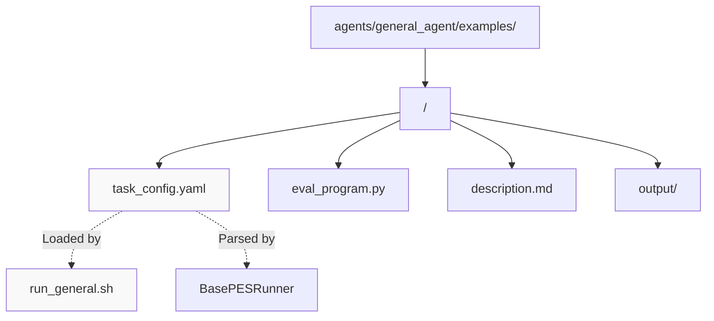
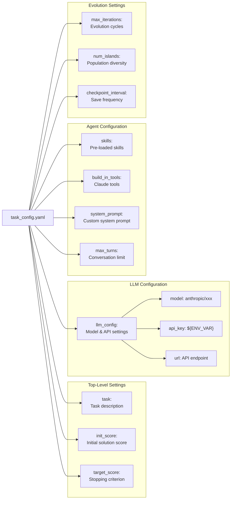
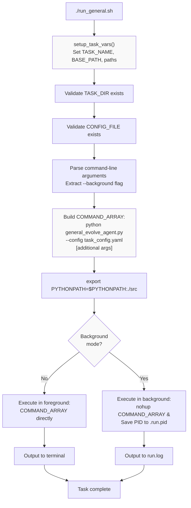
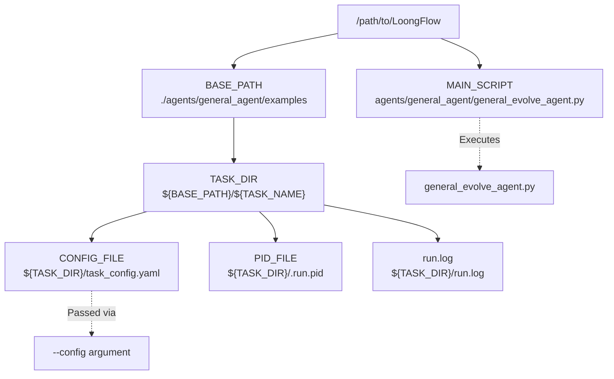
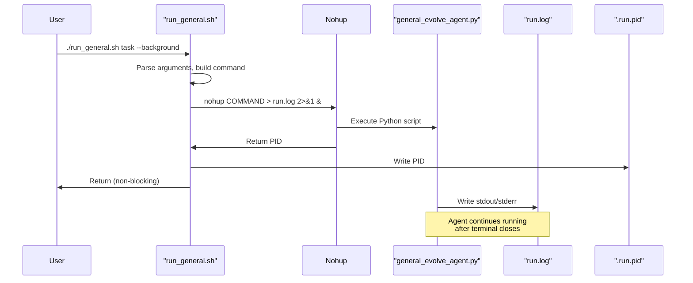
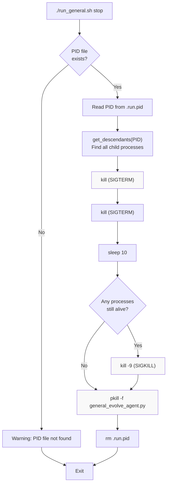
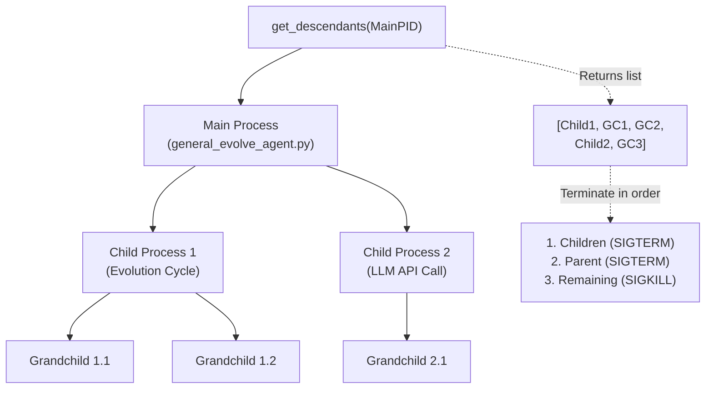
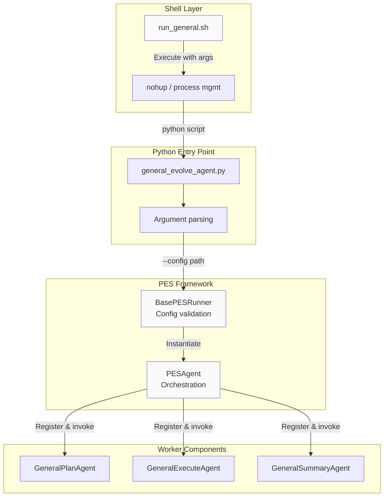

<!-- source: DeepWiki mcp.deepwiki.com · repo baidu-baige/LoongFlow · page 4.6 Configuration & Running · fetched 2026-10-26 -->

# Configuration & Running

<details>
<summary>Relevant source files</summary>

The following files were used as context for generating this wiki page:

- [agents/general_agent/README.md](agents/general_agent/README.md)
- [agents/general_agent/README_zh.md](agents/general_agent/README_zh.md)
- [agents/general_agent/examples/03_bug_hunter/task_config.yaml](agents/general_agent/examples/03_bug_hunter/task_config.yaml)
- [agents/general_agent/examples/04_circle_packing/task_config.yaml](agents/general_agent/examples/04_circle_packing/task_config.yaml)
- [run_general.sh](run_general.sh)
- [run_math.sh](run_math.sh)
- [src/loongflow/framework/claude_code/general_prompt.py](src/loongflow/framework/claude_code/general_prompt.py)

</details>


This page describes how to configure and execute General Agent tasks using the `run_general.sh` script and `task_config.yaml` configuration files. It covers task directory structure, configuration options, execution modes, and process management.

For configuration details of the Planner and Executor components, see [Planner Component](#4.2) and [Executor Component](#4.3). For understanding solution packs and skills, see [Skills & Solution Packs](#4.4). For general framework configuration concepts, see [BasePESRunner & Configuration](#3.6).

---

## Task Directory Structure

General Agent tasks reside in `agents/general_agent/examples/` and follow a specific directory structure.

### Required Files

| File | Purpose | Required |
|------|---------|----------|
| `task_config.yaml` | Main configuration file defining LLM settings, evolution parameters, and agent behavior | Yes |
| `eval_program.py` | Evaluation program that scores generated solutions | No (optional) |
| `description.md` | Task description provided to the agent | No (optional) |

The `run_general.sh` script validates the presence of `task_config.yaml` before execution [run_general.sh:136-139]().



**Task Directory Structure Mapping**

Sources: [run_general.sh:20-32]()

---

## Configuration File Structure

The `task_config.yaml` file configures the General Agent's behavior, LLM settings, and evolution parameters.

### Core Configuration Sections



**Configuration Structure Overview**

Sources: [agents/general_agent/planner.py:40-59]()

### LLM Configuration Requirements

The `GeneralPlanAgent` enforces specific requirements on LLM configuration:

1. **Model Prefix**: Model name must start with `anthropic/` [agents/general_agent/planner.py:54-58]()
2. **API Key**: Required for authentication, typically loaded from environment variables
3. **Model Extraction**: The `anthropic/` prefix is stripped before passing to `ClaudeCodeAgent` [agents/general_agent/planner.py:58]()

### Agent-Specific Settings

| Setting | Type | Purpose | Default |
|---------|------|---------|---------|
| `skills` | List[str] | Pre-loaded skills copied to workspace | `[]` |
| `build_in_tools` | List[str] | Claude built-in tools to enable | `[]` |
| `system_prompt` | str | Custom system prompt override | `GENERAL_PLANNER_SYSTEM` |
| `permission_mode` | str | Claude permission mode | `"acceptEdits"` |
| `max_turns` | int | Maximum conversation turns | Varies |
| `max_thinking_tokens` | int | Extended thinking token limit | None |

The `ClaudeAgentConfig` class validates and structures these settings [agents/general_agent/planner.py:40-46]().

Sources: [agents/general_agent/planner.py:177-189]()

---

## Running General Agent Tasks

The `run_general.sh` script provides a unified interface for executing General Agent tasks.

### Basic Usage Syntax

```bash
# Foreground execution (blocks terminal)
./run_general.sh <task_name> [options]

# Background execution (detached from terminal)
./run_general.sh <task_name> --background [options]

# Stop background execution
./run_general.sh stop <task_name>
```

### Execution Flow



**Execution Flow in run_general.sh**

Sources: [run_general.sh:128-185]()

### Path Resolution

The script resolves paths relative to the repository root:



**Path Resolution in run_general.sh**

Sources: [run_general.sh:20-32]()

---

## Command-Line Options

### Script-Level Options

| Option | Description | Example |
|--------|-------------|---------|
| `<task_name>` | Task directory name (positional, required) | `hello_world` |
| `--background` | Run in background mode with nohup | `./run_general.sh hello_world --background` |
| `stop <task_name>` | Stop background task | `./run_general.sh stop hello_world` |

Sources: [run_general.sh:3-15]()

### Python Script Options

Additional options are passed directly to `general_evolve_agent.py`:

| Option | Type | Description | Default |
|--------|------|-------------|---------|
| `--log-level` | str | Logging verbosity (DEBUG, INFO, WARNING, ERROR) | INFO |
| `--max-iterations` | int | Override max iterations from config | From config |
| `--checkpoint-interval` | int | Override checkpoint save frequency | From config |
| `--output-dir` | str | Override output directory | `./output` |

These options are appended to `PYTHON_ARGS` and passed to the Python script [run_general.sh:146-153]().

### Command Construction

The script constructs the execution command as an array for safe parameter handling:

```bash
COMMAND_ARRAY=(
  "python" "${MAIN_SCRIPT}"
  "--config" "${CONFIG_FILE}"
  "${PYTHON_ARGS[@]}"
)
```

This approach avoids shell injection vulnerabilities that could occur with string concatenation [run_general.sh:156-160]().

Sources: [run_general.sh:141-166]()

---

## Process Management

### Background Execution

When `--background` flag is used, the script:

1. Executes command with `nohup` to detach from terminal
2. Redirects output to `${TASK_DIR}/run.log`
3. Stores process ID in `${TASK_DIR}/.run.pid`
4. Returns immediately, allowing terminal to close



**Background Execution Flow**

Sources: [run_general.sh:170-180]()

### Stopping Background Tasks

The stop command implements a graceful shutdown with fallback to force kill:



**Stop Command Process Termination Flow**

The `get_descendants()` function recursively finds all child processes using `pgrep -P` or `ps --ppid` [run_general.sh:35-50](). This ensures that the entire process tree is terminated, not just the parent process.

Sources: [run_general.sh:60-125]()

### Process Hierarchy Discovery



**Recursive Process Discovery**

Sources: [run_general.sh:35-50]()

---

## Logging and Monitoring

### Log File Locations

| Execution Mode | Log Location | Description |
|----------------|--------------|-------------|
| Foreground | Terminal stdout | Direct output to terminal |
| Background | `${TASK_DIR}/run.log` | Consolidated stdout/stderr |
| Agent Internal | `${OUTPUT_DIR}/logs/` | Structured agent logs |

### Monitoring Background Tasks

To monitor a running background task:

```bash
# View live log output
tail -f ./agents/general_agent/examples/<task_name>/run.log

# Check if process is running
cat ./agents/general_agent/examples/<task_name>/.run.pid
ps -p $(cat ./agents/general_agent/examples/<task_name>/.run.pid)
```

Sources: [run_general.sh:173-179]()

---

## Example Usage Scenarios

### Scenario 1: Quick Foreground Test

```bash
# Run with custom iteration limit and verbose logging
./run_general.sh hello_world --log-level DEBUG --max-iterations 10
```

The task will execute in the foreground, displaying all output directly to the terminal. The process blocks the terminal until completion or interruption (Ctrl+C).

### Scenario 2: Long-Running Background Execution

```bash
# Start task in background
./run_general.sh hello_world --background --max-iterations 1000

# Monitor progress
tail -f ./agents/general_agent/examples/hello_world/run.log

# Stop when desired
./run_general.sh stop hello_world
```

The task runs independently of the terminal session, allowing the terminal to close without affecting execution.

### Scenario 3: Custom Configuration

```bash
# Run with custom output directory and checkpoint frequency
./run_general.sh hello_world \
  --background \
  --output-dir ./custom_output \
  --checkpoint-interval 50 \
  --log-level INFO
```

All Python script options are forwarded after parsing the `--background` flag [run_general.sh:146-153]().

---

## Integration with PES Framework

The `run_general.sh` script serves as the entry point that bridges shell-level process management with the Python-based PES framework.



**Integration Between Shell Script and PES Framework**

The script sets `PYTHONPATH` to include `./src` before execution, ensuring the framework modules are importable [run_general.sh:168]().

Sources: [run_general.sh:156-185](), [agents/general_agent/planner.py:1-46]()

---

## Troubleshooting

### Common Issues

| Issue | Symptom | Solution |
|-------|---------|----------|
| Task directory not found | `Error: Task directory not found` | Verify task name and that directory exists in `agents/general_agent/examples/` |
| Config file missing | `Error: Required file not found: task_config.yaml` | Create or fix path to `task_config.yaml` in task directory |
| Invalid model prefix | `ValueError: Only support Anthropic model` | Ensure model name in config starts with `anthropic/` |
| Background task not stopping | Process continues after stop command | Check PID file exists; manually `pkill -f general_evolve_agent.py` |
| Permission denied | Script fails to execute | Run `chmod +x run_general.sh` to make script executable |

### Debug Steps

1. **Verify file structure**:
   ```bash
   ls -la ./agents/general_agent/examples/<task_name>/
   # Should show: task_config.yaml, eval_program.py (optional)
   ```

2. **Test configuration loading**:
   ```bash
   # Run with debug logging to see config parsing
   ./run_general.sh <task_name> --log-level DEBUG
   ```

3. **Check background process status**:
   ```bash
   # View PID
   cat ./agents/general_agent/examples/<task_name>/.run.pid
   
   # Check process
   ps aux | grep general_evolve_agent
   ```

4. **Inspect logs**:
   ```bash
   # View recent errors
   tail -n 100 ./agents/general_agent/examples/<task_name>/run.log
   ```

Sources: [run_general.sh:132-139](), [agents/general_agent/planner.py:48-59]()

---

