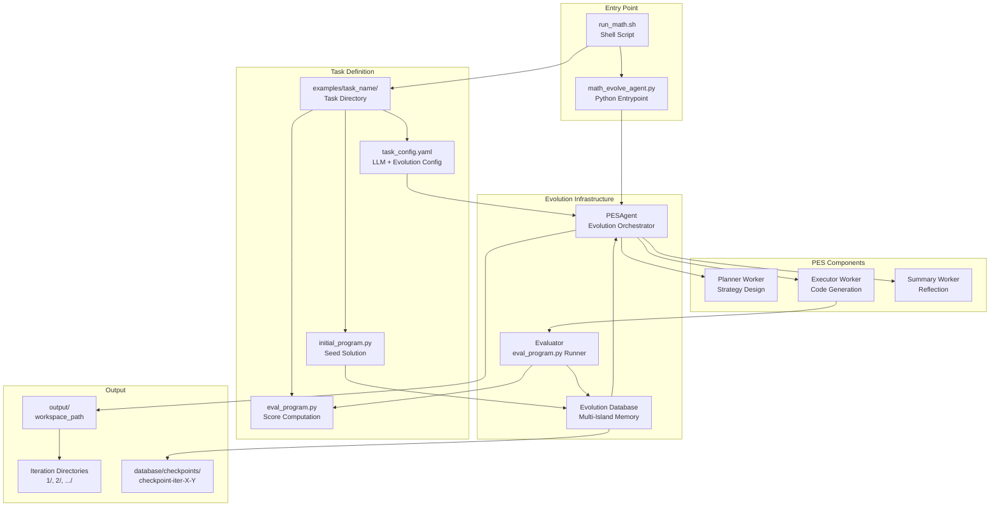
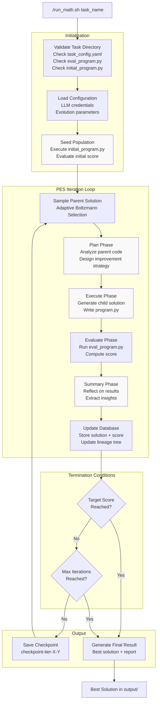
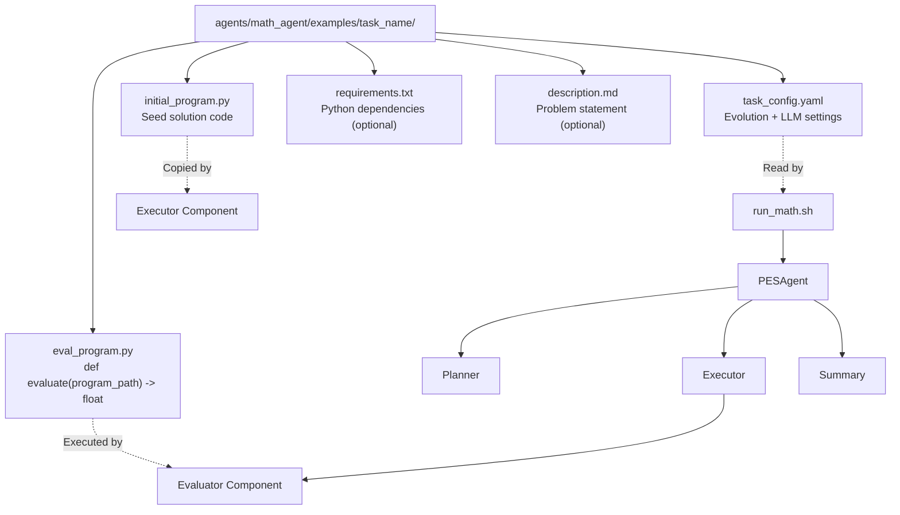

<!-- source: DeepWiki mcp.deepwiki.com · repo baidu-baige/LoongFlow · page 5 Math Agent · fetched 2026-10-26 -->

# Math Agent

<details>
<summary>Relevant source files</summary>

The following files were used as context for generating this wiki page:

- [README.md](README.md)
- [agents/ml_agent/README.md](agents/ml_agent/README.md)

</details>


The **Math Agent** is a specialized implementation of the LoongFlow framework designed for solving mathematical optimization problems through iterative code evolution. It focuses on numerical optimization challenges such as geometry problems, packing algorithms, and computational inequalities.

This page provides an introduction to Math Agent's purpose, architecture, and capabilities. For detailed implementation guides, see:
- **Configuration details**: [Configuration Guide](#5.2)
- **Task file structure**: [Task Structure & Files](#5.3)
- **Execution instructions**: [Running Math Tasks](#5.4)
- **Benchmark results**: [Examples & Results](#5.5)

For the general PES framework that Math Agent builds upon, see [PES Paradigm](#3.1) and [PESAgent Architecture](#3.2).

---

## Purpose and Scope

Math Agent targets **computational optimization problems** where:
- Solutions are expressed as executable Python programs
- Quality is measured by a numerical objective function (minimize or maximize)
- Iterative refinement can discover better algorithmic approaches
- Domain expertise can be encoded as evaluation logic

**Typical use cases include:**
- Circle packing and geometric optimization
- Combinatorial search problems
- Numerical inequality verification
- Algorithm parameter tuning

Math Agent differs from [General Agent](#4) in its focus on numerical optimization rather than software development tasks, and from [ML Agent](#6) in solving mathematical challenges rather than machine learning competitions.

**Sources:** [README.md:62-73](), [README.md:378-432]()

---

## Architecture Overview

Math Agent inherits the PES framework and integrates it with mathematical problem-solving workflows:



**Key architectural components:**

| Component | Purpose | Code Reference |
|-----------|---------|----------------|
| `run_math.sh` | Shell script for task execution and process management | [run_math.sh]() |
| `math_evolve_agent.py` | Python entrypoint that instantiates PESAgent | [agents/math_agent/math_evolve_agent.py]() |
| `task_config.yaml` | Configures LLM settings and evolution parameters | [agents/math_agent/examples/*/task_config.yaml]() |
| `eval_program.py` | Evaluates solutions and returns numerical scores | [agents/math_agent/examples/*/eval_program.py]() |
| `initial_program.py` | Provides seed solution to bootstrap evolution | [agents/math_agent/examples/*/initial_program.py]() |
| `PESAgent` | Orchestrates Plan-Execute-Summary cycles | [src/loongflow/framework/pes/]() |
| Evolution Database | Stores population using Multi-Island + MAP-Elites | See [Evolutionary Memory System](#3.4) |

**Sources:** [README.md:216-236](), [agents/math_agent/]()

---

## Execution Workflow

The following diagram illustrates how a Math Agent task progresses from initialization through iterative evolution:



**Workflow stages:**

1. **Initialization**: Validates task structure, loads configuration, evaluates `initial_program.py` to seed the population
2. **PES Iteration**: Cycles through Plan → Execute → Summary phases, generating and evaluating new solutions
3. **Selection & Memory**: Uses Adaptive Boltzmann selection to sample parents, stores results in Multi-Island populations
4. **Termination**: Stops when target score is reached or max iterations exceeded
5. **Output**: Saves best solution and generates evolution report

**Sources:** [README.md:216-236](), [Diagram 2 in system overview]()

---

## Unique Features for Mathematical Problems

Math Agent includes several capabilities specifically designed for optimization challenges:

### Initial Solution Seeding

Unlike General and ML Agents, Math Agent **requires** an `initial_program.py` file that provides a starting solution. This addresses the cold-start problem in mathematical optimization where random code generation is unlikely to produce valid solutions.

```
agents/math_agent/examples/packing_circle_in_unit_square/
├── initial_program.py      # Seed solution (required for Math Agent)
├── eval_program.py         # Scoring function
└── task_config.yaml        # Configuration
```

The initial program establishes:
- Valid problem structure and constraints
- Baseline algorithmic approach
- Expected output format

**Sources:** [README.md:219](), [agents/math_agent/examples/*/initial_program.py]()

### Numerical Evaluation

Math Agent's `eval_program.py` returns **numerical scores** representing solution quality:

| Problem Type | Score Interpretation | Example |
|--------------|---------------------|---------|
| Maximization | Higher is better | Circle packing density: 2.6359 |
| Minimization | Lower is better | Minimum overlap: 0.3809 |
| Bounded | 0.0 to 1.0 normalized | Classification accuracy |

The evaluation function is executed in isolation to ensure:
- Deterministic scoring
- No cross-contamination between iterations
- Reproducible benchmarks

**Sources:** [README.md:378-432]()

### Evolution-Friendly Configuration

Math Agent tasks typically use:
- **Higher temperature models** (0.7-0.9) for creative exploration
- **Reasoning models** (gemini-3-pro-preview, deepseek-r1) for mathematical insight
- **Longer iteration limits** (50-100) to discover non-obvious optimizations
- **Multiple islands** (2-3) to explore diverse algorithmic strategies

**Sources:** [README.md:218-225]()

---

## Performance Highlights

Math Agent has achieved **state-of-the-art results** on established mathematical benchmarks:

### Terence Tao's Challenge Set

Math Agent **outperformed previous best results on 11 problems** and **surpassed AlphaEvolve on 7 problems**:

| Problem | Metric | Previous Best | AlphaEvolve | Math Agent | Improvement |
|---------|--------|---------------|-------------|------------|-------------|
| Circle packing (square) | Density ↑ | 2.634 | 2.6358 | **2.6360** | New SOTA |
| Circle packing (rectangle) | Density ↑ | 2.364 | 2.3658 | **2.3658** | Tied SOTA |
| Hexagon packing | Score ↓ | 3.943 | 3.9301 | **3.9289** | New SOTA |
| Max-min ratios | Ratio ↓ | 12.89 | 12.8893 | **12.8892** | New SOTA |
| Minimum overlap | Overlap ↓ | 0.380927 | 0.380924 | **0.380914** | New SOTA |
| Uncertainty inequality | Bound ↓ | 0.3523 | 0.3521 | **0.3521** | Tied SOTA |
| 2nd autocorrelation | Bound ↑ | 0.88922 | 0.8963 | **0.9027** | New SOTA |

The complete benchmark includes 11 problems spanning:
- **Geometric packing**: Circle and hexagon arrangements
- **Combinatorial optimization**: Max-min ratio problems
- **Numerical inequalities**: Autocorrelation and uncertainty bounds

**Sources:** [README.md:378-432]()

### Key Success Factors

1. **PES Thinking**: Structured planning enables discovery of novel algorithmic approaches
2. **Multi-Island Memory**: Preserves diverse strategies (greedy, randomized, hybrid)
3. **Long-Range Reasoning**: Global evolution tree allows learning from distant ancestors
4. **Iterative Refinement**: Continuous evaluation drives convergence to optimal solutions

**Sources:** [README.md:142-151]()

---

## Quick Start Example

Run the circle packing optimization problem (reproduces SOTA result):

```bash
# 1. Configure LLM credentials
export ANTHROPIC_API_KEY="your-api-key"
export ANTHROPIC_BASE_URL="your-endpoint"

# Or edit task_config.yaml:
vim agents/math_agent/examples/packing_circle_in_unit_square/task_config.yaml

# 2. Install dependencies
uv pip install -r agents/math_agent/examples/packing_circle_in_unit_square/requirements.txt

# 3. Run evolution (20-30 minutes, ~$10 with Gemini)
./run_math.sh packing_circle_in_unit_square --background

# 4. Monitor progress
tail -f agents/math_agent/examples/packing_circle_in_unit_square/run.log

# 5. Stop if needed
./run_math.sh stop packing_circle_in_unit_square
```

**Expected output structure:**
```
output/
└── packing_circle_in_unit_square-<uuid>/
    ├── 1/, 2/, .../              # Iteration directories
    ├── database/
    │   └── checkpoints/          # checkpoint-iter-X-Y files
    └── best_solution/
        └── program.py            # Final optimized solution
```

**Sources:** [README.md:216-236]()

---

## Task Configuration at a Glance

Math Agent tasks are configured via `task_config.yaml`:

```yaml
# LLM Configuration (required)
llm_config:
  url: "https://your-endpoint/v1"
  api_key: "your-key"
  model: "openai/gemini-3-pro-preview"
  temperature: 0.8
  
# Evolution Parameters
evolve:
  max_iterations: 100
  target_score: 2.64        # Problem-specific
  concurrency: 1
  
  database:
    num_islands: 3          # Multiple populations
    population_size: 30
    sampling_weight_power: 2.0
    checkpoint_interval: 5
```

Key parameters:
- **model**: Recommended models are `gemini-3-pro-preview` or `deepseek-r1-250528` for mathematical reasoning
- **target_score**: Problem-specific objective (set based on known bounds or desired improvement)
- **num_islands**: 2-3 for diverse exploration strategies
- **sampling_weight_power**: 2.0 creates strong bias toward high-scoring solutions

For complete configuration reference, see [Configuration Guide](#5.2).

**Sources:** [README.md:218-225]()

---

## File Structure Reference

Every Math Agent task requires this structure:



**Required files:**
- `task_config.yaml`: LLM credentials and evolution settings
- `eval_program.py`: Computes numerical score from solution
- `initial_program.py`: Provides seed solution

**Optional files:**
- `requirements.txt`: Python packages needed for evaluation
- `description.md`: Human-readable problem statement

For detailed file format specifications, see [Task Structure & Files](#5.3).

**Sources:** [README.md:219](), [agents/math_agent/examples/*/]()

---

## Comparison with Other Agents

| Aspect | Math Agent | General Agent | ML Agent |
|--------|------------|---------------|----------|
| **Problem Domain** | Mathematical optimization | Software development | Machine learning pipelines |
| **Evaluation** | Numerical score (float) | Custom verification logic | Competition metrics |
| **Initial Solution** | Required (`initial_program.py`) | Not required | Not required |
| **Typical Runtime** | 20-30 min per task | 5-30 min per task | Hours to days |
| **LLM Recommendation** | Reasoning models (Gemini, DeepSeek) | General models (GPT-4, Claude) | High-context models |
| **Output** | Optimized algorithm | Working application | Trained model + predictions |
| **Success Metric** | SOTA benchmark scores | Functional requirements met | Competition ranking |

**Sources:** [README.md:45-88](), [README.md:378-432]()

---

## Next Steps

**To get started with Math Agent:**

1. **Configure your environment**: See [Configuration Guide](#5.2) for LLM setup
2. **Understand task structure**: Read [Task Structure & Files](#5.3) to create custom problems  
3. **Run your first task**: Follow [Running Math Tasks](#5.4) for execution instructions
4. **Study examples**: Explore [Examples & Results](#5.5) for real benchmark problems

**For framework internals:**
- [PES Paradigm](#3.1): Understanding the Plan-Execute-Summary cycle
- [PESAgent Architecture](#3.2): How evolution is orchestrated
- [Evolutionary Memory System](#3.4): Multi-Island and MAP-Elites mechanisms

**For creating custom agents:**
- [Building Custom Agents](#7): Extend LoongFlow for new domains
- [Custom PES Components](#7.2): Implement custom Planner/Executor/Summary workers

**Sources:** [Table of contents structure]()

---

