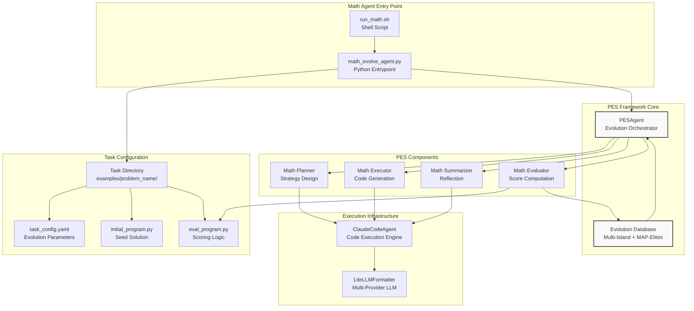
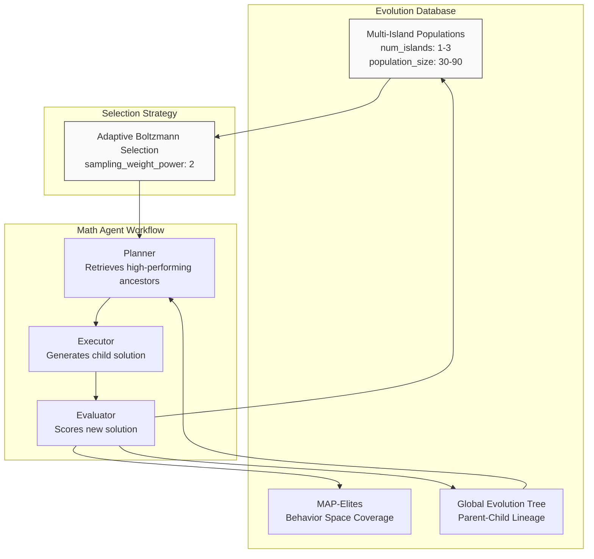

<!-- source: DeepWiki mcp.deepwiki.com · repo baidu-baige/LoongFlow · page 5.1 Math Agent Overview · fetched 2026-10-26 -->

# Math Agent Overview

<details>
<summary>Relevant source files</summary>

The following files were used as context for generating this wiki page:

- [README.md](README.md)
- [agents/ml_agent/README.md](agents/ml_agent/README.md)

</details>


## Purpose and Scope

This page provides an architectural overview of the **Math Agent**, one of three specialized agents in the LoongFlow framework designed for mathematical optimization problems. Math Agent applies the PES (Plan-Execute-Summary) paradigm to iteratively evolve algorithmic solutions for geometry, algebra, and optimization challenges.

**Related Documentation:**
- For configuration details, see [Configuration Guide](#5.2)
- For task setup and file structure, see [Task Structure & Files](#5.3)
- For execution instructions, see [Running Math Tasks](#5.4)
- For example problems and results, see [Examples & Results](#5.5)
- For comparison with General Agent, see [General Agent Overview](#4.1)

---

## Capabilities and Characteristics

Math Agent specializes in **algorithmic optimization problems** where:
- Solutions are expressed as Python programs
- Evaluation is deterministic and numerical
- The objective is to maximize or minimize a quantifiable metric
- Iterative refinement can discover non-obvious algorithmic improvements

**Key Characteristics:**

| Aspect | Description |
|--------|-------------|
| **Domain** | Geometry, algebra, optimization, algorithmic challenges |
| **Solution Type** | Python code implementing mathematical algorithms |
| **Evaluation** | Custom `eval_program.py` runs solution code and returns numerical score |
| **Initialization** | Requires `initial_program.py` to seed the evolution process |
| **Performance** | Achieved SOTA on Terence Tao challenges, surpassing AlphaEvolve on 7/11 problems |
| **Stability** | Efficient, stable convergence due to PES-guided search |

**Notable Achievements:**

| Problem Category | Result |
|-----------------|--------|
| Circle packing in square | **2.6359829624734026** (SOTA, surpassed 2.634) |
| Circle packing in rectangle | **2.365832229500823** (SOTA, surpassed 2.364) |
| Packing hexagons in hexagons | **3.928906855463712** (SOTA, surpassed 3.943) |
| Second autocorrelation inequality | **0.9027021077220739** (SOTA, surpassed 0.88922) |

Sources: [README.md:146-149](), [README.md:380-392]()

---

## Architecture Overview

Math Agent is built on the LoongFlow PES framework, implementing specialized workers for mathematical problem-solving. The architecture follows the same three-phase cycle as other agents but with domain-specific adaptations.

### Component Stack



**Math Agent Execution Stack**

Sources: [README.md:62-73](), [README.md:217-235]()

---

## PES Workflow for Math Problems

The Math Agent follows a structured three-phase evolution cycle, with each phase tailored to mathematical optimization:

```mermaid
graph TB
    subgraph "Iteration N"
        Start["Start Iteration N"]
        SampleParent["Sample Parent Solution<br/>from Evolution Database<br/>(Adaptive Boltzmann Selection)"]
        
        subgraph "Plan Phase"
            AnalyzeParent["Analyze Parent Code<br/>Identify Strengths/Weaknesses"]
            RetrieveExp["Retrieve Similar Past<br/>Experiences from Memory"]
            DesignStrategy["Design Improvement Strategy<br/>Mathematical Insights"]
            PlanOutput["Output: best_plan.md"]
        end
        
        subgraph "Execute Phase"
            GenCode["Generate Child Solution<br/>Python Code"]
            Verify["Verify Syntax<br/>Run Unit Tests"]
            SaveCode["Save to work_dir/"]
            EvalCode["Run eval_program.py<br/>Compute Score"]
            EvalOutput["Output: Score (0.0-1.0+)"]
        end
        
        subgraph "Summary Phase"
            Reflect["Reflect on Outcome<br/>Compare Parent vs Child"]
            ExtractInsights["Extract Reusable Insights<br/>What Worked? What Failed?"]
            UpdateMemory["Update Evolution Database<br/>Store Child + Lineage"]
            SummaryOutput["Output: summary.md"]
        end
        
        CheckConvergence{"Target Score<br/>Reached?"}
        NextIteration["Iteration N+1"]
        Done["Evolution Complete"]
    end
    
    Start --> SampleParent
    SampleParent --> AnalyzeParent
    AnalyzeParent --> RetrieveExp
    RetrieveExp --> DesignStrategy
    DesignStrategy --> PlanOutput
    
    PlanOutput --> GenCode
    GenCode --> Verify
    Verify --> SaveCode
    SaveCode --> EvalCode
    EvalCode --> EvalOutput
    
    EvalOutput --> Reflect
    Reflect --> ExtractInsights
    ExtractInsights --> UpdateMemory
    UpdateMemory --> SummaryOutput
    
    SummaryOutput --> CheckConvergence
    CheckConvergence -->|No| NextIteration
    CheckConvergence -->|Yes| Done
    
    NextIteration --> SampleParent
    
    style PlanOutput fill:#f9f9f9,stroke:#333,stroke-width:1px
    style EvalOutput fill:#f9f9f9,stroke:#333,stroke-width:1px
    style SummaryOutput fill:#f9f9f9,stroke:#333,stroke-width:1px
```



**Math Agent PES Evolution Cycle**

### Phase-Specific Behaviors

| Phase | Math Agent Behavior | Output Artifact |
|-------|---------------------|-----------------|
| **Plan** | Analyzes parent solution code, retrieves relevant mathematical insights from memory, designs targeted improvement strategy | `planner/best_plan.md` |
| **Execute** | Generates new Python code implementing the strategy, runs `eval_program.py` to compute numerical score | `executor/work_dir/solution.py`<br/>`executor/evaluator_dir/score.json` |
| **Summary** | Reflects on score delta, extracts generalizable insights about algorithm design, updates evolution tree | `summary/summary.md` |

Sources: [README.md:299-339]()

---

## Task Structure Requirements

Math Agent requires a specific directory structure for each problem:

```
examples/problem_name/
├── task_config.yaml          # Evolution parameters, LLM config
├── initial_program.py        # Seed solution (REQUIRED for Math Agent)
├── eval_program.py           # Scoring logic
└── requirements.txt          # Python dependencies (optional)
```

**Unique to Math Agent:**

The `initial_program.py` file is **mandatory** for Math Agent (unlike General Agent which can start from scratch). This file provides:
- A working baseline solution
- Correct output format and interface
- Initial algorithm to evolve from

**Example `initial_program.py` structure:**

```python
# Circle packing example
def compute_score():
    # Initial naive algorithm
    # Returns a numerical result
    return score

if __name__ == "__main__":
    result = compute_score()
    print(result)
```

The `eval_program.py` must implement deterministic evaluation:

```python
def evaluate(program_path):
    # Run the program
    # Parse output
    # Compute score (higher or lower is better)
    return score
```

Sources: Task directory structure inferred from [README.md:217-235]()

---

## Performance Benchmarks

Math Agent has demonstrated **state-of-the-art performance** on mathematical optimization challenges, outperforming both human experts and prior AI systems.

### Terence Tao & AlphaEvolve Challenge Set

| Problem | Previous Best | AlphaEvolve | **LoongFlow** | Improvement |
|---------|---------------|-------------|---------------|-------------|
| Circle packing in square (↑) | 2.634 | 2.6358627564 | **2.6359829625** | ✅ New SOTA |
| Circle packing in rectangle (↑) | 2.364 | 2.3658321334 | **2.3658322295** | ✅ New SOTA |
| Packing hexagons in hexagons (↓) | 3.943 | 3.930092 | **3.9289068555** | ✅ New SOTA |
| Max to min ratios (↓) | 12.89 | 12.8892661120 | **12.8892435472** | ✅ New SOTA |
| Minimum overlap problem (↓) | 0.380927 | 0.380924 | **0.3809137564** | ✅ New SOTA |
| Second autocorrelation (↑) | 0.88922 | 0.8962799442 | **0.9027021077** | ✅ New SOTA |
| Uncertainty inequality (↓) | 0.3523 | 0.3520991044 | **0.3520991044** | ≈ Tied SOTA |

**Legend:** (↑) = higher is better, (↓) = lower is better

**Summary:**
- **11 of 11 problems:** Outperformed previous best known results
- **7 of 11 problems:** Surpassed AlphaEvolve's specialized evolutionary approach
- **Cost efficiency:** ~$10 per problem using Gemini 3 Pro

Sources: [README.md:380-392](), [README.md:504-508]()

---

## Comparison with Other Agents

| Aspect | General Agent | **Math Agent** | ML Agent |
|--------|---------------|----------------|----------|
| **Primary Use Case** | General programming tasks | Mathematical optimization | Machine learning pipelines |
| **Solution Format** | Application code, tools | Algorithmic Python code | ML training scripts |
| **Evaluation** | Tool-based or custom logic | Deterministic numerical score | Competition metrics |
| **Initial Seed** | Optional (can start empty) | **Required** (`initial_program.py`) | Optional |
| **Iteration Time** | 5-30 minutes | 20-60 minutes | 30+ minutes (training required) |
| **Convergence** | Variable (skill-dependent) | Stable, monotonic | Variable (data-dependent) |
| **Skills System** | ✅ Extensively used | ❌ Not used | ❌ Not used |

**When to Use Math Agent:**

✅ **Use Math Agent when:**
- Problem has a **clear numerical objective** (maximize/minimize)
- Solutions are **deterministic algorithms** in Python
- You can provide a **working initial solution**
- Evaluation is **fast** (< 5 seconds per run)

❌ **Don't use Math Agent when:**
- Problem requires external tools or APIs (use General Agent)
- Solutions involve ML model training (use ML Agent)
- Evaluation is non-deterministic or subjective
- No initial solution exists (use General Agent to bootstrap)

Sources: Comparison inferred from [README.md:45-88]()

---

## Execution Model

Math Agent operates through the `run_math.sh` shell script and `math_evolve_agent.py` Python entry point:

### Command-Line Interface

```bash
# Run in foreground (blocks terminal)
./run_math.sh problem_name

# Run in background (recommended for long tasks)
./run_math.sh problem_name --background

# Monitor progress
tail -f ./agents/math_agent/examples/problem_name/run.log

# Stop background task
./run_math.sh stop problem_name
```

### Workspace Output

Each run creates a workspace directory:

```
output/
└── task-<uuid>/
    ├── 1/                      # Iteration 1
    │   ├── planner/
    │   │   └── best_plan.md
    │   ├── executor/
    │   │   ├── work_dir/
    │   │   │   └── solution.py
    │   │   └── evaluator_dir/
    │   │       └── score.json
    │   └── summary/
    │       └── summary.md
    ├── 2/                      # Iteration 2
    ├── ...
    └── database/
        └── checkpoints/
            └── checkpoint-iter-X-Y
```

Sources: [README.md:217-235]()

---

## Evolution Database Integration

Math Agent leverages LoongFlow's Multi-Structure Fusion Memory:



**Memory Integration for Math Problems**

The database configuration in `task_config.yaml`:

```yaml
database:
  storage_type: "in_memory"
  num_islands: 3              # Multiple populations for diversity
  population_size: 30         # Solutions per island
  checkpoint_interval: 5      # Save every 5 iterations
  sampling_weight_power: 2    # Quadratic bias toward high scores
```

**Selection Bias:** With `sampling_weight_power: 2`, a solution scoring 0.8 is **4× more likely** to be sampled as a parent than one scoring 0.4, ensuring exploitation of good solutions while maintaining exploration.

Sources: Memory system described in [README.md:343-352]()

---

## Summary

Math Agent is LoongFlow's specialized solver for **mathematical optimization problems**, combining:

1. **PES-guided evolution:** Structured planning, execution, and reflection rather than blind mutation
2. **Deterministic evaluation:** Fast, repeatable scoring via custom `eval_program.py`
3. **Algorithmic focus:** Solutions are Python implementations of mathematical algorithms
4. **SOTA performance:** Demonstrated superiority on geometry and algebra benchmarks

**Next Steps:**
- [Configuration Guide](#5.2): Learn how to configure Math Agent for your problem
- [Task Structure & Files](#5.3): Understand required files and formats
- [Running Math Tasks](#5.4): Execute Math Agent tasks
- [Examples & Results](#5.5): Explore solved problems and analysis

Sources: Overview synthesized from [README.md:1-585](), [agents/ml_agent/README.md:1-189]()

---

