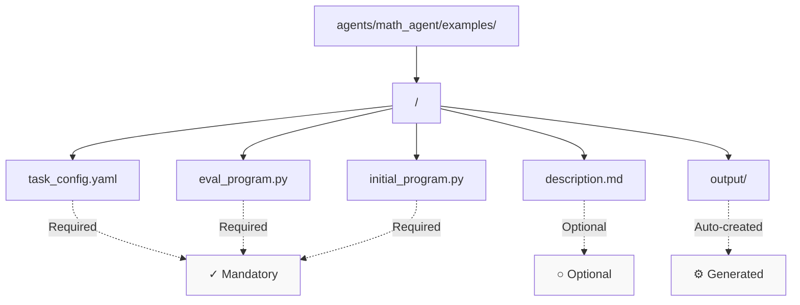
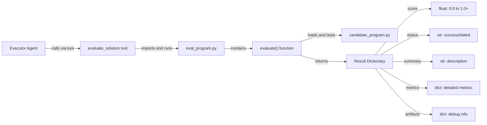
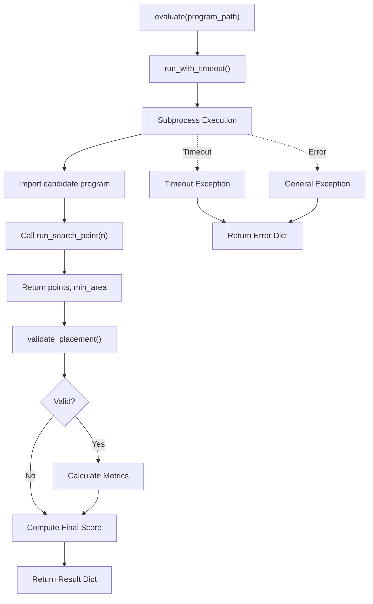
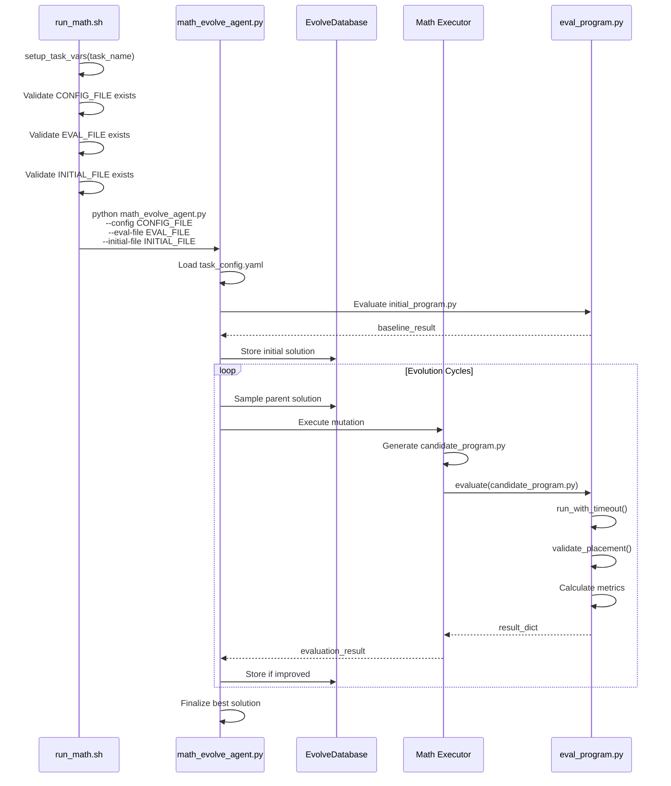
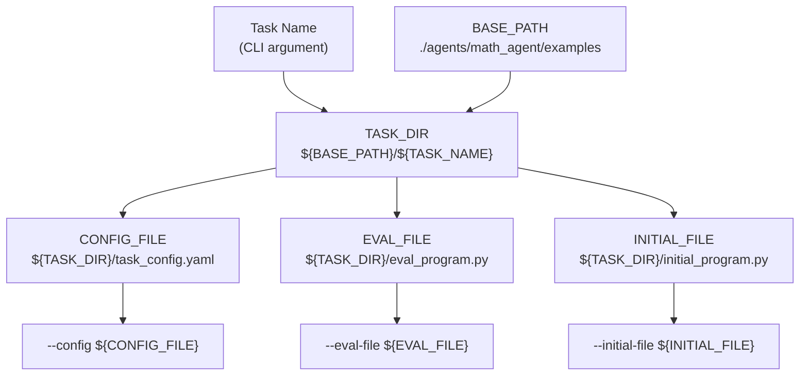

<!-- source: DeepWiki mcp.deepwiki.com · repo baidu-baige/LoongFlow · page 5.3 Task Structure & Files · fetched 2026-10-26 -->

# Task Structure & Files

<details>
<summary>Relevant source files</summary>

The following files were used as context for generating this wiki page:

- [run_general.sh](run_general.sh)
- [run_math.sh](run_math.sh)

</details>


This page describes the required file structure and file specifications for Math Agent tasks. It covers the directory layout, mandatory files, file formats, and conventions that must be followed when creating a new Math Agent task.

For information on configuring task parameters and LLM settings, see [Configuration Guide](#5.2). For details on running tasks using `run_math.sh`, see [Running Math Tasks](#5.4).

---

## Task Directory Structure

Each Math Agent task is organized in a dedicated directory under `agents/math_agent/examples/`. The directory name serves as the task identifier and must contain all required files for task execution.



**Sources:** [run_math.sh:20-33]()

---

## File Validation in run_math.sh

The `run_math.sh` script performs file validation before executing the agent. It checks for the existence of all mandatory files and reports errors if any are missing.

| File | Path Pattern | Validated By | Required |
|------|--------------|--------------|----------|
| `task_config.yaml` | `${TASK_DIR}/task_config.yaml` | [run_math.sh:137-142]() | Yes |
| `eval_program.py` | `${TASK_DIR}/eval_program.py` | [run_math.sh:137-142]() | Yes |
| `initial_program.py` | `${TASK_DIR}/initial_program.py` | [run_math.sh:137-142]() | Yes |

**Variable Definitions:**

```bash
setup_task_vars() {
  TASK_NAME="$1"
  BASE_PATH="./agents/math_agent/examples"
  MAIN_SCRIPT="agents/math_agent/math_evolve_agent.py"
  TASK_DIR="${BASE_PATH}/${TASK_NAME}"
  CONFIG_FILE="${TASK_DIR}/task_config.yaml"
  EVAL_FILE="${TASK_DIR}/eval_program.py"
  INITIAL_FILE="${TASK_DIR}/initial_program.py"
  PID_FILE="${TASK_DIR}/.run.pid"
}
```

**Sources:** [run_math.sh:20-33](), [run_math.sh:133-142]()

---

## Required Files

### task_config.yaml

The `task_config.yaml` file defines task parameters, evolution settings, and LLM configuration. This file is passed to the agent via the `--config` argument [run_math.sh:161]().

**Purpose:**
- Specifies task metadata (name, description)
- Configures evolution parameters (iterations, population size, selection strategy)
- Defines LLM settings for Plan, Execute, and Summarize phases
- Sets output directories and checkpoint intervals

**Usage in Execution:**
```bash
python agents/math_agent/math_evolve_agent.py \
  --config ${CONFIG_FILE} \
  --eval-file ${EVAL_FILE} \
  --initial-file ${INITIAL_FILE}
```

For detailed configuration options and schema, see [Configuration Guide](#5.2).

**Sources:** [run_math.sh:27](), [run_math.sh:159-165]()

---

### eval_program.py

The `eval_program.py` file contains the evaluation function that scores candidate solutions generated during evolution. This file must implement a standardized interface that the executor can call.

#### Evaluation Function Interface



#### Standard Return Format

The `evaluate()` function must return a dictionary with the following structure:

```python
{
  "score": float,          # Primary metric (0.0 to 1.0+ range typical)
  "status": str,           # "success", "validation_failed", "execution_failed"
  "summary": str,          # Human-readable description
  "metrics": {             # Problem-specific metrics
    "metric_1": float,
    "metric_2": float,
    "eval_time": float     # Execution time in seconds
  },
  "artifacts": {           # Debugging and diagnostic information
    "validation_report": str,
    "execution_time": str,
    "stderr": str,         # Error messages if failed
    "failure_stage": str   # Where the failure occurred
  }
}
```

**Sources:** [agents/math_agent/examples/heilbronn_problem_for_convex_regions/eval_program.py:154-278]()

#### Example: Heilbronn Problem Evaluator

The Heilbronn problem evaluator demonstrates the standard pattern:

**Structure:**
1. **Constants** [eval_program.py:16-20](): Define problem parameters (`N_POINTS`, `TARGET_VALUE`, `TIMEOUT_SECONDS`)
2. **Validation Functions** [eval_program.py:29-82](): `validate_placement()`, `min_triangle_area()`
3. **Execution Wrapper** [eval_program.py:84-152](): `run_with_timeout()` runs candidate in isolated subprocess
4. **Main Evaluator** [eval_program.py:154-278](): `evaluate()` orchestrates validation and scoring
5. **CLI Entry Point** [eval_program.py:280-286](): Allows standalone testing

**Execution Flow:**



**Key Features:**

- **Timeout Protection** [eval_program.py:84-152](): Prevents infinite loops via subprocess with timeout
- **Shape Validation** [eval_program.py:168-188](): Ensures output has expected dimensions
- **Geometric Validation** [eval_program.py:190-209](): Problem-specific constraints (points in unit square, non-collinear)
- **Independent Metric Calculation** [eval_program.py:195](): Evaluator independently computes metrics, not trusting candidate output
- **Graceful Failure Handling** [eval_program.py:241-277](): Returns structured error information with zero score

**Sources:** [agents/math_agent/examples/heilbronn_problem_for_convex_regions/eval_program.py:1-286]()

---

### initial_program.py

The `initial_program.py` file provides the starting point for evolutionary search. It contains a baseline implementation that the agent will iteratively improve.

**Purpose:**
- Serves as the first solution in the evolutionary database
- Provides a working example of the expected interface
- Establishes baseline performance metrics

**Requirements:**
1. Must implement the same interface expected by `eval_program.py`
2. Should produce valid (though potentially suboptimal) output
3. Must be executable without errors when evaluated

**Usage in Execution:**

The initial program is passed as an argument to the agent script:

```bash
python agents/math_agent/math_evolve_agent.py \
  --config ${CONFIG_FILE} \
  --eval-file ${EVAL_FILE} \
  --initial-file ${INITIAL_FILE}
```

The agent loads this file, evaluates it to get the baseline score, and stores it as the first solution in the evolutionary database. Subsequent iterations mutate and improve upon this and other solutions.

**Sources:** [run_math.sh:29](), [run_math.sh:163]()

---

### description.md (Optional)

The `description.md` file provides human-readable documentation about the task. While not strictly required by the execution system, it is recommended for task documentation and understanding.

**Typical Contents:**
- Problem statement and mathematical formulation
- Constraints and objectives
- Expected output format
- References to related work or papers
- Example solutions or benchmarks

This file is not processed by the agent system but serves as documentation for developers and researchers working with the task.

---

## File Interaction Flow

The following diagram shows how the required files interact during agent execution:



**File Access Patterns:**

| Phase | File Read | File Written | Purpose |
|-------|-----------|--------------|---------|
| Initialization | `task_config.yaml`<br/>`initial_program.py` | - | Load configuration and baseline |
| Evaluation Setup | `eval_program.py` | - | Import evaluator module |
| Evolution Loop | `eval_program.py` | `candidate_program.py` | Generate and test candidates |
| Execution | `candidate_program.py` | `best_evaluation.json` | Run and score solution |
| Checkpoint | - | `checkpoint-iter-X-Y/` | Periodic state saves |

**Sources:** [run_math.sh:159-165](), [agents/math_agent/examples/heilbronn_problem_for_convex_regions/eval_program.py:84-152]()

---

## File Location Resolution

The Math Agent resolves file locations using the following pattern:



**Example Resolution:**
```bash
# Command: ./run_math.sh heilbronn_problem_for_convex_regions
TASK_NAME="heilbronn_problem_for_convex_regions"
BASE_PATH="./agents/math_agent/examples"
TASK_DIR="./agents/math_agent/examples/heilbronn_problem_for_convex_regions"

CONFIG_FILE="./agents/math_agent/examples/heilbronn_problem_for_convex_regions/task_config.yaml"
EVAL_FILE="./agents/math_agent/examples/heilbronn_problem_for_convex_regions/eval_program.py"
INITIAL_FILE="./agents/math_agent/examples/heilbronn_problem_for_convex_regions/initial_program.py"
```

**Sources:** [run_math.sh:20-33](), [run_math.sh:130]()

---

## Common Patterns and Best Practices

### Evaluator Design Patterns

1. **Timeout Protection**: Always run candidate code in a subprocess with timeout [eval_program.py:84-152]()
2. **Independent Validation**: Recompute metrics rather than trusting candidate output [eval_program.py:195]()
3. **Structured Error Reporting**: Return detailed failure information in `artifacts` [eval_program.py:252-257]()
4. **Graceful Degradation**: Return zero score on failure rather than raising exceptions [eval_program.py:244]()

### Initial Program Guidelines

1. **Functional Baseline**: Implement a simple but working solution (e.g., random search, grid placement)
2. **Interface Compliance**: Match exactly the interface expected by evaluator
3. **Documented Parameters**: Include comments explaining tunable parameters
4. **Fast Execution**: Keep runtime reasonable to enable quick baseline evaluation

### File Organization

```
agents/math_agent/examples/
└── heilbronn_problem_for_convex_regions/
    ├── task_config.yaml          # Task configuration
    ├── eval_program.py           # Evaluator implementation
    ├── initial_program.py        # Baseline solution
    ├── description.md            # Problem documentation
    ├── output/                   # Generated during execution
    │   ├── checkpoint-iter-0-0/  # Periodic checkpoints
    │   ├── evolve.db             # Solution database
    │   └── best_solution.py      # Best found solution
    └── .run.pid                  # Process ID (background mode)
```

**Sources:** [run_math.sh:20-33](), [agents/math_agent/examples/heilbronn_problem_for_convex_regions/eval_program.py:1-286]()

---

