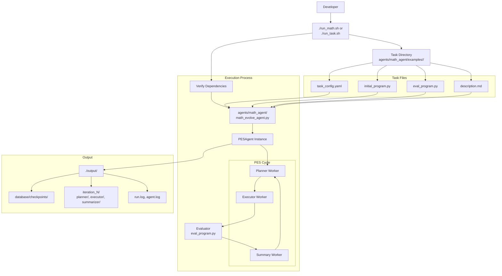
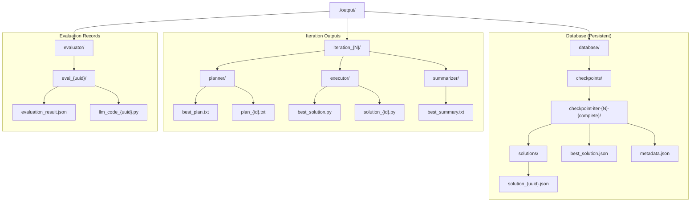
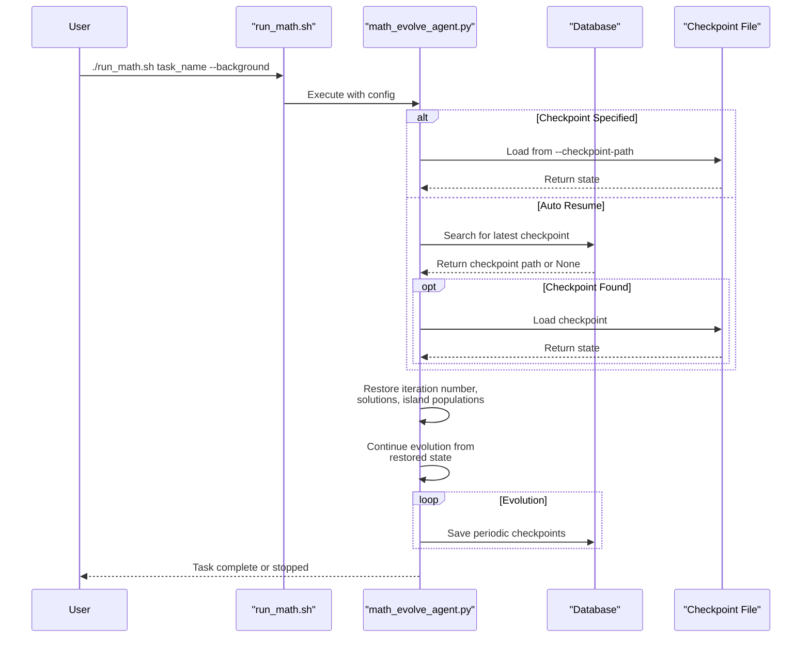

<!-- source: DeepWiki mcp.deepwiki.com · repo baidu-baige/LoongFlow · page 5.4 Running Math Tasks · fetched 2026-10-26 -->

# Running Math Tasks

<details>
<summary>Relevant source files</summary>

The following files were used as context for generating this wiki page:

- [run_general.sh](run_general.sh)
- [run_math.sh](run_math.sh)

</details>


This page provides a step-by-step guide for executing Math Agent tasks, monitoring their progress, managing checkpoints, and handling interruptions. The Math Agent uses the PES paradigm to iteratively evolve solutions to mathematical optimization and algorithm discovery problems.

**Scope**: This page covers the practical execution workflow. For configuration details, see [Configuration Guide](#4.2). For task file structure, see [Task Structure & Files](#4.3). For machine learning tasks, see [Running ML Tasks](#5.3).

---

## Prerequisites

Before running a Math Agent task, ensure you have:

1. **Completed installation** - See [Installation & Setup](#2.1)
2. **Configured your task** - See [Configuration Guide](#4.2)
3. **Prepared task files** - See [Task Structure & Files](#4.3)
4. **Set up LLM credentials** in `task_config.yaml`

---

## Execution Workflow Overview

The following diagram shows the complete execution flow from shell command to final results:



**Sources**: [README.md:157-178](), [docs/en/agents/general_evolve.md:130-170]()

---

## Basic Task Execution

### Starting a Task

Use the `run_math.sh` (or `run_task.sh`) script to start a Math Agent task:

```bash
# Basic syntax
./run_math.sh <task_name> [--background]

# Example: Run circle packing task in foreground
./run_math.sh packing_circle_in_unit_square

# Example: Run in background mode
./run_math.sh packing_circle_in_unit_square --background
```

**Task Name Resolution**: The script looks for tasks in `agents/math_agent/examples/<task_name>/`. Ensure your task directory exists at this location.

**Sources**: [README.md:169-170]()

### Command Line Arguments

The execution script accepts several arguments:

| Argument | Description | Required |
|----------|-------------|----------|
| `<task_name>` | Name of the task directory in `agents/math_agent/examples/` | Yes |
| `--background` | Run task in background mode with log redirection | No |
| `--max-iterations N` | Override max iterations from config | No |
| `--log-level LEVEL` | Set logging level (DEBUG, INFO, WARNING, ERROR) | No |
| `--checkpoint-path PATH` | Resume from specific checkpoint | No |

**Sources**: [docs/en/agents/general_evolve.md:152-160]()

### Example: Complete Startup Sequence

```bash
# 1. Navigate to project root
cd LoongFlow

# 2. Ensure environment is activated
source .venv/bin/activate  # or: conda activate loongflow

# 3. Install task-specific dependencies (if any)
uv pip install -r ./agents/math_agent/examples/packing_circle_in_unit_square/requirements.txt

# 4. Configure LLM in task_config.yaml (edit first!)
# Set url, api_key, model in:
# ./agents/math_agent/examples/packing_circle_in_unit_square/task_config.yaml

# 5. Start the task
./run_math.sh packing_circle_in_unit_square --background

# 6. Verify it's running
ps aux | grep math_evolve_agent
```

**Sources**: [README.md:157-170](), [docs/en/agents/general_evolve.md:136-146]()

---

## Execution Modes

### Foreground Mode

Runs the agent in the current terminal with live output:

```bash
./run_math.sh packing_circle_in_unit_square
```

**Characteristics**:
- Output streams directly to terminal
- Execution blocks until completion or interruption
- Use `Ctrl+C` to stop (may leave incomplete state)
- Best for short debugging runs

**Sources**: [run_ml.sh:288-292]()

### Background Mode

Runs the agent as a daemon process with log file output:

```bash
./run_math.sh packing_circle_in_unit_square --background
```

**Characteristics**:
- Process detaches from terminal
- Output redirected to `run.log` or `agent.log`
- PID stored in `.agent.pid` file for process management
- Survives terminal closure
- Best for long-running evolution tasks

**Process Management Files**:
- PID file: `agents/math_agent/examples/<task_name>/.agent.pid`
- Log file: `agents/math_agent/examples/<task_name>/run.log`

**Sources**: [run_ml.sh:278-287](), [README.md:169-170]()

---

## Monitoring Task Execution

### Real-Time Log Monitoring

Monitor task progress by tailing the log file:

```bash
# Follow log output in real-time
tail -f ./agents/math_agent/examples/packing_circle_in_unit_square/run.log

# Search for specific patterns
grep "Best score" ./agents/math_agent/examples/packing_circle_in_unit_square/run.log

# View last 50 lines
tail -n 50 ./agents/math_agent/examples/packing_circle_in_unit_square/run.log
```

**Log Content Includes**:
- Iteration number and progress
- Current best score and improvements
- LLM API calls and responses
- Evaluation results
- Error messages and warnings
- Checkpoint save notifications

**Sources**: [README.md:172-173](), [run_ml.sh:285-286]()

### Process Status Check

Verify if the task is running:

```bash
# Check if PID file exists
cat ./agents/math_agent/examples/packing_circle_in_unit_square/.agent.pid

# Check if process is alive
ps -p $(cat ./agents/math_agent/examples/packing_circle_in_unit_square/.agent.pid)

# Find all math agent processes
ps aux | grep math_evolve_agent
```

**Sources**: [run_ml.sh:236-243]()

### Visualization Server

Launch the web-based visualization interface to monitor evolution progress interactively:

```bash
python agents/math_agent/visualizer/visualizer.py \
  --port 8888 \
  --checkpoint-path ./output/database/checkpoints
```

Access at `http://localhost:8888` to view:
- **Evolution Tree**: Parent-child solution relationships
- **Score History**: Best and average scores per iteration
- **Code Diffs**: Changes between solution versions
- **Island Map**: Multi-island population distribution

**Sources**: [README.md:395-409](), [docs/en/agents/general_evolve.md:210-235]()

---

## Output Directory Structure

The following diagram maps the output files generated during execution:



**Sources**: [docs/en/agents/general_evolve.md:172-197]()

### Key Output Files

| Path | Description |
|------|-------------|
| `output/database/checkpoints/` | Evolution state snapshots for resumption |
| `output/database/checkpoints/checkpoint-iter-{N}-{complete}/solutions/` | All solution JSON files with scores, code, parent info |
| `output/database/checkpoints/.../best_solution.json` | Current best solution across all islands |
| `output/database/checkpoints/.../metadata.json` | Iteration count, best score, timestamp |
| `output/iteration_{N}/planner/best_plan.txt` | Best execution plan for iteration N |
| `output/iteration_{N}/executor/best_solution.py` | Best code solution for iteration N |
| `output/iteration_{N}/summarizer/best_summary.txt` | Learning insights from iteration N |
| `output/evaluator/eval_{uuid}/evaluation_result.json` | Individual evaluation result with score, status, metrics |

**Sources**: [docs/en/agents/general_evolve.md:172-204]()

---

## Checkpoint System

### Understanding Checkpoints

Checkpoints preserve the complete evolution state and enable resumption after interruptions. Each checkpoint contains:

```json
// metadata.json structure
{
  "iteration": 89,
  "best_score": 2.6359829624734026,
  "timestamp": "2025-01-15T14:32:10",
  "num_solutions": 267,
  "num_islands": 3,
  "convergence_status": "in_progress"
}
```

**Checkpoint Naming**: `checkpoint-iter-{iteration}-{completed_solutions}`

**Sources**: [docs/en/agents/general_evolve.md:179-184]()

### Automatic Checkpoint Saving

Checkpoints are automatically saved at intervals specified in `task_config.yaml`:

```yaml
evolve:
  database:
    checkpoint_interval: 1  # Save every N iterations
```

**Default Behavior**: Checkpoint saved after each iteration (interval=1).

**Manual Checkpoint Trigger**: Checkpoints also save when:
- Target score is reached
- Maximum iterations completed
- Task is stopped via `./run_math.sh stop`

**Sources**: [docs/en/agents/general_evolve.md:72-77]()

---

## Resuming from Interruptions

### Automatic Resumption

If a task is restarted with the same task name, it automatically resumes from the latest checkpoint:

```bash
# Task was interrupted (network error, power loss, etc.)
# Simply re-run the same command
./run_math.sh packing_circle_in_unit_square --background
```

The agent searches for checkpoints in `output/database/checkpoints/` and loads the most recent one.

**Sources**: [docs/en/agents/general_evolve.md:162-170]()

### Manual Checkpoint Selection

Resume from a specific checkpoint:

```bash
# Python script direct execution with checkpoint path
python agents/math_agent/math_evolve_agent.py \
  --config agents/math_agent/examples/packing_circle_in_unit_square/task_config.yaml \
  --checkpoint-path ./output/database/checkpoints/checkpoint-iter-89-267
```

**Use Cases**:
- Revert to earlier checkpoint if later iterations degraded
- Branch evolution from a promising mid-point
- Compare different evolutionary paths

**Sources**: [docs/en/agents/general_evolve.md:165-170]()

### Checkpoint Resume Flow



**Sources**: [docs/en/agents/general_evolve.md:162-170]()

---

## Stopping Tasks

### Graceful Shutdown

Stop a running background task:

```bash
./run_math.sh stop packing_circle_in_unit_square
```

**Shutdown Process**:
1. Sends SIGTERM to main process
2. Waits for current iteration to complete
3. Saves final checkpoint
4. Terminates all child processes
5. Removes PID file
6. Cleans up any orphaned processes

**Timeout**: If processes don't exit after 10 seconds, SIGKILL is sent.

**Sources**: [README.md:175-176](), [run_ml.sh:295-375]()

### Forceful Termination

If graceful shutdown fails:

```bash
# Find and kill the process manually
ps aux | grep math_evolve_agent
kill -9 <PID>

# Clean up PID file
rm ./agents/math_agent/examples/packing_circle_in_unit_square/.agent.pid
```

**Warning**: Forceful termination may result in:
- Incomplete checkpoints
- Corrupted solution files
- Lost progress since last checkpoint

**Sources**: [run_ml.sh:346-359]()

### Foreground Mode Interruption

For foreground tasks, use `Ctrl+C`:

```bash
# Graceful stop (first attempt)
Ctrl+C

# Forceful stop (if hanging)
Ctrl+C (again)
```

**Note**: Foreground mode may not save a checkpoint on interruption. Use background mode for long-running tasks.

**Sources**: [run_ml.sh:288-292]()

---

## Advanced Execution Patterns

### Direct Python Execution

Bypass the shell script for finer control:

```bash
export PYTHONPATH="${PYTHONPATH}:.:./src"

python agents/math_agent/math_evolve_agent.py \
  --config agents/math_agent/examples/packing_circle_in_unit_square/task_config.yaml \
  --initial-file agents/math_agent/examples/packing_circle_in_unit_square/initial_program.py \
  --eval-file agents/math_agent/examples/packing_circle_in_unit_square/eval_program.py \
  --max-iterations 500 \
  --log-level DEBUG
```

**Advantages**:
- Full control over command-line arguments
- Direct debugging without shell script wrapper
- Custom log file locations

**Sources**: [docs/en/agents/general_evolve.md:152-160]()

### Environment Variable Configuration

Override configuration via environment variables:

```bash
export LOONGFLOW_LLM_URL="https://api.openai.com/v1"
export LOONGFLOW_LLM_API_KEY="sk-..."
export LOONGFLOW_LLM_MODEL="gpt-4"

./run_math.sh packing_circle_in_unit_square --background
```

**Note**: Check agent implementation to see which environment variables are supported.

### Multiple Concurrent Tasks

Run multiple tasks in parallel:

```bash
# Start first task
./run_math.sh packing_circle_in_unit_square --background

# Start second task (different task directory)
./run_math.sh heilbronn_problem_for_triangles --background

# Monitor both
tail -f ./agents/math_agent/examples/packing_circle_in_unit_square/run.log &
tail -f ./agents/math_agent/examples/heilbronn_problem_for_triangles/run.log &
```

**Resource Considerations**:
- Each task makes concurrent LLM API calls (specified by `evolve.concurrency` in config)
- Monitor CPU, memory, and API rate limits
- Adjust `evolve.concurrency` if running multiple tasks

**Sources**: [docs/en/agents/general_evolve.md:72-77]()

### Debugging Failed Evaluations

When evaluations fail, examine the evaluation directory:

```bash
# List all evaluation attempts
ls -lt ./output/evaluator/

# View specific evaluation result
cat ./output/evaluator/eval_abc123def/evaluation_result.json

# Check the code that was evaluated
cat ./output/evaluator/eval_abc123def/llm_code_abc123def.py

# Look for Python errors in execution
grep -A 10 "error" ./output/evaluator/eval_abc123def/evaluation_result.json
```

**Common Issues**:
- Syntax errors in generated code
- Timeout exceeded (adjust `evaluator.timeout` in config)
- Import errors (ensure dependencies installed)
- Incorrect evaluation logic in `eval_program.py`

**Sources**: [docs/en/agents/general_evolve.md:194-197]()

---

## Execution Lifecycle Summary

The following table summarizes the complete execution lifecycle:

| Phase | Actions | Key Files |
|-------|---------|-----------|
| **Pre-Execution** | Edit `task_config.yaml`, prepare task files | `task_config.yaml`, `initial_program.py`, `eval_program.py` |
| **Startup** | Run script, validate environment, initialize agent | `run_math.sh`, `.agent.pid` |
| **Iteration Loop** | Plan → Execute → Evaluate → Summary → Checkpoint | `output/iteration_N/*`, `output/database/checkpoints/*` |
| **Monitoring** | Tail logs, view visualization, check PID | `run.log`, `http://localhost:8888` |
| **Interruption** | Save checkpoint, clean up processes | Latest checkpoint in `checkpoints/` |
| **Resumption** | Load checkpoint, restore state, continue | Checkpoint specified or auto-detected |
| **Shutdown** | Stop script, save final checkpoint, cleanup | PID file removed, final checkpoint saved |
| **Post-Execution** | Analyze results, visualize evolution tree | `best_solution.json`, `metadata.json`, visualizer |

**Sources**: [README.md:157-178](), [docs/en/agents/general_evolve.md:130-235]()

---

## Troubleshooting Execution Issues

### Task Won't Start

**Check**:
1. Environment activated: `conda activate loongflow` or `source .venv/bin/activate`
2. Task directory exists: `ls agents/math_agent/examples/<task_name>/`
3. Config file valid: `cat agents/math_agent/examples/<task_name>/task_config.yaml`
4. No conflicting PID file: `rm agents/math_agent/examples/<task_name>/.agent.pid`

**Sources**: [run_ml.sh:234-243]()

### Process Hangs on Startup

**Likely Causes**:
- LLM API unreachable (test with curl)
- Invalid API credentials
- Missing dependencies in task

**Solutions**:
```bash
# Test API connectivity
curl -H "Authorization: Bearer $API_KEY" https://your-llm-api/v1/models

# Check log for errors
tail -f ./agents/math_agent/examples/<task_name>/run.log

# Increase log verbosity
python agents/math_agent/math_evolve_agent.py --log-level DEBUG ...
```

**Sources**: [docs/en/agents/general_evolve.md:247-269]()

### Cannot Stop Task

**Solutions**:
```bash
# Find process ID
ps aux | grep math_evolve_agent

# Force kill
kill -9 <PID>

# Clean up manually
rm agents/math_agent/examples/<task_name>/.agent.pid
pkill -f math_evolve_agent
```

**Sources**: [run_ml.sh:346-365]()

### Checkpoint Not Loading

**Check**:
1. Checkpoint directory exists and has files
2. JSON files are valid (not corrupted)
3. Permissions allow reading checkpoint files

**Manual Verification**:
```bash
# List checkpoints
ls -la ./output/database/checkpoints/

# Validate JSON
python -m json.tool ./output/database/checkpoints/checkpoint-iter-89-267/metadata.json

# Check file permissions
chmod -R u+r ./output/database/checkpoints/
```

**Sources**: [docs/en/agents/general_evolve.md:165-170]()

---

