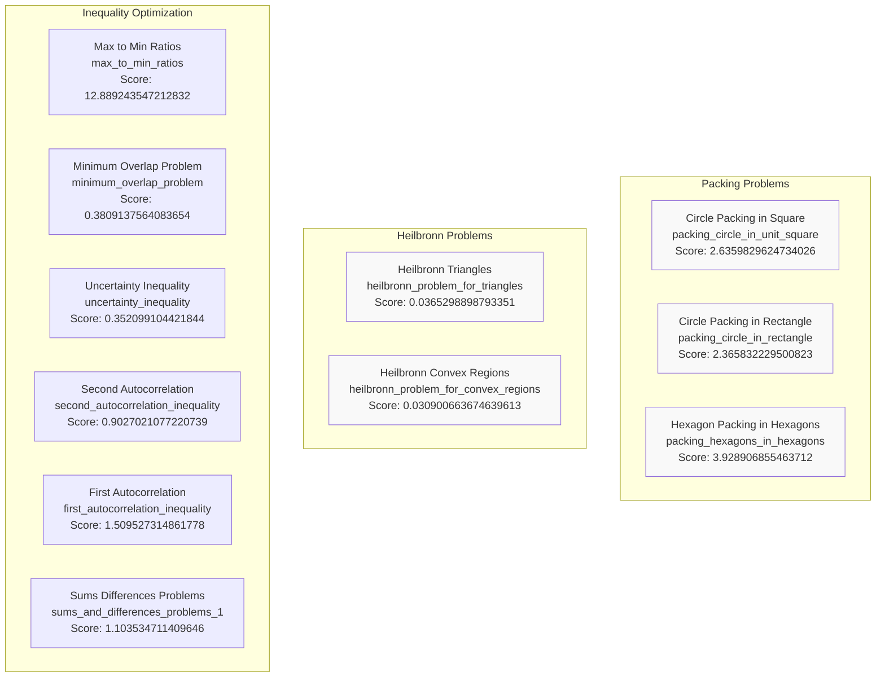
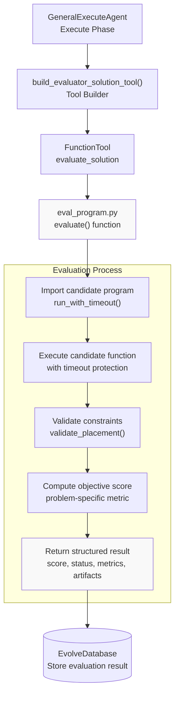
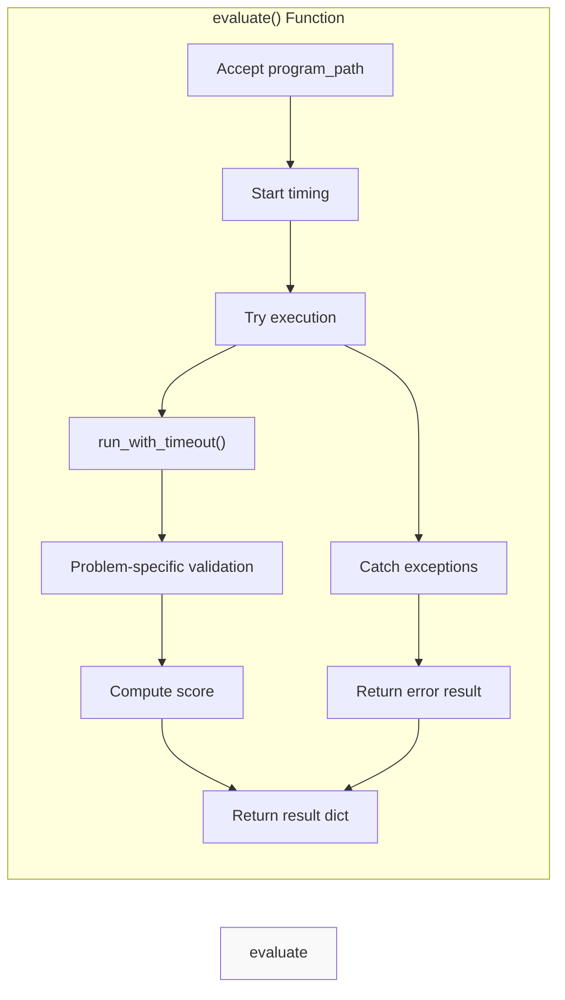
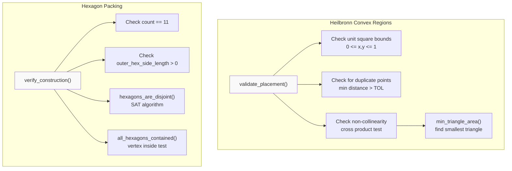
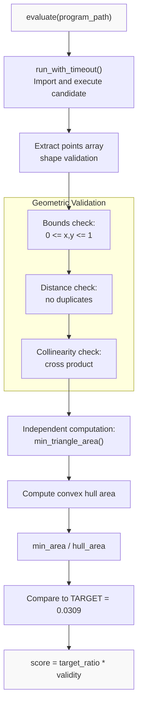
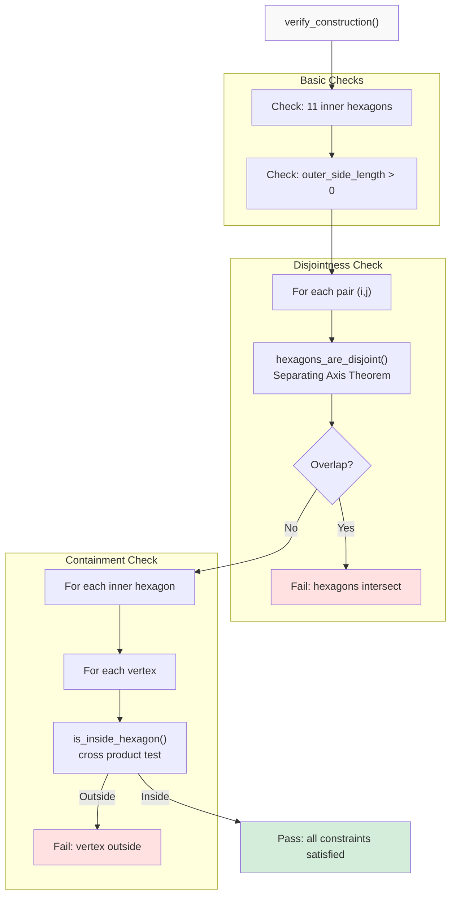
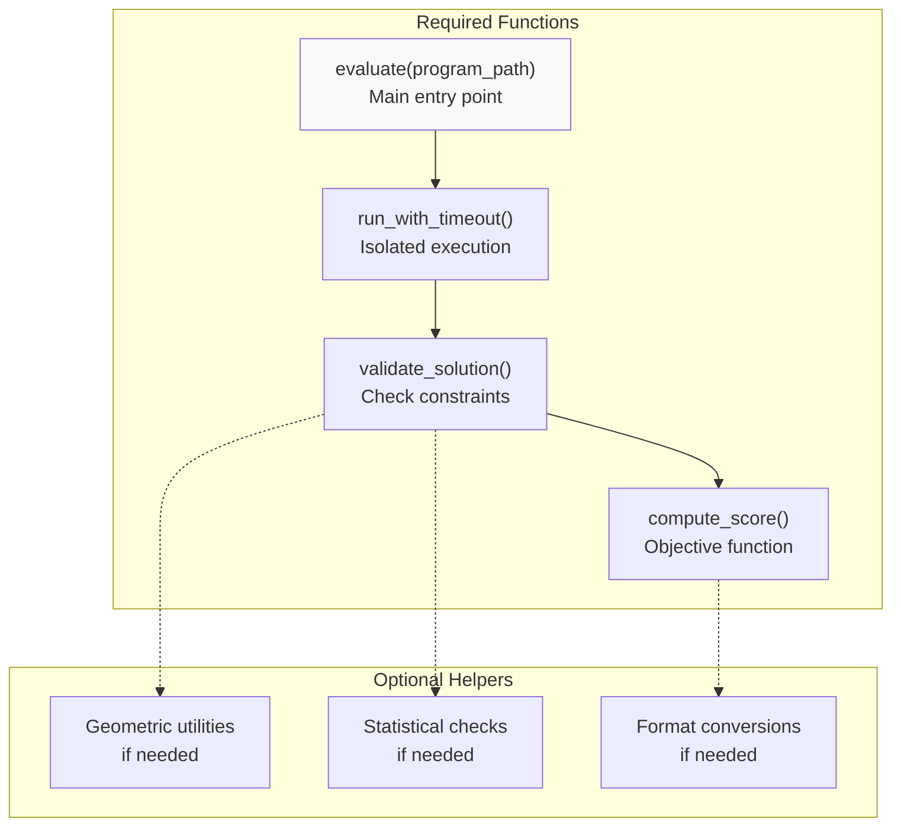
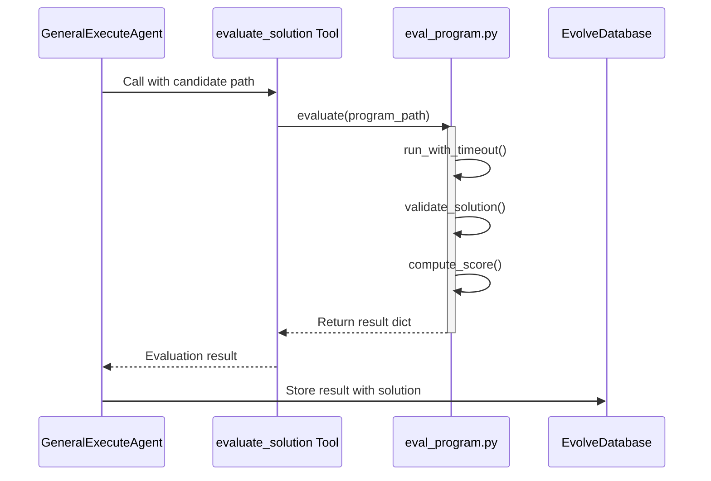

<!-- source: DeepWiki mcp.deepwiki.com · repo baidu-baige/LoongFlow · page 5.5 Examples & Results · fetched 2026-10-26 -->

# Examples & Evaluators

<details>
<summary>Relevant source files</summary>

The following files were used as context for generating this wiki page:

- [README.md](README.md)
- [agents/general_agent/examples/03_bug_hunter/task_config.yaml](agents/general_agent/examples/03_bug_hunter/task_config.yaml)
- [agents/general_agent/examples/04_circle_packing/task_config.yaml](agents/general_agent/examples/04_circle_packing/task_config.yaml)
- [agents/ml_agent/README.md](agents/ml_agent/README.md)

</details>


This page documents the example mathematical optimization problems included with Math Agent and explains the evaluator system that validates and scores candidate solutions. For information about configuring and running Math Agent tasks, see [Configuration Guide](#5.2) and [Running Math Tasks](#5.4). For details about the task file structure, see [Task Structure & Files](#5.3).

## Purpose and Scope

Math Agent includes a collection of challenging mathematical optimization problems that demonstrate the framework's capabilities on state-of-the-art benchmarks. Each problem comes with:

- An evaluation program (`eval_program.py`) that validates solutions and computes scores
- Task configuration (`task_config.yaml`) specifying evolution parameters
- Initial solution (`initial_program.py`) as a starting point
- Problem description (`description.md`) documenting constraints and objectives

This page covers the available example problems, the evaluator architecture, and how evaluators interface with the PES evolution cycle.

**Sources:** [README.md:300-342]()

## Example Problem Catalog

Math Agent includes 11 example problems from the Tao's and AlphaEvolve benchmark sets. These problems span geometric optimization, packing problems, and inequality optimization.

### Problem Categories and Results



**Sources:** [README.md:300-315]()

### Problem Comparison Table

| Problem | Directory | Optimization Goal | LoongFlow Result | Previous Best | AlphaEvolve |
|---------|-----------|-------------------|------------------|---------------|-------------|
| Circle packing (square) | `packing_circle_in_unit_square` | Maximize | **2.6359829624734026** | 2.634 | 2.6358627564136983 |
| Circle packing (rectangle) | `packing_circle_in_rectangle` | Maximize | **2.365832229500823** | 2.364 | 2.3658321334167627 |
| Hexagon packing | `packing_hexagons_in_hexagons` | Minimize | **3.928906855463712** | 3.943 | 3.930092 |
| Max to min ratios | `max_to_min_ratios` | Minimize | **12.889243547212832** | 12.89 | 12.88926611203463 |
| Minimum overlap | `minimum_overlap_problem` | Minimize | **0.3809137564083654** | 0.380927 | 0.380924 |
| Uncertainty inequality | `uncertainty_inequality` | Minimize | **0.352099104421844** | 0.3523 | 0.35209910442252773 |
| Second autocorrelation | `second_autocorrelation_inequality` | Maximize | **0.9027021077220739** | 0.88922 | 0.8962799441554083 |
| Heilbronn triangles | `heilbronn_problem_for_triangles` | Maximize | 0.0365298898793351 | 0.036 | **0.036529889880030156** |
| Heilbronn convex | `heilbronn_problem_for_convex_regions` | Maximize | 0.030900663674639613 | 0.0306 | **0.030936889034895654** |

**Sources:** [README.md:302-314]()

## Evaluator Architecture

Evaluators are standalone Python modules that validate candidate solutions and compute objective scores. They are invoked during the Execute phase of the PES cycle via the `evaluate_solution` tool.

### Evaluator Execution Flow



**Sources:** [agents/math_agent/examples/heilbronn_problem_for_convex_regions/eval_program.py:154-278](), [agents/math_agent/examples/packing_hexagons_in_hexagons/eval_program.py:296-363]()

### Evaluator Result Contract

All evaluators must return a dictionary conforming to this structure:

```python
{
    "score": float,           # Primary optimization metric (higher is better)
    "status": str,           # "success" | "validation_failed" | "execution_failed"
    "summary": str,          # Human-readable description of result
    "metrics": {             # Optional: additional measurements
        "validity": float,
        "eval_time": float,
        ...
    },
    "artifacts": {           # Optional: debugging information
        "stderr": str,
        "traceback": str,
        ...
    }
}
```

**Sources:** [agents/math_agent/examples/heilbronn_problem_for_convex_regions/eval_program.py:227-239](), [agents/math_agent/examples/packing_hexagons_in_hexagons/eval_program.py:336-362]()

## Evaluator Components

### Core Evaluation Function

Every evaluator implements an `evaluate(program_path)` function that serves as the entry point:



**Sources:** [agents/math_agent/examples/heilbronn_problem_for_convex_regions/eval_program.py:154-278]()

### Timeout Protection

Evaluators use `run_with_timeout()` to execute candidate programs with time limits, preventing infinite loops or expensive computations from blocking evolution:

```mermaid
flowchart TD
    RunTimeout["run_with_timeout()"]
    TempScript["Create temporary script<br/>with isolated imports"]
    Subprocess["subprocess.Popen()"]
    Communicate["process.communicate()<br/>timeout parameter"]
    
    subgraph "Outcomes"
        Success["Success: return results"]
        Timeout["TimeoutExpired:<br/>raise TimeoutError"]
        Error["Non-zero exit:<br/>raise RuntimeError"]
    end
    
    ResultFile["Results pickle file<br/>temp_file.results"]
    Deserialize["Unpickle results"]
    
    RunTimeout --> TempScript
    TempScript --> Subprocess
    Subprocess --> Communicate
    
    Communicate --> Success
    Communicate --> Timeout
    Communicate --> Error
    
    Success --> ResultFile
    ResultFile --> Deserialize
    
    style RunTimeout fill:#f9f9f9
    style Timeout fill:#ffe1e1
```



**Sources:** [agents/math_agent/examples/heilbronn_problem_for_convex_regions/eval_program.py:84-152](), [agents/math_agent/examples/packing_hexagons_in_hexagons/eval_program.py:232-294]()

### Validation Logic

Each problem implements domain-specific validation constraints:



**Sources:** [agents/math_agent/examples/heilbronn_problem_for_convex_regions/eval_program.py:29-82](), [agents/math_agent/examples/packing_hexagons_in_hexagons/eval_program.py:152-218]()

## Example: Heilbronn Convex Regions Evaluator

The Heilbronn problem seeks to place N points in a unit square to maximize the minimum triangle area formed by any three points.

### Problem Interface

The candidate program must implement:

```python
def run_search_point(n: int) -> tuple[np.ndarray, float]:
    """
    Returns:
        points: np.ndarray of shape (n, 2) with coordinates
        min_area: float, the minimal triangle area
    """
```

**Sources:** [agents/math_agent/examples/heilbronn_problem_for_convex_regions/eval_program.py:104]()

### Validation Pipeline



**Sources:** [agents/math_agent/examples/heilbronn_problem_for_convex_regions/eval_program.py:154-239]()

### Key Validation Functions

| Function | Purpose | Implementation |
|----------|---------|----------------|
| `validate_placement()` | Check all geometric constraints | [eval_program.py:29-63]() |
| `triangle_area()` | Compute triangle area via cross product | [eval_program.py:66-68]() |
| `min_triangle_area()` | Find minimum over all triangles | [eval_program.py:71-81]() |
| `run_with_timeout()` | Execute with subprocess isolation | [eval_program.py:84-152]() |

**Sources:** [agents/math_agent/examples/heilbronn_problem_for_convex_regions/eval_program.py:1-286]()

### Result Structure

For this problem, the evaluator returns:

```python
{
    "score": float,  # target_ratio * validity (higher is better)
    "status": "success" | "validation_failed" | "execution_failed",
    "summary": str,
    "metrics": {
        "min_area": float,           # Smallest triangle area found
        "min_area_ratio": float,     # min_area / convex_hull_area
        "target_ratio": float,       # min_area_ratio / TARGET_VALUE
        "validity": 1.0 | 0.0,       # Passed geometric validation
        "eval_time": float           # Execution time in seconds
    },
    "artifacts": {
        "execution_time": str,
        "validation_report": str,    # If validation failed
        "failure_stage": str         # Where failure occurred
    }
}
```

**Sources:** [agents/math_agent/examples/heilbronn_problem_for_convex_regions/eval_program.py:227-239]()

## Example: Hexagon Packing Evaluator

This problem asks: what is the smallest regular hexagon that can contain 11 non-overlapping unit regular hexagons?

### Problem Interface

The candidate program must implement:

```python
def optimize_construct() -> tuple:
    """
    Returns:
        inner_hex_data: List of (x, y, angle_degrees) for 11 inner hexagons
        outer_hex_center: (x, y) tuple for outer hexagon center
        outer_hex_side_length: float, side length of outer hexagon
        outer_hex_angle_degrees: float, rotation angle
    """
```

**Sources:** [agents/math_agent/examples/packing_hexagons_in_hexagons/eval_program.py:262-283]()

### Geometric Validation Functions

The evaluator uses the Separating Axis Theorem (SAT) to check hexagon overlap:

| Function | Purpose | Line Reference |
|----------|---------|----------------|
| `hexagon_vertices()` | Generate hexagon vertices from center/side/angle | [eval_program.py:19-43]() |
| `get_normals()` | Compute outward edge normals | [eval_program.py:53-62]() |
| `project_polygon()` | Project polygon onto axis | [eval_program.py:65-76]() |
| `polygons_intersect()` | SAT overlap detection | [eval_program.py:87-101]() |
| `hexagons_are_disjoint()` | Wrapper for two hexagons | [eval_program.py:104-111]() |
| `is_inside_hexagon()` | Point containment test | [eval_program.py:115-136]() |
| `all_hexagons_contained()` | Check all vertices inside outer | [eval_program.py:139-149]() |

**Sources:** [agents/math_agent/examples/packing_hexagons_in_hexagons/eval_program.py:19-149]()

### Validation Logic Flow



**Sources:** [agents/math_agent/examples/packing_hexagons_in_hexagons/eval_program.py:152-218]()

### Score Computation

The score is computed as the ratio of the target value to the achieved outer hexagon side length:

```
score = TARGET / outer_hex_side_length
where TARGET = 3.931 (lower outer_hex_side_length is better)
```

**Sources:** [agents/math_agent/examples/packing_hexagons_in_hexagons/eval_program.py:347]()

## Writing Custom Evaluators

To create a custom evaluator for a new mathematical optimization problem:

### 1. Define the Problem Interface

Specify what function(s) the candidate program must implement:

```python
def your_problem_function(...) -> ReturnType:
    """
    Clear docstring explaining:
    - Input constraints
    - Output format
    - Optimization objective (minimize/maximize)
    """
    pass
```

### 2. Implement Core Functions



### 3. Structure the Evaluation Logic

Follow this pattern in your `evaluate()` function:

```python
def evaluate(program_path):
    start_time = time.time()
    
    try:
        # 1. Execute with timeout protection
        result = run_with_timeout(program_path, timeout_seconds=TIMEOUT)
        eval_time = time.time() - start_time
        
        # 2. Validate constraints
        is_valid, error_msg = validate_solution(result)
        validity = 1.0 if is_valid else 0.0
        
        if not is_valid:
            return {
                "status": "validation_failed",
                "score": 0.0,
                "summary": error_msg,
                "metrics": {"validity": 0.0, "eval_time": eval_time},
                "artifacts": {"reason": error_msg}
            }
        
        # 3. Compute objective score
        score = compute_objective_score(result)
        
        return {
            "status": "success",
            "score": float(score),
            "summary": f"Valid solution with score {score}",
            "metrics": {
                "validity": 1.0,
                "eval_time": eval_time,
                # ... problem-specific metrics
            }
        }
        
    except TimeoutError:
        return {
            "status": "execution_failed",
            "score": 0.0,
            "summary": "Execution timeout",
            "metrics": {"validity": 0.0},
            "artifacts": {"error": "timeout"}
        }
    except Exception as e:
        return {
            "status": "execution_failed",
            "score": 0.0,
            "summary": f"Execution failed: {e}",
            "metrics": {"validity": 0.0},
            "artifacts": {"traceback": traceback.format_exc()}
        }
```

### 4. Constants and Configuration

Define problem-specific constants at the module level:

```python
# Problem parameters
N_POINTS = 13
TARGET_VALUE = 0.0309
TIMEOUT_SECONDS = 1800
TOLERANCE = 1e-6

# Optimization direction
MAXIMIZE = True  # or False for minimization
```

**Sources:** [agents/math_agent/examples/heilbronn_problem_for_convex_regions/eval_program.py:16-20](), [agents/math_agent/examples/packing_hexagons_in_hexagons/eval_program.py:15-16]()

### 5. Test Your Evaluator

Every evaluator should include a `__main__` block for standalone testing:

```python
if __name__ == "__main__":
    file = "initial_program.py"
    res = evaluate(file)
    import json
    print(json.dumps(res, ensure_ascii=False, indent=2))
```

**Sources:** [agents/math_agent/examples/heilbronn_problem_for_convex_regions/eval_program.py:280-285](), [agents/math_agent/examples/packing_hexagons_in_hexagons/eval_program.py:365-367]()

## Evaluator Integration with PES

During the Execute phase, evaluators are invoked via the `evaluate_solution` tool built by `build_evaluator_solution_tool()`:



The evaluation result is stored in the database alongside the candidate solution, enabling:
- Score-based selection for parent sampling
- Performance tracking across generations
- Failure analysis for debugging

**Sources:** [agents/math_agent/examples/heilbronn_problem_for_convex_regions/eval_program.py:154-278](), [agents/math_agent/examples/packing_hexagons_in_hexagons/eval_program.py:296-363]()

---

