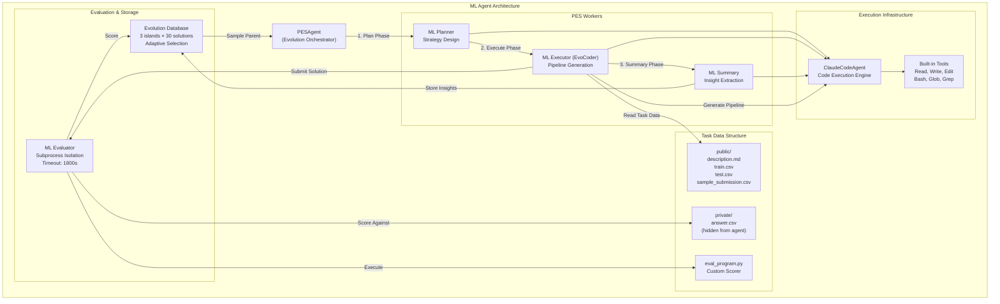
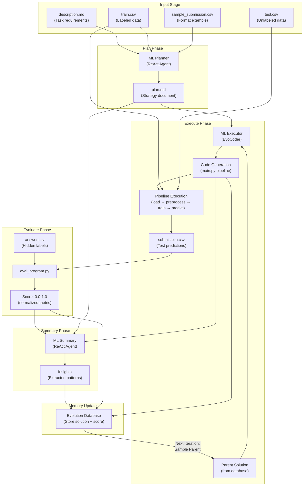
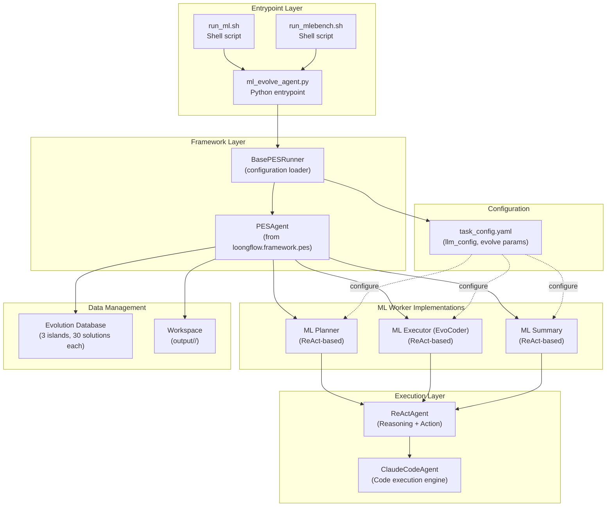

<!-- source: DeepWiki mcp.deepwiki.com · repo baidu-baige/LoongFlow · page 6.1 ML Agent Overview · fetched 2026-10-26 -->

# ML Agent Overview

<details>
<summary>Relevant source files</summary>

The following files were used as context for generating this wiki page:

- [README.md](README.md)
- [agents/ml_agent/README.md](agents/ml_agent/README.md)

</details>


This page provides an overview of the ML Agent: its purpose, architecture, core components, and performance achievements. The ML Agent is one of three specialized agents in LoongFlow, designed specifically for autonomous machine learning pipeline construction and optimization.

For detailed configuration options, see [Configuration Guide](#6.2). For running ML tasks and using the shell scripts, see [Running ML Tasks](#6.3). For MLE-Bench-specific setup and integration, see [MLE-Bench Integration](#6.4).

## Purpose and Scope

The ML Agent is a specialized implementation of LoongFlow's PES paradigm for solving machine learning competition problems. It autonomously constructs, executes, and evolves complete ML pipelines—from data preprocessing and feature engineering to model training and hyperparameter optimization—without human intervention beyond the initial problem specification.

**Key objectives:**
- **Autonomous Pipeline Construction**: Generates end-to-end ML solutions including data loading, preprocessing, feature engineering, model selection, training, and prediction
- **Kaggle-Style Competition Solving**: Targets benchmark competitions from MLE-Bench, optimizing for competition metrics (accuracy, F1, AUC, etc.)
- **Iterative Evolution**: Continuously refines solutions through PES cycles, improving scores over multiple iterations
- **Full-Process Automation**: Handles all aspects of ML development from understanding task descriptions to generating submission files

The ML Agent validates its effectiveness on [MLE-Bench](https://github.com/openai/mle-bench), a benchmark of 48 Kaggle competitions spanning diverse ML domains (computer vision, NLP, tabular data, time series).

**Sources:** [README.md:75-88](), [agents/ml_agent/README.md:1-14]()

## Architecture Overview

The ML Agent implements the PES paradigm through three specialized worker components that operate within the `PESAgent` evolution framework. Each worker is configured for ML-specific challenges such as long code generation, data pipeline construction, and evaluation timeouts.

### ML Agent PES Cycle



**Diagram: ML Agent PES Implementation**

The diagram shows how ML Agent components integrate with the PES framework:

1. **PESAgent** orchestrates the evolution cycle, managing iterations and concurrency
2. **ML Planner** analyzes the task description and designs an ML strategy (model selection, preprocessing approach, feature engineering)
3. **ML Executor (EvoCoder)** generates complete Python pipelines with extended timeout (86400s default) to handle complex data processing
4. **ML Summary** reflects on execution results and extracts reusable ML patterns
5. **ML Evaluator** runs generated pipelines in isolated subprocesses with configurable timeout (1800s default) and scores predictions against hidden ground truth
6. **Evolution Database** maintains population diversity across 3 islands with 30 solutions each

**Sources:** [agents/ml_agent/README.md:89-137](), [README.md:238-262]()

## Core Components

### ML Planner Worker

The ML Planner analyzes competition requirements and designs an ML strategy. It operates as a ReAct agent with access to file reading tools.

**Key responsibilities:**
- Parse `description.md` to understand task type (classification, regression, segmentation, etc.)
- Analyze data schema from training files
- Design preprocessing and feature engineering strategy
- Select candidate model architectures
- Plan validation strategy and evaluation metrics

**Configuration parameters:**
- `react_max_steps: 10` - Maximum ReAct iterations for planning
- `evo_coder_timeout: 3600` - Timeout for code generation during planning (1 hour)

The planner outputs a markdown plan describing the proposed approach, which guides the executor phase.

**Sources:** [agents/ml_agent/README.md:105-108]()

### ML Executor Worker (EvoCoder)

The ML Executor generates and executes complete ML pipelines. It is the most compute-intensive component, with extended timeouts to handle data loading, preprocessing, training, and prediction.

**Key responsibilities:**
- Clone parent solution from database (if continuing from previous iteration)
- Generate Python code implementing the planned strategy
- Execute training pipeline on `train.csv`
- Generate predictions on `test.csv`
- Create submission file in required format
- Handle data transformations, feature engineering, model training, and inference

**Configuration parameters:**
- `react_max_steps: 10` - Maximum ReAct iterations for code generation
- `evo_coder_timeout: 86400` - Timeout for pipeline execution (24 hours) to handle large datasets and complex training

The executor outputs:
- `main.py` or similar Python pipeline script
- `submission.csv` with predictions for test set
- Execution logs and intermediate artifacts

**Sources:** [agents/ml_agent/README.md:110-113]()

### ML Summary Worker

The ML Summary reflects on iteration outcomes and extracts insights for future iterations.

**Key responsibilities:**
- Analyze execution success/failure
- Identify effective preprocessing techniques
- Note successful model architectures and hyperparameters
- Extract reusable patterns (e.g., "tree-based models work well for this tabular data")
- Store insights in evolution database for retrieval in future planning phases

**Configuration parameters:**
- `react_max_steps: 10` - Maximum ReAct iterations for summarization

**Sources:** [agents/ml_agent/README.md:115-117]()

### ML Evaluator

The ML Evaluator scores generated solutions by comparing predictions against hidden ground truth. It executes `eval_program.py` in an isolated subprocess with timeout protection.

**Key responsibilities:**
- Load agent-generated `submission.csv`
- Load ground truth from `private/answer.csv`
- Execute custom scoring logic (accuracy, F1, AUC, RMSE, etc.)
- Return score normalized to 0.0-1.0 range
- Handle timeouts and exceptions gracefully

**Configuration parameters:**
- `timeout: 1800` - Maximum evaluation time (30 minutes) to prevent hanging on large datasets

**Expected `eval_program.py` signature:**
```python
def evaluate(task_data_path, best_code_path, artifacts):
    """
    Args:
        task_data_path: Path to task directory containing private/answer.csv
        best_code_path: Path to generated solution directory
        artifacts: Additional execution artifacts
    
    Returns:
        dict with keys:
            - status: "success" or "failure"
            - summary: Human-readable description
            - score: Float in range 0.0-1.0
            - metrics: Dict of additional metrics
            - artifacts: Dict of additional outputs
    """
```

**Sources:** [agents/ml_agent/README.md:128-130](), [agents/ml_agent/README.md:168-176]()

## Task Data Structure

ML Agent expects a standardized directory structure for each task:

```
task_name/
├── task_config.yaml          # Evolution configuration
├── eval_program.py           # Custom scoring logic
├── public/                   # Visible to agent
│   ├── description.md        # Task requirements
│   ├── train.csv             # Labeled training data
│   ├── test.csv              # Test features only
│   └── sample_submission.csv # Expected output format
└── private/                  # Hidden from agent
    └── answer.csv            # Ground truth for scoring
```

**File purposes:**

| File | Purpose | Visibility |
|------|---------|------------|
| `description.md` | Task description, data schema, evaluation metric, submission format | Agent can read |
| `train.csv` | Labeled training examples | Agent can read |
| `test.csv` | Unlabeled test examples for prediction | Agent can read |
| `sample_submission.csv` | Example submission with correct format | Agent can read |
| `answer.csv` | Ground truth labels for test set | Hidden (evaluator only) |
| `eval_program.py` | Python script computing score from submission | Hidden (evaluator only) |

This structure enables the agent to learn from training data and generate predictions for test data, while the evaluator independently scores predictions against hidden answers.

**Sources:** [agents/ml_agent/README.md:143-184]()

## Workspace and Output Structure

After running a task, ML Agent creates a structured workspace under `output/`:

```
output/
├── <task-uuid>/              # Unique identifier for this run
│   ├── 1/                    # Iteration 1
│   │   ├── planner/
│   │   │   └── plan.md       # Strategy for this iteration
│   │   ├── evocoder/         # (Note: ML Executor is also called EvoCoder)
│   │   │   └── generated_code/
│   │   ├── executor/
│   │   │   ├── work_dir/     # Pipeline execution workspace
│   │   │   └── submission.csv
│   │   └── summary/
│   │       └── summary.md    # Reflection and insights
│   ├── 2/                    # Iteration 2
│   └── ...
├── logs/
│   └── evolux.log            # Runtime logs
├── database/
│   ├── checkpoints/          # Periodic state snapshots
│   └── populations/          # Solution populations per island
└── evaluate/
    └── scores/               # Evaluation results per iteration
```

Each iteration directory contains a complete audit trail of the PES cycle: the plan that was designed, the code that was generated, the execution results, and the insights extracted.

**Sources:** [agents/ml_agent/README.md:70-85]()

## ML Agent Data Flow



**Diagram: ML Agent Data Flow Through PES Cycle**

The diagram illustrates how data flows through a single PES iteration:

1. **Plan Phase**: Planner reads task description, training data schema, and submission format to design strategy
2. **Execute Phase**: Executor clones parent solution (if available), generates new pipeline code, trains on training data, generates predictions on test data
3. **Evaluate Phase**: Evaluator compares predictions to hidden ground truth using custom scoring function
4. **Summary Phase**: Summary analyzes results and extracts reusable insights
5. **Memory Update**: Solution, score, and insights stored in database for future sampling

**Sources:** [agents/ml_agent/README.md:70-85](), [agents/ml_agent/README.md:143-167]()

## Capabilities and Autonomous Features

The ML Agent autonomously handles the full ML development lifecycle without human intervention:

### Data Understanding and Preprocessing
- **Schema Analysis**: Automatically infers data types, missing value patterns, categorical vs. numerical features
- **Data Cleaning**: Handles missing values, outliers, duplicate entries
- **Encoding**: Applies appropriate encoding strategies (one-hot, label, target encoding) for categorical features
- **Normalization**: Scales numerical features when beneficial

### Feature Engineering
- **Domain-Agnostic Features**: Creates polynomial features, interaction terms, statistical aggregates
- **Domain-Specific Features**: For vision tasks, may implement augmentation; for NLP, may create text statistics
- **Feature Selection**: Identifies and removes low-value features

### Model Selection and Training
- **Architecture Selection**: Chooses appropriate model families (tree-based, neural networks, linear models) based on data characteristics
- **Ensemble Methods**: Combines multiple models (stacking, blending, voting)
- **Hyperparameter Tuning**: Adjusts learning rates, regularization, tree depth, etc.
- **Cross-Validation**: Implements k-fold or stratified validation to prevent overfitting

### Iterative Improvement
- **Error Analysis**: Identifies failure modes from previous iterations
- **Strategy Refinement**: Adjusts preprocessing, features, or models based on summary insights
- **Jump-Style Evolution**: Can make large architectural changes when local improvements plateau

**Sources:** [README.md:75-88](), [agents/ml_agent/README.md:1-4]()

## Performance and Results

The ML Agent has been extensively validated on MLE-Bench, a benchmark of 48 Kaggle competitions spanning diverse ML domains.

### MLE-Bench Medal Distribution

| Medal Type | Count | Percentage |
|------------|-------|------------|
| 🥇 Gold    | 26    | 54.2%      |
| 🥈 Silver  | 17    | 35.4%      |
| 🥉 Bronze  | 5     | 10.4%      |
| **Total**  | **48**| **100%**   |

The ML Agent achieved medals on all 48 competitions, with gold medals (top 10% performance) on more than half.

### Competition Domains

The 48 competitions span multiple ML domains:

- **Computer Vision**: Image classification, object detection, segmentation (e.g., aerial-cactus-identification, histopathologic-cancer-detection, vinbigdata-chest-xray-abnormalities-detection)
- **Natural Language Processing**: Text classification, question answering (e.g., detecting-insults-in-social-commentary, chaii-hindi-and-tamil-question-answering, google-quest-challenge)
- **Tabular Data**: Regression, classification on structured data (e.g., tabular-playground-series-dec-2021)
- **Time Series**: Sequential prediction (e.g., predict-volcanic-eruptions-ingv-oe)
- **Multi-Modal**: Mixed data types (e.g., 3d-object-detection-for-autonomous-vehicles)

### Example Gold Medal Competitions

| Competition | Domain | Difficulty | Link |
|-------------|--------|------------|------|
| stanford-covid-vaccine | RNA structure | Hard | [Example](./agents/ml_agent/examples/mlebench/competitions/hard/stanford-covid-vaccine) |
| iwildcam-2019-fgvc6 | Wildlife classification | Hard | [Example](./agents/ml_agent/examples/mlebench/competitions/hard/iwildcam-2019-fgvc6) |
| us-patent-phrase-to-phrase-matching | NLP similarity | Medium | [Example](./agents/ml_agent/examples/mlebench/competitions/medium/us-patent-phrase-to-phrase-matching) |
| dogs-vs-cats-redux-kernels-edition | Image classification | Simple | [Example](./agents/ml_agent/examples/mlebench/competitions/simple/dogs-vs-cats-redux-kernels-edition) |

Full results are available in [agents/ml_agent/examples/mlebench/competitions/]().

**Sources:** [README.md:146-427](), [agents/ml_agent/README.md:8-14]()

## Comparison with Other Agents

The ML Agent shares the PES paradigm with General-Agent and Math-Agent but differs in domain focus and implementation details:

| Aspect | ML Agent | Math Agent | General Agent |
|--------|----------|------------|---------------|
| **Domain** | Machine learning competitions | Mathematical optimization | General programming tasks |
| **Input** | Structured datasets (CSV, images) | Problem description + initial program | Task description + optional skills |
| **Output** | Prediction files (submission.csv) | Optimized numerical results | Working code/applications |
| **Evaluation** | Competition metrics (accuracy, AUC, RMSE) | Objective function value | Custom eval_program.py or simple verification |
| **Executor Timeout** | 86400s (24 hours) - for large dataset training | Variable - depends on optimization | Variable - depends on task complexity |
| **Evaluator Timeout** | 1800s (30 minutes) | Variable | Variable |
| **Key Challenge** | Data pipeline construction + model selection | Algorithm design + numerical optimization | Code correctness + feature implementation |
| **Example Task** | Predicting cancer from histopathology images | Circle packing in unit square | Building a TODO list app |
| **Population Size** | 30 per island | 30 per island | 30 per island |
| **Islands** | 3 | 1-3 | 1-3 |

**Key distinctions:**

1. **ML Agent** focuses on end-to-end ML pipeline construction, requiring long execution timeouts for training on large datasets
2. **Math Agent** focuses on numerical optimization with algorithmic innovation, requiring precise objective function evaluation
3. **General Agent** focuses on general-purpose programming with flexible skill-based customization

All three agents share:
- PES thinking paradigm (Plan → Execute → Summary)
- ClaudeCodeAgent as the underlying execution engine
- Evolution Database with multi-island populations and Adaptive Boltzmann selection
- Checkpoint system for fault tolerance

For Math Agent details, see [Math Agent Overview](#5.1). For General Agent details, see [General Agent Overview](#4.1).

**Sources:** [README.md:41-119](), [agents/ml_agent/README.md:89-137]()

## Component Integration Diagram



**Diagram: ML Agent Component Integration**

This diagram shows how ML Agent components integrate from shell scripts down to the execution engine:

1. **Entrypoint Layer**: Shell scripts (`run_ml.sh`, `run_mlebench.sh`) invoke the Python entrypoint (`ml_evolve_agent.py`)
2. **Framework Layer**: Python entrypoint uses `BasePESRunner` to load configuration and instantiate `PESAgent`
3. **ML Worker Layer**: PESAgent registers ML-specific Planner, Executor, and Summary workers
4. **Execution Layer**: All workers use `ReActAgent` for reasoning loops, which wraps `ClaudeCodeAgent` for code execution
5. **Configuration**: `task_config.yaml` configures LLM settings, timeouts, and evolution parameters
6. **Data Management**: PESAgent manages evolution database (multi-island populations) and workspace (iteration artifacts)

**Sources:** [agents/ml_agent/README.md:27-68](), [agents/ml_agent/README.md:89-137]()

## Next Steps

- **Configuration**: For detailed configuration options and parameter tuning, see [Configuration Guide](#6.2)
- **Running Tasks**: For shell script usage and task execution, see [Running ML Tasks](#6.3)
- **MLE-Bench**: For setting up MLE-Bench competitions, see [MLE-Bench Integration](#6.4)
- **Results**: For detailed competition results and example solutions, see [Examples & Results](#6.5)
- **Custom Tasks**: For creating custom ML tasks beyond MLE-Bench, see [agents/ml_agent/README.md:143-184]()

---

