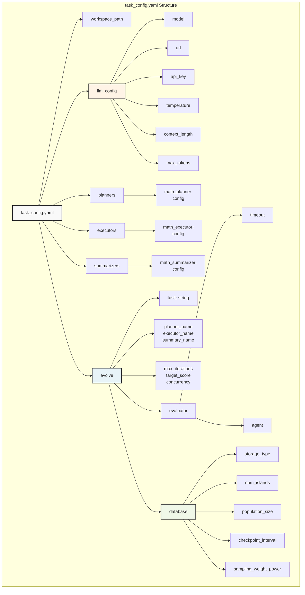
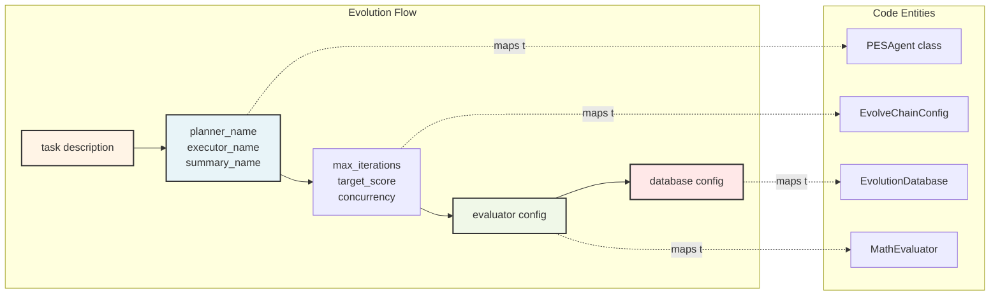
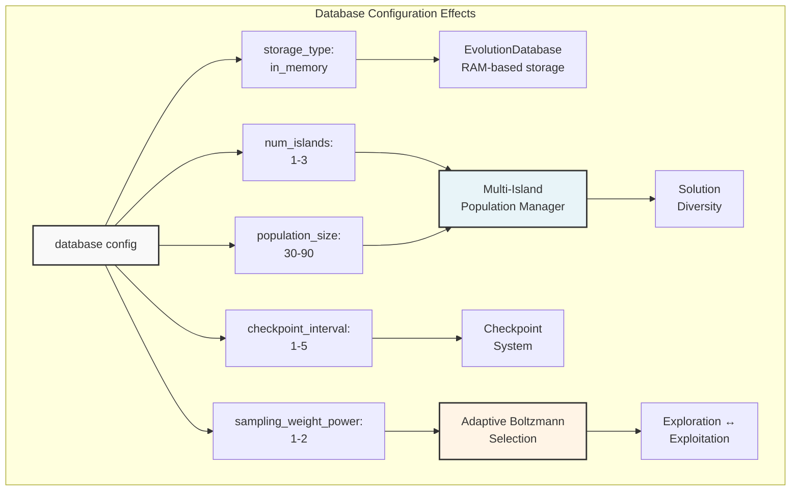
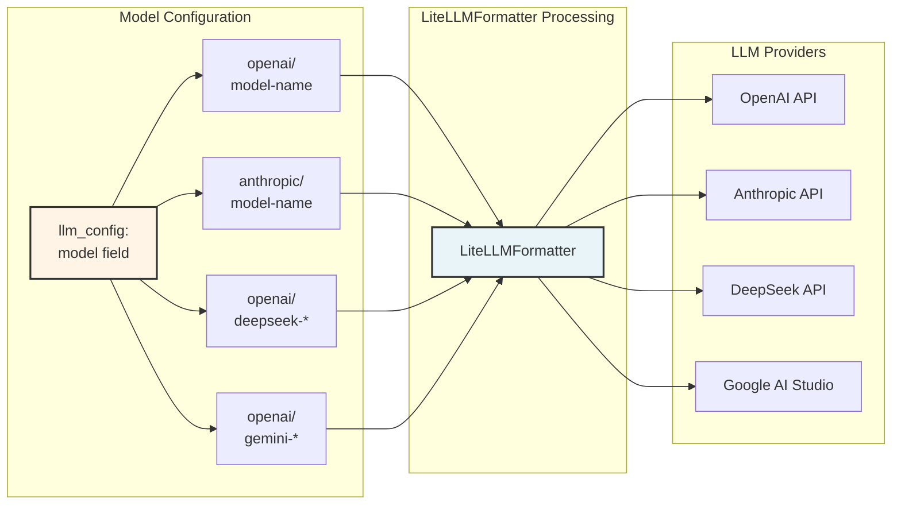
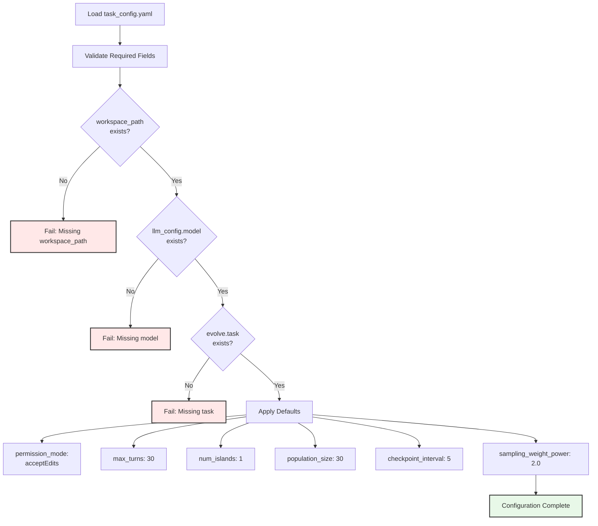

<!-- source: DeepWiki mcp.deepwiki.com · repo baidu-baige/LoongFlow · page 6.2 Configuration Guide · fetched 2026-10-26 -->

# Configuration Guide

<details>
<summary>Relevant source files</summary>

The following files were used as context for generating this wiki page:

- [README.md](README.md)
- [agents/general_agent/examples/03_bug_hunter/task_config.yaml](agents/general_agent/examples/03_bug_hunter/task_config.yaml)
- [agents/general_agent/examples/04_circle_packing/task_config.yaml](agents/general_agent/examples/04_circle_packing/task_config.yaml)
- [agents/ml_agent/README.md](agents/ml_agent/README.md)

</details>


## Purpose and Scope

This document explains how to configure Math Agent tasks through the `task_config.yaml` file. It covers all configuration parameters, their purposes, and recommended values for mathematical optimization problems.

For information about the task directory structure and required files, see [Task Structure & Files](#5.3). For instructions on running configured tasks, see [Running Math Tasks](#5.4).

**Sources:** [README.md:1-237](), [agents/general_agent/examples/04_circle_packing/task_config.yaml:1-109]()

---

## Configuration File Structure

Every Math Agent task requires a `task_config.yaml` file in its directory. This file controls the entire evolution process, from LLM selection to database population management.



**Diagram: task_config.yaml Configuration Hierarchy**

**Sources:** [agents/general_agent/examples/04_circle_packing/task_config.yaml:1-109](), [agents/ml_agent/README.md:89-137]()

---

## Global Configuration

### workspace_path

Specifies the output directory for all evolution artifacts.

```yaml
workspace_path: "./output-circle-packing"
```

The framework creates a UUID-based subdirectory structure within this path:

```
workspace_path/
├── task-<uuid>/
│   ├── 1/                    # Iteration directories
│   ├── 2/
│   └── ...
└── database/
    └── checkpoints/          # Evolution state snapshots
```

**Sources:** [agents/general_agent/examples/04_circle_packing/task_config.yaml:2]()

### llm_config

Global LLM configuration used by all components unless overridden. Math Agent requires high-capability models for mathematical reasoning.

```yaml
llm_config:
  url: "https://api.example.com/v1"
  api_key: "your-api-key"
  model: "openai/gemini-3-pro-preview"
  temperature: 0.8
  context_length: 128000
  max_tokens: 32768
  top_p: 1.0
```

| Field | Type | Description | Recommended Value |
|-------|------|-------------|-------------------|
| `url` | string | API endpoint URL | Provider-specific |
| `api_key` | string | Authentication key | From provider |
| `model` | string | Model identifier with provider prefix | `openai/gemini-3-pro-preview` or `openai/deepseek-r1-250528` |
| `temperature` | float | Sampling randomness (0.0-2.0) | `0.8` for math tasks |
| `context_length` | int | Maximum context window | `128000` (model-dependent) |
| `max_tokens` | int | Maximum output tokens | `32768` |
| `top_p` | float | Nucleus sampling threshold | `1.0` |

**Model Recommendations for Math Agent:**
- **Best performance**: `gemini-3-pro-preview`, `deepseek-r1-250528`
- **Budget option**: `deepseek-v3` (faster, lower cost)
- **Reasoning tasks**: Models with thinking tokens (`deepseek-r1` series)

**Sources:** [README.md:218-225](), [README.md:240-248](), [agents/ml_agent/README.md:94-103]()

---

## Component Configuration

Math Agent uses three types of workers in the PES cycle: Planners, Executors, and Summarizers. Each has its own configuration section.

### Planners Configuration

The `planners` section defines available planner workers. Math Agent typically uses a single planner named `math_planner`.

```yaml
planners:
  math_planner:
    system_prompt: "You are an expert mathematician..."  # Optional
    permission_mode: "acceptEdits"
    max_turns: 50
    max_thinking_tokens: 10000    # For reasoning models
    max_output_tokens: 16000
```

**Configuration Fields:**

| Field | Type | Default | Description |
|-------|------|---------|-------------|
| `system_prompt` | string | Component default | Custom system instructions |
| `permission_mode` | string | `"acceptEdits"` | File operation permission level |
| `max_turns` | int | `30` | Maximum conversation turns |
| `max_thinking_tokens` | int | Model default | Token budget for chain-of-thought (reasoning models) |
| `max_output_tokens` | int | Model default | Token budget for final output |

**Permission Modes:**
- `"acceptEdits"`: Automatically approve file edits (recommended for math tasks)
- `"ask"`: Require human approval for each operation
- `"reject"`: Deny all file operations

**Sources:** [agents/general_agent/examples/04_circle_packing/task_config.yaml:13-24]()

### Executors Configuration

The `executors` section defines executor workers that generate and test solution code.

```yaml
executors:
  math_executor:
    permission_mode: "acceptEdits"
    max_turns: 50
    max_output_tokens: 16000
```

Executors typically use the same configuration structure as planners but may need higher `max_turns` for iterative code development.

**Sources:** [agents/general_agent/examples/04_circle_packing/task_config.yaml:25-36]()

### Summarizers Configuration

The `summarizers` section defines summary workers that extract insights from iterations.

```yaml
summarizers:
  math_summarizer:
    permission_mode: "acceptEdits"
    max_turns: 30
    max_output_tokens: 10000
```

Summarizers typically need fewer turns than executors since they perform analysis rather than generation.

**Sources:** [agents/general_agent/examples/04_circle_packing/task_config.yaml:37-48]()

---

## Evolution Configuration

The `evolve` section is the core configuration controlling the evolution process.



**Diagram: Evolution Configuration to Code Entity Mapping**

**Sources:** [agents/general_agent/examples/04_circle_packing/task_config.yaml:50-108]()

### Task Definition

The `task` field contains the complete problem description visible to all workers.

```yaml
evolve:
  task: |
    Your task is to write a search function to find a way to place num_circles 
    disjoint disks into the unit square [0,1] x [0,1] in such a way that the 
    sum of their radii is as big as possible.
    
    Your program will be evaluated with the command: 
    centers, radii, sum_radii = run_packing(num_circles)
    
    Key geometric insights:
    - Circle packings often follow hexagonal patterns in the densest regions
    - Maximum density for infinite circle packing is pi/(2*sqrt(3)) ≈ 0.9069
    - You have 1000 seconds of runtime
```

**Best Practices:**
- Include clear input/output specifications
- Specify evaluation criteria
- Provide domain-specific insights
- State runtime or resource constraints
- Include validation requirements

**Sources:** [agents/general_agent/examples/04_circle_packing/task_config.yaml:54-76]()

### Component Selection

Map component names to the configured workers:

```yaml
evolve:
  planner_name: "math_planner"
  executor_name: "math_executor"
  summary_name: "math_summarizer"
```

These names must match keys in the `planners`, `executors`, and `summarizers` sections.

**Sources:** [agents/general_agent/examples/04_circle_packing/task_config.yaml:77-80]()

### Iteration Control Parameters

```yaml
evolve:
  max_iterations: 200
  target_score: 1.0
  concurrency: 1
```

| Parameter | Type | Description | Recommended for Math |
|-----------|------|-------------|---------------------|
| `max_iterations` | int | Maximum evolution cycles | `100-200` for optimization problems |
| `target_score` | float | Stop when this score is reached | `1.0` (normalized score) |
| `concurrency` | int | Parallel evolution chains | `1` (single chain for deterministic results) |

Evolution stops when **either** `max_iterations` is reached **or** `target_score` is achieved.

**Sources:** [agents/general_agent/examples/04_circle_packing/task_config.yaml:82-85]()

### Evaluator Settings

The `evaluator` section configures solution evaluation through `eval_program.py`.

```yaml
evolve:
  evaluator:
    timeout: 1200                # 20 minutes
    agent:
      permission_mode: "acceptEdits"
      max_turns: 50
      max_output_tokens: 10000
```

| Field | Type | Description | Math Agent Recommendation |
|-------|------|-------------|---------------------------|
| `timeout` | int | Evaluation timeout in seconds | `1200-3600` (allow time for optimization) |
| `agent` | dict | Evaluator agent configuration | Similar to executor config |

**Timeout Considerations:**
- Math optimization often requires minutes to hours
- Circle packing: ~1200s (20 min)
- Geometry problems: ~1800s (30 min)
- Complex optimization: ~3600s (1 hour)

**Sources:** [agents/general_agent/examples/04_circle_packing/task_config.yaml:87-99]()

### Database Settings

The `database` section controls evolutionary memory and population management.

```yaml
evolve:
  database:
    storage_type: "in_memory"
    num_islands: 1
    population_size: 30
    checkpoint_interval: 5
    sampling_weight_power: 2
```



**Diagram: Database Configuration Impact on Evolution**

**Configuration Fields:**

| Field | Type | Values | Description |
|-------|------|--------|-------------|
| `storage_type` | string | `"in_memory"` | Storage backend (only in-memory currently supported) |
| `num_islands` | int | `1-3` | Number of isolated populations |
| `population_size` | int | `30-90` | Solutions per island |
| `checkpoint_interval` | int | `1-5` | Iterations between checkpoints |
| `sampling_weight_power` | float | `1.0-2.0` | Exponential bias toward high scores |

**Multi-Island Strategy:**

| Islands | Population Size | Total Solutions | Best For |
|---------|----------------|-----------------|----------|
| 1 | 90 | 90 | Fast convergence, focused search |
| 2 | 45 | 90 | Balanced exploration/exploitation |
| 3 | 30 | 90 | Maximum diversity, complex landscapes |

**Sampling Weight Power:**

The `sampling_weight_power` parameter controls parent selection bias using Adaptive Boltzmann selection:

$$P(solution_i) \propto score_i^{power}$$

| Value | Behavior | Use Case |
|-------|----------|----------|
| `1.0` | Linear preference | Broad exploration, early iterations |
| `1.5` | Moderate exploitation | Balanced search |
| `2.0` | Strong exploitation | Refining solutions, late iterations |

With `sampling_weight_power: 2`, a solution with score 0.8 is **4× more likely** to be selected than one with score 0.4.

**Sources:** [agents/general_agent/examples/04_circle_packing/task_config.yaml:100-108]()

---

## LLM Provider Configuration

Math Agent supports multiple LLM providers through the LiteLLM abstraction layer. The `model` field uses provider prefixes to route requests.



**Diagram: LLM Provider Routing via Model Prefix**

### Supported Providers

| Provider | Model Prefix | Example Model | Configuration |
|----------|--------------|---------------|---------------|
| OpenAI | `openai/` | `openai/gpt-4` | Set `url` to OpenAI endpoint |
| Anthropic | `anthropic/` | `anthropic/claude-3-opus` | Set `url` to Anthropic endpoint |
| DeepSeek | `openai/` | `openai/deepseek-r1-250528` | Set `url` to DeepSeek endpoint |
| Google | `openai/` | `openai/gemini-3-pro-preview` | Set `url` to Google AI Studio endpoint |
| Azure OpenAI | `azure/` | `azure/gpt-4` | Set `url` to Azure endpoint |

### Provider-Specific Configuration

#### OpenAI-Compatible Providers

```yaml
llm_config:
  url: "https://api.openai.com/v1"
  api_key: "sk-..."
  model: "openai/gpt-4"
```

#### DeepSeek (Reasoning Models)

```yaml
llm_config:
  url: "https://api.deepseek.com/v1"
  api_key: "sk-..."
  model: "openai/deepseek-r1-250528"
  max_thinking_tokens: 10000  # Enable chain-of-thought
```

DeepSeek reasoning models support a `reasoning_content` field for chain-of-thought reasoning, automatically handled by `LiteLLMFormatter`.

#### Google AI Studio

```yaml
llm_config:
  url: "https://generativelanguage.googleapis.com/v1beta"
  api_key: "AIza..."
  model: "openai/gemini-3-pro-preview"
  context_length: 128000
```

**Sources:** [README.md:218-225](), [README.md:240-248]()

---

## Configuration Examples

### Minimal Configuration

Fastest setup for testing Math Agent:

```yaml
workspace_path: "./output"

llm_config:
  model: "anthropic/deepseek-v3"

planners:
  math_planner: {}

executors:
  math_executor: {}

summarizers:
  math_summarizer: {}

evolve:
  task: "Your math problem description here"
  planner_name: "math_planner"
  executor_name: "math_executor"
  summary_name: "math_summarizer"
  max_iterations: 50
  target_score: 1.0
  concurrency: 1
  
  evaluator:
    timeout: 1200
  
  database:
    storage_type: "in_memory"
    num_islands: 1
    population_size: 30
    checkpoint_interval: 5
    sampling_weight_power: 2
```

**Sources:** [agents/general_agent/examples/04_circle_packing/task_config.yaml:1-109]()

### Production Configuration

Full configuration for serious optimization work:

```yaml
workspace_path: "./output-production"

llm_config:
  url: "https://api.deepseek.com/v1"
  api_key: "${DEEPSEEK_API_KEY}"
  model: "openai/deepseek-r1-250528"
  temperature: 0.8
  context_length: 128000
  max_tokens: 32768
  top_p: 1.0

planners:
  math_planner:
    permission_mode: "acceptEdits"
    max_turns: 50
    max_thinking_tokens: 10000
    max_output_tokens: 16000

executors:
  math_executor:
    permission_mode: "acceptEdits"
    max_turns: 100
    max_thinking_tokens: 10000
    max_output_tokens: 16000

summarizers:
  math_summarizer:
    permission_mode: "acceptEdits"
    max_turns: 30
    max_output_tokens: 10000

evolve:
  task: |
    [Detailed problem specification with domain insights]
  
  planner_name: "math_planner"
  executor_name: "math_executor"
  summary_name: "math_summarizer"
  
  max_iterations: 200
  target_score: 1.0
  concurrency: 1
  
  evaluator:
    timeout: 3600
    agent:
      permission_mode: "acceptEdits"
      max_turns: 50
      max_output_tokens: 10000
  
  database:
    storage_type: "in_memory"
    num_islands: 3
    population_size: 30
    checkpoint_interval: 5
    sampling_weight_power: 2
```

**Sources:** [agents/ml_agent/README.md:89-137]()

### Multi-Island Configuration

Maximize diversity for complex optimization landscapes:

```yaml
evolve:
  database:
    storage_type: "in_memory"
    num_islands: 3           # Three isolated populations
    population_size: 30      # 30 solutions per island = 90 total
    checkpoint_interval: 1   # Checkpoint every iteration
    sampling_weight_power: 1.5  # Moderate exploitation
```

**Trade-offs:**
- **More islands**: Greater diversity, slower convergence, better escape from local optima
- **Fewer islands**: Faster convergence, less exploration, may get stuck
- **Checkpoint interval**: Lower = more fault tolerance, higher = less I/O overhead

**Sources:** [agents/general_agent/examples/04_circle_packing/task_config.yaml:100-108]()

---

## Configuration Reference

### Complete Field Reference

| Section | Field Path | Type | Required | Default | Description |
|---------|-----------|------|----------|---------|-------------|
| Global | `workspace_path` | string | Yes | - | Output directory path |
| Global | `llm_config.url` | string | No* | - | API endpoint URL |
| Global | `llm_config.api_key` | string | No* | - | API authentication key |
| Global | `llm_config.model` | string | Yes | - | Model identifier with provider prefix |
| Global | `llm_config.temperature` | float | No | 0.8 | Sampling temperature (0.0-2.0) |
| Global | `llm_config.context_length` | int | No | Model default | Maximum context window |
| Global | `llm_config.max_tokens` | int | No | Model default | Maximum output tokens |
| Global | `llm_config.top_p` | float | No | 1.0 | Nucleus sampling threshold |
| Component | `planners.<name>.system_prompt` | string | No | Component default | Custom system instructions |
| Component | `planners.<name>.permission_mode` | string | No | `"acceptEdits"` | File operation permission level |
| Component | `planners.<name>.max_turns` | int | No | 30 | Maximum conversation turns |
| Component | `planners.<name>.max_thinking_tokens` | int | No | Model default | Reasoning token budget |
| Component | `planners.<name>.max_output_tokens` | int | No | Model default | Output token budget |
| Evolution | `evolve.task` | string | Yes | - | Problem description |
| Evolution | `evolve.planner_name` | string | Yes | - | Selected planner name |
| Evolution | `evolve.executor_name` | string | Yes | - | Selected executor name |
| Evolution | `evolve.summary_name` | string | Yes | - | Selected summarizer name |
| Evolution | `evolve.max_iterations` | int | Yes | - | Maximum evolution cycles |
| Evolution | `evolve.target_score` | float | Yes | - | Target score for early stopping |
| Evolution | `evolve.concurrency` | int | No | 1 | Parallel evolution chains |
| Evaluator | `evolve.evaluator.timeout` | int | Yes | - | Evaluation timeout (seconds) |
| Evaluator | `evolve.evaluator.agent.*` | dict | No | Same as executor | Evaluator agent config |
| Database | `evolve.database.storage_type` | string | No | `"in_memory"` | Storage backend type |
| Database | `evolve.database.num_islands` | int | No | 1 | Number of populations |
| Database | `evolve.database.population_size` | int | No | 30 | Solutions per island |
| Database | `evolve.database.checkpoint_interval` | int | No | 5 | Iterations between checkpoints |
| Database | `evolve.database.sampling_weight_power` | float | No | 2.0 | Parent selection bias exponent |

*`url` and `api_key` can be set via environment variables (`ANTHROPIC_API_KEY`, `ANTHROPIC_BASE_URL`, etc.)

**Sources:** [agents/general_agent/examples/04_circle_packing/task_config.yaml:1-109](), [agents/ml_agent/README.md:89-137]()

---

## Environment Variable Overrides

LLM credentials can be set via environment variables instead of in the configuration file:

```bash
# Anthropic (for claude-* models)
export ANTHROPIC_API_KEY="your-key"
export ANTHROPIC_BASE_URL="https://api.anthropic.com"

# OpenAI
export OPENAI_API_KEY="your-key"
export OPENAI_BASE_URL="https://api.openai.com/v1"

# DeepSeek
export OPENAI_API_KEY="your-deepseek-key"
export OPENAI_BASE_URL="https://api.deepseek.com/v1"
```

If both environment variables and `llm_config` fields are present, the configuration file takes precedence.

**Sources:** [README.md:189-192]()

---

## Validation and Defaults

The Math Agent validates configuration at startup and applies defaults:



**Diagram: Configuration Validation and Default Application Flow**

**Sources:** [agents/general_agent/examples/04_circle_packing/task_config.yaml:1-109]()

---

