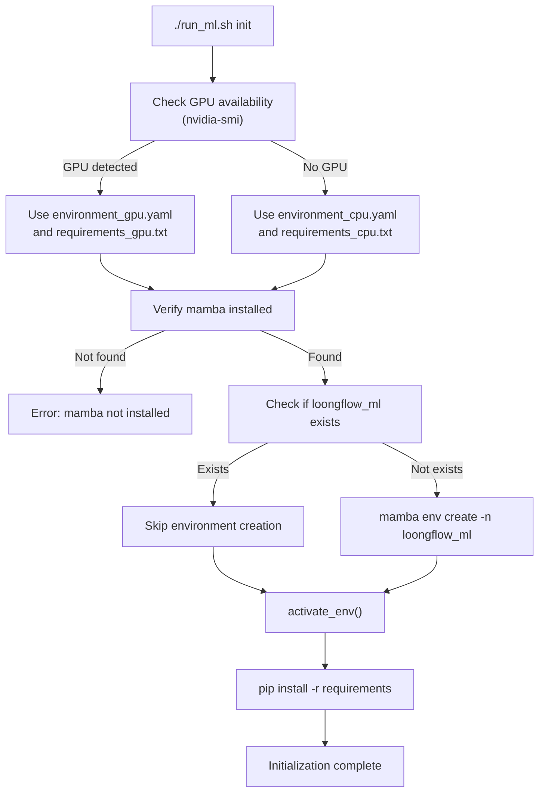
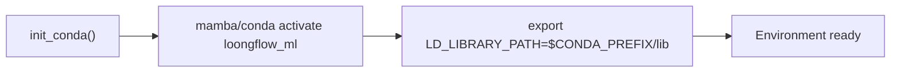
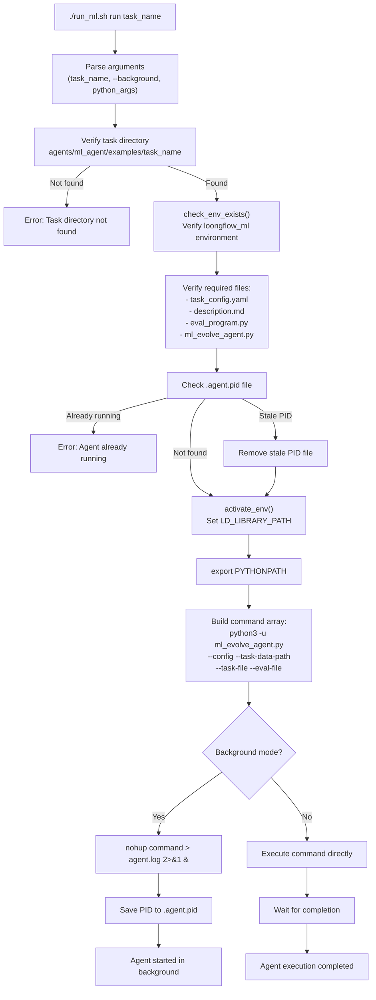
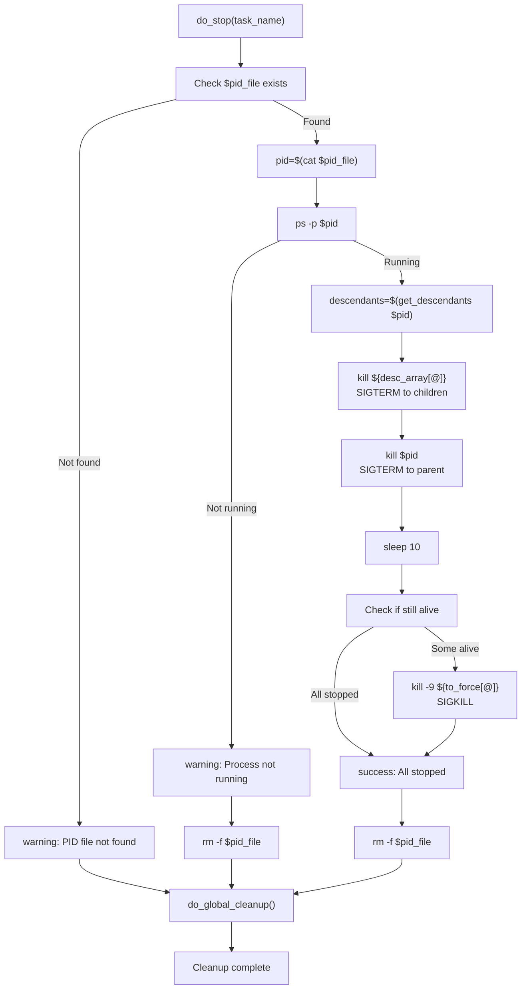
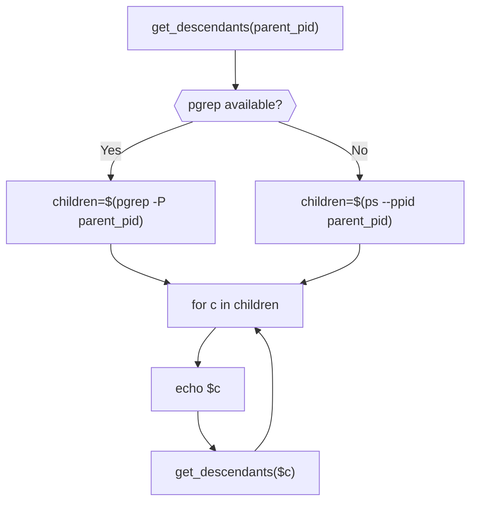
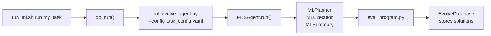

<!-- source: DeepWiki mcp.deepwiki.com · repo baidu-baige/LoongFlow · page 6.3 Running ML Tasks · fetched 2026-10-26 -->

# Running ML Tasks

<details>
<summary>Relevant source files</summary>

The following files were used as context for generating this wiki page:

- [run_ml.sh](run_ml.sh)
- [run_mlebench.sh](run_mlebench.sh)

</details>


This page covers execution of custom machine learning tasks using the `run_ml.sh` shell script. This script is for general ML tasks located in `agents/ml_agent/examples/`. For Kaggle competitions via MLE-Bench, use `run_mlebench.sh` instead (see page 6.4).

**Scope of this page:**
- General ML tasks in `agents/ml_agent/examples/<task_name>/`
- Uses `ml_evolve_agent.py` as the agent script
- Custom task configurations and evaluators

**Not covered here:**
- MLE-Bench competitions (see page 6.4 - uses `run_mlebench.sh` and `ml_agent.py`)

For task configuration details, see page 6.2. For ML Agent architecture overview, see page 6.1.

## Script Comparison

| Aspect | `run_ml.sh` (This Page) | `run_mlebench.sh` (Page 6.4) |
|--------|-------------------------|------------------------------|
| Purpose | Custom ML tasks | Kaggle competitions via MLE-bench |
| Agent Script | `ml_evolve_agent.py` | `ml_agent.py` |
| Task Location | `agents/ml_agent/examples/<task_name>/` | `output/mlebench/<competition_id>/` |
| Data Preparation | Manual | `mlebench prepare` command |
| Task Structure | Custom `task_config.yaml` | MLE-bench prepared data |

**Sources:** [run_ml.sh:1-15](), [run_mlebench.sh:1-16]()

## Prerequisites

- Python 3.12+
- `mamba` or `conda` installed
- Task directory with required files (see next section)
- LLM API credentials in `task_config.yaml`

**Sources:** [run_ml.sh:17-21](), [run_ml.sh:379-401]()

## Task Directory Structure

Tasks must be located in `agents/ml_agent/examples/<task_name>/`. The script uses `DEFAULT_TASK_BASE="$SCRIPT_DIR/agents/ml_agent/examples"` to locate tasks.

**Required Directory Structure:**

```
agents/ml_agent/examples/
└── <task_name>/                   # Task identifier
    ├── task_config.yaml           # PESAgent configuration
    ├── eval_program.py            # Evaluation script
    ├── public/                    # Public data directory
    │   ├── description.md         # Task description (--task-file)
    │   ├── train.csv             # Training data
    │   ├── test.csv              # Test data
    │   └── sample_submission.csv # Expected output format
    └── private/                   # Ground truth (optional)
        └── answer.csv
```

**Critical Files Verified by `do_run()`:**

| File Path Variable | Purpose | Checked at Line |
|--------------------|---------|-----------------|
| `task_config` | `task_config.yaml` location | [run_ml.sh:221-223]() |
| `description_file` | Task description for LLM | [run_ml.sh:224-226]() |
| `eval_program` | Evaluation logic | [run_ml.sh:227-229]() |
| `evolve_script` | `ml_evolve_agent.py` path | [run_ml.sh:230-232]() |

**Sources:** [run_ml.sh:19](), [run_ml.sh:200-206](), [run_ml.sh:212-232]()

## Environment Initialization

### The `init` Command

Before running any ML task, you must initialize the environment using the `init` command. This command:

1. Detects GPU availability (NVIDIA)
2. Creates or verifies the `loongflow_ml` conda environment
3. Installs required dependencies based on hardware configuration

```bash
./run_ml.sh init
```

**Command Flow:**



**Sources:** [run_ml.sh:118-170](), [run_ml.sh:122-132]()

### Environment Files

GPU detection via `nvidia-smi` determines which environment to use:

| Condition | `env_file` | `pip_file` |
|-----------|------------|------------|
| GPU detected | `agents/ml_agent/examples/environment_gpu.yaml` | `agents/ml_agent/examples/requirements_gpu.txt` |
| No GPU | `agents/ml_agent/examples/environment_cpu.yaml` | `agents/ml_agent/examples/requirements_cpu.txt` |

**Environment Setup in `activate_env()`:**



The `LD_LIBRARY_PATH` export ensures conda-installed libraries are found at runtime.

**Sources:** [run_ml.sh:124-132](), [run_ml.sh:73-90]()

## Running ML Tasks

### The `run` Command

The `run` command executes an ML task with the evolutionary agent. It supports both foreground and background execution modes.

**Basic Syntax:**

```bash
./run_ml.sh run <task_name> [--background] [additional_python_args]
```

**Parameters:**

| Parameter | Required | Description |
|-----------|----------|-------------|
| `task_name` | Yes | Name of the task directory under `agents/ml_agent/examples/` |
| `--background` | No | Run in background mode (detached from terminal) |
| `additional_python_args` | No | Additional arguments passed to the Python script |

**Examples:**

```bash
# Run in foreground (blocks terminal)
./run_ml.sh run ml_example

# Run in background
./run_ml.sh run ml_example --background

# Run with custom Python arguments
./run_ml.sh run ml_example --background --log-level DEBUG
```

**Sources:** [run_ml.sh:172-293](), [run_ml.sh:14](), [run_ml.sh:396-400]()

### Execution Flow



**Sources:** [run_ml.sh:172-293](), [run_ml.sh:208-243]()

### Task File Verification

Before execution, the script verifies the following files exist:

```python
# File paths checked by run_ml.sh
task_config = "$task_dir/task_config.yaml"
description_file = "$task_dir/public/description.md"
eval_program = "$task_dir/eval_program.py"
evolve_script = "$SCRIPT_DIR/agents/ml_agent/ml_evolve_agent.py"
```

If any required file is missing, the script exits with an error message.

**Sources:** [run_ml.sh:212-232]()

### Python Command Construction

The `do_run()` function builds the command array at [run_ml.sh:252-262]():

```bash
python3 -u $evolve_script \
  --config "$agent_config_path" \
  --task-data-path "$task_data_path" \
  --task-file "$task_file" \
  --eval-file "$eval_program" \
  [additional_python_args]
```

**Variable Mapping:**

| Variable | Value | Purpose |
|----------|-------|---------|
| `evolve_script` | `$SCRIPT_DIR/agents/ml_agent/ml_evolve_agent.py` | Main agent script |
| `agent_config_path` | `$task_dir/task_config.yaml` | PESAgent config |
| `task_data_path` | `$task_dir/public` | Data directory |
| `task_file` | `$task_dir/public/description.md` | Task description |
| `eval_program` | `$task_dir/eval_program.py` | Evaluator |

The `-u` flag enables unbuffered stdout/stderr for real-time log viewing.

**Sources:** [run_ml.sh:252-262](), [run_ml.sh:218]()

### Environment Variables

During execution, the script sets:

| Variable | Value | Purpose |
|----------|-------|---------|
| `PYTHONPATH` | `$SCRIPT_DIR:$SCRIPT_DIR/src` | Enable module imports |
| `LD_LIBRARY_PATH` | `$CONDA_PREFIX/lib` | Link conda libraries |
| `CONDA_DEFAULT_ENV` | `loongflow_ml` | Active conda environment |

**Sources:** [run_ml.sh:249](), [run_ml.sh:84-86]()

## Monitoring Running Tasks

### Log Files

When running in background mode, all output is redirected to `agent.log` in the task directory:

```bash
# Monitor logs in real-time
tail -f agents/ml_agent/examples/<task_name>/agent.log

# View last 100 lines
tail -n 100 agents/ml_agent/examples/<task_name>/agent.log

# Search for errors
grep -i error agents/ml_agent/examples/<task_name>/agent.log
```

**Sources:** [run_ml.sh:217](), [run_ml.sh:280](), [run_ml.sh:286]()

### Process Status

Check if a task is running by inspecting the PID file:

```bash
# Check PID file
cat agents/ml_agent/examples/<task_name>/.agent.pid

# Verify process is running (replace <PID> with actual PID)
ps -p <PID>

# View process tree
pstree -p <PID>
```

**Sources:** [run_ml.sh:216](), [run_ml.sh:235-243]()

### Output Directory Structure

While the task runs, output is written to the task directory:

```
agents/ml_agent/examples/<task_name>/
├── .agent.pid              # Process ID file
├── agent.log               # Execution log
└── output/                 # Task outputs (created by agent)
    ├── database/
    │   └── checkpoints/    # Evolutionary checkpoints
    └── iteration_N/        # Per-iteration outputs
        ├── planner/
        ├── executor/
        └── summarizer/
```

**Sources:** [run_ml.sh:216-217](), [docs/en/agents/ml_evolve.md:213-237]()

## Stopping Running Tasks

### The `stop` Command

Syntax: `./run_ml.sh stop <task_name>`

Invokes `do_stop()` which terminates the agent and all child processes.

**Process Termination Flow (`do_stop()`):**



**Key Functions:**

- `get_descendants()` [run_ml.sh:92-107](): Recursively finds child PIDs using `pgrep -P` or `ps --ppid`
- `do_global_cleanup()` [run_ml.sh:368-375](): Kills any remaining `ml_agent.py` processes with `pkill -f`

**Sources:** [run_ml.sh:295-366](), [run_ml.sh:325-365](), [run_ml.sh:92-107](), [run_ml.sh:368-375]()

### Process Tree Management

The `get_descendants()` function [run_ml.sh:92-107]() recursively finds all child processes:

**Algorithm:**



This ensures all spawned processes (Python evaluators, subprocesses) are found before termination.

**Sources:** [run_ml.sh:92-107](), [run_ml.sh:326-330]()

### Global Cleanup

`do_global_cleanup()` [run_ml.sh:368-375]() performs final cleanup:

```bash
pkill -f "agents/ml_agent/ml_agent.py" 2>/dev/null || true
```

This catches orphaned `ml_agent.py` processes that escaped the PID tree traversal. Note the intentional use of `ml_agent.py` (not `ml_evolve_agent.py`) to match potential legacy process names.

**Sources:** [run_ml.sh:368-375](), [run_ml.sh:365](), [run_ml.sh:311]()

## Complete Workflow Example

**End-to-End Task Execution:**

```bash
# 1. One-time environment setup
./run_ml.sh init

# 2. Create task structure
mkdir -p agents/ml_agent/examples/my_task/public
# Add: task_config.yaml, eval_program.py, description.md, train.csv, test.csv

# 3. Run in background
./run_ml.sh run my_task --background
# Creates: .agent.pid, agent.log

# 4. Monitor execution
tail -f agents/ml_agent/examples/my_task/agent.log

# 5. Check status
ps -p $(cat agents/ml_agent/examples/my_task/.agent.pid)

# 6. Graceful termination
./run_ml.sh stop my_task
# Removes: .agent.pid
```

**Code Flow Through System:**



**Sources:** [run_ml.sh:396-400](), [run_ml.sh:172-293](), [run_ml.sh:218]()

## Command Reference Table

| Command | Purpose | Key Functions | Output Files |
|---------|---------|---------------|--------------|
| `./run_ml.sh init` | Initialize environment | `do_init()`, `activate_env()` | Conda environment `loongflow_ml` |
| `./run_ml.sh run <task> [--background]` | Execute task | `do_run()`, `check_env_exists()`, `activate_env()` | `.agent.pid`, `agent.log` |
| `./run_ml.sh stop <task>` | Stop task | `do_stop()`, `get_descendants()`, `do_global_cleanup()` | Removes `.agent.pid` |

**Sources:** [run_ml.sh:118-170](), [run_ml.sh:172-293](), [run_ml.sh:295-366]()

## Shell Script Function Reference

All functions in `run_ml.sh`:

| Function | Lines | Purpose | Key Operations |
|----------|-------|---------|----------------|
| `info()` | [run_ml.sh:23-25]() | Print blue info message | `echo -e "\033[34m[INFO]\033[0m"` |
| `success()` | [run_ml.sh:27-29]() | Print green success message | `echo -e "\033[32m[SUCCESS]\033[0m"` |
| `warning()` | [run_ml.sh:31-33]() | Print yellow warning | `echo -e "\033[33m[WARNING]\033[0m"` |
| `error()` | [run_ml.sh:35-38]() | Print red error and exit | `echo` to stderr, `exit 1` |
| `init_conda()` | [run_ml.sh:41-70]() | Initialize conda/mamba | Source `conda.sh`, eval hook |
| `activate_env()` | [run_ml.sh:73-90]() | Activate `loongflow_ml` | `mamba activate`, set `LD_LIBRARY_PATH` |
| `get_descendants()` | [run_ml.sh:92-107]() | Find child PIDs recursively | `pgrep -P` or `ps --ppid` |
| `check_env_exists()` | [run_ml.sh:109-114]() | Verify env exists | `mamba env list \| grep` |
| `do_init()` | [run_ml.sh:118-170]() | Create environment | `mamba env create`, `pip install` |
| `do_run()` | [run_ml.sh:172-293]() | Execute agent | Build command array, `nohup` or foreground |
| `do_stop()` | [run_ml.sh:295-366]() | Terminate agent | `kill` SIGTERM → SIGKILL, `get_descendants()` |
| `do_global_cleanup()` | [run_ml.sh:368-375]() | Kill orphans | `pkill -f "ml_agent.py"` |

**Main Script Logic:** [run_ml.sh:377-420]() - Case statement dispatching to `do_init()`, `do_run()`, or `do_stop()`.

**Sources:** [run_ml.sh:23-420]()

## Troubleshooting

### Common Issues

**1. Environment not found error:**

```bash
Error: Environment 'loongflow_ml' not found. Please run './run_ml.sh init' first.
```

**Solution:** Run `./run_ml.sh init` to create the environment.

**Sources:** [run_ml.sh:112]()

---

**2. Task directory not found:**

```bash
Error: Task directory not found: agents/ml_agent/examples/task_name
```

**Solution:** Verify the task name is correct and the directory exists under `agents/ml_agent/examples/`.

**Sources:** [run_ml.sh:204-206]()

---

**3. Agent already running:**

```bash
Error: Agent is already running with PID 12345. Use 'stop' first.
```

**Solution:** Stop the existing process with `./run_ml.sh stop <task_name>` or kill it manually if the PID file is stale.

**Sources:** [run_ml.sh:235-243]()

---

**4. Required files missing:**

```bash
Error: Task config not found: task_config.yaml
Error: Description file not found: description.md
Error: Eval program not found: eval_program.py
```

**Solution:** Ensure all required files exist in the task directory. See [Task Directory Structure](#task-directory-structure).

**Sources:** [run_ml.sh:221-232]()

---

**5. Conda/mamba not found:**

```bash
Error: Neither conda nor mamba found. Please install mambaforge or miniconda first.
```

**Solution:** Install mamba or conda before running the script.

**Sources:** [run_ml.sh:54]()

### Debug Tips

1. **Check environment activation:**
   ```bash
   mamba activate loongflow_ml
   which python
   ```

2. **Verify PYTHONPATH:**
   ```bash
   echo $PYTHONPATH
   # Should include script directory and src/
   ```

3. **Manual process inspection:**
   ```bash
   ps aux | grep ml_evolve_agent.py
   ```

4. **Review full logs:**
   ```bash
   less agents/ml_agent/examples/<task_name>/agent.log
   ```

**Sources:** [run_ml.sh:77](), [run_ml.sh:249](), [run_ml.sh:217]()

---

