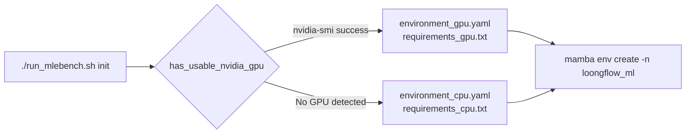
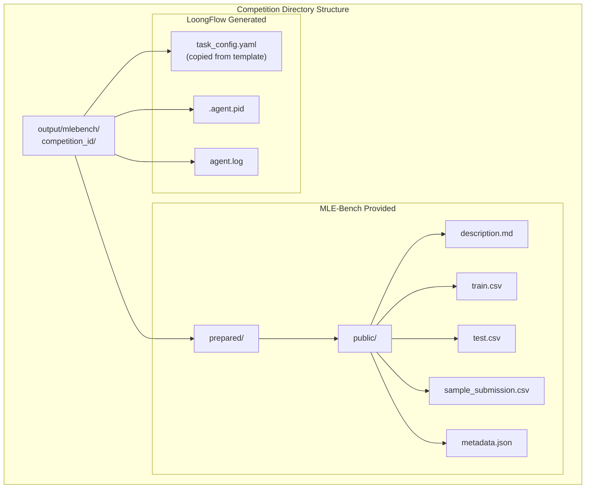
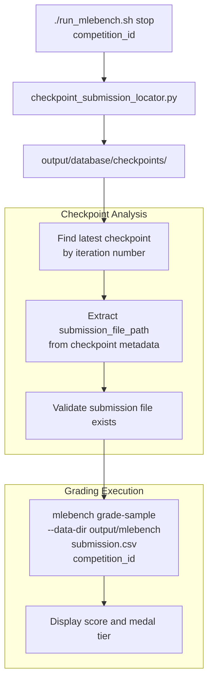

<!-- source: DeepWiki mcp.deepwiki.com · repo baidu-baige/LoongFlow · page 6.4 MLE-Bench Integration · fetched 2026-10-26 -->

# MLE-Bench Integration

<details>
<summary>Relevant source files</summary>

The following files were used as context for generating this wiki page:

- [README.md](README.md)
- [agents/ml_agent/README.md](agents/ml_agent/README.md)
- [run_ml.sh](run_ml.sh)
- [run_mlebench.sh](run_mlebench.sh)

</details>


This page documents the technical integration between LoongFlow's ML Agent and MLE-Bench, a benchmark suite of 75 Kaggle-style machine learning competitions developed by OpenAI. MLE-Bench provides standardized datasets, evaluation metrics, and grading infrastructure for testing autonomous ML systems. 

For general ML Agent usage and custom tasks, see [ML Agent Overview](#6.1). For running MLE-Bench competitions, see [Running ML Tasks](#6.3). For competition results, see [Examples & Results](#6.5).

---

## Overview

MLE-Bench serves as the primary benchmark for evaluating LoongFlow's ML Agent capabilities. The integration automates the complete workflow from environment setup through competition data preparation, agent execution, and final submission grading.

### Key Components

| Component | Purpose | Location |
|-----------|---------|----------|
| `run_mlebench.sh` | Main orchestration script | [run_mlebench.sh]() |
| MLE-Bench Library | Competition data and grading | Cloned from `github.com/openai/mle-bench` |
| `checkpoint_submission_locator.py` | Finds best submission from checkpoints | [agents/ml_agent/examples/mlebench/checkpoint_submission_locator.py]() |
| Competition Data | Downloaded competition files | `output/mlebench/<competition_id>/` |
| Environment | Isolated conda environment | `loongflow_ml` |

The system achieved medals across all 48 tested competitions, including 26 Gold medals, demonstrating robust autonomous ML pipeline construction capabilities.

**Sources:** [README.md:10-14](), [README.md:146-149](), [run_mlebench.sh:1-16]()

---

## MLE-Bench Workflow

The complete lifecycle from initialization through grading follows a four-stage process:

```mermaid
graph TB
    subgraph "Stage 1: Initialization"
        Init[./run_mlebench.sh init]
        DetectGPU{GPU Available?}
        EnvGPU[environment_gpu.yaml]
        EnvCPU[environment_cpu.yaml]
        CreateEnv[mamba env create<br/>loongflow_ml]
        CloneRepo[git clone<br/>mle-bench repo]
        LFSPull[git lfs pull<br/>Download LFS files]
        ModifyTF[Modify TensorFlow<br/>version to >=2.15]
        InstallMLB[pip install mlebench]
        
        Init --> DetectGPU
        DetectGPU -->|Yes| EnvGPU
        DetectGPU -->|No| EnvCPU
        EnvGPU --> CreateEnv
        EnvCPU --> CreateEnv
        CreateEnv --> CloneRepo
        CloneRepo --> LFSPull
        LFSPull --> ModifyTF
        ModifyTF --> InstallMLB
    end
    
    subgraph "Stage 2: Preparation"
        Prepare[./run_mlebench.sh prepare<br/>competition_id]
        MLBPrepare[mlebench prepare<br/>--competition-id<br/>--data-dir]
        DownloadData[Download from Kaggle<br/>via mlebench]
        ExtractPublic[Extract to<br/>prepared/public/]
        
        Prepare --> MLBPrepare
        MLBPrepare --> DownloadData
        DownloadData --> ExtractPublic
    end
    
    subgraph "Stage 3: Execution"
        Run[./run_mlebench.sh run<br/>competition_id]
        CopyConfig[Copy task_config.yaml<br/>template]
        LaunchAgent[python ml_evolve_agent.py<br/>--config<br/>--task-data-path<br/>--eval-file]
        PESCycle[PES Evolution Cycle]
        CheckpointSave[Save checkpoints<br/>with submission_file_path]
        
        Run --> CopyConfig
        CopyConfig --> LaunchAgent
        LaunchAgent --> PESCycle
        PESCycle --> CheckpointSave
    end
    
    subgraph "Stage 4: Grading"
        Stop[./run_mlebench.sh stop<br/>competition_id]
        LocateBest[checkpoint_submission_locator.py<br/>Find latest best submission]
        ExtractPath[Extract submission_file_path<br/>from checkpoint]
        GradeSample[mlebench grade-sample<br/>--data-dir submission.csv]
        DisplayScore[Display final score<br/>and medal tier]
        
        Stop --> LocateBest
        LocateBest --> ExtractPath
        ExtractPath --> GradeSample
        GradeSample --> DisplayScore
    end
    
    InstallMLB -.-> Prepare
    ExtractPublic -.-> Run
    CheckpointSave -.-> Stop
```



**Sources:** [run_mlebench.sh:218-305](), [run_mlebench.sh:307-329](), [run_mlebench.sh:331-445](), [run_mlebench.sh:447-523]()

---

## Environment Initialization

### GPU Detection and Environment Selection

The initialization process automatically detects hardware capabilities and selects the appropriate environment configuration:



The `has_usable_nvidia_gpu()` function [run_mlebench.sh:196-207]() verifies both the presence of `nvidia-smi` and the existence of enumerated GPU devices.

**Sources:** [run_mlebench.sh:196-207](), [run_mlebench.sh:221-232]()

### MLE-Bench Library Installation

The initialization clones and installs the MLE-Bench library with specific modifications:

| Step | Action | Location |
|------|--------|----------|
| Clone Repository | `git clone https://github.com/openai/mle-bench` | [run_mlebench.sh:268-269]() |
| Fetch LFS Files | `git lfs fetch --all && git lfs pull` | [run_mlebench.sh:275-278]() |
| Modify Dependencies | Change `tensorflow>=2.16` to `tensorflow>=2.15` | [run_mlebench.sh:281-292]() |
| Install Package | `pip install -e mle-bench/` | [run_mlebench.sh:294-295]() |

The TensorFlow version modification ensures compatibility with the broader LoongFlow ecosystem.

**Sources:** [run_mlebench.sh:262-298]()

---

## Competition Data Structure

### Directory Layout

Each competition creates a standardized directory structure under `output/mlebench/<competition_id>/`:



The `prepared/public/` directory [run_mlebench.sh:342]() contains all competition data visible to the agent, while private test labels remain hidden in MLE-Bench's internal structure.

**Sources:** [run_mlebench.sh:341-351]()

### Critical File Paths

The execution script constructs paths to required files:

```python
# Path construction from run_mlebench.sh:341-351
competition_dir = f"{MLEBENCH_DIR}/{competition_id}"
task_data_path = f"{competition_dir}/prepared/public"
task_file = f"{task_data_path}/description.md"
config_template = "agents/ml_agent/examples/mlebench/task_config.yaml"
eval_program = "agents/ml_agent/examples/mlebench/eval_program.py"
agent_config_path = f"{competition_dir}/task_config.yaml"
```

These paths are passed to `ml_evolve_agent.py` [run_mlebench.sh:407-412]() as command-line arguments.

**Sources:** [run_mlebench.sh:340-351](), [run_mlebench.sh:405-416]()

---

## Competition Preparation

### Data Download Process

The `prepare` command downloads competition data using MLE-Bench's built-in Kaggle integration:

```bash
./run_mlebench.sh prepare <competition_id>
```

Internally, this executes:

```bash
mlebench prepare \
    --competition-id "$competition_id" \
    --data-dir "$MLEBENCH_DIR"
```

**Prerequisites:**
- Kaggle API credentials must be configured at `~/.kaggle/kaggle.json`
- Git LFS must be installed and initialized

The preparation validates that the competition directory exists before proceeding [run_mlebench.sh:354]().

**Sources:** [run_mlebench.sh:307-329](), [README.md:21-25]()

---

## Execution Model

### Command Construction

The `run` command builds a Python invocation with competition-specific paths:

```bash
python3 -u agents/ml_agent/ml_evolve_agent.py \
    --config <competition_dir>/task_config.yaml \
    --task-data-path <competition_dir>/prepared/public \
    --task-file <task_data_path>/description.md \
    --eval-file agents/ml_agent/examples/mlebench/eval_program.py
```

**Sources:** [run_mlebench.sh:405-412]()

### Background vs Foreground Execution

The script supports two execution modes:

| Mode | Flag | Behavior | PID Tracking | Log File |
|------|------|----------|--------------|----------|
| Foreground | (default) | Blocking, output to console | No | N/A |
| Background | `--background` | Detached with nohup | Yes (.agent.pid) | agent.log |

Background execution [run_mlebench.sh:430-439]():
```bash
nohup "${command_array[@]}" > "$log_file" 2>&1 &
echo $! > "$pid_file"
```

**Sources:** [run_mlebench.sh:430-444]()

### Debug Mode

The `--debug` flag enables test score computation by setting an environment variable:

```bash
export MLEBENCH_COMPUTE_TEST_SCORE=true
```

This allows evaluators to compute scores on test data during development [run_mlebench.sh:401-403]().

**Sources:** [run_mlebench.sh:400-403]()

### Environment Configuration

Before execution, the script:
1. Activates the `loongflow_ml` conda environment [run_mlebench.sh:395]()
2. Sets `LD_LIBRARY_PATH` to include conda lib directory [run_mlebench.sh:85-91]()
3. Appends to `PYTHONPATH` [run_mlebench.sh:398]():
   ```bash
   export PYTHONPATH="${PYTHONPATH:+$PYTHONPATH:}$SCRIPT_DIR:$SCRIPT_DIR/src"
   ```

**Sources:** [run_mlebench.sh:394-398]()

---

## Grading System

### Checkpoint-Based Submission Locator

When stopping an agent, the system automatically locates the best submission from evolution checkpoints:



**Sources:** [run_mlebench.sh:111-194](), [run_mlebench.sh:522]()

### Grading Fallback Strategy

The `grade_latest_best_submission()` function attempts grading through multiple methods:

1. **Direct mlebench command** [run_mlebench.sh:159-168]():
   ```bash
   mlebench grade-sample --data-dir "$MLEBENCH_DIR" \
       "$submission_path" "$competition_id"
   ```

2. **Mamba-based execution** [run_mlebench.sh:170-179]():
   ```bash
   mamba run -n loongflow_ml mlebench grade-sample ...
   ```

3. **Conda-based execution** [run_mlebench.sh:181-190]():
   ```bash
   conda run -n loongflow_ml mlebench grade-sample ...
   ```

Each method captures output and handles failures gracefully, displaying warnings rather than errors.

**Sources:** [run_mlebench.sh:158-194]()

### Submission File Path Extraction

The helper script extracts the submission path from checkpoint metadata:

```bash
python3 agents/ml_agent/examples/mlebench/checkpoint_submission_locator.py \
    --checkpoints-root output/database/checkpoints \
    --field submission_file_path
```

The script searches for the latest checkpoint by iteration number and reads the stored `submission_file_path` field.

**Sources:** [run_mlebench.sh:135-142]()

---

## Process Management

### PID Tracking and Cleanup

The script maintains process lifecycle through `.agent.pid` files:

```mermaid
graph TB
    subgraph "Process Start"
        CheckPID{PID file exists?}
        ValidatePID{Process running?}
        RemoveStale["Remove stale PID file"]
        LaunchBG["Launch in background<br/>nohup ... &"]
        SavePID["Save PID to .agent.pid"]
        
        CheckPID -->|Yes| ValidatePID
        ValidatePID -->|Yes| Error["Error: Already running"]
        ValidatePID -->|No| RemoveStale
        CheckPID -->|No| LaunchBG
        RemoveStale --> LaunchBG
        LaunchBG --> SavePID
    end
    
    subgraph "Process Stop"
        ReadPID["Read PID from .agent.pid"]
        GetDescendants["get_descendants()<br/>Find all child processes"]
        SendSIGTERM["Send SIGTERM<br/>to all processes"]
        Wait["sleep 10"]
        CheckAlive{Processes alive?}
        SendSIGKILL["Send SIGKILL<br/>force termination"]
        CleanupPID["Remove .agent.pid"]
        
        ReadPID --> GetDescendants
        GetDescendants --> SendSIGTERM
        SendSIGTERM --> Wait
        Wait --> CheckAlive
        CheckAlive -->|Yes| SendSIGKILL
        CheckAlive -->|No| CleanupPID
        SendSIGKILL --> CleanupPID
    end
```



The `get_descendants()` function [run_mlebench.sh:95-109]() recursively finds all child processes using either `pgrep` or `ps` depending on availability.

**Sources:** [run_mlebench.sh:361-369](), [run_mlebench.sh:477-514](), [run_mlebench.sh:94-109]()

### Global Cleanup

After stopping, the script performs global cleanup to catch any orphaned processes:

```bash
pkill -f "agents/ml_agent/ml_evolve_agent.py" 2>/dev/null || true
```

This ensures no residual agent processes remain running [run_mlebench.sh:525-532]().

**Sources:** [run_mlebench.sh:525-532]()

---

## Integration with ML Agent Pipeline

### Configuration Template

MLE-Bench competitions use a shared configuration template:

```
agents/ml_agent/examples/mlebench/task_config.yaml
```

This template is copied to each competition directory during the first run [run_mlebench.sh:372-377](). Users can then customize settings per competition.

**Sources:** [run_mlebench.sh:348](), [run_mlebench.sh:372-377]()

### Evaluator Integration

All MLE-Bench competitions share a common evaluator:

```
agents/ml_agent/examples/mlebench/eval_program.py
```

This evaluator interfaces with MLE-Bench's grading infrastructure to compute scores on validation data. The evaluator stores the `submission_file_path` in checkpoint metadata for later grading.

**Sources:** [run_mlebench.sh:349](), [run_mlebench.sh:411]()

### Data Path Mapping

The agent receives competition data through standardized paths:

| Variable | Path | Contents |
|----------|------|----------|
| `--task-data-path` | `prepared/public/` | All visible competition files |
| `--task-file` | `prepared/public/description.md` | Task requirements |
| `--eval-file` | `mlebench/eval_program.py` | Evaluation logic |

These paths ensure the agent operates within MLE-Bench's sandboxed environment without access to private test labels.

**Sources:** [run_mlebench.sh:407-411]()

---

## Differences from General ML Tasks

### Initialization

| Aspect | General ML (`run_ml.sh`) | MLE-Bench (`run_mlebench.sh`) |
|--------|--------------------------|-------------------------------|
| Environment | `loongflow_ml` | `loongflow_ml` (same) |
| Additional Setup | None | Clone mle-bench repo, Git LFS pull |
| Dependencies | requirements_{gpu\|cpu}.txt | requirements_{gpu\|cpu}.txt + mlebench |

**Sources:** [run_ml.sh:131-183](), [run_mlebench.sh:218-305]()

### Data Preparation

| Aspect | General ML | MLE-Bench |
|--------|------------|-----------|
| Data Source | Pre-existing in task directory | Downloaded via `mlebench prepare` |
| Structure | User-defined | Standardized `prepared/public/` |
| Command | N/A | `./run_mlebench.sh prepare <id>` |

**Sources:** [run_ml.sh:214-245](), [run_mlebench.sh:307-329]()

### Execution

| Aspect | General ML | MLE-Bench |
|--------|------------|-----------|
| Config Path | `examples/<task>/task_config.yaml` | `output/mlebench/<id>/task_config.yaml` |
| Task File | `examples/<task>/public/description.md` | `prepared/public/description.md` |
| Evaluator | `examples/<task>/eval_program.py` | `examples/mlebench/eval_program.py` (shared) |

**Sources:** [run_ml.sh:225-245](), [run_mlebench.sh:340-351]()

### Post-Execution

| Aspect | General ML | MLE-Bench |
|--------|------------|-----------|
| Grading | Manual or custom | Automatic `mlebench grade-sample` |
| Best Solution Location | Manual checkpoint inspection | `checkpoint_submission_locator.py` |

**Sources:** [run_ml.sh:308-379](), [run_mlebench.sh:111-194](), [run_mlebench.sh:520-523]()

---

## Command Reference

### Full Command Syntax

```bash
# Initialize environment (one-time setup)
./run_mlebench.sh init

# Download competition data
./run_mlebench.sh prepare <competition_id>

# Run agent (foreground)
./run_mlebench.sh run <competition_id> [--debug] [python_args...]

# Run agent (background)
./run_mlebench.sh run <competition_id> --background [--debug] [python_args...]

# Stop agent and grade best submission
./run_mlebench.sh stop <competition_id>
```

**Sources:** [run_mlebench.sh:536-554]()

### Example Workflow

```bash
# Setup
./run_mlebench.sh init
./run_mlebench.sh prepare spooky-author-identification

# Run with debug mode enabled
./run_mlebench.sh run spooky-author-identification --background --debug

# Monitor progress
tail -f output/mlebench/spooky-author-identification/agent.log

# Stop and grade
./run_mlebench.sh stop spooky-author-identification
```

**Sources:** [run_mlebench.sh:547-552]()

---

## Environment Variables

### Execution Context

| Variable | Set By | Purpose |
|----------|--------|---------|
| `CONDA_PREFIX` | conda/mamba activate | Base path for conda libraries |
| `LD_LIBRARY_PATH` | activate_env() | Shared library search path |
| `PYTHONPATH` | do_run() | Module search path |
| `MLEBENCH_COMPUTE_TEST_SCORE` | --debug flag | Enable test score computation |

**Sources:** [run_mlebench.sh:85-91](), [run_mlebench.sh:398](), [run_mlebench.sh:401-403]()

### Conda Detection

The script detects conda/mamba through multiple fallback methods [run_mlebench.sh:43-71]():

1. `$CONDA_EXE` environment variable
2. `$MAMBA_EXE` environment variable
3. `which mamba` command
4. `which conda` command

This ensures compatibility across different installation methods.

**Sources:** [run_mlebench.sh:42-72]()

---

