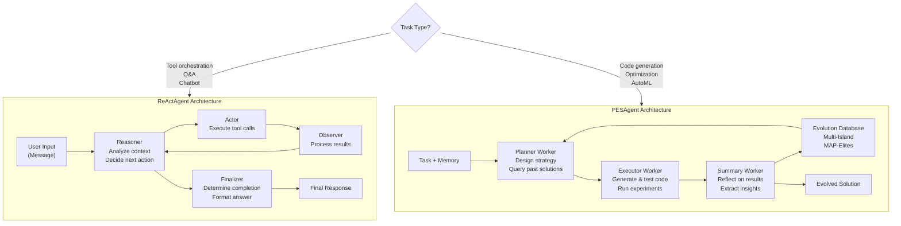
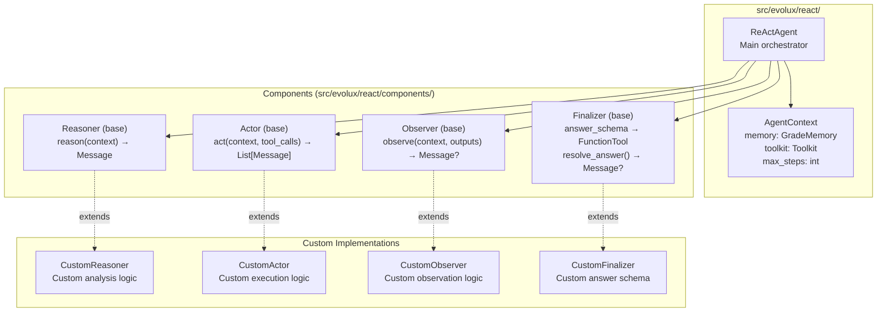
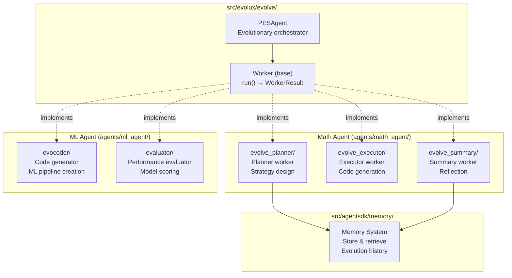
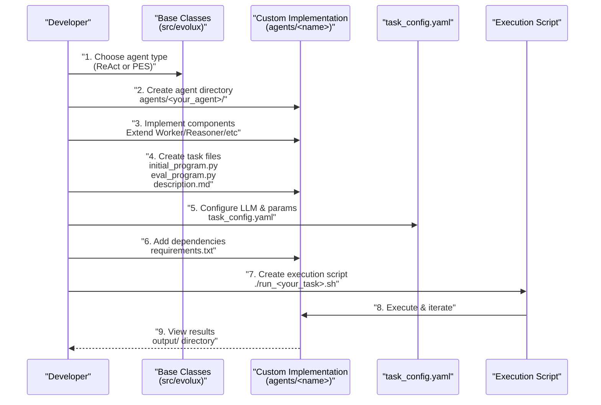
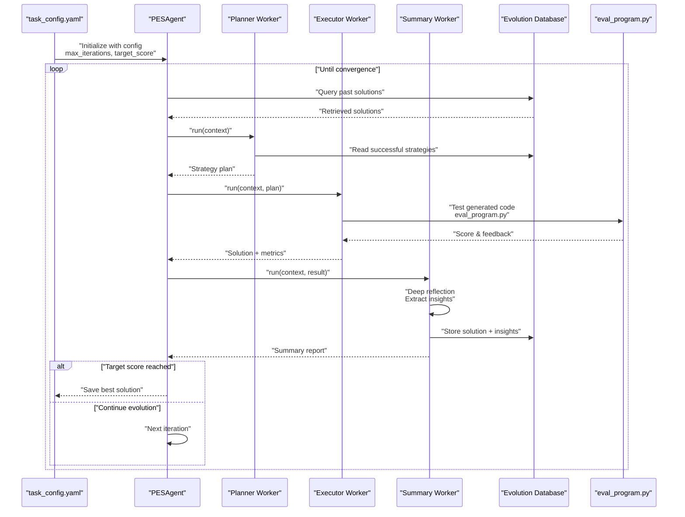

<!-- source: DeepWiki mcp.deepwiki.com · repo baidu-baige/LoongFlow · page 7 Building Custom Agents · fetched 2026-10-26 -->

# Building Custom Agents

<details>
<summary>Relevant source files</summary>

The following files were used as context for generating this wiki page:

- [README.md](README.md)
- [agents/ml_agent/README.md](agents/ml_agent/README.md)
- [src/loongflow/framework/pes/base_runner.py](src/loongflow/framework/pes/base_runner.py)
- [src/loongflow/framework/pes/pes_agent.py](src/loongflow/framework/pes/pes_agent.py)

</details>


## Purpose and Scope

This section covers how to extend LoongFlow by creating custom agents, components, tools, and evaluation functions. LoongFlow provides two primary agent architectures that can be customized:

- **ReActAgent** for tool-based reactive workflows (see [Custom ReAct Agents](#6.1))
- **PESAgent** for evolutionary problem-solving with structured memory (see [Custom PES Components](#6.2))

This page provides an architectural overview and decision framework for customization. For specific implementation details:

- **Tool development**: See [Tool Development](#6.3)
- **Custom evaluation functions**: See [Custom Evaluators](#6.4)
- **Math task setup**: See [Task Structure & Files](#4.3)
- **ML task configuration**: See [ML Configuration Guide](#5.2)

---

## Agent Architecture Overview

LoongFlow provides two distinct agent architectures, each with different customization points. Understanding these architectures is essential for determining which components to extend.

### ReActAgent vs PESAgent Architecture



**Sources**: [AGENTS.md:12-28](), [docs/en/build_agent/custom_guide.md:6-77]()

---

## Customization Decision Framework

The following table maps common customization needs to the appropriate extension points:

| Customization Goal | Agent Type | Component to Extend | Subsection |
|-------------------|-----------|---------------------|-----------|
| Add new tool/API integration | ReActAgent | `BaseTool` | [6.3](#6.3) |
| Custom reasoning logic | ReActAgent | `Reasoner` | [6.1](#6.1) |
| Parallel tool execution | ReActAgent | `Actor` | [6.1](#6.1) |
| Custom answer format | ReActAgent | `Finalizer` | [6.1](#6.1) |
| Custom planning strategy | PESAgent | `Planner` worker | [6.2](#6.2) |
| Domain-specific code generation | PESAgent | `Executor` worker | [6.2](#6.2) |
| Custom reflection/learning | PESAgent | `Summary` worker | [6.2](#6.2) |
| Custom scoring metrics | PESAgent | Evaluation function | [6.4](#6.4) |
| Memory selection strategy | PESAgent | Memory configuration | [3.4](#3.4) |

---

## Component Structure and Interfaces

### ReActAgent Component Hierarchy



**Sources**: [docs/en/build_agent/custom_guide.md:8-77](), [AGENTS.md:14]()

### PESAgent Component Hierarchy



**Sources**: [AGENTS.md:12-28](), [AGENTS.md:86-87]()

---

## Development Workflow

### Environment and Module Structure

The LoongFlow codebase separates concerns between framework-level abstractions and domain-specific implementations:

| Directory | Purpose | Custom Development |
|-----------|---------|-------------------|
| `src/evolux/` | Agent architectures (PESAgent, ReActAgent) | Extend base classes |
| `src/agentsdk/` | Generic utilities (tools, memory, models) | Add generic tools |
| `agents/math_agent/` | Math-specific implementations | Create new math tasks |
| `agents/ml_agent/` | ML-specific implementations | Create new ML tasks |
| `agents/<your_agent>/` | Custom domain agent | Full custom implementation |

**Sources**: [AGENTS.md:10-28]()

### Custom Agent Development Pattern



**Sources**: [AGENTS.md:44-76]()

---

## Key Design Principles

### 1. Separation of Framework and Domain Logic

**Rule**: Do not hardcode domain-specific logic into `src/agentsdk/` or `src/evolux/`. Keep the SDK generic.

- **Generic tools** (e.g., web search, code execution) → `src/agentsdk/tools/`
- **Domain-specific tools** (e.g., math solvers, ML metrics) → `agents/<domain>/tools/`

**Sources**: [AGENTS.md:106-109]()

### 2. Async-First Architecture

All component methods use `async/await` patterns:

```python
# Correct pattern
async def reason(self, context: AgentContext) -> Message:
    result = await self.generate_reasoning(context)
    return result

# Also correct
async def act(self, context: AgentContext, tool_calls: List[ToolCallElement]):
    results = await asyncio.gather(*[
        context.toolkit.arun(call.target, call.arguments)
        for call in tool_calls
    ])
    return results
```

**Sources**: [docs/en/build_agent/custom_guide.md:17-38](), [AGENTS.md:93]()

### 3. Type Safety and Validation

LoongFlow uses Python type hints and Pydantic for data validation:

- All public methods must have type annotations
- Use Pydantic models for configuration objects
- LLM responses are parsed into strongly-typed `Message` objects

**Sources**: [AGENTS.md:92](), [AGENTS.md:42]()

### 4. Path Handling

Agent execution contexts depend on the repository root directory. Use relative paths carefully:

```python
# Recommended: Use Path objects
from pathlib import Path

task_dir = Path(__file__).parent
config_path = task_dir / "task_config.yaml"

# Avoid: Hardcoded absolute paths
# config_path = "/absolute/path/to/config.yaml"  # Will break
```

**Sources**: [AGENTS.md:94]()

---

## Component Lifecycle and Interfaces

### ReActAgent Component Lifecycle

```mermaid
sequenceDiagram
    participant User
    participant Agent as "ReActAgent"
    participant Context as "AgentContext"
    participant Reasoner
    participant Actor
    participant Observer
    participant Finalizer
    participant Toolkit
    
    User->>Agent: "run(message)"
    Agent->>Context: "Initialize context<br/>memory.add(message)"
    
    loop "Until max_steps or answer"
        Agent->>Reasoner: "reason(context)"
        Reasoner->>Context: "Read memory"
        Reasoner-->>Agent: "Message with tool_calls"
        
        Agent->>Actor: "act(context, tool_calls)"
        Actor->>Toolkit: "arun(tool_name, args)"
        Toolkit-->>Actor: "Tool results"
        Actor-->>Agent: "List[Message]"
        
        Agent->>Observer: "observe(context, results)"
        Observer-->>Agent: "Observation message"
        
        Agent->>Finalizer: "resolve_answer()"
        Finalizer-->>Agent: "Message or None"
        
        alt "Answer found"
            Agent-->>User: "Final response"
        else "Continue"
            Agent->>Context: "Update memory"
        end
    end
```

**Sources**: [docs/en/build_agent/custom_guide.md:6-77]()

### PESAgent Component Lifecycle



**Sources**: [AGENTS.md:86-87]()

---

## Configuration Integration

Custom agents integrate with LoongFlow's configuration system through `task_config.yaml`:

### ReActAgent Configuration

```yaml
llm_config:
  url: "https://api.openai.com/v1"
  api_key: "your-key"
  model: "gpt-4"
  temperature: 0.7

react_config:
  max_steps: 10
  sys_prompt: "Your system prompt"
  toolkit:
    - name: "custom_tool"
      enabled: true
```

### PESAgent Configuration

```yaml
llm_config:
  url: "https://api.openai.com/v1"
  api_key: "your-key"
  model: "gpt-4"

components:
  planner:
    class: "agents.custom.planner.CustomPlanner"
    prompt: "prompts/plan.txt"
  
  executor:
    class: "agents.custom.executor.CustomExecutor"
    max_attempts: 3
  
  summary:
    class: "agents.custom.summary.CustomSummary"
    reflection_depth: "deep"

evolve_config:
  max_iterations: 100
  target_score: 0.95
  num_islands: 5
```

**Sources**: [AGENTS.md:80-81](), [AGENTS.md:30-35]()

---

## Testing Custom Components

### Unit Testing Pattern

```python
# tests/custom_agent/test_reasoner.py
import pytest
from loongflow.framework.react import AgentContext
from agents.custom.reasoner import CustomReasoner

@pytest.mark.asyncio
async def test_custom_reasoner():
    reasoner = CustomReasoner(model=mock_model, sys_prompt="Test")
    context = AgentContext(memory=mock_memory, toolkit=mock_toolkit)
    
    result = await reasoner.reason(context)
    
    assert result is not None
    assert result.role == Role.ASSISTANT
```

Run tests using:

```bash
uv run pytest tests/custom_agent/
```

**Sources**: [AGENTS.md:96-102]()

---

## Safety Considerations

### Code Execution Sandboxing

When building custom `Executor` components that generate and run code:

1. **Validate generated code** before execution
2. **Use subprocess isolation** for untrusted code
3. **Set resource limits** (CPU time, memory)
4. **Preserve warning mechanisms** from base implementations

**Example pattern from Math Agent executor**:

```python
# Execute in subprocess with timeout
result = subprocess.run(
    ["python", generated_file],
    timeout=60,
    capture_output=True,
    text=True
)
```

**Sources**: [AGENTS.md:109]()

---

## Next Steps

Choose the appropriate subsection based on your customization needs:

- **[6.1 Custom ReAct Agents](#6.1)**: Build tool-based agents with custom reasoning
- **[6.2 Custom PES Components](#6.2)**: Extend evolutionary agents with custom workers
- **[6.3 Tool Development](#6.3)**: Create domain-specific tools
- **[6.4 Custom Evaluators](#6.4)**: Implement custom scoring metrics

For practical examples, see:
- **Math Agent examples**: [4.5 Examples & Results](#4.5)
- **ML Agent examples**: [5.5 Examples & Results](#5.5)

---

