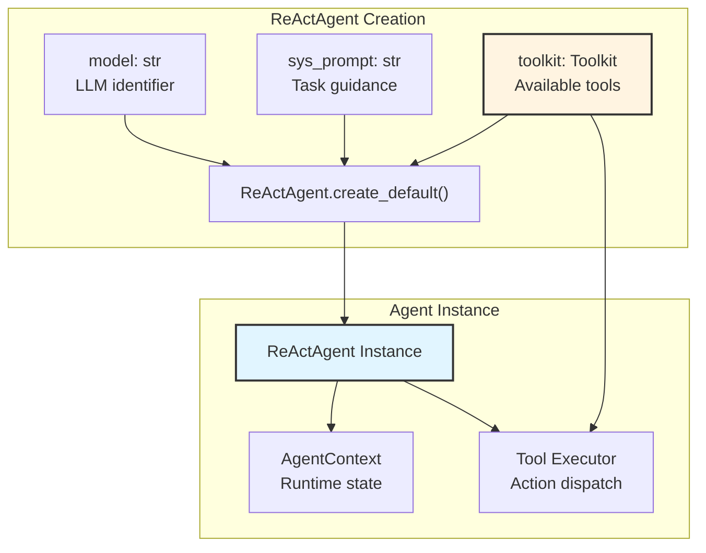
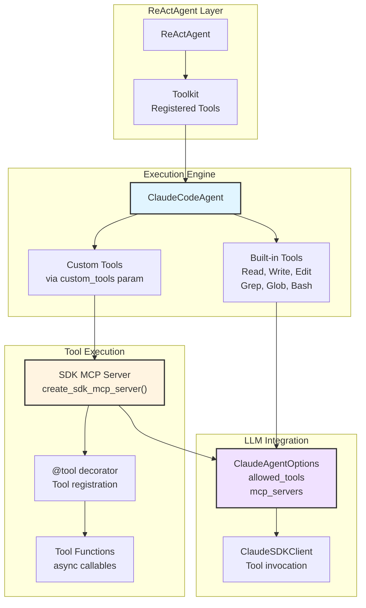

<!-- source: DeepWiki mcp.deepwiki.com · repo baidu-baige/LoongFlow · page 7.1 Custom ReAct Agents · fetched 2026-10-26 -->

# Custom ReAct Agents

<details>
<summary>Relevant source files</summary>

The following files were used as context for generating this wiki page:

- [README.md](README.md)
- [agents/ml_agent/README.md](agents/ml_agent/README.md)
- [src/loongflow/framework/claude_code/claude_code_agent.py](src/loongflow/framework/claude_code/claude_code_agent.py)

</details>


This guide explains how to create custom ReActAgent instances with specialized toolkits for task-specific automation. ReActAgent provides a flexible framework for building agents that combine reasoning with tool execution through the ReAct (Reasoning + Acting) paradigm.

For building custom PES components (Planner, Executor, Summary workers), see [Custom PES Components](#7.2). For general tool development patterns, see [Tool Development](#7.3).

**Sources:** [README.md:1-585]()

---

## ReActAgent Overview

ReActAgent is a framework component that implements the ReAct paradigm: agents alternate between reasoning about the task and taking actions using tools. Unlike PESAgent which orchestrates long-term evolutionary cycles, ReActAgent focuses on single-iteration problem solving through tool-augmented reasoning.

### ReActAgent vs PESAgent

| Aspect | ReActAgent | PESAgent |
|--------|------------|----------|
| **Purpose** | Single-task execution with tools | Multi-iteration evolutionary improvement |
| **Pattern** | Reasoning → Action → Observation | Plan → Execute → Summary (repeated) |
| **Memory** | Single-session context | Multi-Structure Fusion Memory with evolution tree |
| **Use Case** | Tool-based automation tasks | Complex problems requiring iterative refinement |
| **Tool Integration** | Direct toolkit registration | Tools used within Execute phase workers |

### When to Use ReActAgent

ReActAgent is suitable for:

- **Single-shot tasks**: File processing, data analysis, code generation
- **Tool-heavy workflows**: Tasks requiring multiple tool interactions
- **Custom automation**: Building domain-specific agents with specialized toolkits
- **Interactive sessions**: Agents that respond to user queries with tool assistance

For problems requiring iterative improvement and learning from failures, use PESAgent (see [PESAgent Architecture](#3.2)).

**Sources:** [README.md:460-477](), [agents/ml_agent/README.md:1-189]()

---

## Creating ReActAgent Instances

### Basic Creation Pattern

```python
from loongflow.framework.react import AgentContext, ReActAgent
from loongflow.agentsdk.tools import Toolkit

# Build toolkit with custom tools
toolkit = Toolkit()
toolkit.register_tool(MyCustomTool())
toolkit.register_tool(AnotherTool())

# Create ReActAgent with default configuration
agent = ReActAgent.create_default(
    model="openai/gpt-4",
    sys_prompt="You are a helpful assistant specialized in data analysis.",
    toolkit=toolkit
)

# Execute agent
result = await agent("Analyze the sales data in data/sales.csv")
```

The `create_default()` factory method configures a standard ReActAgent with:
- LLM model configuration
- System prompt for task context
- Registered toolkit for available actions

**Sources:** [README.md:460-477]()

### ReActAgent Configuration



**Diagram: ReActAgent Instantiation Flow**

**Sources:** [README.md:460-477]()

---

## Building Custom Toolkits

A toolkit is a collection of tools that the agent can invoke during execution. Tools extend the agent's capabilities beyond pure reasoning.

### Toolkit Registration Pattern

```python
from loongflow.agentsdk.tools import Toolkit

# Initialize empty toolkit
toolkit = Toolkit()

# Register tools individually
toolkit.register_tool(FileReadTool())
toolkit.register_tool(FileWriteTool())
toolkit.register_tool(DataAnalysisTool())
toolkit.register_tool(DatabaseQueryTool())

# Tools are now available to the agent
```

### Example: TODO List Toolkit

```python
from loongflow.agentsdk.tools import TodoReadTool, TodoWriteTool, Toolkit

toolkit = Toolkit()
toolkit.register_tool(TodoReadTool())
toolkit.register_tool(TodoWriteTool())

agent = ReActAgent.create_default(
    model="openai/gpt-4",
    sys_prompt="You are a TODO list manager. Help users organize tasks.",
    toolkit=toolkit
)

# Agent can now read and write TODO items
result = await agent("Add a task: Review pull request #123")
```

### Toolkit Organization by Domain

Organize tools into domain-specific toolkits for maintainability:

```python
# Data analysis toolkit
data_toolkit = Toolkit()
data_toolkit.register_tool(CSVReaderTool())
data_toolkit.register_tool(StatisticsCalculatorTool())
data_toolkit.register_tool(VisualizationTool())

# Code analysis toolkit
code_toolkit = Toolkit()
code_toolkit.register_tool(ASTParserTool())
code_toolkit.register_tool(LinterTool())
code_toolkit.register_tool(SecurityScannerTool())

# Web automation toolkit
web_toolkit = Toolkit()
web_toolkit.register_tool(HTTPRequestTool())
web_toolkit.register_tool(HTMLParserTool())
web_toolkit.register_tool(BrowserAutomationTool())
```

**Sources:** [README.md:462-477]()

---

## Integration with ClaudeCodeAgent

ReActAgent instances typically use ClaudeCodeAgent as their execution engine. ClaudeCodeAgent provides built-in tools and supports custom tool registration through its MCP (Model Context Protocol) server integration.

### ClaudeCodeAgent Tool Architecture



**Diagram: Tool Flow from ReActAgent to ClaudeCodeAgent**

**Sources:** [src/loongflow/framework/claude_code/claude_code_agent.py:1-620]()

### ClaudeCodeAgent Initialization with Custom Tools

ClaudeCodeAgent supports custom tools through two mechanisms:

1. **Constructor-time registration** via `custom_tools` parameter
2. **Dynamic registration** via `add_custom_tool()` method

```python
from loongflow.framework.claude_code import ClaudeCodeAgent

# Define custom tool function
async def custom_calculator(args):
    """Calculate mathematical expressions."""
    result = eval(args['expression'])
    return {
        "content": [
            {"type": "text", "text": f"Result: {result}"}
        ]
    }

# Option 1: Constructor-time registration
agent = ClaudeCodeAgent(
    model="openai/gpt-4",
    work_dir="./workspace",
    tool_list=["Read", "Edit", "Bash"],
    custom_tools={
        "calculator": {
            "function": custom_calculator,
            "description": "Evaluates mathematical expressions",
            "parameters": {"expression": str}
        }
    }
)

# Option 2: Dynamic registration
agent = ClaudeCodeAgent(
    model="openai/gpt-4",
    work_dir="./workspace",
    tool_list=["Read", "Edit"]
)

agent.add_custom_tool(
    name="calculator",
    function=custom_calculator,
    description="Evaluates mathematical expressions",
    parameters={"expression": str}
)
```

**Sources:** [src/loongflow/framework/claude_code/claude_code_agent.py:103-186]()

### Tool List Configuration

ClaudeCodeAgent provides several built-in tools that can be enabled via the `tool_list` parameter:

| Tool | Purpose | Typical Use Case |
|------|---------|------------------|
| `Read` | Read file contents | Loading code, data, configs |
| `Write` | Write file contents | Saving outputs, creating files |
| `Edit` | Modify existing files | Code refactoring, patches |
| `Grep` | Search file contents | Finding patterns, debugging |
| `Glob` | List files by pattern | File discovery, batch operations |
| `Bash` | Execute shell commands | Running programs, system tasks |
| `Skill` | Load .claude/skills/ | Domain expertise injection |
| `Task` | Task management | Multi-step workflows |

Default configuration (if `tool_list` is None):

```python
tool_list = ["Read", "Write", "Edit", "Grep", "Glob", "Bash", "Skill", "Task"]
```

To create a restricted agent with limited tools:

```python
# Read-only agent
readonly_agent = ClaudeCodeAgent(
    model="openai/gpt-4",
    tool_list=["Read", "Glob"]  # No write or execution capabilities
)

# Code analysis agent
analysis_agent = ClaudeCodeAgent(
    model="openai/gpt-4",
    tool_list=["Read", "Grep", "Glob"]  # Analysis tools only
)

# Full-capability agent
full_agent = ClaudeCodeAgent(
    model="openai/gpt-4",
    tool_list=["Read", "Write", "Edit", "Grep", "Glob", "Bash"]
)
```

**Sources:** [src/loongflow/framework/claude_code/claude_code_agent.py:156-170]()

---

## Custom Tool Development

Custom tools must follow specific implementation patterns to integrate with ClaudeCodeAgent's MCP server architecture.

### Tool Function Requirements

Custom tool functions must satisfy these requirements:

1. **Asynchronous**: Defined with `async def`
2. **Signature**: Accept a single `args` dictionary parameter
3. **Return format**: Return a dictionary with `content` key containing message blocks
4. **Type annotations**: Parameter types declared in tool registration

**Sources:** [src/loongflow/framework/claude_code/claude_code_agent.py:261-319]()

### Custom Tool Implementation Pattern

```python
async def my_custom_tool(args):
    """
    Tool implementation pattern.
    
    Args:
        args: Dictionary with parameters defined in tool registration
        
    Returns:
        dict: Response with content blocks
            {
                "content": [
                    {"type": "text", "text": "Response message"},
                    {"type": "image", "source": "..."},  # Optional
                    # Additional content blocks...
                ]
            }
    """
    # Extract parameters
    param1 = args.get('param1')
    param2 = args.get('param2')
    
    # Perform tool logic
    result = perform_operation(param1, param2)
    
    # Return formatted response
    return {
        "content": [
            {"type": "text", "text": f"Operation completed: {result}"}
        ]
    }
```

### Example: File Statistics Tool

```python
import os
import asyncio

async def file_stats_tool(args):
    """Calculate statistics for a file."""
    filepath = args['filepath']
    
    if not os.path.exists(filepath):
        return {
            "content": [
                {"type": "text", "text": f"Error: File not found: {filepath}"}
            ]
        }
    
    # Gather statistics
    size = os.path.getsize(filepath)
    lines = 0
    words = 0
    
    with open(filepath, 'r') as f:
        for line in f:
            lines += 1
            words += len(line.split())
    
    stats = f"""File Statistics for {filepath}:
- Size: {size} bytes
- Lines: {lines}
- Words: {words}
"""
    
    return {
        "content": [
            {"type": "text", "text": stats}
        ]
    }

# Register with agent
agent.add_custom_tool(
    name="file_stats",
    function=file_stats_tool,
    description="Calculate statistics (size, lines, words) for a file",
    parameters={
        "filepath": str
    }
)
```

### Example: Database Query Tool

```python
import asyncio
import sqlite3

async def db_query_tool(args):
    """Execute SQL query against database."""
    db_path = args['db_path']
    query = args['query']
    
    try:
        # Execute query (in practice, use async DB library)
        conn = sqlite3.connect(db_path)
        cursor = conn.cursor()
        cursor.execute(query)
        
        # Fetch results
        results = cursor.fetchall()
        columns = [desc[0] for desc in cursor.description]
        
        conn.close()
        
        # Format results
        if not results:
            response = "Query returned no results"
        else:
            response = f"Query returned {len(results)} rows:\n"
            response += f"Columns: {', '.join(columns)}\n\n"
            for row in results[:10]:  # Limit display
                response += f"{row}\n"
            if len(results) > 10:
                response += f"\n... and {len(results) - 10} more rows"
        
        return {
            "content": [
                {"type": "text", "text": response}
            ]
        }
        
    except Exception as e:
        return {
            "content": [
                {"type": "text", "text": f"Error executing query: {str(e)}"}
            ]
        }

# Register with agent
agent.add_custom_tool(
    name="db_query",
    function=db_query_tool,
    description="Execute SQL query against SQLite database",
    parameters={
        "db_path": str,
        "query": str
    }
)
```

**Sources:** [src/loongflow/framework/claude_code/claude_code_agent.py:281-319]()

---

## Tool Registration and Management

ClaudeCodeAgent provides methods for dynamic tool management during agent lifetime.

### Adding Custom Tools

```python
# Method signature
agent.add_custom_tool(
    name: str,              # Unique tool identifier
    function: Callable,     # Async function implementing tool
    description: str,       # Tool description for LLM
    parameters: Optional[Dict[str, type]] = None  # Parameter schema
)
```

The `add_custom_tool()` method:
- Validates tool name for conflicts with built-in tools
- Validates function is async and callable
- Registers tool with MCP server
- Updates `ClaudeAgentOptions` to include new tool
- Logs registration success/failure

**Sources:** [src/loongflow/framework/claude_code/claude_code_agent.py:525-578]()

### Removing Custom Tools

```python
# Remove a tool by name
success = agent.remove_custom_tool("calculator")

if success:
    print("Tool removed successfully")
else:
    print("Tool not found")
```

The `remove_custom_tool()` method:
- Returns `True` if tool was removed, `False` if not found
- Updates `ClaudeAgentOptions` to remove tool from allowed list
- Does not affect built-in tools (only custom tools can be removed)

**Sources:** [src/loongflow/framework/claude_code/claude_code_agent.py:579-598]()

### Listing and Inspecting Tools

```python
# List all custom tool names
tool_names = agent.list_custom_tools()
print(f"Registered custom tools: {tool_names}")

# Get info about specific tool
tool_info = agent.get_custom_tool_info("calculator")
if tool_info:
    print(f"Description: {tool_info['description']}")
    print(f"Parameters: {tool_info['parameters']}")
```

Methods:
- `list_custom_tools()`: Returns list of custom tool names (excludes built-in tools)
- `get_custom_tool_info(name)`: Returns tool configuration dict or `None` if not found

**Sources:** [src/loongflow/framework/claude_code/claude_code_agent.py:600-620]()

### Tool Name Validation

Tool names are validated to prevent conflicts and ensure compatibility:

```python
# Valid tool names
"my_tool"          # ✓ Alphanumeric with underscore
"data_processor"   # ✓ Descriptive name
"tool-v2"          # ✓ Hyphen allowed

# Invalid tool names
"Read"             # ✗ Conflicts with built-in tool
"my tool"          # ✗ Contains space
"tool@v1"          # ✗ Contains special character
""                 # ✗ Empty string
```

Validation rules (see [src/loongflow/framework/claude_code/claude_code_agent.py:236-260]()):
- Non-empty string required
- Only alphanumeric characters, underscores, and hyphens allowed
- Must not conflict with built-in tool names (`Read`, `Write`, `Edit`, etc.)

**Sources:** [src/loongflow/framework/claude_code/claude_code_agent.py:236-260]()

---

## Advanced Usage Patterns

### Multi-Domain Agent with Toolkit Composition

```python
# Build specialized toolkits
file_toolkit = Toolkit()
file_toolkit.register_tool(CSVReaderTool())
file_toolkit.register_tool(JSONParserTool())

web_toolkit = Toolkit()
web_toolkit.register_tool(HTTPRequestTool())
web_toolkit.register_tool(APIClientTool())

# Compose into unified toolkit
unified_toolkit = Toolkit()
for tool in file_toolkit.get_all_tools():
    unified_toolkit.register_tool(tool)
for tool in web_toolkit.get_all_tools():
    unified_toolkit.register_tool(tool)

# Create multi-domain agent
agent = ReActAgent.create_default(
    model="openai/gpt-4",
    sys_prompt="You can process files and make web requests.",
    toolkit=unified_toolkit
)
```

### Conditional Tool Loading

```python
def create_agent_for_environment(env: str):
    """Create agent with environment-specific tools."""
    
    toolkit = Toolkit()
    
    # Always include basic tools
    toolkit.register_tool(FileReadTool())
    toolkit.register_tool(FileWriteTool())
    
    if env == "production":
        # Production: read-only database access
        toolkit.register_tool(ReadOnlyDBTool())
    elif env == "development":
        # Development: full database access
        toolkit.register_tool(DBQueryTool())
        toolkit.register_tool(DBMigrationTool())
    
    return ReActAgent.create_default(
        model="openai/gpt-4",
        sys_prompt=f"Environment: {env}",
        toolkit=toolkit
    )

dev_agent = create_agent_for_environment("development")
prod_agent = create_agent_for_environment("production")
```

### Tool Permission Modes

ClaudeCodeAgent supports different permission modes for tool execution:

```python
# Prompt mode: Ask for confirmation before tool execution
cautious_agent = ClaudeCodeAgent(
    model="openai/gpt-4",
    permission_mode="prompt",
    tool_list=["Read", "Write", "Bash"]
)

# AcceptEdits mode: Auto-approve file edits, prompt for bash
balanced_agent = ClaudeCodeAgent(
    model="openai/gpt-4",
    permission_mode="acceptEdits",
    tool_list=["Read", "Write", "Edit", "Bash"]
)

# AcceptAll mode: Auto-approve all operations
autonomous_agent = ClaudeCodeAgent(
    model="openai/gpt-4",
    permission_mode="acceptAll",
    tool_list=["Read", "Write", "Edit", "Bash"]
)
```

Permission modes:
- `"prompt"`: User confirmation required for all operations (default)
- `"acceptEdits"`: Auto-approve file edits, prompt for other operations
- `"acceptAll"`: Auto-approve all tool executions (use with caution)

**Sources:** [src/loongflow/framework/claude_code/claude_code_agent.py:145-149](), [src/loongflow/framework/claude_code/claude_code_agent.py:183-184]()

### Custom Tool with Error Handling

```python
async def robust_file_processor(args):
    """File processing tool with comprehensive error handling."""
    filepath = args['filepath']
    operation = args['operation']
    
    errors = []
    
    # Validation
    if not os.path.exists(filepath):
        errors.append(f"File not found: {filepath}")
    
    if operation not in ['analyze', 'transform', 'validate']:
        errors.append(f"Unknown operation: {operation}")
    
    if errors:
        return {
            "content": [
                {"type": "text", "text": f"Errors:\n" + "\n".join(errors)}
            ]
        }
    
    try:
        # Perform operation
        if operation == 'analyze':
            result = analyze_file(filepath)
        elif operation == 'transform':
            result = transform_file(filepath)
        elif operation == 'validate':
            result = validate_file(filepath)
        
        return {
            "content": [
                {"type": "text", "text": f"Success: {result}"}
            ]
        }
        
    except Exception as e:
        return {
            "content": [
                {"type": "text", "text": f"Error during {operation}: {str(e)}"}
            ]
        }

agent.add_custom_tool(
    name="file_processor",
    function=robust_file_processor,
    description="Process files with error handling",
    parameters={
        "filepath": str,
        "operation": str
    }
)
```

---

## Best Practices

### 1. Tool Granularity

**DO**: Create focused, single-purpose tools
```python
async def read_csv_tool(args):
    """Read CSV file and return as structured data."""
    # Single responsibility: CSV reading
    
async def analyze_csv_tool(args):
    """Analyze CSV data and return statistics."""
    # Single responsibility: Analysis
```

**DON'T**: Create monolithic multi-purpose tools
```python
async def csv_everything_tool(args):
    """Read, analyze, transform, and visualize CSV."""
    # Too many responsibilities
```

### 2. Parameter Validation

Always validate parameters before processing:

```python
async def validated_tool(args):
    """Tool with proper parameter validation."""
    required_params = ['filepath', 'operation']
    
    # Check required parameters
    missing = [p for p in required_params if p not in args]
    if missing:
        return {
            "content": [{
                "type": "text",
                "text": f"Missing required parameters: {missing}"
            }]
        }
    
    # Validate parameter values
    if not os.path.exists(args['filepath']):
        return {
            "content": [{
                "type": "text",
                "text": f"File not found: {args['filepath']}"
            }]
        }
    
    # Process request
    # ...
```

### 3. Informative Tool Descriptions

```python
# Good: Specific, actionable description
agent.add_custom_tool(
    name="csv_analyzer",
    function=analyze_csv,
    description="Analyze CSV file and return statistics (row count, column types, missing values, basic distributions)",
    parameters={"filepath": str}
)

# Bad: Vague description
agent.add_custom_tool(
    name="csv_analyzer",
    function=analyze_csv,
    description="Analyzes CSV files",  # Not helpful
    parameters={"filepath": str}
)
```

### 4. Error Reporting

Return structured error information:

```python
async def good_error_handling(args):
    """Tool with clear error reporting."""
    try:
        result = risky_operation(args)
        return {
            "content": [{
                "type": "text",
                "text": f"Success: {result}"
            }]
        }
    except FileNotFoundError as e:
        return {
            "content": [{
                "type": "text",
                "text": f"Error: File not found - {str(e)}\nPlease check the file path and try again."
            }]
        }
    except PermissionError as e:
        return {
            "content": [{
                "type": "text",
                "text": f"Error: Permission denied - {str(e)}\nEnsure the file is readable."
            }]
        }
    except Exception as e:
        return {
            "content": [{
                "type": "text",
                "text": f"Unexpected error: {type(e).__name__}: {str(e)}"
            }]
        }
```

### 5. Async Best Practices

```python
# Good: Truly async operation
async def async_http_request(args):
    """Make HTTP request asynchronously."""
    import aiohttp
    
    async with aiohttp.ClientSession() as session:
        async with session.get(args['url']) as response:
            content = await response.text()
            return {
                "content": [{"type": "text", "text": content}]
            }

# Bad: Blocking operation in async function
async def fake_async_tool(args):
    """This blocks despite being async."""
    import requests
    
    # Blocks the event loop!
    response = requests.get(args['url'])
    return {
        "content": [{"type": "text", "text": response.text}]
    }

# Fix: Use asyncio for CPU-bound work
async def cpu_intensive_tool(args):
    """Properly handle CPU-intensive work."""
    import asyncio
    
    # Offload to thread pool
    result = await asyncio.to_thread(expensive_computation, args['data'])
    return {
        "content": [{"type": "text", "text": f"Result: {result}"]
    }
```

### 6. Tool Testing

Test custom tools independently before integration:

```python
import asyncio

async def test_custom_tool():
    """Test tool in isolation."""
    # Test valid input
    result = await my_custom_tool({"param": "value"})
    assert "content" in result
    print("Valid input test: PASSED")
    
    # Test missing parameters
    result = await my_custom_tool({})
    assert "error" in result["content"][0]["text"].lower()
    print("Missing param test: PASSED")
    
    # Test invalid input
    result = await my_custom_tool({"param": "invalid"})
    assert "error" in result["content"][0]["text"].lower()
    print("Invalid input test: PASSED")

# Run tests
asyncio.run(test_custom_tool())
```

**Sources:** [src/loongflow/framework/claude_code/claude_code_agent.py:1-620](), [README.md:1-585]()

---

## Complete Example: Data Analysis Agent

```python
from loongflow.framework.react import ReActAgent
from loongflow.framework.claude_code import ClaudeCodeAgent
from loongflow.agentsdk.tools import Toolkit
import pandas as pd
import asyncio

# Custom tool implementations
async def load_dataset_tool(args):
    """Load dataset from file."""
    filepath = args['filepath']
    
    try:
        df = pd.read_csv(filepath)
        info = f"Loaded {len(df)} rows, {len(df.columns)} columns\nColumns: {list(df.columns)}"
        return {"content": [{"type": "text", "text": info}]}
    except Exception as e:
        return {"content": [{"type": "text", "text": f"Error: {str(e)}"}]}

async def describe_dataset_tool(args):
    """Generate descriptive statistics."""
    filepath = args['filepath']
    
    try:
        df = pd.read_csv(filepath)
        stats = df.describe().to_string()
        return {"content": [{"type": "text", "text": f"Statistics:\n{stats}"}]}
    except Exception as e:
        return {"content": [{"type": "text", "text": f"Error: {str(e)}"}]}

async def find_missing_tool(args):
    """Find missing values in dataset."""
    filepath = args['filepath']
    
    try:
        df = pd.read_csv(filepath)
        missing = df.isnull().sum()
        missing = missing[missing > 0]
        
        if len(missing) == 0:
            return {"content": [{"type": "text", "text": "No missing values found"}]}
        
        report = "Missing values:\n" + missing.to_string()
        return {"content": [{"type": "text", "text": report}]}
    except Exception as e:
        return {"content": [{"type": "text", "text": f"Error: {str(e)}"}]}

# Build data analysis agent
async def create_data_analyst():
    """Create specialized data analysis agent."""
    
    # Create ClaudeCodeAgent with custom tools
    agent = ClaudeCodeAgent(
        model="openai/gpt-4",
        work_dir="./data",
        tool_list=["Read", "Write", "Glob"],  # Basic file operations
        system_prompt="""You are a data analysis expert. You can:
1. Load datasets from CSV files
2. Generate descriptive statistics
3. Identify missing values and data quality issues
4. Provide insights and recommendations

Always validate file paths before processing.""",
        permission_mode="acceptEdits"
    )
    
    # Register custom data analysis tools
    agent.add_custom_tool(
        name="load_dataset",
        function=load_dataset_tool,
        description="Load CSV dataset and show basic information",
        parameters={"filepath": str}
    )
    
    agent.add_custom_tool(
        name="describe_dataset",
        function=describe_dataset_tool,
        description="Generate descriptive statistics for numeric columns",
        parameters={"filepath": str}
    )
    
    agent.add_custom_tool(
        name="find_missing",
        function=find_missing_tool,
        description="Identify columns with missing values",
        parameters={"filepath": str}
    )
    
    return agent

# Usage
async def main():
    agent = await create_data_analyst()
    
    # Analyze dataset
    result = await agent.run(
        "Analyze the sales data in sales_2024.csv. "
        "Show me basic statistics and identify any data quality issues."
    )
    
    print(result.data)

if __name__ == "__main__":
    asyncio.run(main())
```

This example demonstrates:
- Multiple custom tools with specific purposes
- Error handling in each tool
- Domain-specific system prompt
- Tool registration and management
- Practical data analysis workflow

**Sources:** [src/loongflow/framework/claude_code/claude_code_agent.py:103-524](), [README.md:460-477]()

---

