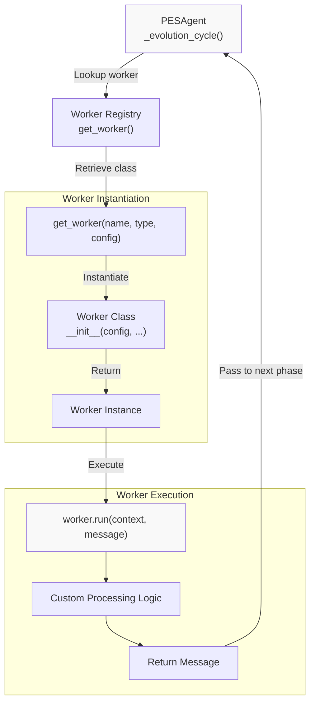
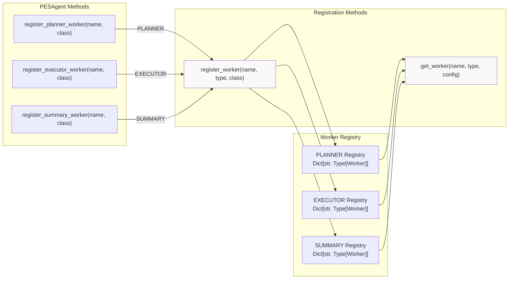
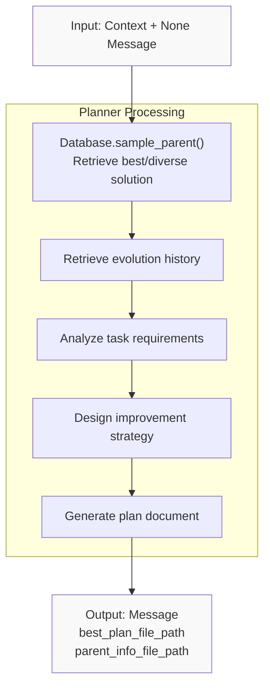
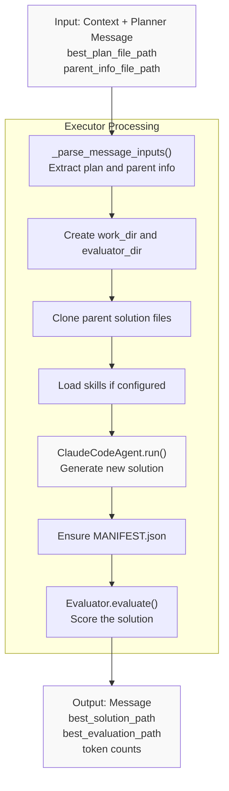
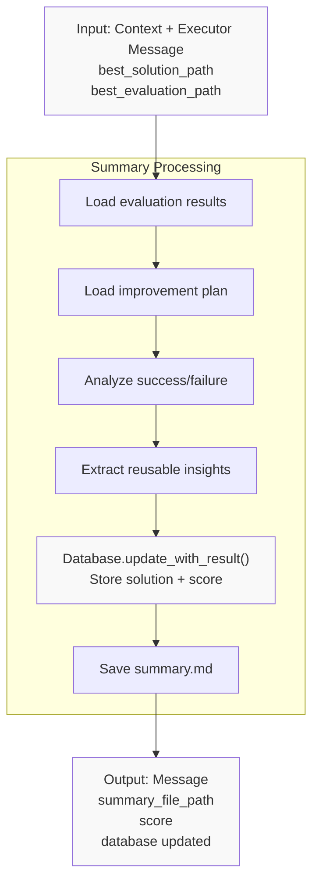
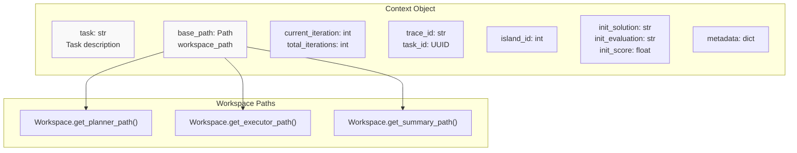
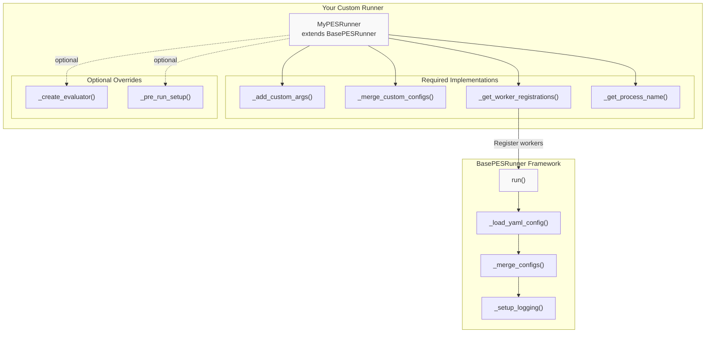

<!-- source: DeepWiki mcp.deepwiki.com · repo baidu-baige/LoongFlow · page 7.2 Custom PES Components · fetched 2026-10-26 -->

# Custom PES Components

<details>
<summary>Relevant source files</summary>

The following files were used as context for generating this wiki page:

- [agents/general_agent/executor.py](agents/general_agent/executor.py)
- [src/loongflow/framework/pes/base_runner.py](src/loongflow/framework/pes/base_runner.py)
- [src/loongflow/framework/pes/pes_agent.py](src/loongflow/framework/pes/pes_agent.py)

</details>


This page provides a technical guide for implementing custom Planner, Executor, and Summary workers for the PESAgent framework. These three worker types form the core of the PES (Plan-Execute-Summary) evolutionary cycle.

For information about creating custom tools for ClaudeCodeAgent, see [Tool Development](#7.3). For custom evaluation logic, see [Custom Evaluators](#7.4). For creating ReActAgent instances with custom toolkits, see [Custom ReAct Agents](#7.1).

---

## Worker Interface Overview

All PES components must implement the `Worker` interface, which defines a single `run` method that accepts a `Context` and a `Message`, and returns a `Message`.

**Worker Lifecycle Diagram**



**Sources:**
- [src/loongflow/framework/pes/register.py:1-100]()
- [src/loongflow/framework/pes/pes_agent.py:174-329]()

---

## Worker Base Class

The `Worker` abstract base class defines the interface all PES components must implement:

| Method | Signature | Description |
|--------|-----------|-------------|
| `run` | `async def run(context: Context, message: Message) -> Message` | Main execution method for the worker |

**Key Characteristics:**

- **Async Execution**: All workers use `async/await` for concurrent operation
- **Context-Aware**: Workers receive a `Context` object containing task metadata, workspace paths, and iteration information
- **Message-Based Communication**: Workers receive input via `Message` objects and return output as `Message` objects
- **Stateless**: Workers should not maintain state between calls; all state is managed by the database

**Sources:**
- [src/loongflow/framework/pes/register.py:1-50]()

---

## Worker Registration System

Before workers can be used by PESAgent, they must be registered in the global worker registry. The registration system maps worker names to their implementation classes.

**Registration Architecture**



**Registration Example:**

```python
# In your runner class (e.g., GeneralPESRunner)
agent = PESAgent(config=config)

# Register your custom workers
agent.register_planner_worker("my_planner", MyPlannerClass)
agent.register_executor_worker("my_executor", MyExecutorClass)
agent.register_summary_worker("my_summary", MySummaryClass)
```

**Sources:**
- [src/loongflow/framework/pes/pes_agent.py:141-172]()
- [src/loongflow/framework/pes/base_runner.py:434-440]()

---

## Implementing a Planner Worker

The Planner worker is responsible for analyzing the current state and designing a strategy for the next iteration.

**Planner Data Flow**



**Implementation Template:**

```python
from loongflow.framework.pes.register import Worker
from loongflow.framework.pes.context import Context
from loongflow.agentsdk.message import Message, ContentElement, Role, MimeType
from loongflow.framework.pes.database import EvolveDatabase

class MyPlanner(Worker):
    def __init__(self, config: Any, db: EvolveDatabase):
        super().__init__()
        self.config = config
        self.database = db
        
    async def run(self, context: Context, message: Message) -> Message:
        # 1. Sample parent solution from database
        parent_info = self.database.sample_parent(
            island_id=context.island_id,
            init_solution=context.init_solution,
            init_evaluation=context.init_evaluation,
            init_score=context.init_score
        )
        
        # 2. Save parent info to workspace
        planner_dir = Workspace.get_planner_path(context, create=True)
        parent_info_path = planner_dir / "parent_info.json"
        with open(parent_info_path, "w") as f:
            json.dump(parent_info, f, ensure_ascii=False, indent=2)
        
        # 3. Design improvement strategy
        plan = await self._design_strategy(context, parent_info)
        
        # 4. Save plan to workspace
        plan_path = planner_dir / "best_plan.md"
        with open(plan_path, "w") as f:
            f.write(plan)
        
        # 5. Return message with file paths
        return Message.from_text(
            data={
                "best_plan_file_path": str(plan_path),
                "parent_info_file_path": str(parent_info_path),
                "total_prompt_tokens": 0,
                "total_completion_tokens": 0,
            },
            sender="planner",
            role=Role.USER,
            mime_type=MimeType.APPLICATION_JSON
        )
    
    async def _design_strategy(self, context: Context, parent_info: dict) -> str:
        # Implement your strategy design logic here
        # This might involve LLM calls, analysis, etc.
        pass
```

**Key Responsibilities:**

1. **Parent Selection**: Sample a parent solution from the database using `database.sample_parent()`
2. **Context Analysis**: Analyze task requirements, parent solution quality, and evolution history
3. **Strategy Design**: Create an improvement plan based on the analysis
4. **File Management**: Save parent info and plan to workspace directories
5. **Message Return**: Return file paths for the Executor to use

**Sources:**
- [agents/general_agent/planner.py:1-200]()
- [src/loongflow/framework/pes/pes_agent.py:230-247]()

---

## Implementing an Executor Worker

The Executor worker implements the plan by generating a new solution and evaluating it.

**Executor Data Flow**



**Implementation Reference:**

The `GeneralExecuteAgent` class provides a complete implementation example:

| Method | Purpose | Line Reference |
|--------|---------|----------------|
| `__init__` | Initialize with config and evaluator | [agents/general_agent/executor.py:44-68]() |
| `run` | Main execution workflow | [agents/general_agent/executor.py:69-227]() |
| `_parse_message_inputs` | Extract plan and parent info from message | [agents/general_agent/executor.py:229-261]() |
| `_execute_once` | Run ClaudeCodeAgent to generate solution | [agents/general_agent/executor.py:263-334]() |

**Key Executor Steps:**

```python
async def run(self, context: Context, message: Message) -> Message:
    # 1. Parse planner message
    parent_ctx = self._parse_message_inputs(message)
    
    # 2. Create workspace directories
    executor_dir = Workspace.get_executor_path(context, True)
    work_dir = executor_dir / "work_dir"
    evaluator_dir = executor_dir / "evaluator_dir"
    
    # 3. Clone parent solution (if exists)
    if parent_ctx.parent_solution_path:
        copy_solution_files(parent_ctx.parent_solution_path, work_dir)
    
    # 4. Load skills
    if self.config.skills:
        load_skills(skill_names=self.config.skills, work_dir=work_dir)
    
    # 5. Execute agent to generate solution
    result = await self._execute_once(context, parent_ctx, work_dir)
    
    # 6. Ensure manifest
    await ensure_manifest(work_dir, self.config.llm_config.model_dump())
    
    # 7. Evaluate solution
    evaluation_result = await self.evaluator.evaluate(solution_message, context)
    
    # 8. Return solution path and evaluation
    return Message.from_text(
        data={
            "best_solution_path": str(work_dir),
            "best_evaluation_path": str(evaluation_file),
            "best_plan_file_path": parent_ctx.stage1_plan_file_path,
            "parent_info_file_path": parent_ctx.parent_info_file_path,
            "total_prompt_tokens": result["input_tokens"],
            "total_completion_tokens": result["output_tokens"],
        },
        sender="executor",
        role=Role.USER,
        mime_type=MimeType.APPLICATION_JSON
    )
```

**Executor Configuration:**

Executors typically require:
- **LLM Config**: Model, API key, URL for agent execution
- **Skills**: List of skills to load into the workspace
- **Tool Settings**: Built-in tools, disallowed tools, permission mode
- **Turn Limits**: `max_turns`, `max_thinking_tokens`, `max_output_tokens`

**Sources:**
- [agents/general_agent/executor.py:1-335]()
- [src/loongflow/framework/pes/pes_agent.py:252-268]()

---

## Implementing a Summary Worker

The Summary worker reflects on the execution results and extracts insights for future iterations.

**Summary Data Flow**



**Implementation Template:**

```python
class MySummary(Worker):
    def __init__(self, config: Any, db: EvolveDatabase):
        super().__init__()
        self.config = config
        self.database = db
        
    async def run(self, context: Context, message: Message) -> Message:
        # 1. Extract executor outputs
        data = message.get_elements(ContentElement)[0].data
        solution_path = data["best_solution_path"]
        evaluation_path = data["best_evaluation_path"]
        plan_path = data["best_plan_file_path"]
        
        # 2. Load evaluation results
        with open(evaluation_path, "r") as f:
            evaluation = json.load(f)
        score = evaluation["score"]
        
        # 3. Generate summary/insights
        summary_text = await self._generate_summary(
            context, solution_path, evaluation, plan_path
        )
        
        # 4. Update database with results
        await self.database.update_with_result(
            island_id=context.island_id,
            iteration_id=context.current_iteration,
            solution=solution_path,
            score=score,
            info=summary_text
        )
        
        # 5. Save summary to workspace
        summary_dir = Workspace.get_summary_path(context, create=True)
        summary_path = summary_dir / "summary.md"
        with open(summary_path, "w") as f:
            f.write(summary_text)
        
        # 6. Return summary message
        return Message.from_text(
            data={
                "summary_file_path": str(summary_path),
                "score": score,
                "status": evaluation["status"],
            },
            sender="summary",
            role=Role.USER,
            mime_type=MimeType.APPLICATION_JSON
        )
    
    async def _generate_summary(self, context, solution_path, evaluation, plan_path):
        # Implement summary generation logic
        # This might involve LLM-based reflection
        pass
```

**Key Responsibilities:**

1. **Result Analysis**: Load and analyze evaluation results from the Executor
2. **Insight Extraction**: Generate summaries and extract reusable patterns
3. **Database Update**: Call `database.update_with_result()` to store the new solution
4. **Summary Storage**: Save summary document to workspace
5. **Completion Signal**: Return message indicating the cycle is complete

**Sources:**
- [agents/general_agent/summary.py:1-200]()
- [src/loongflow/framework/pes/pes_agent.py:274-289]()

---

## Context and Message Objects

Workers communicate via `Context` and `Message` objects that carry metadata and data between phases.

**Context Structure**



**Message Elements**

| Element Type | Purpose | Usage |
|--------------|---------|-------|
| `ContentElement` | Primary data payload | Store file paths, scores, metadata |
| `ToolCallElement` | Tool invocation records | ClaudeCodeAgent tool calls |
| `ThinkElement` | Reasoning traces | LLM thinking process |

**Message Construction Pattern:**

```python
# Create message with structured data
return Message.from_text(
    data={
        "best_plan_file_path": str(plan_path),
        "parent_info_file_path": str(parent_info_path),
        "total_prompt_tokens": 1000,
        "total_completion_tokens": 500,
    },
    sender="planner",  # Worker identifier
    role=Role.USER,
    mime_type=MimeType.APPLICATION_JSON
)

# Extract data from message
elems = message.get_elements(ContentElement)
data = elems[0].data
plan_path = data.get("best_plan_file_path")
```

**Sources:**
- [src/loongflow/framework/pes/context.py:1-200]()
- [src/loongflow/agentsdk/message/message.py:1-300]()

---

## Complete Integration Example

This section demonstrates how to integrate custom workers into a complete PES agent using `BasePESRunner`.

**Runner Implementation Architecture**



**Complete Runner Example:**

```python
from loongflow.framework.pes.base_runner import BasePESRunner
from loongflow.framework.pes.context import EvolveChainConfig
from typing import List, Tuple, Type

class MyPESRunner(BasePESRunner):
    """Custom PES Agent runner with custom workers."""
    
    def _get_process_name(self) -> str:
        """Return display name for this agent."""
        return "My Custom PES Agent"
    
    def _add_custom_args(self, parser: argparse.ArgumentParser) -> None:
        """Add custom command-line arguments."""
        parser.add_argument(
            "--my-custom-arg",
            type=str,
            default=None,
            help="Custom argument for my agent"
        )
    
    def _merge_custom_configs(
        self, 
        args: argparse.Namespace, 
        config: Dict[str, Any]
    ) -> Dict[str, Any]:
        """Merge custom CLI arguments into config."""
        if args.my_custom_arg is not None:
            config["my_custom_setting"] = args.my_custom_arg
        return config
    
    def _get_worker_registrations(self) -> Tuple[
        List[Tuple[str, Type[Worker]]],  # planners
        List[Tuple[str, Type[Worker]]],  # executors
        List[Tuple[str, Type[Worker]]],  # summarizers
    ]:
        """Return worker class registrations."""
        planners = [
            ("my_planner", MyPlanner),
        ]
        executors = [
            ("my_executor", MyExecutor),
        ]
        summarizers = [
            ("my_summary", MySummary),
        ]
        return planners, executors, summarizers
    
    def _create_evaluator(self, config: EvolveChainConfig) -> Optional[Evaluator]:
        """Create custom evaluator if needed."""
        # Return None to use default, or return custom evaluator
        return MyCustomEvaluator(config.evolve.evaluator)
    
    def _pre_run_setup(self) -> None:
        """Execute setup before agent starts."""
        # Configure multiprocessing, environment, etc.
        import multiprocessing
        multiprocessing.set_start_method("spawn", force=True)

# Entry point
if __name__ == "__main__":
    runner = MyPESRunner()
    runner.start()
```

**Configuration File (task_config.yaml):**

```yaml
evolve:
  task: "Your task description"
  workspace_path: "./workspace"
  target_score: 0.95
  max_iterations: 100
  concurrency: 3
  
  planner_name: "my_planner"
  executor_name: "my_executor"
  summary_name: "my_summary"
  
  database:
    num_islands: 2
    population_size: 60
    checkpoint_interval: 5
    output_path: "./database"

planners:
  my_planner:
    llm_config:
      model: "anthropic/claude-3-5-sonnet-20241022"
      api_key: "${ANTHROPIC_API_KEY}"
    skills: ["code-analysis"]
    max_turns: 20

executors:
  my_executor:
    llm_config:
      model: "anthropic/claude-3-5-sonnet-20241022"
      api_key: "${ANTHROPIC_API_KEY}"
    skills: ["skill-creator"]
    max_turns: 50
    permission_mode: "acceptEdits"

summarizers:
  my_summary:
    llm_config:
      model: "anthropic/claude-3-5-sonnet-20241022"
      api_key: "${ANTHROPIC_API_KEY}"
    max_turns: 10
```

**Execution:**

```bash
python my_pes_runner.py \
  --config task_config.yaml \
  --max-iterations 50 \
  --target-score 0.90
```

**Sources:**
- [src/loongflow/framework/pes/base_runner.py:1-505]()
- [agents/general_agent/general_evolve_agent.py:1-200]()

---

## Worker Configuration Patterns

Each worker type receives its configuration from the `task_config.yaml` file under the respective section (`planners`, `executors`, `summarizers`).

**Configuration Hierarchy**

| Configuration Section | Purpose | Common Fields |
|----------------------|---------|---------------|
| `planners.{name}` | Planner-specific settings | `llm_config`, `skills`, `max_turns` |
| `executors.{name}` | Executor-specific settings | `llm_config`, `skills`, `build_in_tools`, `permission_mode` |
| `summarizers.{name}` | Summary-specific settings | `llm_config`, `max_turns` |

**LLM Configuration Fields:**

```yaml
llm_config:
  model: "anthropic/claude-3-5-sonnet-20241022"
  api_key: "${ANTHROPIC_API_KEY}"
  url: null  # Optional custom endpoint
  prompt_token_price: 0.003
  completion_token_price: 0.015
```

**Skills Configuration:**

```yaml
skills:
  - "code-analysis"      # Pre-defined skill
  - "skill-creator"      # Skill creation capability
  - "custom-domain"      # Your custom skill
```

**Tool Configuration (Executor):**

```yaml
build_in_tools:
  - "Read"
  - "Write"
  - "EditFile"
  - "Grep"
  - "Glob"
  - "BashCommand"

disallowed_tools:
  - "BashCommand"  # Optionally restrict certain tools
```

**Sources:**
- [examples/general/todo_app/task_config.yaml:1-100]()
- [src/loongflow/framework/pes/context.py:100-200]()

---

## Best Practices

**Worker Design:**

1. **Keep Workers Stateless**: All state should be in the database or workspace files
2. **Use Context Paths**: Always use `Workspace.get_*_path()` for file I/O
3. **Error Handling**: Catch and log exceptions, return error states in messages
4. **Token Tracking**: Include `total_prompt_tokens` and `total_completion_tokens` in returned messages
5. **File Path Conventions**: Return absolute paths in messages for clarity

**Performance:**

1. **Async Operations**: Use `async/await` for I/O-bound operations
2. **Concurrency**: Design workers to run concurrently (avoid shared mutable state)
3. **Database Updates**: Only call `database.update_with_result()` in the Summary worker
4. **Checkpoint Compatibility**: Ensure worker state can be reconstructed from workspace files

**Testing:**

1. **Unit Test Workers**: Test each worker independently with mock contexts
2. **Integration Test**: Test full PES cycle with all three workers
3. **Checkpoint Test**: Verify resumption from checkpoints works correctly
4. **Error Recovery**: Test behavior when workers fail or return errors

**Sources:**
- [agents/general_agent/executor.py:69-227]()
- [src/loongflow/framework/pes/pes_agent.py:174-329]()

---

