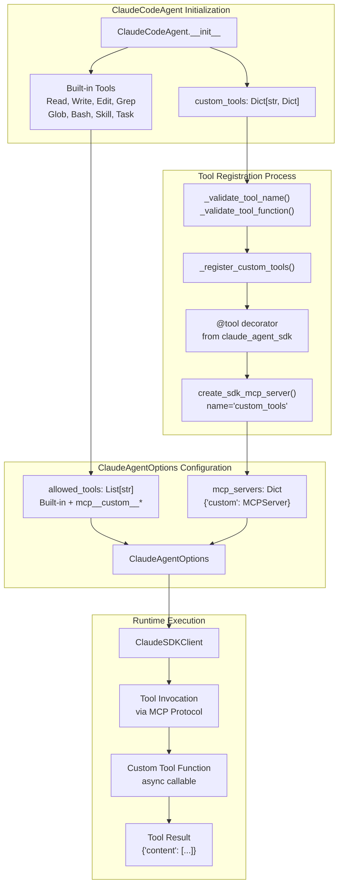
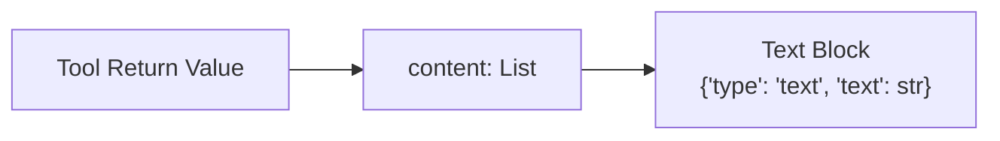
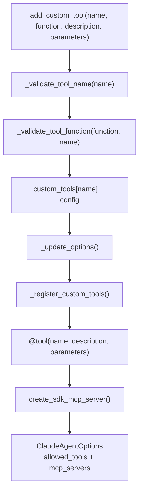

<!-- source: DeepWiki mcp.deepwiki.com · repo baidu-baige/LoongFlow · page 7.3 Tool Development · fetched 2026-10-26 -->

# Tool Development

<details>
<summary>Relevant source files</summary>

The following files were used as context for generating this wiki page:

- [src/loongflow/framework/claude_code/claude_code_agent.py](src/loongflow/framework/claude_code/claude_code_agent.py)

</details>


This page explains how to create custom tools for `ClaudeCodeAgent`, extending its capabilities beyond the built-in tools (Read, Write, Edit, Grep, Glob, Bash, Skill, Task). Custom tools enable the agent to perform domain-specific operations such as database queries, API calls, calculations, or specialized file processing.

For implementing custom PES components (Planner, Executor, Summary), see [Custom PES Components](#7.2). For creating custom evaluator logic, see [Custom Evaluators](#7.4).

**Sources:** [src/loongflow/framework/claude_code/claude_code_agent.py:60-620]()

---

## Tool Architecture

### ClaudeCodeAgent Tool Integration Flow



**Sources:** [src/loongflow/framework/claude_code/claude_code_agent.py:103-233](), [src/loongflow/framework/claude_code/claude_code_agent.py:281-318]()

Custom tools are integrated into `ClaudeCodeAgent` through the Model Context Protocol (MCP) server mechanism. The agent creates an MCP server named `"custom_tools"` that exposes custom tool functions. Tool names are prefixed with `mcp__custom__` in the allowed tools list to distinguish them from built-in tools.

---

## Tool Structure

### Required Components

Every custom tool consists of three components:

| Component | Type | Description |
|-----------|------|-------------|
| `function` | `Callable` | Async function implementing the tool logic |
| `description` | `str` | Human-readable description for the LLM |
| `parameters` | `Dict[str, type]` | Parameter schema mapping names to types |

**Sources:** [src/loongflow/framework/claude_code/claude_code_agent.py:126-141](), [src/loongflow/framework/claude_code/claude_code_agent.py:291-295]()

### Tool Function Requirements

Tool functions must satisfy these requirements:

1. **Async Definition**: Must be defined with `async def`
2. **Single Argument**: Accepts a dictionary of arguments
3. **Return Format**: Returns a dictionary with `content` key containing a list of content blocks

```python
async def my_tool(args: dict) -> dict:
    """
    Args:
        args: Dictionary containing tool parameters
    
    Returns:
        Dictionary with structure:
        {
            "content": [
                {"type": "text", "text": "result text"},
                # ... more content blocks
            ]
        }
    """
    # Tool implementation
    result = process(args)
    return {
        "content": [
            {"type": "text", "text": f"Result: {result}"}
        ]
    }
```

**Sources:** [src/loongflow/framework/claude_code/claude_code_agent.py:261-279](), [src/loongflow/framework/claude_code/claude_code_agent.py:546-560]()

### Tool Content Block Format

The return value's `content` list contains content blocks following the Anthropic message format:



**Sources:** [src/loongflow/framework/claude_code/claude_code_agent.py:546-552]()

---

## Creating Custom Tools

### Method 1: Constructor Initialization

Pass custom tools during `ClaudeCodeAgent` initialization:

```python
from loongflow.framework.claude_code import ClaudeCodeAgent

async def calculator_tool(args):
    expression = args.get("expression", "")
    try:
        result = eval(expression)
        return {
            "content": [
                {"type": "text", "text": f"Result: {result}"}
            ]
        }
    except Exception as e:
        return {
            "content": [
                {"type": "text", "text": f"Error: {str(e)}"}
            ]
        }

agent = ClaudeCodeAgent(
    model="claude-3-5-sonnet-20241022",
    work_dir="./workspace",
    tool_list=["Read", "Edit"],
    custom_tools={
        "calculator": {
            "function": calculator_tool,
            "description": "Evaluates mathematical expressions",
            "parameters": {"expression": str}
        }
    }
)
```

**Sources:** [src/loongflow/framework/claude_code/claude_code_agent.py:86-100](), [src/loongflow/framework/claude_code/claude_code_agent.py:111-141]()

### Method 2: Dynamic Tool Addition

Add tools after agent initialization using `add_custom_tool()`:

```python
agent = ClaudeCodeAgent(
    model="claude-3-5-sonnet-20241022",
    work_dir="./workspace"
)

async def database_query(args):
    query = args.get("query", "")
    # Execute database query
    results = execute_sql(query)
    return {
        "content": [
            {"type": "text", "text": f"Query results: {results}"}
        ]
    }

agent.add_custom_tool(
    name="db_query",
    function=database_query,
    description="Executes SQL queries against the database",
    parameters={"query": str}
)
```

**Sources:** [src/loongflow/framework/claude_code/claude_code_agent.py:525-578]()

---

## Tool Registration and Validation

### Tool Registration Process



**Sources:** [src/loongflow/framework/claude_code/claude_code_agent.py:525-578](), [src/loongflow/framework/claude_code/claude_code_agent.py:320-361]()

### Validation Rules

#### Tool Name Validation

The `_validate_tool_name()` method enforces these rules:

| Rule | Validation |
|------|------------|
| Non-empty | Name must be a non-empty string |
| Alphanumeric | Only letters, numbers, underscores, and hyphens allowed |
| No conflicts | Cannot match built-in tool names |

```python
# Valid names
"calculator"
"db_query"
"api-client"
"get_weather_v2"

# Invalid names
""                    # Empty
"my tool"            # Contains space
"api@client"         # Contains special character
"Read"               # Conflicts with built-in tool
```

**Sources:** [src/loongflow/framework/claude_code/claude_code_agent.py:236-259]()

#### Tool Function Validation

The `_validate_tool_function()` method checks:

1. **Callable**: Function must be callable
2. **Async**: Function must be a coroutine function (defined with `async def`)

```python
# Valid function
async def my_tool(args):
    return {"content": [...]}

# Invalid - not async
def my_tool(args):  # TypeError: must be async
    return {"content": [...]}
```

**Sources:** [src/loongflow/framework/claude_code/claude_code_agent.py:261-279]()

---

## Tool Decorator Application

### The @tool Decorator

Custom tool functions are wrapped with the `@tool` decorator from `claude_agent_sdk`:

```python
from claude_agent_sdk import tool

# The decorator is applied internally by ClaudeCodeAgent
decorated_func = tool(tool_name, description, parameters)(func)
```

This decorator converts the Python function into an MCP-compatible tool that the Claude SDK can invoke.

**Sources:** [src/loongflow/framework/claude_code/claude_code_agent.py:13-20](), [src/loongflow/framework/claude_code/claude_code_agent.py:306-308]()

### MCP Server Creation

Decorated tools are bundled into an MCP server:

```python
from claude_agent_sdk import create_sdk_mcp_server

# Create MCP server with custom tools
custom_server = create_sdk_mcp_server(
    name="custom_tools",
    version="1.0.0",
    tools=custom_tool_functions  # List of decorated functions
)

mcp_servers = {"custom": custom_server}
```

The MCP server is then passed to `ClaudeAgentOptions` to make tools available to the agent.

**Sources:** [src/loongflow/framework/claude_code/claude_code_agent.py:196-200](), [src/loongflow/framework/claude_code/claude_code_agent.py:331-334]()

### Tool Name Resolution

Custom tools appear in the `allowed_tools` list with the prefix `mcp__custom__`:

```python
# Custom tool named "calculator" becomes:
"mcp__custom__calculator"

# Built allowed_tools list:
allowed_tools = [
    "Read",
    "Write", 
    "Edit",
    "mcp__custom__calculator",
    "mcp__custom__db_query"
]
```

**Sources:** [src/loongflow/framework/claude_code/claude_code_agent.py:202-204](), [src/loongflow/framework/claude_code/claude_code_agent.py:337-338]()

---

## Tool Lifecycle Management

### Tool Management Methods

`ClaudeCodeAgent` provides methods for runtime tool management:

| Method | Purpose | Return Type |
|--------|---------|-------------|
| `add_custom_tool(name, function, description, parameters)` | Add a new tool | `None` |
| `remove_custom_tool(name)` | Remove a tool by name | `bool` |
| `list_custom_tools()` | List all custom tool names | `List[str]` |
| `get_custom_tool_info(name)` | Get tool configuration | `Optional[Dict]` |

**Sources:** [src/loongflow/framework/claude_code/claude_code_agent.py:525-620]()

### Removing Tools

```python
# Remove a custom tool
success = agent.remove_custom_tool("calculator")

if success:
    print("Tool removed")
else:
    print("Tool not found")
```

When a tool is removed, `_update_options()` is called to rebuild the `ClaudeAgentOptions` without the removed tool.

**Sources:** [src/loongflow/framework/claude_code/claude_code_agent.py:579-598]()

### Listing and Inspecting Tools

```python
# List all custom tools
tool_names = agent.list_custom_tools()
print(f"Custom tools: {tool_names}")

# Get tool configuration
tool_info = agent.get_custom_tool_info("calculator")
if tool_info:
    print(f"Description: {tool_info['description']}")
    print(f"Parameters: {tool_info['parameters']}")
```

**Sources:** [src/loongflow/framework/claude_code/claude_code_agent.py:600-620]()

---

## Practical Examples

### Example 1: Simple Calculator Tool

A tool with basic parameter handling and error management:

```python
async def calculator(args):
    """Evaluates mathematical expressions safely."""
    expression = args.get("expression", "")
    
    if not expression:
        return {
            "content": [
                {"type": "text", "text": "Error: No expression provided"}
            ]
        }
    
    try:
        # Use eval with limited scope for safety
        allowed_names = {"__builtins__": {}}
        result = eval(expression, allowed_names)
        
        return {
            "content": [
                {"type": "text", "text": f"Result: {result}"}
            ]
        }
    except Exception as e:
        return {
            "content": [
                {"type": "text", "text": f"Error: {str(e)}"}
            ]
        }

agent.add_custom_tool(
    name="calculator",
    function=calculator,
    description="Evaluates mathematical expressions like '2 + 2' or '5 * 3'",
    parameters={"expression": str}
)
```

**Sources:** [src/loongflow/framework/claude_code/claude_code_agent.py:546-560]()

### Example 2: File Search Tool

A tool with multiple parameters and file system operations:

```python
async def search_files(args):
    """Searches files for a pattern in a directory."""
    import os
    import re
    
    directory = args.get("directory", ".")
    pattern = args.get("pattern", "")
    file_extension = args.get("extension", "")
    
    if not pattern:
        return {
            "content": [
                {"type": "text", "text": "Error: Pattern is required"}
            ]
        }
    
    matches = []
    regex = re.compile(pattern)
    
    for root, dirs, files in os.walk(directory):
        for file in files:
            if file_extension and not file.endswith(file_extension):
                continue
                
            filepath = os.path.join(root, file)
            try:
                with open(filepath, 'r', encoding='utf-8') as f:
                    content = f.read()
                    if regex.search(content):
                        matches.append(filepath)
            except Exception:
                continue
    
    result_text = "\n".join(matches) if matches else "No matches found"
    return {
        "content": [
            {"type": "text", "text": f"Search results:\n{result_text}"}
        ]
    }

agent.add_custom_tool(
    name="search_files",
    function=search_files,
    description="Searches files in a directory for a regex pattern",
    parameters={
        "directory": str,
        "pattern": str,
        "extension": str
    }
)
```

**Sources:** [src/loongflow/framework/claude_code/claude_code_agent.py:525-560]()

### Example 3: API Client Tool

A tool demonstrating async HTTP requests:

```python
import aiohttp

async def fetch_api(args):
    """Fetches data from an API endpoint."""
    url = args.get("url", "")
    method = args.get("method", "GET").upper()
    headers = args.get("headers", {})
    
    if not url:
        return {
            "content": [
                {"type": "text", "text": "Error: URL is required"}
            ]
        }
    
    try:
        async with aiohttp.ClientSession() as session:
            async with session.request(method, url, headers=headers) as response:
                status = response.status
                text = await response.text()
                
                return {
                    "content": [
                        {
                            "type": "text",
                            "text": f"Status: {status}\n\nResponse:\n{text}"
                        }
                    ]
                }
    except Exception as e:
        return {
            "content": [
                {"type": "text", "text": f"Error: {str(e)}"}
            ]
        }

agent.add_custom_tool(
    name="api_client",
    function=fetch_api,
    description="Fetches data from HTTP API endpoints",
    parameters={
        "url": str,
        "method": str,
        "headers": dict
    }
)
```

**Sources:** [src/loongflow/framework/claude_code/claude_code_agent.py:261-279]()

---

## Best Practices

### Naming Conventions

1. **Descriptive Names**: Use clear, action-oriented names
   - Good: `search_files`, `fetch_api`, `calculate_sum`
   - Avoid: `tool1`, `helper`, `function`

2. **Consistent Casing**: Use snake_case for tool names
   - Good: `database_query`, `get_weather`
   - Avoid: `DatabaseQuery`, `getWeather`

3. **Avoid Conflicts**: Don't use names matching built-in tools
   - Built-in tools: `Read`, `Write`, `Edit`, `Grep`, `Glob`, `Bash`, `Skill`, `Task`

**Sources:** [src/loongflow/framework/claude_code/claude_code_agent.py:236-259]()

### Error Handling

Always handle errors gracefully within tool functions:

```python
async def robust_tool(args):
    try:
        # Tool logic
        result = perform_operation(args)
        
        return {
            "content": [
                {"type": "text", "text": f"Success: {result}"}
            ]
        }
    except ValueError as e:
        # Specific error handling
        return {
            "content": [
                {"type": "text", "text": f"Validation error: {str(e)}"}
            ]
        }
    except Exception as e:
        # General error handling
        return {
            "content": [
                {"type": "text", "text": f"Unexpected error: {str(e)}"}
            ]
        }
```

**Sources:** [src/loongflow/framework/claude_code/claude_code_agent.py:546-560]()

### Async Patterns

1. **Always Use async def**: Tool functions must be asynchronous
2. **Use await for I/O**: Leverage async I/O operations for better performance
3. **Avoid Blocking Operations**: Don't use `time.sleep()`, use `asyncio.sleep()`

```python
import asyncio

async def slow_operation(args):
    # Good: async sleep
    await asyncio.sleep(1)
    
    # Bad: blocking sleep (avoid)
    # time.sleep(1)
    
    return {"content": [...]}
```

**Sources:** [src/loongflow/framework/claude_code/claude_code_agent.py:275-279]()

### Parameter Validation

Validate and provide defaults for parameters:

```python
async def validated_tool(args):
    # Validate required parameters
    required_param = args.get("required_param")
    if not required_param:
        return {
            "content": [
                {"type": "text", "text": "Error: required_param is missing"}
            ]
        }
    
    # Provide defaults for optional parameters
    optional_param = args.get("optional_param", "default_value")
    
    # Validate parameter types and ranges
    count = args.get("count", 10)
    if not isinstance(count, int) or count < 1:
        return {
            "content": [
                {"type": "text", "text": "Error: count must be a positive integer"}
            ]
        }
    
    # Tool logic
    result = process(required_param, optional_param, count)
    
    return {
        "content": [
            {"type": "text", "text": f"Result: {result}"}
        ]
    }
```

**Sources:** [src/loongflow/framework/claude_code/claude_code_agent.py:291-295]()

### Detailed Descriptions

Provide clear, detailed descriptions that help the LLM understand when and how to use the tool:

```python
agent.add_custom_tool(
    name="process_csv",
    function=process_csv_tool,
    description=(
        "Processes CSV files to extract, filter, and transform data. "
        "Supports filtering by column values and aggregating results. "
        "Use this tool when working with tabular data in CSV format."
    ),
    parameters={
        "filepath": str,
        "filter_column": str,
        "filter_value": str,
        "aggregate": str
    }
)
```

Good descriptions include:
- What the tool does
- When to use it
- Input/output formats
- Any limitations or constraints

**Sources:** [src/loongflow/framework/claude_code/claude_code_agent.py:292-293]()

---

