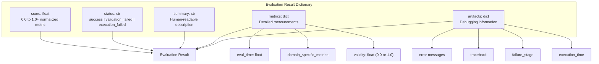
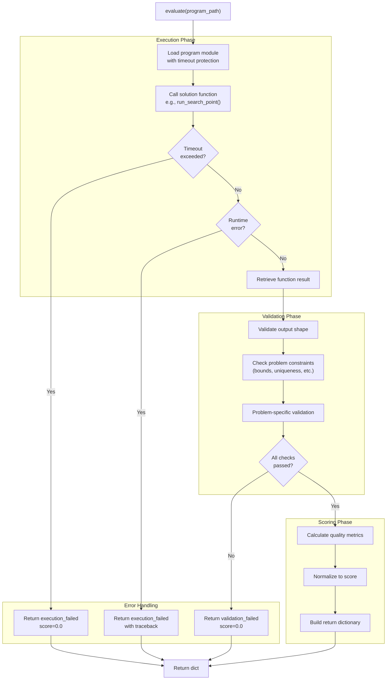
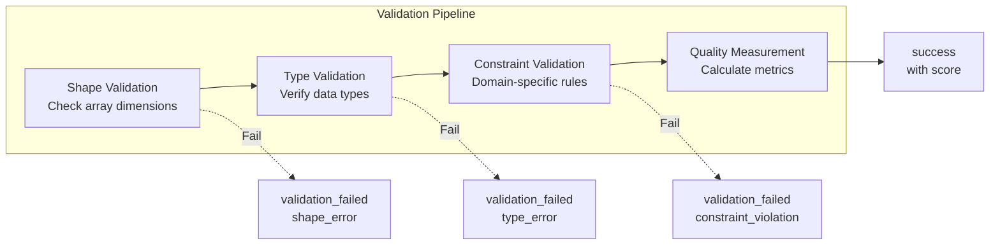
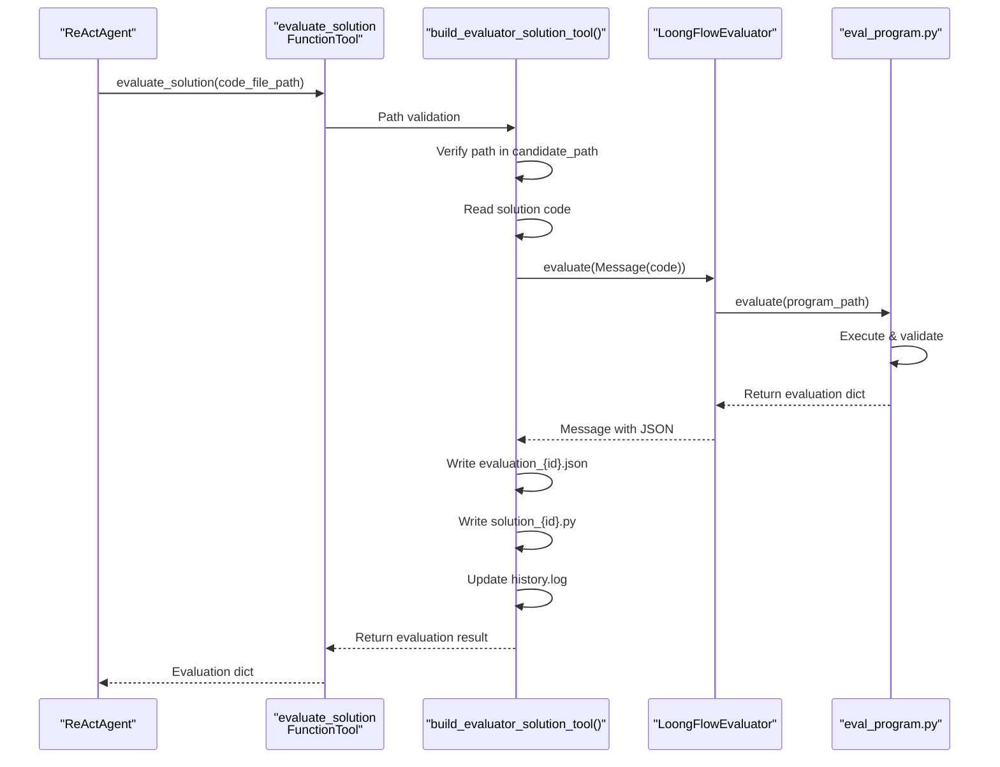
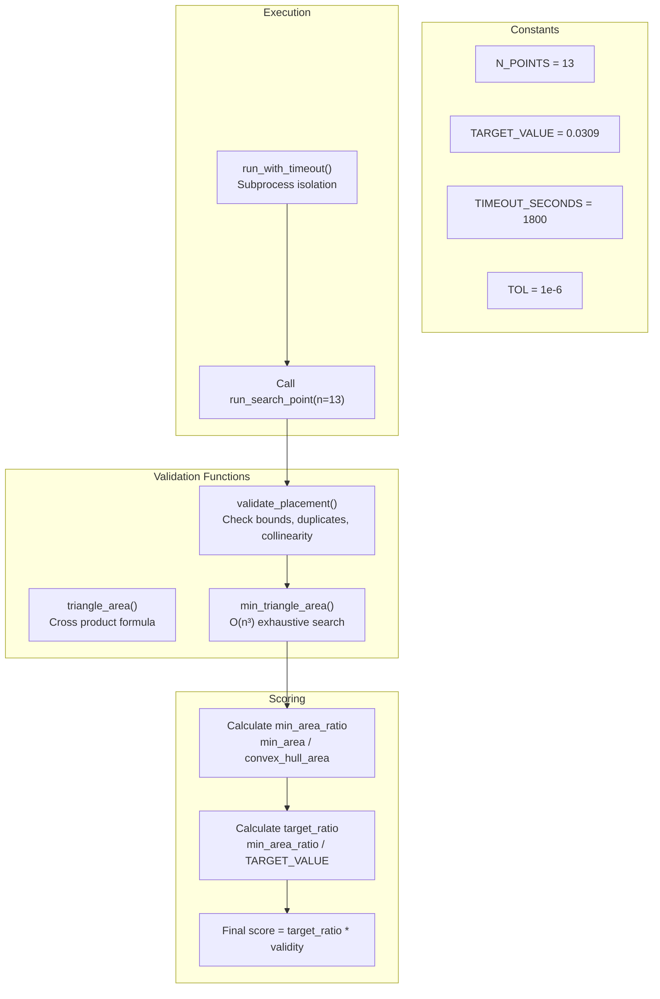
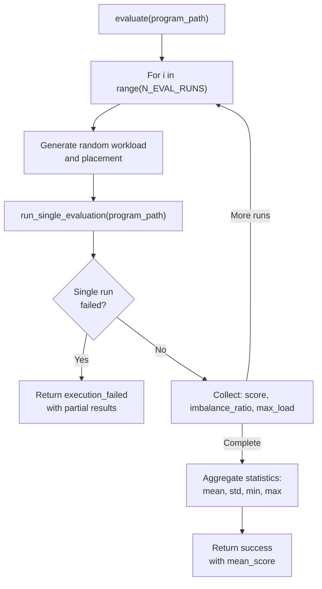

<!-- source: DeepWiki mcp.deepwiki.com · repo baidu-baige/LoongFlow · page 7.4 Custom Evaluators · fetched 2026-10-26 -->

# Custom Evaluators

<details>
<summary>Relevant source files</summary>

The following files were used as context for generating this wiki page:

- [agents/general_agent/evaluator.py](agents/general_agent/evaluator.py)

</details>


Custom evaluators are problem-specific evaluation programs that score candidate solutions generated during PES evolution cycles. Each evaluator implements a standardized interface that validates candidate solutions, measures their quality, and returns structured feedback to guide the evolutionary process.

This page covers the implementation contract, return value structure, and integration patterns for custom evaluators. For information about running evaluators as tools during execution, see [Tool Development](#7.3). For examples of evaluators in specific agent types, see [Math Agent Examples](#5.6) and [ML Agent Integration](#6.4).

---

## Evaluator Contract

All custom evaluators must implement a single entry point function with the following signature:

```python
def evaluate(program_path: str) -> dict
```

The `program_path` parameter is the absolute file path to the candidate solution program being evaluated. The function must return a structured dictionary conforming to the standard evaluation contract described below.

### Standard Return Structure



**Sources:** [agents/math_agent/examples/heilbronn_problem_for_convex_regions/eval_program.py:227-239](), [agents/math_agent/examples/packing_hexagons_in_hexagons/eval_program.py:296-362](), [agents/math_agent/examples/moe_lb/eval_program.py:194-239]()

---

## Required Fields

### Core Fields

| Field | Type | Required | Description |
|-------|------|----------|-------------|
| `score` | `float` | Yes | Normalized score, typically 0.0 to 1.0+. Higher is better. Must be serializable. |
| `status` | `str` | Yes | One of: `"success"`, `"validation_failed"`, `"execution_failed"` |
| `summary` | `str` | Yes | Human-readable description of evaluation result |
| `metrics` | `dict` | Recommended | Detailed measurements including `eval_time` and problem-specific metrics |
| `artifacts` | `dict` | Recommended | Debugging information, error messages, traceback for failed evaluations |

### Status Values

- **`success`**: Solution executed successfully and passed all validation checks
- **`validation_failed`**: Solution executed but failed constraint validation (e.g., points outside bounds, constraint violations)
- **`execution_failed`**: Solution failed to execute (timeout, runtime error, missing functions)

**Sources:** [agents/math_agent/examples/heilbronn_problem_for_convex_regions/eval_program.py:159-277]()

---

## Evaluation Workflow



**Sources:** [agents/math_agent/examples/heilbronn_problem_for_convex_regions/eval_program.py:154-277](), [agents/math_agent/examples/packing_hexagons_in_hexagons/eval_program.py:296-362]()

---

## Implementation Patterns

### Timeout Protection

Evaluators must prevent solutions from running indefinitely. Two common patterns:

**Pattern 1: Subprocess Isolation**
```python
def run_with_timeout(program_path, n_points, timeout_seconds=TIMEOUT_SECONDS):
    """Runs program in separate process with timeout."""
    # Create temporary script that imports and runs the solution
    # Use subprocess.Popen with communicate(timeout=timeout_seconds)
    # Handle subprocess.TimeoutExpired exception
```

This pattern is used in [agents/math_agent/examples/heilbronn_problem_for_convex_regions/eval_program.py:84-152]() and [agents/math_agent/examples/moe_lb/eval_program.py:64-136]().

**Pattern 2: Direct Import with Timeout**
```python
def run_with_timeout(program_path, timeout_seconds=20):
    """Import module and call function directly."""
    # Use importlib to load module
    # Call function synchronously (assuming it respects time limits)
    # Catch exceptions and re-raise as RuntimeError
```

This simpler pattern is used in [agents/math_agent/examples/packing_hexagons_in_hexagons/eval_program.py:232-294]().

**Sources:** [agents/math_agent/examples/heilbronn_problem_for_convex_regions/eval_program.py:84-152](), [agents/math_agent/examples/packing_hexagons_in_hexagons/eval_program.py:232-294](), [agents/math_agent/examples/moe_lb/eval_program.py:64-136]()

### Validation Stages

Evaluators typically perform multi-stage validation:



**Example: Heilbronn Problem Validation**

1. **Shape Validation**: [agents/math_agent/examples/heilbronn_problem_for_convex_regions/eval_program.py:168-188]()
   - Verify `points.shape == (N_POINTS, 2)`
   
2. **Geometric Validation**: [agents/math_agent/examples/heilbronn_problem_for_convex_regions/eval_program.py:29-63]()
   - Check points are within unit square
   - Verify no duplicate points
   - Ensure no three points are collinear

3. **Quality Calculation**: [agents/math_agent/examples/heilbronn_problem_for_convex_regions/eval_program.py:195-213]()
   - Calculate minimum triangle area
   - Compute convex hull area ratio
   - Normalize against benchmark

**Sources:** [agents/math_agent/examples/heilbronn_problem_for_convex_regions/eval_program.py:29-239]()

### Error Handling Strategy

Robust evaluators handle three error categories:

| Error Category | Status | Score | Required Artifacts |
|----------------|--------|-------|-------------------|
| Timeout | `execution_failed` | 0.0 | `failure_stage`, `execution_time`, timeout message |
| Runtime Error | `execution_failed` | 0.0 | `stderr`, `traceback`, `failure_stage` |
| Validation Failure | `validation_failed` | 0.0 | `validation_report`, specific constraint violation |

**Example Error Response:**
```python
{
    "score": 0.0,
    "status": "execution_failed",
    "summary": "Execution failed: The program timed out after 1800 seconds.",
    "metrics": {
        "eval_time": 1800.1,
    },
    "artifacts": {
        "stderr": "TimeoutError: Process timed out after 1800 seconds",
        "failure_stage": "execution_timeout",
        "execution_time": "1800.10s"
    }
}
```

**Sources:** [agents/math_agent/examples/heilbronn_problem_for_convex_regions/eval_program.py:241-277]()

---

## Integration with Tool System

Evaluators are exposed to agents through the `evaluate_solution` tool built by `build_evaluator_solution_tool()`.

### Tool Integration Flow



**Sources:** [agents/math_agent/executor/execute_react/build_tool.py:78-210]()

### Tool Builder Implementation

The `build_evaluator_solution_tool()` function wraps the evaluator:

1. **Path Validation**: Ensures solution file is within `candidate_path` [agents/math_agent/executor/execute_react/build_tool.py:98-125]()
2. **File Reading**: Loads solution code [agents/math_agent/executor/execute_react/build_tool.py:141-153]()
3. **Evaluation Execution**: Calls `LoongFlowEvaluator.evaluate()` [agents/math_agent/executor/execute_react/build_tool.py:156-162]()
4. **Result Persistence**: Writes `evaluation_{id}.json` and `solution_{id}.py` [agents/math_agent/executor/execute_react/build_tool.py:163-172]()
5. **History Logging**: Updates `history.log` with evaluation [agents/math_agent/executor/execute_react/build_tool.py:180-198]()

**Sources:** [agents/math_agent/executor/execute_react/build_tool.py:78-210]()

---

## Example: Heilbronn Problem Evaluator

The Heilbronn problem evaluator demonstrates a complete implementation with geometric validation and quality scoring.

### Problem Definition

Place n=13 points in a unit square to maximize the minimum triangle area formed by any three points.

### Evaluator Structure



**Sources:** [agents/math_agent/examples/heilbronn_problem_for_convex_regions/eval_program.py:1-286]()

### Key Implementation Details

**Geometric Validation**: [agents/math_agent/examples/heilbronn_problem_for_convex_regions/eval_program.py:29-63]()
```python
def validate_placement(points: np.ndarray):
    """Checks that all points are inside unit square, no overlaps, no collinearity."""
    # Check for duplicates with tolerance
    # Verify points within [0,1]×[0,1]
    # Test all triplets for collinearity using cross product
    return is_valid, error_message
```

**Quality Metric**: [agents/math_agent/examples/heilbronn_problem_for_convex_regions/eval_program.py:71-81]()
```python
def min_triangle_area(points):
    """Calculate minimal triangle area - O(n³) exhaustive."""
    min_area = float("inf")
    for all combinations of 3 points:
        area = triangle_area(pi, pj, pk)
        min_area = min(min_area, area)
    return min_area
```

**Score Normalization**: [agents/math_agent/examples/heilbronn_problem_for_convex_regions/eval_program.py:198-213]()
```python
# Area relative to convex hull
min_area_ratio = final_min_area / convex_hull_area

# Progress toward benchmark
target_ratio = min_area_ratio / TARGET_VALUE  # 0.0309 for n=13

# Final score with validity penalty
score = target_ratio * validity  # validity ∈ {0.0, 1.0}
```

**Sources:** [agents/math_agent/examples/heilbronn_problem_for_convex_regions/eval_program.py:29-239]()

---

## Multi-Run Evaluation Pattern

Some problems require statistical evaluation across multiple runs to measure robustness.

### MoE Load Balancing Example

The MoE load balancing evaluator runs 100 independent evaluations and aggregates results:



**Implementation**: [agents/math_agent/examples/moe_lb/eval_program.py:194-239]()

**Aggregated Metrics**:
```python
{
    "score": mean_score,
    "metrics": {
        "mean_score": np.mean(scores),
        "std_dev_score": np.std(scores),
        "min_score": np.min(scores),
        "max_score": np.max(scores),
        "mean_imbalance_ratio": np.mean(imbalance_ratios),
        "std_dev_imbalance_ratio": np.std(imbalance_ratios),
        "eval_time": eval_time,
        "completed_runs": N_EVAL_RUNS
    }
}
```

**Sources:** [agents/math_agent/examples/moe_lb/eval_program.py:194-239]()

---

## Best Practices

### 1. Subprocess Isolation for Untrusted Code

Use subprocess execution for solutions that may contain infinite loops or resource exhaustion:

```python
subprocess.Popen([sys.executable, temp_script],
                 stdout=subprocess.PIPE,
                 stderr=subprocess.PIPE)
stdout, stderr = process.communicate(timeout=timeout_seconds)
```

**Sources:** [agents/math_agent/examples/heilbronn_problem_for_convex_regions/eval_program.py:120-125]()

### 2. Tolerance-Based Comparisons

Use epsilon tolerance for floating-point comparisons:

```python
EPSILON = 1e-9
if abs(value1 - value2) < EPSILON:
    # Consider equal
```

**Sources:** [agents/math_agent/examples/packing_hexagons_in_hexagons/eval_program.py:16-50]()

### 3. Staged Validation with Early Exit

Validate in stages from cheap to expensive checks:

1. Type and shape validation (fast)
2. Constraint validation (medium)
3. Quality computation (potentially expensive)

Return immediately on first failure to save computation.

**Sources:** [agents/math_agent/examples/heilbronn_problem_for_convex_regions/eval_program.py:168-239]()

### 4. Comprehensive Error Reporting

Always populate `artifacts` with debugging information:

```python
"artifacts": {
    "stderr": error_message,
    "traceback": traceback.format_exc(),
    "failure_stage": "geometric_validation",
    "execution_time": f"{eval_time:.2f}s"
}
```

This helps agents learn from failures during evolution.

**Sources:** [agents/math_agent/examples/heilbronn_problem_for_convex_regions/eval_program.py:215-226]()

### 5. Normalized Scoring

Design scores so that:
- 0.0 represents complete failure
- 1.0 represents achieving the current benchmark
- Values > 1.0 represent exceeding the benchmark

This enables meaningful comparison across evolution cycles.

**Sources:** [agents/math_agent/examples/heilbronn_problem_for_convex_regions/eval_program.py:210-213]()

### 6. Path Validation

When loading solution files, always validate paths are within allowed directories:

```python
candidate_path_abs = os.path.abspath(candidate_path)
requested_path_abs = os.path.abspath(code_file_path)
if not requested_path_abs.startswith(candidate_path_abs):
    raise ValueError(f"Path outside permitted workspace")
```

**Sources:** [agents/math_agent/executor/execute_react/build_tool.py:98-125]()

---

## Testing Evaluators

Evaluators should be runnable as standalone scripts for development and debugging:

```python
if __name__ == "__main__":
    file = "initial_program.py"
    res = evaluate(file)
    import json
    print(json.dumps(res, ensure_ascii=False, indent=2))
```

This allows testing without the full PES framework.

**Example Test Output**:
```json
{
  "score": 0.8523,
  "status": "success",
  "summary": "Evaluation successful.",
  "metrics": {
    "min_area": 0.0263,
    "min_area_ratio": 0.0263,
    "target_ratio": 0.8523,
    "validity": 1.0,
    "eval_time": 45.23
  },
  "artifacts": {
    "validation_report": "Placement is valid.",
    "summary": "Achieved 85.23% of benchmark."
  }
}
```

**Sources:** [agents/math_agent/examples/heilbronn_problem_for_convex_regions/eval_program.py:280-286](), [agents/math_agent/examples/packing_hexagons_in_hexagons/eval_program.py:365-368]()

---

