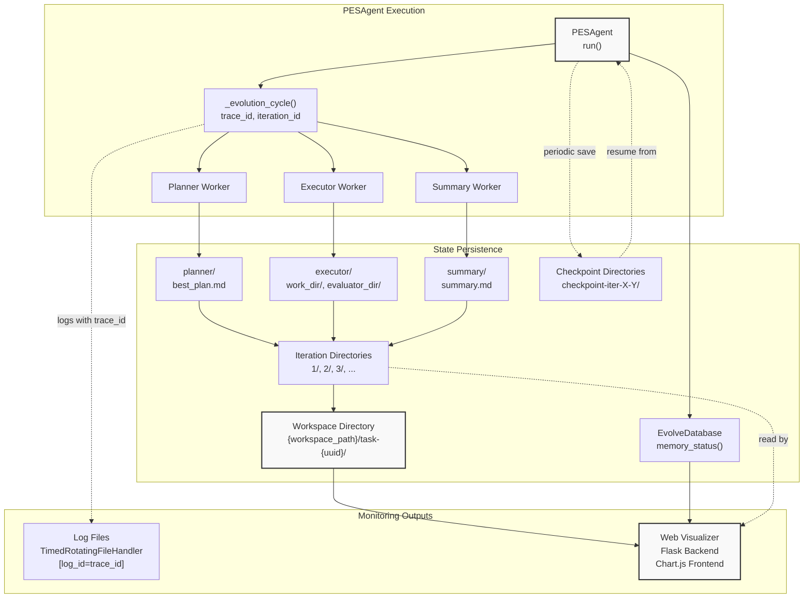
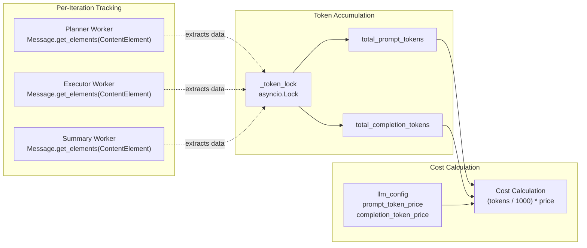

<!-- source: DeepWiki mcp.deepwiki.com · repo baidu-baige/LoongFlow · page 8 Visualization & Monitoring · fetched 2026-10-26 -->

# Visualization & Monitoring

<details>
<summary>Relevant source files</summary>

The following files were used as context for generating this wiki page:

- [agents/general_agent/README.md](agents/general_agent/README.md)
- [agents/general_agent/README_zh.md](agents/general_agent/README_zh.md)
- [src/loongflow/framework/claude_code/general_prompt.py](src/loongflow/framework/claude_code/general_prompt.py)
- [src/loongflow/framework/pes/base_runner.py](src/loongflow/framework/pes/base_runner.py)
- [src/loongflow/framework/pes/pes_agent.py](src/loongflow/framework/pes/pes_agent.py)

</details>


This section covers the tools and mechanisms for monitoring, debugging, and visualizing LoongFlow's evolutionary processes. These capabilities enable real-time tracking of agent progress, inspection of intermediate results, and recovery from interruptions.

**Scope**: This page provides an overview of LoongFlow's monitoring infrastructure. For detailed usage of specific tools, see:
- [Visualization Server](#8.1) - Web-based dashboard for real-time monitoring
- [Checkpoints & Resumption](#8.2) - Fault tolerance and state persistence
- [Logging & Debugging](#8.3) - Log configuration and debugging techniques

---

## Monitoring Architecture

LoongFlow provides three complementary monitoring mechanisms that operate at different levels of the system:

| Mechanism | Level | Purpose | Output Format |
|-----------|-------|---------|---------------|
| **Visualization Server** | Task-level | Real-time progress tracking, iteration comparison | Web dashboard (Flask + JS) |
| **Checkpoints** | Agent-level | State persistence, resumption after interruption | Directory snapshots (`checkpoint-iter-X-Y/`) |
| **Logging** | Framework-level | Detailed execution traces, debugging | Log files (rotating, trace-tagged) |

### Monitoring Data Flow



**Diagram: Monitoring Data Flow**

Sources: [src/loongflow/framework/pes/pes_agent.py:174-329](), [agents/general_agent/README.md:162-299]()

---

## Workspace Organization

All monitoring data originates from the workspace directory structure. Each task execution creates a UUID-based workspace containing iteration artifacts:

```
{workspace_path}/
└── task-{uuid}/                    # Task instance directory
    ├── 1/                          # Iteration 1
    │   ├── planner/
    │   │   └── best_plan.md        # Plan output
    │   ├── executor/
    │   │   ├── work_dir/           # Generated solution files
    │   │   │   ├── index.json      # Solution pack manifest
    │   │   │   └── ...             # Solution files
    │   │   └── evaluator_dir/
    │   │       └── best_evaluation.json  # Evaluation results
    │   └── summary/
    │       └── summary.md          # Summary output
    ├── 2/                          # Iteration 2
    │   └── ...
    └── database/
        ├── checkpoint-iter-15-5/   # Checkpoint at iteration 15, 5th completion
        └── checkpoint-iter-30-10/  # Checkpoint at iteration 30, 10th completion
```

This standardized structure enables:
- **Visualization**: The web server reads iteration directories and JSON evaluation files
- **Checkpoints**: Database state snapshots are stored in `database/` subdirectories
- **Debugging**: Each iteration preserves complete inputs, outputs, and intermediate artifacts

Sources: [agents/general_agent/README.md:274-300](), [src/loongflow/framework/pes/pes_agent.py:214-226]()

---

## Real-Time Progress Tracking

`PESAgent` maintains execution metrics throughout the evolution process:

### Token and Cost Tracking



**Diagram: Token and Cost Tracking**

The `_evolution_cycle` method tracks LLM usage per iteration and logs cumulative metrics:

```
Trace ID: {trace_id}, Evolution cycle for iteration {iteration_id} completed successfully.
Used Prompt tokens: {prompt_tokens}, cost: {prompt_cost}.
Used Completion tokens: {completion_tokens}, cost: {completion_cost}.
Total Tokens: {total_tokens}, total cost: {total_cost}.
```

Sources: [src/loongflow/framework/pes/pes_agent.py:183-312](), [src/loongflow/framework/pes/pes_agent.py:240-289]()

### Score Evolution Tracking

The agent monitors the best score across all iterations by querying the database:

```python
global_status = self.database.memory_status()
best_score = global_status.get("global_status", {}).get("best_score", 0.0)

if best_score >= self.target_score:
    # Target achieved, trigger shutdown
```

This enables:
- **Early termination**: Process stops when target score is reached
- **Progress visibility**: Current best score is available to monitoring tools
- **Convergence detection**: Identify when improvements plateau

Sources: [src/loongflow/framework/pes/pes_agent.py:479-513]()

---

## Monitoring Components Overview

### 1. Visualization Server

A Flask-based web application that provides real-time dashboards for task monitoring. Key features:

- **Score Evolution Charts**: Dynamic graphs showing performance across iterations (Chart.js)
- **Iteration Browser**: Navigate and compare all iterations with detailed metrics
- **File Tree Navigation**: Hierarchical view of solution pack contents
- **Markdown Rendering**: Rich formatting for plans, summaries, and evaluation logs (Marked.js)
- **Multi-Workspace Support**: Monitor multiple tasks simultaneously

**Entry Point**: `agents/general_agent/visualizer/visualizer.py`

**Data Sources**: 
- Workspace iteration directories for artifacts
- `executor/evaluator_dir/best_evaluation.json` for scores
- `executor/work_dir/` for generated files

See [Visualization Server](#8.1) for detailed usage.

Sources: [agents/general_agent/README.md:162-299]()

### 2. Checkpoint System

Periodic state snapshots that enable resumption after interruptions:

**Checkpoint Naming Convention**:
```
checkpoint-iter-{iteration_id}-{completion_count}
```
- `iteration_id`: ID of the iteration that just completed
- `completion_count`: Total number of completed cycles since start

**Triggering Logic**:
```python
async def _handle_cycle_completion_and_checkpoint(self, iteration_id: int):
    async with self._completion_lock:
        self._completion_count += 1
        current_count = self._completion_count
        
        interval = self.config.evolve.database.checkpoint_interval
        if interval > 0 and current_count % interval == 0:
            should_save = True
```

**Resumption**: When loading from a checkpoint, the completion count is restored from the directory name:
```python
match = re.search(r"checkpoint-iter-(\d+)-(\d+)$", dir_name)
if match:
    self._completion_count = int(match.group(2))
```

See [Checkpoints & Resumption](#8.2) for detailed mechanics.

Sources: [src/loongflow/framework/pes/pes_agent.py:86-116](), [src/loongflow/framework/pes/pes_agent.py:330-376]()

### 3. Logging Infrastructure

Structured logging with trace IDs, file rotation, and configurable verbosity:

**Configuration** (via `task_config.yaml`):
```yaml
logger:
  level: "INFO"                    # DEBUG, INFO, WARNING, ERROR, CRITICAL
  log_path: "./logs"               # Log directory
  filename: "loongflow.log"        # Log file name
  console_logging: true            # Enable console output
  file_logging: true               # Enable file output
  rotation: "midnight"             # Rotation schedule
  backup_count: 7                  # Number of backup files
```

**Log Format**:
```
[%(asctime)s] [%(levelname)s] [log_id=%(log_id)s] [%(name)s] %(message)s
```

The `log_id` field contains the trace ID, enabling correlation of log entries across concurrent iterations.

**CLI Override**:
```bash
./run_general.sh task_name --log-level DEBUG --log-path ./debug-logs
```

See [Logging & Debugging](#8.3) for debugging strategies.

Sources: [src/loongflow/framework/pes/base_runner.py:278-325](), [src/loongflow/framework/pes/base_runner.py:142-154]()

---

## Trace ID System

Each evolution cycle receives a unique 12-character trace ID that appears in all related log entries:

```python
trace_id = str(uuid.uuid4().hex[:12])
self.logger.info(f"Trace ID: {trace_id}, Starting evolution cycle for iteration {iteration_id}.")
```

This enables:
- **Concurrent execution tracking**: Identify which log entries belong to which parallel iteration
- **Debugging**: Isolate logs for a specific failed iteration
- **Correlation**: Connect planner → executor → summary logs for a single cycle

The trace ID is propagated through the `Context` object to all workers in the cycle:

```python
context = Context(
    task=evolve_conf.task,
    base_path=evolve_conf.workspace_path,
    # ...
    trace_id=trace_id,
    # ...
)
```

Sources: [src/loongflow/framework/pes/pes_agent.py:178-181](), [src/loongflow/framework/pes/pes_agent.py:214-226](), [src/loongflow/agentsdk/logger/logger.py]()

---

## Integration with PES Cycle

Monitoring is deeply integrated with the three-phase PES cycle:

```mermaid
graph TB
    subgraph "Plan Phase"
        Planner["Planner Worker"]
        PlanArtifacts["Artifacts:<br/>planner/best_plan.md"]
        PlanLogs["Logs:<br/>[log_id=abc123] Planner..."]
    end
    
    subgraph "Execute Phase"
        Executor["Executor Worker"]
        ExecuteArtifacts["Artifacts:<br/>executor/work_dir/<br/>executor/evaluator_dir/"]
        ExecuteLogs["Logs:<br/>[log_id=abc123] Executor..."]
    end
    
    subgraph "Summary Phase"
        Summary["Summary Worker"]
        SummaryArtifacts["Artifacts:<br/>summary/summary.md"]
        SummaryLogs["Logs:<br/>[log_id=abc123] Summary..."]
    end
    
    subgraph "Monitoring Points"
        TokenTracking["Token Tracking<br/>total_prompt_tokens<br/>total_completion_tokens"]
        ScoreUpdate["Database Update<br/>best_score, current_iteration"]
        CheckpointCheck["Checkpoint Check<br/>completion_count % interval"]
    end
    
    Planner --> PlanArtifacts
    Planner -.logs.-> PlanLogs
    Planner --> TokenTracking
    
    Executor --> ExecuteArtifacts
    Executor -.logs.-> ExecuteLogs
    Executor --> TokenTracking
    
    Summary --> SummaryArtifacts
    Summary -.logs.-> SummaryLogs
    Summary --> TokenTracking
    Summary --> ScoreUpdate
    Summary --> CheckpointCheck
```



**Diagram: Monitoring Integration with PES Cycle**

Each phase produces:
- **Artifacts**: Structured outputs (Markdown, JSON, solution files) in the workspace
- **Logs**: Tagged with the same trace ID for correlation
- **Metrics**: Token counts, costs, scores accumulated in `PESAgent`

Sources: [src/loongflow/framework/pes/pes_agent.py:174-329]()

---

## Command-Line Monitoring

The shell scripts provide built-in monitoring capabilities:

### Background Execution

```bash
# Run in background with logging to file
./run_general.sh task_name --background

# Logs written to:
# agents/general_agent/examples/task_name/run.log

# PID stored in:
# agents/general_agent/examples/task_name/.run.pid
```

### Stopping Tasks

```bash
# Send graceful shutdown signal
./run_general.sh stop task_name

# The agent catches SIGTERM and:
# 1. Sets _stop_event to halt new iterations
# 2. Waits for running cycles to complete
# 3. Saves final checkpoint
# 4. Generates final result message
```

Sources: [agents/general_agent/README.md:40-54](), [src/loongflow/framework/pes/base_runner.py:446-460]()

---

## Configuration Reference

Monitoring-related configuration fields in `task_config.yaml`:

```yaml
# Workspace output location
workspace_path: "./output-task-name"

evolve:
  # Checkpoint configuration
  database:
    checkpoint_interval: 5        # Save checkpoint every N completions (0 = disabled)
    output_path: "./database"     # Checkpoint storage location
  
  # Termination conditions (monitoring triggers)
  max_iterations: 100             # Stop after N iterations
  target_score: 0.9               # Stop when score >= target

# Logging configuration
logger:
  level: "INFO"                   # Log verbosity
  log_path: "./logs"              # Log directory
  filename: "loongflow.log"       # Log file name
  console_logging: true           # Console output
  file_logging: true              # File output
  rotation: "midnight"            # Rotation schedule
  backup_count: 7                 # Backup file count
```

Sources: [agents/general_agent/README.md:113-159](), [src/loongflow/framework/pes/base_runner.py:193-254]()

---

## Next Steps

For detailed information on specific monitoring tools:

- **[Visualization Server](#8.1)**: Launch the web dashboard, navigate the interface, and interpret visualizations
- **[Checkpoints & Resumption](#8.2)**: Configure checkpoint intervals, resume from checkpoints, and understand checkpoint internals
- **[Logging & Debugging](#8.3)**: Configure log levels, debug failed iterations, and troubleshoot common issues

Sources: This overview synthesizes information from [src/loongflow/framework/pes/pes_agent.py](), [src/loongflow/framework/pes/base_runner.py](), [agents/general_agent/README.md]()

---

