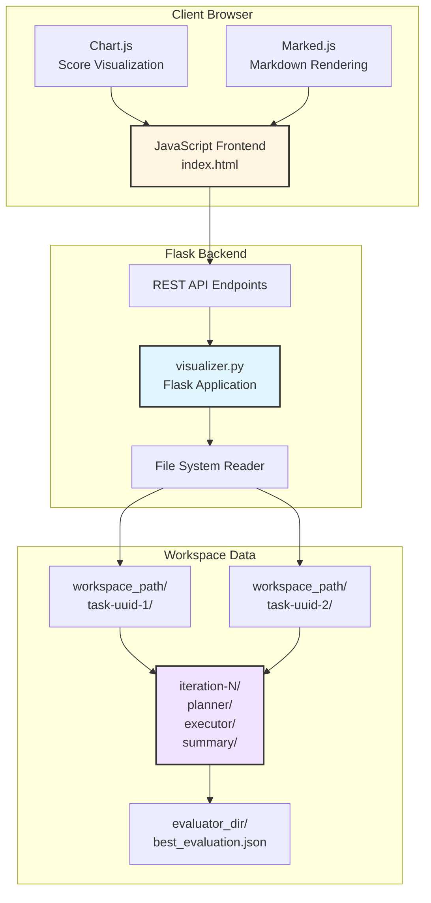
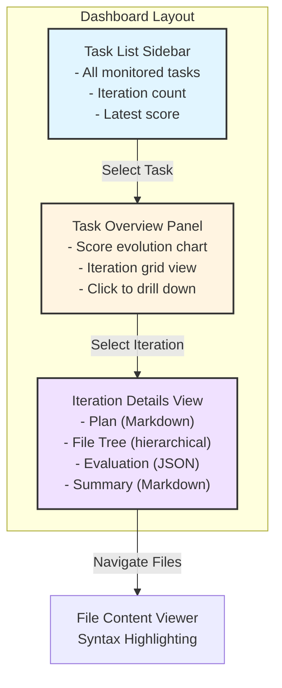
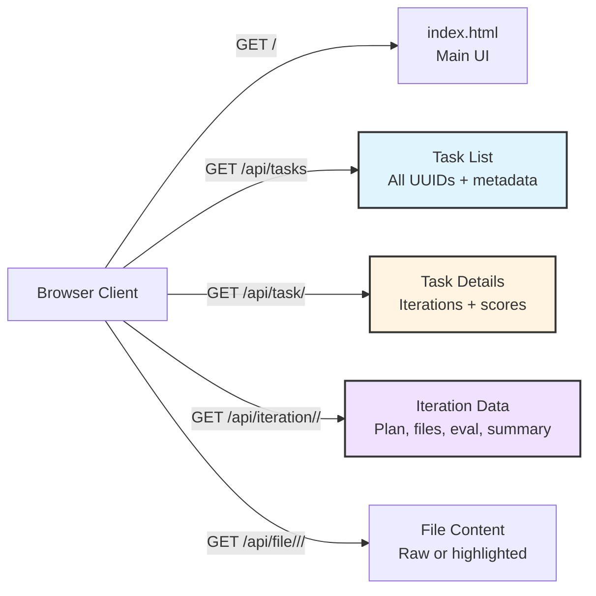
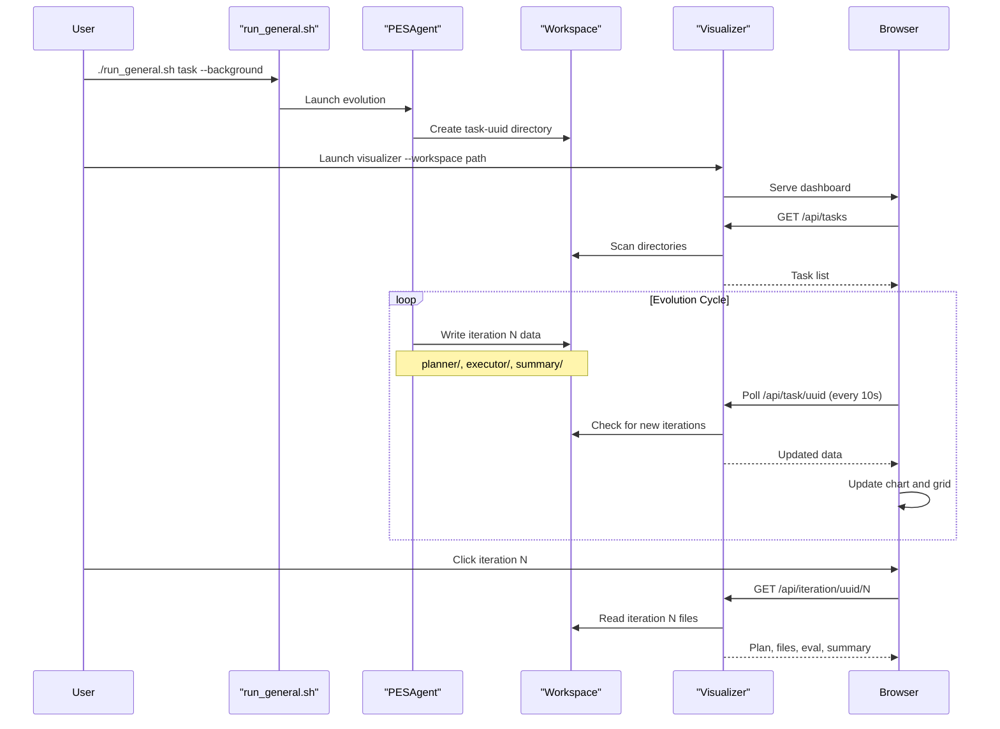

<!-- source: DeepWiki mcp.deepwiki.com · repo baidu-baige/LoongFlow · page 8.1 Visualization Server · fetched 2026-10-26 -->

# Visualization Server

<details>
<summary>Relevant source files</summary>

The following files were used as context for generating this wiki page:

- [agents/general_agent/README.md](agents/general_agent/README.md)
- [agents/general_agent/README_zh.md](agents/general_agent/README_zh.md)
- [src/loongflow/framework/claude_code/general_prompt.py](src/loongflow/framework/claude_code/general_prompt.py)

</details>


The Visualization Server provides a web-based real-time dashboard for monitoring LoongFlow task execution. It serves as the primary interface for observing evolution progress, exploring iteration artifacts, and analyzing solution quality across the PES cycle.

For information about the workspace directory structure that the visualizer reads, see [Workspace Output](#8). For checkpoint persistence and resumption, see [Checkpoints & Resumption](#8.2).

---

## Purpose and Scope

The Visualization Server is a Flask-based web application that monitors one or more workspace directories and presents evolution data through an interactive dashboard. It provides:

- **Real-time monitoring** of running tasks with automatic updates
- **Score evolution tracking** via dynamic charts
- **Iteration browsing** to explore all PES cycle outputs
- **File inspection** with syntax highlighting and hierarchical navigation
- **Multi-task support** for comparing parallel evolution runs

The visualizer operates independently of the evolution process—it reads workspace artifacts without modifying them.

Sources: [agents/general_agent/README.md:162-299]()

---

## Architecture Overview

### System Components



**Backend Architecture**: The Flask server at [agents/general_agent/visualizer/visualizer.py]() provides REST endpoints that read workspace directories without maintaining persistent state. Each request triggers a fresh filesystem scan.

**Frontend Architecture**: A single-page application using vanilla JavaScript. Chart.js renders score evolution graphs with dynamic Y-axis scaling. Marked.js processes Markdown content from plan and summary files.

**Data Flow**: The client polls the backend every 10 seconds when viewing task details, fetching updated iteration data as new PES cycles complete.

Sources: [agents/general_agent/README.md:276-285]()

---

## Launching the Visualizer

### Command-Line Interface

The visualizer is launched as a standalone Python script with workspace path arguments:

```bash
# Monitor single workspace
python agents/general_agent/visualizer/visualizer.py \
    --workspace ./output-todo-list

# Monitor multiple workspaces
python agents/general_agent/visualizer/visualizer.py \
    --workspaces "./output-todo-list,./output-file-processor,./output-bug-hunter"

# Custom port and host binding
python agents/general_agent/visualizer/visualizer.py \
    --workspace ./output-todo-list \
    --port 8080 \
    --host 0.0.0.0
```

**Arguments**:
- `--workspace`: Single workspace path (mutually exclusive with `--workspaces`)
- `--workspaces`: Comma-separated list of workspace paths
- `--port`: HTTP port (default: 8080)
- `--host`: Bind address (default: 127.0.0.1)

After launch, access the dashboard at `http://127.0.0.1:<port>` or the specified host/port combination.

Sources: [agents/general_agent/README.md:166-179](), [agents/general_agent/README.md:212-227]()

### Typical Usage Patterns

**Monitor running task**:
```bash
# Terminal 1: Start evolution
./run_general.sh 01_todo_list

# Terminal 2: Launch visualizer
python agents/general_agent/visualizer/visualizer.py --workspace ./output-todo-list
```

**Analyze completed task**:
```bash
python agents/general_agent/visualizer/visualizer.py --workspace ./output-bug-hunter
```

**Compare multiple tasks**:
```bash
python agents/general_agent/visualizer/visualizer.py \
  --workspaces "./output-todo-list,./output-file-processor,./output-bug-hunter,./output-circle-packing"
```

Sources: [agents/general_agent/README.md:254-273]()

---

## Dashboard Interface

### UI Component Layout



**Task List Sidebar**: Displays all tasks across monitored workspaces. Shows iteration count and latest score at a glance. Click any task to view detailed progress.

**Task Overview Panel**: 
- Score history chart with dynamic Y-axis scaling based on value range
- Grid view of all iterations with scores and file counts
- Click any iteration to explore details

**Iteration Details View**: Four-tab interface presenting:
- **Plan**: Markdown-rendered planning document showing task decomposition
- **Generated Files**: Hierarchical tree structure
  - Click folders (📁) to expand/collapse
  - Click files to view syntax-highlighted content
- **Evaluation**: Detailed scoring and feedback logs
- **Summary**: Insights and learnings from the iteration

Sources: [agents/general_agent/README.md:231-250]()

---

## Data Format and Directory Structure

### Workspace Organization

The visualizer expects workspace directories following this structure:

```
workspace_path/
├── task-<uuid-1>/              # Task directory (UUID-based)
│   ├── 1/                      # Iteration 1
│   │   ├── planner/
│   │   │   └── best_plan.md    # Planner output
│   │   ├── executor/
│   │   │   ├── work_dir/       # Generated solution files
│   │   │   └── evaluator_dir/
│   │   │       └── best_evaluation.json  # Score data
│   │   └── summary/
│   │       └── summary.md      # Summary output
│   ├── 2/                      # Iteration 2
│   │   └── ...
│   └── database/               # Evolution database
│       └── checkpoints/
├── task-<uuid-2>/
│   └── ...
```

**Directory Naming Conventions**:
- Task directories: UUID-based organization (e.g., `task-550e8400-e29b-41d4-a716-446655440000`)
- Iteration subdirectories: Numeric (1, 2, 3, ...)
- Fixed subdirectory names: `planner/`, `executor/`, `summary/`

Sources: [agents/general_agent/README.md:279-284]()

### Evaluation Data Format

The visualizer reads score data from `executor/evaluator_dir/best_evaluation.json`:

```json
{
  "score": 0.85,
  "feedback": "Solution meets 85% of requirements...",
  "metrics": {
    "test_pass_rate": 0.9,
    "code_quality": 0.8
  },
  "status": "success"
}
```

**Required Fields**:
- `score`: Numeric score (0.0 to 1.0+, where 1.0 = objective achieved)
- `feedback`: String containing evaluation details

**Optional Fields**:
- `metrics`: Object with additional measurements
- `status`: Evaluation status (success, validation_failed, execution_failed, framework_error)

The score field is extracted for chart rendering and iteration grid display. If `best_evaluation.json` is missing or malformed, the iteration is shown without a score.

Sources: [agents/general_agent/README.md:279-284]()

### File Tree Data Structure

Generated files in `executor/work_dir/` are read recursively. The visualizer constructs a hierarchical tree representation on the backend and sends it to the frontend for rendering:

```json
{
  "name": "work_dir",
  "type": "directory",
  "children": [
    {
      "name": "src",
      "type": "directory",
      "children": [
        {"name": "main.py", "type": "file", "path": "src/main.py"}
      ]
    },
    {"name": "README.md", "type": "file", "path": "README.md"}
  ]
}
```

The frontend renders this as collapsible folders. Clicking a file triggers a request to read its content with syntax highlighting applied based on file extension.

Sources: [agents/general_agent/README.md:244-248]()

---

## REST API Endpoints

### Data Retrieval Flow



**Key Endpoints** (from Flask application):

| Endpoint | Method | Purpose |
|----------|--------|---------|
| `/` | GET | Serve main dashboard HTML |
| `/api/tasks` | GET | List all tasks across workspaces |
| `/api/task/<task_uuid>` | GET | Get task overview with iteration list |
| `/api/iteration/<task_uuid>/<iter_num>` | GET | Get iteration details (plan, files, eval, summary) |
| `/api/file/<task_uuid>/<iter_num>/<file_path>` | GET | Retrieve file content from work_dir |

**Response Format**: All API endpoints return JSON. Errors return `{"error": "message"}` with appropriate HTTP status codes.

**Auto-refresh Behavior**: When viewing task details, the frontend polls `/api/task/<uuid>` every 10 seconds to detect new iterations from ongoing evolution.

Sources: [agents/general_agent/README.md:276-285]()

---

## Features in Detail

### Score Evolution Chart

The Chart.js-powered graph displays score progression across iterations:

| Feature | Implementation |
|---------|----------------|
| **Dynamic Y-axis** | Automatically scales to fit value range (0.0-1.0 or higher) |
| **X-axis** | Iteration numbers (1, 2, 3, ...) |
| **Data points** | Connected line with circle markers |
| **Hover tooltips** | Shows exact score value |
| **Missing scores** | Iterations without `best_evaluation.json` are shown as gaps |

The chart helps identify:
- **Improvement trends**: Upward slope indicates successful evolution
- **Plateaus**: Flat regions suggest exploration needed
- **Regressions**: Downward spikes indicate failed iterations

Sources: [agents/general_agent/README.md:201-209]()

### Markdown Rendering

Plan and summary files are rendered using Marked.js with the following features:

- **Headers**: Proper hierarchy (H1-H6)
- **Lists**: Ordered and unordered
- **Code blocks**: Syntax highlighting via highlight.js (if integrated)
- **Links**: Clickable (external only—internal links not processed)
- **Tables**: Rendered as HTML tables
- **Emphasis**: Bold, italic, strikethrough

The rendering preserves the structured format described in the PES prompts (see [agents/general_agent/visualizer/visualizer.py]() for implementation).

Sources: [agents/general_agent/README.md:205](), [src/loongflow/framework/claude_code/general_prompt.py:136-171]() (plan structure), [src/loongflow/framework/claude_code/general_prompt.py:414-448]() (summary structure)

### Hierarchical File Tree

The file tree navigator provides:

**Folder Operations**:
- Click folder icon (📁) to expand/collapse children
- Indentation shows nesting level
- Visual indicators for expanded/collapsed state

**File Operations**:
- Click file name to load content in viewer
- File type icons based on extension
- File count displayed next to folders

**Navigation State**:
- Maintains expansion state during session
- Resets when switching iterations

This allows efficient browsing of multi-file solution packs without overwhelming the UI with all content at once.

Sources: [agents/general_agent/README.md:244-248]()

### Code Viewer

File content display with:

| Capability | Description |
|------------|-------------|
| **Syntax highlighting** | Applied based on file extension (.py, .js, .md, etc.) |
| **Line numbers** | Displayed in gutter |
| **Read-only view** | Content cannot be modified through visualizer |
| **Large file handling** | Truncation or pagination for very large files |
| **Raw text fallback** | For unknown extensions or binary files |

The viewer helps developers inspect generated solutions, understand changes between iterations, and verify implementation details.

Sources: [agents/general_agent/README.md:205]()

---

## Troubleshooting

### Common Issues and Solutions

**No tasks showing up**:
- **Cause**: Workspace path does not point to valid output directory
- **Solution**: Verify the path contains UUID-based task directories with numeric iteration subdirectories
- **Check**: Run `ls -la <workspace_path>` to confirm structure

**Score not displayed**:
- **Cause**: Missing or malformed `best_evaluation.json` in iteration folders
- **Solution**: Verify `executor/evaluator_dir/best_evaluation.json` exists
- **Check**: Ensure JSON contains valid `score` field (number type)
- **Example**: `{"score": 0.85, "feedback": "..."}`

**Files not loading**:
- **Cause**: Missing `work_dir/` directory or incorrect permissions
- **Solution**: Confirm `executor/work_dir/` directory exists in the iteration
- **Check**: Verify file permissions allow read access for the visualizer process
- **Command**: `chmod -R a+r <workspace_path>` (if needed)

**Auto-refresh not working**:
- **Cause**: Browser blocking background requests or JavaScript disabled
- **Solution**: Check browser console for errors, ensure JavaScript is enabled
- **Workaround**: Manually refresh the page to see new iterations

**Port already in use**:
- **Cause**: Another process is using the specified port
- **Solution**: Use `--port <different_port>` argument
- **Find process**: `lsof -i :<port>` on Unix/Linux systems

Sources: [agents/general_agent/README.md:286-299]()

---

## Integration with Evolution Workflow

### Typical Monitoring Workflow



**Timeline**:
1. User starts evolution in background mode
2. User launches visualizer pointing to workspace
3. Dashboard loads existing iterations
4. As PESAgent writes new iterations, dashboard auto-updates
5. User explores iterations, files, and scores in real-time

**Decoupling**: The visualizer is completely decoupled from the evolution process. It operates as a read-only observer, ensuring no interference with ongoing tasks.

Sources: [agents/general_agent/README.md:254-261]()

---

## Advanced Usage

### Multi-Workspace Monitoring

When monitoring multiple workspaces simultaneously:

```bash
python agents/general_agent/visualizer/visualizer.py \
  --workspaces "./output-task1,./output-task2,./output-task3"
```

**Behavior**:
- Task list shows all tasks from all workspaces
- Each task displays its source workspace path
- Charts and details work identically for all tasks
- Useful for comparing different agent types or parameter settings

**Use Cases**:
- Compare General Agent vs. Math Agent on similar problems
- Monitor multiple concurrent evolution runs with different configurations
- Analyze impact of different skill configurations

Sources: [agents/general_agent/README.md:218-220]()

### Analyzing Completed Runs

The visualizer works equally well for post-mortem analysis:

1. Navigate to completed workspace directory
2. Launch visualizer
3. Explore full evolution history
4. Identify successful strategies from high-scoring iterations
5. Study failure patterns from low-scoring iterations

**Benefits of Post-Mortem Analysis**:
- No performance impact on running tasks
- Complete history available for pattern identification
- Can compare multiple completed runs side-by-side

Sources: [agents/general_agent/README.md:262-266]()

---

## Technical Implementation Notes

### Backend Technology Stack

- **Framework**: Flask (Python web framework)
- **Filesystem Access**: Standard Python `os` and `pathlib` modules
- **JSON Parsing**: Built-in `json` module
- **No Database**: All data read directly from filesystem

The simplicity of the backend ensures minimal dependencies and easy deployment. The stateless design means the server can be restarted without losing any data.

Sources: [agents/general_agent/README.md:276-278]()

### Frontend Technology Stack

- **Base**: Vanilla JavaScript (no framework)
- **Charting**: Chart.js for score evolution graphs
- **Markdown**: Marked.js for rendering plan and summary files
- **Styling**: Custom CSS (included in HTML)

**No Build Step Required**: The frontend consists of a single HTML file with inline JavaScript and CSS, making deployment trivial.

**Browser Compatibility**: Works in all modern browsers (Chrome, Firefox, Safari, Edge). Requires JavaScript enabled.

Sources: [agents/general_agent/README.md:277]()

### Performance Considerations

**Filesystem Scanning**: Each API request triggers a fresh scan of the workspace directory. For workspaces with hundreds of iterations, this may introduce latency.

**Optimization Strategies**:
- The visualizer does not cache data, ensuring always-fresh results
- Directory tree is built recursively but only to depth needed
- File content is loaded on-demand (not pre-loaded)

**Scalability**: The visualizer handles workspaces with 100+ iterations reasonably well. For extremely large datasets (1000+ iterations), consider filtering or archiving old iterations.

Sources: [agents/general_agent/README.md:276-285]()

---

