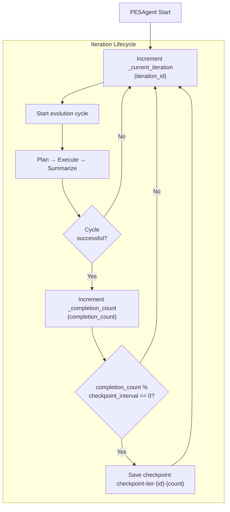
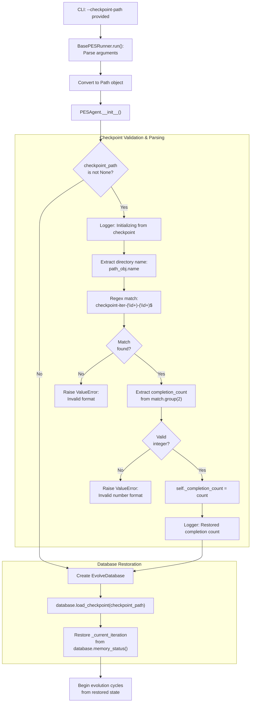
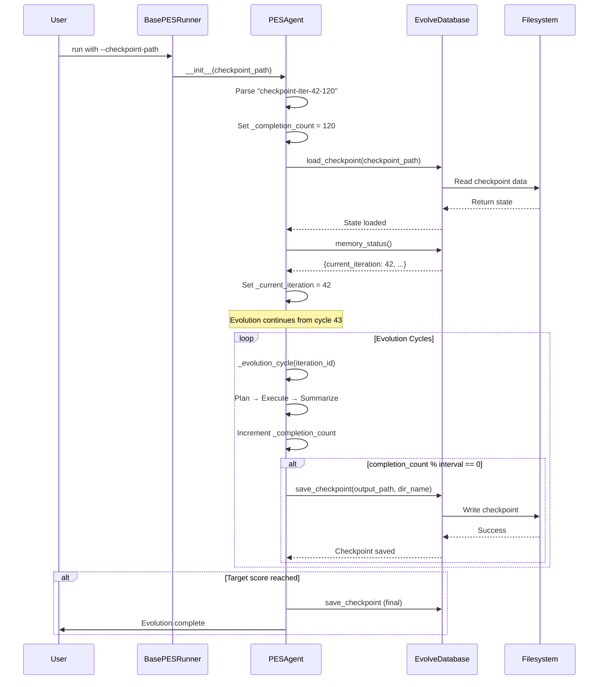

<!-- source: DeepWiki mcp.deepwiki.com · repo baidu-baige/LoongFlow · page 8.2 Checkpoints & Resumption · fetched 2026-10-26 -->

# Checkpoints & Resumption

<details>
<summary>Relevant source files</summary>

The following files were used as context for generating this wiki page:

- [src/loongflow/framework/pes/base_runner.py](src/loongflow/framework/pes/base_runner.py)
- [src/loongflow/framework/pes/pes_agent.py](src/loongflow/framework/pes/pes_agent.py)

</details>


This page describes the checkpoint system in LoongFlow's evolutionary framework, including checkpoint creation, naming conventions, state management, and resumption procedures. Checkpoints enable long-running evolutionary processes to be interrupted and resumed without losing progress.

For information about the evolutionary memory system and database structure, see [Evolutionary Memory System](#3.4). For details on the PESAgent orchestration and lifecycle, see [PESAgent Architecture](#3.2).

## Overview

The LoongFlow checkpoint system provides automatic state persistence during evolutionary runs. Checkpoints capture the complete state of the `EvolveDatabase`, including solution history, lineage relationships, and evolutionary progress. The system supports both planned checkpoints (at regular intervals) and emergency checkpoints (when reaching target scores or iteration limits).

**Sources:** [src/loongflow/framework/pes/pes_agent.py:1-599]()

## Checkpoint Naming Convention

Checkpoints use a strictly enforced naming format that encodes both iteration information and completion tracking:

```
checkpoint-iter-{iteration_id}-{completion_count}
```

| Component | Description | Example |
|-----------|-------------|---------|
| `checkpoint-iter-` | Fixed prefix | `checkpoint-iter-` |
| `{iteration_id}` | The iteration ID that triggered the checkpoint | `42` |
| `{completion_count}` | Total number of completed evolution cycles | `120` |

**Example:** `checkpoint-iter-42-120` indicates the checkpoint was saved after iteration 42 completed, and at that point 120 total cycles had finished.

The naming format is validated using a regex pattern: `checkpoint-iter-(\d+)-(\d+)$` [src/loongflow/framework/pes/pes_agent.py:97]()

### Distinction Between Iteration ID and Completion Count

- **`iteration_id`**: A sequential counter that increments before starting each new evolution cycle. This represents the "next iteration to start" and may skip numbers if cycles fail or are cancelled.
- **`completion_count`**: A monotonic counter that increments only after successful completion of an evolution cycle. This represents the actual number of finished cycles and is used to determine checkpoint intervals.



**Diagram: Checkpoint Creation Trigger Flow**

**Sources:** [src/loongflow/framework/pes/pes_agent.py:86-116](), [src/loongflow/framework/pes/pes_agent.py:330-346](), [src/loongflow/framework/pes/pes_agent.py:377-397]()

## When Checkpoints Are Created

Checkpoints are created in three scenarios:

### 1. Regular Interval Checkpoints

Triggered after every `N` completed cycles, where `N` is defined by `checkpoint_interval` in the configuration. The check occurs in `_handle_cycle_completion_and_checkpoint()`:

```python
interval = self.config.evolve.database.checkpoint_interval
if interval > 0 and current_count % interval == 0:
    should_save = True
```

**Sources:** [src/loongflow/framework/pes/pes_agent.py:341-343]()

### 2. Target Score Reached

When the best solution reaches or exceeds `target_score`, a final checkpoint is saved before stopping:

```python
if best_score >= self.target_score:
    # ... logging ...
    await self._save_checkpoint(
        self._current_iteration, self._completion_count
    )
    self._stop_event.set()
```

**Sources:** [src/loongflow/framework/pes/pes_agent.py:509-512]()

### 3. Max Iterations Reached

When `_current_iteration >= max_iterations`, a checkpoint is saved during cleanup:

```python
if (
    self._current_iteration >= self.max_iterations
    and not self._stop_event.is_set()
):
    await self._save_checkpoint(
        self._current_iteration, self._completion_count
    )
```

**Sources:** [src/loongflow/framework/pes/pes_agent.py:525-531]()

## What Is Saved in a Checkpoint

Each checkpoint contains the complete state of the `EvolveDatabase`, which includes:

- **Solution Archive**: All generated solutions with their code and evaluation results
- **Evolutionary Tree**: Parent-child relationships and lineage information
- **Island States**: Multi-island evolutionary memory including MAP-Elites grids
- **Metadata**: Global status, current iteration, best scores, and timestamps

The actual checkpoint save operation delegates to the database:

```python
await self.database.save_checkpoint(
    self.config.evolve.database.output_path, dir_name
)
```

**Sources:** [src/loongflow/framework/pes/pes_agent.py:365-367]()

## Resuming from a Checkpoint

### Command-Line Usage

To resume from a checkpoint, use the `--checkpoint-path` argument:

```bash
# Math Agent
./run_math.sh run path/to/task_config.yaml --checkpoint-path ./output/checkpoint-iter-42-120

# ML Agent
./run_ml.sh run path/to/task_config.yaml --checkpoint-path ./output/checkpoint-iter-42-120

# General Agent
./run_general.sh run path/to/task_config.yaml --checkpoint-path ./output/checkpoint-iter-42-120
```

**Sources:** [src/loongflow/framework/pes/base_runner.py:76-80]()

### Resumption Process



**Diagram: Checkpoint Resumption Flow**

**Sources:** [src/loongflow/framework/pes/pes_agent.py:89-128](), [src/loongflow/framework/pes/base_runner.py:417-472]()

## State Restoration Details

### Completion Count Restoration

The `_completion_count` is extracted directly from the checkpoint directory name using regex parsing:

| Step | Code Location | Description |
|------|---------------|-------------|
| 1. Extract directory name | [src/loongflow/framework/pes/pes_agent.py:93-94]() | `dir_name = path_obj.name` |
| 2. Apply regex pattern | [src/loongflow/framework/pes/pes_agent.py:97]() | `match = re.search(r"checkpoint-iter-(\d+)-(\d+)$", dir_name)` |
| 3. Extract count | [src/loongflow/framework/pes/pes_agent.py:103]() | `self._completion_count = int(match.group(2))` |
| 4. Validate | [src/loongflow/framework/pes/pes_agent.py:99-116]() | Raise `ValueError` if invalid format or number |

**Sources:** [src/loongflow/framework/pes/pes_agent.py:89-116]()

### Iteration ID Restoration

The `_current_iteration` is **not** restored from the checkpoint directory name. Instead, it is loaded from the database's `memory_status()`:

```python
self._current_iteration = (
    self.database.memory_status()
    .get("global_status", {})
    .get("current_iteration", 0)
)
```

This ensures that the iteration counter reflects the actual state stored in the database, which may differ from the checkpoint directory name if cycles failed or were interrupted.

**Sources:** [src/loongflow/framework/pes/pes_agent.py:131-135]()

### Database State Loading

After parsing the checkpoint path, the database is loaded:

```python
if checkpoint_path is not None:
    self.logger.info(
        f"Loading database from checkpoint at {checkpoint_path}"
    )
    self.database.load_checkpoint(str(checkpoint_path))
```

This restores all solution archives, evolutionary trees, island states, and metadata from the checkpoint directory.

**Sources:** [src/loongflow/framework/pes/pes_agent.py:124-128]()

## Configuration Options

### Checkpoint Interval

Set the frequency of automatic checkpoints using the `checkpoint_interval` parameter in `task_config.yaml`:

```yaml
evolve:
  database:
    checkpoint_interval: 10  # Save checkpoint every 10 completed cycles
    output_path: ./output
```

| Value | Behavior |
|-------|----------|
| `> 0` | Save checkpoint every N completed cycles |
| `0` | Disable automatic interval checkpoints (only save at target/max iterations) |

**Sources:** [src/loongflow/framework/pes/pes_agent.py:341-343]()

### Output Path

Checkpoints are saved as subdirectories within the configured `output_path`:

```yaml
evolve:
  database:
    output_path: ./output  # Checkpoints saved as ./output/checkpoint-iter-X-Y/
```

**Sources:** [src/loongflow/framework/pes/pes_agent.py:366]()

## Error Handling

### Invalid Checkpoint Format

If the checkpoint directory name doesn't match the expected format, initialization fails with a descriptive error:

```python
raise ValueError(
    f"Invalid checkpoint directory format: '{dir_name}'. "
    "Expected format: 'checkpoint-iter-{id}-{count}'"
)
```

**Example invalid names:**
- `checkpoint-42-120` (missing "iter-")
- `checkpoint-iter-42` (missing completion count)
- `checkpoint-iter-abc-120` (non-numeric iteration ID)

**Sources:** [src/loongflow/framework/pes/pes_agent.py:113-116]()

### Checkpoint Save Failures

If checkpoint saving fails (e.g., disk full, permission issues), the error is logged but does not stop the evolution process:

```python
except Exception as e:
    self.logger.error(
        f"Failed to save checkpoint {dir_name}: {e}",
        exc_info=True,
    )
```

This prevents checkpoint failures from disrupting the ongoing evolutionary search.

**Sources:** [src/loongflow/framework/pes/pes_agent.py:371-375]()

## Concurrency Considerations

Checkpoint operations use the `_completion_lock` to ensure thread-safe updates to `_completion_count`:

```python
async with self._completion_lock:
    self._completion_count += 1
    current_count = self._completion_count
    
    interval = self.config.evolve.database.checkpoint_interval
    if interval > 0 and current_count % interval == 0:
        should_save = True
```

This prevents race conditions when multiple evolution cycles complete simultaneously in concurrent execution mode.

**Sources:** [src/loongflow/framework/pes/pes_agent.py:337-343]()

## Example Checkpoint Lifecycle



**Diagram: Complete Checkpoint Lifecycle with Resumption**

**Sources:** [src/loongflow/framework/pes/pes_agent.py:43-599](), [src/loongflow/framework/pes/base_runner.py:387-504]()

---

