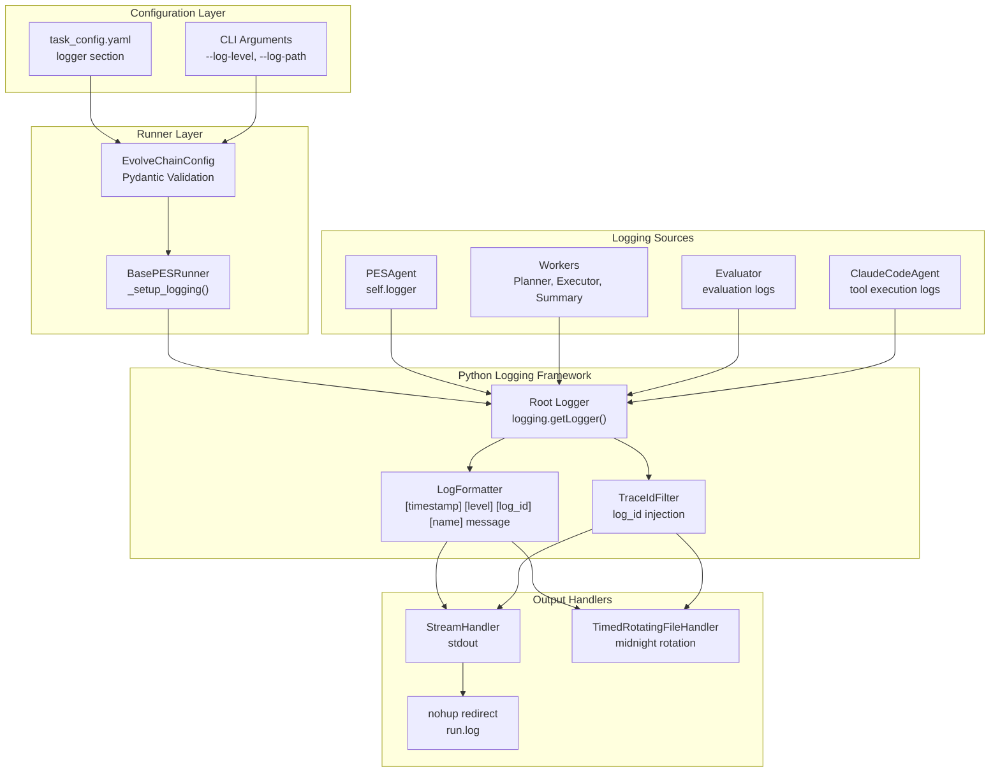
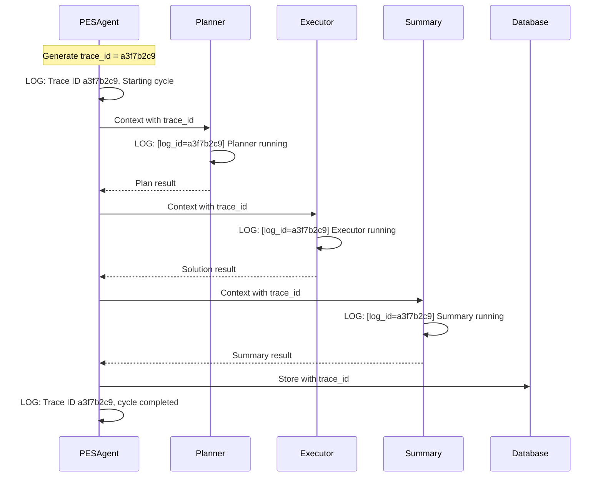
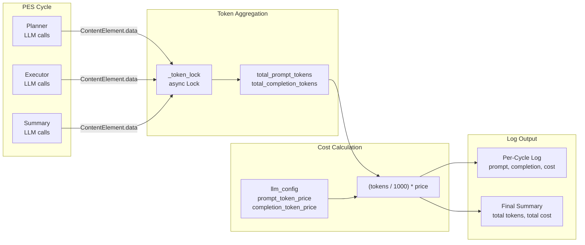

<!-- source: DeepWiki mcp.deepwiki.com · repo baidu-baige/LoongFlow · page 8.3 Logging & Debugging · fetched 2026-10-26 -->

# Logging & Debugging

<details>
<summary>Relevant source files</summary>

The following files were used as context for generating this wiki page:

- [run_general.sh](run_general.sh)
- [run_math.sh](run_math.sh)
- [src/loongflow/framework/pes/base_runner.py](src/loongflow/framework/pes/base_runner.py)
- [src/loongflow/framework/pes/pes_agent.py](src/loongflow/framework/pes/pes_agent.py)

</details>


## Purpose and Scope

This page explains LoongFlow's logging infrastructure and debugging techniques. It covers log configuration, output formats, trace ID correlation, and common debugging patterns. For information about monitoring evolution progress visually, see [Visualization Server](#8.1). For checkpoint-based recovery, see [Checkpoints & Resumption](#8.2).

---

## Log Configuration System

LoongFlow uses a hierarchical configuration system for logging, allowing control through both YAML configuration files and command-line arguments.

### Configuration Sources

Logging is configured through three primary mechanisms:

**1. YAML Configuration (`task_config.yaml`)**

```yaml
logger:
  level: "INFO"                    # Log level: DEBUG, INFO, WARNING, ERROR, CRITICAL
  console_logging: true            # Enable console output
  file_logging: true               # Enable file output
  log_path: "./workspace/logs"     # Directory for log files
  filename: "loongflow.log"        # Base log filename
  rotation: "midnight"             # Rotation schedule: midnight, H, D, W0-W6
  backup_count: 7                  # Number of backup log files to keep
```

**2. Command-Line Overrides**

All shell scripts (`run_general.sh`, `run_math.sh`, `run_mlebench.sh`) support logging overrides:

| Argument | Description | Example |
|----------|-------------|---------|
| `--log-level` | Override log level | `--log-level DEBUG` |
| `--log-path` | Override log directory | `--log-path ./custom/logs` |

**3. Execution Mode**

Background execution automatically redirects all output to `run.log`:

```bash
# Background mode: output → task_dir/run.log
./run_general.sh hello_world --background

# Foreground mode: output → console
./run_general.sh hello_world
```

Sources: [run_general.sh:176-189](), [run_math.sh:175-190](), [src/loongflow/framework/pes/base_runner.py:141-154]()

---

## Logging Architecture

### Component Hierarchy



**Logging Setup Flow**

The logging system initializes during agent startup through these stages:

1. **Configuration Loading**: `BasePESRunner` loads YAML configuration and merges CLI overrides [src/loongflow/framework/pes/base_runner.py:177-254]()
2. **Validation**: `EvolveChainConfig` validates logger settings via Pydantic [src/loongflow/framework/pes/base_runner.py:400-413]()
3. **Handler Setup**: `_setup_logging()` creates console and/or file handlers [src/loongflow/framework/pes/base_runner.py:278-325]()
4. **Filter Installation**: `TraceIdFilter` is attached to inject trace IDs [src/loongflow/framework/pes/base_runner.py:302-318]()

Sources: [src/loongflow/framework/pes/base_runner.py:278-325]()

---

## Log Output Destinations

### Console Logging

When `console_logging: true`, logs are written to `stdout` with real-time output. In foreground execution mode, users see logs directly in their terminal:

```bash
./run_general.sh hello_world --log-level DEBUG
# Logs appear immediately in terminal
```

### File Logging

When `file_logging: true`, logs are written to rotating files in the configured `log_path` directory:

**File Rotation Behavior**

LoongFlow uses `TimedRotatingFileHandler` with configurable rotation:

| Rotation Value | Behavior |
|---------------|----------|
| `midnight` | New file at midnight each day |
| `H` | Hourly rotation |
| `D` | Daily rotation (at midnight) |
| `W0` through `W6` | Weekly rotation (Monday through Sunday) |

The `backup_count` parameter controls retention:
- `backup_count: 7` keeps 7 previous log files
- Older files are automatically deleted

**Example Log Files**:
```
workspace/logs/
├── loongflow.log              # Current log
├── loongflow.log.2025-01-14   # Yesterday's backup
├── loongflow.log.2025-01-13   # 2 days ago
└── ...
```

Sources: [src/loongflow/framework/pes/base_runner.py:305-319]()

### Background Execution Logs

When running tasks in background mode with `--background`, shell scripts redirect all output to `run.log` in the task directory:

```bash
./run_general.sh hello_world --background
# Output → agents/general_agent/examples/hello_world/run.log
```

**Background Log Characteristics**:
- Contains both stdout and stderr: `> "${TASK_DIR}/run.log" 2>&1`
- Grows unbounded (no automatic rotation)
- Persists after shell exit via `nohup`
- Monitors progress with: `tail -f <task_dir>/run.log`

**Stopping Background Tasks**:
```bash
./run_general.sh stop hello_world
# Terminates process and cleans up .run.pid file
```

Sources: [run_general.sh:176-189](), [run_general.sh:60-124]()

---

## Log Message Format and Structure

### Standard Log Format

All log messages follow this structure:

```
[timestamp] [level] [log_id=trace_id] [logger_name] message
```

**Example**:
```
[2025-01-15 10:23:45,123] [INFO] [log_id=a3f7b2c9] [loongflow.framework.pes.pes_agent] Trace ID: a3f7b2c9, Starting evolution cycle for iteration 5.
```

**Field Breakdown**:

| Field | Description | Example |
|-------|-------------|---------|
| `timestamp` | ISO-8601 format with milliseconds | `2025-01-15 10:23:45,123` |
| `level` | Log severity level | `DEBUG`, `INFO`, `WARNING`, `ERROR`, `CRITICAL` |
| `log_id` | Trace ID for correlation | `a3f7b2c9` (12-char hex) |
| `logger_name` | Module path of logger | `loongflow.framework.pes.pes_agent` |
| `message` | Actual log content | Task-specific information |

Sources: [src/loongflow/framework/pes/base_runner.py:295-296]()

### Trace ID System

Each evolution cycle generates a unique 12-character hexadecimal trace ID for correlation across log messages.

**Trace ID Generation**:
```python
trace_id = str(uuid.uuid4().hex[:12])  # e.g., "a3f7b2c9e4d1"
```

**Trace ID Lifecycle**:



**Correlation Example**:

Searching logs for a specific trace ID reveals all activity for that cycle:

```bash
grep "log_id=a3f7b2c9" loongflow.log
```

Output:
```
[10:23:45] [INFO] [log_id=a3f7b2c9] [...] Starting evolution cycle for iteration 5.
[10:23:47] [DEBUG] [log_id=a3f7b2c9] [...] Planner generated strategy
[10:24:12] [INFO] [log_id=a3f7b2c9] [...] Executor completed solution
[10:24:15] [INFO] [log_id=a3f7b2c9] [...] Summary extracted insights
[10:24:16] [INFO] [log_id=a3f7b2c9] [...] Evolution cycle completed. Tokens: 15234
```

Sources: [src/loongflow/framework/pes/pes_agent.py:178-181](), [src/loongflow/framework/pes/pes_agent.py:214-225]()

---

## Log Levels and Usage

### Level Hierarchy

LoongFlow uses Python's standard logging levels with specific semantic meanings:

| Level | Numeric Value | Usage in LoongFlow |
|-------|--------------|-------------------|
| `DEBUG` | 10 | Detailed diagnostic information, internal state changes, LLM prompt/response debugging |
| `INFO` | 20 | Normal operation milestones: iterations starting/completing, scores, checkpoints |
| `WARNING` | 30 | Recoverable issues: deprecated features, fallback behaviors, missing optional resources |
| `ERROR` | 40 | Failures that don't stop execution: worker errors, evaluation failures, retry attempts |
| `CRITICAL` | 50 | Fatal errors requiring shutdown: configuration validation failures, database corruption |

### Level-Specific Patterns

**DEBUG Level**

Produces verbose output for development and troubleshooting:
- LLM API requests and responses
- Database query details
- Worker internal state transitions
- File system operations

**Enable with**:
```bash
./run_general.sh hello_world --log-level DEBUG
```

**INFO Level (Default)**

Recommended for production use. Logs key events:
- Evolution cycle start/completion
- Iteration numbers and trace IDs
- Solution scores and evaluations
- Token usage and costs
- Checkpoint saves

**Example INFO logs**:
```
[INFO] [log_id=abc123] Starting evolution cycle for iteration 5.
[INFO] [log_id=abc123] Evolution cycle completed. Tokens: 12500, cost: 0.025
[INFO] Triggering checkpoint save. Count: 10, Iter: 10.
```

Sources: [src/loongflow/framework/pes/pes_agent.py:179-181](), [src/loongflow/framework/pes/pes_agent.py:307-312](), [src/loongflow/framework/pes/pes_agent.py:359-361]()

**WARNING Level**

Indicates potential issues that don't prevent execution:
- Process already stopped (idempotent stop command)
- Missing PID file during stop
- Non-critical file not found

**Example WARNING logs**:
```
[WARNING] Evolution cycle for iteration 3 was cancelled.
[WARNING] Process (PID: 12345) in PID file no longer exists.
```

Sources: [src/loongflow/framework/pes/pes_agent.py:319-321]()

**ERROR Level**

Logs failures that affect individual operations:
- Evolution cycle exceptions
- Checkpoint save failures
- Unexpected worker errors

**Example ERROR logs**:
```
[ERROR] Evolution cycle for iteration 7 failed: ConnectionError: API timeout
[ERROR] Failed to save checkpoint checkpoint-iter-10-10: DiskError: No space left
[ERROR] An evolution cycle task failed unexpectedly: ValueError: Invalid score
```

Sources: [src/loongflow/framework/pes/pes_agent.py:324-327](), [src/loongflow/framework/pes/pes_agent.py:371-375](), [src/loongflow/framework/pes/pes_agent.py:473-476]()

---

## Token Usage Tracking

LoongFlow automatically tracks and logs token consumption for cost monitoring.

### Token Accounting Flow



### Token Logging Format

**Per-Cycle Token Logs**:

After each evolution cycle completes, token usage is logged:

```
[INFO] [log_id=abc123] Evolution cycle for iteration 5 completed successfully.
Used Prompt tokens: 8234, cost: 0.008234.
Used Completion tokens: 3421, cost: 0.010263.
Total Tokens: 11655, total cost: 0.018497.
```

**Final Summary**:

At process termination, cumulative totals are logged:

```
[INFO] Final token usage - 
Completion tokens: 342150, cost: 1.026450. 
Prompt tokens: 823400, cost: 0.823400. 
Total tokens: 1165550, Total Cost: 1.849850.
```

Sources: [src/loongflow/framework/pes/pes_agent.py:294-312](), [src/loongflow/framework/pes/pes_agent.py:557-562]()

### Token Data Collection

Tokens are extracted from `ContentElement.data` dictionaries:

```python
async with self._token_lock:
    self.total_prompt_tokens += plan_content[0].data.get("total_prompt_tokens", 0)
    self.total_completion_tokens += plan_content[0].data.get("total_completion_tokens", 0)
```

The `_token_lock` ensures thread-safe accumulation in concurrent execution mode.

Sources: [src/loongflow/framework/pes/pes_agent.py:240-246](), [src/loongflow/framework/pes/pes_agent.py:84]()

---

## Debugging Techniques

### Common Debugging Scenarios

#### 1. Evolution Not Progressing

**Symptoms**:
- No new iterations logged
- Process appears frozen
- No checkpoint saves

**Debugging Steps**:

```bash
# Check if process is running
ps aux | grep general_evolve_agent.py

# Examine recent logs
tail -n 100 agents/general_agent/examples/task_name/run.log

# Look for errors or warnings
grep -E "ERROR|WARNING" agents/general_agent/examples/task_name/run.log
```

**Common Causes**:
- LLM API rate limiting (check for API error messages)
- Evaluation timeout (check evaluator logs)
- Database lock contention (look for database operation delays)
- Max iterations reached (check final log message)

#### 2. High Token Costs

**Symptoms**:
- Unexpectedly high cost logs
- Rapid token consumption

**Debugging Steps**:

```bash
# Track token usage by iteration
grep "Evolution cycle.*completed successfully" run.log | \
  grep -oP "Total Tokens: \K[0-9]+"

# Find highest-cost cycles
grep "total cost:" run.log | sort -t':' -k5 -n | tail -10
```

**Investigation**:
- Check if DEBUG logging is enabled (generates more tokens)
- Review planner/executor `max_turns` configuration
- Examine solution complexity (larger solutions → more tokens)

Sources: [src/loongflow/framework/pes/pes_agent.py:307-312]()

#### 3. Worker Failures

**Symptoms**:
- ERROR messages referencing Planner, Executor, or Summary
- Evolution cycles failing repeatedly
- Specific trace IDs with errors

**Debugging Steps**:

```bash
# Find all worker failures
grep "ERROR" run.log | grep -E "Planner|Executor|Summary"

# Investigate specific trace ID
grep "log_id=abc123" run.log
```

**Common Patterns**:
```
[ERROR] Evolution cycle for iteration 7 failed: ValueError: Invalid configuration
[ERROR] An evolution cycle task failed unexpectedly: TimeoutError: LLM request timeout
```

Enable DEBUG logging to see worker internal state:
```bash
./run_general.sh task_name --log-level DEBUG
```

Sources: [src/loongflow/framework/pes/pes_agent.py:324-327]()

#### 4. Checkpoint Issues

**Symptoms**:
- Checkpoint save failures
- Unable to resume from checkpoint
- Missing checkpoint directories

**Debugging Steps**:

```bash
# List checkpoints
ls -la workspace_path/task-uuid/database/

# Check checkpoint logs
grep "checkpoint" run.log

# Verify checkpoint format
ls workspace_path/task-uuid/database/checkpoint-iter-*
```

**Expected Format**:
```
checkpoint-iter-{iteration_id}-{completion_count}
```

**Common Issues**:
- Disk space exhaustion (check ERROR logs for "No space left")
- Invalid checkpoint path format
- Permissions issues

Sources: [src/loongflow/framework/pes/pes_agent.py:348-375]()

---

## Interpreting Evolution Logs

### Typical Evolution Cycle Log Sequence

```
[INFO] [log_id=a3f7b2c9] Trace ID: a3f7b2c9, Starting evolution cycle for iteration 5.
[DEBUG] [log_id=a3f7b2c9] [Planner] Analyzing parent solution from iteration 3
[DEBUG] [log_id=a3f7b2c9] [Planner] Generated improvement strategy
[DEBUG] [log_id=a3f7b2c9] [Executor] Cloning parent solution pack
[DEBUG] [log_id=a3f7b2c9] [Executor] Applying mutations based on plan
[INFO] [log_id=a3f7b2c9] [Evaluator] Solution score: 0.8523
[DEBUG] [log_id=a3f7b2c9] [Summary] Extracting insights from execution
[INFO] [log_id=a3f7b2c9] Evolution cycle for iteration 5 completed successfully.
Used Prompt tokens: 8234, cost: 0.008234.
Used Completion tokens: 3421, cost: 0.010263.
Total Tokens: 11655, total cost: 0.018497.
```

### Key Log Patterns

**Startup Sequence**:
```
1. Loading base configuration from YAML...
2. Merging command-line overrides...
3. Validating final configuration...
   - Configuration is valid.
4. Initializing PESAgent...
======================================
🚀 Starting General-Evolve Process 🚀
🎯 Task: Create a TODO list application...
📈 Target Score: 0.95
🔄 Max Iterations: 100
======================================
[INFO] Starting initial evolution workers...
[INFO] Started 3 initial evolution workers.
```

**Checkpoint Creation**:
```
[INFO] Triggering checkpoint save. Count: 10, Iter: 10.
[INFO] Checkpoint saved to ./workspace/task-uuid/database/checkpoint-iter-10-10
```

**Target Achievement**:
```
[INFO] Target score (0.95) reached. Save the last checkpoint, Initiating shutdown.
Total Completion tokens used: 145234, cost: 0.435702.
Total Prompt tokens used: 312456, cost: 0.312456.
Total tokens: 457690, Total Cost: 0.748158.
```

**Graceful Shutdown**:
```
🛑 Received signal SIGINT. Initiating graceful shutdown...
[INFO] Interrupt signal received. Setting stop event...
[INFO] Main loop finished. Cleaning up running tasks...
[INFO] Cancelling 2 active evolution tasks...
[INFO] All tasks have been cleaned up.
[INFO] Evolution process concluded. Invoking Finalizer.
```

Sources: [src/loongflow/framework/pes/base_runner.py:394-495](), [src/loongflow/framework/pes/pes_agent.py:179-329](), [src/loongflow/framework/pes/pes_agent.py:500-512](), [src/loongflow/framework/pes/pes_agent.py:589-598]()

---

## Advanced Debugging

### Trace ID Correlation Across Workspace

Each trace ID corresponds to an iteration directory in the workspace. To correlate logs with artifacts:

```bash
# Extract trace ID from logs
TRACE_ID=$(grep "Starting evolution cycle for iteration 5" run.log | \
  grep -oP "Trace ID: \K[a-f0-9]+")

# Find corresponding workspace directory
find workspace_path/task-uuid/ -name "$TRACE_ID" -type d

# Examine artifacts
ls workspace_path/task-uuid/5/planner/
ls workspace_path/task-uuid/5/executor/work_dir/
ls workspace_path/task-uuid/5/summary/
```

### Multi-Worker Concurrency Debugging

With `concurrency > 1`, multiple evolution cycles run simultaneously. Use trace IDs to separate concurrent logs:

```bash
# Show all active trace IDs
grep "Starting evolution cycle" run.log | tail -5 | grep -oP "Trace ID: \K[a-f0-9]+"

# Track specific worker progress
grep "log_id=a3f7b2c9" run.log | grep -E "Planner|Executor|Summary"
```

### Database State Inspection

Check database memory status by examining checkpoints or enabling DEBUG logging:

```bash
# Latest checkpoint
ls -lt workspace_path/task-uuid/database/ | head -5

# Database status in logs (DEBUG level)
grep "memory_status" run.log
```

Sources: [src/loongflow/framework/pes/pes_agent.py:479-483]()

---

## Log File Management

### Disk Space Monitoring

Long-running evolution tasks can generate large logs:

**Check log sizes**:
```bash
du -sh workspace_path/logs/
du -sh agents/general_agent/examples/*/run.log
```

**Rotate or truncate large logs**:
```bash
# Truncate run.log (for background tasks)
> agents/general_agent/examples/task_name/run.log

# Force log rotation (if file logging enabled)
mv workspace_path/logs/loongflow.log workspace_path/logs/loongflow.log.manual
```

### Backup Count Management

The `backup_count` setting controls retention:

```yaml
logger:
  backup_count: 7  # Keep 7 days of rotated logs
```

Increase for longer retention or decrease to save disk space.

Sources: [src/loongflow/framework/pes/base_runner.py:314]()

---

## Summary

LoongFlow's logging system provides comprehensive observability through:

- **Flexible Configuration**: YAML + CLI control over log levels, destinations, and rotation
- **Trace ID Correlation**: 12-character IDs link all activities within an evolution cycle
- **Token Tracking**: Automatic monitoring of LLM usage and costs
- **Multi-Destination Output**: Console, rotating files, and background logs
- **Structured Format**: Consistent timestamp-level-traceid-logger-message pattern

For production use, recommended settings:
- **Log Level**: `INFO` (balance detail with volume)
- **File Logging**: Enabled with `midnight` rotation and `backup_count: 7`
- **Background Execution**: For long-running tasks with `tail -f run.log` monitoring

For debugging:
- **Log Level**: `DEBUG` (verbose internal state)
- **Console Logging**: Enabled for real-time feedback
- **Trace ID Grep**: Isolate specific cycles for deep analysis

Sources: [src/loongflow/framework/pes/base_runner.py:278-325](), [src/loongflow/framework/pes/pes_agent.py:174-329](), [run_general.sh:1-191]()

---

