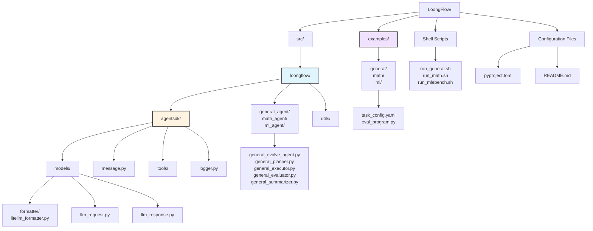
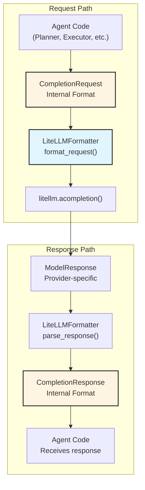
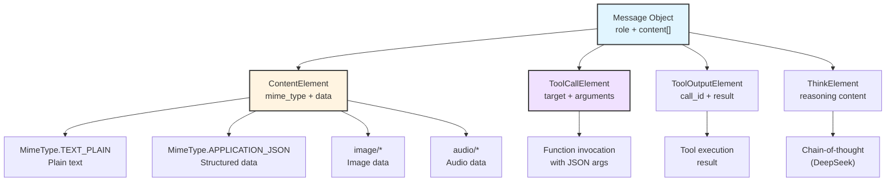
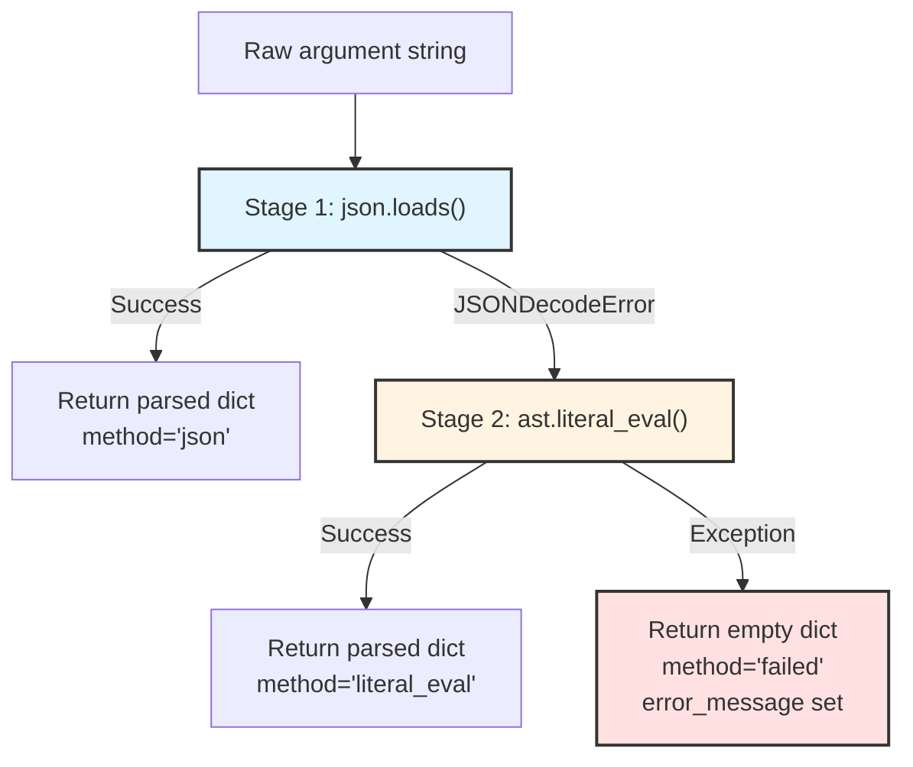
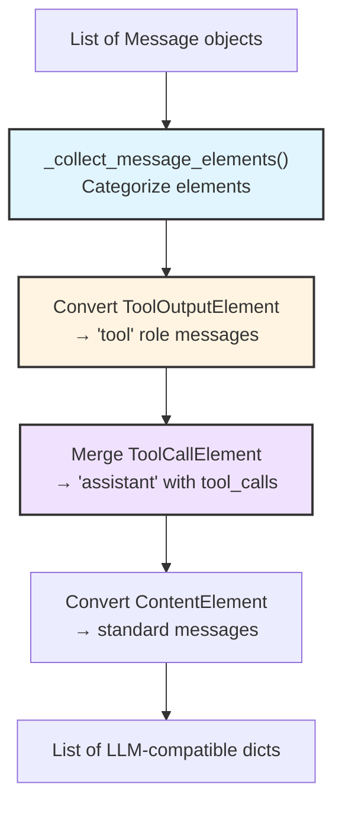

<!-- source: DeepWiki mcp.deepwiki.com · repo baidu-baige/LoongFlow · page 9.1 Development Guide · fetched 2026-10-26 -->

# Development Guide

<details>
<summary>Relevant source files</summary>

The following files were used as context for generating this wiki page:

- [pyproject.toml](pyproject.toml)
- [src/loongflow/agentsdk/models/formatter/litellm_formatter.py](src/loongflow/agentsdk/models/formatter/litellm_formatter.py)
- [uv.lock](uv.lock)

</details>


This page provides technical guidance for setting up a development environment to contribute to the LoongFlow codebase. It covers dependency installation, project structure, running tests, and understanding the code organization patterns used throughout the framework.

For information about filing issues, see [Issue Reporting](#9.2). For pull request guidelines and coding standards, see [Pull Requests](#9.3). If you're looking to use LoongFlow rather than contribute to it, see [Installation & Setup](#2.1).

---

## Prerequisites

LoongFlow requires **Python 3.12 or higher**. The project uses modern Python features including type hints, async/await syntax, and structural pattern matching.

**System Requirements:**
- Python >= 3.12
- Git for version control
- A package manager: `uv` (recommended) or `conda`
- Terminal access for running shell scripts
- Sufficient disk space for LLM API caches and evolution workspaces

**Sources:** [pyproject.toml:16]()

---

## Setting Up Development Environment

### Installation Methods

The project supports two installation approaches: `uv` (recommended for speed) and `pip` with virtual environments.

#### Option 1: Using uv (Recommended)

```bash
# Install uv if not already installed
curl -LsSf https://astral.sh/uv/install.sh | sh

# Clone the repository
git clone https://github.com/baidu-baige/LoongFlow.git
cd LoongFlow

# Create virtual environment and install dependencies
uv venv
source .venv/bin/activate  # On Windows: .venv\Scripts\activate

# Install in editable mode with dev dependencies
uv pip install -e ".[dev]"
```

#### Option 2: Using pip

```bash
# Clone the repository
git clone https://github.com/baidu-baige/LoongFlow.git
cd LoongFlow

# Create virtual environment
python -m venv .venv
source .venv/bin/activate  # On Windows: .venv\Scripts\activate

# Install in editable mode with dev dependencies
pip install -e ".[dev]"
```

The `-e` flag installs the package in **editable mode**, meaning code changes take effect immediately without reinstalling.

### Dependency Overview

The project defines two dependency sets in `pyproject.toml`:

| Dependency Category | Key Packages | Purpose |
|-------------------|--------------|---------|
| **Core Runtime** | `claude-agent-sdk`, `litellm`, `openai` | LLM integration and agent execution |
| **Scientific Computing** | `numpy`, `scipy`, `matplotlib`, `sympy` | Math agent calculations and visualization |
| **Web Services** | `flask`, `uvicorn`, `aiohttp` | Visualization server and async HTTP |
| **Testing** | `pytest`, `pytest-asyncio`, `pyfakefs` | Test framework and utilities |
| **Utilities** | `pyyaml`, `redis`, `psutil` | Configuration, caching, process management |

**Sources:** [pyproject.toml:18-36](), [pyproject.toml:38-43]()

### PyPI Mirror Configuration

The project is configured to use the Tsinghua University PyPI mirror for faster downloads in China:

```toml
[[tool.uv.index]]
url = "https://pypi.tuna.tsinghua.edu.cn/simple"
default = true
```

To use the default PyPI index instead, comment out this section in `pyproject.toml`.

**Sources:** [pyproject.toml:45-47]()

---

## Project Structure

### Directory Layout



**Sources:** [pyproject.toml:5-8]()

### Package Organization

The `src/loongflow/` directory follows a modular structure:

| Module | Purpose | Key Files |
|--------|---------|-----------|
| `agentsdk/` | Core agent SDK and LLM integration | `message.py`, `claude_code_agent.py` |
| `agentsdk/models/` | LLM request/response abstractions | `llm_request.py`, `llm_response.py` |
| `agentsdk/models/formatter/` | Multi-provider LLM adapters | `litellm_formatter.py`, `base_formatter.py` |
| `agentsdk/tools/` | Built-in tools for code execution | `read.py`, `write.py`, `edit.py`, `bash.py` |
| `general_agent/` | General-domain agent implementation | `general_evolve_agent.py`, workers |
| `math_agent/` | Math optimization agent | `math_evolve_agent.py`, workers |
| `ml_agent/` | Machine learning competition agent | `ml_evolve_agent.py`, workers |
| `utils/` | Shared utilities | Database, config loaders, helpers |

The structure enforces **separation of concerns**: the `agentsdk/` package provides reusable infrastructure (LLM communication, tool execution), while agent-specific packages (`general_agent/`, etc.) implement domain logic.

**Sources:** [pyproject.toml:5-8]()

### Build System Configuration

LoongFlow uses `setuptools` as its build backend:

```toml
[build-system]
requires = ["setuptools>=45", "wheel"]
build-backend = "setuptools.build_meta"

[tool.setuptools.packages.find]
where = ["src"]
include = ["loongflow*"]
namespaces = true
```

The `namespaces = true` setting enables PEP 420 namespace packages, allowing modular extensions.

**Sources:** [pyproject.toml:1-8]()

---

## Running Tests

### Test Framework Configuration

LoongFlow uses **pytest** with async support via `pytest-asyncio`. The test configuration is defined in `pyproject.toml`:

```toml
[tool.pytest.ini_options]
pythonpath = ["src", "."]
asyncio_mode = "auto"
addopts = "-s"
log_cli = true
log_cli_level = "INFO"
log_cli_format = "%(asctime)s [%(levelname)s] %(message)s"
log_cli_date_format = "%Y-%m-%d %H:%M:%S"
```

**Configuration Breakdown:**

| Setting | Value | Purpose |
|---------|-------|---------|
| `pythonpath` | `["src", "."]` | Enables imports from `src/loongflow/` and project root |
| `asyncio_mode` | `"auto"` | Automatically detects and runs async tests |
| `addopts` | `"-s"` | Disables output capture (prints appear immediately) |
| `log_cli` | `true` | Enables real-time logging during test execution |
| `log_cli_level` | `"INFO"` | Shows INFO and above log messages |

**Sources:** [pyproject.toml:49-56]()

### Running Tests

```bash
# Run all tests
pytest

# Run tests in a specific directory
pytest tests/agentsdk/

# Run a specific test file
pytest tests/agentsdk/test_litellm_formatter.py

# Run with verbose output
pytest -v

# Run with coverage report
pytest --cov=loongflow --cov-report=html
```

### Test Dependencies

The development dependencies include:

```toml
[project.optional-dependencies]
dev = [
    "pytest>=8.4.2",
    "pytest-asyncio>=1.2.0",
    "pyfakefs>=5.10.0"
]
```

- **pytest-asyncio**: Enables testing of async functions using `async def test_*()` syntax
- **pyfakefs**: Provides a fake filesystem for testing file operations without disk I/O

**Sources:** [pyproject.toml:38-43]()

---

## Code Organization Patterns

### LLM Integration Architecture

The codebase uses a **formatter pattern** to abstract different LLM providers. Understanding this pattern is essential for contributing LLM-related features.



**Key Classes:**

1. **`CompletionRequest`** [src/loongflow/agentsdk/models/llm_request.py](): Internal request format used throughout LoongFlow
2. **`CompletionResponse`** [src/loongflow/agentsdk/models/llm_response.py](): Internal response format with typed elements
3. **`LiteLLMFormatter`** [src/loongflow/agentsdk/models/formatter/litellm_formatter.py:29-583](): Converts between LoongFlow and LiteLLM formats

**Sources:** [src/loongflow/agentsdk/models/formatter/litellm_formatter.py:1-583]()

### Message Element Types

The message system uses typed elements to represent different content types:



**Implementation Details:**

- **`ContentElement`**: Represents text, JSON, images, or audio. The `mime_type` field determines interpretation [src/loongflow/agentsdk/models/formatter/litellm_formatter.py:246-297]()
- **`ToolCallElement`**: Represents function calls with typed arguments [src/loongflow/agentsdk/models/formatter/litellm_formatter.py:248-258]()
- **`ToolOutputElement`**: Contains execution results from tools [src/loongflow/agentsdk/models/formatter/litellm_formatter.py:298-323]()
- **`ThinkElement`**: Stores chain-of-thought reasoning (used by DeepSeek Reasoner) [src/loongflow/agentsdk/models/formatter/litellm_formatter.py:261-262](), [src/loongflow/agentsdk/models/formatter/litellm_formatter.py:408-409]()

**Sources:** [src/loongflow/agentsdk/models/formatter/litellm_formatter.py:14-21](), [src/loongflow/agentsdk/models/formatter/litellm_formatter.py:234-266]()

### Provider Detection Pattern

The `LiteLLMFormatter` determines the LLM provider using a prefix mapping:

```python
MODEL_PROVIDER_PREFIX_MAP = {
    "gpt": "openai",
    "azure-gpt": "azure_openai",
    "claude": "anthropic",
    "gemini": "google_ai_studio",
    "mistral": "mistral_ai",
    "huggingface": "huggingface",
    "deepseek": "deepseek",
}
```

The `get_provider_for_model()` method [src/loongflow/agentsdk/models/formatter/litellm_formatter.py:163-177]() checks model name prefixes to determine routing.

**Special Case - DeepSeek Reasoner:**

DeepSeek's reasoning models use a `reasoning_content` field for chain-of-thought. The formatter detects this using `_is_deepseek_reasoner()` [src/loongflow/agentsdk/models/formatter/litellm_formatter.py:179-185]() and handles it specially during message conversion [src/loongflow/agentsdk/models/formatter/litellm_formatter.py:346-351]().

**Sources:** [src/loongflow/agentsdk/models/formatter/litellm_formatter.py:38-46](), [src/loongflow/agentsdk/models/formatter/litellm_formatter.py:163-185]()

### JSON Parsing Resilience

LLM tool call arguments sometimes contain malformed JSON. The formatter implements a multi-stage parsing strategy:



**Implementation:** The `_safe_parse_json()` method [src/loongflow/agentsdk/models/formatter/litellm_formatter.py:536-582]() tries standard JSON parsing first, then falls back to `ast.literal_eval()` for Python-like syntax (single quotes, trailing commas).

**Sources:** [src/loongflow/agentsdk/models/formatter/litellm_formatter.py:513-532](), [src/loongflow/agentsdk/models/formatter/litellm_formatter.py:536-582]()

---

## Development Workflow Best Practices

### Code Style Guidelines

While the project doesn't currently enforce strict linting, follow these conventions observed in the codebase:

1. **Type Hints**: Use type annotations for function signatures and class attributes
2. **Docstrings**: Include module-level docstrings explaining purpose [src/loongflow/agentsdk/models/formatter/litellm_formatter.py:1-5]()
3. **Logging**: Use `get_logger(__name__)` for module-level loggers [src/loongflow/agentsdk/models/formatter/litellm_formatter.py:26]()
4. **Error Handling**: Log errors with context before raising or returning error states [src/loongflow/agentsdk/models/formatter/litellm_formatter.py:561-578]()

### Testing Async Code

When writing tests for async functions, use the `async def` syntax:

```python
import pytest

async def test_llm_formatter():
    formatter = LiteLLMFormatter()
    request = CompletionRequest(messages=[...])
    kwargs = formatter.format_request(request, "gpt-4")
    assert "model" in kwargs
```

The `asyncio_mode = "auto"` setting automatically handles async test execution.

**Sources:** [pyproject.toml:51]()

### Debugging LLM Interactions

The formatter includes extensive debug logging for message conversion:

```python
logger.debug(
    f"convert message after: {json.dumps(llm_messages, ensure_ascii=False)}"
)
```

Set `log_cli_level = "DEBUG"` in `pytest.ini_options` or use `--log-cli-level=DEBUG` flag to see detailed message transformations during testing.

**Sources:** [src/loongflow/agentsdk/models/formatter/litellm_formatter.py:69-71](), [pyproject.toml:54]()

### Working with Fake Filesystems

Use `pyfakefs` for testing file operations without disk I/O:

```python
def test_file_operations(fs):  # fs fixture from pyfakefs
    fs.create_file('/tmp/test.txt', contents='data')
    # Your file operation code here
    assert os.path.exists('/tmp/test.txt')
```

This prevents test pollution and speeds up execution.

**Sources:** [pyproject.toml:43]()

---

## Understanding Core Abstractions

### The Formatter Interface

All LLM formatters inherit from `BaseFormatter` and implement two methods:

1. **`format_request()`**: Converts `CompletionRequest` → provider-specific kwargs [src/loongflow/agentsdk/models/formatter/litellm_formatter.py:52-128]()
2. **`parse_response()`**: Converts provider response → `CompletionResponse` [src/loongflow/agentsdk/models/formatter/litellm_formatter.py:130-161]()

This abstraction allows adding new LLM providers by implementing a single formatter class.

### Message Conversion Pipeline

The `_convert_messages()` method [src/loongflow/agentsdk/models/formatter/litellm_formatter.py:187-232]() implements a three-step pipeline:



**Step Details:**

1. **Element Collection** [src/loongflow/agentsdk/models/formatter/litellm_formatter.py:234-266](): Separates content, tool calls, tool outputs, and thinking elements
2. **Tool Output Conversion** [src/loongflow/agentsdk/models/formatter/litellm_formatter.py:298-323](): Creates separate messages with `role: "tool"`
3. **Tool Call Merging** [src/loongflow/agentsdk/models/formatter/litellm_formatter.py:325-352](): Combines content and `tool_calls` array in assistant messages
4. **Standard Message Conversion** [src/loongflow/agentsdk/models/formatter/litellm_formatter.py:354-365](): Converts plain text/structured content

**Sources:** [src/loongflow/agentsdk/models/formatter/litellm_formatter.py:187-365]()

---

## Next Steps

After setting up your development environment:

1. **Explore the codebase**: Navigate `src/loongflow/` to understand the module structure
2. **Run existing tests**: Execute `pytest` to ensure your environment is configured correctly
3. **Read related pages**: See [Project Structure](#10.1) for detailed directory layouts
4. **Review contribution guidelines**: See [Pull Requests](#9.3) before submitting code

For questions or issues during setup, see [Issue Reporting](#9.2).

**Sources:** All sections

---

