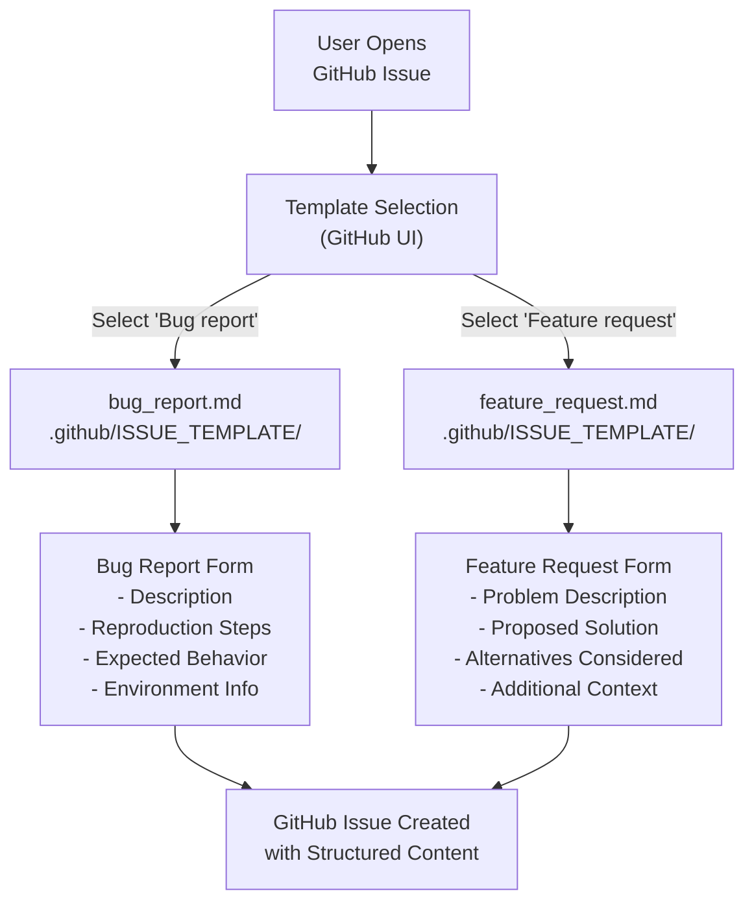
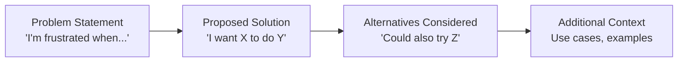
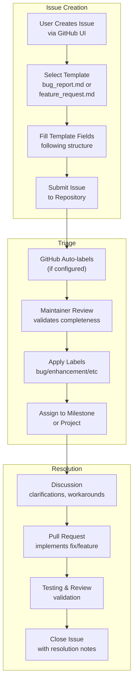

<!-- source: DeepWiki mcp.deepwiki.com · repo baidu-baige/LoongFlow · page 9.2 Issue Reporting · fetched 2026-10-26 -->

# Issue Reporting

<details>
<summary>Relevant source files</summary>

The following files were used as context for generating this wiki page:

- [.github/ISSUE_TEMPLATE/bug_report.md](.github/ISSUE_TEMPLATE/bug_report.md)
- [.github/ISSUE_TEMPLATE/feature_request.md](.github/ISSUE_TEMPLATE/feature_request.md)

</details>


This page explains how to report bugs and request features for LoongFlow using GitHub Issues. It covers the available issue templates, required information, and best practices for effective bug reports and feature requests.

For information about submitting code changes, see [Pull Requests](#9.3). For development environment setup, see [Development Guide](#9.1).

---

## Overview

LoongFlow uses GitHub Issues for tracking bugs, feature requests, and other development tasks. Two standardized issue templates are provided to ensure consistent, actionable reports:

- **Bug Report Template**: For reporting errors, unexpected behavior, or performance problems
- **Feature Request Template**: For proposing new capabilities or enhancements

Both templates are located in [.github/ISSUE_TEMPLATE/]() and are automatically presented when creating a new issue in the GitHub repository.

Sources: [.github/ISSUE_TEMPLATE/bug_report.md:1-39](), [.github/ISSUE_TEMPLATE/feature_request.md:1-21]()

---

## Issue Template Structure

The following diagram shows the GitHub issue creation workflow and how templates are applied:



**GitHub Issue Template Mapping to Files**

Sources: [.github/ISSUE_TEMPLATE/bug_report.md:1-9](), [.github/ISSUE_TEMPLATE/feature_request.md:1-9]()

---

## Bug Reports

The bug report template ([.github/ISSUE_TEMPLATE/bug_report.md]()) structures reports into six key sections:

### Required Information

| Section | Purpose | Example |
|---------|---------|---------|
| **Description** | Clear summary of the bug | "PESAgent crashes when resuming from checkpoint with corrupted database" |
| **Reproduction Steps** | Exact steps to trigger the bug | 1. Run `./run_general.sh todo_app`<br/>2. Stop execution at iteration 5<br/>3. Corrupt `database/checkpoint-iter-5-0`<br/>4. Resume with same command |
| **Expected Behavior** | What should happen | "Agent should detect corruption and either recover or fail gracefully with error message" |
| **Actual Behavior** | What actually happens | "Process crashes with `KeyError` in evolution_database.py" |
| **Environment** | OS, Python version, dependencies | OS: Ubuntu 22.04<br/>Python: 3.10.12<br/>litellm: 1.0.0 |
| **Additional Context** | Logs, screenshots, related issues | Stack trace, `run.log` excerpt, related to #123 |

### Environment Information

For LoongFlow-specific bugs, include:

```yaml
# System Environment
OS: [Ubuntu 22.04 / macOS 14.1 / Windows 11]
Python Version: [3.10+ required]
Package Manager: [uv / conda]

# LoongFlow Configuration
Agent Type: [general / math / ml]
Task Name: [e.g., todo_app, circle_packing]
LLM Provider: [anthropic / openai / deepseek]
Model: [e.g., claude-3-opus-20240229]

# Execution Mode
Mode: [foreground / background]
Concurrent Workers: [number from task_config.yaml]
Checkpoint Interval: [number from task_config.yaml]

# File Paths
Workspace Path: [path to workspace]
Task Config: [path to task_config.yaml]
```

### Critical Information for Different Components

**PESAgent Issues**:
- Current iteration number (from workspace directory names)
- Contents of [workspace/database/]() directory
- Relevant checkpoint files: `checkpoint-iter-X-Y`
- Worker configuration from [task_config.yaml]()

**LLM Integration Issues**:
- LLM provider and model name
- API key configuration method (environment variable name)
- Error messages from `litellm` library
- Contents of request/response if available

**Evaluation Issues**:
- Contents of [eval_program.py]()
- Evaluator type (`simple` or `tool`)
- Timeout settings from [task_config.yaml]()
- Contents of [executor/evaluator_dir/]() from failed iteration

**ClaudeCodeAgent Issues**:
- Permission mode (`permissive` / `normal` / `strict`)
- Skills loaded (from [task_config.yaml]())
- Tool calls made (from iteration logs)
- Contents of [.claude/skills/]() if using custom skills

Sources: [.github/ISSUE_TEMPLATE/bug_report.md:10-38]()

---

## Feature Requests

The feature request template ([.github/ISSUE_TEMPLATE/feature_request.md]()) guides users through proposing new capabilities:

### Template Structure



### Effective Feature Proposals

| Component | Description | Example for LoongFlow |
|-----------|-------------|----------------------|
| **Problem Statement** | What limitation exists? | "When evolving Math Agent solutions, I cannot visualize the geometric constraints in real-time, making it hard to understand why certain solutions fail." |
| **Proposed Solution** | Specific enhancement request | "Add a geometry visualization tool to ClaudeCodeAgent that can render shapes defined in `initial_program.py` and overlay them with solution attempts." |
| **Alternatives** | Other approaches considered | "Could export coordinates to CSV and use external plotting tools, but this breaks the iteration flow." |
| **Use Cases** | Who benefits and how? | "Beneficial for circle packing, polygon coverage, and other spatial optimization problems. Helps debug constraint violations." |

### LoongFlow-Specific Considerations

When proposing features, specify which component is affected:

**Framework Core**:
- Changes to PES paradigm ([PESAgent](#3.2))
- Memory system enhancements ([Evolutionary Memory](#3.4))
- New configuration options ([Configuration Reference](#10.2))

**Agent Implementations**:
- General Agent capabilities ([General Agent](#4))
- Math Agent tools ([Math Agent](#5))
- ML Agent features ([ML Agent](#6))

**Infrastructure**:
- LLM provider support ([LLM Integration](#3.5))
- Execution tools ([Tool Development](#7.3))
- Monitoring features ([Visualization Server](#8.1))

Sources: [.github/ISSUE_TEMPLATE/feature_request.md:10-20]()

---

## Issue Reporting Workflow

The following diagram illustrates the complete issue lifecycle from creation to resolution:



**Issue Lifecycle in LoongFlow Repository**

Sources: [.github/ISSUE_TEMPLATE/bug_report.md:1-9](), [.github/ISSUE_TEMPLATE/feature_request.md:1-9]()

---

## Best Practices

### Writing Effective Bug Reports

**Minimal Reproducible Example**: Provide the smallest possible task configuration and steps that trigger the bug:

```yaml
# task_config.yaml - minimal config that reproduces issue
GENERAL:
  planners:
    llm_config:
      model: "anthropic/claude-3-opus-20240229"
    max_turns: 10  # Reduced from 50 to isolate issue
  
  executors:
    skills: []  # Empty to test if bug is skill-related
  
  summarizers:
    max_turns: 5
```

**Isolated Environment**: Test in a fresh virtual environment to rule out dependency conflicts:

```bash
# Create isolated test environment
uv venv test-env
source test-env/bin/activate
uv pip install -r requirements.txt

# Reproduce bug
./run_general.sh minimal_test_task
```

**Log Excerpts**: Include relevant portions of logs, not entire files:

```
# From run.log - show 10 lines before error
[2024-01-15 14:32:10] INFO: Starting iteration 3
[2024-01-15 14:32:11] INFO: Sampled parent: solution_id_abc123
[2024-01-15 14:32:12] INFO: Planner phase completed
[2024-01-15 14:32:13] INFO: Executor phase started
[2024-01-15 14:32:14] ERROR: KeyError in evolution_database.py:245
Traceback (most recent call last):
  File "loongflow/evolution_database.py", line 245, in get_solution
    return self.populations[island_id][solution_id]
KeyError: 'solution_id_abc123'
```

### Feature Request Guidelines

**Scope Appropriately**: Propose focused features rather than broad redesigns:

❌ **Too Broad**: "Rewrite the entire memory system to use graph databases"

✅ **Well-Scoped**: "Add support for Neo4j as an alternative backend for the Global Evolution Tree to enable graph-based lineage queries"

**Provide Context**: Explain the use case and impact:

```
## Use Case
When working with complex Math Agent problems involving 1000+ iterations,
the current SQLite-based evolution tree becomes slow for lineage queries.

## Proposed Solution
Add an optional Neo4j adapter that maintains the same Evolution Tree
interface but uses graph traversal for O(log n) parent lookups.

## Impact
- Speeds up iteration planning for long-running tasks
- Enables new analysis capabilities (e.g., "find all ancestors with score > 0.9")
- Maintains backward compatibility via adapter pattern
```

**Reference Existing Code**: Link to relevant files and line numbers:

"The current implementation at [loongflow/evolution_database.py:200-250]() uses SQLite for lineage tracking. Proposed Neo4j adapter would implement the same interface at [loongflow/evolution_database.py:150-160]()."

Sources: [.github/ISSUE_TEMPLATE/bug_report.md:10-38](), [.github/ISSUE_TEMPLATE/feature_request.md:10-20]()

---

## Common Issue Categories

### Bug Report Categories

| Category | Description | Example |
|----------|-------------|---------|
| **Installation** | Setup, dependencies, environment | "uv installation fails on Windows with Python 3.11" |
| **Configuration** | task_config.yaml parsing, validation | "Invalid YAML format not caught, causes cryptic error" |
| **Execution** | Runtime errors, crashes | "PESAgent deadlocks with concurrent_executions > 5" |
| **LLM Integration** | API calls, rate limits, formatting | "DeepSeek reasoning_content not parsed correctly" |
| **Evaluation** | Scoring logic, subprocess issues | "eval_program.py timeout not respected" |
| **Checkpointing** | Save/resume functionality | "Cannot resume after changing num_islands" |
| **Visualization** | Dashboard errors, display issues | "Score chart shows NaN for failed evaluations" |

### Feature Request Categories

| Category | Description | Example |
|----------|-------------|---------|
| **New Agent Type** | Domain-specific agent | "Add BioAgent for protein folding optimization" |
| **LLM Provider** | Additional model support | "Support for Cohere Command-R models" |
| **Execution Tools** | New ClaudeCodeAgent tools | "Add web scraping tool for ML data collection" |
| **Memory Features** | Evolution system enhancements | "Add solution similarity clustering to MAP-Elites" |
| **Monitoring** | Visualization improvements | "Real-time resource usage dashboard" |
| **Configuration** | New parameters, validation | "Add per-component LLM model override" |

Sources: [.github/ISSUE_TEMPLATE/bug_report.md:1-39](), [.github/ISSUE_TEMPLATE/feature_request.md:1-21]()

---

## Template Fields Reference

### Bug Report Fields

The bug report template defines these fields in [.github/ISSUE_TEMPLATE/bug_report.md:1-39]():

```yaml
Frontmatter:
  name: "Bug report"
  about: "Create a report to help us improve"
  title: ""
  labels: ""
  assignees: ""

Sections:
  - Describe the bug:
      type: text
      lines: 10-11
      
  - To Reproduce:
      type: steps
      lines: 13-18
      format: "1. Step one\n2. Step two..."
      
  - Expected behavior:
      type: text
      lines: 20-21
      
  - Screenshots:
      type: optional
      lines: 23-24
      
  - Desktop:
      type: structured
      lines: 26-29
      fields: [OS, Browser, Version]
      
  - Smartphone:
      type: structured  
      lines: 31-35
      fields: [Device, OS, Browser, Version]
      
  - Additional context:
      type: text
      lines: 37-38
```

### Feature Request Fields

The feature request template defines these fields in [.github/ISSUE_TEMPLATE/feature_request.md:1-21]():

```yaml
Frontmatter:
  name: "Feature request"
  about: "Suggest an idea for this project"
  title: ""
  labels: ""
  assignees: ""

Sections:
  - Is your feature request related to a problem:
      type: text
      lines: 10-11
      prompt: "Ex. I'm always frustrated when [...]"
      
  - Describe the solution you'd like:
      type: text
      lines: 13-14
      
  - Describe alternatives you've considered:
      type: text
      lines: 16-17
      
  - Additional context:
      type: text
      lines: 19-20
```

Sources: [.github/ISSUE_TEMPLATE/bug_report.md:1-39](), [.github/ISSUE_TEMPLATE/feature_request.md:1-21]()

---

## Issue Labels and Organization

While not defined in the template files themselves, issues in the LoongFlow repository are typically organized with labels:

**Priority Labels**:
- `critical`: Blocks core functionality
- `high`: Significantly impacts users
- `medium`: Noticeable but has workarounds
- `low`: Minor inconvenience

**Component Labels**:
- `framework`: Core PES/ReAct components
- `general-agent`: General Agent specific
- `math-agent`: Math Agent specific
- `ml-agent`: ML Agent specific
- `llm-integration`: LiteLLM, providers
- `visualization`: Dashboard, monitoring
- `documentation`: Wiki, comments, examples

**Type Labels**:
- `bug`: Something isn't working
- `enhancement`: New feature or request
- `question`: Further information requested
- `duplicate`: Already reported
- `wontfix`: Will not be addressed

Sources: [.github/ISSUE_TEMPLATE/bug_report.md:1-9](), [.github/ISSUE_TEMPLATE/feature_request.md:1-9]()

---

## Next Steps After Reporting

After submitting an issue:

1. **Monitor for Responses**: Enable GitHub notifications for comments and labels
2. **Provide Clarifications**: Respond promptly to maintainer questions
3. **Test Workarounds**: Try suggested fixes and report results
4. **Contribute**: Consider submitting a pull request to fix the issue yourself (see [Pull Requests](#9.3))

For complex issues requiring discussion, consider:
- Starting a GitHub Discussion for design questions
- Joining community channels for real-time troubleshooting
- Reviewing existing issues for similar reports

Sources: [.github/ISSUE_TEMPLATE/bug_report.md:1-39](), [.github/ISSUE_TEMPLATE/feature_request.md:1-21]()

---

