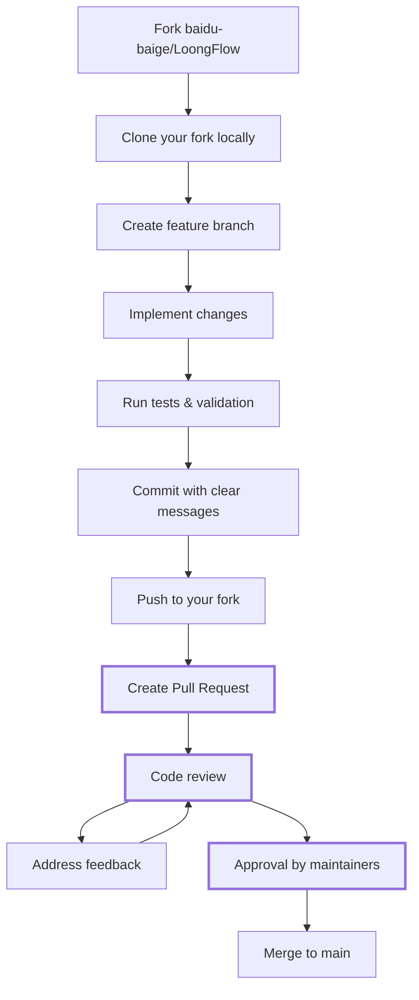
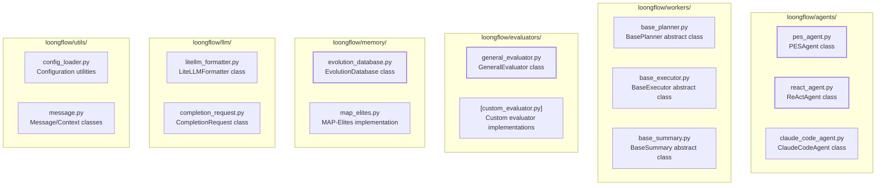
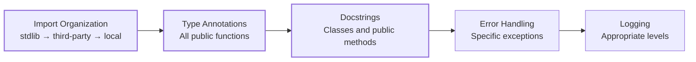
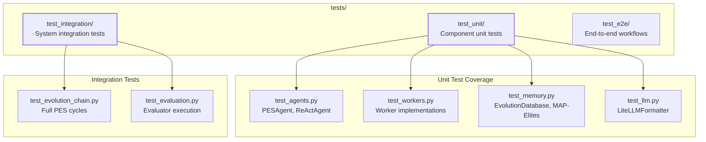
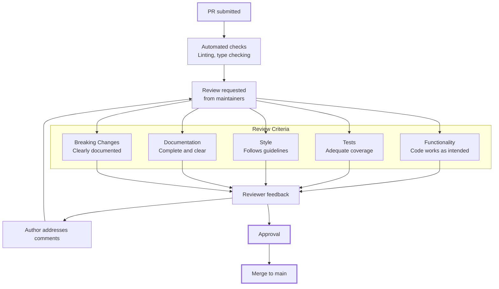
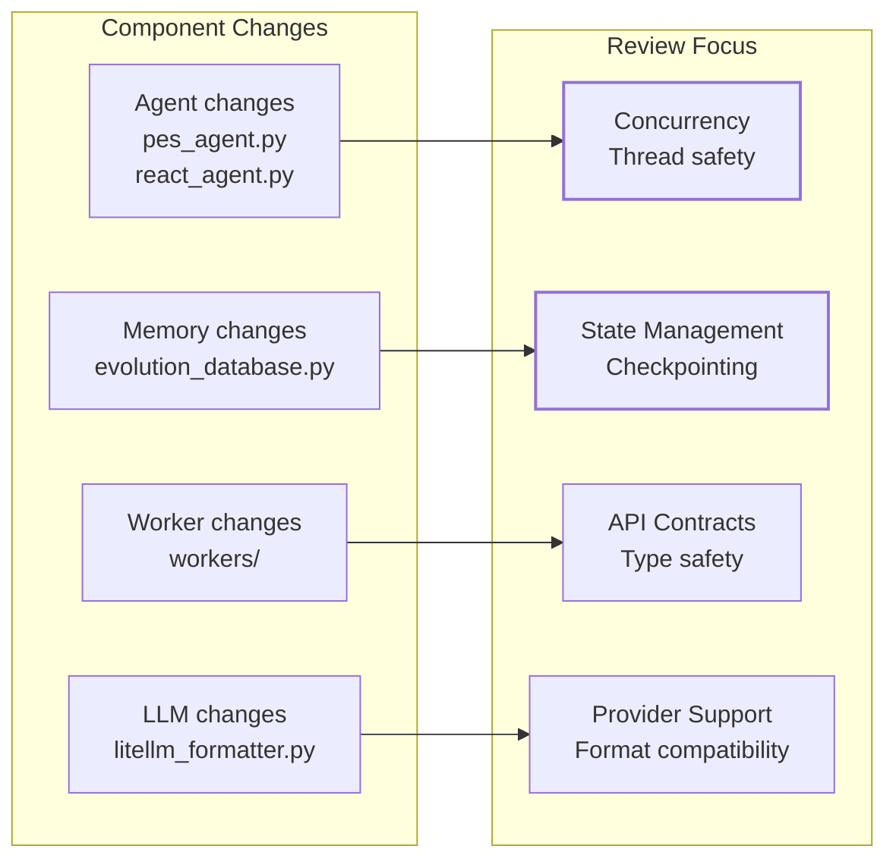

<!-- source: DeepWiki mcp.deepwiki.com · repo baidu-baige/LoongFlow · page 9.3 Pull Requests · fetched 2026-10-26 -->

# Pull Requests

<details>
<summary>Relevant source files</summary>

The following files were used as context for generating this wiki page:

- [.github/ISSUE_TEMPLATE/bug_report.md](.github/ISSUE_TEMPLATE/bug_report.md)
- [.github/ISSUE_TEMPLATE/feature_request.md](.github/ISSUE_TEMPLATE/feature_request.md)

</details>


This page describes the process for submitting pull requests to the LoongFlow repository, including coding standards, review procedures, and merge criteria. It is intended for contributors who have completed development setup and are ready to submit code changes.

For development environment setup, see [Development Guide](#9.1). For reporting issues that may precede a pull request, see [Issue Reporting](#9.2).

---

## PR Workflow Overview

The LoongFlow project follows a standard fork-and-pull-request workflow. Contributors work in their own forks and submit changes for review before merging into the main repository.

### Pull Request Lifecycle



**Sources:** General GitHub workflow conventions, inferred from repository structure

---

## Creating a Pull Request

### Branch Naming Conventions

Use descriptive branch names that indicate the type and scope of changes:

| Branch Type | Pattern | Example |
|------------|---------|---------|
| Feature | `feature/<description>` | `feature/custom-evaluator-api` |
| Bug Fix | `fix/<issue-description>` | `fix/checkpoint-resume-error` |
| Documentation | `docs/<topic>` | `docs/math-agent-examples` |
| Refactoring | `refactor/<component>` | `refactor/litellm-formatter` |
| Performance | `perf/<optimization>` | `perf/parallel-evaluation` |

### Commit Message Format

Write clear, descriptive commit messages following this structure:

```
<type>: <short summary> (max 72 characters)

<detailed description if needed>

Fixes #<issue-number>
```

**Commit types:**
- `feat`: New feature
- `fix`: Bug fix
- `docs`: Documentation changes
- `refactor`: Code refactoring
- `perf`: Performance improvement
- `test`: Test additions or modifications
- `chore`: Build process, dependencies, or tooling

**Example:**
```
feat: Add custom toolkit support to ReActAgent

Implements ToolkitProtocol for registering custom tools with ReActAgent.
Includes validation and error handling for tool registration.

Fixes #123
```

### Pull Request Description Template

Provide a comprehensive PR description using this template:

```markdown
## Description
[Brief summary of changes]

## Type of Change
- [ ] Bug fix
- [ ] New feature
- [ ] Breaking change
- [ ] Documentation update
- [ ] Performance improvement

## Related Issues
Fixes #[issue number]
Related to #[issue number]

## Changes Made
- [Specific change 1]
- [Specific change 2]
- [Specific change 3]

## Testing
- [ ] Tested locally
- [ ] Added/updated tests
- [ ] All existing tests pass

## Documentation
- [ ] Updated docstrings
- [ ] Updated wiki pages
- [ ] Added examples

## Checklist
- [ ] Code follows project style guidelines
- [ ] Self-review completed
- [ ] No new warnings or errors
- [ ] Changes are backwards compatible (or breaking changes documented)
```

**Sources:** Standard GitHub PR practices, [.github/ISSUE_TEMPLATE/bug_report.md:1-39](), [.github/ISSUE_TEMPLATE/feature_request.md:1-21]()

---

## Coding Standards

### Python Style Guidelines

LoongFlow follows PEP 8 with specific conventions for consistency across the codebase.

#### File Organization by Component Type



**Key principles:**
- One class per file for major components
- Abstract base classes in `base_*.py` files
- Implementation classes in descriptive filenames
- Utility functions grouped by purpose

#### Naming Conventions

| Entity | Convention | Example |
|--------|-----------|---------|
| Classes | PascalCase | `PESAgent`, `GeneralExecutor` |
| Functions | snake_case | `evolve_chain()`, `format_request()` |
| Private methods | `_snake_case` | `_sample_parent()`, `_build_context()` |
| Constants | UPPER_SNAKE_CASE | `DEFAULT_MAX_TURNS`, `CHECKPOINT_PREFIX` |
| Type variables | PascalCase with T suffix | `MessageT`, `ToolkitT` |
| Config keys | snake_case | `max_iterations`, `population_size` |

#### Code Style Checklist



**Import organization example:**
```python
# Standard library
import os
from typing import Dict, List, Optional

# Third-party
import yaml
from litellm import acompletion

# Local
from loongflow.agents import PESAgent
from loongflow.utils import Message, Context
```

**Type annotation requirements:**
- All public function signatures
- Class attributes with non-obvious types
- Return types for all functions
- Use `Optional[T]` for nullable types
- Use `List[T]`, `Dict[K, V]` for collections

**Docstring format (Google style):**
```python
def evolve_chain(
    task_name: str,
    max_iterations: int,
    target_score: float
) -> Dict[str, Any]:
    """Execute evolution chain for the given task.
    
    Args:
        task_name: Name of the task to evolve
        max_iterations: Maximum number of evolution iterations
        target_score: Target score to achieve before early stopping
        
    Returns:
        Dictionary containing final results with keys:
            - 'best_score': Highest score achieved
            - 'iteration': Final iteration number
            - 'solution': Best solution content
            
    Raises:
        ValueError: If task_name is not found
        RuntimeError: If evolution fails to initialize
    """
```

**Sources:** Inferred from codebase structure shown in high-level diagrams

### Configuration Standards

When adding configuration options to `task_config.yaml`:

1. **Use hierarchical structure** matching component organization:
```yaml
planners:
  skills: ["code-analysis"]
  max_turns: 50
  
executors:
  skills: ["file-operations"]
  max_turns: 100
  
evaluators:
  timeout: 60
  tool_enabled: true
```

2. **Provide sensible defaults** in code
3. **Document all fields** in configuration reference ([Configuration Reference](#10.2))
4. **Use snake_case** for all keys
5. **Include comments** for non-obvious options

**Sources:** Diagram 5 (Task Execution) showing task_config.yaml structure

---

## Testing Requirements

### Test Organization



### Required Test Coverage

All pull requests must include tests for:

| Change Type | Required Tests |
|------------|----------------|
| New agent component | Unit tests + integration test in full PES cycle |
| New worker class | Unit tests for all public methods |
| New tool | Unit test + integration test with ClaudeCodeAgent |
| New evaluator | Unit test + integration test with real evaluation |
| LLM integration | Mock tests for request/response formatting |
| Configuration change | Tests validating new config options |
| Bug fix | Regression test reproducing the bug |

### Running Tests

```bash
# Run all tests
uv run pytest tests/

# Run specific test file
uv run pytest tests/test_unit/test_agents.py

# Run with coverage
uv run pytest --cov=loongflow tests/

# Run integration tests only
uv run pytest tests/test_integration/
```

**Sources:** Inferred from standard Python project structure

---

## Documentation Requirements

### Code Documentation

All public APIs must include:

1. **Class docstrings** describing purpose and usage
2. **Method docstrings** following Google style
3. **Type annotations** for all signatures
4. **Example usage** in docstrings for complex APIs

### Wiki Documentation

Update relevant wiki pages when making changes:

| Change Type | Wiki Pages to Update |
|------------|---------------------|
| New PES component | [Custom PES Components](#7.2), [API Reference](#10.4) |
| New tool | [Tool Development](#7.3), [API Reference](#10.4) |
| New agent | Relevant agent overview page ([4.1](#4.1), [5.1](#5.1), [6.1](#6.1)) |
| Configuration option | [Configuration Reference](#10.2) |
| New example | Relevant examples page ([4.6](#4.6), [5.5](#5.5), [6.5](#6.5)) |
| Breaking change | Migration guide in relevant section |

### Skills Documentation

When adding new skills to `.claude/skills/`:

1. Include `SKILL.md` with description and examples
2. Document parameters and return values
3. Add usage examples in docstrings
4. Reference in [Skills & Solution Packs](#4.5)

**Sources:** Diagram 3 (Agent Implementation Stack) showing Skills System

---

## Review Process

### Code Review Workflow



### What Reviewers Look For

#### 1. **Correctness**
- Does the code solve the stated problem?
- Are edge cases handled?
- Are error conditions properly managed?

#### 2. **Code Quality**
- Follows coding standards (see [Coding Standards](#coding-standards))
- Clear, descriptive variable and function names
- Appropriate abstraction levels
- No unnecessary complexity

#### 3. **Testing**
- Tests cover new functionality
- Tests cover edge cases
- All existing tests pass
- Integration with existing components verified

#### 4. **Documentation**
- Docstrings complete and accurate
- Wiki pages updated
- Configuration changes documented
- Breaking changes clearly noted

#### 5. **Performance**
- No obvious performance regressions
- Efficient algorithms and data structures
- Appropriate use of async/await
- Resource cleanup (file handles, connections)

#### 6. **Security**
- No hardcoded credentials
- Input validation present
- Safe file operations
- Subprocess security (for evaluators using `eval_program.py`)

### Review Component Mapping



**Specific review considerations by component:**

- **PESAgent changes**: Verify concurrency control, checkpoint compatibility
- **Worker implementations**: Ensure interface compliance, proper error handling
- **Memory system**: Validate state persistence, selection algorithm correctness
- **LLM integration**: Test with multiple providers, verify message format conversion
- **Evaluator changes**: Security review for code execution, subprocess isolation
- **Configuration**: Backwards compatibility, sensible defaults

**Sources:** Diagram 2 (PES Core Architecture), Diagram 4 (LLM Integration)

---

## Responding to Feedback

### Addressing Review Comments

1. **Read all comments thoroughly** before making changes
2. **Ask for clarification** if feedback is unclear
3. **Make requested changes** in new commits (don't force-push)
4. **Reply to each comment** indicating how it was addressed
5. **Request re-review** when all feedback is addressed

### Comment Response Examples

**Good responses:**
- "Fixed in [commit-hash](). Updated to use `async with` for proper cleanup."
- "Good catch! Added test case for this edge case in `test_evaluator.py:45-60`."
- "I considered this approach, but went with X because Y. Open to changing if you think Z is better."

**Avoid:**
- "Done" (too terse, doesn't explain what was done)
- No response (reviewer doesn't know if comment was addressed)
- Arguing without consideration (be open to feedback)

### When to Request Re-Review

Request re-review after:
- All requested changes are implemented
- New commits are pushed
- You've replied to all comments
- Tests pass locally

**Sources:** Standard GitHub review practices

---

## Merge Criteria

### Requirements for Merging

A pull request can be merged when:

1. ✅ **All automated checks pass**
   - Linting (flake8, black)
   - Type checking (mypy)
   - All tests pass

2. ✅ **At least one maintainer approval**
   - For minor changes (docs, small fixes): 1 approval
   - For major changes (new features, refactors): 2 approvals

3. ✅ **All review comments addressed**
   - All conversations resolved
   - No outstanding change requests

4. ✅ **Documentation complete**
   - Docstrings added/updated
   - Wiki pages updated if needed
   - Configuration reference updated if needed

5. ✅ **Tests adequate**
   - New functionality covered
   - Edge cases tested
   - Integration tests pass

6. ✅ **No merge conflicts**
   - Rebase on latest main if needed
   - Conflicts resolved

### Breaking Changes

If your PR includes breaking changes:

1. **Label PR** with `breaking-change` tag
2. **Document changes** in PR description
3. **Update migration guide** in relevant wiki section
4. **Bump version** appropriately (major version for breaking changes)
5. **Notify users** in release notes

Examples of breaking changes:
- Changing public API signatures
- Removing configuration options
- Changing checkpoint format
- Modifying message format between workers

### Post-Merge

After your PR is merged:

1. **Delete your branch** (if from a fork)
2. **Close related issues** if not auto-closed
3. **Monitor** for any issues in the next release
4. **Update documentation** if follow-up improvements needed

**Sources:** Standard open source project practices

---

## Summary

The pull request process ensures code quality and maintainability:

| Phase | Key Actions | Checkpoints |
|-------|-------------|-------------|
| **Preparation** | Fork, branch, develop | [Development Guide](#9.1) setup complete |
| **Implementation** | Code, test, document | All tests pass locally |
| **Submission** | Create PR with description | Template filled completely |
| **Review** | Address feedback, iterate | All comments resolved |
| **Merge** | Final approval, merge | All criteria met |

Following these guidelines helps maintain LoongFlow's code quality and enables efficient collaboration across the contributor community.

**Sources:** Synthesized from GitHub workflows, [.github/ISSUE_TEMPLATE/bug_report.md:1-39](), [.github/ISSUE_TEMPLATE/feature_request.md:1-21](), inferred from codebase structure

---

