# Page: Overview

# Overview

<details>
<summary>Relevant source files</summary>

The following files were used as context for generating this wiki page:

- [README.md](README.md)
- [agents/ml_agent/README.md](agents/ml_agent/README.md)

</details>


This document provides a high-level introduction to the LoongFlow framework, its core PES (Plan-Execute-Summarize) paradigm, and the architectural components that enable expert-level agent development. For installation instructions, see [Installation & Setup](#2.1). For details on the PES paradigm implementation, see [PES Paradigm](#3.1). For information on specific agent types, see [General Agent](#4), [Math Agent](#5), and [ML Agent](#6).

## What is LoongFlow?

LoongFlow is an open-source framework for building expert-level AI agents that solve complex, long-horizon reasoning tasks through structured thinking and iterative learning. The framework implements a cognitive paradigm inspired by how human experts approach difficult problems: plan systematically, execute deliberately, and learn from both successes and failures.

The framework provides:
- A standardized **PES (Plan-Execute-Summary) thinking paradigm** implemented via the `PESAgent` class
- An **evolutionary memory system** using `EvolveDatabase` with multi-island architecture, MAP-Elites diversity preservation, and adaptive Boltzmann selection
- **Three specialized agent implementations** in `agents/math_agent/`, `agents/ml_agent/`, and `agents/general_agent/`
- **LLM-agnostic integration** via `LiteLLMFormatter` supporting OpenAI-compatible APIs

**Sources:** [README.md:1-110](), [README.md:125-140]()

## The PES Paradigm

The Plan-Execute-Summary (PES) paradigm is the central abstraction in LoongFlow. Each evolution cycle consists of three distinct phases implemented via worker registration in `PESAgent`:

| Phase | Worker Registration Method | Purpose | Key Activities |
|-------|---------------------------|---------|----------------|
| **Plan** | `register_planner_worker()` | Design deliberate approach | Sample parent solutions via `EvolveDatabase`, retrieve historical lineage, generate execution blueprint |
| **Execute** | `register_executor_worker()` | Perform controlled experiments | Set up iteration workspace, implement plan, invoke `Evaluator`, collect metrics |
| **Summary** | `register_summary_worker()` | Reflect and consolidate learning | Analyze results, extract insights, update `EvolveDatabase`, record parent-child lineage |

The `PESAgent` class orchestrates this cycle, managing concurrent evolution iterations and checkpointing state to `checkpoint-iter-X-Y/` directories.

**Sources:** [README.md:299-339](), [README.md:439-456]()

## Framework Architecture Overview

**Diagram: Core Framework Components and Code Entities**

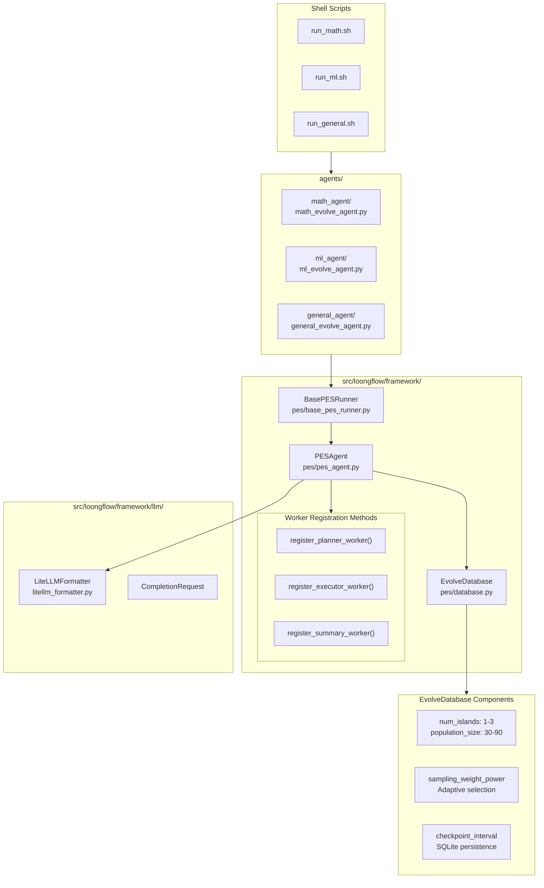

The framework architecture consists of:

1. **Core Framework** (`src/loongflow/framework/pes/`)
   - `PESAgent`: Main orchestrator managing evolution cycles
   - `BasePESRunner`: Configuration validation and worker registration template
   - `EvolveDatabase`: SQLite-based persistent storage with checkpoint support

2. **LLM Integration** (`src/loongflow/framework/llm/`)
   - `LiteLLMFormatter`: Message format conversion for multiple providers
   - `CompletionRequest`: Internal message representation

3. **Specialized Agents** (`agents/`)
   - `math_evolve_agent.py`: Math optimization tasks
   - `ml_evolve_agent.py`: Machine learning competitions
   - `general_evolve_agent.py`: General-purpose task solving

4. **Entry Points**
   - Shell scripts: `run_math.sh`, `run_ml.sh`, `run_general.sh`
   - Each script invokes corresponding `*_evolve_agent.py` entrypoint

**Sources:** [README.md:35-90](), [README.md:439-477]()

## PESAgent and Worker System

**Diagram: PESAgent Worker Registration and Code Flow**

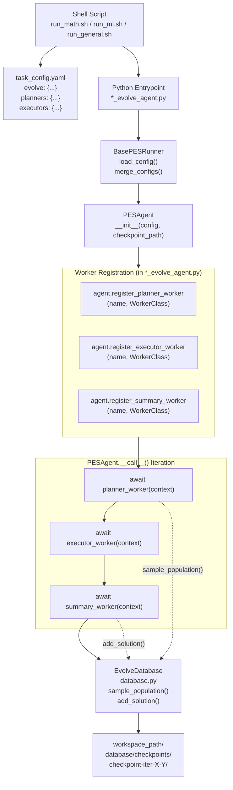

The `PESAgent` class implements a worker registry pattern where domain-specific agents register their worker implementations:

| Worker Type | Registration Method | Example Implementations | Purpose |
|-------------|---------------------|------------------------|---------|
| **Planner** | `register_planner_worker(name, Class)` | `GeneralPlanAgent`, `MathPlanner`, `MLPlanner` | Generate execution strategy based on task context and parent solutions |
| **Executor** | `register_executor_worker(name, Class)` | `GeneralExecuteAgent`, `MathExecutor`, `MLExecutor` | Execute plan, generate solution, invoke evaluator |
| **Summary** | `register_summary_worker(name, Class)` | `GeneralSummaryAgent`, `MathSummary`, `MLSummary` | Reflect on results, extract insights, update database |

Each worker receives a `Context` object containing:
- `trace_id`: Unique iteration identifier
- `iteration`: Current iteration number
- `task`: Task configuration and requirements
- `workspace`: Filesystem path for iteration artifacts

The `EvolveDatabase` maintains solution populations, lineage trees, and scores. Checkpoints are saved to `checkpoint-iter-{island}-{iteration}/` directories at intervals defined by `checkpoint_interval` in configuration.

**Sources:** [README.md:439-456](), [README.md:299-339]()

## Three Specialized Agent Types

LoongFlow provides three concrete agent implementations demonstrating different use cases of the PES paradigm.

**Diagram: Three Agent Implementations with Code Paths**

```mermaid
graph TB
    subgraph MathAgent["agents/math_agent/"]
        MathEntry["math_evolve_agent.py"]
        MathPlanner["MathPlanner (ReActAgent)"]
        MathExecutor["MathExecutor (ReActAgent)"]
        MathSummary["MathSummary (ReActAgent)"]
        MathTools["build_evaluator_solution_tool()<br/>build_executor_write_tool()<br/>build_executor_read_tool()<br/>build_install_package_tool()"]
        MathEval["eval_program.py<br/>(per task in examples/)"]
    end
    
    subgraph MLAgent["agents/ml_agent/"]
        MLEntry["ml_evolve_agent.py"]
        MLPlanner["MLPlanner (ReActAgent)"]
        MLExecutor["MLExecutor (ReActAgent)"]
        MLSummary["MLSummary (ReActAgent)"]
        MLEBench["mlebench/<br/>prepare.py<br/>grade.py"]
        MLEval["eval_program.py<br/>(per competition)"]
    end
    
    subgraph GeneralAgent["agents/general_agent/"]
        GenEntry["general_evolve_agent.py"]
        GenPlanner["GeneralPlanAgent<br/>(ClaudeCodeAgent)"]
        GenExecutor["GeneralExecuteAgent<br/>(ClaudeCodeAgent)"]
        GenSummary["GeneralSummaryAgent<br/>(ClaudeCodeAgent)"]
        Skills[".claude/skills/<br/>code-analysis<br/>skill-creator"]
        GenEval["GeneralEvaluator<br/>eval_program.py"]
    end
    
    MathEntry --> MathPlanner
    MathEntry --> MathExecutor
    MathEntry --> MathSummary
    MathExecutor --> MathTools
    MathExecutor --> MathEval
    
    MLEntry --> MLPlanner
    MLEntry --> MLExecutor
    MLEntry --> MLSummary
    MLExecutor --> MLEBench
    MLExecutor --> MLEval
    
    GenEntry --> GenPlanner
    GenEntry --> GenExecutor
    GenEntry --> GenSummary
    GenExecutor --> Skills
    GenExecutor --> GenEval
```

| Agent Type | Entrypoint | Worker Classes | Execution Environment | Evaluation |
|------------|------------|----------------|----------------------|------------|
| **Math-Agent** | `math_evolve_agent.py` | `MathPlanner`, `MathExecutor`, `MathSummary` (all `ReActAgent`-based) | Tool-based: `evaluate_solution`, `write`, `read`, `ls`, `install_package` | Task-specific `eval_program.py` in each `examples/` subdirectory |
| **ML-Agent** | `ml_evolve_agent.py` | `MLPlanner`, `MLExecutor`, `MLSummary` (all `ReActAgent`-based) | MLE-bench integration: `prepare.py`, `grade.py`, Kaggle API | Competition-specific `eval_program.py` with metrics from MLE-bench |
| **General-Agent** | `general_evolve_agent.py` | `GeneralPlanAgent`, `GeneralExecuteAgent`, `GeneralSummaryAgent` (all `ClaudeCodeAgent`-based) | Skills system (`.claude/skills/`), solution packs, file I/O tools | `GeneralEvaluator` with optional tool-based or simple scoring |

Key differences:

- **Agent SDK**: Math and ML agents use `ReActAgent` (reasoning-action loop), General agent uses `ClaudeCodeAgent` (Claude SDK wrapper)
- **Tools**: Math/ML use explicit tool builders (`build_*_tool()`), General uses skills loaded from `.claude/skills/`
- **Evaluation**: Math/ML use subprocess-isolated `eval_program.py`, General supports both tool-based and simple evaluation modes

**Sources:** [README.md:35-90](), [README.md:360-432]()

## Execution Infrastructure

**Diagram: Shell Script Execution Flow and File Paths**

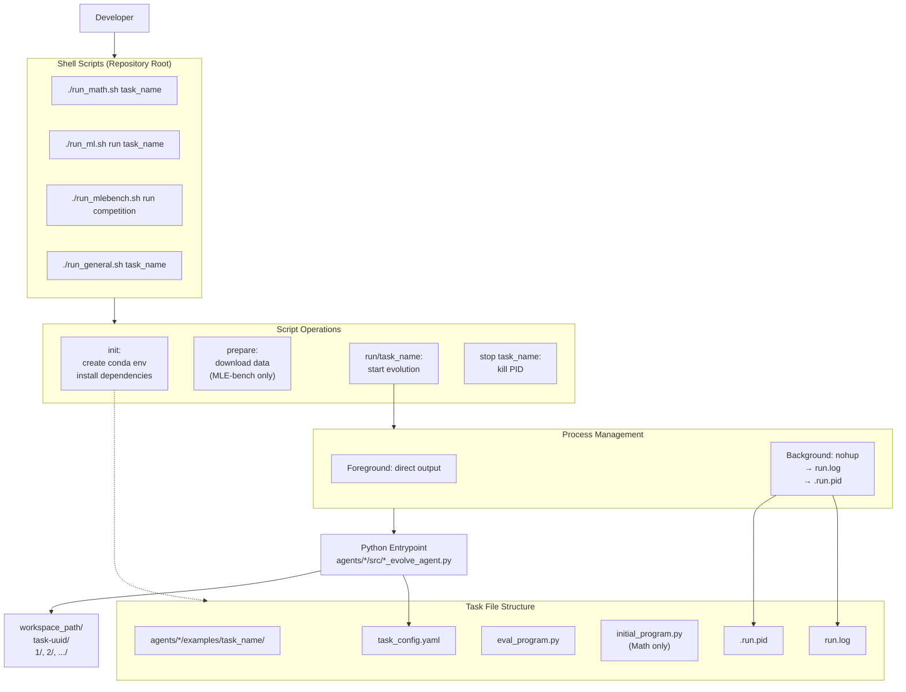

| Script | Primary Command | Additional Operations | Task Directory |
|--------|----------------|----------------------|----------------|
| `run_math.sh` | `./run_math.sh <task> [--background]` | `init`, `stop <task>` | `agents/math_agent/examples/<task>/` |
| `run_ml.sh` | `./run_ml.sh run <task> [--background]` | `init`, `stop <task>` | `agents/ml_agent/examples/<task>/` |
| `run_mlebench.sh` | `./run_mlebench.sh run <comp> [--background]` | `init`, `prepare <comp>`, `stop <comp>` | `agents/ml_agent/examples/mlebench/competitions/*/<comp>/` |
| `run_general.sh` | `./run_general.sh <task> [--background]` | `stop <task>` | `agents/general_agent/examples/<task>/` |

**Script Operations:**

1. **init**: Creates conda/mamba environment from `environment_gpu.yaml` or `environment_cpu.yaml` (with automatic GPU detection)
2. **prepare** (MLE-bench only): Downloads competition data via `mlebench prepare <competition-id>`
3. **run/task_name**: 
   - Validates `task_config.yaml` exists in task directory
   - Launches Python entrypoint (`*_evolve_agent.py`)
   - Foreground mode: direct console output
   - Background mode: `nohup ... > run.log 2>&1 &`, saves PID to `.run.pid`
4. **stop**: Reads PID from `.run.pid`, terminates process via `kill`

**Output Structure:**

Each run creates a workspace directory specified by `workspace_path` in `task_config.yaml`, containing:
- Numbered iteration directories: `1/`, `2/`, ...
- Database and checkpoints: `database/checkpoints/checkpoint-iter-X-Y/`
- Evaluation results: `evaluate/`

**Sources:** [README.md:156-263](), [agents/ml_agent/README.md:28-68]()

## Key Framework Components

### Core Classes

| Class | Location | Purpose |
|-------|----------|---------|
| `PESAgent` | `src/loongflow/framework/pes/` | Main orchestrator for evolution cycles, manages worker registry |
| `BasePESRunner` | `src/loongflow/framework/pes/` | Configuration loading, validation, and agent initialization |
| `ReActAgent` | `src/loongflow/framework/react/` | Reasoning-and-acting agent for tool-based execution |
| `EvolveDatabase` | `src/loongflow/framework/pes/` | SQLite-based persistent storage for solutions and lineage |
| `LiteLLMFormatter` | `src/loongflow/framework/llm/` | Unified interface to multiple LLM providers |

### Tool System

**Diagram: Tool System with Code Entities**

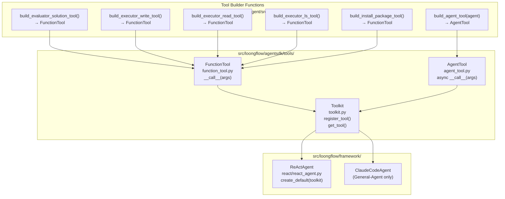

| Component | File Path | Purpose | Usage Example |
|-----------|-----------|---------|---------------|
| `FunctionTool` | `src/loongflow/agentsdk/tools/function_tool.py` | Wraps Python functions as tools | `build_executor_write_tool()` creates file writing tool |
| `AgentTool` | `src/loongflow/agentsdk/tools/agent_tool.py` | Wraps nested agent invocation | `build_agent_tool(evaluator_agent)` embeds evaluation agent |
| `Toolkit` | `src/loongflow/agentsdk/tools/toolkit.py` | Manages tool collections | `toolkit.register_tool(tool)`, `toolkit.get_tool(name)` |
| `ReActAgent` | `src/loongflow/framework/react/react_agent.py` | Reasoning-Action agent | `ReActAgent.create_default(model, sys_prompt, toolkit)` |

**Tool Builder Functions** (Math/ML Agents):
- `build_evaluator_solution_tool(eval_program_path, task_data_path)`: Creates tool for running `eval_program.py`
- `build_executor_write_tool(work_dir)`: File writing with path restrictions
- `build_executor_read_tool(work_dir)`: File reading
- `build_executor_ls_tool(work_dir)`: Directory listing
- `build_install_package_tool()`: Package installation via pip

**General-Agent Skills** (alternative to explicit tools):
- Skills loaded from `.claude/skills/` directory
- Formatted via `load_skills()` and `format_loaded_skills()`
- Injected into `ClaudeCodeAgent` system prompts

**Sources:** [README.md:460-477]()

### Utilities and Support

| Component | Purpose |
|-----------|---------|
| **Skills** | Reusable code snippets loaded via `load_skills()` and `format_loaded_skills()` |
| **Solution Packs** | Complete solution directories managed by `copy_solution_files()`, `ensure_manifest()`, `validate_manifest()` |
| **Checkpoints** | Named directories (`checkpoint-iter-X-Y`) for resumable evolution |
| **Visualizer** | Interactive web UI for viewing evolution trees and solution islands |

**Sources:** High-Level Diagrams (Diagram 5), [README.md:389-409](), [README_zh.md:399-420]()

## Evolutionary Memory System

The memory system combines multiple techniques for diversity preservation and intelligent selection:

| Component | Purpose | Implementation |
|-----------|---------|----------------|
| **Multi-Island Architecture** | Maintain diverse solution populations | Multiple independent archives with different selection pressures |
| **MAP-Elites** | Preserve solutions across behavior space | Grid-based archive organized by solution characteristics |
| **Adaptive Boltzmann Selection** | Balance exploration vs exploitation | Temperature-based sampling that adapts to progress |
| **Global Evolutionary Tree** | Track lineage and enable retrieval | Tree structure recording parent-child relationships |

The system allows agents to:
- Sample promising parent solutions for mutation
- Avoid redundant exploration of similar approaches
- Escape local optima through diverse population maintenance
- Learn from historical successes and failures

**Sources:** [README.md:283-295](), [README_zh.md:283-295](), High-Level Diagrams (Diagram 2, 4)

## LLM Integration

**Diagram: LiteLLMFormatter Message Flow**

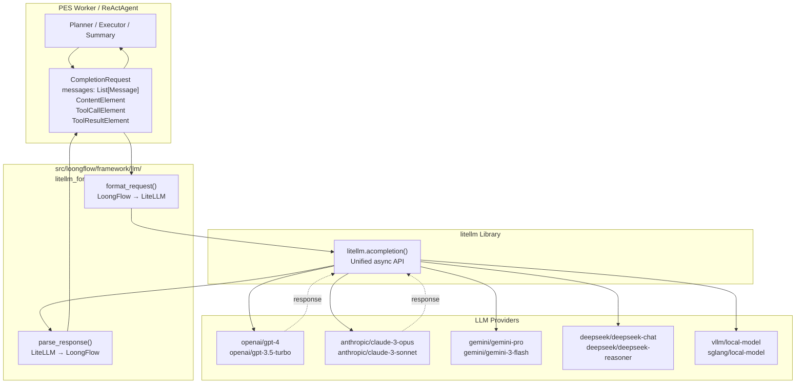

**Configuration in task_config.yaml:**

```yaml
llm_config:
  url: "https://api.example.com/v1"
  api_key: "your-api-key"
  model: "openai/gpt-4"  # Provider prefix determines routing
  temperature: 0.8
  context_length: 128000
  max_tokens: 8192
  top_p: 1.0
```

**LiteLLMFormatter Responsibilities:**

1. **Message Format Conversion:**
   - `format_request()`: Converts `CompletionRequest` with typed message elements (`ContentElement`, `ToolCallElement`, `ToolResultElement`) to LiteLLM format
   - `parse_response()`: Converts LiteLLM response back to `CompletionRequest`

2. **Provider-Specific Handling:**
   - DeepSeek: Extracts `reasoning_content` field for chain-of-thought models
   - Tool calls: Maps between LoongFlow and provider-specific tool schemas
   - Context management: Handles `context_length` and token truncation

3. **Unified API:**
   - Model selection by prefix: `openai/`, `anthropic/`, `gemini/`, `deepseek/`
   - `litellm.acompletion()` routes to appropriate provider
   - Environment variable fallback: `ANTHROPIC_API_KEY`, `OPENAI_API_KEY`, etc.

**Sources:** [README.md:218-247](), [agents/ml_agent/README.md:94-103]()

## Performance and Results

LoongFlow has demonstrated expert-level performance on challenging benchmarks.

### Mathematical Optimization (Tao's & AlphaEvolve Sets)

Performance on 11 mathematical challenges from Terence Tao's collection and AlphaEvolve benchmark set:

| Problem | Metric | Previously Best | AlphaEvolve | LoongFlow | Example Directory |
|---------|--------|----------------|-------------|-----------|-------------------|
| Circle packing in square | Maximize density | 2.634 | 2.6358627564 | **2.6359829625** | `agents/math_agent/examples/packing_circle_in_unit_square/` |
| Circle packing in rectangle | Maximize density | 2.364 | 2.3658321334 | **2.365832229** | `agents/math_agent/examples/packing_circle_in_rectangle/` |
| Hexagons in hexagons | Minimize ratio | 3.943 | 3.930092 | **3.928906855** | `agents/math_agent/examples/packing_hexagons_in_hexagons/` |
| Max to min ratios | Minimize ratio | 12.89 | 12.88926611 | **12.889243547** | `agents/math_agent/examples/max_to_min_ratios/` |
| Minimum overlap | Minimize overlap | 0.380927 | 0.380924 | **0.380913756** | `agents/math_agent/examples/minimum_overlap_problem/` |
| Uncertainty inequality | Minimize bound | 0.3523 | 0.35209910 | **0.352099104** | `agents/math_agent/examples/uncertainty_inequality/` |
| 2nd autocorrelation | Maximize | 0.88922 | 0.896279944 | **0.902702108** | `agents/math_agent/examples/second_autocorrelation_inequality/` |

**Results Summary:**
- **11 problems** surpassed best known human results
- **7 problems** exceeded AlphaEvolve's performance
- State-of-the-art (SOTA) results in geometry optimization and inequality bounds

### Machine Learning (MLE-bench Kaggle Competitions)

Performance on 48 Kaggle competitions from MLE-bench benchmark:

| Medal Tier | Count | Representative Examples |
|------------|-------|-------------------------|
| 🥇 Gold | 26 | `stanford-covid-vaccine`, `iwildcam-2019-fgvc6`, `3d-object-detection-for-autonomous-vehicles` |
| 🥈 Silver | 17 | Multiple medium-difficulty competitions |
| 🥉 Bronze | 5 | Various simple competitions |

**Competition Difficulty Distribution:**
- Simple: `aerial-cactus-identification`, `dogs-vs-cats-redux-kernels-edition`
- Medium: `google-quest-challenge`, `learning-agency-lab-automated-essay-scoring-2`
- Hard: `rsna-miccai-brain-tumor-radiogenomic-classification`, `vinbigdata-chest-xray-abnormalities-detection`

Full competition results with score breakdowns available in `agents/ml_agent/examples/mlebench/competitions/`.

**Sources:** [README.md:142-427](), [agents/ml_agent/README.md:8-14]()

## Next Steps

To get started with LoongFlow:

1. **Installation**: Follow [Installation & Setup](#2.1) to configure your environment
2. **Quick Starts**: Try the guided tutorials for [Math Agent](#2.2), [ML Agent](#2.3), or [General Agent](#2.4)
3. **Deep Dives**: Learn about the [PES Paradigm](#3.1), [PESAgent Architecture](#3.2), and [Evolutionary Memory](#3.4)
4. **Build Custom Agents**: See [Building Custom Agents](#7) for implementing your own domain-specific agents

For visualization and monitoring, refer to [Visualization & Monitoring](#8).

**Sources:** [README.md:128-204](), [README_zh.md:129-206]()

---

# Page: Getting Started

# Getting Started

<details>
<summary>Relevant source files</summary>

The following files were used as context for generating this wiki page:

- [README.md](README.md)
- [agents/ml_agent/README.md](agents/ml_agent/README.md)

</details>


This page provides an overview of the steps required to install LoongFlow, configure your environment, and run your first evolution task. For detailed installation instructions, see [Installation & Setup](#2.1). For agent-specific quick start guides, see [Quick Start - General Agent](#2.2), [Quick Start - Math Agent](#2.3), or [Quick Start - ML Agent](#2.4).

---

## Overview

Getting started with LoongFlow involves four main steps:

1. **Environment Setup**: Install Python 3.12+ and create a virtual environment
2. **Package Installation**: Install LoongFlow and its dependencies
3. **LLM Configuration**: Configure API credentials for your chosen LLM provider
4. **Run Your First Task**: Execute one of the example tasks using the appropriate shell script

The entire process takes approximately 10-15 minutes for initial setup, with individual example tasks running in 5-30 minutes depending on complexity.

---

## Prerequisites

LoongFlow requires the following system prerequisites:

| Requirement | Version | Purpose |
|------------|---------|---------|
| Python | 3.12+ | Core runtime environment |
| uv or conda | Latest | Package and environment management |
| Git | Any | Repository cloning |
| Git LFS | Any (ML Agent only) | Large file handling for MLE-Bench |

**Operating System**: Linux/macOS recommended. Windows users should use WSL2.

**Hardware**: No GPU required for framework operation. LLM inference happens via API calls.

**Sources**: [README.md:163-182]()

---

## Installation Flow

The following diagram shows the installation and setup process, mapping to the actual commands and files you'll interact with:

**Diagram: Installation and Setup Process**

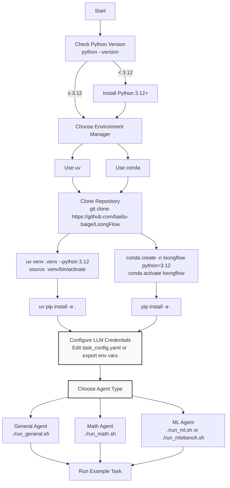

**Sources**: [README.md:161-182](), [README.md:186-262]()

---

## LLM Configuration

LoongFlow requires an LLM API for agent operation. The framework uses `LiteLLMFormatter` to support multiple providers through a unified interface.

### Supported Providers

| Provider | Model Examples | Configuration |
|----------|---------------|---------------|
| OpenAI | `gpt-4`, `gpt-3.5-turbo` | Default provider |
| Anthropic | `claude-3-opus`, `claude-3-sonnet` | Use `anthropic/` prefix |
| Google | `gemini-3-pro-preview` | Use `openai/` prefix |
| DeepSeek | `deepseek-r1-250528` | Supports reasoning content |
| Azure OpenAI | `azure-gpt-4` | Use `azure/` prefix |

### Configuration Methods

**Method 1: Environment Variables** (Quick Start)

```bash
export ANTHROPIC_API_KEY="your-api-key"
export ANTHROPIC_BASE_URL="https://api.anthropic.com"
```

**Method 2: task_config.yaml** (Recommended for Tasks)

```yaml
llm_config:
  url: "https://your-endpoint/v1"
  api_key: "your-api-key"
  model: "openai/gemini-3-pro-preview"
  temperature: 0.8
  context_length: 128000
  max_tokens: 32768
```

The `LiteLLMFormatter` class handles format translation between LoongFlow's internal `CompletionRequest` format and provider-specific APIs.

**Sources**: [README.md:189-193](), [README.md:219-247](), [agents/ml_agent/README.md:94-102]()

---

## Agent Type Selection

LoongFlow provides three specialized agents, each optimized for different problem domains:

**Diagram: Agent Selection Decision Tree**

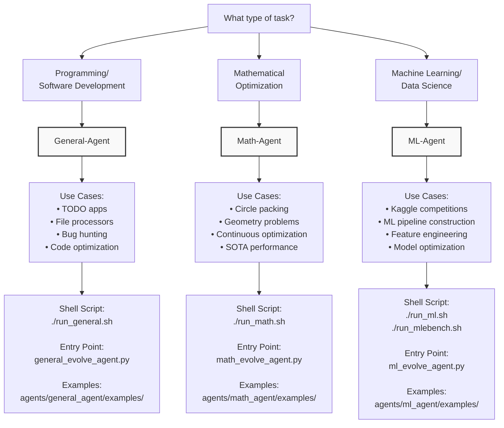

### General-Agent

**Purpose**: Flexible, skill-driven coding tasks from simple applications to complex bug hunting.

**Key Components**:
- `GeneralPlanner`: Strategy design using code analysis skills
- `GeneralExecuteAgent`: Solution generation via `ClaudeCodeAgent`
- `GeneralEvaluator`: Active verification with custom `eval_program.py`

**Typical Workflow**: Plan → Generate Code → Execute → Evaluate → Reflect

**Sources**: [README.md:45-58](), [README.md:359-376]()

### Math-Agent

**Purpose**: Efficient, stable mathematical algorithm design with continuous evolution toward SOTA results.

**Key Components**:
- Requires `initial_program.py` for seeding solutions
- Custom `eval_program.py` for mathematical objective functions
- Optimized for continuous optimization problems

**Typical Workflow**: Plan → Modify Initial Program → Evaluate Score → Reflect

**Sources**: [README.md:60-73](), [README.md:378-393]()

### ML-Agent

**Purpose**: Full-process, autonomous ML pipeline construction with competitive performance.

**Key Components**:
- MLE-Bench integration for Kaggle-style competitions
- Extended evaluation timeouts for training-heavy tasks
- Multi-stage workflow: data exploration → feature engineering → model training

**Typical Workflow**: Plan → Build Pipeline → Train Model → Evaluate → Reflect

**Sources**: [README.md:75-88](), [README.md:395-427](), [agents/ml_agent/README.md:1-189]()

---

## Task Execution Flow

The following diagram maps the execution flow to actual code entities in the LoongFlow codebase:

**Diagram: Task Execution Architecture**

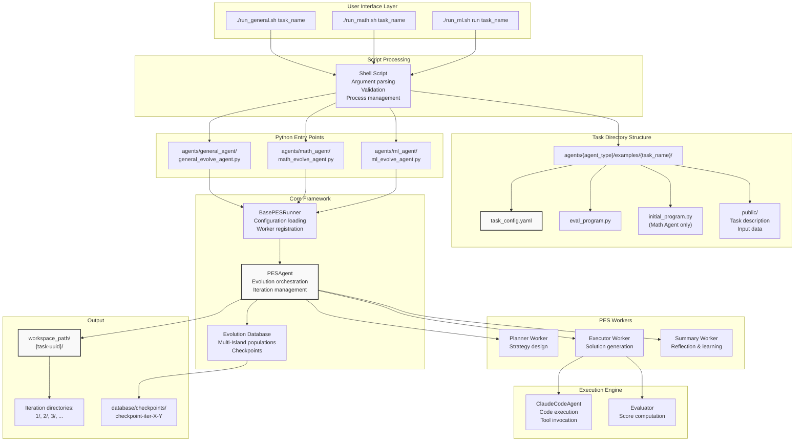

**Sources**: [README.md:186-262](), [agents/ml_agent/README.md:28-68]()

---

## Running Your First Task

### Quick Start Sequence

1. **Navigate to LoongFlow directory**
   ```bash
   cd LoongFlow
   ```

2. **Activate environment**
   ```bash
   # For uv
   source .venv/bin/activate
   
   # For conda
   conda activate loongflow
   ```

3. **Configure LLM** (if not using environment variables)
   ```bash
   # Edit the task's configuration file
   vim agents/general_agent/examples/01_todo_list/task_config.yaml
   ```

4. **Run example task**
   ```bash
   # General Agent - TODO list app (5-10 minutes)
   ./run_general.sh 01_todo_list
   
   # Math Agent - Circle packing (20-30 minutes, run in background)
   ./run_math.sh packing_circle_in_unit_square --background
   
   # ML Agent - MLE-Bench competition (varies by competition)
   ./run_mlebench.sh init
   ./run_mlebench.sh prepare detecting-insults-in-social-commentary
   ./run_mlebench.sh run detecting-insults-in-social-commentary --background
   ```

5. **Monitor progress**
   ```bash
   # For background tasks, check the log
   tail -f agents/general_agent/examples/04_circle_packing/run.log
   tail -f agents/math_agent/examples/packing_circle_in_unit_square/run.log
   tail -f output/logs/evolux.log  # ML Agent
   ```

6. **Stop background task** (if needed)
   ```bash
   ./run_general.sh stop 04_circle_packing
   ./run_math.sh stop packing_circle_in_unit_square
   ./run_mlebench.sh stop detecting-insults-in-social-commentary
   ```

**Sources**: [README.md:186-262](), [agents/ml_agent/README.md:28-68]()

---

## Execution Modes

LoongFlow shell scripts support two execution modes:

| Mode | Usage | Output | Process Management | Use Case |
|------|-------|--------|-------------------|----------|
| **Foreground** | `./run_*.sh task_name` | Direct to console | Blocking, Ctrl+C to stop | Quick tests, debugging |
| **Background** | `./run_*.sh task_name --background` | Logged to `run.log` | Detached, PID in `.run.pid` | Long-running tasks |

**Background Mode Details**:
- Process runs via `nohup`
- Output redirected to `run.log` in task directory
- PID stored in `.run.pid` for process tracking
- Use `./run_*.sh stop task_name` to terminate

**Sources**: [README.md:204-210](), [README.md:228-234](), [agents/ml_agent/README.md:42-48]()

---

## Understanding Task Structure

Each task follows a standardized directory structure:

**Diagram: Task Directory Structure**

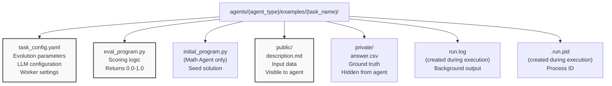

### Required Files

| File | Required For | Purpose |
|------|-------------|---------|
| `task_config.yaml` | All agents | Defines evolution parameters, LLM settings, worker configurations |
| `eval_program.py` | All agents | Implements scoring logic, returns dict with `score` field (0.0-1.0) |
| `initial_program.py` | Math Agent only | Provides seed solution for evolution |
| `public/description.md` | ML Agent | Task description visible to agent |
| `private/answer.csv` | ML Agent | Ground truth for evaluation (hidden) |

**Sources**: [agents/ml_agent/README.md:146-167]()

---

## Output and Workspace

After execution, results are organized in the workspace:

```
workspace_path/{task-uuid}/
├── 1/                          # Iteration 1
│   ├── planner/
│   │   └── best_plan.md        # Strategy document
│   ├── executor/
│   │   ├── work_dir/           # Generated code
│   │   └── evaluator_dir/      # Evaluation artifacts
│   └── summary/
│       └── summary.md          # Reflection insights
├── 2/                          # Iteration 2
├── 3/                          # Iteration 3
└── database/
    └── checkpoints/
        ├── checkpoint-iter-0-0
        ├── checkpoint-iter-0-5
        └── checkpoint-iter-0-10
```

**Key Output Directories**:
- **planner/**: Contains strategy design and analysis from `Planner` worker
- **executor/**: Contains generated code and execution artifacts from `Executor` worker
- **summary/**: Contains reflections and insights from `Summary` worker
- **database/checkpoints/**: Periodic snapshots of evolution state for resumption

**Sources**: [agents/ml_agent/README.md:72-85]()

---

## Next Steps

After completing your first task execution:

1. **Explore Agent-Specific Quick Starts**:
   - [Quick Start - General Agent](#2.2): Step-by-step tutorial for TODO list app
   - [Quick Start - Math Agent](#2.3): Circle packing optimization walkthrough
   - [Quick Start - ML Agent](#2.4): MLE-Bench competition setup

2. **Understand Core Concepts**:
   - [PES Paradigm](#3.1): Learn the Plan-Execute-Summary thinking framework
   - [Evolutionary Memory System](#3.4): Understand how agents learn and improve
   - [LLM Integration](#3.5): Configure different LLM providers

3. **Dive into Agent Details**:
   - [General Agent](#4): Programming tasks and skill-driven evolution
   - [Math Agent](#5): Mathematical optimization techniques
   - [ML Agent](#6): Machine learning pipeline construction

4. **Advanced Topics**:
   - [Visualization & Monitoring](#8): Track evolution in real-time
   - [Building Custom Agents](#7): Create your own specialized agents
   - [Configuration Reference](#10.2): Complete configuration options

**Sources**: [README.md:157-262]()

---

# Page: Installation & Setup

# Installation & Setup

<details>
<summary>Relevant source files</summary>

The following files were used as context for generating this wiki page:

- [README.md](README.md)
- [agents/ml_agent/README.md](agents/ml_agent/README.md)
- [pyproject.toml](pyproject.toml)
- [src/loongflow/agentsdk/models/formatter/litellm_formatter.py](src/loongflow/agentsdk/models/formatter/litellm_formatter.py)
- [uv.lock](uv.lock)

</details>


This page covers the installation and initial configuration of LoongFlow, including environment setup, dependency management, and preparation for running agents. For running specific agent tasks, see Quick Start guides for [Math Agent](#2.2), [ML Agent](#2.3), and [General Agent](#2.4). For detailed configuration options, see [Configuration Reference](#10.2).

## Prerequisites

LoongFlow requires the following prerequisites before installation:

| Requirement | Version/Details | Purpose |
|------------|----------------|---------|
| **Python** | 3.12 or higher | Core runtime requirement |
| **Package Manager** | `uv` OR `conda`/`mamba` | Dependency management |
| **Git** | Any recent version | Repository cloning |
| **Git LFS** | For ML Agent with MLE-bench | Large file support |
| **NVIDIA GPU** | Optional | Accelerated ML training (CPU fallback available) |

**Note:** `mamba` is required for ML Agent initialization. For Math Agent and General Agent, either `uv` or `conda` can be used.

**Sources:** [README.md:134-153]()

## Installation Overview

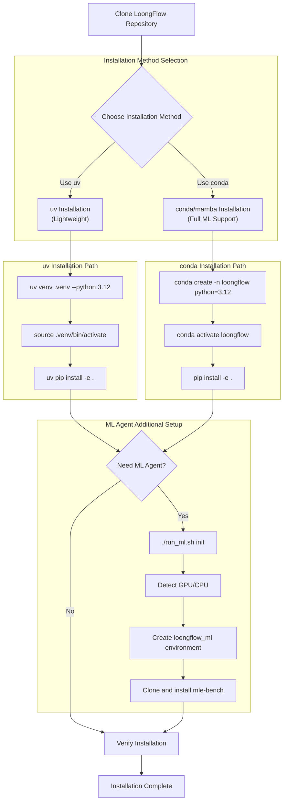

**Sources:** [README.md:136-153](), [run_ml.sh:118-170](), [run_mlebench.sh:120-207]()

## Base Installation

### Method 1: Using uv (Recommended for Math/General Agents)

The `uv` package manager provides fast, lightweight environment management suitable for Math Agent and General Agent tasks.

```bash
# Install uv (if not already installed)
# See: https://docs.astral.sh/uv/getting-started/installation/

# Clone the repository
git clone https://github.com/baidu-baige/LoongFlow.git
cd LoongFlow

# Create virtual environment with Python 3.12
uv venv .venv --python 3.12

# Activate the environment
source .venv/bin/activate

# Install LoongFlow in editable mode
uv pip install -e .
```

This installs the core LoongFlow framework from [src/loongflow/]() including:
- PES framework components ([src/loongflow/framework/pes/]())
- ReAct agent framework ([src/loongflow/framework/react/]())
- LLM integration layer ([src/loongflow/agentsdk/llm/]())
- Tool system ([src/loongflow/agentsdk/tools/]())

**Sources:** [README.md:136-146]()

### Method 2: Using conda/mamba (Required for ML Agent)

Conda/mamba installation is required if you plan to use ML Agent, as it needs specialized ML dependencies and environment isolation.

```bash
# Install Miniforge (includes conda and mamba)
# See: https://conda-forge.org/download/

# Clone the repository
git clone https://github.com/baidu-baige/LoongFlow.git
cd LoongFlow

# Create conda environment with Python 3.12
conda create -n loongflow python=3.12

# Activate the environment
conda activate loongflow

# Install LoongFlow in editable mode
pip install -e .
```

**Sources:** [README.md:147-152]()

## Agent-Specific Environment Setup

LoongFlow agents have different environment requirements based on their execution needs:

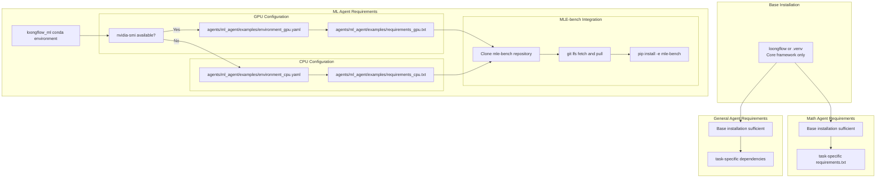

**Sources:** [run_ml.sh:118-170](), [run_mlebench.sh:120-207]()

### ML Agent Environment Initialization

ML Agent requires a separate conda environment with comprehensive ML libraries. The initialization is automated via the `run_ml.sh` or `run_mlebench.sh` scripts:

```bash
# Initialize ML Agent environment (auto-detects GPU/CPU)
./run_ml.sh init

# Or for MLE-bench integration
./run_mlebench.sh init
```

#### Initialization Process Flow

The `do_init()` function in both scripts performs the following steps:

1. **GPU Detection** ([run_ml.sh:124-134](), [run_mlebench.sh:123-134]()):
   - Checks for `nvidia-smi` command availability
   - Selects appropriate environment file based on hardware

2. **Environment File Selection**:
   - GPU detected: `agents/ml_agent/examples/environment_gpu.yaml`
   - CPU only: `agents/ml_agent/examples/environment_cpu.yaml`

3. **Conda Environment Creation** ([run_ml.sh:146-154](), [run_mlebench.sh:148-156]()):
   - Creates environment named `loongflow_ml`
   - Installs conda packages from selected YAML file
   - Skips if environment already exists

4. **Pip Dependencies Installation** ([run_ml.sh:159-160](), [run_mlebench.sh:161-162]()):
   - Installs from `requirements_gpu.txt` or `requirements_cpu.txt`
   - Uses `--no-build-isolation` flag for compatibility

5. **MLE-bench Setup** (only for `run_mlebench.sh`, [run_mlebench.sh:165-198]()):
   - Clones `mle-bench` repository from OpenAI
   - Fetches Git LFS files
   - Modifies TensorFlow version requirement (2.16 → 2.15)
   - Installs mle-bench in editable mode

**Sources:** [run_ml.sh:118-170](), [run_mlebench.sh:120-207]()

### Math Agent Environment Setup

Math Agent uses the base installation plus task-specific dependencies:

```bash
# After base installation, install task-specific requirements
uv pip install -r ./agents/math_agent/examples/<task_name>/requirements.txt

# Example for circle packing task
uv pip install -r ./agents/math_agent/examples/packing_circle_in_unit_square/requirements.txt
```

**Sources:** [README.md:169]()

### General Agent Environment Setup

General Agent uses the base installation and requires no additional environment setup. Task-specific dependencies (if any) are documented in individual task directories.

**Sources:** [README.md:136-152]()

## Environment Structure and Key Files

The following diagram maps LoongFlow's directory structure to environment configuration files:

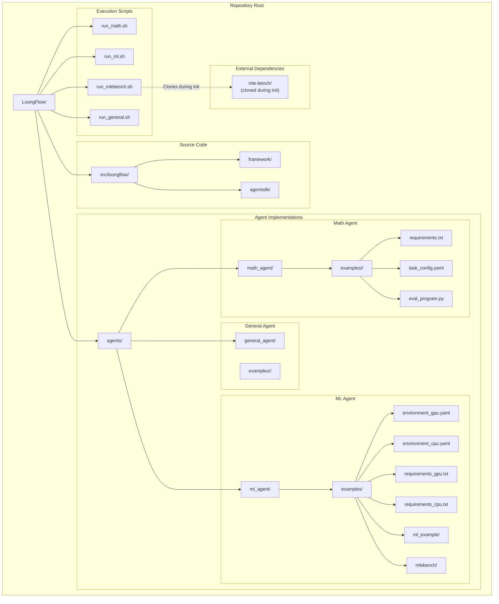

**Sources:** [run_ml.sh:126-132](), [run_mlebench.sh:165-174](), [README.md:35]()

## Environment Activation and Management

### Activation Commands

Different environments require different activation commands:

| Environment | Activation Command | Deactivation |
|------------|-------------------|--------------|
| **uv (.venv)** | `source .venv/bin/activate` | `deactivate` |
| **conda (loongflow)** | `conda activate loongflow` | `conda deactivate` |
| **conda (loongflow_ml)** | `conda activate loongflow_ml` | `conda deactivate` |

### Conda/Mamba Initialization

The execution scripts automatically handle conda initialization and activation through helper functions:

**`init_conda()` function** ([run_ml.sh:41-72](), [run_mlebench.sh:42-72]()):
- Detects conda/mamba installation via `CONDA_EXE`, `MAMBA_EXE`, or `command -v`
- Sources `conda.sh` and `mamba.sh` from conda base directory
- Enables `conda activate` command in shell

**`activate_env()` function** ([run_ml.sh:73-92](), [run_mlebench.sh:75-92]()):
- Calls `init_conda()` to prepare shell environment
- Activates target environment (`loongflow_ml`)
- Sets `LD_LIBRARY_PATH` to include conda lib directory
- Verifies successful activation via `CONDA_DEFAULT_ENV`

**Sources:** [run_ml.sh:41-92](), [run_mlebench.sh:42-92]()

## LLM Configuration

After installation, you must configure LLM credentials before running agents. This is done via `task_config.yaml` files in each task directory.

### Configuration Structure

```yaml
llm_config:
  url: "https://api.openai.com/v1"  # API endpoint
  api_key: "your-api-key-here"      # API key
  model: "openai/gpt-4"              # Model identifier with provider prefix
```

### Supported Providers

LoongFlow uses LiteLLM ([src/loongflow/agentsdk/llm/litellm_formatter.py]()) for multi-provider support:

| Provider | Model Prefix | Example |
|----------|-------------|---------|
| **OpenAI** | `openai/` | `openai/gpt-4` |
| **Anthropic** | (default) | `claude-3-opus-20240229` |
| **Google** | `google/` | `google/gemini-pro` |
| **DeepSeek** | `deepseek/` | `deepseek/deepseek-chat` |
| **Custom OpenAI-compatible** | `openai/` | `openai/custom-model` |

### Recommended Models

For optimal results, the documentation recommends ([README.md:161-166](), [README.md:183-189]()):
- `openai/gemini-3-pro-preview` (Google Gemini)
- `deepseek-r1-250528` (DeepSeek R1)

**Sources:** [README.md:160-190](), [README.md:432-442]()

## Verification Steps

After installation, verify your setup with these checks:

### 1. Import Core Framework

```bash
# Activate your environment first
source .venv/bin/activate  # or: conda activate loongflow

# Test Python imports
python -c "from loongflow.framework.pes import PESAgent; print('PES framework OK')"
python -c "from loongflow.framework.react import ReActAgent; print('ReAct framework OK')"
```

### 2. Verify Script Executability

```bash
# Check script permissions
ls -l run_math.sh run_ml.sh run_mlebench.sh run_general.sh

# Make executable if needed
chmod +x run_*.sh
```

### 3. Verify ML Environment (if installed)

```bash
# Check environment exists
conda env list | grep loongflow_ml

# Verify activation
conda activate loongflow_ml
python -c "import torch; print(f'PyTorch: {torch.__version__}')"
python -c "import tensorflow; print(f'TensorFlow: {tensorflow.__version__}')"
```

### 4. Check MLE-bench Installation (if needed)

```bash
conda activate loongflow_ml
python -c "import mlebench; print('MLE-bench installed')"
mlebench --version
```

**Sources:** [run_ml.sh:111-114](), [run_mlebench.sh:112-116]()

## Troubleshooting

### Common Installation Issues

| Issue | Solution |
|-------|----------|
| **`mamba not found`** | Install mambaforge from https://conda-forge.org/download/ |
| **`uv not found`** | Install uv from https://docs.astral.sh/uv/getting-started/installation/ |
| **Environment activation fails** | Source conda.sh manually: `source ~/mambaforge/etc/profile.d/conda.sh` |
| **Git LFS files missing** | Run `git lfs install && git lfs pull` in mle-bench directory |
| **TensorFlow version conflict** | The init script automatically patches this ([run_mlebench.sh:182-194]()) |

### Environment Detection Issues

If GPU detection fails incorrectly:

```bash
# Manually specify environment file
mamba env create -n loongflow_ml -f agents/ml_agent/examples/environment_gpu.yaml
pip install -r agents/ml_agent/examples/requirements_gpu.txt
```

**Sources:** [run_ml.sh:124-134](), [run_mlebench.sh:123-134](), [run_mlebench.sh:182-194]()

## Next Steps

After successful installation:

1. **Configure LLM credentials** in task config files (see [Configuration Reference](#10.2))
2. **Try a quick start guide**:
   - [Math Agent Quick Start](#2.2) - Run mathematical optimization tasks
   - [ML Agent Quick Start](#2.3) - Run machine learning competitions
   - [General Agent Quick Start](#2.4) - Run general problem-solving tasks
3. **Explore examples** in respective `agents/*/examples/` directories
4. **Learn about the PES paradigm** - [PES Paradigm](#3.1) for understanding the core framework

**Sources:** [README.md:128-206]()

---

# Page: Quick Start - General Agent

# Quick Start - General Agent

<details>
<summary>Relevant source files</summary>

The following files were used as context for generating this wiki page:

- [README.md](README.md)
- [agents/ml_agent/README.md](agents/ml_agent/README.md)
- [run_general.sh](run_general.sh)
- [run_math.sh](run_math.sh)

</details>


This guide walks you through running your first General Agent task: a simple TODO list application. The example demonstrates LoongFlow's PES paradigm (Plan-Execute-Summary) and evolutionary improvement cycle in approximately 5-10 minutes.

**Prerequisites**: Complete installation and LLM configuration as described in [Installation & Setup](#2.1). For deeper understanding of General Agent capabilities and architecture, see [General Agent Overview](#4.1).

---

## Overview of General Agent Examples

The General Agent includes four progressively complex examples that demonstrate different capabilities:

| Example | Difficulty | Duration | Description | Key Features |
|---------|-----------|----------|-------------|--------------|
| **01_todo_list** | ⭐ Beginner | 5-10 min | Command-line TODO app with persistent storage | Basic file I/O, data structures |
| **02_file_processor** | ⭐⭐ Intermediate | 10-15 min | CSV/JSON processor with custom skills | Skills system, data transformation |
| **03_bug_hunter** | ⭐⭐⭐ Advanced | 15-20 min | Production bug detection with OWASP/CWE analysis | Security scanning, complex analysis |
| **04_circle_packing** | ⭐⭐⭐⭐ Expert | 20-30 min | Geometric optimization problem | Custom evaluation, mathematical optimization |

This quick start focuses on **01_todo_list**, the foundational example. For a comprehensive tutorial covering all examples, see the [Complete Tutorial](https://github.com/baidu-baige/LoongFlow/blob/main/agents/general_agent/TUTORIAL.md).

**Sources**: [README.md:363-369](), [README.md:186-213]()

---

## Task Directory Structure

Each General Agent task follows a consistent directory structure:

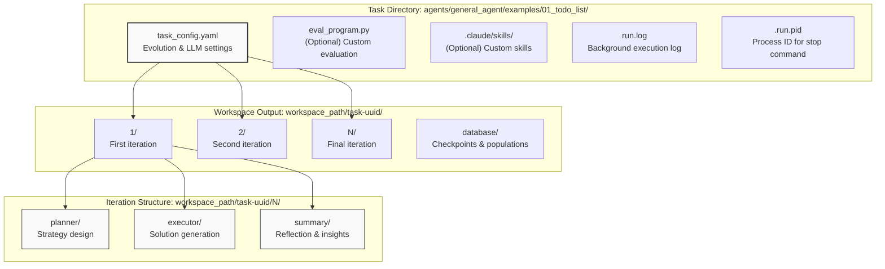

**Required Files**:
- `task_config.yaml`: Controls evolution parameters, LLM configuration, and worker settings

**Optional Files**:
- `eval_program.py`: Custom evaluation logic (if not provided, uses simple score-based evaluation)
- `.claude/skills/`: Domain-specific knowledge packages

**Generated Files**:
- `run.log`: Background execution output
- `.run.pid`: Process ID for background task management

**Sources**: [run_general.sh:19-32](), [agents/ml_agent/README.md:70-85]()

---

## Running Your First Task

### Step 1: Configure LLM Credentials

Before running any task, ensure your LLM credentials are configured. You can either:

**Option A: Environment Variables**
```bash
export ANTHROPIC_API_KEY="your-api-key"
export ANTHROPIC_BASE_URL="your-endpoint"  # Optional
```

**Option B: Edit task_config.yaml**
```yaml
llm_config:
  url: "https://api.anthropic.com/v1"
  api_key: "your-api-key"
  model: "anthropic/claude-3-5-sonnet-20241022"
```

**Sources**: [README.md:188-192]()

### Step 2: Execute the Task

The [run_general.sh:1-191]() script provides two execution modes:

**Foreground Execution** (blocks terminal, shows real-time output):
```bash
./run_general.sh 01_todo_list
```

**Background Execution** (runs in background, logs to file):
```bash
./run_general.sh 01_todo_list --background

# Monitor progress
tail -f ./agents/general_agent/examples/01_todo_list/run.log
```

**Sources**: [README.md:194-195](), [run_general.sh:7-15]()

### Step 3: Understanding the Execution Flow

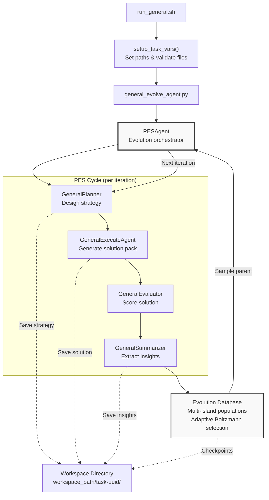

**Key Components**:
- **run_general.sh**: Shell script that validates task directory and launches Python entrypoint
- **general_evolve_agent.py**: Python entrypoint that instantiates `PESAgent` and registers workers
- **PESAgent**: Core evolution orchestrator that manages PES cycles
- **GeneralPlanner**: Analyzes task and designs execution strategy
- **GeneralExecuteAgent**: Generates solution code using `ClaudeCodeAgent`
- **GeneralEvaluator**: Evaluates solution quality (simple or tool-based)
- **GeneralSummarizer**: Reflects on outcomes and extracts reusable insights
- **Evolution Database**: Maintains populations across islands with adaptive selection

**Sources**: [run_general.sh:129-191](), [README.md:439-455]()

---

## Execution Sequence

When you run `./run_general.sh 01_todo_list`, the following sequence occurs:

1. **Script Validation** [run_general.sh:130-139]()
   - Validates task directory exists at `agents/general_agent/examples/01_todo_list/`
   - Checks required file: `task_config.yaml`
   - Constructs command array with configuration path

2. **Python Entrypoint Launch** [run_general.sh:156-166]()
   - Executes `python agents/general_agent/general_evolve_agent.py --config <path>`
   - Sets `PYTHONPATH` to include `./src`

3. **PESAgent Initialization**
   - Loads configuration from `task_config.yaml`
   - Registers worker implementations:
     - Planner: `GeneralPlanner`
     - Executor: `GeneralExecuteAgent`
     - Summary: `GeneralSummarizer`
   - Initializes Evolution Database with configured islands and population size

4. **Evolution Loop** (iterates until convergence)
   - **Plan Phase**: Planner analyzes task requirements and designs strategy
   - **Execute Phase**: Executor generates solution code and creates solution pack
   - **Evaluate Phase**: Evaluator scores the solution (0.0-1.0 scale)
   - **Summary Phase**: Summarizer reflects on results and extracts insights
   - **Database Update**: Stores solution in population and updates evolution tree

5. **Termination**
   - Stops when `target_score` is reached or `max_iterations` is exceeded
   - Saves final checkpoint to `workspace_path/database/checkpoints/`
   - Outputs best solution location

**Sources**: [run_general.sh:156-191]()

---

## Task Configuration

The `task_config.yaml` file controls all aspects of evolution. Here's a minimal example for the TODO list task:

```yaml
# Workspace for outputs
workspace_path: "./output"

# LLM Configuration
llm_config:
  url: "https://api.anthropic.com/v1"
  api_key: "your-api-key"
  model: "anthropic/claude-3-5-sonnet-20241022"
  temperature: 0.8
  max_tokens: 8192

# Planner Configuration
planners:
  general_planner:
    skills: []  # Optional: custom skill packages
    max_turns: 50
    timeout: 1800

# Executor Configuration
executors:
  general_executor:
    skills: []
    max_turns: 50
    timeout: 1800

# Summarizer Configuration
summarizers:
  general_summarizer:
    max_turns: 20
    timeout: 900

# Evolution Configuration
evolve:
  planner_name: "general_planner"
  executor_name: "general_executor"
  summary_name: "general_summarizer"
  
  max_iterations: 30
  target_score: 0.95
  concurrency: 1
  
  # Evaluator settings
  evaluator:
    mode: "simple"  # or "tool" for active verification
    timeout: 600
  
  # Database settings
  database:
    storage_type: "in_memory"
    num_islands: 1
    population_size: 30
    checkpoint_interval: 5
    sampling_weight_power: 2.0
```

**Key Parameters**:

| Section | Parameter | Description | Typical Value |
|---------|-----------|-------------|---------------|
| `llm_config` | `model` | LLM model to use | `anthropic/claude-3-5-sonnet-20241022` |
| `llm_config` | `temperature` | Sampling temperature | `0.8` |
| `evolve` | `max_iterations` | Maximum evolution cycles | `30` |
| `evolve` | `target_score` | Score to achieve for early stopping | `0.95` |
| `evolve.database` | `num_islands` | Number of independent populations | `1-3` |
| `evolve.database` | `population_size` | Solutions per island | `30-90` |
| `evolve.database` | `sampling_weight_power` | Selection bias (higher = more exploitation) | `2.0` |

For complete configuration reference, see [Configuration Reference](#10.2).

**Sources**: [agents/ml_agent/README.md:89-137]()

---

## Monitoring Progress

### Real-time Logs

For foreground execution, output appears directly in the terminal. For background execution:

```bash
tail -f ./agents/general_agent/examples/01_todo_list/run.log
```

**Typical log output**:
```
[INFO] Iteration 1/30 started
[INFO] Planner: Analyzing task requirements...
[INFO] Executor: Generating solution code...
[INFO] Evaluator: Score = 0.65
[INFO] Summary: Extracted 3 insights
[INFO] Database: Stored solution in island 0, population size = 1
[INFO] Iteration 2/30 started
...
```

**Sources**: [README.md:206-207]()

### Workspace Inspection

Each iteration creates a directory under `workspace_path/task-uuid/N/`:

```
workspace_path/task-uuid/
├── 1/                          # First iteration
│   ├── planner/
│   │   └── best_plan.md        # Strategy design
│   ├── executor/
│   │   ├── work_dir/           # Generated code files
│   │   └── evaluator_dir/      # Evaluation artifacts
│   └── summary/
│       └── summary.md          # Reflection and insights
├── 2/                          # Second iteration
├── ...
└── database/
    └── checkpoints/
        ├── checkpoint-iter-1-0
        ├── checkpoint-iter-5-0
        └── ...
```

**Key Files**:
- **planner/best_plan.md**: Contains the strategy designed by `GeneralPlanner`
- **executor/work_dir/**: Contains solution code generated by `GeneralExecuteAgent`
- **summary/summary.md**: Contains insights extracted by `GeneralSummarizer`
- **database/checkpoints/**: Periodic snapshots of evolution state

**Sources**: [README.md:206-207]()

---

## Stopping a Running Task

For background tasks, use the stop command:

```bash
./run_general.sh stop 01_todo_list
```

This command:
1. Reads the PID from `.run.pid` file [run_general.sh:76]()
2. Terminates all child processes [run_general.sh:82-89]()
3. Terminates the parent process [run_general.sh:92]()
4. Force kills any remaining processes after 10 seconds [run_general.sh:94-110]()
5. Removes the PID file [run_general.sh:123]()

**Sources**: [README.md:209-210](), [run_general.sh:61-125]()

---

## Understanding Results

### Solution Pack Structure

The final solution is located in the last iteration's `executor/work_dir/` directory. For the TODO list example, you'll typically find:

```
executor/work_dir/
├── todo_app.py              # Main application code
├── requirements.txt         # Python dependencies
└── MANIFEST.md             # Solution description and usage
```

The **MANIFEST.md** file contains:
- Description of what the solution does
- How to run the solution
- Example usage commands
- Known limitations or considerations

**Sources**: Referenced from typical General Agent output structure

### Evaluation Scores

Each iteration receives a score from the `GeneralEvaluator`:

- **Simple Mode**: Uses LLM-based scoring (0.0-1.0 scale)
- **Tool Mode**: Active verification with custom `eval_program.py`

The evolution converges when:
- Score reaches or exceeds `target_score` in configuration
- `max_iterations` is reached
- Manual termination via stop command

**Sources**: Referenced from PES evaluation process

---

## Next Steps

After completing the TODO list example:

1. **Try More Examples**:
   - Run `./run_general.sh 02_file_processor` for custom skills demonstration
   - Run `./run_general.sh 03_bug_hunter` for production-grade analysis tools
   - Run `./run_general.sh 04_circle_packing --background` for optimization challenges

2. **Customize Configuration**:
   - Modify `task_config.yaml` to experiment with different LLM models
   - Adjust evolution parameters (iterations, population size, islands)
   - Try different evaluator modes (simple vs. tool-based)

3. **Create Custom Tasks**:
   - Follow the directory structure template
   - Define your own `task_config.yaml`
   - Optionally add custom `eval_program.py` for domain-specific scoring
   - See [Skills & Solution Packs](#4.5) for skill creation

4. **Explore Visualization**:
   - Launch the web visualizer to inspect evolution trees
   - See [Visualization Server](#8.1) for setup instructions

5. **Deep Dive into Components**:
   - Understand [Planner Component](#4.2) strategy design
   - Explore [Executor Component](#4.3) solution generation
   - Learn about [Evaluator Component](#4.4) scoring mechanisms

**Sources**: [README.md:198-212](), [README.md:363-376]()

---

## Command Reference

```bash
# Foreground execution
./run_general.sh <task_name> [options]

# Background execution
./run_general.sh <task_name> --background [options]

# Stop background task
./run_general.sh stop <task_name>

# Additional Python options (passed through)
./run_general.sh <task_name> --log-level DEBUG --max-iterations 100
```

**Available Options**:
- `--background`: Run in background mode
- `--log-level`: Set logging verbosity (DEBUG, INFO, WARNING, ERROR)
- `--max-iterations`: Override config max_iterations
- `--target-score`: Override config target_score
- `--checkpoint-path`: Resume from specific checkpoint

For complete script reference, see [Shell Script Reference](#10.3).

**Sources**: [run_general.sh:1-15](), [run_general.sh:146-166]()

---

# Page: Quick Start - Math Agent

# Quick Start - Math Agent

<details>
<summary>Relevant source files</summary>

The following files were used as context for generating this wiki page:

- [README.md](README.md)
- [agents/ml_agent/README.md](agents/ml_agent/README.md)
- [run_general.sh](run_general.sh)
- [run_math.sh](run_math.sh)

</details>


This page provides a practical walkthrough for running your first Math Agent task. It demonstrates how to configure, execute, and monitor a mathematical optimization problem using the circle packing example.

For a comprehensive overview of Math Agent's architecture and capabilities, see [Math Agent Overview](#5.1). For detailed configuration options, see [Configuration Guide](#5.2). For information about creating custom math tasks, see [Task Structure & Files](#5.3).

## Prerequisites

Before running Math Agent, ensure you have:

- Completed the installation steps from [Installation & Setup](#2.1)
- An active Python 3.12+ environment with LoongFlow installed
- LLM API credentials (OpenAI-compatible endpoint)
- Basic understanding of the PES paradigm (see [PES Paradigm](#3.1))

**Recommended Models**: Math Agent performs best with reasoning-capable models such as `gemini-3-pro-preview` or `deepseek-r1-250528`.

Sources: [README.md:215-235]()

## Task File Structure

Math Agent tasks require three essential files in the task directory:

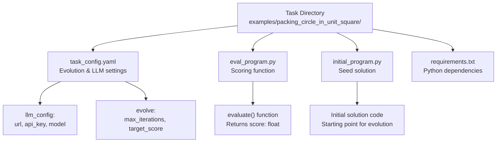

| File | Purpose | Required |
|------|---------|----------|
| `task_config.yaml` | Configures LLM settings, evolution parameters, and worker configurations | Yes |
| `eval_program.py` | Contains the `evaluate()` function that scores solutions (returns 0.0-1.0+) | Yes |
| `initial_program.py` | Provides the initial seed solution for evolution to start from | Yes |
| `requirements.txt` | Lists Python dependencies needed by the task | No |

Sources: [run_math.sh:27-30](), [README.md:218-228]()

## Step 1: Configure LLM Settings

Navigate to the circle packing example directory and edit the configuration file:

```bash
cd agents/math_agent/examples/packing_circle_in_unit_square
vim task_config.yaml
```

The minimal required configuration involves setting up the LLM connection:

```yaml
llm_config:
  url: "https://your-endpoint/v1"
  api_key: "your-api-key"
  model: "openai/gemini-3-pro-preview"
  temperature: 0.8
  context_length: 128000
  max_tokens: 8192
  top_p: 1.0
```

**Configuration Notes**:
- The `model` field uses provider prefixes (e.g., `openai/`, `anthropic/`)
- Default provider is `openai` if no prefix is specified
- The LiteLLMFormatter handles provider-specific message formatting (see [LLM Integration](#3.5))
- For DeepSeek models, reasoning content is automatically extracted

**Alternative Configuration Methods**:
You can also set LLM credentials via environment variables:

```bash
export ANTHROPIC_API_KEY="your-api-key"
export ANTHROPIC_BASE_URL="your-endpoint"
```

Sources: [README.md:218-224]()

## Step 2: Install Task Dependencies

Most math tasks require specific Python packages for numerical computation:

```bash
# Install task-specific dependencies
uv pip install -r requirements.txt
```

For the circle packing example, this typically includes packages like `numpy`, `scipy`, and `matplotlib` for optimization algorithms and visualization.

Sources: [README.md:227]()

## Step 3: Run the Task

The `run_math.sh` script provides a unified interface for executing Math Agent tasks:

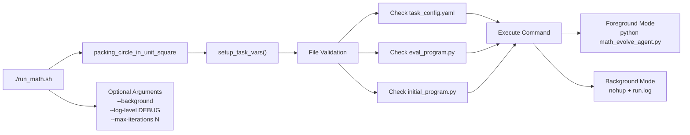

### Foreground Execution

Run the task in the foreground (blocks terminal, shows live output):

```bash
./run_math.sh packing_circle_in_unit_square
```

This executes the following command:

```bash
PYTHONPATH=$PYTHONPATH:./src python agents/math_agent/math_evolve_agent.py \
  --config ./agents/math_agent/examples/packing_circle_in_unit_square/task_config.yaml \
  --eval-file ./agents/math_agent/examples/packing_circle_in_unit_square/eval_program.py \
  --initial-file ./agents/math_agent/examples/packing_circle_in_unit_square/initial_program.py
```

### Background Execution

For long-running evolution tasks, use background mode:

```bash
./run_math.sh packing_circle_in_unit_square --background
```

This command:
1. Starts the task in the background using `nohup`
2. Redirects output to `run.log` in the task directory
3. Stores the process ID in `.run.pid` for later management

Additional Python arguments can be passed after the task name:

```bash
./run_math.sh packing_circle_in_unit_square --background \
  --log-level DEBUG \
  --max-iterations 100
```

Sources: [run_math.sh:1-190](), [README.md:226-229]()

## Step 4: Monitor Progress

### Log File Monitoring

For background tasks, monitor the log file in real-time:

```bash
tail -f ./agents/math_agent/examples/packing_circle_in_unit_square/run.log
```

The log output shows:
- PES cycle progression (Plan → Execute → Summary phases)
- Solution scores for each iteration
- Evolutionary database updates
- Checkpoint creation events

### Workspace Structure

Evolution results are stored in the configured `workspace_path` (typically `./output`):

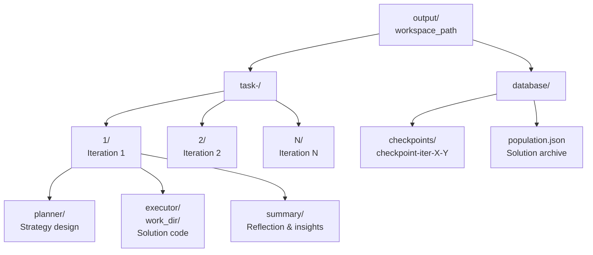

Each iteration directory contains:

| Subdirectory | Contents |
|--------------|----------|
| `planner/` | Planning phase output: strategy documents, parent solution analysis |
| `executor/` | Execution phase output: `work_dir/` with generated code, `evaluator_dir/` with scores |
| `summary/` | Summary phase output: reflection documents, extracted insights |

Sources: [README.md:226-235]()

## Step 5: Stop the Task

To gracefully stop a background task:

```bash
./run_math.sh stop packing_circle_in_unit_square
```

This command:
1. Reads the PID from `.run.pid` in the task directory
2. Identifies all descendant processes using `get_descendants()`
3. Sends SIGTERM to child processes first
4. Sends SIGTERM to the main process
5. Waits 10 seconds for graceful shutdown
6. Force kills remaining processes with SIGKILL if needed
7. Performs global cleanup to ensure no orphaned processes

The stop process is implemented in [run_math.sh:61-126]():

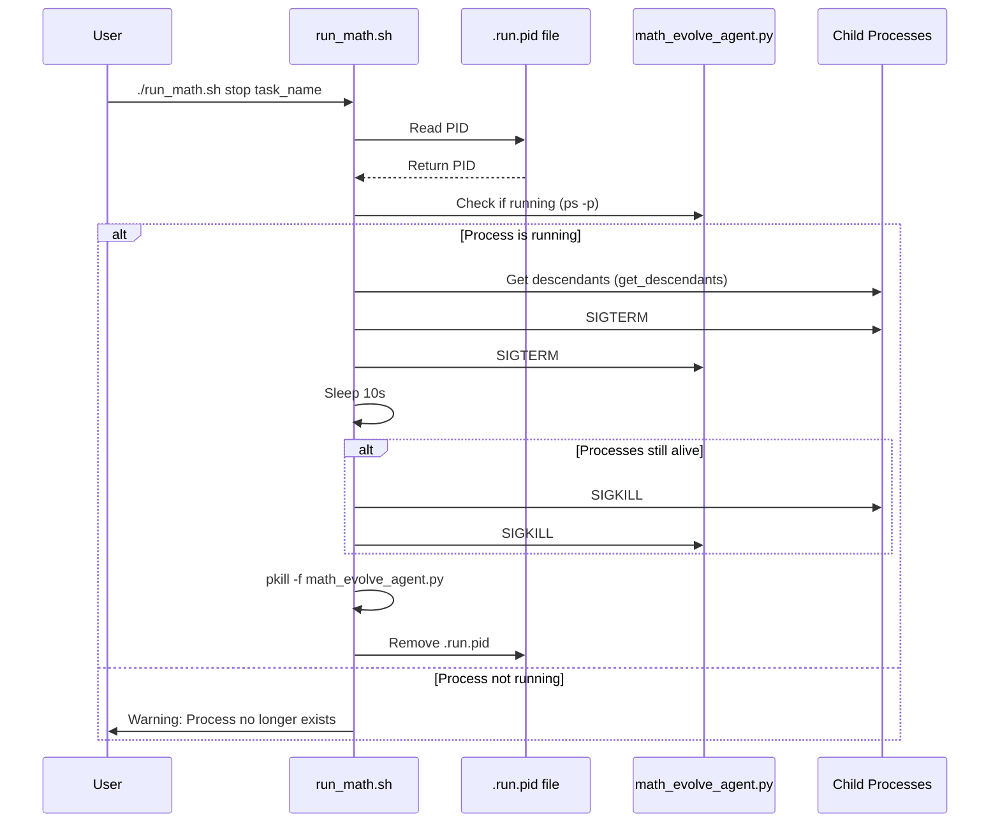

Sources: [run_math.sh:61-126]()

## Understanding the Execution Flow

When you run a Math Agent task, the following sequence occurs:

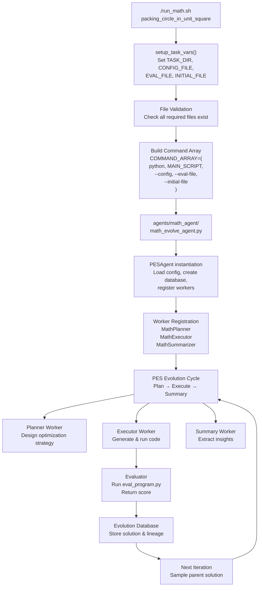

The Python entry point at [agents/math_agent/math_evolve_agent.py]() performs these operations:

1. **Configuration Loading**: Parse command-line arguments and load `task_config.yaml`
2. **Database Initialization**: Create Evolution Database with multi-island populations
3. **Worker Registration**: Register domain-specific PES workers (Planner, Executor, Summary)
4. **Seed Population**: Load and evaluate `initial_program.py` to seed the population
5. **Evolution Loop**: Execute PES cycles until `max_iterations` or `target_score` is reached

Sources: [run_math.sh:159-165]()

## Expected Output

For the circle packing problem, a successful run produces:

**Console Output (Foreground Mode)**:
```
✅ Checks passed. Preparing to run task: packing_circle_in_unit_square
------------------------------------------------------------------
🚀 Command to execute:
PYTHONPATH=./src python agents/math_agent/math_evolve_agent.py --config ... --eval-file ... --initial-file ...
------------------------------------------------------------------
[INFO] Iteration 1: Score=2.6234
[INFO] Iteration 2: Score=2.6289
[INFO] Iteration 5: Score=2.6321 (checkpoint created)
[INFO] Iteration 10: Score=2.6342 (checkpoint created)
...
```

**Workspace Files**:
- `output/task-<uuid>/1/executor/work_dir/solution.py`: Generated code for iteration 1
- `output/task-<uuid>/1/planner/plan.md`: Strategy document
- `output/database/checkpoint-iter-5-0/`: Population snapshot at iteration 5

**Final Result**:
The best solution is stored in the Evolution Database and can be accessed through the visualization server (see [Visualization Server](#8.1)) or by inspecting checkpoint files.

Sources: [run_math.sh:167-171]()

## Next Steps

After successfully running your first Math Agent task:

1. **Explore Configuration**: See [Configuration Guide](#5.2) to customize evolution parameters, LLM settings, and worker configurations
2. **Create Custom Tasks**: Follow [Task Structure & Files](#5.3) to build your own mathematical optimization problems
3. **View Results**: Use the visualization server ([Visualization Server](#8.1)) to explore the evolution tree and solution progression
4. **Run Other Examples**: Try additional problems in `agents/math_agent/examples/` such as `packing_circle_in_rectangle` or `max_to_min_ratios`

For understanding how Math Agent achieves SOTA results on mathematical challenges, see [Examples & Results](#5.5).

Sources: [README.md:215-235]()

---

# Page: Quick Start - ML Agent

# Quick Start - ML Agent

<details>
<summary>Relevant source files</summary>

The following files were used as context for generating this wiki page:

- [README.md](README.md)
- [agents/ml_agent/README.md](agents/ml_agent/README.md)
- [run_ml.sh](run_ml.sh)
- [run_mlebench.sh](run_mlebench.sh)

</details>


This guide walks you through running your first ML Agent task in under 10 minutes. You will learn how to set up the environment, run both custom ML tasks and MLE-Bench competitions, and monitor the evolution process.

For detailed ML Agent architecture and capabilities, see [ML Agent Overview](#6.1). For configuration options and task creation, see [Configuration Guide](#6.2) and [Running ML Tasks](#6.3).

---

## Prerequisites

Before starting, ensure you have:

| Requirement | Purpose | Installation |
|-------------|---------|--------------|
| **Ubuntu 22.04+** | Operating system (recommended) | - |
| **Python 3.12+** | Runtime environment | Already installed if you completed [Installation & Setup](#2.1) |
| **Mamba/Conda** | Environment manager for ML dependencies | `wget https://github.com/conda-forge/miniforge/releases/latest/download/Mambaforge-Linux-x86_64.sh && bash Mambaforge-Linux-x86_64.sh` |
| **Git LFS** (MLE-Bench only) | Large file storage for competition data | `sudo apt install git-lfs && git lfs install` |
| **Kaggle API** (MLE-Bench only) | Competition data download | Download `kaggle.json` from https://www.kaggle.com/settings/account |

**Kaggle API Setup (MLE-Bench only):**
```bash
mkdir -p ~/.kaggle
mv ~/Downloads/kaggle.json ~/.kaggle/
chmod 600 ~/.kaggle/kaggle.json
```

Sources: [README.md:160-181](), [agents/ml_agent/README.md:16-25]()

---

## ML Agent Execution Paths

The ML Agent provides two execution paths optimized for different use cases:

```mermaid
graph TB
    subgraph "Entry Points"
        RunML["run_ml.sh<br/>Custom ML Tasks"]
        RunMLE["run_mlebench.sh<br/>MLE-Bench Competitions"]
    end
    
    subgraph "Initialization"
        InitML["init command<br/>Creates loongflow_ml env"]
        InitMLE["init command<br/>Creates loongflow_ml env<br/>Clones mle-bench repo"]
    end
    
    subgraph "Task Preparation"
        CustomPrep["Task Directory<br/>agents/ml_agent/examples/<task_name>"]
        MLEPrep["prepare command<br/>Downloads competition data<br/>to output/mlebench/<competition_id>"]
    end
    
    subgraph "Configuration"
        Config["task_config.yaml<br/>LLM settings<br/>Evolution parameters"]
    end
    
    subgraph "Python Execution"
        Evolve["ml_evolve_agent.py<br/>PESAgent orchestration"]
    end
    
    subgraph "Components"
        Planner["MLPlanner<br/>Strategy design"]
        Executor["MLExecutor<br/>Code generation"]
        Summary["MLSummary<br/>Reflection"]
        Evaluator["eval_program.py<br/>Score computation"]
    end
    
    RunML --> InitML
    RunMLE --> InitMLE
    
    InitML --> CustomPrep
    InitMLE --> MLEPrep
    
    CustomPrep --> Config
    MLEPrep --> Config
    
    Config --> Evolve
    
    Evolve --> Planner
    Evolve --> Executor
    Evolve --> Summary
    Evolve --> Evaluator
    
    style RunML fill:#f9f9f9,stroke:#333,stroke-width:2px
    style RunMLE fill:#f9f9f9,stroke:#333,stroke-width:2px
    style Evolve fill:#e1f5ff,stroke:#333,stroke-width:2px
```

**Two Shell Script Workflows:**

| Script | Purpose | Task Source | Example |
|--------|---------|-------------|---------|
| `run_ml.sh` | Custom ML tasks | Local task directories in `agents/ml_agent/examples/` | Iris classification, custom datasets |
| `run_mlebench.sh` | MLE-Bench competitions | Downloaded from Kaggle via MLE-Bench library | `detecting-insults-in-social-commentary` |

Both scripts share the same conda environment (`loongflow_ml`) and Python entrypoint ([agents/ml_agent/ml_evolve_agent.py]()), but differ in how tasks are prepared and located.

Sources: [run_ml.sh:1-434](), [run_mlebench.sh:1-579](), [README.md:238-262]()

---

## Quick Start: Custom ML Task

This example uses the pre-configured `ml_example` task (Iris classification) to demonstrate the basic workflow.

### Step 1: Initialize Environment

```bash
# From repository root
cd LoongFlow

# Create conda environment with ML dependencies
./run_ml.sh init
```

The `init` command:
1. Detects GPU availability (lines [run_ml.sh:109-120]())
2. Creates conda environment from [agents/ml_agent/examples/environment_gpu.yaml]() or [environment_cpu.yaml]()
3. Installs Python packages from [requirements_gpu.txt]() or [requirements_cpu.txt]()
4. Environment name: `loongflow_ml` (defined at [run_ml.sh:20]())

**Expected output:**
```
[INFO] Detected NVIDIA GPU, using GPU environment
[INFO] Creating new environment from agents/ml_agent/examples/environment_gpu.yaml...
[SUCCESS] Conda environment 'loongflow_ml' is ready.
```

Sources: [run_ml.sh:131-183]()

### Step 2: Configure LLM Credentials

Edit the task configuration file to add your LLM API credentials:

```bash
vim agents/ml_agent/examples/ml_example/task_config.yaml
```

**Required configuration:**
```yaml
llm_config:
  url: "https://your-llm-endpoint/v1"
  api_key: "your-api-key"
  model: "openai/gemini-3-pro-preview"  # Or deepseek-r1-250528
  temperature: 0.8
  context_length: 128000
  max_tokens: 32768
```

The ML Agent supports any OpenAI-compatible API endpoint. See [LLM Integration](#3.5) for multi-provider support details.

Sources: [agents/ml_agent/README.md:94-102]()

### Step 3: Run the Task

```bash
# Run in foreground (see output immediately)
./run_ml.sh run ml_example

# OR run in background (recommended for long tasks)
./run_ml.sh run ml_example --background
```

**Foreground vs Background Execution:**

| Mode | Command | Output | Use Case |
|------|---------|--------|----------|
| Foreground | `./run_ml.sh run ml_example` | Console output | Testing, debugging |
| Background | `./run_ml.sh run ml_example --background` | Logs to `agent.log` | Production runs, long evolutions |

When running in background, the script:
1. Creates PID file at `agents/ml_agent/examples/ml_example/.agent.pid` ([run_ml.sh:229]())
2. Redirects output to `agents/ml_agent/examples/ml_example/agent.log` ([run_ml.sh:230]())
3. Returns immediately with process ID

Sources: [run_ml.sh:185-306](), [README.md:252-254]()

### Step 4: Monitor Progress

```bash
# View real-time logs
tail -f agents/ml_agent/examples/ml_example/agent.log

# Check evolution database checkpoints
ls -lh output/database/checkpoints/
```

The agent writes structured logs showing:
- Iteration numbers and parent solution IDs
- Planner strategies and execution results
- Evaluation scores and database updates
- Checkpoint creation events

Sources: [run_ml.sh:293-300]()

### Step 5: Stop the Task

```bash
./run_ml.sh stop ml_example
```

The stop command:
1. Reads PID from `.agent.pid` file ([run_ml.sh:328]())
2. Terminates child processes with SIGTERM ([run_ml.sh:346-349]())
3. Force kills with SIGKILL if needed after 10 seconds ([run_ml.sh:369-372]())
4. Cleans up residual processes ([run_ml.sh:381-387]())

Sources: [run_ml.sh:308-379]()

---

## Quick Start: MLE-Bench Competition

MLE-Bench tasks follow a similar workflow but require additional preparation steps to download competition data.

### Step 1: Initialize MLE-Bench Environment

```bash
# From repository root
cd LoongFlow

# Create environment and install mle-bench library
./run_mlebench.sh init
```

The MLE-Bench `init` command additionally:
1. Clones the [mle-bench repository](https://github.com/openai/mle-bench) ([run_mlebench.sh:269]())
2. Fetches Git LFS files for competition data ([run_mlebench.sh:276-278]())
3. Patches TensorFlow version requirement ([run_mlebench.sh:284-289]())
4. Installs `mlebench` library in editable mode ([run_mlebench.sh:295]())

Sources: [run_mlebench.sh:218-305]()

### Step 2: Prepare Competition Data

```bash
# Download and prepare a competition
./run_mlebench.sh prepare detecting-insults-in-social-commentary
```

This command:
1. Downloads competition data from Kaggle via `mlebench prepare` ([run_mlebench.sh:324-326]())
2. Extracts data to `output/mlebench/detecting-insults-in-social-commentary/prepared/public/` ([run_mlebench.sh:342]())
3. Creates `description.md` task file ([run_mlebench.sh:345]())

**Directory structure created:**
```
output/mlebench/detecting-insults-in-social-commentary/
├── prepared/
│   └── public/
│       ├── description.md          # Competition description
│       ├── train.csv               # Training data
│       ├── test.csv                # Test data
│       └── sample_submission.csv   # Submission format
└── private/                        # Ground truth (hidden from agent)
```

Sources: [run_mlebench.sh:307-329]()

### Step 3: Configure LLM (First Run Only)

For the first MLE-Bench run, copy and edit the configuration template:

```bash
# Template is automatically copied on first run
# Edit LLM credentials:
vim output/mlebench/detecting-insults-in-social-commentary/task_config.yaml
```

The script copies [agents/ml_agent/examples/mlebench/task_config.yaml]() to the competition directory if it doesn't exist ([run_mlebench.sh:372-377]()).

Sources: [run_mlebench.sh:371-377]()

### Step 4: Run the Competition

```bash
# Run in background (recommended)
./run_mlebench.sh run detecting-insults-in-social-commentary --background

# Debug mode (computes test scores during evolution)
./run_mlebench.sh run detecting-insults-in-social-commentary --debug
```

**Debug Mode:**
Setting `--debug` flag enables `MLEBENCH_COMPUTE_TEST_SCORE=true` ([run_mlebench.sh:402]()) which makes the evaluator compute scores on test data during evolution. This is useful for debugging but may lead to overfitting.

Sources: [run_mlebench.sh:331-445]()

### Step 5: Monitor and Stop

```bash
# Monitor logs
tail -f output/mlebench/detecting-insults-in-social-commentary/agent.log

# Stop when needed
./run_mlebench.sh stop detecting-insults-in-social-commentary
```

When stopping, the script automatically grades the best submission using `mlebench grade-sample` ([run_mlebench.sh:111-194]()):

```
[INFO] Grading latest best submission from checkpoint:
  checkpoint: output/database/checkpoints/checkpoint-iter-50-0
  submission: output/.../executor/work_dir/submission.csv
[SUCCESS] mlebench grade-sample completed.
Score: 0.85432 (Gold Medal)
```

Sources: [run_mlebench.sh:447-523](), [run_mlebench.sh:111-194]()

---

## Understanding Command Line Arguments

Both shell scripts share a common argument structure:

```mermaid
graph LR
    subgraph "Shell Script Arguments"
        Command["Command<br/>{init|prepare|run|stop}"]
        TaskID["Task Identifier<br/>task_name or competition_id"]
        Flags["Flags<br/>--background, --debug"]
        PythonArgs["Python Arguments<br/>Passed to ml_evolve_agent.py"]
    end
    
    subgraph "Python Script Arguments"
        Config["--config<br/>task_config.yaml path"]
        TaskData["--task-data-path<br/>public/ directory"]
        TaskFile["--task-file<br/>description.md"]
        EvalFile["--eval-file<br/>eval_program.py"]
    end
    
    Command --> TaskID
    TaskID --> Flags
    Flags --> PythonArgs
    
    Flags --> Config
    Flags --> TaskData
    Flags --> TaskFile
    Flags --> EvalFile
```

**Shell script command construction:**

```bash
# run_ml.sh builds this command array (lines 265-275):
python3 -u agents/ml_agent/ml_evolve_agent.py \
  --config agents/ml_agent/examples/ml_example/task_config.yaml \
  --task-data-path agents/ml_agent/examples/ml_example/public \
  --task-file agents/ml_agent/examples/ml_example/public/description.md \
  --eval-file agents/ml_agent/examples/ml_example/eval_program.py \
  [additional_python_args...]
```

The shell scripts handle:
- Environment activation ([run_ml.sh:73-90](), [run_mlebench.sh:75-92]())
- LD_LIBRARY_PATH configuration ([run_ml.sh:84-88]())
- PYTHONPATH setup ([run_ml.sh:262]())
- Process management (background mode, PID tracking, cleanup)

Sources: [run_ml.sh:185-306](), [run_mlebench.sh:331-445]()

---

## Task Directory Structure

Understanding the file layout helps troubleshoot issues and create custom tasks:

```mermaid
graph TB
    subgraph "Custom ML Task"
        TaskDir1["agents/ml_agent/examples/ml_example/"]
        Config1["task_config.yaml"]
        EvalProg1["eval_program.py"]
        Public1["public/<br/>description.md<br/>train.csv<br/>test.csv"]
        Private1["private/<br/>answer.csv"]
        PID1[".agent.pid<br/>(created at runtime)"]
        Log1["agent.log<br/>(created at runtime)"]
        
        TaskDir1 --> Config1
        TaskDir1 --> EvalProg1
        TaskDir1 --> Public1
        TaskDir1 --> Private1
        TaskDir1 --> PID1
        TaskDir1 --> Log1
    end
    
    subgraph "MLE-Bench Competition"
        TaskDir2["output/mlebench/detecting-insults.../"]
        Config2["task_config.yaml<br/>(copied from template)"]
        Prepared["prepared/public/<br/>description.md<br/>train.csv<br/>test.csv"]
        Private2["prepared/private/<br/>answer.csv"]
        PID2[".agent.pid"]
        Log2["agent.log"]
        
        TaskDir2 --> Config2
        TaskDir2 --> Prepared
        TaskDir2 --> Private2
        TaskDir2 --> PID2
        TaskDir2 --> Log2
    end
```

**File Requirements:**

| File | Required | Created By | Purpose |
|------|----------|------------|---------|
| `task_config.yaml` | ✅ Yes | User/Template | Evolution and LLM configuration |
| `eval_program.py` | ✅ Yes | User/MLE-Bench | Scoring function implementation |
| `public/description.md` | ✅ Yes | User/MLE-Bench | Task description visible to agent |
| `public/train.csv` | ✅ Yes | User/MLE-Bench | Training data |
| `public/test.csv` | ✅ Yes | User/MLE-Bench | Test features (labels hidden) |
| `private/answer.csv` | ✅ Yes | User/MLE-Bench | Ground truth for evaluation |
| `.agent.pid` | Auto | Shell script | Process ID for background tasks |
| `agent.log` | Auto | Shell script | Execution logs (background mode) |

**Path verification in shell scripts:**

The `run` commands verify all required files exist before launching the Python agent:
- [run_ml.sh:234-245](): Checks `task_config.yaml`, `description.md`, `eval_program.py`, `ml_evolve_agent.py`
- [run_mlebench.sh:354-358](): Checks `task_data_path`, `task_file`, `config_template`, `eval_program`, `evolve_script`

Sources: [run_ml.sh:224-245](), [run_mlebench.sh:340-358](), [agents/ml_agent/README.md:144-167]()

---

## Evolution Output Structure

Both workflows produce identical output structures in the workspace directory:

```
output/
├── <task-uuid>/                    # Unique ID for this evolution run
│   ├── 1/                          # Iteration 1
│   │   ├── planner/
│   │   │   ├── best_plan.md        # Selected strategy
│   │   │   └── trace.json          # Reasoning trace
│   │   ├── executor/
│   │   │   ├── work_dir/           # Generated code and artifacts
│   │   │   │   ├── main.py         # ML pipeline code
│   │   │   │   ├── submission.csv  # Predictions
│   │   │   │   └── ...
│   │   │   └── evaluator_dir/      # Evaluation results
│   │   └── summary/
│   │       └── summary.md          # Insights and learnings
│   ├── 2/                          # Iteration 2
│   ├── 3/                          # Iteration 3
│   └── ...
├── database/
│   └── checkpoints/
│       ├── checkpoint-iter-1-0     # Checkpoint after iteration 1
│       ├── checkpoint-iter-5-0     # Checkpoint after iteration 5
│       └── ...
├── logs/
│   └── evolux.log                  # System logs
└── evaluate/
    └── evaluation_results.json     # Score history
```

**Key artifacts:**
- **best_plan.md**: Strategy selected by the Planner for this iteration
- **work_dir/main.py**: Executable ML pipeline generated by the Executor
- **submission.csv**: Predictions on test data
- **summary.md**: Summary worker's reflection on what worked/failed
- **checkpoint-iter-X-Y**: Database snapshots for resumption

See [Visualization & Monitoring](#8) for tools to explore these artifacts.

Sources: [agents/ml_agent/README.md:70-85]()

---

## Common Tasks

### Resume from Checkpoint

Both agents automatically resume from the latest checkpoint if the database directory exists:

```bash
# First run
./run_ml.sh run ml_example --background

# Stop after some iterations
./run_ml.sh stop ml_example

# Resume automatically picks up from latest checkpoint
./run_ml.sh run ml_example --background
```

The checkpoint detection happens in [agents/ml_agent/ml_evolve_agent.py]() which looks for checkpoint files in `output/database/checkpoints/`.

### Pass Additional Arguments

Any arguments not recognized by the shell script are passed to the Python script:

```bash
# Override max iterations
./run_ml.sh run ml_example --max-iterations 50

# Change output directory
./run_ml.sh run ml_example --workspace-path ./custom_output
```

These are collected in the `python_args` array ([run_ml.sh:189-205]()) and appended to the command array ([run_ml.sh:273-275]()).

### Clean Previous Runs

```bash
# Remove all output artifacts
rm -rf output/

# Remove specific task's output
rm -rf output/database/
rm -rf output/<task-uuid>/
```

Sources: [run_ml.sh:189-275]()

---

## Troubleshooting

### Environment Not Found

**Error:** `Environment 'loongflow_ml' not found`

**Solution:**
```bash
./run_ml.sh init        # or ./run_mlebench.sh init
```

The scripts check environment existence before running ([run_ml.sh:123-127](), [run_mlebench.sh:210-214]()).

### PID File Already Exists

**Error:** `Agent is already running with PID XXXX`

**Solution:**
```bash
# Stop the running agent first
./run_ml.sh stop ml_example

# Or remove stale PID file if process is dead
rm agents/ml_agent/examples/ml_example/.agent.pid
```

The scripts validate PID file status before starting ([run_ml.sh:248-256]()).

### Competition Data Not Found

**Error:** `Task data path '...' not found`

**Solution:**
```bash
# For MLE-Bench, run prepare first
./run_mlebench.sh prepare <competition_id>
```

The `prepare` command must complete successfully before `run` ([run_mlebench.sh:307-329]()).

### GPU Not Detected

If you have a GPU but the script uses CPU environment:

```bash
# Verify nvidia-smi works
nvidia-smi

# If it works, the GPU detection function may need adjustment
# Check run_ml.sh:109-120 or run_mlebench.sh:196-207
```

Sources: [run_ml.sh:109-120](), [run_ml.sh:123-127](), [run_ml.sh:248-256](), [run_mlebench.sh:196-207](), [run_mlebench.sh:210-214]()

---

## Next Steps

After completing this quick start:

- **Explore Results**: See [Examples & Results](#6.5) for MLE-Bench medal analysis
- **Create Custom Tasks**: Follow [MLE-Bench Integration](#6.4) to set up new competitions
- **Understand Architecture**: Read [ML Agent Overview](#6.1) for implementation details
- **Monitor Evolution**: Use [Visualization Server](#8.1) for real-time progress tracking
- **Tune Parameters**: Adjust [Configuration](#6.2) for better performance

Sources: [README.md:238-262](), [agents/ml_agent/README.md:27-68]()

---

# Page: Core Framework

# Core Framework

<details>
<summary>Relevant source files</summary>

The following files were used as context for generating this wiki page:

- [README.md](README.md)
- [agents/ml_agent/README.md](agents/ml_agent/README.md)
- [src/loongflow/framework/pes/base_runner.py](src/loongflow/framework/pes/base_runner.py)
- [src/loongflow/framework/pes/pes_agent.py](src/loongflow/framework/pes/pes_agent.py)

</details>


The LoongFlow Core Framework provides the foundational architecture for building expert-grade AI agents. It defines two primary agent types (PESAgent and ReActAgent), establishes the worker/component abstraction pattern, and provides integration layers for LLMs, tools, and memory systems.

## Overview

The Core Framework is organized around several key architectural patterns:

1. **Dual Agent Architectures**: PESAgent for evolutionary optimization tasks and ReActAgent for reactive problem-solving
2. **Modular Component System**: Worker and component abstractions enable domain-specific customization
3. **Unified Configuration**: YAML-based configuration with Pydantic validation
4. **Multi-Provider LLM Integration**: Abstract interface supporting multiple LLM providers
5. **Asynchronous Execution**: Built on Python's async/await for concurrent operations

**Detailed Subsystem Documentation:**
- **PES Paradigm** (Page 3.1): The Plan-Execute-Summary thinking paradigm
- **PESAgent Architecture** (Page 3.2): Evolutionary agent implementation details
- **ReActAgent Architecture** (Page 3.3): Reactive agent implementation details
- **Evolutionary Memory System** (Page 3.4): Multi-structure fusion memory mechanics
- **LLM Integration** (Page 3.5): Multi-provider support and message formatting
- **BasePESRunner & Configuration** (Page 3.6): Runner template and configuration loading

## Framework Architecture

### High-Level Component Organization

**Core Framework Structure**

```mermaid
graph TB
    subgraph "Framework Core (src/loongflow/framework/)"
        PES["pes/<br/>PESAgent & Components"]
        React["react/<br/>ReActAgent & Components"]
        Base["base/<br/>AgentBase"]
    end
    
    subgraph "Agent SDK (src/loongflow/agentsdk/)"
        Message["message/<br/>Message, ContentElement<br/>ToolCallElement, ThinkElement"]
        Tools["tools/<br/>BaseTool, Toolkit"]
        Logger["logger/<br/>TraceIdFilter, Logging"]
        Models["models/<br/>LiteLLMFormatter"]
    end
    
    subgraph "PES Components (src/loongflow/framework/pes/)"
        PESAgent["pes_agent.py<br/>PESAgent orchestrator"]
        Context["context.py<br/>Context, EvolveChainConfig"]
        Database["database/<br/>EvolveDatabase"]
        Evaluator["evaluator.py<br/>Evaluator, LoongFlowEvaluator"]
        Finalizer["finalizer.py<br/>Finalizer, LoongFlowFinalizer"]
        Register["register.py<br/>Worker registration"]
        BaseRunner["base_runner.py<br/>BasePESRunner"]
    end
    
    subgraph "Application Agents"
        GeneralAgent["agents/general_agent/<br/>Programming tasks"]
        MathAgent["agents/math_agent/<br/>Math optimization"]
        MLAgent["agents/ml_agent/<br/>ML competitions"]
    end
    
    Base --> PES
    Base --> React
    Message --> PES
    Message --> React
    Models --> PES
    Logger --> PES
    
    PESAgent --> Context
    PESAgent --> Database
    PESAgent --> Evaluator
    PESAgent --> Finalizer
    PESAgent --> Register
    BaseRunner --> PESAgent
    
    PES --> GeneralAgent
    PES --> MathAgent
    PES --> MLAgent
    React --> GeneralAgent
    Tools --> React
```

**Sources:** [src/loongflow/framework/pes/pes_agent.py:1-599](), [src/loongflow/framework/pes/base_runner.py:1-505]()

### Directory Structure

| Directory | Purpose | Key Components |
|-----------|---------|----------------|
| `src/loongflow/framework/base/` | Abstract base classes | `AgentBase` |
| `src/loongflow/framework/pes/` | PESAgent implementation | `PESAgent`, `Context`, `EvolveDatabase`, `Evaluator`, `Finalizer` |
| `src/loongflow/framework/pes/database/` | Evolution database | `EvolveDatabase`, checkpoint system |
| `src/loongflow/framework/react/` | ReActAgent implementation | `ReActAgent`, reactive components |
| `src/loongflow/agentsdk/message/` | Message structures | `Message`, `ContentElement`, `ToolCallElement` |
| `src/loongflow/agentsdk/tools/` | Tool system | `BaseTool`, `Toolkit` |
| `src/loongflow/agentsdk/models/` | Data models | `LiteLLMFormatter`, configuration schemas |

**Sources:** [src/loongflow/framework/pes/pes_agent.py:1-30](), [src/loongflow/framework/pes/base_runner.py:1-30]()

## Agent Architectures

LoongFlow provides two agent architectures optimized for different problem domains.

### Architecture Comparison

| Aspect | ReActAgent | PESAgent |
|--------|-----------|----------|
| **Use Case** | Tool orchestration, Q&A, simple automation | Expert problem solving, optimization, evolution |
| **Thinking Model** | Reason-Act-Observe cycle | Plan-Execute-Summary paradigm |
| **Memory** | Stateless | Multi-structure evolutionary memory |
| **Iteration Model** | Single-pass or limited retries | Multi-iteration with convergence criteria |
| **Component Model** | Reasoner → Actor → Observer | Planner → Executor → Summary |
| **Configuration** | Minimal setup | Comprehensive configuration required |
| **Concurrency** | Single execution | Parallel evolution cycles supported |

**Sources:** [README.md:154-156]()

### PESAgent Execution Flow

**PESAgent Evolution Cycle**

```mermaid
graph TB
    Start["PESAgent.run()"]
    InitDB["Initialize EvolveDatabase<br/>Load checkpoint if provided"]
    CheckInit{"Initial solution<br/>meets target?"}
    StartCycle["_try_start_new_cycle()"]
    CreateTask["asyncio.create_task(<br/>_evolution_cycle(iteration_id))"]
    
    subgraph "Evolution Cycle (_evolution_cycle)"
        GetParent["Sample parent from database<br/>(Adaptive Boltzmann selection)"]
        CreateContext["Create Context object<br/>(task, iteration, trace_id)"]
        
        Planner["Planner Worker<br/>get_worker(planner_name, PLANNER)<br/>planner.run(context, None)"]
        Executor["Executor Worker<br/>get_worker(executor_name, EXECUTOR)<br/>executor.run(context, planner_result)"]
        Summary["Summary Worker<br/>get_worker(summary_name, SUMMARY)<br/>summary.run(context, executor_result)"]
        
        StoreResult["Store in EvolveDatabase<br/>Update evolution tree"]
        Checkpoint["_handle_cycle_completion_and_checkpoint()"]
    end
    
    CheckScore{"best_score >=<br/>target_score?"}
    CheckIter{"iteration <<br/>max_iterations?"}
    SaveCheckpoint["_save_checkpoint()"]
    Cleanup["_cleanup_tasks()"]
    Finalize["Finalizer.finalize(database)"]
    End["Return final Message"]
    
    Start --> InitDB
    InitDB --> CheckInit
    CheckInit -->|Yes| Finalize
    CheckInit -->|No| StartCycle
    StartCycle --> CreateTask
    CreateTask --> GetParent
    GetParent --> CreateContext
    CreateContext --> Planner
    Planner --> Executor
    Executor --> Summary
    Summary --> StoreResult
    StoreResult --> Checkpoint
    Checkpoint --> CheckScore
    CheckScore -->|Yes| SaveCheckpoint
    CheckScore -->|No| CheckIter
    CheckIter -->|Yes| StartCycle
    CheckIter -->|No| SaveCheckpoint
    SaveCheckpoint --> Cleanup
    Cleanup --> Finalize
    Finalize --> End
```

**Sources:** [src/loongflow/framework/pes/pes_agent.py:174-328](), [src/loongflow/framework/pes/pes_agent.py:399-572]()

### ReActAgent Execution Flow

ReActAgent implements a simpler Reason-Act-Observe loop for reactive problem-solving. The agent uses a `Toolkit` of registered tools and iterates through reasoning and action steps until a solution is reached or a step limit is hit.

**Typical Usage Pattern:**

```python
# Build toolkit with domain tools
toolkit = Toolkit()
toolkit.register_tool(TodoReadTool())
toolkit.register_tool(TodoWriteTool())

# Create agent with default configuration
agent = ReActAgent.create_default(
    model=model, 
    sys_prompt=sys_prompt, 
    toolkit=toolkit
)

# Execute
result = await agent(message)
```

**Sources:** [README.md:460-476]()

## Worker Registration and Component Model

PESAgent uses a **Worker registration pattern** where domain-specific implementations of Planner, Executor, and Summary phases are registered with the agent at initialization.

### Worker Registration Pattern

**Worker Registration in PESAgent**

```mermaid
graph TB
    subgraph "Worker Registry (src/loongflow/framework/pes/register.py)"
        Registry["Global Worker Registry<br/>Dict[str, Dict[str, Type[Worker]]]"]
        PLANNER["PLANNER = 'planner'"]
        EXECUTOR["EXECUTOR = 'executor'"]
        SUMMARY["SUMMARY = 'summary'"]
        RegisterFunc["register_worker(name, phase, worker_class)"]
        GetFunc["get_worker(name, phase, **kwargs)"]
    end
    
    subgraph "PESAgent (src/loongflow/framework/pes/pes_agent.py)"
        RegisterPlanner["register_planner_worker(name, worker_class)<br/>register_worker(name, PLANNER, worker_class)"]
        RegisterExecutor["register_executor_worker(name, worker_class)<br/>register_worker(name, EXECUTOR, worker_class)"]
        RegisterSummary["register_summary_worker(name, worker_class)<br/>register_worker(name, SUMMARY, worker_class)"]
        
        EvolutionCycle["_evolution_cycle(iteration_id)"]
        GetPlannerWorker["planner = get_worker(planner_name, PLANNER, config=planner_config, db=database)"]
        GetExecutorWorker["executor = get_worker(executor_name, EXECUTOR, config=executor_config, evaluator=evaluator, db=database)"]
        GetSummaryWorker["summary = get_worker(summary_name, SUMMARY, config=summary_config, db=database)"]
    end
    
    subgraph "Application Agent Initialization"
        AppInit["agents/math_agent/math_evolve_agent.py"]
        CreateAgent["agent = PESAgent(config, checkpoint_path)"]
        RegP["agent.register_planner_worker('planner', PlanAgent)"]
        RegE["agent.register_executor_worker('executor', ExecuteAgent)"]
        RegS["agent.register_summary_worker('summary', SummaryAgent)"]
    end
    
    RegisterFunc --> Registry
    GetFunc --> Registry
    
    RegisterPlanner --> RegisterFunc
    RegisterExecutor --> RegisterFunc
    RegisterSummary --> RegisterFunc
    
    EvolutionCycle --> GetPlannerWorker
    EvolutionCycle --> GetExecutorWorker
    EvolutionCycle --> GetSummaryWorker
    
    GetPlannerWorker --> GetFunc
    GetExecutorWorker --> GetFunc
    GetSummaryWorker --> GetFunc
    
    AppInit --> CreateAgent
    CreateAgent --> RegP
    CreateAgent --> RegE
    CreateAgent --> RegS
    
    RegP --> RegisterPlanner
    RegE --> RegisterExecutor
    RegS --> RegisterSummary
```

**Sources:** [src/loongflow/framework/pes/pes_agent.py:141-172](), [src/loongflow/framework/pes/pes_agent.py:230-289](), [README.md:439-455]()

### Worker Lifecycle in Evolution Cycle

Each worker in the PES cycle follows a standardized execution pattern:

**Worker Execution Sequence:**

1. **Worker Instantiation**: `get_worker()` creates a new worker instance with configuration
2. **Worker Execution**: `worker.run(context, input_message)` executes the worker's logic
3. **Result Return**: Worker returns a `Message` object with execution results
4. **Token Tracking**: Framework extracts token usage from `ContentElement` data

**Worker Interface Contract:**

Each worker class must implement:
- `async def run(self, context: Context, input_message: Optional[Message]) -> Message`
  - `context`: Contains task definition, iteration metadata, workspace paths
  - `input_message`: Output from previous phase (None for Planner)
  - Returns: `Message` with results and metadata

**Token Usage Tracking:**

```python
# From src/loongflow/framework/pes/pes_agent.py:238-246
plan_content = planner_result.get_elements(ContentElement)
if plan_content and len(plan_content) > 0:
    async with self._token_lock:
        self.total_prompt_tokens += plan_content[0].data.get(
            "total_prompt_tokens", 0
        )
        self.total_completion_tokens += plan_content[0].data.get(
            "total_completion_tokens", 0
        )
```

**Sources:** [src/loongflow/framework/pes/pes_agent.py:230-289](), [src/loongflow/framework/pes/pes_agent.py:238-268]()

## Context and Configuration

### Context Object

The `Context` object carries metadata and state information throughout an evolution cycle.

**Context Structure:**

```mermaid
graph TB
    subgraph "Context (src/loongflow/framework/pes/context.py)"
        ContextObj["Context Object"]
        
        Task["task: str<br/>Task description"]
        BasePath["base_path: Path<br/>Workspace directory"]
        InitSol["init_solution: Optional[str]<br/>Initial code"]
        InitEval["init_evaluation: Optional[str]<br/>Initial evaluation result"]
        InitScore["init_score: Optional[float]<br/>Initial score"]
        
        TaskID["task_id: UUID<br/>Unique task identifier"]
        IslandID["island_id: int<br/>Multi-island population ID"]
        Iteration["current_iteration: int<br/>Current iteration number"]
        TotalIter["total_iterations: int<br/>Max iterations"]
        TraceID["trace_id: str<br/>Trace identifier for logging"]
        
        Metadata["metadata: Dict[str, Any]<br/>Additional data"]
    end
    
    ContextObj --> Task
    ContextObj --> BasePath
    ContextObj --> InitSol
    ContextObj --> InitEval
    ContextObj --> InitScore
    ContextObj --> TaskID
    ContextObj --> IslandID
    ContextObj --> Iteration
    ContextObj --> TotalIter
    ContextObj --> TraceID
    ContextObj --> Metadata
```

**Context Creation in Evolution Cycle:**

```python
# From src/loongflow/framework/pes/pes_agent.py:214-226
context = Context(
    task=evolve_conf.task,
    base_path=evolve_conf.workspace_path,
    init_solution=evolve_conf.initial_code,
    init_evaluation=evolve_conf.initial_evaluation,
    init_score=evolve_conf.initial_score,
    task_id=self.task_id,
    island_id=current_island_id,
    current_iteration=iteration_id,
    total_iterations=self.max_iterations,
    trace_id=trace_id,
    metadata=evolve_conf.metadata,
)
```

**Sources:** [src/loongflow/framework/pes/pes_agent.py:214-226]()

### EvolveChainConfig

The `EvolveChainConfig` class (Pydantic model) defines the complete configuration schema for a PESAgent run.

**Configuration Hierarchy:**

| Section | Type | Purpose |
|---------|------|---------|
| `llm_config` | `LLMConfig` | LLM provider settings (URL, API key, model, temperature) |
| `evolve` | `EvolveConfig` | Evolution parameters (max_iterations, target_score, concurrency) |
| `evolve.database` | `DatabaseConfig` | Database settings (num_islands, population_size, checkpoint_interval) |
| `evolve.evaluator` | `EvaluatorConfig` | Evaluator settings (timeout, evaluate_code) |
| `planners` | `Dict[str, Any]` | Planner worker configurations |
| `executors` | `Dict[str, Any]` | Executor worker configurations |
| `summarizers` | `Dict[str, Any]` | Summary worker configurations |
| `logger` | `LoggerConfig` | Logging configuration (level, file paths) |

**Sources:** [src/loongflow/framework/pes/pes_agent.py:44-68]()

## BasePESRunner Template

The `BasePESRunner` abstract base class provides a reusable template for building PES agent runners, reducing code duplication across different agent types.

**BasePESRunner Workflow**

```mermaid
graph TB
    Start["BasePESRunner.start()"]
    PreSetup["_pre_run_setup()<br/>(Optional override)"]
    ParseArgs["_setup_arg_parser()<br/>Parse CLI arguments"]
    LoadYAML["_load_yaml_config(config_path)<br/>Load task_config.yaml"]
    MergeConfigs["_merge_configs(args, base_config)<br/>Apply CLI overrides"]
    Validate["EvolveChainConfig.model_validate()<br/>Pydantic validation"]
    SetupLogging["_setup_logging(config)<br/>Configure root logger"]
    
    CreateEvaluator["_create_evaluator(config)<br/>(Optional override)"]
    GetWorkers["_get_worker_registrations()<br/>(Abstract method)"]
    
    CreateAgent["PESAgent(config, checkpoint_path, evaluator)"]
    RegisterWorkers["Register planners, executors, summarizers"]
    
    SignalHandlers["Setup signal handlers<br/>(SIGINT, SIGTERM)"]
    PrintBanner["Print startup banner"]
    RunAgent["await agent.run()"]
    PrintResult["Print final result"]
    
    Start --> PreSetup
    PreSetup --> ParseArgs
    ParseArgs --> LoadYAML
    LoadYAML --> MergeConfigs
    MergeConfigs --> Validate
    Validate --> SetupLogging
    SetupLogging --> CreateEvaluator
    CreateEvaluator --> GetWorkers
    GetWorkers --> CreateAgent
    CreateAgent --> RegisterWorkers
    RegisterWorkers --> SignalHandlers
    SignalHandlers --> PrintBanner
    PrintBanner --> RunAgent
    RunAgent --> PrintResult
```

**Sources:** [src/loongflow/framework/pes/base_runner.py:29-505]()

### BasePESRunner Abstract Methods

Subclasses must implement these methods:

| Method | Purpose | Return Type |
|--------|---------|-------------|
| `_add_custom_args(parser)` | Add agent-specific CLI arguments | `None` |
| `_merge_custom_configs(args, config)` | Merge custom CLI args into config | `Dict[str, Any]` |
| `_get_process_name()` | Return display name for the process | `str` |
| `_get_worker_registrations()` | Return worker class mappings | `Tuple[List, List, List]` |

Optional overrides:

| Method | Purpose | Default Behavior |
|--------|---------|------------------|
| `_create_evaluator(config)` | Create custom evaluator | Returns `None` (uses default) |
| `_pre_run_setup()` | Execute setup before agent starts | No-op |

**Sources:** [src/loongflow/framework/pes/base_runner.py:161-381]()

### Configuration Loading and Merging

**Configuration Merge Priority (highest to lowest):**

1. **CLI Arguments**: Command-line flags override everything
2. **YAML Configuration**: `task_config.yaml` provides base settings
3. **Default Values**: Pydantic model defaults for unspecified fields

**Common CLI Arguments:**

```bash
# Core arguments
--config PATH               # Required: path to task_config.yaml
--checkpoint-path PATH      # Resume from checkpoint

# Task overrides
--task TEXT                 # Override task description
--task-file PATH            # Load task from file
--eval-file PATH            # Override evaluator code
--workspace-path PATH       # Override workspace directory

# Evolution overrides
--max-iterations N          # Override max iterations
--target-score FLOAT        # Override target score
--planner NAME              # Override planner worker name
--executor NAME             # Override executor worker name
--summary NAME              # Override summary worker name

# Logging overrides
--log-level LEVEL           # DEBUG, INFO, WARNING, ERROR, CRITICAL
--log-path PATH             # Override log directory
```

**Sources:** [src/loongflow/framework/pes/base_runner.py:59-159](), [src/loongflow/framework/pes/base_runner.py:177-254]()

## Checkpoint System

PESAgent implements automatic checkpointing to enable resumption after interruptions.

**Checkpoint Mechanism**

```mermaid
graph TB
    subgraph "Checkpoint Lifecycle"
        CycleComplete["Evolution cycle completes"]
        IncrementCount["_completion_count += 1"]
        CheckInterval{"completion_count %<br/>checkpoint_interval == 0?"}
        SaveCheckpoint["_save_checkpoint(iteration_id, completion_count)"]
        SaveDB["database.save_checkpoint(output_path, dir_name)"]
        
        CycleComplete --> IncrementCount
        IncrementCount --> CheckInterval
        CheckInterval -->|Yes| SaveCheckpoint
        CheckInterval -->|No| CycleComplete
        SaveCheckpoint --> SaveDB
    end
    
    subgraph "Checkpoint Directory Format"
        DirName["checkpoint-iter-{iteration_id}-{completion_count}"]
        Example["Example: checkpoint-iter-42-85<br/>iteration_id=42, completion_count=85"]
    end
    
    subgraph "Resume from Checkpoint"
        LoadCheckpoint["PESAgent(config, checkpoint_path)"]
        ParsePath["Parse checkpoint directory name"]
        ExtractCount["Extract completion_count from name"]
        LoadDB["database.load_checkpoint(checkpoint_path)"]
        RestoreState["Restore _completion_count and database state"]
    end
    
    SaveDB --> DirName
    DirName --> Example
    
    LoadCheckpoint --> ParsePath
    ParsePath --> ExtractCount
    ExtractCount --> LoadDB
    LoadDB --> RestoreState
```

**Sources:** [src/loongflow/framework/pes/pes_agent.py:86-129](), [src/loongflow/framework/pes/pes_agent.py:330-375]()

### Checkpoint Naming Convention

**Format:** `checkpoint-iter-{iteration_id}-{completion_count}`

- `iteration_id`: The iteration ID that just completed
- `completion_count`: Total number of completed evolution cycles (cumulative)

**Example:**
- `checkpoint-iter-12-5`: Iteration 12 completed, 5 total cycles finished
- `checkpoint-iter-37-85`: Iteration 37 completed, 85 total cycles finished

**Checkpoint Interval Configuration:**

```yaml
# In task_config.yaml
evolve:
  database:
    checkpoint_interval: 5  # Save checkpoint every 5 completed cycles
```

Setting `checkpoint_interval: 0` disables automatic checkpointing.

**Sources:** [src/loongflow/framework/pes/pes_agent.py:330-375](), [src/loongflow/framework/pes/pes_agent.py:86-116]()

## Concurrency and Asynchronous Execution

LoongFlow's core framework uses Python's `async/await` for concurrent operations.

### Concurrency Model

**PESAgent Concurrent Evolution:**

```mermaid
graph TB
    subgraph "Concurrency Control"
        MaxWorkers["max_workers = config.evolve.concurrency"]
        IterLock["_iteration_lock: asyncio.Lock"]
        CompletionLock["_completion_lock: asyncio.Lock"]
        TokenLock["_token_lock: asyncio.Lock"]
        RunningTasks["_running_tasks: Set[asyncio.Task]"]
    end
    
    subgraph "Main Loop (PESAgent.run)"
        TryStart["_try_start_new_cycle()"]
        CheckSlots{"len(_running_tasks)<br/>< max_workers?"}
        CreateNewTask["asyncio.create_task(_evolution_cycle(id))"]
        WaitAny["await asyncio.wait(tasks, FIRST_COMPLETED)"]
        HandleDone["Remove completed task, check for convergence"]
    end
    
    TryStart --> CheckSlots
    CheckSlots -->|Yes| CreateNewTask
    CheckSlots -->|No| WaitAny
    CreateNewTask --> RunningTasks
    RunningTasks --> WaitAny
    WaitAny --> HandleDone
    HandleDone --> TryStart
```

**Concurrency Configuration:**

```yaml
# In task_config.yaml
evolve:
  concurrency: 3  # Run up to 3 evolution cycles in parallel
```

**Lock Usage:**

- **`_iteration_lock`**: Protects iteration counter when starting new cycles
- **`_completion_lock`**: Protects completion counter and checkpoint logic
- **`_token_lock`**: Protects token usage counters (thread-safe accumulation)

**Sources:** [src/loongflow/framework/pes/pes_agent.py:74-84](), [src/loongflow/framework/pes/pes_agent.py:377-397](), [src/loongflow/framework/pes/pes_agent.py:445-519]()

### Async Execution Patterns

**Key Async Operations:**

| Component | Async Method | Purpose |
|-----------|-------------|---------|
| `PESAgent` | `async def run()` | Main evolution loop |
| `Worker` | `async def run(context, input_message)` | Worker execution |
| `Evaluator` | `async def evaluate(message)` | Solution evaluation |
| `Database` | `async def save_checkpoint(path, name)` | Checkpoint persistence |
| `Finalizer` | `async def finalize(database, **kwargs)` | Final result generation |

**Sources:** [src/loongflow/framework/pes/pes_agent.py:399-572]()

## Signal Handling and Graceful Shutdown

PESAgent implements graceful shutdown when receiving interrupt signals.

**Signal Handling Flow:**

```mermaid
graph TB
    SigInt["SIGINT / SIGTERM received"]
    SignalHandler["signal_handler(sig_name)"]
    SetStopEvent["agent._stop_event.set()"]
    CreateIntTask["asyncio.create_task(agent.interrupt())"]
    
    MainLoop["Main loop checks _stop_event"]
    BreakLoop["Break out of wait loop"]
    CleanupTasks["_cleanup_tasks()<br/>Cancel running evolution cycles"]
    GatherTasks["await asyncio.gather(*tasks, return_exceptions=True)"]
    SaveFinalCheckpoint["_save_checkpoint() if needed"]
    Finalize["Finalizer.finalize(database)"]
    Exit["Return final Message"]
    
    SigInt --> SignalHandler
    SignalHandler --> SetStopEvent
    SignalHandler --> CreateIntTask
    SetStopEvent --> MainLoop
    MainLoop --> BreakLoop
    BreakLoop --> CleanupTasks
    CleanupTasks --> GatherTasks
    GatherTasks --> SaveFinalCheckpoint
    SaveFinalCheckpoint --> Finalize
    Finalize --> Exit
```

**Signal Handler Registration:**

```python
# From src/loongflow/framework/pes/base_runner.py:446-459
def signal_handler(sig_name: str) -> None:
    print(f"\n🛑 Received signal {sig_name}. Initiating graceful shutdown...")
    agent._stop_event.set()
    if interrupt_task is None or interrupt_task.done():
        interrupt_task = asyncio.create_task(agent.interrupt())

for sig in (signal.SIGINT, signal.SIGTERM):
    loop.add_signal_handler(sig, lambda s=sig: signal_handler(s.name))
```

**Sources:** [src/loongflow/framework/pes/base_runner.py:446-459](), [src/loongflow/framework/pes/pes_agent.py:574-598]()

## Error Handling and Validation

### Configuration Validation

All configuration is validated using Pydantic models with strict type checking:

```python
# From src/loongflow/framework/pes/base_runner.py:400-413
try:
    config = EvolveChainConfig.model_validate(final_config_dict)
except ValidationError as e:
    print("\n--- Configuration Validation Error ---")
    print(f"Details:\n{e}")
    sys.exit(1)
```

**Validation Features:**
- Type checking for all configuration fields
- Required field enforcement
- Value range validation (e.g., `concurrency >= 1`)
- Nested configuration validation

**Sources:** [src/loongflow/framework/pes/base_runner.py:400-413]()

### Evolution Cycle Error Handling

**Error Recovery in Evolution Cycles:**

```python
# From src/loongflow/framework/pes/pes_agent.py:318-328
except asyncio.CancelledError:
    logger.warning(f"Evolution cycle for iteration {iteration_id} was cancelled.")
    time.sleep(3)
except Exception as e:
    logger.error(
        f"Evolution cycle for iteration {iteration_id} failed: {e}",
        exc_info=True,
    )
    time.sleep(3)
```

Failed evolution cycles log errors but don't crash the entire process. The agent continues with remaining cycles and new iterations.

**Sources:** [src/loongflow/framework/pes/pes_agent.py:318-328]()

---

## Extension Points

The Core Framework provides multiple extension points for custom implementations:

| Extension Point | Interface | Use Case |
|----------------|-----------|----------|
| Custom Workers | `BaseWorker` (in `src/evolux/base/`) | Implement domain-specific Planner/Executor/Summary logic |
| Custom Components | Component interfaces (in `src/evolux/react/`) | Custom Reasoner/Actor/Observer/Finalizer for ReActAgent |
| Custom Tools | `BaseTool` (in `src/agentsdk/tools/`) | Add new tool capabilities to ReActAgent |
| Custom Memory | Memory interfaces (in `src/agentsdk/memory/`) | Alternative memory/retrieval strategies |
| Custom Evaluators | Evaluation functions | Domain-specific scoring and fitness functions |

**Sources:** [AGENTS.md:85-109]()

---

## Framework Dependencies

The Core Framework relies on the following key dependencies:

**Core Libraries:**

| Dependency | Version | Purpose |
|------------|---------|---------|
| Python | 3.12+ | Language runtime (strict requirement) |
| Pydantic | Latest | Data validation and schema definition |
| litellm | ≥1.80.10 | Multi-provider LLM client |
| openai | ≥1.102.0 | OpenAI-compatible API support |

**Package Management:**

- **Primary**: `uv` (recommended for all operations)
- **Alternative**: `conda` (supported but not preferred)
- **Lock file**: `uv.lock` (dependency resolution)
- **Project definition**: `pyproject.toml`

**Sources:** [AGENTS.md:38-42](), [AGENTS.md:46-54](), [README.md:134-153]()

---

## Relationship to Application Agents

The Core Framework provides the foundation for specialized agent implementations:

```mermaid
graph TB
    subgraph "Core Framework (src/)"
        CF_Base["Base Classes & Interfaces"]
        CF_PES["PESAgent Architecture"]
        CF_React["ReActAgent Architecture"]
        CF_SDK["AgentSDK (Tools, Memory, etc.)"]
    end
    
    subgraph "Math Agent (agents/math_agent/)"
        MA_Planner["evolve_planner/<br/>Math-specific planning"]
        MA_Executor["evolve_executor/<br/>Code generation & eval"]
        MA_Summary["evolve_summary/<br/>Result analysis"]
    end
    
    subgraph "ML Agent (agents/ml_agent/)"
        MLA_Coder["evocoder/<br/>ML code generation"]
        MLA_Eval["evaluator/<br/>Model evaluation"]
    end
    
    CF_Base --> CF_PES
    CF_Base --> CF_React
    CF_PES --> MA_Planner
    CF_PES --> MA_Executor
    CF_PES --> MA_Summary
    CF_PES --> MLA_Coder
    CF_PES --> MLA_Eval
    CF_SDK --> MA_Executor
    CF_SDK --> MLA_Eval
```

**Design Principle:** The Core Framework (`src/`) remains domain-agnostic. All domain-specific logic resides in agent implementations (`agents/`).

**Sources:** [AGENTS.md:10-28](), [AGENTS.md:105-109]()

---

# Page: PES Paradigm (Plan-Execute-Summary)

# PES Paradigm (Plan-Execute-Summary)

<details>
<summary>Relevant source files</summary>

The following files were used as context for generating this wiki page:

- [README.md](README.md)
- [agents/general_agent/README.md](agents/general_agent/README.md)
- [agents/general_agent/README_zh.md](agents/general_agent/README_zh.md)
- [agents/ml_agent/README.md](agents/ml_agent/README.md)
- [src/loongflow/framework/claude_code/general_prompt.py](src/loongflow/framework/claude_code/general_prompt.py)

</details>


This document explains the **PES (Plan-Execute-Summary) thinking paradigm**, the core cognitive framework that enables LoongFlow agents to tackle complex, long-horizon reasoning tasks through structured iteration. PES transforms evolution from blind mutation into guided, reasoning-driven improvement.

**Scope**: This page covers the conceptual model, the three phases, prompt engineering strategy, and how PES structures agent behavior. For implementation details of the orchestration layer, see [PESAgent Architecture](#3.2). For component-specific implementations (General Agent's Planner, Executor, etc.), see sections [4.2](#4.2), [4.3](#4.3), and [4.4](#4.4).

---

## Conceptual Overview

The PES paradigm reorganizes agent behavior around how human experts approach complex problems: **plan strategically, execute deliberately, and learn from outcomes**.

### The Core Insight

Traditional evolutionary agents mutate solutions randomly and select survivors based on fitness scores. This works for search-heavy problems but struggles with expert-level tasks requiring deep reasoning because:

- Exploration is blind or weakly guided
- Long-horizon reasoning chains break easily  
- Experience remains task-specific and is not reused
- Agents converge prematurely to local optima

PES addresses these limitations by shifting the abstraction from *evolving outputs* to **standardizing how agents think, act, and learn**. Instead of random mutations, each iteration follows an explicit three-phase cognitive cycle.

### From Evolution to Reasoning

LoongFlow embeds evolutionary mechanisms (population management, selection, memory) **within a structured thinking process**. Each "evolution iteration" is actually a complete reasoning cycle:

```
Traditional Evolution: Mutate → Evaluate → Select
PES Evolution:         Plan → Execute → Summary → Store in Memory → Sample Parent → Repeat
```

This transformation enables agents to:
- **Plan deliberately** rather than mutate randomly
- **Execute with intent** rather than generate blindly
- **Learn systematically** rather than discard failed attempts
- **Accumulate experience** across iterations through structured memory

Sources: [README.md:266-353]()

---

## The Three Phases

### Architectural Diagram

```mermaid
graph TB
    subgraph "PES Cycle - Single Iteration"
        DB[(Evolution Database<br/>Population + Tree Memory)]
        
        Sample[Sample Parent<br/>Boltzmann Selection]
        
        Plan[Plan Phase<br/>Strategy Design]
        Execute[Execute Phase<br/>Implementation]
        Summary[Summary Phase<br/>Reflection]
        
        Evaluate[Evaluator<br/>Score Assignment]
        Store[Store Child<br/>Update Lineage]
    end
    
    DB --> Sample
    Sample -->|Parent Solution<br/>score, plan, summary| Plan
    
    Plan -->|Improvement Plan<br/>strategy, steps| Execute
    Execute -->|Child Solution<br/>generated output| Evaluate
    Evaluate -->|Score + Metrics| Summary
    
    Summary -->|Evolution Insights<br/>what worked, what failed| Store
    Store --> DB
    
    DB -.next iteration.-> Sample
    
    style Plan fill:#e1f5ff
    style Execute fill:#fff4e1
    style Summary fill:#f0e1ff
```

Sources: [README.md:299-336](), Diagram 2 from system overview

---

### Phase 1: Plan

**Role**: Design a clear, actionable strategy for the Execute phase to implement.

The Planner receives:
- **Task objective**: What we're trying to accomplish
- **Parent solution**: Previous attempt (if any) with its score, plan, and summary
- **Evolution memory**: Access to database tools for querying past attempts
- **Skills**: Domain-specific capabilities available in the workspace

The Planner produces:
- **Improvement plan**: A structured markdown document with situation analysis, strategy, action steps, expected deliverables, and success criteria

#### Planning Behaviors by Task Type

The Planner adapts its approach based on task characteristics:

| Task Type | Planning Focus | Example Output |
|-----------|---------------|----------------|
| **Optimization** | Identify bottlenecks, select improvement approach, define expected gains | "Refactor sorting algorithm to use quicksort; expected 2x speedup" |
| **Diagnostic** | Generate hypotheses, design tests, specify validation methods | "Test database connection, check query timeout settings" |
| **Generation** | Define approach, structure, quality criteria, deliverable format | "Create REST API with 3 endpoints; JSON responses; OpenAPI spec" |
| **Analysis** | Specify what to examine, methods to use, patterns to identify | "Analyze sales data by region; use regression; identify seasonality" |

#### Prompt Structure

The Planner's behavior is defined by `GENERAL_PLANNER_SYSTEM` and `GENERAL_PLANNER_USER` prompts. Key prompt elements:

- **System prompt**: Establishes the Planner's role, available resources, and key principles
- **User prompt**: Provides task context, parent solution, and required plan structure
- **Required output format**: Enforces a specific markdown structure (Situation Analysis → Strategy → Action Steps → Expected Deliverables → Success Criteria)

The prompts emphasize:
- **Plan-task alignment**: Every element must serve the task objective
- **Actionability**: The Executor must understand exactly what to do
- **Learning from history**: Use database tools to avoid repeating failures
- **Skill integration**: Leverage Skills when task-relevant to produce professional output

Sources: [src/loongflow/framework/claude_code/general_prompt.py:23-183](), [README.md:305-313]()

---

### Phase 2: Execute

**Role**: Transform strategic plans into concrete solutions.

The Executor receives:
- **Task objective**: Original problem statement
- **Improvement plan**: Strategy from the Plan phase
- **Parent solution**: Cloned into working directory (if exists)
- **Skills**: Domain-specific tools and knowledge

The Executor produces:
- **Child solution**: A Solution Pack (directory with multiple files + manifest)

#### Solution Pack Concept

All solutions in LoongFlow follow the **Solution Pack format** - a directory structure containing:

```
solution_pack/
├── index.json              # Auto-generated manifest (file types, descriptions)
├── src/                    # Core implementation files
├── tests/                  # Test files
├── docs/                   # Documentation (README, architecture notes)
└── config/                 # Configuration files
```

This structure enables:
- **Multi-file solutions**: Complex implementations with proper organization
- **Incremental improvement**: Clone parent, modify specific files
- **Clear navigation**: Manifest provides high-level overview
- **Version tracking**: Full solution state captured in directory

#### Execution Behaviors by Task Type

| Task Type | Executor Deliverables | Organization |
|-----------|----------------------|--------------|
| **Optimization** | Improved code/algorithm + tests | `src/optimized_algo.py`, `tests/test_performance.py` |
| **Diagnostic** | Investigation report + evidence | `docs/diagnosis.md`, `logs/`, `tests/reproduce_issue.py` |
| **Generation** | Generated artifact + documentation | `src/app.py`, `docs/README.md`, `config/settings.yaml` |
| **Analysis** | Analysis results + supporting data | `reports/analysis.md`, `data/processed/`, `notebooks/` |

#### Prompt Structure

The Executor's behavior is defined by `GENERAL_EXECUTOR_SYSTEM` and `GENERAL_EXECUTOR_USER` prompts. Key elements:

- **Working in Solution Packs**: Executor operates inside a directory, creates/modifies files using tools
- **Quality standards**: Complete (no placeholders), verifiable (testable), improvement-oriented
- **Skill-first approach**: Use Skills when task-relevant for professional output
- **Adaptive execution**: Follow the plan but adjust if necessary, documenting changes

Sources: [src/loongflow/framework/claude_code/general_prompt.py:186-322](), [README.md:314-322]()

---

### Phase 3: Summary

**Role**: Evaluate outcomes and extract reusable insights for future iterations.

The Summary phase receives:
- **Task objective**: Original problem statement  
- **Parent solution**: Previous attempt with its score and context
- **Child solution**: New solution produced by Executor
- **Assessment result**: Score from Evaluator, plus metrics and feedback

The Summary phase produces:
- **Evolution summary**: Structured analysis of what happened, what worked, what failed, and recommendations

#### Summary Categories

| Category | Condition | Implication |
|----------|-----------|-------------|
| **IMPROVEMENT** | Child score > Parent score | Strategy was effective; identify successful patterns |
| **REGRESSION** | Child score < Parent score | Strategy failed; analyze root cause |
| **STALE** | Child score ≈ Parent score | No meaningful progress; need different approach |

#### Analysis Framework

The Summarizer follows a structured process:

1. **Assess outcome**: Compare scores and determine category
2. **Analyze changes**: Compare Solution Pack structures (manifests, file diffs)
3. **Identify successes**: What worked and why (causal reasoning)
4. **Identify failures**: What didn't work and why (even for improvements)
5. **Extract patterns**: Generalizable lessons for future iterations
6. **Guide next steps**: Actionable recommendations

#### Prompt Structure

The Summary's behavior is defined by `GENERAL_SUMMARY_SYSTEM` and `GENERAL_SUMMARY_USER` prompts. Key elements:

- **Evidence-based analysis**: Use manifests and selective file reading, not exhaustive inspection
- **Causal over correlational**: Explain *why* something worked or failed
- **Balanced perspective**: Acknowledge both successes and failures
- **Actionable insights**: Provide concrete guidance for next iteration
- **Required structure**: Assessment → What Was Done → What Worked → What Didn't Work → Insights → Recommendations

The insights generated here feed back into the Evolution Database and are retrieved by future Planners through memory tools.

Sources: [src/loongflow/framework/claude_code/general_prompt.py:325-460](), [README.md:323-333]()

---

## Phase Communication and Data Flow

### Message Flow Diagram

```mermaid
graph LR
    subgraph "Phase Input/Output Flow"
        DB[(Database)]
        
        P_In[Plan Input:<br/>parent_solution<br/>task_info<br/>workspace]
        P_Out[Plan Output:<br/>improvement_plan]
        
        E_In[Execute Input:<br/>improvement_plan<br/>parent_solution<br/>task_info<br/>solution_path]
        E_Out[Execute Output:<br/>child_solution]
        
        Eval[Evaluator:<br/>child_solution<br/>→ score]
        
        S_In[Summary Input:<br/>parent_solution<br/>child_solution<br/>assessment_result<br/>task_info]
        S_Out[Summary Output:<br/>evolution_summary]
    end
    
    DB -->|sample| P_In
    P_In --> P_Out
    P_Out --> E_In
    E_In --> E_Out
    E_Out --> Eval
    Eval --> S_In
    S_In --> S_Out
    S_Out -->|store| DB
```

### Context Object

Each phase operates within a shared **Context** object that carries iteration metadata:

- `trace_id`: Unique identifier for this iteration
- `iteration`: Current iteration number
- `task`: Task objective string
- `workspace`: Working directory path
- `parent_solution`: Parent solution data (if exists)
- `island_num`: Number of islands in the database
- `parent_island`: Which island the parent came from

This context flows through all three phases, providing consistent state.

### Message Objects

Communication between phases uses **Message** objects with typed elements:

| Element Type | Purpose | Example |
|--------------|---------|---------|
| `ContentElement` | Plain text content | Task descriptions, feedback |
| `ToolCallElement` | Tool invocation records | File reads, database queries |
| `ThinkElement` | Reasoning traces | Analysis steps, decision rationale |

These structured messages enable the framework to:
- Track tool usage across phases
- Preserve reasoning chains for debugging
- Convert between different LLM formats (via `LiteLLMFormatter`)

Sources: Diagram 2 from system overview, [README.md:266-274]()

---

## Prompt Engineering Strategy

### Universal Prompts

LoongFlow uses **task-type agnostic prompts** that adapt based on context rather than requiring different prompts for different domains. This design principle enables:

- **Single prompt set**: All agents share the same Plan/Execute/Summary prompts
- **Skill-driven specialization**: Domain expertise comes from Skills, not hardcoded instructions
- **Iterative improvement**: Prompts support both first attempts and refinement cycles
- **Adaptive behavior**: Agents infer task type from objective and adapt accordingly

### Prompt Parameter System

The prompts use Python's `str.format()` to inject context:

| Phase | Parameters |
|-------|-----------|
| **Planner** | `task_info`, `parent_solution`, `workspace`, `island_num`, `parent_island`, `best_plan_path`, `loaded_skills` |
| **Executor** | `task_info`, `improvement_plan`, `parent_solution`, `solution_path`, `loaded_skills` |
| **Summary** | `task_info`, `parent_solution`, `child_solution`, `assessment_result`, `workspace`, `summary_path`, `loaded_skills` |

### Required Output Structures

All phases enforce structured output via markdown templates:

**Plan Structure**:
```
# Plan
## Situation Analysis
## Strategy  
## Action Steps
## Expected Deliverables
## Success Criteria
```

**Summary Structure**:
```
# Evolution Summary
## Assessment
## What Was Done
## What Worked
## What Didn't Work
## Insights
## Recommendations
```

This standardization ensures:
- **Consistency**: All iterations follow the same cognitive pattern
- **Parseability**: Outputs can be programmatically analyzed
- **Quality control**: Missing sections indicate incomplete reasoning
- **Learning efficiency**: Structured insights are easier to retrieve and apply

Sources: [src/loongflow/framework/claude_code/general_prompt.py:1-21](), [src/loongflow/framework/claude_code/general_prompt.py:139-183](), [src/loongflow/framework/claude_code/general_prompt.py:414-448]()

---

## Evaluation Strategy

### Two Evaluation Modes

LoongFlow supports two evaluation approaches, both defined in the prompt system:

#### 1. Simple Evaluator (Active Verification)

**Principle**: "Verify, Don't Just Read"

The Simple Evaluator actively verifies solutions rather than passively reading them:

| Solution Type | Verification Strategy |
|---------------|----------------------|
| **Code/Algorithm** | Write test cases, execute tests, analyze pass rate |
| **Scripts/Commands** | Execute script, verify output matches expectations |
| **Analysis/Reports** | Verify claims against source data, check logical consistency |
| **Text/Design** | Semantic evaluation (when verification impossible) |

**Scoring Scale**:
- `score >= 1.0`: Task objective achieved (1.0 = met, higher = exceeded)
- `score < 1.0`: Objective not yet achieved (0.8-0.9 nearly complete, 0.6-0.7 partial success, etc.)

**Output Format**:
```
Score: <number, can be >= 1.0>
Feedback: <detailed evaluation with verification results>
```

#### 2. Tool-Based Evaluator (Custom eval_program.py)

For tasks requiring domain-specific evaluation logic, users provide an `eval_program.py` script:

```python
def evaluate(task_data_path, best_code_path, artifacts):
    """
    Returns:
        dict with keys: status, summary, score (0.0-1.0+), metrics, artifacts
    """
```

The Tool-Based Evaluator:
- Calls `evaluate_solution` tool with the solution pack's entrypoint file
- Receives score and detailed results from the custom script
- Analyzes and interprets the results
- Outputs the exact score from the tool (no modification allowed)

**Use cases**: Competition submissions (Kaggle metrics), performance benchmarks, specialized quality criteria.

Sources: [src/loongflow/framework/claude_code/general_prompt.py:462-624](), [src/loongflow/framework/claude_code/general_prompt.py:626-724]()

---

## Implementation Structure

### Code Entity Mapping

```mermaid
graph TB
    subgraph "Prompt System"
        PLAN_SYS["GENERAL_PLANNER_SYSTEM<br/>general_prompt.py:27-79"]
        PLAN_USER["GENERAL_PLANNER_USER<br/>general_prompt.py:82-183"]
        
        EXEC_SYS["GENERAL_EXECUTOR_SYSTEM<br/>general_prompt.py:190-257"]
        EXEC_USER["GENERAL_EXECUTOR_USER<br/>general_prompt.py:260-322"]
        
        SUM_SYS["GENERAL_SUMMARY_SYSTEM<br/>general_prompt.py:329-371"]
        SUM_USER["GENERAL_SUMMARY_USER<br/>general_prompt.py:373-460"]
    end
    
    subgraph "Worker Implementations"
        GeneralPlanner["GeneralPlanner<br/>agents/general_agent/"]
        GeneralExecutor["GeneralExecuteAgent<br/>agents/general_agent/"]
        GeneralSummarizer["GeneralSummarizer<br/>agents/general_agent/"]
    end
    
    subgraph "Orchestration"
        PESAgent["PESAgent<br/>framework/pes/"]
        Context["Context object<br/>trace_id, task, workspace"]
        Message["Message object<br/>ContentElement, ToolCallElement"]
    end
    
    PLAN_SYS --> GeneralPlanner
    PLAN_USER --> GeneralPlanner
    EXEC_SYS --> GeneralExecutor
    EXEC_USER --> GeneralExecutor
    SUM_SYS --> GeneralSummarizer
    SUM_USER --> GeneralSummarizer
    
    GeneralPlanner --> PESAgent
    GeneralExecutor --> PESAgent
    GeneralSummarizer --> PESAgent
    
    PESAgent --> Context
    PESAgent --> Message
```

### Prompt Formatting Example

When `PESAgent` invokes a worker, it formats the prompts with context:

```python
# Planner invocation (conceptual)
system_prompt = GENERAL_PLANNER_SYSTEM
user_prompt = GENERAL_PLANNER_USER.format(
    task_info=context.task,
    parent_solution=format_solution(parent),
    workspace=context.workspace,
    island_num=db.num_islands,
    parent_island=parent.island_id,
    best_plan_path="/path/to/plan.md",
    loaded_skills=format_skills(skills)
)
```

The formatted prompts are then passed to `ClaudeCodeAgent` which handles LLM communication via `LiteLLMFormatter`.

### Worker Registration Pattern

Domain-specific agents (General, Math, ML) implement workers that use these prompts:

```python
# From general_evolve_agent.py (conceptual)
agent = PESAgent(config=config, checkpoint_path=checkpoint_path)

agent.register_planner_worker("planner", GeneralPlanner)
agent.register_executor_worker("executor", GeneralExecuteAgent)
agent.register_summary_worker("summary", GeneralSummarizer)

result = await agent()
```

Each worker class:
- Receives a formatted prompt from the framework
- Executes using `ClaudeCodeAgent` or `ReActAgent`
- Returns structured output (plan, solution, summary)

Sources: [src/loongflow/framework/claude_code/general_prompt.py:1-733](), [README.md:437-455]()

---

## PES vs Traditional Approaches

### Comparison Table

| Aspect | Prompt/Tool Agents | OpenEvolve-Style | LoongFlow PES |
|--------|-------------------|------------------|---------------|
| **Core Loop** | Generate → Retry | Mutate → Select | Plan → Execute → Summary |
| **Reasoning Depth** | Shallow (single-turn) | Limited (mutation-driven) | Deep (multi-phase structured) |
| **Learning from Failure** | ❌ No | Partial (score-based selection) | ✅ Explicit reflection in Summary phase |
| **Experience Reuse** | ❌ No | ❌ No | ✅ Structured memory via Summary insights |
| **Guidance Mechanism** | Prompt engineering | Random/guided mutation | Strategic planning with memory retrieval |
| **Stability** | Fragile (depends on single prompt quality) | Often unstable (exploration chaos) | Stable (structured convergence) |
| **Long-horizon Tasks** | ❌ Breaks easily | ⚠️ Struggles | ✅ Designed for it |
| **Best Use Case** | Simple automation | Search-heavy optimization | Expert-level problem solving |

### Key Differentiators

**vs Prompt/Tool Agents**:
- PES adds **iterative refinement** instead of single-shot generation
- PES includes **structured learning** instead of discarding failures
- PES provides **memory-guided planning** instead of context-only prompting

**vs OpenEvolve/AlphaEvolve**:
- PES replaces **blind mutation** with **strategic planning**
- PES adds **explicit reflection** instead of just scoring
- PES enables **jump-style reasoning** via global evolution tree memory (see [Evolutionary Memory System](#3.4))
- PES maintains **structured experience** instead of task-specific scores

### When to Use PES

PES excels at:
- **Complex reasoning tasks**: Problems requiring multi-step planning and execution
- **Expert-level domains**: Tasks where domain knowledge must guide exploration
- **Iterative improvement**: Scenarios where learning from past attempts is critical
- **Long-horizon problems**: Tasks too complex for single-pass solutions

PES may be overkill for:
- Simple automation (single prompt often sufficient)
- Pure search problems (traditional evolution may be faster)
- Well-defined APIs with clear patterns (template-based generation works)

Sources: [README.md:153-156](), [README.md:276-296]()

---

## Summary

The PES paradigm is LoongFlow's core innovation, transforming agent evolution from mutation-driven search into structured, reasoning-guided improvement. By organizing each iteration into Plan-Execute-Summary phases:

- **Planning** provides deliberate strategy instead of random exploration
- **Execution** implements plans with skill-driven quality
- **Summary** extracts reusable insights that compound across iterations

This cognitive framework, combined with evolutionary memory (see [Evolutionary Memory System](#3.4)) and implemented by `PESAgent` (see [PESAgent Architecture](#3.2)), enables agents to achieve expert-level performance on tasks requiring deep, long-horizon reasoning.

The universal prompt system in [src/loongflow/framework/claude_code/general_prompt.py]() defines agent behavior through carefully crafted instructions that adapt to any task type, making PES both powerful and flexible.

---

# Page: PESAgent Architecture

# PESAgent Architecture

<details>
<summary>Relevant source files</summary>

The following files were used as context for generating this wiki page:

- [src/loongflow/framework/pes/base_runner.py](src/loongflow/framework/pes/base_runner.py)
- [src/loongflow/framework/pes/pes_agent.py](src/loongflow/framework/pes/pes_agent.py)

</details>


This document explains the internal architecture of the `PESAgent` class, which orchestrates concurrent evolution cycles in LoongFlow. It covers initialization, worker registration, evolution cycle execution, concurrency control, checkpointing, and lifecycle management.

For an understanding of the PES paradigm itself (Plan-Execute-Summary thinking pattern), see [PES Paradigm](#3.1). For configuration and launching agents, see [BasePESRunner & Configuration](#3.6). For memory and database architecture, see [Evolutionary Memory System](#3.4).

---

## Overview

The `PESAgent` class is the central orchestrator in LoongFlow's framework. It manages multiple concurrent evolution cycles, each consisting of Plan, Execute, and Summary phases. The agent handles:

- **Concurrent Execution**: Runs multiple evolution cycles in parallel (controlled by `concurrency` setting)
- **Worker Management**: Dynamically loads and invokes registered Planner, Executor, and Summary workers
- **State Persistence**: Periodic checkpointing with resumption support
- **Convergence Control**: Monitors target scores and iteration limits
- **Graceful Shutdown**: Responds to interrupts and cleans up running tasks

Sources: [src/loongflow/framework/pes/pes_agent.py:1-35]()

---

## Class Structure and Initialization

### PESAgent Class Hierarchy

```mermaid
graph TB
    AgentBase["AgentBase<br/>(framework/base/agent_base.py)"]
    PESAgent["PESAgent<br/>(framework/pes/pes_agent.py)"]
    
    AgentBase -->|inherits| PESAgent
    
    subgraph "Dependencies"
        EvolveChainConfig["EvolveChainConfig<br/>Configuration model"]
        EvolveDatabase["EvolveDatabase<br/>Memory & populations"]
        Evaluator["Evaluator<br/>Solution scoring"]
        Finalizer["Finalizer<br/>Result generation"]
    end
    
    PESAgent -->|requires| EvolveChainConfig
    PESAgent -->|optional| EvolveDatabase
    PESAgent -->|optional| Evaluator
    PESAgent -->|optional| Finalizer
```

Sources: [src/loongflow/framework/pes/pes_agent.py:35-60]()

### Constructor Parameters

The `PESAgent.__init__()` method accepts the following parameters:

| Parameter | Type | Required | Description |
|-----------|------|----------|-------------|
| `config` | `EvolveChainConfig` | ✓ | Root configuration for evolution chain |
| `database` | `EvolveDatabase` | ✗ | Database instance (created from config if not provided) |
| `evaluator` | `Evaluator` | ✗ | Evaluator component (defaults to `LoongFlowEvaluator`) |
| `finalizer` | `Finalizer` | ✗ | Finalizer component (defaults to `LoongFlowFinalizer`) |
| `checkpoint_path` | `Path` | ✗ | Path to resume from checkpoint |

Sources: [src/loongflow/framework/pes/pes_agent.py:43-59]()

### State Management Variables

The agent maintains extensive state through instance variables:

```mermaid
graph TB
    subgraph "Configuration State"
        config["config: EvolveChainConfig"]
        target_score["target_score: float"]
        max_workers["max_workers: int"]
        max_iterations["max_iterations: int"]
    end
    
    subgraph "Runtime State"
        task_id["task_id: UUID"]
        _current_iteration["_current_iteration: int"]
        _completion_count["_completion_count: int"]
        _running_tasks["_running_tasks: Set[Task]"]
        _stop_event["_stop_event: asyncio.Event"]
    end
    
    subgraph "Concurrency Locks"
        _iteration_lock["_iteration_lock: asyncio.Lock<br/>Starting new tasks"]
        _completion_lock["_completion_lock: asyncio.Lock<br/>Finishing and checkpointing"]
        _token_lock["_token_lock: asyncio.Lock<br/>Token counting"]
    end
    
    subgraph "Token Tracking"
        total_prompt_tokens["total_prompt_tokens: int"]
        total_completion_tokens["total_completion_tokens: int"]
    end
    
    subgraph "Components"
        database["database: EvolveDatabase"]
        evaluator["evaluator: Evaluator"]
        finalizer["finalizer: Finalizer"]
    end
```

**Key State Variables:**

- **`task_id`**: Unique UUID for this agent run [src/loongflow/framework/pes/pes_agent.py:75]()
- **`_current_iteration`**: Current iteration counter, independent of completion count [src/loongflow/framework/pes/pes_agent.py:131-135]()
- **`_completion_count`**: Number of successfully completed cycles, used for checkpoint intervals [src/loongflow/framework/pes/pes_agent.py:87-116]()
- **`_running_tasks`**: Set of currently executing asyncio tasks [src/loongflow/framework/pes/pes_agent.py:77]()
- **`_stop_event`**: Asyncio event for signaling shutdown [src/loongflow/framework/pes/pes_agent.py:76]()

Sources: [src/loongflow/framework/pes/pes_agent.py:69-138]()

### Checkpoint Path Parsing

When initializing from a checkpoint, the agent parses the directory name to restore the completion count:

**Expected Format**: `checkpoint-iter-{iteration_id}-{completion_count}`

**Example**: `checkpoint-iter-42-100` means iteration 42 was running when the 100th task completed.

The regex pattern `checkpoint-iter-(\d+)-(\d+)` extracts the completion count (group 2) and restores `_completion_count`. The iteration ID is not used to set completion count; instead, `_current_iteration` is loaded from the database's global status.

Sources: [src/loongflow/framework/pes/pes_agent.py:89-116](), [src/loongflow/framework/pes/pes_agent.py:131-135]()

---

## Worker Registration System

### Registration Interface

The `PESAgent` provides three registration methods that delegate to the global worker registry:

```python
def register_planner_worker(self, name: str, worker_class: type[Worker])
def register_executor_worker(self, name: str, worker_class: type[Worker])
def register_summary_worker(self, name: str, worker_class: type[Worker])
```

**Worker Types:**
- **`PLANNER`**: Strategy design workers
- **`EXECUTOR`**: Solution generation workers  
- **`SUMMARY`**: Reflection and learning workers

These constants are defined in [src/loongflow/framework/pes/register.py]().

Sources: [src/loongflow/framework/pes/pes_agent.py:140-172]()

### Worker Lifecycle

```mermaid
graph LR
    Registration["Worker Registration<br/>register_*_worker()"]
    Registry["Global Registry<br/>register.py"]
    Retrieval["Worker Retrieval<br/>get_worker()"]
    Instantiation["Worker Instance<br/>config + db/evaluator"]
    Execution["Worker Execution<br/>worker.run(context, msg)"]
    
    Registration -->|"register_worker(name, type, class)"| Registry
    Registry -->|"get_worker(name, type, ...)"| Retrieval
    Retrieval -->|"instantiate with args"| Instantiation
    Instantiation -->|"await"| Execution
```

**Registration Flow:**
1. Agent calls `register_planner_worker("general", GeneralPlanner)`
2. Registration adds to global registry map
3. During cycle, `get_worker("general", PLANNER, ...)` retrieves class
4. Worker is instantiated with config, database, and optionally evaluator
5. Worker's `run()` method is invoked with context and previous phase message

Sources: [src/loongflow/framework/pes/pes_agent.py:25-32](), [src/loongflow/framework/pes/pes_agent.py:140-172](), [src/loongflow/framework/pes/pes_agent.py:231-280]()

---

## Evolution Cycle Execution

### Single Cycle Flow

The `_evolution_cycle(iteration_id)` method implements a complete Plan-Execute-Summary cycle:

```mermaid
graph TB
    Start["Start Cycle<br/>iteration_id"]
    TraceID["Generate trace_id<br/>uuid.uuid4().hex[:12]"]
    
    subgraph "Configuration Loading"
        GetNames["Get worker names<br/>planner_name, executor_name, summary_name"]
        GetConfigs["Get worker configs<br/>from self.config.planners/executors/summarizers"]
        Validate["Validate all configs exist"]
    end
    
    subgraph "Context Creation"
        CalcIsland["Calculate island_id<br/>iteration_id % num_islands"]
        CreateContext["Create Context object<br/>task, base_path, init_solution<br/>island_id, iteration_id, trace_id"]
    end
    
    subgraph "Three-Phase Execution"
        Planner["PLANNER PHASE<br/>get_worker + run(context, None)"]
        PlanTokens["Update token counts<br/>from planner_result"]
        CheckStop1["Check _stop_event"]
        
        Executor["EXECUTOR PHASE<br/>get_worker + run(context, planner_result)"]
        ExecTokens["Update token counts<br/>from executor_result"]
        CheckStop2["Check _stop_event"]
        
        Summary["SUMMARY PHASE<br/>get_worker + run(context, executor_result)"]
        SumTokens["Update token counts<br/>from summary_result"]
        CheckStop3["Check _stop_event"]
    end
    
    LogCosts["Log token usage and costs"]
    Checkpoint["Handle completion and checkpoint<br/>_handle_cycle_completion_and_checkpoint()"]
    
    Start --> TraceID
    TraceID --> GetNames
    GetNames --> GetConfigs
    GetConfigs --> Validate
    Validate --> CalcIsland
    CalcIsland --> CreateContext
    CreateContext --> Planner
    Planner --> PlanTokens
    PlanTokens --> CheckStop1
    CheckStop1 -->|not stopped| Executor
    Executor --> ExecTokens
    ExecTokens --> CheckStop2
    CheckStop2 -->|not stopped| Summary
    Summary --> SumTokens
    SumTokens --> CheckStop3
    CheckStop3 -->|not stopped| LogCosts
    LogCosts --> Checkpoint
    
    CheckStop1 -->|stopped| End["Return"]
    CheckStop2 -->|stopped| End
    CheckStop3 -->|stopped| End
    Checkpoint --> End
```

Sources: [src/loongflow/framework/pes/pes_agent.py:174-328]()

### Context Object Creation

The `Context` object carries metadata through all three phases:

**Key Fields:**
- **`task`**: Task description from config
- **`base_path`**: Workspace path for outputs
- **`init_solution`**: Initial code/solution
- **`task_id`**: Unique UUID for this agent run
- **`island_id`**: Current island for multi-island populations (`iteration_id % num_islands`)
- **`current_iteration`**: Iteration number
- **`trace_id`**: 12-character hex identifier for logging

Sources: [src/loongflow/framework/pes/pes_agent.py:214-226]()

### Token Tracking

Each phase returns a `Message` with `ContentElement` containing token usage data. The agent extracts and accumulates:

```python
async with self._token_lock:
    self.total_prompt_tokens += content[0].data.get("total_prompt_tokens", 0)
    self.total_completion_tokens += content[0].data.get("total_completion_tokens", 0)
```

This happens after each phase (Planner, Executor, Summary). Cost calculations use prices from `self.config.llm_config`.

Sources: [src/loongflow/framework/pes/pes_agent.py:240-289](), [src/loongflow/framework/pes/pes_agent.py:298-312]()

---

## Concurrency Architecture

### Atomic Task Spawning

The `_try_start_new_cycle()` method atomically checks conditions and spawns new evolution cycles:

```mermaid
graph TB
    TryStart["_try_start_new_cycle()"]
    AcquireLock["Acquire _iteration_lock"]
    
    CheckWorkers{"len(_running_tasks)<br/>< max_workers?"}
    CheckIter{"_current_iteration<br/>< max_iterations?"}
    CheckStop{"_stop_event<br/>is_set()?"}
    
    IncrementIter["_current_iteration += 1"]
    CreateTask["asyncio.create_task<br/>(_evolution_cycle)"]
    AddToSet["_running_tasks.add(task)"]
    ReturnTrue["return True"]
    
    ReturnFalse["return False"]
    
    TryStart --> AcquireLock
    AcquireLock --> CheckWorkers
    CheckWorkers -->|Yes| CheckIter
    CheckWorkers -->|No| ReturnFalse
    CheckIter -->|Yes| CheckStop
    CheckIter -->|No| ReturnFalse
    CheckStop -->|Not set| IncrementIter
    CheckStop -->|Set| ReturnFalse
    IncrementIter --> CreateTask
    CreateTask --> AddToSet
    AddToSet --> ReturnTrue
```

**Atomicity Guarantees:**
- The `_iteration_lock` ensures only one coroutine can check conditions and increment `_current_iteration` at a time
- This prevents over-spawning tasks beyond `max_workers`
- The iteration counter is incremented **before** creating the task to reserve the ID

Sources: [src/loongflow/framework/pes/pes_agent.py:377-397]()

### Three-Lock Architecture

The agent uses three separate locks to avoid contention:

| Lock | Purpose | Scope |
|------|---------|-------|
| `_iteration_lock` | Starting new tasks | Protects task spawning logic |
| `_completion_lock` | Finishing tasks | Protects completion counter and checkpoint triggering |
| `_token_lock` | Token counting | Protects token accumulation from concurrent phases |

This separation allows tasks to complete and checkpoint while new tasks are being spawned, maximizing concurrency.

Sources: [src/loongflow/framework/pes/pes_agent.py:80-84]()

### Concurrency Control Flow

```mermaid
sequenceDiagram
    participant Main as Main Loop
    participant Lock as _iteration_lock
    participant Task as Evolution Task
    participant CompLock as _completion_lock
    participant DB as Database
    
    Main->>Lock: Try acquire
    Lock-->>Main: Acquired
    Main->>Main: Check max_workers, max_iterations
    Main->>Main: _current_iteration += 1
    Main->>Task: asyncio.create_task()
    Main->>Main: Add to _running_tasks
    Lock-->>Main: Release
    
    Note over Task: Execute Plan-Execute-Summary
    
    Task->>CompLock: Acquire
    CompLock-->>Task: Acquired
    Task->>Task: _completion_count += 1
    Task->>Task: Check checkpoint_interval
    CompLock-->>Task: Release
    
    alt Checkpoint triggered
        Task->>DB: save_checkpoint()
    end
    
    Task-->>Main: Complete
    Main->>Main: Remove from _running_tasks
    Main->>DB: Check best_score
    
    alt Target reached
        Main->>Main: Set _stop_event
    else Max iterations
        Main->>Lock: Try spawn new
    end
```

Sources: [src/loongflow/framework/pes/pes_agent.py:377-397](), [src/loongflow/framework/pes/pes_agent.py:330-346](), [src/loongflow/framework/pes/pes_agent.py:444-519]()

---

## Checkpoint and Resumption System

### Checkpoint Triggering Logic

The `_handle_cycle_completion_and_checkpoint()` method manages checkpoint intervals:

```python
async def _handle_cycle_completion_and_checkpoint(self, iteration_id: int):
    should_save = False
    current_count = 0
    
    async with self._completion_lock:
        self._completion_count += 1
        current_count = self._completion_count
        
        interval = self.config.evolve.database.checkpoint_interval
        if interval > 0 and current_count % interval == 0:
            should_save = True
    
    if should_save:
        await self._save_checkpoint(iteration_id, current_count)
```

**Key Points:**
- Completion count increments **after** each successful cycle
- Checkpoint interval is configurable (e.g., interval=5 means checkpoint every 5 completions)
- Lock protects both counter increment and interval check for atomicity

Sources: [src/loongflow/framework/pes/pes_agent.py:330-346]()

### Checkpoint Naming Convention

Checkpoints use a specific naming format that encodes both iteration ID and completion count:

**Format**: `checkpoint-iter-{iteration_id}-{completion_count}`

**Examples:**
- `checkpoint-iter-42-100`: Iteration 42 was active when the 100th task completed
- `checkpoint-iter-150-150`: Iteration 150 completed and was the 150th completion (no concurrency)

**Why Two Numbers?**
- **`iteration_id`**: The iteration that triggered the checkpoint (may be ahead of completion count with concurrency)
- **`completion_count`**: Total successfully completed cycles (determines next checkpoint)

This dual numbering handles concurrent execution where iteration 50 might complete before iteration 48.

Sources: [src/loongflow/framework/pes/pes_agent.py:348-375]()

### Resumption Process

When resuming from a checkpoint:

1. **Parse checkpoint directory name** using regex `checkpoint-iter-(\d+)-(\d+)` [src/loongflow/framework/pes/pes_agent.py:97-116]()
2. **Restore `_completion_count`** from group 2 (second number)
3. **Load database** from checkpoint path [src/loongflow/framework/pes/pes_agent.py:124-128]()
4. **Restore `_current_iteration`** from database's `global_status.current_iteration` [src/loongflow/framework/pes/pes_agent.py:131-135]()

**Important**: The iteration ID in the checkpoint name is **not** used to set `_completion_count`. Only the second number (completion count) matters for resumption logic.

Sources: [src/loongflow/framework/pes/pes_agent.py:89-135]()

---

## Main Execution Loop

### Initialization and Early Exit

The `run()` method begins by initializing state and checking for early termination:

```mermaid
graph TB
    Start["run() invoked"]
    Clear["Clear _stop_event<br/>Clear _running_tasks"]
    
    CheckInitCode{"initial_code exists<br/>AND evaluate_code=True<br/>AND initial_score=None<br/>AND _current_iteration=0?"}
    
    EvalInit["Evaluate initial solution<br/>self.evaluator.evaluate()"]
    SetScore["Set initial_score<br/>and initial_evaluation"]
    
    CheckTarget{"initial_score >=<br/>target_score?"}
    
    Finalize["Call finalizer.finalize()<br/>Return final_message"]
    
    ContinueLoop["Continue to main loop"]
    
    Start --> Clear
    Clear --> CheckInitCode
    CheckInitCode -->|Yes| EvalInit
    CheckInitCode -->|No| CheckTarget
    EvalInit --> SetScore
    SetScore --> CheckTarget
    CheckTarget -->|Yes| Finalize
    CheckTarget -->|No| ContinueLoop
```

This early evaluation ensures the initial solution is scored if not already done, and allows immediate exit if it meets the target.

Sources: [src/loongflow/framework/pes/pes_agent.py:399-433]()

### Main Loop Architecture

The main loop implements a work-stealing pattern with graceful shutdown:

```mermaid
graph TB
    Start["Start initial workers<br/>while _try_start_new_cycle()"]
    
    CheckTasks{"_running_tasks<br/>not empty<br/>AND not stopped?"}
    
    CreateWaiter["Create stop_waiter task<br/>_stop_event.wait()"]
    WaitAny["asyncio.wait()<br/>FIRST_COMPLETED"]
    
    CheckStopDone{"stop_waiter<br/>in done?"}
    
    RemoveTask["Remove completed task<br/>from _running_tasks"]
    CheckExc["Check task for exceptions"]
    
    GetBestScore["Query database.memory_status()<br/>Get best_score"]
    
    CheckTarget{"best_score >=<br/>target_score?"}
    
    SaveFinal["Save final checkpoint"]
    SetStop["Set _stop_event"]
    
    TrySpawn["Try spawn new cycles<br/>while _try_start_new_cycle()"]
    
    Cleanup["_cleanup_tasks()"]
    FinalFinalize["finalizer.finalize()"]
    
    Start --> CheckTasks
    CheckTasks -->|Yes| CreateWaiter
    CheckTasks -->|No| Cleanup
    CreateWaiter --> WaitAny
    WaitAny --> CheckStopDone
    CheckStopDone -->|Yes| Cleanup
    CheckStopDone -->|No| RemoveTask
    RemoveTask --> CheckExc
    CheckExc --> GetBestScore
    GetBestScore --> CheckTarget
    CheckTarget -->|Yes| SaveFinal
    CheckTarget -->|No| TrySpawn
    SaveFinal --> SetStop
    SetStop --> Cleanup
    TrySpawn --> CheckTasks
    Cleanup --> FinalFinalize
```

**Key Features:**
- Uses `asyncio.wait()` with `FIRST_COMPLETED` to wake on any task completion **or** stop signal
- Creates a stop waiter task to enable waking when `_stop_event` is set
- After each completion, checks for target score achievement
- Attempts to spawn new cycles to maintain `max_workers` concurrency
- Handles exceptions in completed tasks without crashing the loop

Sources: [src/loongflow/framework/pes/pes_agent.py:435-538]()

### Stop Conditions

The evolution process terminates when any of these conditions is met:

1. **Target Score Reached**: `best_score >= target_score` [src/loongflow/framework/pes/pes_agent.py:484-513]()
2. **Max Iterations**: `_current_iteration >= max_iterations` [src/loongflow/framework/pes/pes_agent.py:525-534]()
3. **Interrupt Signal**: `_stop_event.is_set()` via signal handler [src/loongflow/framework/pes/base_runner.py:446-453]()

When the target score is reached, the agent:
- Logs final token usage and costs
- Saves a final checkpoint
- Sets `_stop_event` to signal all running tasks
- Breaks from the main loop

Sources: [src/loongflow/framework/pes/pes_agent.py:484-516](), [src/loongflow/framework/pes/pes_agent.py:525-537]()

---

## Lifecycle Management

### Interruption Handling

The `interrupt_impl()` method provides graceful shutdown:

```python
async def interrupt_impl(self):
    self.logger.info("Interrupt signal received. Setting stop event...")
    if not self._stop_event.is_set():
        self._stop_event.set()
    
    self.evaluator.interrupt()
    self.logger.info("PESAgent interruption process complete.")
```

**Interrupt Flow:**
1. Set `_stop_event` to signal main loop
2. Call `evaluator.interrupt()` to halt any active evaluation
3. Main loop detects stop event and exits
4. `_cleanup_tasks()` cancels all running tasks

Sources: [src/loongflow/framework/pes/pes_agent.py:589-598]()

### Task Cleanup

The `_cleanup_tasks()` method cancels all active evolution cycles:

```python
async def _cleanup_tasks(self):
    if not self._running_tasks:
        return
    
    self.logger.info(f"Cancelling {len(self._running_tasks)} active evolution tasks...")
    for task in self._running_tasks:
        task.cancel()
    
    await asyncio.gather(*self._running_tasks, return_exceptions=True)
    self._running_tasks.clear()
    self.logger.info("All tasks have been cleaned up.")
```

**Cleanup Process:**
1. Iterate over all tasks in `_running_tasks`
2. Call `task.cancel()` on each
3. Use `asyncio.gather()` with `return_exceptions=True` to wait for all cancellations
4. Clear the task set

This ensures no orphaned tasks remain running after agent shutdown.

Sources: [src/loongflow/framework/pes/pes_agent.py:574-587]()

### Finalization

After the main loop exits, regardless of reason, the `Finalizer` generates a final result message:

```python
final_message = await self.finalizer.finalize(
    self.database,
    start_time=start_time,
    was_interrupted=was_interrupted_flag,
    total_tokens=total_tokens,
    total_cost=total_cost,
)
return final_message
```

The finalizer:
- Queries the database for the best solution
- Computes runtime statistics
- Packages results into a `Message` object
- Returns metrics and solution details

Sources: [src/loongflow/framework/pes/pes_agent.py:564-572]()

---

## Integration with BasePESRunner

### Runner Responsibilities

The `BasePESRunner` class (see [BasePESRunner & Configuration](#3.6)) handles the outer lifecycle:

```mermaid
graph TB
    ParseArgs["Parse CLI arguments<br/>config, checkpoint-path, overrides"]
    LoadYAML["Load YAML config<br/>_load_yaml_config()"]
    MergeConfig["Merge CLI overrides<br/>_merge_configs()"]
    Validate["Validate with Pydantic<br/>EvolveChainConfig.model_validate()"]
    
    SetupLog["Setup logging<br/>_setup_logging()"]
    CreateEval["Create evaluator<br/>_create_evaluator()"]
    
    InstantiatePES["Instantiate PESAgent<br/>config, checkpoint_path, evaluator"]
    RegisterWorkers["Register workers<br/>register_planner_worker()<br/>register_executor_worker()<br/>register_summary_worker()"]
    
    SetupSignals["Setup signal handlers<br/>SIGINT, SIGTERM"]
    
    RunAgent["await agent.run()"]
    
    ParseArgs --> LoadYAML
    LoadYAML --> MergeConfig
    MergeConfig --> Validate
    Validate --> SetupLog
    SetupLog --> CreateEval
    CreateEval --> InstantiatePES
    InstantiatePES --> RegisterWorkers
    RegisterWorkers --> SetupSignals
    SetupSignals --> RunAgent
```

**Division of Labor:**
- **`BasePESRunner`**: Configuration, validation, worker registration, signal handling, logging setup
- **`PESAgent`**: Evolution orchestration, concurrency, checkpointing, worker execution

Sources: [src/loongflow/framework/pes/base_runner.py:387-504]()

### Signal Handling

The runner sets up signal handlers that interact with the agent's `_stop_event`:

```python
def signal_handler(sig_name: str) -> None:
    nonlocal interrupt_task
    print(f"\n🛑 Received signal {sig_name}. Initiating graceful shutdown...")
    # Set the stop event immediately to unblock the main loop
    agent._stop_event.set()
    # Create interrupt task and keep reference
    if interrupt_task is None or interrupt_task.done():
        interrupt_task = asyncio.create_task(agent.interrupt())
```

This allows `Ctrl+C` or `SIGTERM` to trigger graceful shutdown:
1. Signal handler sets `_stop_event`
2. Main loop wakes (from `stop_waiter` task)
3. Loop exits and calls `_cleanup_tasks()`
4. `agent.interrupt()` task runs in parallel

Sources: [src/loongflow/framework/pes/base_runner.py:446-453]()

---

## Key Design Patterns

### Producer-Consumer with Work Stealing

The agent implements a work-stealing pattern:
- **Producer**: `_try_start_new_cycle()` spawns tasks when slots available
- **Consumer**: Main loop waits for any task completion
- **Work Stealing**: After each completion, immediately tries to spawn new work

This maximizes CPU utilization by maintaining `max_workers` concurrent cycles.

### Lock Segregation for Scalability

Three separate locks avoid contention:
- Task spawning (hot path) doesn't block completion handling
- Token counting (frequent, fast) doesn't block checkpointing (infrequent, slow)
- Completion counting and checkpoint logic are atomic but don't block task starts

### Two-Level Iteration Tracking

- **`_current_iteration`**: Monotonic counter for iteration IDs, never decreases
- **`_completion_count`**: Count of finished cycles, used for checkpoint intervals

This separation handles concurrent execution where iteration N+5 might finish before iteration N.

Sources: [src/loongflow/framework/pes/pes_agent.py:80-87](), [src/loongflow/framework/pes/pes_agent.py:131-135]()

---

## Summary

The `PESAgent` architecture provides:

1. **Concurrent Evolution**: Parallel Plan-Execute-Summary cycles with configurable concurrency
2. **Worker Abstraction**: Dynamic loading and execution of registered Planner/Executor/Summary components
3. **Robust Checkpointing**: Dual-number naming convention handles concurrent execution, enabling precise resumption
4. **Graceful Shutdown**: Signal handling, stop events, and task cleanup ensure clean termination
5. **Cost Tracking**: Aggregates token usage and calculates costs across all LLM calls
6. **Convergence Detection**: Monitors best scores and iteration counts to determine when to stop

The agent serves as the runtime engine for all LoongFlow agents (General, Math, ML), with domain-specific behavior implemented through registered workers rather than agent subclassing.

Sources: [src/loongflow/framework/pes/pes_agent.py:1-599]()

---

# Page: ReActAgent Architecture

# ReActAgent Architecture

<details>
<summary>Relevant source files</summary>

The following files were used as context for generating this wiki page:

- [README.md](README.md)
- [agents/ml_agent/README.md](agents/ml_agent/README.md)

</details>


## Purpose and Scope

The `ReActAgent` class implements the **ReAct (Reasoning and Acting)** framework pattern in LoongFlow. Unlike [`PESAgent`](#3.2), which orchestrates multi-phase evolutionary cycles, `ReActAgent` provides a simpler, single-turn agent pattern optimized for tool-based task execution.

ReActAgent is used when you need:
- Direct tool-based problem solving without evolutionary memory
- Single-task execution with reasoning and action interleaving
- Custom toolkit integration for domain-specific capabilities

For building evolutionary agents with Plan-Execute-Summary cycles, see [`PESAgent Architecture`](#3.2). For creating custom ReAct agents with domain-specific toolkits, see [`Custom ReAct Agents`](#7.1). For tool development details, see [`Tool Development`](#7.3).

**Sources:** [README.md:459-477](), [agents/ml_agent/README.md:1-189]()

---

## ReAct Framework Overview

The ReAct framework combines **Reasoning** (chain-of-thought) and **Acting** (tool invocation) in an interleaved loop. Each step alternates between:

1. **Reasoning**: The agent analyzes the current state and decides what action to take
2. **Acting**: The agent invokes a tool from its toolkit to gather information or modify state
3. **Observation**: The agent receives the tool's output and incorporates it into its reasoning

This cycle continues until the agent produces a final answer or reaches a step limit.

```mermaid
graph LR
    Input["User Message"] --> Reason["Reasoning Step"]
    Reason --> Decide{"Action Needed?"}
    Decide -->|Yes| Act["Invoke Tool"]
    Act --> Observe["Process Tool Output"]
    Observe --> Reason
    Decide -->|No| Output["Final Answer"]
    
    style Reason fill:#f9f9f9
    style Act fill:#f9f9f9
    style Output fill:#f9f9f9
```

**Diagram: ReAct Loop Execution Pattern**

**Sources:** [README.md:459-477]()

---

## Core Components

### ReActAgent Class

The `ReActAgent` class is the main entry point for creating ReAct-based agents. It manages the reasoning-action loop and coordinates between the LLM, toolkit, and message protocol.

**Key Responsibilities:**
- Execute the ReAct loop with configurable step limits
- Manage toolkit tool invocation and result handling
- Format messages for LLM consumption
- Parse LLM responses for tool calls and reasoning traces
- Provide factory methods for common agent configurations

**Class Location:** [src/loongflow/framework/react/]()

**Sources:** [README.md:459-477]()

---

### Toolkit System

The `Toolkit` class provides a registry for tools that the agent can invoke. Tools are registered by name and can be called during the ReAct loop.

```mermaid
graph TB
    subgraph "Toolkit Registration"
        Toolkit["Toolkit Instance"]
        Tool1["TodoReadTool"]
        Tool2["TodoWriteTool"]
        Tool3["Custom Tool"]
    end
    
    subgraph "Tool Interface"
        ToolDef["Tool Definition<br/>name, description<br/>parameter schema"]
        ToolExec["Tool Execution<br/>async __call__"]
    end
    
    Toolkit --> Tool1
    Toolkit --> Tool2
    Toolkit --> Tool3
    
    Tool1 --> ToolDef
    Tool1 --> ToolExec
    Tool2 --> ToolDef
    Tool2 --> ToolExec
    Tool3 --> ToolDef
    Tool3 --> ToolExec
    
    style Toolkit fill:#f9f9f9
    style ToolDef fill:#f9f9f9
    style ToolExec fill:#f9f9f9
```

**Diagram: Toolkit and Tool Registration Architecture**

**Tool Registration Example:**
```python
from loongflow.agentsdk.tools import Toolkit, TodoReadTool, TodoWriteTool

toolkit = Toolkit()
toolkit.register_tool(TodoReadTool())
toolkit.register_tool(TodoWriteTool())
```

Each tool provides:
- **Name**: Unique identifier for the tool
- **Description**: Human-readable explanation of tool purpose (used in LLM prompts)
- **Parameter Schema**: JSON schema defining expected inputs
- **Execution Logic**: Async callable that performs the tool's action

**Sources:** [README.md:462-468]()

---

### ReActAgent Creation and Configuration

The `ReActAgent` class provides a factory method `create_default` for instantiating agents with standard configurations:

**Factory Method Signature:**
```python
ReActAgent.create_default(
    model: str,           # LLM model identifier
    sys_prompt: str,      # System prompt defining agent behavior
    toolkit: Toolkit      # Toolkit instance with registered tools
) -> ReActAgent
```

**Usage Pattern:**
```python
from loongflow.framework.react import ReActAgent
from loongflow.agentsdk.tools import Toolkit, TodoReadTool, TodoWriteTool

# Configure toolkit
toolkit = Toolkit()
toolkit.register_tool(TodoReadTool())
toolkit.register_tool(TodoWriteTool())

# Create agent with default configuration
agent = ReActAgent.create_default(
    model="openai/gpt-4",
    sys_prompt="You are a helpful assistant that manages TODO lists.",
    toolkit=toolkit
)

# Execute task
result = await agent("Add 'Review PR' to my TODO list")
```

**Sources:** [README.md:459-477]()

---

## Execution Architecture

The following diagram maps ReActAgent's execution flow from invocation to response, showing how it integrates with the toolkit and LLM layers.

```mermaid
graph TB
    subgraph "Client Layer"
        UserCode["User Code<br/>await agent(message)"]
    end
    
    subgraph "ReActAgent Core"
        AgentEntry["ReActAgent.__call__"]
        ReactLoop["ReAct Loop Controller<br/>max_steps iteration"]
        MessageFormatter["Message Formatter<br/>Format history + toolkit"]
        ResponseParser["Response Parser<br/>Extract tool calls"]
    end
    
    subgraph "Toolkit Layer"
        ToolRegistry["Toolkit.get_tool(name)"]
        ToolExecution["Tool.__call__(args)"]
        ToolResult["Tool Result Object"]
    end
    
    subgraph "LLM Integration Layer"
        LLMRequest["LiteLLMFormatter.format_request"]
        LLMCall["litellm.acompletion"]
        LLMResponse["LiteLLMFormatter.parse_response"]
    end
    
    subgraph "Message Protocol"
        ContentElement["ContentElement<br/>Text content"]
        ToolCallElement["ToolCallElement<br/>Tool invocation"]
        ThinkElement["ThinkElement<br/>Reasoning trace"]
    end
    
    UserCode --> AgentEntry
    AgentEntry --> ReactLoop
    ReactLoop --> MessageFormatter
    MessageFormatter --> LLMRequest
    LLMRequest --> LLMCall
    LLMCall --> LLMResponse
    LLMResponse --> ResponseParser
    
    ResponseParser -->|"Tool Call Detected"| ToolRegistry
    ToolRegistry --> ToolExecution
    ToolExecution --> ToolResult
    ToolResult --> ReactLoop
    
    ResponseParser -->|"Final Answer"| UserCode
    
    MessageFormatter -.-> ContentElement
    MessageFormatter -.-> ToolCallElement
    MessageFormatter -.-> ThinkElement
    
    style AgentEntry fill:#f9f9f9
    style ReactLoop fill:#f9f9f9
    style ToolExecution fill:#f9f9f9
    style LLMCall fill:#f9f9f9
```

**Diagram: ReActAgent Execution Flow**

**Sources:** [README.md:459-477]()

---

## Step-by-Step Execution Model

The ReActAgent execution follows this sequence for each iteration:

| Step | Component | Action | Message Element |
|------|-----------|--------|-----------------|
| 1 | `MessageFormatter` | Format conversation history with available tools | `ContentElement` |
| 2 | `LiteLLMFormatter` | Convert to provider-specific format | N/A |
| 3 | `litellm.acompletion` | Send request to LLM provider | N/A |
| 4 | `LiteLLMFormatter` | Parse LLM response | `ThinkElement`, `ToolCallElement` |
| 5 | `ResponseParser` | Extract tool calls or final answer | N/A |
| 6a | `ToolRegistry` | If tool call: retrieve tool by name | N/A |
| 6b | `ToolExecution` | Execute tool with parsed arguments | N/A |
| 6c | `ToolResult` | Append tool result to message history | `ContentElement` |
| 6d | Loop | Return to step 1 (unless max_steps reached) | N/A |
| 7 | `UserCode` | If final answer: return result | `ContentElement` |

**Termination Conditions:**
- LLM produces a final answer (no tool call)
- Maximum step limit reached (`max_steps` configuration)
- Error during tool execution

**Sources:** [README.md:459-477]()

---

## Integration with LLM Layer

ReActAgent integrates with LoongFlow's LLM abstraction layer to support multiple providers. The toolkit schema is automatically converted to the appropriate tool format for each provider.

```mermaid
graph TB
    subgraph "ReActAgent Layer"
        Agent["ReActAgent Instance"]
        Toolkit["Toolkit<br/>tools registry"]
    end
    
    subgraph "Message Conversion"
        ToLLM["format_request<br/>Convert toolkit schema<br/>to provider format"]
        FromLLM["parse_response<br/>Extract tool_calls<br/>and reasoning"]
    end
    
    subgraph "LiteLLM Layer"
        LiteLLM["litellm.acompletion<br/>Unified API"]
    end
    
    subgraph "Provider-Specific Formats"
        OpenAI["OpenAI Format<br/>functions array"]
        Anthropic["Anthropic Format<br/>tools array"]
        DeepSeek["DeepSeek Format<br/>tools + reasoning_content"]
    end
    
    Agent --> Toolkit
    Agent --> ToLLM
    Toolkit --> ToLLM
    ToLLM --> LiteLLM
    
    LiteLLM --> OpenAI
    LiteLLM --> Anthropic
    LiteLLM --> DeepSeek
    
    OpenAI -.->|response| LiteLLM
    Anthropic -.->|response| LiteLLM
    DeepSeek -.->|response| LiteLLM
    
    LiteLLM --> FromLLM
    FromLLM --> Agent
    
    style ToLLM fill:#f9f9f9
    style FromLLM fill:#f9f9f9
    style LiteLLM fill:#f9f9f9
```

**Diagram: ReActAgent LLM Integration Architecture**

The `LiteLLMFormatter` (see [`LLM Integration`](#3.5)) handles:
- Converting toolkit schemas to provider-specific tool definitions
- Parsing provider-specific tool call responses
- Normalizing reasoning traces across providers (especially for DeepSeek's `reasoning_content`)

**Sources:** [README.md:459-477]()

---

## ReActAgent vs PESAgent Comparison

LoongFlow provides two core agent patterns with distinct use cases:

| Aspect | ReActAgent | PESAgent |
|--------|------------|----------|
| **Pattern** | ReAct (Reasoning + Acting) | PES (Plan-Execute-Summary) |
| **Architecture** | Single-turn loop | Multi-phase evolutionary cycle |
| **Memory** | Conversation history only | Multi-Structure Fusion Memory |
| **Use Case** | Direct tool-based tasks | Long-horizon optimization |
| **Execution** | Immediate tool invocation | Structured planning → execution → reflection |
| **Learning** | No inter-run learning | Experience accumulation across iterations |
| **Concurrency** | Single agent per task | Multiple evolutionary branches |
| **Complexity** | Simple, lightweight | Complex, stateful |
| **Best For** | API integrations, data retrieval, single-step automation | Research tasks, code evolution, optimization problems |
| **Example Agents** | TODO manager, data processor | General-Agent, Math-Agent, ML-Agent |

**When to Choose ReActAgent:**
- Task requires tool invocation without evolutionary improvement
- Single-shot problem solving is sufficient
- Lightweight execution with minimal state management
- Building custom agents with domain-specific toolkits

**When to Choose PESAgent:**
- Task benefits from iterative refinement
- Need to learn from failures and accumulate experience
- Problem requires long-horizon reasoning
- Want to leverage evolutionary memory (Multi-Island, MAP-Elites)

See [`PESAgent Architecture`](#3.2) for details on the evolutionary agent pattern.

**Sources:** [README.md:125-156](), [README.md:437-477]()

---

## Usage in LoongFlow Codebase

ReActAgent is used as a foundational building block within larger agent systems. While PESAgent is the primary agent type for the specialized agents (General, Math, ML), ReActAgent components may be used internally for:

### Internal Tool-Based Workers

The PES workers (Planner, Executor, Summary) may use ReActAgent-style tool invocation patterns for specific subtasks:

```mermaid
graph TB
    subgraph "PESAgent Orchestration"
        PESAgent["PESAgent"]
        Planner["Planner Worker"]
        Executor["Executor Worker"]
        Summary["Summary Worker"]
    end
    
    subgraph "Worker Internals"
        PlannerTools["Planner Tools<br/>code-analysis<br/>skill retrieval"]
        ExecutorTools["Executor Tools<br/>ClaudeCodeAgent<br/>file operations"]
        SummaryTools["Summary Tools<br/>insight extraction<br/>experience storage"]
    end
    
    subgraph "ReAct Pattern"
        ReActLoop["ReAct Loop<br/>Reasoning + Acting"]
    end
    
    PESAgent --> Planner
    PESAgent --> Executor
    PESAgent --> Summary
    
    Planner --> PlannerTools
    Executor --> ExecutorTools
    Summary --> SummaryTools
    
    PlannerTools --> ReActLoop
    ExecutorTools --> ReActLoop
    SummaryTools --> ReActLoop
    
    style PESAgent fill:#f9f9f9
    style ReActLoop fill:#f9f9f9
```

**Diagram: ReActAgent Usage Within PES Workers**

### Standalone Tool-Based Agents

ReActAgent can be used directly for simpler tasks that don't require evolutionary improvement:

**Example Use Cases:**
- **Data retrieval agents**: Fetch information from APIs using tool calls
- **File processing agents**: Read, transform, and write files
- **Validation agents**: Check code quality or data integrity using analysis tools
- **Interactive assistants**: Multi-turn conversations with tool access

**Sources:** [README.md:459-477]()

---

## Configuration and Customization

ReActAgent behavior is controlled through:

### Agent Configuration Parameters

| Parameter | Type | Purpose | Default |
|-----------|------|---------|---------|
| `model` | str | LLM model identifier | Required |
| `sys_prompt` | str | System prompt defining agent role | Required |
| `toolkit` | Toolkit | Registered tools available to agent | Required |
| `max_steps` | int | Maximum ReAct loop iterations | 10 |
| `temperature` | float | LLM sampling temperature | 0.8 |
| `max_tokens` | int | Maximum tokens in LLM response | 4096 |

### System Prompt Structure

The system prompt should define:
1. **Agent role and persona**: What the agent is and its expertise
2. **Task description**: What the agent should accomplish
3. **Tool usage guidelines**: When and how to use available tools
4. **Output format**: Expected structure of final answer

**Example System Prompt:**
```python
sys_prompt = """You are a helpful assistant that manages TODO lists.

You have access to the following tools:
- todo_read: Read the current TODO list
- todo_write: Add, update, or delete TODO items

Always check the current state before making changes.
Provide clear confirmation messages after successful operations."""
```

### Toolkit Customization

Custom tools can be registered to extend agent capabilities. See [`Tool Development`](#7.3) for creating custom tools and [`Custom ReAct Agents`](#7.1) for building domain-specific agents.

**Sources:** [README.md:459-477]()

---

## Message Protocol and Data Structures

ReActAgent uses a structured message protocol for communication between components:

```mermaid
graph TB
    subgraph "Message Types"
        Content["ContentElement<br/>role: user/assistant/system<br/>content: string"]
        ToolCall["ToolCallElement<br/>id: string<br/>name: string<br/>arguments: dict"]
        Think["ThinkElement<br/>content: string<br/>reasoning trace"]
        ToolResult["ToolResultElement<br/>tool_call_id: string<br/>result: string"]
    end
    
    subgraph "Message Flow"
        UserMessage["User Message"] --> Content
        LLMThinking["LLM Reasoning"] --> Think
        LLMAction["LLM Tool Call"] --> ToolCall
        ToolExecution["Tool Execution"] --> ToolResult
        FinalAnswer["Final Answer"] --> Content
    end
    
    Content --> MessageHistory["Message History<br/>List[MessageElement]"]
    Think --> MessageHistory
    ToolCall --> MessageHistory
    ToolResult --> MessageHistory
    
    style Content fill:#f9f9f9
    style ToolCall fill:#f9f9f9
    style Think fill:#f9f9f9
    style ToolResult fill:#f9f9f9
```

**Diagram: ReActAgent Message Protocol**

### Message Element Types

Each message element type serves a specific purpose in the ReAct loop:

1. **ContentElement**: Plain text messages from user or assistant
2. **ThinkElement**: LLM's internal reasoning (chain-of-thought)
3. **ToolCallElement**: Request to invoke a specific tool
4. **ToolResultElement**: Result returned from tool execution

These elements are serialized and deserialized by `LiteLLMFormatter` for provider-specific formats.

**Sources:** [README.md:459-477]()

---

## Summary

The `ReActAgent` class provides a flexible, tool-based agent implementation using the ReAct (Reasoning and Acting) framework. Key characteristics:

- **Simple Execution Model**: Single-turn loop alternating between reasoning and tool invocation
- **Toolkit Integration**: Extensible tool registry for domain-specific capabilities
- **LLM Provider Agnostic**: Works with any OpenAI-compatible API via `LiteLLMFormatter`
- **Message Protocol**: Structured message types for reasoning traces and tool interactions
- **Complementary to PESAgent**: Lightweight alternative for non-evolutionary tasks

ReActAgent serves as a foundational pattern in LoongFlow, used both as a standalone agent for tool-based tasks and as a component within more complex evolutionary agents.

For evolutionary task solving with iterative improvement, see [`PESAgent Architecture`](#3.2). For creating custom ReAct agents, see [`Custom ReAct Agents`](#7.1).

**Sources:** [README.md:1-585](), [agents/ml_agent/README.md:1-189]()

---

# Page: Evolutionary Memory System

# Evolutionary Memory System

<details>
<summary>Relevant source files</summary>

The following files were used as context for generating this wiki page:

- [README.md](README.md)
- [agents/ml_agent/README.md](agents/ml_agent/README.md)
- [src/loongflow/framework/pes/base_runner.py](src/loongflow/framework/pes/base_runner.py)
- [src/loongflow/framework/pes/pes_agent.py](src/loongflow/framework/pes/pes_agent.py)

</details>


## Purpose and Scope

The Evolutionary Memory System is LoongFlow's hybrid memory architecture that enables agents to learn from experience, maintain solution diversity, and escape local optima. This system integrates four complementary mechanisms—Multi-Island architecture, MAP-Elites, Adaptive Boltzmann Selection, and Global Evolution Tree—to provide structured memory retrieval and storage throughout the PES cycle.

This document focuses on the memory system's architecture, components, and integration with the agent workflow. For information about how the PES paradigm orchestrates thinking, see [PES Paradigm](#3.1). For details on how PESAgent uses memory during execution, see [PESAgent Architecture](#3.2).

**Sources:** [README.md:280-294](), [README.md:108-110]()

---

## Overview: Hybrid Memory Architecture

LoongFlow's memory system addresses a fundamental limitation of traditional evolutionary approaches: the tendency to converge to local optima through purely fitness-based selection. By combining multiple memory strategies, the system maintains diverse solution populations while enabling intelligent retrieval based on context.

**Memory System Architecture with Code Entities**

```mermaid
graph TB
    subgraph "Memory Components"
        MI["Multi-Island System<br/>num_islands config"]
        ME["MAP-Elites Grid<br/>behavioral dimensions"]
        BS["Adaptive Boltzmann<br/>temperature parameter"]
        ET["Global Evolution Tree<br/>parent-child lineage"]
    end
    
    subgraph "PES Integration"
        Planner["Planner Worker<br/>get_worker(planner_name)"]
        Executor["Executor Worker<br/>get_worker(executor_name)"]
        Summary["Summary Worker<br/>get_worker(summary_name)"]
    end
    
    subgraph "Storage Layer"
        EDB["EvolveDatabase<br/>create_database()"]
        Checkpoint["save_checkpoint()<br/>checkpoint-iter-X-Y"]
        MemStatus["memory_status()<br/>global_status dict"]
    end
    
    Planner -->|"queries during planning"| EDB
    Executor -->|"evaluates solutions"| EDB
    Summary -->|"stores results"| EDB
    
    EDB --> MI
    EDB --> ME
    EDB --> BS
    EDB --> ET
    
    EDB -->|"periodic save"| Checkpoint
    EDB -->|"provides context"| MemStatus
```

**Key Design Principles:**

| Principle | Implementation | Benefit |
|-----------|----------------|---------|
| **Diversity Preservation** | Multi-Island + MAP-Elites | Prevents premature convergence |
| **Quality Guidance** | Adaptive Boltzmann Selection | Balances exploration vs exploitation |
| **Historical Learning** | Global Evolution Tree | Enables long-range jump reasoning |
| **Structured Storage** | Checkpoint-based persistence | Supports resumption and analysis |

**Sources:** [README.md:284-294](), [src/loongflow/framework/pes/pes_agent.py:119-128](), [src/loongflow/framework/pes/pes_agent.py:348-376]()

---

## Multi-Island Architecture

The Multi-Island system partitions the solution population into geographically isolated subpopulations (islands), each evolving independently with occasional migration. This preserves diversity by preventing a single dominant solution from taking over the entire population.

### Island Structure

```mermaid
graph LR
    subgraph "Island 1"
        I1S1["Solution A<br/>score=0.85"]
        I1S2["Solution B<br/>score=0.82"]
        I1S3["Solution C<br/>score=0.79"]
    end
    
    subgraph "Island 2"
        I2S1["Solution D<br/>score=0.78"]
        I2S2["Solution E<br/>score=0.88"]
        I2S3["Solution F<br/>score=0.75"]
    end
    
    subgraph "Island 3"
        I3S1["Solution G<br/>score=0.81"]
        I3S2["Solution H<br/>score=0.77"]
        I3S3["Solution I<br/>score=0.83"]
    end
    
    I1S2 -.->|"migration event"| I2S3
    I2S1 -.->|"migration event"| I3S2
    
    subgraph "Memory Query"
        Query["Plan Phase:<br/>sample_from_islands()"]
    end
    
    Query --> I1S1
    Query --> I2S2
    Query --> I3S1
```

### Configuration Parameters

Islands are configured in `task_config.yaml` under the database configuration section:

```yaml
evolve:
  database:
    num_islands: 5                    # Number of parallel islands
    checkpoint_interval: 5            # Save checkpoint every N completions
    output_path: "./output"           # Base path for database storage
```

The number of islands is accessed via `config.evolve.database.num_islands` in the code, and the current island for an iteration is computed as `iteration_id % num_islands`.

### Island Operations

The system performs the following operations during evolution:

1. **Initialization**: Seeds each island with diverse initial solutions
2. **Local Evolution**: Solutions within each island evolve independently
3. **Migration**: Periodically exchanges top solutions between islands
4. **Selection**: Retrieves solutions from multiple islands during Plan phase

**Implementation Details:**

- Islands maintain separate solution rankings
- Migration targets are selected based on diversity metrics
- Island boundaries prevent homogenization of the population
- Each island can specialize in different solution regions

**Sources:** [README.md:290](), [src/loongflow/framework/pes/pes_agent.py:209-212](), [src/loongflow/framework/pes/context.py]()

---

## MAP-Elites System

MAP-Elites (Multi-dimensional Archive of Phenotypic Elites) maintains a grid-based archive where solutions are stored based on their behavioral characteristics rather than just fitness. This ensures the memory system captures diverse solution strategies, not just high-scoring variants of the same approach.

### Behavioral Grid Structure

```mermaid
graph TB
    subgraph "MAP-Elites Grid"
        subgraph "Dimension 1: Complexity"
            D1L["Low<br/>10-50 LOC"]
            D1M["Medium<br/>50-100 LOC"]
            D1H["High<br/>100+ LOC"]
        end
        
        subgraph "Dimension 2: Runtime"
            D2F["Fast<br/>&lt;1s"]
            D2M["Medium<br/>1-10s"]
            D2S["Slow<br/>&gt;10s"]
        end
        
        C11["Cell[Low,Fast]<br/>Simple Greedy<br/>score=0.75"]
        C12["Cell[Low,Med]<br/>Basic Search<br/>score=0.71"]
        C21["Cell[Med,Fast]<br/>Optimized Algo<br/>score=0.88"]
        C22["Cell[Med,Med]<br/>Hybrid Approach<br/>score=0.92"]
        C31["Cell[High,Fast]<br/>Advanced Opt<br/>score=0.85"]
        C32["Cell[High,Slow]<br/>Exhaustive<br/>score=0.78"]
    end
    
    NewSol["New Solution<br/>complexity=med<br/>runtime=fast<br/>score=0.90"]
    
    NewSol -->|"add_to_grid()"| C21
    C21 -.->|"replaces if better"| NewSol
    
    Query["Plan Phase:<br/>query_elites(behavior)"]
    Query --> C21
    Query --> C22
```

### Behavioral Dimensions

The system extracts behavioral features from solutions to determine grid placement:

| Dimension | Description | Measurement |
|-----------|-------------|-------------|
| **Complexity** | Code structure complexity | Lines of code, cyclomatic complexity |
| **Runtime** | Execution time characteristics | Average evaluation time |
| **Memory Usage** | Resource consumption | Peak memory footprint |
| **Approach Type** | Algorithmic strategy | Categorical classification |

### Elite Selection and Storage

```mermaid
sequenceDiagram
    participant E as Executor
    participant S as Summary Worker
    participant ME as MAP-Elites Grid
    participant DB as Solutions Database
    
    E->>S: solution + evaluation results
    S->>S: extract_behavioral_features(solution)
    S->>ME: compute_grid_cell(features)
    ME->>ME: check if cell empty or better
    
    alt Cell empty or new solution better
        ME->>DB: store_elite(solution, cell_id)
        ME-->>S: solution stored as elite
    else Existing elite better
        ME-->>S: solution discarded
    end
    
    Note over ME,DB: Each cell stores only<br/>the best solution for<br/>that behavioral niche
```

### Retrieval During Planning

The Plan phase queries MAP-Elites to retrieve diverse solutions:

```python
# Pseudocode for elite retrieval
def retrieve_planning_context(target_behavior):
    # Query nearby cells in behavioral space
    nearby_cells = map_elites.get_neighbors(target_behavior)
    
    # Retrieve elite from each relevant cell
    elite_solutions = []
    for cell in nearby_cells:
        if cell.has_elite():
            elite_solutions.append(cell.get_elite())
    
    # Return diverse set of high-quality solutions
    return elite_solutions
```

**Sources:** [README.md:290]()

---

## Adaptive Boltzmann Selection

The Adaptive Boltzmann Selection mechanism controls the exploration-exploitation trade-off during solution retrieval. It uses a temperature parameter that adjusts dynamically based on evolutionary progress, similar to simulated annealing.

### Temperature-Based Selection

```mermaid
graph TB
    subgraph "Solution Population"
        S1["Solution 1<br/>score=0.95<br/>rank=1"]
        S2["Solution 2<br/>score=0.88<br/>rank=2"]
        S3["Solution 3<br/>score=0.82<br/>rank=3"]
        S4["Solution 4<br/>score=0.76<br/>rank=4"]
        S5["Solution 5<br/>score=0.70<br/>rank=5"]
    end
    
    subgraph "Boltzmann Selection Process"
        Temp["Temperature T<br/>(adaptive)"]
        
        Prob["Compute Probabilities:<br/>P(i) = exp(score_i/T) / Σ exp(score_j/T)"]
        
        Sample["sample_solution()<br/>based on probabilities"]
    end
    
    S1 --> Prob
    S2 --> Prob
    S3 --> Prob
    S4 --> Prob
    S5 --> Prob
    
    Temp --> Prob
    Prob --> Sample
    
    subgraph "Temperature States"
        High["High T (exploration)<br/>T=2.0<br/>More uniform sampling"]
        Med["Medium T (balanced)<br/>T=1.0<br/>Balanced selection"]
        Low["Low T (exploitation)<br/>T=0.5<br/>Focus on best"]
    end
    
    Sample -.-> High
    Sample -.-> Med
    Sample -.-> Low
```

### Selection Probability Formula

For a solution with score `s_i`, the selection probability under Boltzmann distribution is:

```
P(i) = exp(s_i / T) / Σ_j exp(s_j / T)

where:
  s_i = normalized score of solution i
  T = temperature parameter
  Σ_j = sum over all solutions j
```

### Temperature Adaptation Schedule

| Evolution Stage | Temperature | Behavior | Use Case |
|----------------|-------------|----------|----------|
| **Early** (0-20%) | High (T=2.0-3.0) | Broad exploration | Discover diverse solution regions |
| **Mid** (20-60%) | Medium (T=1.0-2.0) | Balanced search | Refine promising approaches |
| **Late** (60-100%) | Low (T=0.3-1.0) | Focused exploitation | Converge to optimal solutions |

### Adaptive Temperature Update

The temperature adjusts based on evolutionary progress metrics:

```python
# Pseudocode for temperature adaptation
def update_temperature(current_iteration, max_iterations, 
                      improvement_rate, diversity_metric):
    # Base schedule: decrease temperature over time
    progress = current_iteration / max_iterations
    base_temp = max_temp * (1 - progress) + min_temp * progress
    
    # Adjust based on improvement rate
    if improvement_rate < threshold:
        # Increase exploration if stuck
        adjustment = 1.2
    else:
        # Continue exploitation if improving
        adjustment = 0.9
    
    # Adjust based on diversity
    if diversity_metric < min_diversity:
        # Boost exploration to restore diversity
        adjustment *= 1.3
    
    return base_temp * adjustment
```

**Sources:** [README.md:291]()

---

## Global Evolution Tree

The Global Evolution Tree maintains a complete lineage of all solutions generated during evolution, enabling "jump-style reasoning" where the agent can leap to distant solution regions based on historical context.

### Tree Structure and Lineage

```mermaid
graph TB
    subgraph "Generation 0"
        G0S1["Initial<br/>Solution A<br/>score=0.50"]
    end
    
    subgraph "Generation 1"
        G1S1["Variant A1<br/>score=0.58"]
        G1S2["Variant A2<br/>score=0.62"]
    end
    
    subgraph "Generation 2"
        G2S1["Refined A1a<br/>score=0.65"]
        G2S2["Hybrid A2b<br/>score=0.73"]
        G2S3["Novel B1<br/>score=0.68"]
    end
    
    subgraph "Generation 5"
        G5S1["Advanced C1<br/>score=0.88"]
        G5S2["Jump from A1<br/>score=0.85"]
    end
    
    G0S1 -->|"mutation"| G1S1
    G0S1 -->|"mutation"| G1S2
    G1S1 -->|"refinement"| G2S1
    G1S2 -->|"crossover"| G2S2
    G1S2 -->|"novel"| G2S3
    
    G2S2 -->|"evolution path"| G5S1
    G2S1 -.->|"jump link"| G5S2
    
    Query["Plan Phase:<br/>get_evolutionary_context()"]
    Query -->|"retrieve ancestors"| G2S1
    Query -->|"retrieve success path"| G5S1
    Query -->|"identify jump points"| G5S2
```

### Tree Node Information

Each node in the evolution tree stores:

```python
# Tree node structure (conceptual)
class EvolutionNode:
    solution_id: str
    generation: int
    score: float
    parent_ids: List[str]           # One or more parents
    children_ids: List[str]
    
    # Solution content
    code: str
    evaluation_results: Dict
    
    # Metadata for retrieval
    behavioral_features: Dict
    mutation_type: str              # "refinement", "crossover", "novel"
    timestamp: datetime
    
    # Context from PES phases
    plan_summary: str
    execution_log: str
    reflection: str
```

### Retrieval Strategies

The system supports multiple retrieval patterns from the evolution tree:

| Strategy | Description | Query Method |
|----------|-------------|--------------|
| **Ancestry Trace** | Retrieve parent-child lineage | `get_ancestors(solution_id, depth)` |
| **Success Path** | Follow path of improving scores | `trace_success_path(target_score)` |
| **Branch Points** | Identify divergent exploration points | `find_branches(generation_range)` |
| **Jump Points** | Locate non-incremental improvements | `identify_jumps(score_threshold)` |
| **Similar Context** | Find solutions from similar planning contexts | `query_by_context(plan_embedding)` |

### Long-Range Context Retrieval

```mermaid
sequenceDiagram
    participant P as Planner
    participant ET as Evolution Tree
    participant DB as Database
    
    P->>ET: request_context(current_state)
    ET->>ET: compute_current_position()
    
    par Retrieve Multiple Contexts
        ET->>DB: get_recent_ancestors(depth=3)
        ET->>DB: get_best_solutions(top_k=5)
        ET->>DB: find_similar_contexts(embedding)
        ET->>DB: identify_jump_candidates()
    end
    
    DB-->>ET: historical_solutions
    ET->>ET: rank_by_relevance(solutions)
    ET-->>P: contextualized_memory
    
    Note over P,ET: Planner uses context to design<br/>next exploration strategy
```

**Sources:** [README.md:292](), [README.md:294]()

---

## Memory Integration with PES Cycle

The memory system integrates tightly with each phase of the PES paradigm, providing historical context during planning and capturing insights during summarization.

### Plan Phase: Memory Retrieval

```mermaid
graph LR
    subgraph "Plan Phase Workflow"
        Start["Start Planning"]
        Query["Query Memory<br/>Systems"]
        
        subgraph "Retrieval Operations"
            R1["sample_from_islands()<br/>(diversity)"]
            R2["query_elites(behavior)<br/>(behavioral coverage)"]
            R3["boltzmann_select(temp)<br/>(guided sampling)"]
            R4["get_context(history)<br/>(lineage)"]
        end
        
        Combine["Combine Retrieved<br/>Solutions"]
        Context["Build Planning<br/>Context"]
        Strategy["Generate<br/>Execution Plan"]
    end
    
    Start --> Query
    Query --> R1
    Query --> R2
    Query --> R3
    Query --> R4
    
    R1 --> Combine
    R2 --> Combine
    R3 --> Combine
    R4 --> Combine
    
    Combine --> Context
    Context --> Strategy
```

The Planner receives:
- Diverse solutions from multiple islands
- Elite solutions from relevant behavioral niches
- Temperature-adjusted sample favoring quality
- Historical context from evolution tree

### Execute Phase: Tracking Metadata

During execution, the `Context` object carries metadata about the current evolution cycle:

```python
# Context structure from src/loongflow/framework/pes/context.py
context = Context(
    task=evolve_conf.task,
    base_path=evolve_conf.workspace_path,
    init_solution=evolve_conf.initial_code,
    init_evaluation=evolve_conf.initial_evaluation,
    init_score=evolve_conf.initial_score,
    task_id=self.task_id,              # Unique run identifier
    island_id=current_island_id,        # Multi-island assignment
    current_iteration=iteration_id,     # Evolution iteration number
    total_iterations=self.max_iterations,
    trace_id=trace_id,                 # Per-cycle trace identifier
    metadata=evolve_conf.metadata      # Additional metadata
)
```

This context is passed through the Plan → Execute → Summary pipeline, allowing each phase to access and contribute to the evolution metadata.

### Summary Phase: Memory Updates

**Summary Phase Database Interaction**

```mermaid
sequenceDiagram
    participant Cycle as "_evolution_cycle()"
    participant Summary as "Summary Worker<br/>get_worker(summary_name)"
    participant DB as "EvolveDatabase"
    participant Checkpoint as "_handle_cycle_completion"
    
    Cycle->>Summary: "run(context, executor_result)"
    Summary->>Summary: "reflect on execution results"
    Summary->>Summary: "extract insights and learning"
    
    Summary->>DB: "store solution + metadata"
    Note over DB: "Updates memory structures:<br/>- Multi-island populations<br/>- MAP-Elites grid<br/>- Evolution tree lineage"
    
    DB-->>Summary: "solution stored"
    Summary-->>Cycle: "summary_result (Message)"
    
    Cycle->>Checkpoint: "_handle_cycle_completion_and_checkpoint()"
    Checkpoint->>Checkpoint: "Increment _completion_count"
    
    alt "completion_count % checkpoint_interval == 0"
        Checkpoint->>DB: "save_checkpoint(output_path, dir_name)"
        Note over DB: "Persist full state to disk<br/>checkpoint-iter-X-Y/"
    end
```

The Summary worker stores evolution results in the database, which manages all memory structures. The `PESAgent` then checks if a checkpoint should be saved based on the completion interval.

**Sources:** [src/loongflow/framework/pes/pes_agent.py:274-293](), [src/loongflow/framework/pes/pes_agent.py:330-346](), [README.md:266-273]()

---

## Storage and Persistence

The memory system persists to disk in a structured format that supports resumption and visualization.

### Directory Structure

Checkpoints are stored with a specific naming convention enforced by `PESAgent`:

```
{output_path}/
└── database/
    └── checkpoints/
        ├── checkpoint-iter-15-5/         # iteration_id=15, completion_count=5
        ├── checkpoint-iter-42-10/        # iteration_id=42, completion_count=10
        ├── checkpoint-iter-89-20/        # iteration_id=89, completion_count=20
        └── ...
```

**Checkpoint Naming Convention:**

Format: `checkpoint-iter-{iteration_id}-{completion_count}`

- `iteration_id`: The iteration ID of the task that just finished
- `completion_count`: Total number of completed evolution cycles

This format is used in two places:
1. **Saving**: Generated in `_save_checkpoint()` at [src/loongflow/framework/pes/pes_agent.py:357]()
2. **Loading**: Parsed during initialization at [src/loongflow/framework/pes/pes_agent.py:86-116]()

### Checkpoint Contents and Memory Status

The `EvolveDatabase` provides memory status information through the `memory_status()` method, which returns a dictionary containing:

```python
# Memory status structure (returned by database.memory_status())
status = {
    "global_status": {
        "current_iteration": 42,        # Current evolution iteration
        "best_score": 0.925,            # Best score achieved so far
        # Other global metrics...
    },
    # Additional memory structure information
    # (specific to database implementation)
}
```

This status information is used by `PESAgent` to:
- Track evolution progress [src/loongflow/framework/pes/pes_agent.py:131-135]()
- Check stopping conditions [src/loongflow/framework/pes/pes_agent.py:479-488]()
- Restore state when resuming from checkpoint

The complete memory state (islands, elites, tree, etc.) is persisted via `database.save_checkpoint()` and restored via `database.load_checkpoint()`.

### Resumption from Checkpoint

**Checkpoint Restoration Process**

```mermaid
sequenceDiagram
    participant CLI as "BasePESRunner<br/>--checkpoint-path arg"
    participant Agent as "PESAgent.__init__"
    participant Parser as "Checkpoint Parser<br/>regex: checkpoint-iter-(\\d+)-(\\d+)"
    participant DB as "EvolveDatabase<br/>load_checkpoint()"
    
    CLI->>Agent: "Initialize with checkpoint_path"
    Agent->>Parser: "Parse directory name"
    Parser->>Parser: "Extract completion_count from name"
    Parser-->>Agent: "_completion_count = N"
    
    Agent->>DB: "create_database(config)"
    Agent->>DB: "load_checkpoint(checkpoint_path)"
    DB-->>Agent: "Database state restored"
    
    Agent->>DB: "memory_status()['global_status']"
    DB-->>Agent: "current_iteration value"
    Agent->>Agent: "Set _current_iteration from DB"
    
    Note over Agent: "Ready to resume evolution<br/>from iteration N+1"
```

The checkpoint path is passed via CLI argument `--checkpoint-path` and handled by `BasePESRunner`. The `PESAgent` constructor parses the directory name using regex pattern `checkpoint-iter-(\d+)-(\d+)$` to extract the completion count, then loads the database state.

**Implementation Notes:**
- Checkpoints are triggered by `_handle_cycle_completion_and_checkpoint()` after each successful evolution cycle
- Checkpoint interval is controlled by `config.evolve.database.checkpoint_interval`
- When loading from a checkpoint, the completion count is restored from the directory name
- Visualization tools read directly from checkpoint directories

**Sources:** [src/loongflow/framework/pes/pes_agent.py:330-375](), [src/loongflow/framework/pes/pes_agent.py:86-116](), [README.md:396-398]()

---

## Memory System Configuration

All memory components are configured through `task_config.yaml` and validated by `EvolveChainConfig`:

```yaml
evolve:
  # Core evolution parameters
  max_iterations: 100
  target_score: 0.95
  concurrency: 5                    # Max parallel evolution cycles
  
  # Database and memory configuration
  database:
    num_islands: 5                  # Multi-island architecture
    checkpoint_interval: 5          # Save checkpoint every N completions
    output_path: "./output"         # Base path for storage
  
  # Worker selection
  planner_name: "planner"
  executor_name: "executor"
  summary_name: "summary"
  
  # Task context
  task: "Your task description"
  workspace_path: "./workspace"
  initial_code: "..."              # Optional initial solution
  initial_score: null              # Computed if not provided

# LLM pricing for cost tracking
llm_config:
  url: "https://api.example.com/v1"
  api_key: "your-key"
  model: "model-name"
  prompt_token_price: 0.00001      # Per 1K tokens
  completion_token_price: 0.00003  # Per 1K tokens
```

The configuration is loaded by `BasePESRunner._load_yaml_config()` and merged with CLI arguments via `_merge_configs()`, then validated as an `EvolveChainConfig` Pydantic model.

**Sources:** [src/loongflow/framework/pes/base_runner.py:177-254](), [src/loongflow/framework/pes/context.py](), [README.md:161-190]()

---

## Performance Characteristics

The memory system balances several competing objectives:

| Metric | Target | Implementation Details |
|--------|--------|------------------------|
| **Solution Diversity** | Maintain diverse approaches | Multi-Island (`num_islands` config) + MAP-Elites |
| **Checkpoint Frequency** | Configurable persistence | `checkpoint_interval` parameter |
| **Concurrent Evolution** | Multiple parallel cycles | `concurrency` parameter (max workers) |
| **Token Tracking** | Cost monitoring | Tracked via `total_prompt_tokens` and `total_completion_tokens` |

The `PESAgent` manages concurrency through `_running_tasks` set and `_iteration_lock`, ensuring that no more than `max_workers` evolution cycles run simultaneously. Token usage is tracked per-cycle and aggregated for total cost calculation.

### Memory vs. Simple Fitness-Based Selection

Comparison on mathematical optimization tasks:

```mermaid
graph LR
    subgraph "Traditional Fitness Selection"
        T1["Early: High diversity<br/>but random"]
        T2["Mid: Rapid convergence<br/>to local optimum"]
        T3["Late: Stuck at<br/>suboptimal solution"]
        T1 --> T2 --> T3
    end
    
    subgraph "LoongFlow Memory System"
        L1["Early: Guided exploration<br/>via islands"]
        L2["Mid: Behavioral diversity<br/>via MAP-Elites"]
        L3["Late: Jump reasoning<br/>via tree context"]
        L1 --> L2 --> L3
    end
    
    Result["Final Result:<br/>Memory system achieves<br/>11/11 SOTA vs<br/>7/11 for baseline"]
    
    T3 -.-> Result
    L3 --> Result
```

**Sources:** [src/loongflow/framework/pes/pes_agent.py:71-84](), [src/loongflow/framework/pes/pes_agent.py:137-138](), [src/loongflow/framework/pes/pes_agent.py:294-312](), [README.md:302-316]()

---

## Summary

The Evolutionary Memory System provides four complementary mechanisms that work together:

1. **Multi-Island**: Preserves geographic diversity by isolating subpopulations
2. **MAP-Elites**: Ensures behavioral diversity by archiving solutions across feature space
3. **Adaptive Boltzmann**: Balances exploration and exploitation through dynamic temperature
4. **Global Evolution Tree**: Enables jump-style reasoning through lineage tracking

These components integrate seamlessly with the PES cycle, providing context during planning and capturing insights during summarization. The result is an agent that learns from experience and escapes local optima, achieving expert-level performance on complex tasks.

**Sources:** [README.md:284-294](), [README.md:100-122]() (framework overview and achievements)

---

# Page: LLM Integration

# LLM Integration

<details>
<summary>Relevant source files</summary>

The following files were used as context for generating this wiki page:

- [pyproject.toml](pyproject.toml)
- [src/loongflow/agentsdk/models/formatter/litellm_formatter.py](src/loongflow/agentsdk/models/formatter/litellm_formatter.py)
- [src/loongflow/framework/claude_code/claude_code_agent.py](src/loongflow/framework/claude_code/claude_code_agent.py)
- [uv.lock](uv.lock)

</details>


## Purpose and Scope

This document explains how LoongFlow integrates with Large Language Models (LLMs) through a unified abstraction layer. It covers the message formatting system, provider support, request/response handling, and how LoongFlow translates its internal message representations to and from various LLM APIs.

For information about how LLMs are used within the PES paradigm, see [PES Paradigm](#3.1). For configuration of LLM parameters, see [BasePESRunner & Configuration](#3.6).

---

## Architecture Overview

LoongFlow uses **LiteLLM** as its universal LLM integration layer, enabling support for multiple providers through a single interface. The `LiteLLMFormatter` class bridges LoongFlow's internal message abstractions (`Message`, `CompletionRequest`, `CompletionResponse`) with LiteLLM's standardized API, which in turn routes to various LLM providers.

**LiteLLMFormatter Request/Response Flow**

```mermaid
graph TB
    subgraph "Agent Layer"
        ClaudeCodeAgent["ClaudeCodeAgent"]
        PESWorkers["PES Workers<br/>Planner/Executor/Summary"]
        ReActAgent["ReActAgent"]
    end
    
    subgraph "Message Abstraction Layer"
        Message["Message<br/>(role + List[Elements])"]
        CompletionRequest["CompletionRequest<br/>(messages, temperature, tools)"]
        CompletionResponse["CompletionResponse<br/>(id, usage, content)"]
    end
    
    subgraph "LiteLLMFormatter"
        format_request["format_request()<br/>CompletionRequest → Dict[str, Any]"]
        _convert_messages["_convert_messages()<br/>Message[] → OpenAI format"]
        get_provider_for_model["get_provider_for_model()<br/>model name → provider"]
        parse_response["parse_response()<br/>ModelResponse → CompletionResponse"]
        _extract_elements["_extract_elements_from_choices()<br/>Extract ContentElement, ToolCallElement"]
    end
    
    subgraph "LiteLLM Library"
        acompletion["litellm.acompletion(**kwargs)<br/>Unified async completion API"]
        ModelResponse["ModelResponse<br/>(id, choices, usage)"]
    end
    
    subgraph "LLM Provider APIs"
        openai_api["OpenAI API"]
        anthropic_api["Anthropic API"]
        deepseek_api["DeepSeek API"]
        gemini_api["Google AI Studio API"]
        others_api["Mistral, Huggingface, etc."]
    end
    
    ClaudeCodeAgent --> CompletionRequest
    PESWorkers --> CompletionRequest
    ReActAgent --> CompletionRequest
    
    CompletionRequest --> format_request
    format_request --> _convert_messages
    format_request --> get_provider_for_model
    format_request --> acompletion
    
    acompletion --> openai_api
    acompletion --> anthropic_api
    acompletion --> deepseek_api
    acompletion --> gemini_api
    acompletion --> others_api
    
    openai_api --> ModelResponse
    anthropic_api --> ModelResponse
    deepseek_api --> ModelResponse
    gemini_api --> ModelResponse
    others_api --> ModelResponse
    
    ModelResponse --> parse_response
    parse_response --> _extract_elements
    parse_response --> CompletionResponse
    
    CompletionResponse --> ClaudeCodeAgent
    CompletionResponse --> PESWorkers
    CompletionResponse --> ReActAgent
```

**Sources:** [src/loongflow/agentsdk/models/formatter/litellm_formatter.py:1-583](), [src/loongflow/framework/claude_code/claude_code_agent.py:1-620]()

---

## LiteLLMFormatter: The Core Adapter

The `LiteLLMFormatter` class (defined in [src/loongflow/agentsdk/models/formatter/litellm_formatter.py:29-583]()) implements the `BaseFormatter` interface and handles bidirectional conversion between LoongFlow's message schema and LiteLLM's API format.

### Key Responsibilities

| Responsibility | Primary Methods | Supporting Methods | Description |
|----------------|-----------------|-------------------|-------------|
| **Request Formatting** | `format_request()` | `get_provider_for_model()`, `_convert_messages()` | Converts `CompletionRequest` to LiteLLM `acompletion` kwargs |
| **Message Conversion** | `_convert_messages()` | `_collect_message_elements()`, `_append_content_element()`, `_convert_tool_output()`, `_merge_tool_calls()`, `_convert_standard_message()` | Translates LoongFlow `Message` objects (with multiple element types) to OpenAI-compatible message dicts |
| **Response Parsing** | `parse_response()` | `_parse_full_response()`, `_parse_stream_response()`, `_parse_dict_response()`, `_extract_elements_from_choices()` | Converts LiteLLM `ModelResponse` back to `CompletionResponse` with typed elements |
| **Provider Detection** | `get_provider_for_model()` | `MODEL_PROVIDER_PREFIX_MAP` | Maps model names to LiteLLM provider identifiers |
| **Special Model Handling** | `_is_deepseek_reasoner()` | - | Detects DeepSeek-Reasoner models for `reasoning_content` field handling |
| **Safe Parsing** | `_safe_parse_json()` | - | Parses tool arguments with fallback strategies (json.loads → ast.literal_eval) |

**Sources:** [src/loongflow/agentsdk/models/formatter/litellm_formatter.py:29-583]()

---

## Message Conversion Flow

LoongFlow uses a rich message element system (`ContentElement`, `ToolCallElement`, `ToolOutputElement`, `ThinkElement`) that must be converted to the simpler OpenAI/LiteLLM message format. The `_convert_messages()` method handles multiple element types within a single `Message` object.

**_convert_messages() Processing Pipeline**

```mermaid
flowchart TD
    Start["Message[]<br/>(LoongFlow internal format)"]
    
    Loop["For each Message"]
    
    Collect["_collect_message_elements()<br/>Returns tuple of categorized elements"]
    
    ContentTexts["content_texts: List[str]<br/>(TEXT_PLAIN)"]
    StructuredItems["structured_items: List[dict]<br/>(images, audio, JSON)"]
    ToolCalls["tool_calls: List[dict]<br/>(ToolCallElement)"]
    ToolOutputs["tool_outputs: List[ToolOutputElement]<br/>(tool execution results)"]
    ThinkingContent["thinking_content: List[str]<br/>(ThinkElement)"]
    
    ConvertToolOut["_convert_tool_output()<br/>ToolOutputElement → OpenAI tool message"]
    MergeToolCalls["_merge_tool_calls()<br/>Combine content + tool_calls + reasoning_content"]
    ConvertStandard["_convert_standard_message()<br/>Standard user/system/assistant message"]
    
    ToolMsg["{'role': 'tool', 'name': ..., 'tool_call_id': ..., 'content': ...}"]
    AssistantMsg["{'role': 'assistant', 'content': ..., 'tool_calls': [...], 'reasoning_content': ...}"]
    StandardMsg["{'role': 'user'|'system', 'content': ...}"]
    
    Output["List[Dict[str, Any]]<br/>(OpenAI-compatible messages)"]
    
    Start --> Loop
    Loop --> Collect
    
    Collect --> ContentTexts
    Collect --> StructuredItems
    Collect --> ToolCalls
    Collect --> ToolOutputs
    Collect --> ThinkingContent
    
    ToolOutputs --> ConvertToolOut
    ConvertToolOut --> ToolMsg
    ToolMsg --> Output
    
    ToolCalls --> MergeToolCalls
    ContentTexts --> MergeToolCalls
    StructuredItems --> MergeToolCalls
    ThinkingContent --> MergeToolCalls
    MergeToolCalls --> AssistantMsg
    AssistantMsg --> Output
    
    ContentTexts --> ConvertStandard
    StructuredItems --> ConvertStandard
    ConvertStandard --> StandardMsg
    StandardMsg --> Output
    
    Output --> LiteLLM["litellm.acompletion(**kwargs)"]
```

### Element Collection Logic

The `_collect_message_elements()` method ([src/loongflow/agentsdk/models/formatter/litellm_formatter.py:234-266]()) iterates through `msg.content` and categorizes elements:

```python
# Pseudocode from _collect_message_elements
for elem in msg.content:
    if isinstance(elem, ContentElement):
        _append_content_element(elem, content_texts, structured_items)
    elif isinstance(elem, ToolCallElement):
        tool_calls.append({
            "id": str(elem.call_id),
            "type": "function",
            "function": {
                "name": elem.target,
                "arguments": json.dumps(elem.arguments)
            }
        })
    elif isinstance(elem, ToolOutputElement):
        tool_outputs.append(elem)
    elif isinstance(elem, ThinkElement):
        thinking_content.append(elem.content)
```

**Sources:** [src/loongflow/agentsdk/models/formatter/litellm_formatter.py:187-366]()

---

## Message Element Types

LoongFlow supports four primary message element types, each serving a specific purpose in agent communication:

### ContentElement

Represents textual, visual, or audio content.

```python
# Text content
ContentElement(mime_type=MimeType.TEXT_PLAIN, data="Hello, world")

# Image content (converted to image_url format)
ContentElement(mime_type="image/jpeg", data="https://...")

# Audio content (converted to input_audio format)
ContentElement(mime_type="audio/mp3", data="base64_encoded_data")
```

**Conversion:** Text becomes message `content` field, images/audio become structured content items.

**Sources:** [src/loongflow/agentsdk/models/formatter/litellm_formatter.py:268-297]()

### ToolCallElement

Represents a tool invocation request from the assistant.

```python
ToolCallElement(
    call_id="call_abc123",
    target="evaluate_solution",
    arguments={"code": "...", "test_cases": [...]}
)
```

**Conversion:** Becomes OpenAI-style `tool_calls` array in assistant message.

**Sources:** [src/loongflow/agentsdk/models/formatter/litellm_formatter.py:248-258](), [src/loongflow/agentsdk/models/formatter/litellm_formatter.py:325-353]()

### ToolOutputElement

Represents the result of a tool execution.

```python
ToolOutputElement(
    call_id="call_abc123",
    tool_name="evaluate_solution",
    result=[ContentElement(mime_type=MimeType.TEXT_PLAIN, data="Score: 0.95")]
)
```

**Conversion:** Becomes a separate message with `role="tool"` and `tool_call_id`.

**Sources:** [src/loongflow/agentsdk/models/formatter/litellm_formatter.py:298-323]()

### ThinkElement

Represents internal reasoning or thought process (used by models like DeepSeek-Reasoner).

```python
ThinkElement(content="Let me break down this problem step by step...")
```

**Conversion:** For DeepSeek-Reasoner models, becomes `reasoning_content` field. Otherwise, prefixed with `[think]` marker in content.

**Sources:** [src/loongflow/agentsdk/models/formatter/litellm_formatter.py:262-263](), [src/loongflow/agentsdk/models/formatter/litellm_formatter.py:346-350]()

---

## Request Formatting

The `format_request()` method converts a LoongFlow `CompletionRequest` into kwargs suitable for `litellm.acompletion()`.

### Request Parameters

| Parameter | Source | Description |
|-----------|--------|-------------|
| `model` | `model_name` arg | Model identifier (with optional provider prefix) |
| `messages` | `request.messages` | Converted message list |
| `temperature` | `request.temperature` | Sampling temperature (0.0-1.0) |
| `top_p` | `request.top_p` | Nucleus sampling parameter |
| `max_tokens` | `request.max_tokens` | Maximum tokens to generate |
| `stop` | `request.stop` | Stop sequences |
| `tools` | `request.tools` | Tool/function definitions |
| `tool_choice` | `request.tool_choice` | Tool selection strategy (`auto`, `required`, etc.) |
| `base_url` | `base_url` arg | Custom API endpoint |
| `api_key` | `api_key` arg | Authentication key |
| `custom_llm_provider` | Auto-detected | Provider name for LiteLLM |

### Example Flow

```mermaid
sequenceDiagram
    participant Agent as "PESAgent/ReActAgent"
    participant Formatter as "LiteLLMFormatter"
    participant LiteLLM as "litellm.acompletion"
    participant Provider as "LLM Provider"
    
    Agent->>Formatter: format_request(CompletionRequest)
    Formatter->>Formatter: get_provider_for_model()
    Formatter->>Formatter: _convert_messages()
    Formatter->>LiteLLM: kwargs dict
    LiteLLM->>Provider: HTTP request
    Provider->>LiteLLM: ModelResponse
    LiteLLM->>Formatter: ModelResponse
    Formatter->>Formatter: parse_response()
    Formatter->>Agent: CompletionResponse
```

**Sources:** [src/loongflow/agentsdk/models/formatter/litellm_formatter.py:52-128]()

---

## Response Parsing

The `parse_response()` method handles three types of LiteLLM responses:

### Response Types

```mermaid
graph TB
    ParseResp["parse_response(raw)"]
    
    CheckType{"Response Type?"}
    
    FullResp["ModelResponse<br/>(non-streaming)"]
    StreamResp["ModelResponseStream<br/>(streaming chunk)"]
    DictResp["dict<br/>(streaming dict)"]
    
    ParseFull["_parse_full_response()"]
    ParseStream["_parse_stream_response()"]
    ParseDict["_parse_dict_response()"]
    
    ExtractElems["_extract_elements_from_choices()<br/>Convert to LoongFlow elements"]
    
    CompResp["CompletionResponse"]
    
    ParseResp --> CheckType
    CheckType -->|"isinstance(ModelResponse)"| FullResp
    CheckType -->|"isinstance(ModelResponseStream)"| StreamResp
    CheckType -->|"isinstance(dict)"| DictResp
    
    FullResp --> ParseFull
    StreamResp --> ParseStream
    DictResp --> ParseDict
    
    ParseFull --> ExtractElems
    ParseStream --> ExtractElems
    ParseDict --> ExtractElems
    
    ExtractElems --> CompResp
```

### Parsing Logic

The response parser extracts:

1. **Text content** → `ContentElement(mime_type=TEXT_PLAIN, data=...)`
2. **Tool calls** → `ToolCallElement(target=..., arguments=...)`
3. **Reasoning content** (DeepSeek) → `ThinkElement(content=...)`
4. **Token usage** → `CompletionUsage(completion_tokens=..., prompt_tokens=..., total_tokens=...)`
5. **Finish reason** → `"stop"`, `"tool_calls"`, `"length"`, etc.

**Sources:** [src/loongflow/agentsdk/models/formatter/litellm_formatter.py:130-162](), [src/loongflow/agentsdk/models/formatter/litellm_formatter.py:367-467]()

---

## Tool Arguments Parsing

Tool calls from LLMs often contain malformed JSON. The formatter implements a robust parsing strategy with multiple fallbacks.

### Safe JSON Parsing Strategy

```mermaid
flowchart TD
    Start["Raw tool arguments string"]
    
    TryJSON["Try json.loads()"]
    JSONSuccess{"Success?"}
    ReturnJSON["Return parsed dict<br/>method='json'"]
    
    TryLiteral["Try ast.literal_eval()"]
    LiteralSuccess{"Success?"}
    ReturnLiteral["Return parsed dict<br/>method='literal_eval'<br/>(log warning)"]
    
    Failed["Return {}<br/>method='failed'<br/>error_message=..."]
    
    Start --> TryJSON
    TryJSON --> JSONSuccess
    JSONSuccess -->|"Yes"| ReturnJSON
    JSONSuccess -->|"No"| TryLiteral
    
    TryLiteral --> LiteralSuccess
    LiteralSuccess -->|"Yes"| ReturnLiteral
    LiteralSuccess -->|"No"| Failed
```

The error message is stored in `ToolCallElement.metadata["tool_arguments_err"]` for debugging.

**Sources:** [src/loongflow/agentsdk/models/formatter/litellm_formatter.py:536-582](), [src/loongflow/agentsdk/models/formatter/litellm_formatter.py:513-532]()

---

## Provider Support

LoongFlow supports multiple LLM providers through LiteLLM's unified interface. The provider is auto-detected from the model name prefix using `MODEL_PROVIDER_PREFIX_MAP` or can be explicitly specified.

### Supported Providers

The `MODEL_PROVIDER_PREFIX_MAP` constant ([src/loongflow/agentsdk/models/formatter/litellm_formatter.py:38-46]()) defines the prefix-to-provider mapping:

| Prefix | LiteLLM Provider | Example Model Names | Notes |
|--------|------------------|---------------------|-------|
| `gpt` | `openai` | `gpt-4o`, `gpt-4-turbo`, `gpt-3.5-turbo` | Standard OpenAI models |
| `azure-gpt` | `azure_openai` | `azure-gpt-4` | Azure OpenAI deployments |
| `claude` | `anthropic` | `claude-3-opus`, `claude-3-sonnet` | Anthropic models |
| `gemini` | `google_ai_studio` | `gemini-2.0-flash-thinking-exp`, `gemini-pro` | Google AI Studio models |
| `deepseek` | `deepseek` | `deepseek-reasoner`, `deepseek-chat` | DeepSeek models (special reasoning handling) |
| `mistral` | `mistral_ai` | `mistral-large`, `mistral-medium` | Mistral AI models |
| `huggingface` | `huggingface` | `huggingface/...` | Huggingface Inference API |
| *(no prefix)* | `openai` | Custom/vLLM/sglang endpoints | Defaults to OpenAI-compatible API |

### Provider Detection Logic

The `get_provider_for_model()` method ([src/loongflow/agentsdk/models/formatter/litellm_formatter.py:163-177]()) determines the provider:

```python
def get_provider_for_model(
    self, model_name: str, model_provider: Optional[str] = None
) -> str:
    """
    Determine the LLM provider for a given model.
    """
    # 1. Explicit override
    if model_provider:
        return model_provider

    # 2. Prefix-based detection
    for prefix, provider in self.MODEL_PROVIDER_PREFIX_MAP.items():
        if model_name.startswith(prefix):
            return provider

    # 3. Default to OpenAI-compatible
    return "openai"
```

**Provider Selection in format_request()**

```mermaid
flowchart TD
    Start["format_request(request, model_name, ...)"]
    
    GetProvider["get_provider_for_model(model_name, model_provider)"]
    
    CheckExplicit{"model_provider<br/>parameter<br/>provided?"}
    ReturnExplicit["Return model_provider"]
    
    CheckPrefix{"model_name<br/>starts with<br/>known prefix?"}
    ReturnPrefix["Return mapped provider"]
    
    ReturnDefault["Return 'openai'<br/>(default)"]
    
    BuildKwargs["kwargs['custom_llm_provider'] = provider"]
    
    CallLiteLLM["litellm.acompletion(**kwargs)"]
    
    Start --> GetProvider
    GetProvider --> CheckExplicit
    CheckExplicit -->|"Yes"| ReturnExplicit
    CheckExplicit -->|"No"| CheckPrefix
    CheckPrefix -->|"Yes"| ReturnPrefix
    CheckPrefix -->|"No"| ReturnDefault
    
    ReturnExplicit --> BuildKwargs
    ReturnPrefix --> BuildKwargs
    ReturnDefault --> BuildKwargs
    
    BuildKwargs --> CallLiteLLM
```

**Sources:** [src/loongflow/agentsdk/models/formatter/litellm_formatter.py:38-46](), [src/loongflow/agentsdk/models/formatter/litellm_formatter.py:163-177](), [src/loongflow/agentsdk/models/formatter/litellm_formatter.py:52-128]()

---

## Special Model Handling

### DeepSeek-Reasoner

DeepSeek-Reasoner models expose their reasoning process through a `reasoning_content` field. LoongFlow captures this as `ThinkElement` objects.

```mermaid
graph LR
    Assistant["Assistant Message"]
    
    HasReasoning{"Has reasoning_content?"}
    
    ThinkElem["ThinkElement<br/>(reasoning process)"]
    ContentElem["ContentElement<br/>(final answer)"]
    
    Response["CompletionResponse"]
    
    Assistant --> HasReasoning
    HasReasoning -->|"Yes"| ThinkElem
    HasReasoning --> ContentElem
    
    ThinkElem --> Response
    ContentElem --> Response
```

Detection logic: `"deepseek-reasoner" in model_name.lower()`

**Sources:** [src/loongflow/agentsdk/models/formatter/litellm_formatter.py:179-185](), [src/loongflow/agentsdk/models/formatter/litellm_formatter.py:346-350](), [src/loongflow/agentsdk/models/formatter/litellm_formatter.py:485-490]()

---

## Configuration

LLM integration is configured through the `llm_config` section of `task_config.yaml` and component-specific configuration.

### task_config.yaml LLM Configuration

```yaml
llm_config:
  url: "https://api.openai.com/v1"          # Base URL for API endpoint
  api_key: "sk-..."                          # Authentication key
  model: "gpt-4o"                            # Model identifier
  temperature: 0.7                           # Optional: sampling temperature
  top_p: 0.9                                 # Optional: nucleus sampling
  max_tokens: 4096                           # Optional: max generation length
  timeout: 600                               # Optional: request timeout (seconds)

# Component-specific LLM settings
planners:
  llm_config:
    model: "gpt-4o"
    temperature: 0.8
    max_tokens: 4096

executors:
  llm_config:
    model: "claude-3-opus"  # Can use different model for execution
    temperature: 0.0
    max_tokens: 8192

summarizers:
  llm_config:
    model: "gpt-4o"
    temperature: 0.5
```

### Model Name Formats

**With Provider Prefix (Explicit):**
```yaml
model: "openai/gpt-4o"
model: "anthropic/claude-3-opus"
model: "google/gemini-2.0-flash-thinking-exp"
model: "deepseek/deepseek-reasoner"
```

**Without Provider Prefix (Auto-detected):**
```yaml
model: "gpt-4o"                    # → openai provider
model: "claude-3-sonnet"           # → anthropic provider
model: "gemini-pro"                # → google_ai_studio provider
model: "deepseek-reasoner"         # → deepseek provider
```

**Custom Endpoints (vLLM, sglang, etc.):**
```yaml
llm_config:
  url: "http://localhost:8000/v1"
  model: "my-custom-model"          # Defaults to openai-compatible
  # OR explicitly set provider:
  # model_provider: "openai"
```

### Environment Variables

For `ClaudeCodeAgent` configuration:
```bash
export ANTHROPIC_API_KEY="sk-ant-..."
export ANTHROPIC_BASE_URL="https://api.anthropic.com"
export CLAUDE_CODE_MAX_OUTPUT_TOKENS="8192"  # Optional
```

For general LiteLLM usage, standard provider environment variables work:
```bash
export OPENAI_API_KEY="sk-..."
export ANTHROPIC_API_KEY="sk-ant-..."
export GOOGLE_AI_STUDIO_API_KEY="..."
```

**Sources:** [src/loongflow/agentsdk/models/formatter/litellm_formatter.py:52-128](), [src/loongflow/framework/claude_code/claude_code_agent.py:25-58]()

---

## Usage Examples

### Basic Request Flow

```python
from loongflow.agentsdk.models.formatter.litellm_formatter import LiteLLMFormatter
from loongflow.agentsdk.models.llm_request import CompletionRequest
from loongflow.agentsdk.message import Message, ContentElement, MimeType

# Create formatter
formatter = LiteLLMFormatter()

# Build request
request = CompletionRequest(
    messages=[
        Message(role="user", content=[
            ContentElement(mime_type=MimeType.TEXT_PLAIN, data="Solve this problem...")
        ])
    ],
    temperature=0.7,
    max_tokens=2048
)

# Format for LiteLLM
kwargs = formatter.format_request(
    request=request,
    model_name="gpt-4o",
    base_url="https://api.openai.com/v1",
    api_key="sk-..."
)

# Call LiteLLM
import litellm
response = await litellm.acompletion(**kwargs)

# Parse response
completion = formatter.parse_response(response)
```

### Tool Call Handling

```python
# Request with tools
request = CompletionRequest(
    messages=[...],
    tools=[
        {
            "type": "function",
            "function": {
                "name": "evaluate_solution",
                "description": "Evaluate code against test cases",
                "parameters": {...}
            }
        }
    ],
    tool_choice="auto"
)

# Format and call
kwargs = formatter.format_request(request, model_name="gpt-4o", ...)
response = await litellm.acompletion(**kwargs)

# Parse response - will contain ToolCallElement if model chose to call a tool
completion = formatter.parse_response(response)
for elem in completion.content:
    if isinstance(elem, ToolCallElement):
        print(f"Tool: {elem.target}, Args: {elem.arguments}")
```

**Sources:** [src/loongflow/agentsdk/models/formatter/litellm_formatter.py:52-128]()

---

## Integration with ClaudeCodeAgent

While `LiteLLMFormatter` provides multi-provider support, `ClaudeCodeAgent` uses the Claude Agent SDK directly for code execution capabilities. The SDK configuration is handled by the `apply_llm_config()` function.

### ClaudeCodeAgent LLM Configuration

**apply_llm_config() Environment Setup**

```mermaid
flowchart TD
    Start["ClaudeCodeAgent.__init__(model, api_key, url, ...)"]
    
    ApplyConfig["apply_llm_config(api_key, url, max_output_tokens)"]
    
    CheckAPIKey{"api_key<br/>provided?"}
    EnvAPIKey["api_key = os.getenv('ANTHROPIC_API_KEY')"]
    ValidateAPIKey{"api_key<br/>exists?"}
    RaiseAPIError["raise ValueError('Missing ANTHROPIC_API_KEY')"]
    SetAPIKey["os.environ['ANTHROPIC_API_KEY'] = api_key"]
    
    CheckURL{"url<br/>provided?"}
    EnvURL["url = os.getenv('ANTHROPIC_BASE_URL')"]
    ValidateURL{"url<br/>exists?"}
    RaiseURLError["raise ValueError('Missing ANTHROPIC_BASE_URL')"]
    SetURL["os.environ['ANTHROPIC_BASE_URL'] = url"]
    
    CheckMaxTokens{"max_output_tokens<br/>provided?"}
    SetMaxTokens["os.environ['CLAUDE_CODE_MAX_OUTPUT_TOKENS'] = str(max_output_tokens)"]
    
    CreateOptions["ClaudeAgentOptions(model=model, ...)"]
    
    Start --> ApplyConfig
    ApplyConfig --> CheckAPIKey
    CheckAPIKey -->|"No"| EnvAPIKey
    CheckAPIKey -->|"Yes"| ValidateAPIKey
    EnvAPIKey --> ValidateAPIKey
    ValidateAPIKey -->|"No"| RaiseAPIError
    ValidateAPIKey -->|"Yes"| SetAPIKey
    
    SetAPIKey --> CheckURL
    CheckURL -->|"No"| EnvURL
    CheckURL -->|"Yes"| ValidateURL
    EnvURL --> ValidateURL
    ValidateURL -->|"No"| RaiseURLError
    ValidateURL -->|"Yes"| SetURL
    
    SetURL --> CheckMaxTokens
    CheckMaxTokens -->|"Yes"| SetMaxTokens
    CheckMaxTokens -->|"No"| CreateOptions
    SetMaxTokens --> CreateOptions
```

The `ClaudeCodeAgent` ([src/loongflow/framework/claude_code/claude_code_agent.py:60-620]()) wraps the Claude Agent SDK (`claude_agent_sdk`) and uses environment variables for configuration:

- `ANTHROPIC_API_KEY`: Authentication key
- `ANTHROPIC_BASE_URL`: API endpoint (can point to proxies or custom deployments)
- `CLAUDE_CODE_MAX_OUTPUT_TOKENS`: Optional token limit

**Sources:** [src/loongflow/framework/claude_code/claude_code_agent.py:25-58](), [src/loongflow/framework/claude_code/claude_code_agent.py:103-234]()

### Integration Points in Agent Architecture

The `LiteLLMFormatter` is used in different contexts depending on the agent type:

**PESAgent Workers and LLM Calls**

```mermaid
graph TB
    subgraph "PES Cycle"
        Planner["GeneralPlanner<br/>(or Math/ML variants)"]
        Executor["GeneralExecutor<br/>(uses ClaudeCodeAgent)"]
        Summarizer["GeneralSummarizer"]
    end
    
    subgraph "LLM Integration Paths"
        ClaudeAgent["ClaudeCodeAgent<br/>(Claude SDK direct)"]
        LiteLLMPath["LiteLLMFormatter<br/>(multi-provider support)"]
    end
    
    subgraph "Execution Engines"
        ClaudeSDK["claude_agent_sdk.ClaudeSDKClient"]
        LiteLLMAPI["litellm.acompletion"]
    end
    
    subgraph "LLM Providers"
        Anthropic["Anthropic<br/>(Claude models)"]
        OpenAI["OpenAI<br/>(GPT models)"]
        Others["DeepSeek, Gemini, etc."]
    end
    
    Planner --> LiteLLMPath
    Executor --> ClaudeAgent
    Summarizer --> LiteLLMPath
    
    ClaudeAgent --> ClaudeSDK
    LiteLLMPath --> LiteLLMAPI
    
    ClaudeSDK --> Anthropic
    LiteLLMAPI --> OpenAI
    LiteLLMAPI --> Anthropic
    LiteLLMAPI --> Others
```

**Key Difference:**
- **ClaudeCodeAgent** uses the Claude Agent SDK directly via `ClaudeSDKClient` for code execution features (terminal, file operations)
- **Other agents/workers** (Planner, Summarizer, ReActAgent) use `LiteLLMFormatter` for flexible multi-provider support

**Sources:** [src/loongflow/framework/claude_code/claude_code_agent.py:60-620](), [src/loongflow/agentsdk/models/formatter/litellm_formatter.py:29-583]()

---

## Dependencies

The LLM integration layer depends on:

| Package | Version | Purpose |
|---------|---------|---------|
| `litellm` | >=1.80.10 | Universal LLM API adapter |
| `openai` | >=1.102.0 | OpenAI client (used by LiteLLM) |

**Sources:** [pyproject.toml:31-34]()

---

# Page: BasePESRunner & Configuration

# BasePESRunner & Configuration

<details>
<summary>Relevant source files</summary>

The following files were used as context for generating this wiki page:

- [src/loongflow/framework/pes/base_runner.py](src/loongflow/framework/pes/base_runner.py)
- [src/loongflow/framework/pes/pes_agent.py](src/loongflow/framework/pes/pes_agent.py)

</details>


This document explains the `BasePESRunner` class, which provides a reusable foundation for building PES agent runners. It handles configuration loading from YAML files, merging CLI overrides, validation, logging setup, and agent initialization. This is the base class that all agent type runners (Math, ML, General) extend.

For information about the PESAgent itself and how it orchestrates evolution cycles, see [PESAgent Architecture](#3.2). For details on specific configuration options and their meanings, see [Configuration Reference](#10.2).

## Overview

`BasePESRunner` is an abstract base class that standardizes the workflow for launching PES agents across different domains. It implements the common pattern of:

1. Parsing command-line arguments
2. Loading YAML configuration files
3. Merging CLI overrides into configuration
4. Validating configuration with Pydantic
5. Setting up logging infrastructure
6. Instantiating `PESAgent` with worker registrations
7. Running the evolution process with signal handling

By inheriting from `BasePESRunner`, agent implementations only need to define their domain-specific workers and configuration extensions, while the framework handles all boilerplate.

**Sources:** [src/loongflow/framework/pes/base_runner.py:1-505]()

## Architecture Diagram

```mermaid
graph TB
    subgraph "User Interface Layer"
        CLI["CLI Arguments<br/>--config, --task, etc."]
        YAML["YAML Configuration<br/>task_config.yaml"]
    end
    
    subgraph "BasePESRunner Framework"
        Parser["ArgumentParser<br/>_setup_arg_parser()"]
        Loader["YAML Loader<br/>_load_yaml_config()"]
        Merger["Config Merger<br/>_merge_configs()"]
        
        subgraph "Abstract Methods (Subclass Implements)"
            AddArgs["_add_custom_args()"]
            MergeCustom["_merge_custom_configs()"]
            GetWorkers["_get_worker_registrations()"]
            GetName["_get_process_name()"]
        end
        
        subgraph "Optional Overrides"
            CreateEval["_create_evaluator()"]
            PreSetup["_pre_run_setup()"]
        end
        
        Validator["Pydantic Validation<br/>EvolveChainConfig.model_validate()"]
        LogSetup["Logging Setup<br/>_setup_logging()"]
        AgentInit["PESAgent Initialization"]
        WorkerReg["Worker Registration"]
        Runner["Agent Execution<br/>run()"]
    end
    
    subgraph "Output Layer"
        PESAgent["PESAgent Instance<br/>with registered workers"]
        LogFiles["Log Files<br/>TimedRotatingFileHandler"]
        Evolution["Evolution Process"]
    end
    
    CLI --> Parser
    YAML --> Loader
    
    Parser --> Merger
    Loader --> Merger
    
    Merger --> AddArgs
    Merger --> MergeCustom
    MergeCustom --> Validator
    
    Validator --> LogSetup
    LogSetup --> CreateEval
    CreateEval --> PreSetup
    PreSetup --> AgentInit
    
    AgentInit --> GetWorkers
    GetWorkers --> WorkerReg
    WorkerReg --> PESAgent
    
    LogSetup --> LogFiles
    
    GetName --> Runner
    PESAgent --> Runner
    Runner --> Evolution
    
    style BasePESRunner fill:#f9f9f9
    style AbstractMethods fill:#ffe6e6
    style OptionalOverrides fill:#e6f3ff
```

**Sources:** [src/loongflow/framework/pes/base_runner.py:29-505]()

## Configuration System Architecture

The configuration system follows a layered approach where CLI arguments can override YAML values:

```mermaid
flowchart TD
    Start["User invokes runner"]
    
    subgraph "Layer 1: Base Configuration"
        LoadYAML["Load task_config.yaml<br/>_load_yaml_config()"]
        BaseDict["Base Config Dictionary"]
    end
    
    subgraph "Layer 2: CLI Overrides"
        ParseArgs["Parse CLI Arguments<br/>parser.parse_args()"]
        CommonMerge["Merge Common Overrides<br/>--task, --max-iterations, etc."]
        CustomMerge["Merge Custom Overrides<br/>_merge_custom_configs()"]
        FinalDict["Final Config Dictionary"]
    end
    
    subgraph "Layer 3: Validation"
        Validate["Pydantic Validation<br/>EvolveChainConfig.model_validate()"]
        TypedConfig["EvolveChainConfig Instance"]
        ValidationError["ValidationError"]
    end
    
    subgraph "Layer 4: Consumption"
        SetupLog["Setup Logging"]
        CreateAgent["Create PESAgent"]
        RegisterWorkers["Register Workers"]
        RunAgent["Run Agent"]
    end
    
    Start --> LoadYAML
    LoadYAML --> BaseDict
    Start --> ParseArgs
    
    BaseDict --> CommonMerge
    ParseArgs --> CommonMerge
    CommonMerge --> CustomMerge
    CustomMerge --> FinalDict
    
    FinalDict --> Validate
    Validate -->|Success| TypedConfig
    Validate -->|Failure| ValidationError
    ValidationError --> Exit["sys.exit(1)"]
    
    TypedConfig --> SetupLog
    SetupLog --> CreateAgent
    CreateAgent --> RegisterWorkers
    RegisterWorkers --> RunAgent
    
    style Layer1 fill:#f0f0f0
    style Layer2 fill:#e8e8e8
    style Layer3 fill:#d8d8d8
    style Layer4 fill:#c8c8c8
```

**Sources:** [src/loongflow/framework/pes/base_runner.py:177-254](), [src/loongflow/framework/pes/base_runner.py:387-413]()

## CLI Argument Parsing

### Standard Arguments

`BasePESRunner` provides a comprehensive set of standard CLI arguments that apply to all agent types:

| Argument | Type | Purpose | Config Override |
|----------|------|---------|-----------------|
| `--config` / `-c` | `str` | **Required.** Path to YAML configuration file | - |
| `--checkpoint-path` | `str` | Path to checkpoint directory for resumption | - |
| `--task` | `str` | Override task description | `evolve.task` |
| `--task-file` | `str` | Load task from file (takes precedence) | `evolve.task` |
| `--eval-file` | `str` | Override evaluation code from file | `evolve.evaluator.evaluate_code` |
| `--workspace-path` | `str` | Override workspace directory | `evolve.evaluator.workspace_path` |
| `--max-iterations` | `int` | Override maximum iterations | `evolve.max_iterations` |
| `--target-score` | `float` | Override target score | `evolve.target_score` |
| `--planner` | `str` | Override planner worker name | `evolve.planner_name` |
| `--executor` | `str` | Override executor worker name | `evolve.executor_name` |
| `--summary` | `str` | Override summary worker name | `evolve.summary_name` |
| `--log-level` | `str` | Override logging level (DEBUG/INFO/etc.) | `logger.level` |
| `--log-path` | `str` | Override log file directory | `logger.log_path` |

The argument parser is set up in `_setup_arg_parser()`:

**Sources:** [src/loongflow/framework/pes/base_runner.py:59-159]()

### Custom Arguments

Subclasses must implement `_add_custom_args()` to add domain-specific arguments:

```python
@abstractmethod
def _add_custom_args(self, parser: argparse.ArgumentParser) -> None:
    """Add agent-specific command-line arguments."""
    pass
```

For example, a Math agent might add:
```python
parser.add_argument("--optimization-method", type=str, help="...")
```

**Sources:** [src/loongflow/framework/pes/base_runner.py:161-171]()

## Configuration Loading and Merging

### YAML Loading

The `_load_yaml_config()` method loads the base configuration from a YAML file:

```python
def _load_yaml_config(self, config_path: str) -> Dict[str, Any]:
    """Loads the base configuration from a YAML file."""
    try:
        with open(config_path, "r", encoding="utf-8") as f:
            return yaml.safe_load(f)
    except FileNotFoundError:
        print(f"Error: Configuration file not found at '{config_path}'",
              file=sys.stderr)
        sys.exit(1)
    except yaml.YAMLError as e:
        print(f"Error parsing YAML file '{config_path}':\n{e}", 
              file=sys.stderr)
        sys.exit(1)
```

**Sources:** [src/loongflow/framework/pes/base_runner.py:177-190]()

### Configuration Merging Strategy

The `_merge_configs()` method applies CLI overrides to the base configuration:

```mermaid
graph TB
    BaseConfig["Base Config Dictionary<br/>from YAML"]
    
    subgraph "Ensure Structure"
        EnsureEvolve["Ensure 'evolve' key exists"]
        EnsureEvaluator["Ensure 'evolve.evaluator' exists"]
        EnsureLogger["Ensure 'logger' exists"]
    end
    
    subgraph "Apply Task Overrides"
        CheckTask["args.task?"]
        CheckTaskFile["args.task_file?"]
        SetTask["Set evolve.task"]
        ReadFile["Read file content"]
    end
    
    subgraph "Apply Evaluator Overrides"
        CheckEval["args.eval_file?"]
        SetEval["Set evolve.evaluator.evaluate_code"]
        CheckWorkspace["args.workspace_path?"]
        SetWorkspace["Set evolve.evaluator.workspace_path"]
    end
    
    subgraph "Apply Evolution Overrides"
        CheckMaxIter["args.max_iterations?"]
        SetMaxIter["Set evolve.max_iterations"]
        CheckTarget["args.target_score?"]
        SetTarget["Set evolve.target_score"]
        CheckPlanner["args.planner?"]
        SetPlanner["Set evolve.planner_name"]
        CheckExecutor["args.executor?"]
        SetExecutor["Set evolve.executor_name"]
        CheckSummary["args.summary?"]
        SetSummary["Set evolve.summary_name"]
    end
    
    subgraph "Apply Logging Overrides"
        CheckLogLevel["args.log_level?"]
        SetLogLevel["Set logger.level"]
        CheckLogPath["args.log_path?"]
        SetLogPath["Set logger.log_path"]
    end
    
    CustomMerge["_merge_custom_configs()<br/>Subclass-specific merging"]
    
    FinalConfig["Final Merged Config"]
    
    BaseConfig --> EnsureEvolve
    EnsureEvolve --> EnsureEvaluator
    EnsureEvaluator --> EnsureLogger
    
    EnsureLogger --> CheckTask
    CheckTask -->|Yes| SetTask
    CheckTask -->|No| CheckTaskFile
    CheckTaskFile -->|Yes| ReadFile
    ReadFile --> SetTask
    CheckTaskFile -->|No| CheckEval
    
    SetTask --> CheckEval
    CheckEval -->|Yes| SetEval
    CheckEval -->|No| CheckWorkspace
    
    SetEval --> CheckWorkspace
    CheckWorkspace -->|Yes| SetWorkspace
    CheckWorkspace -->|No| CheckMaxIter
    
    SetWorkspace --> CheckMaxIter
    CheckMaxIter -->|Yes| SetMaxIter
    CheckMaxIter -->|No| CheckTarget
    
    SetMaxIter --> CheckTarget
    CheckTarget -->|Yes| SetTarget
    CheckTarget -->|No| CheckPlanner
    
    SetTarget --> CheckPlanner
    CheckPlanner -->|Yes| SetPlanner
    CheckPlanner -->|No| CheckExecutor
    
    SetPlanner --> CheckExecutor
    CheckExecutor -->|Yes| SetExecutor
    CheckExecutor -->|No| CheckSummary
    
    SetExecutor --> CheckSummary
    CheckSummary -->|Yes| SetSummary
    CheckSummary -->|No| CheckLogLevel
    
    SetSummary --> CheckLogLevel
    CheckLogLevel -->|Yes| SetLogLevel
    CheckLogLevel -->|No| CheckLogPath
    
    SetLogLevel --> CheckLogPath
    CheckLogPath -->|Yes| SetLogPath
    CheckLogPath -->|No| CustomMerge
    
    SetLogPath --> CustomMerge
    CustomMerge --> FinalConfig
```

**Note:** If `--task-file` is provided, it takes precedence over `--task`.

**Sources:** [src/loongflow/framework/pes/base_runner.py:192-254]()

### Custom Configuration Merging

Subclasses must implement `_merge_custom_configs()` to handle domain-specific configuration:

```python
@abstractmethod
def _merge_custom_configs(
    self, args: argparse.Namespace, config: Dict[str, Any]
) -> Dict[str, Any]:
    """Merge agent-specific configurations."""
    pass
```

This allows each agent type to handle its own custom CLI arguments and inject them into the appropriate configuration locations.

**Sources:** [src/loongflow/framework/pes/base_runner.py:256-272]()

### Configuration Validation

After merging, the final configuration dictionary is validated using Pydantic:

```python
try:
    print("3. Validating final configuration...")
    config = EvolveChainConfig.model_validate(final_config_dict)
    print("   - Configuration is valid.")
except ValidationError as e:
    print("\n--- Configuration Validation Error ---", file=sys.stderr)
    print(f"There are issues with your merged configuration "
          f"(from {args.config} and CLI args).", file=sys.stderr)
    print(f"Details:\n{e}", file=sys.stderr)
    print("--------------------------------------", file=sys.stderr)
    sys.exit(1)
```

The `EvolveChainConfig` Pydantic model enforces type safety and required fields. If validation fails, the error is printed to stderr and the process exits with code 1.

**Sources:** [src/loongflow/framework/pes/base_runner.py:400-413]()

## Logging Setup

The `_setup_logging()` method configures Python's root logger based on the validated `LoggerConfig`:

```mermaid
graph TB
    LoggerConfig["LoggerConfig<br/>from validated config"]
    
    RootLogger["Get root logger<br/>logging.getLogger()"]
    ClearHandlers["Clear existing handlers"]
    SetLevel["Set log level<br/>logger.setLevel()"]
    
    CreateFormatter["Create formatter<br/>[timestamp] [level] [log_id] [name] message"]
    
    CheckConsole{"console_logging<br/>enabled?"}
    ConsoleHandler["StreamHandler(sys.stdout)"]
    AddTraceFilter1["Add TraceIdFilter"]
    AddConsole["Add to root logger"]
    
    CheckFile{"file_logging<br/>enabled?"}
    CreateDir["Create log directory<br/>mkdir -p"]
    FileHandler["TimedRotatingFileHandler<br/>when=rotation, backupCount=..."]
    AddTraceFilter2["Add TraceIdFilter"]
    AddFile["Add to root logger"]
    
    Done["Logging configured"]
    
    LoggerConfig --> RootLogger
    RootLogger --> ClearHandlers
    ClearHandlers --> SetLevel
    SetLevel --> CreateFormatter
    
    CreateFormatter --> CheckConsole
    CheckConsole -->|Yes| ConsoleHandler
    ConsoleHandler --> AddTraceFilter1
    AddTraceFilter1 --> AddConsole
    
    CheckConsole -->|No| CheckFile
    AddConsole --> CheckFile
    
    CheckFile -->|Yes| CreateDir
    CreateDir --> FileHandler
    FileHandler --> AddTraceFilter2
    AddTraceFilter2 --> AddFile
    
    CheckFile -->|No| Done
    AddFile --> Done
```

### Logging Features

1. **Dual Output**: Supports both console and file logging simultaneously
2. **Structured Format**: Includes timestamp, level, trace ID, logger name, and message
3. **Trace ID Filter**: Adds `TraceIdFilter` to inject correlation IDs into logs
4. **Log Rotation**: Uses `TimedRotatingFileHandler` with configurable rotation interval and backup count
5. **UTF-8 Encoding**: Ensures proper handling of international characters

**Sources:** [src/loongflow/framework/pes/base_runner.py:278-326]()

## Abstract Methods for Subclassing

### Required Implementations

Subclasses must implement these four abstract methods:

#### 1. `_get_process_name()`

Returns a display name for the process (shown in startup banner):

```python
@abstractmethod
def _get_process_name(self) -> str:
    """Return the display name for this process.
    
    Examples: "Math Evolve", "ML-Evolve"
    """
    pass
```

**Sources:** [src/loongflow/framework/pes/base_runner.py:331-338]()

#### 2. `_get_worker_registrations()`

Returns worker class registrations:

```python
@abstractmethod
def _get_worker_registrations(
    self,
) -> Tuple[
    List[Tuple[str, Type[Worker]]],  # planners
    List[Tuple[str, Type[Worker]]],  # executors
    List[Tuple[str, Type[Worker]]],  # summarizers
]:
    """Return worker class registrations for the agent.
    
    Returns:
        A tuple of three lists:
        - planners: List of (name, PlannerClass) tuples
        - executors: List of (name, ExecutorClass) tuples
        - summarizers: List of (name, SummaryClass) tuples
    """
    pass
```

Example return value:
```python
return (
    [("default_planner", MyPlannerClass)],
    [("default_executor", MyExecutorClass)],
    [("default_summary", MySummaryClass)]
)
```

**Sources:** [src/loongflow/framework/pes/base_runner.py:340-357]()

#### 3. `_add_custom_args()`

Adds agent-specific CLI arguments (already discussed above).

**Sources:** [src/loongflow/framework/pes/base_runner.py:161-171]()

#### 4. `_merge_custom_configs()`

Merges agent-specific configuration (already discussed above).

**Sources:** [src/loongflow/framework/pes/base_runner.py:256-272]()

### Optional Overrides

#### 1. `_create_evaluator()`

Create a custom evaluator instance:

```python
def _create_evaluator(self, config: EvolveChainConfig) -> Optional[Evaluator]:
    """Create and return a custom evaluator instance.
    
    Override this method if your agent needs a custom evaluator.
    Default returns None (uses framework default evaluator).
    """
    return None
```

If this returns `None`, `PESAgent` will use the default `LoongFlowEvaluator`.

**Sources:** [src/loongflow/framework/pes/base_runner.py:359-372]()

#### 2. `_pre_run_setup()`

Execute setup code before agent starts:

```python
def _pre_run_setup(self) -> None:
    """Execute any setup code before the agent starts.
    
    Override this method for agent-specific initialization
    (e.g., multiprocessing settings, environment setup).
    """
    pass
```

Common uses include:
- Setting multiprocessing start method
- Environment variable configuration
- Third-party library initialization

**Sources:** [src/loongflow/framework/pes/base_runner.py:374-381]()

## Agent Initialization and Execution

### Initialization Sequence

The `run()` method orchestrates the complete initialization and execution sequence:

```mermaid
sequenceDiagram
    participant U as User
    participant R as BasePESRunner
    participant A as ArgumentParser
    participant L as YAMLLoader
    participant M as ConfigMerger
    participant V as PydanticValidator
    participant Log as LoggingSetup
    participant P as PESAgent
    participant W as WorkerRegistry
    participant E as EvolutionProcess

    U->>R: start()
    R->>R: _pre_run_setup()
    R->>R: asyncio.run(run())
    
    R->>A: parse_args()
    A-->>R: args namespace
    
    R->>L: _load_yaml_config(config_path)
    L-->>R: base_config dict
    
    R->>M: _merge_configs(args, base_config)
    M->>M: Apply common overrides
    M->>R: _merge_custom_configs()
    R-->>M: merged_config
    M-->>R: final_config_dict
    
    R->>V: EvolveChainConfig.model_validate()
    alt Validation Success
        V-->>R: config instance
    else Validation Failure
        V-->>R: ValidationError
        R->>U: sys.exit(1)
    end
    
    R->>Log: _setup_logging(config)
    Log->>Log: Configure root logger
    Log->>Log: Add handlers & filters
    
    R->>R: _create_evaluator(config)
    R->>P: PESAgent(config, evaluator, checkpoint_path)
    
    R->>R: _get_worker_registrations()
    loop For each worker type
        R->>W: agent.register_*_worker(name, class)
        W->>P: Register worker
    end
    
    R->>R: Setup signal handlers (SIGINT/SIGTERM)
    R->>R: Print startup banner
    
    R->>P: agent.run()
    P->>E: Start evolution cycles
    E-->>P: final_result
    P-->>R: final_message
    
    R->>U: Print results / exit
```

**Sources:** [src/loongflow/framework/pes/base_runner.py:387-495]()

### Worker Registration

After creating the `PESAgent`, workers are registered:

```python
# Register workers
planners, executors, summarizers = self._get_worker_registrations()
for name, worker_cls in planners:
    agent.register_planner_worker(name, worker_cls)
for name, worker_cls in executors:
    agent.register_executor_worker(name, worker_cls)
for name, worker_cls in summarizers:
    agent.register_summary_worker(name, worker_cls)
```

This registration allows `PESAgent` to dynamically instantiate the appropriate worker classes during evolution cycles.

**Sources:** [src/loongflow/framework/pes/base_runner.py:434-440]()

### Signal Handling

Graceful shutdown on SIGINT/SIGTERM:

```python
def signal_handler(sig_name: str) -> None:
    nonlocal interrupt_task
    print(f"\n🛑 Received signal {sig_name}. Initiating graceful shutdown...")
    # Set the stop event immediately to unblock the main loop
    agent._stop_event.set()
    # Create interrupt task and keep reference
    if interrupt_task is None or interrupt_task.done():
        interrupt_task = asyncio.create_task(agent.interrupt())

for sig in (signal.SIGINT, signal.SIGTERM):
    try:
        loop.add_signal_handler(sig, lambda s=sig: signal_handler(s.name))
    except NotImplementedError:
        pass  # Windows doesn't support add_signal_handler
```

This ensures that evolution cycles complete their current work and checkpoints are saved before the process terminates.

**Sources:** [src/loongflow/framework/pes/base_runner.py:443-459]()

### Startup Banner

The runner prints an informative startup banner:

```python
process_name = self._get_process_name()
print("\n======================================")
print(f"🚀 Starting {process_name} Process 🚀")
print(f"🎯 Task: {(config.evolve.task or '')[:80]}...")
print(f"📈 Target Score: {config.evolve.target_score}")
print(f"🔄 Max Iterations: {config.evolve.max_iterations}")
print(f"- Planner: {config.evolve.planner_name}")
print(f"- Executor: {config.evolve.executor_name}")
print(f"- Summarizer: {config.evolve.summary_name}")
if checkpoint_path:
    print(f"↩️ Resuming from checkpoint: {checkpoint_path}")
print("======================================\n")
```

**Sources:** [src/loongflow/framework/pes/base_runner.py:462-473]()

## Entry Point

The `start()` method is the public entry point:

```python
def start(self) -> None:
    """Entry point to start the agent.
    
    Calls _pre_run_setup() then runs the async run() method.
    """
    self._pre_run_setup()
    asyncio.run(self.run())
```

Agent implementations typically expose this in their main block:

```python
if __name__ == "__main__":
    runner = MyCustomRunner()
    runner.start()
```

**Sources:** [src/loongflow/framework/pes/base_runner.py:497-504]()

## Implementation Example Pattern

Here's the typical pattern for implementing a custom runner:

```mermaid
classDiagram
    class BasePESRunner {
        <<abstract>>
        +parser: ArgumentParser
        +__init__()
        +start() void
        +run() async Message
        #_setup_arg_parser() ArgumentParser
        #_load_yaml_config(path) Dict
        #_merge_configs(args, config) Dict
        #_setup_logging(config) void
        #_add_custom_args(parser)* void
        #_merge_custom_configs(args, config)* Dict
        #_get_process_name()* str
        #_get_worker_registrations()* Tuple
        #_create_evaluator(config) Optional~Evaluator~
        #_pre_run_setup() void
    }
    
    class CustomAgentRunner {
        +__init__()
        +_add_custom_args(parser) void
        +_merge_custom_configs(args, config) Dict
        +_get_process_name() str
        +_get_worker_registrations() Tuple
        +_create_evaluator(config) Optional~Evaluator~
        +_pre_run_setup() void
    }
    
    class MyPlannerWorker {
        <<Worker>>
    }
    
    class MyExecutorWorker {
        <<Worker>>
    }
    
    class MySummaryWorker {
        <<Worker>>
    }
    
    class MyCustomEvaluator {
        <<Evaluator>>
    }
    
    BasePESRunner <|-- CustomAgentRunner
    CustomAgentRunner ..> MyPlannerWorker : registers
    CustomAgentRunner ..> MyExecutorWorker : registers
    CustomAgentRunner ..> MySummaryWorker : registers
    CustomAgentRunner ..> MyCustomEvaluator : creates
```

**Sources:** [src/loongflow/framework/pes/base_runner.py:29-505]()

## Relationship to PESAgent

`BasePESRunner` serves as the initialization and configuration layer for `PESAgent`:

```mermaid
graph LR
    subgraph "Configuration Layer"
        YAML["task_config.yaml"]
        CLI["CLI Arguments"]
        Runner["BasePESRunner"]
    end
    
    subgraph "Agent Layer"
        Config["EvolveChainConfig<br/>validated config"]
        Agent["PESAgent<br/>orchestrator"]
        Workers["Registered Workers<br/>Planner, Executor, Summary"]
    end
    
    subgraph "Execution Layer"
        Cycles["Evolution Cycles"]
        DB["EvolveDatabase"]
        Eval["Evaluator"]
    end
    
    YAML --> Runner
    CLI --> Runner
    Runner --> Config
    Config --> Agent
    
    Runner --> Workers
    Workers --> Agent
    
    Runner --> Eval
    Eval --> Agent
    
    Agent --> Cycles
    Cycles --> DB
    Cycles --> Eval
```

The runner is responsible for:
- **Configuration**: Loading, merging, and validating configuration
- **Dependency Injection**: Creating and providing evaluator, database path, checkpoint path
- **Worker Registration**: Registering domain-specific worker implementations
- **Process Management**: Signal handling, logging, startup/shutdown

The agent is responsible for:
- **Orchestration**: Managing concurrent evolution cycles
- **Worker Lifecycle**: Instantiating and running workers
- **State Management**: Interacting with the database and checkpoints
- **Termination Logic**: Deciding when to stop based on target score or max iterations

**Sources:** [src/loongflow/framework/pes/base_runner.py:1-505](), [src/loongflow/framework/pes/pes_agent.py:35-599]()

---

# Page: General Agent

# General Agent

<details>
<summary>Relevant source files</summary>

The following files were used as context for generating this wiki page:

- [README.md](README.md)
- [agents/general_agent/README.md](agents/general_agent/README.md)
- [agents/general_agent/README_zh.md](agents/general_agent/README_zh.md)
- [agents/ml_agent/README.md](agents/ml_agent/README.md)
- [src/loongflow/framework/claude_code/general_prompt.py](src/loongflow/framework/claude_code/general_prompt.py)

</details>


General Agent is a flexible, skill-driven implementation of the PES paradigm designed for general-purpose programming tasks. Unlike Math Agent ([5](#5)) which specializes in mathematical optimization, or ML Agent ([6](#6)) which targets machine learning competitions, General Agent handles diverse software development challenges ranging from simple scripts to complex multi-file applications.

## Purpose and Capabilities

General Agent excels at iteratively evolving software solutions through structured thinking and active verification. It operates on **Solution Packs** - multi-file directories that represent complete, organized solutions rather than single-file programs.

**Primary Use Cases:**

| Task Category | Examples | Difficulty Range |
|--------------|----------|------------------|
| **Application Development** | CLI tools, data processors, web utilities | ⭐ to ⭐⭐⭐ |
| **Code Quality** | Bug detection, security scanning, refactoring | ⭐⭐⭐ |
| **Algorithm Optimization** | Performance tuning, geometric solvers | ⭐⭐⭐⭐ |
| **System Integration** | File format converters, API clients | ⭐⭐ |

**Key Capabilities:**

- **Multi-file Solutions**: Creates organized projects with source code, tests, documentation, and configuration files
- **Skill-Driven Evolution**: Leverages reusable skills (SOPs) to guide high-quality solution generation
- **Active Verification**: Evaluates solutions by running tests and executing code, not just reading it
- **Evolutionary Memory**: Accesses historical solutions through database tools during planning
- **Anthropic Integration**: Uses Claude models exclusively via `ClaudeCodeAgent` for code execution capabilities

Sources: [README.md:45-88](), [agents/general_agent/README.md:1-98]()

## When to Use General Agent

**Choose General Agent when:**
- The solution requires multiple related files (code, tests, docs, config)
- You want skill-based guidance for domain-specific best practices
- Active code execution and testing is important for validation
- The task involves software development or code analysis
- You need iterative refinement of a codebase

**Consider alternatives when:**
- The task is purely mathematical optimization → Use Math Agent ([5](#5))
- The task is a machine learning competition → Use ML Agent ([6](#6))
- Single-file solutions are sufficient → Math Agent may be simpler
- Non-Anthropic models are required → General Agent requires Anthropic Claude

Sources: [README.md:359-376](), [agents/general_agent/README.md:75-98]()

## Example Progression

General Agent includes four progressive examples demonstrating increasing complexity:

```mermaid
graph LR
    Beginner["01_todo_list<br/>⭐ Beginner<br/>5-10 min<br/>Single-file CLI app"]
    Intermediate["02_file_processor<br/>⭐⭐ Intermediate<br/>10-15 min<br/>Multi-file with skills"]
    Advanced["03_bug_hunter<br/>⭐⭐⭐ Advanced<br/>15-20 min<br/>Code analysis tools"]
    Expert["04_circle_packing<br/>⭐⭐⭐⭐ Expert<br/>20-30 min<br/>Geometric optimization"]
    
    Beginner --> Intermediate
    Intermediate --> Advanced
    Advanced --> Expert
    
    style Beginner fill:#e8f4f8
    style Intermediate fill:#d4e9f7
    style Advanced fill:#b8daf5
    style Expert fill:#9ccbf3
```

**Learning Path:**

1. **Level 1 (01_todo_list)**: Learn basic PES workflow with a simple TODO list application
2. **Level 2 (02_file_processor)**: Introduce custom skills and CSV/JSON processing
3. **Level 3 (03_bug_hunter)**: Apply code analysis with security scanning (OWASP/CWE)
4. **Level 4 (04_circle_packing)**: Tackle complex optimization with geometric constraints

For hands-on tutorials, see the [General Agent Tutorial](agents/general_agent/TUTORIAL.md) or dive into [General Agent Overview](#4.1).

Sources: [README.md:359-376](), [agents/general_agent/README.md:75-98]()

## High-Level Architecture

General Agent implements the PES paradigm through specialized components that work with multi-file Solution Packs:

**System Architecture Diagram**

```mermaid
graph TB
    subgraph Input["Input Layer"]
        TaskConfig["task_config.yaml<br/>(task definition, LLM config)"]
        Skills[".claude/skills/<br/>(reusable capabilities)"]
        EvalScript["eval_program.py<br/>(optional custom evaluator)"]
    end
    
    subgraph PESCycle["PES Cycle"]
        Planner["GeneralPlanAgent<br/>agents/general_agent/planner.py"]
        Executor["GeneralExecuteAgent<br/>agents/general_agent/executor.py"]
        Summary["GeneralSummaryAgent<br/>agents/general_agent/summary.py"]
    end
    
    subgraph Execution["Execution Engine"]
        ClaudeAgent["ClaudeCodeAgent<br/>(Anthropic SDK wrapper)"]
        DBTools["Database Tools<br/>GetMemoryStatusTool<br/>GetSolutionsTool<br/>GetBestSolutionsTool"]
    end
    
    subgraph Evaluation["Evaluation"]
        EvalSimple["Simple Evaluator<br/>(LLM-based verification)"]
        EvalTool["Tool Evaluator<br/>(custom eval_program.py)"]
    end
    
    subgraph Output["Output Layer"]
        SolutionPack["Solution Pack<br/>work_dir/<br/>+ index.json manifest"]
        BestPlan["best_plan.md"]
        Evaluation["best_evaluation.json"]
    end
    
    subgraph Support["Support Systems"]
        Utils["utils.py<br/>load_skills()<br/>copy_solution_files()<br/>ensure_manifest()"]
        Database["EvolveDatabase<br/>(evolutionary memory)"]
    end
    
    TaskConfig --> Planner
    Skills --> Utils
    Utils --> Planner
    Utils --> Executor
    
    Planner --> ClaudeAgent
    Executor --> ClaudeAgent
    Summary --> ClaudeAgent
    
    DBTools --> ClaudeAgent
    Database --> DBTools
    
    Planner --> BestPlan
    Executor --> SolutionPack
    SolutionPack --> EvalSimple
    SolutionPack --> EvalTool
    EvalScript --> EvalTool
    EvalSimple --> Evaluation
    EvalTool --> Evaluation
    
    Evaluation --> Database
```

**Component Roles:**

| Component | Implementation | Primary Function |
|-----------|---------------|------------------|
| **Planner** | `GeneralPlanAgent` | Analyzes parent solutions, queries evolutionary memory via database tools, designs improvement strategies |
| **Executor** | `GeneralExecuteAgent` | Implements plans by creating/modifying multi-file Solution Packs using ClaudeCodeAgent |
| **Summary** | `GeneralSummaryAgent` | Reflects on execution outcomes, extracts insights for future iterations |
| **Evaluator** | `GeneralEvaluator` | Actively verifies solutions through code execution and testing |
| **Utils** | `utils.py` | Loads skills, manages solution packs, converts tools for ClaudeCodeAgent |

All components use `ClaudeCodeAgent` as the execution engine, which wraps Anthropic's Claude SDK to provide file system access, bash execution, and tool integration.

Sources: [agents/general_agent/planner.py:37-72](), [agents/general_agent/executor.py:40-67](), [agents/general_agent/evaluator.py:1-100](), [agents/general_agent/utils.py:22-93]()

## Solution Pack Concept

A defining characteristic of General Agent is its use of **Solution Packs** - organized multi-file directories that represent complete solutions rather than single scripts. This enables evolution of complex software projects with proper structure, tests, and documentation.

**Solution Pack Structure Example**

```mermaid
graph TD
    Root["Solution Pack Root<br/>(absolute path)"]
    Manifest["index.json<br/>(auto-generated manifest)"]
    Src["src/<br/>(source code)"]
    Tests["tests/<br/>(test files)"]
    Docs["docs/<br/>(documentation)"]
    Config["config/<br/>(configuration)"]
    
    MainPy["main.py<br/>(entry point)"]
    UtilsPy["utils.py<br/>(helpers)"]
    TestMain["test_main.py<br/>(unit tests)"]
    README["README.md<br/>(overview)"]
    
    Root --> Manifest
    Root --> Src
    Root --> Tests
    Root --> Docs
    Root --> Config
    
    Src --> MainPy
    Src --> UtilsPy
    Tests --> TestMain
    Docs --> README
```

**Manifest (`index.json`) Structure:**

Every solution pack includes an auto-generated manifest describing its contents:

```json
{
  "description": "CLI TODO list manager with persistent storage",
  "entry_point": "src/main.py",
  "files": [
    {
      "path": "src/main.py",
      "type": "code",
      "description": "Main CLI entry point"
    },
    {
      "path": "tests/test_main.py",
      "type": "test",
      "description": "Unit tests for TODO operations"
    },
    {
      "path": "README.md",
      "type": "doc",
      "description": "Usage instructions"
    }
  ],
  "dependencies": ["argparse", "json"],
  "metadata": {}
}
```

The manifest serves two purposes:
1. **During Evolution**: Helps the LLM understand solution structure without reading every file
2. **During Evaluation**: Identifies the entry point for execution and testing

For detailed information on solution pack operations and the skills system, see [Skills & Solution Packs](#4.5).

Sources: [agents/general_agent/utils.py:435-522](), [agents/general_agent/README.md:100-110]()

---

## Core Components

### GeneralPlanAgent

The planner component uses ClaudeCodeAgent with database tools to analyze evolutionary history and generate improvement plans.

```mermaid
graph LR
    subgraph "GeneralPlanAgent Workflow"
        Init["__init__<br/>(config, db)"]
        DBToolsSetup["Setup Database Tools<br/>GetMemoryStatusTool<br/>GetSolutionsTool<br/>GetBestSolutionsTool<br/>GetParentsByChildIdTool<br/>GetChildsByParentTool"]
        
        Run["run(context, message)"]
        Sample["database.sample_solution<br/>(island_id)"]
        Process["_process_parent_solution<br/>(load solution pack context)"]
        LoadSkills["load_skills<br/>(skill_names, work_dir)"]
        BuildTools["build_custom_tools_from_function_tools<br/>(convert FunctionTool to custom_tools)"]
        
        CreateAgent["ClaudeCodeAgent<br/>(model, work_dir, custom_tools)"]
        Execute["agent.run(user_prompt)"]
        SavePlan["Write best_plan.md<br/>Save parent_info.json"]
    end
    
    Init --> DBToolsSetup
    Run --> Sample
    Sample --> Process
    Process --> LoadSkills
    LoadSkills --> BuildTools
    BuildTools --> CreateAgent
    CreateAgent --> Execute
    Execute --> SavePlan
```

**Key Methods:**

- **`__init__(config, db)`** [agents/general_agent/planner.py:40-71](): Initializes planner with configuration and creates five database tool instances
- **`run(context, message)`** [agents/general_agent/planner.py:140-296](): Orchestrates planning phase
- **`_process_parent_solution(parent_dict, context)`** [agents/general_agent/planner.py:73-138](): Loads solution pack context for parent solution using `_prepare_solution_pack_context()`

**Database Tools Integration:**

The planner provides database tools to ClaudeCodeAgent as custom tools, enabling the LLM to query evolutionary memory:

```python
self.custom_tools = [
    GetMemoryStatusTool(self.database.memory_status),
    GetSolutionsTool(self.database.get_solutions),
    GetBestSolutionsTool(self.database.get_best_solutions),
    GetParentsByChildIdTool(self.database.get_parents_by_child_id),
    GetChildsByParentTool(self.database.get_childs_by_parent_id),
]
```

These `FunctionTool` instances are converted to ClaudeCodeAgent's custom tool format via `build_custom_tools_from_function_tools()`.

**Prompt Structure:**

The planner constructs prompts using `GENERAL_PLANNER_USER` and `GENERAL_PLANNER_SYSTEM` templates, injecting:
- Task information from `context.task`
- Parent solution pack (tree + manifest)
- Workspace path (absolute)
- Island information
- Loaded skills information
- Output path for `best_plan.md`

Sources: [agents/general_agent/planner.py:37-296](), [agents/general_agent/utils.py:95-174](), [agents/general_agent/utils.py:176-194]()

---

### GeneralExecuteAgent

The executor component implements solution pack creation and evolution using ClaudeCodeAgent.

```mermaid
graph TB
    subgraph "GeneralExecuteAgent Workflow"
        Init["__init__<br/>(config, evaluator)"]
        
        Run["run(context, message)"]
        Parse["_parse_message_inputs<br/>(extract plan, parent_info)"]
        
        Setup["Setup Workspace<br/>executor_dir/work_dir/<br/>executor_dir/evaluator_dir/"]
        LoadSkillsE["load_skills<br/>(if configured)"]
        
        Clone["copy_solution_files<br/>(parent → work_dir)"]
        Execute["_execute_once<br/>(context, parent_ctx, candidate_dir)"]
        
        subgraph "Agent Execution"
            BuildPrompt["Format GENERAL_EXECUTOR_USER<br/>task_info, improvement_plan<br/>parent_solution, solution_path"]
            CreateAgentE["ClaudeCodeAgent<br/>(work_dir=candidate_dir)"]
            RunAgent["agent.run(user_prompt)"]
        end
        
        EnsureManifest["ensure_manifest<br/>(candidate_dir, llm_config)"]
        Evaluate["evaluator.evaluate<br/>(solution_message, context)"]
        SaveResults["Save best_evaluation.json<br/>Return solution_path"]
    end
    
    Run --> Parse
    Parse --> Setup
    Setup --> LoadSkillsE
    LoadSkillsE --> Clone
    Clone --> Execute
    
    Execute --> BuildPrompt
    BuildPrompt --> CreateAgentE
    CreateAgentE --> RunAgent
    
    RunAgent --> EnsureManifest
    EnsureManifest --> Evaluate
    Evaluate --> SaveResults
```

**Key Methods:**

- **`__init__(config, evaluator)`** [agents/general_agent/executor.py:43-66](): Validates Anthropic model requirement and stores evaluator
- **`run(context, message)`** [agents/general_agent/executor.py:68-219](): Orchestrates execution workflow
- **`_parse_message_inputs(message)`** [agents/general_agent/executor.py:221-253](): Extracts plan path, parent info, and parent solution path from planner message
- **`_execute_once(context, parent_ctx, candidate_dir)`** [agents/general_agent/executor.py:255-324](): Creates ClaudeCodeAgent and executes plan once

**Workspace Structure:**

```
executor_dir/
├── work_dir/              # Solution pack being developed
│   ├── .claude/
│   │   └── skills/        # Loaded skills
│   ├── src/
│   ├── tests/
│   └── index.json         # Generated manifest
└── evaluator_dir/
    └── best_evaluation.json
```

**Execution Context:**

The `ExecutionContext` dataclass [agents/general_agent/executor.py:28-37]() holds:
- `parent_info_file_path`: Path to parent_info.json
- `parent_core`: Parent's score (typo for "score" in original code)
- `parent_solution`: JSON string of parent metadata
- `parent_solution_path`: Absolute path to parent solution directory
- `stage1_plan`: Plan content from best_plan.md
- `stage1_plan_file_path`: Path to plan file

Sources: [agents/general_agent/executor.py:40-324](), [agents/general_agent/utils.py:435-473]()

---

### Tool Conversion System

General Agent uses a specialized tool conversion system to bridge `FunctionTool` instances (used by the framework) and ClaudeCodeAgent's custom tool format.

```mermaid
graph TB
    subgraph "Tool Conversion Flow"
        FT["FunctionTool<br/>(func, args_schema, name, description)"]
        Decl["get_declaration()<br/>(name, description, parameters)"]
        
        Convert["convert_function_tool_to_custom_tool<br/>(tool)"]
        
        subgraph "Conversion Process"
            ExtractParams["Extract parameters schema<br/>(JSON → Python types)"]
            CreateWrapper["Create async wrapper<br/>calls tool.arun(args)"]
            FormatResponse["Format ToolResponse<br/>→ Claude format"]
        end
        
        CustomTool["Custom Tool Dict<br/>{function: async_func<br/>description: str<br/>parameters: dict}"]
        
        ClaudeAgent["ClaudeCodeAgent<br/>(custom_tools={name: tool_dict})"]
    end
    
    FT --> Decl
    Decl --> Convert
    Convert --> ExtractParams
    ExtractParams --> CreateWrapper
    CreateWrapper --> FormatResponse
    FormatResponse --> CustomTool
    CustomTool --> ClaudeAgent
```

**Conversion Mapping:**

| FunctionTool Type | ClaudeCodeAgent Type |
|-------------------|---------------------|
| JSON Schema ("string", "integer", etc.) | Python types (str, int, float, bool, list, dict) |
| `tool.arun(args)` call | Async wrapper function |
| `ToolResponse.content[0].data` | `{"content": [{"type": "text", "text": str}]}` |

**Key Function:**

`convert_function_tool_to_custom_tool(tool)` [agents/general_agent/utils.py:95-173]():
1. Extracts declaration from `FunctionTool`
2. Maps JSON schema types to Python types
3. Creates async wrapper that:
   - Calls `tool.arun(args)` 
   - Falls back to direct `tool.func(**args)` if `arun` fails
   - Converts `ToolResponse` to Claude format
4. Returns dict with `function`, `description`, `parameters`

Sources: [agents/general_agent/utils.py:95-194]()

---

## Skills System

Skills are reusable code templates, examples, or instructions stored in `.claude/skills` at the project root. They are loaded into the agent's workspace to provide context and capabilities.

### Skill Loading Process

```mermaid
graph LR
    subgraph "Skill Loading"
        SkillRoot["LoongFlow/.claude/skills/<br/>skill-creator/<br/>skill-dashboard/<br/>skill-xyz/"]
        
        LoadCall["load_skills<br/>(skill_names, work_dir)"]
        
        Validate["Validate skill_names<br/>Check base_skills_dir exists"]
        
        CopyLoop["For each skill:<br/>Copy recursively<br/>project_root/.claude/skills/skill-name<br/>→ work_dir/.claude/skills/skill-name"]
        
        TargetDir["work_dir/.claude/skills/<br/>skill-creator/<br/>skill-dashboard/<br/>skill-xyz/"]
        
        Format["format_loaded_skills<br/>(read SKILL.md frontmatter)"]
        
        PromptInfo["Skills Info for Prompt:<br/>- **skill-name**: description<br/>- **skill-creator**: Creates new skills"]
    end
    
    SkillRoot --> LoadCall
    LoadCall --> Validate
    Validate --> CopyLoop
    CopyLoop --> TargetDir
    TargetDir --> Format
    Format --> PromptInfo
```

**Skill Structure:**

Each skill is a directory containing:
- `SKILL.md` - Main skill documentation with YAML frontmatter
- Supporting files (examples, templates, code snippets)

**SKILL.md Frontmatter:**
```yaml
---
name: "Skill Creator"
description: "Creates new skills from examples and descriptions"
---

# Skill Usage Instructions
...
```

**Key Functions:**

| Function | Purpose | File Location |
|----------|---------|---------------|
| `load_skills(skill_names, work_dir)` | Copy skills from project root to workspace | [agents/general_agent/utils.py:22-93]() |
| `format_loaded_skills(skill_names, work_dir)` | Extract skill metadata for prompt injection | [agents/general_agent/utils.py:197-261]() |

**Configuration:**

Skills are specified in `ClaudeAgentConfig`:
```python
config = ClaudeAgentConfig(
    skills=["skill-creator", "skill-dashboard"],
    ...
)
```

Both planner and executor load skills if configured [agents/general_agent/planner.py:156-172](), [agents/general_agent/executor.py:105-120]().

Sources: [agents/general_agent/utils.py:22-93](), [agents/general_agent/utils.py:197-261]()

---

## Data Flow Through PES Cycle

The following diagram shows how data flows through a complete PES iteration in General Agent:

```mermaid
sequenceDiagram
    participant DB as EvolveDatabase
    participant Plan as GeneralPlanAgent
    participant Exec as GeneralExecuteAgent
    participant Eval as GeneralEvaluator
    
    Note over Plan: Planning Phase
    Plan->>DB: sample_solution(island_id)
    DB-->>Plan: parent_dict or init_parent
    Plan->>Plan: _process_parent_solution<br/>(load solution pack context)
    Plan->>Plan: load_skills(work_dir)
    Plan->>Plan: build_custom_tools<br/>(database tools)
    Plan->>Plan: ClaudeCodeAgent.run<br/>(with DB tools access)
    Plan->>Plan: Write best_plan.md<br/>Save parent_info.json
    
    Note over Exec: Execution Phase
    Plan->>Exec: Message(best_plan_path, parent_info_path)
    Exec->>Exec: _parse_message_inputs<br/>(extract paths)
    Exec->>Exec: Setup workspace<br/>(work_dir, evaluator_dir)
    Exec->>Exec: load_skills(work_dir)
    Exec->>Exec: copy_solution_files<br/>(parent → work_dir)
    Exec->>Exec: _execute_once<br/>ClaudeCodeAgent.run
    Exec->>Exec: ensure_manifest<br/>(generate index.json)
    
    Note over Eval: Evaluation Phase
    Exec->>Eval: Message(solution_pack_path)
    Eval->>Eval: Load solution pack<br/>Execute evaluation logic
    Eval-->>Exec: EvaluationResult<br/>(score, summary, metrics)
    Exec->>Exec: Save best_evaluation.json
    
    Note over DB: Summarization Phase (not shown in these files)
    Exec->>DB: Store solution metadata<br/>(solution_path, score, evaluation)
```

**Message Data Structure:**

1. **Planner → Executor:**
```json
{
  "parent_info_file_path": "/abs/path/to/parent_info.json",
  "best_plan_file_path": "/abs/path/to/best_plan.md",
  "total_prompt_tokens": 1500,
  "total_completion_tokens": 800
}
```

2. **Executor → Summary:**
```json
{
  "best_plan_file_path": "/abs/path/to/best_plan.md",
  "best_solution_path": "/abs/path/to/work_dir",
  "best_evaluation_path": "/abs/path/to/best_evaluation.json",
  "parent_info_file_path": "/abs/path/to/parent_info.json",
  "total_prompt_tokens": 3200,
  "total_completion_tokens": 1500
}
```

**Path Handling:**

All paths are converted to absolute paths using `os.path.abspath()` to avoid confusion across different working directories [agents/general_agent/planner.py:93-98](), [agents/general_agent/executor.py:98-99](), [agents/general_agent/executor.py:243-244]().

Sources: [agents/general_agent/planner.py:140-296](), [agents/general_agent/executor.py:68-219](), [agents/general_agent/utils.py:524-570]()

---

## Configuration

General Agent uses `ClaudeAgentConfig` dataclass for configuration:

**ClaudeAgentConfig Structure:**
```python
@dataclass
class ClaudeAgentConfig:
    llm_config: LLMConfig                # Required: Anthropic model config
    skills: Optional[List[str]]          # Skill names to load
    build_in_tools: List[str]            # Built-in tool names for ClaudeCodeAgent
    system_prompt: Optional[str]         # Override default system prompt
    permission_mode: Optional[str]       # "acceptEdits" or other modes
    max_turns: int                       # Max conversation turns
    max_thinking_tokens: Optional[int]   # Max tokens for extended thinking
```

**Model Requirements:**

Both planner and executor validate that the model starts with `"anthropic/"` and extract the model name:
```python
if not llm_config.model.startswith("anthropic/"):
    raise ValueError("Only support Anthropic model, please use model name like anthropic/xxx.")
llm_config.model = llm_config.model.split("/")[-1]
```

This converts `"anthropic/claude-3-5-sonnet-20241022"` to `"claude-3-5-sonnet-20241022"` for ClaudeCodeAgent.

**Built-in Tools:**

ClaudeCodeAgent supports these built-in tools (configurable via `build_in_tools` list):
- `write` - Write files
- `read` - Read files  
- `list_dir` - List directory contents
- `search` - Search in files
- `bash` - Execute bash commands
- `str_replace` - String replacement in files

For full configuration details, see [Configuration & Running](#4.5).

Sources: [agents/general_agent/planner.py:52-59](), [agents/general_agent/executor.py:51-62](), [agents/general_agent/common.py]()

---

## Integration with PES Framework

General Agent integrates with the PES framework through the `Worker` interface:

```mermaid
graph TB
    subgraph "PES Framework Integration"
        PESAgent["PESAgent<br/>(orchestrator)"]
        
        subgraph "Worker Registry"
            PlannerWorker["Worker: GeneralPlanAgent<br/>run(context, message)"]
            ExecutorWorker["Worker: GeneralExecuteAgent<br/>run(context, message)"]
            SummaryWorker["Worker: GeneralSummaryAgent<br/>run(context, message)"]
        end
        
        Context["Context<br/>(trace_id, task, iteration,<br/>island_id, workspace)"]
        Message["Message<br/>(content, role, metadata)"]
        
        Workspace["Workspace Helper<br/>get_planner_path()<br/>get_executor_path()<br/>write_planner_best_plan()<br/>get_planner_parent_info_path()"]
        
        DB["EvolveDatabase<br/>(sample_solution,<br/>memory_status,<br/>get_solutions)"]
    end
    
    PESAgent --> PlannerWorker
    PESAgent --> ExecutorWorker
    PESAgent --> SummaryWorker
    
    PlannerWorker --> Context
    PlannerWorker --> Message
    PlannerWorker --> Workspace
    PlannerWorker --> DB
    
    ExecutorWorker --> Context
    ExecutorWorker --> Message
    ExecutorWorker --> Workspace
    
    Context --> Workspace
```

**Worker Interface Implementation:**

Both `GeneralPlanAgent` and `GeneralExecuteAgent` inherit from `Worker` and implement:
- `async def run(self, context: Context, message: Message) -> Message`

**Workspace Utilities:**

The `Workspace` class provides path management:
- `Workspace.get_planner_path(context, create=True)` - Returns planner workspace directory
- `Workspace.get_executor_path(context, create=True)` - Returns executor workspace directory
- `Workspace.write_planner_best_plan(context, content, filename)` - Writes plan file
- `Workspace.get_planner_parent_info_path(context)` - Returns parent_info.json path
- `Workspace.get_planner_best_plan_path(context, filename)` - Returns plan file path

These utilities ensure consistent path handling across iterations and checkpoints.

Sources: [agents/general_agent/planner.py:37-41](), [agents/general_agent/executor.py:40-44](), [agents/general_agent/planner.py:148-218](), [agents/general_agent/executor.py:86-96]()

---

## Summary

General Agent provides a flexible, multi-file solution evolution system with the following key features:

1. **Solution Pack Protocol**: All solutions are multi-file directories with manifests
2. **ClaudeCodeAgent Integration**: Uses Anthropic's Claude for both planning and execution
3. **Database Tool Access**: Planner queries evolutionary memory via custom tools
4. **Skills System**: Reusable capabilities loaded from project-level `.claude/skills`
5. **Copy-on-Write Evolution**: Parent solutions are cloned and modified iteratively
6. **Automatic Manifest Generation**: Ensures all solution packs have structured metadata

For implementing custom General Agent tasks, see [Configuration & Running](#4.5). For extending the system with custom skills, see [Skills & Solution Packs](#4.4).

Sources: [agents/general_agent/planner.py:1-297](), [agents/general_agent/executor.py:1-325](), [agents/general_agent/utils.py:1-570]()

---

# Page: General Agent Overview

# General Agent Overview

<details>
<summary>Relevant source files</summary>

The following files were used as context for generating this wiki page:

- [agents/general_agent/README.md](agents/general_agent/README.md)
- [agents/general_agent/README_zh.md](agents/general_agent/README_zh.md)
- [src/loongflow/framework/claude_code/general_prompt.py](src/loongflow/framework/claude_code/general_prompt.py)

</details>


## Purpose and Scope

The **General Agent** is a specialized implementation of LoongFlow's PES paradigm designed for general-purpose task solving through iterative evolution of **solution packs**. Unlike the Math Agent (see [Math Agent Overview](#5.1)) and ML Agent (see [ML Agent Overview](#6.1)), which target domain-specific problems, General Agent provides a flexible framework for evolving solutions to arbitrary tasks where the solution can be represented as a directory structure with multiple files and resources.

This document introduces General Agent's architecture, solution pack protocol, and integration with ClaudeCodeAgent. For details on specific components, see [Planner Component](#4.2) and [Executor Component](#4.3). For information about configuring and running General Agent tasks, see [Configuration & Running](#4.5).

## Architecture Overview

General Agent implements the PES paradigm using `ClaudeCodeAgent` as the underlying LLM-powered execution engine. The architecture consists of three primary worker components that orchestrate solution pack evolution through database-backed memory management.

```mermaid
graph TB
    subgraph "General Agent System"
        subgraph "Worker Components"
            Planner["GeneralPlanAgent<br/>(planner.py)"]
            Executor["GeneralExecuteAgent<br/>(executor.py)"]
            Summary["GeneralSummaryAgent<br/>(summary.py)"]
        end
        
        subgraph "Core Infrastructure"
            ClaudeAgent["ClaudeCodeAgent<br/>Anthropic API Integration"]
            Database["EvolveDatabase<br/>Solution Memory"]
            Evaluator["GeneralEvaluator<br/>(evaluator.py)"]
        end
        
        subgraph "Support Systems"
            Skills["Skills System<br/>load_skills()"]
            SolutionPack["Solution Pack Protocol<br/>index.json manifest"]
            DBTools["Database Tools<br/>GetMemoryStatusTool<br/>GetSolutionsTool<br/>GetBestSolutionsTool"]
            Utils["Utilities<br/>copy_solution_files()<br/>ensure_manifest()"]
        end
    end
    
    Planner --> ClaudeAgent
    Planner --> Database
    Planner --> DBTools
    Planner --> Skills
    
    Executor --> ClaudeAgent
    Executor --> SolutionPack
    Executor --> Skills
    Executor --> Utils
    Executor --> Evaluator
    
    Summary --> Database
    
    Database --> Planner
    SolutionPack --> Executor
    Evaluator --> Database
```

**Sources:** [agents/general_agent/planner.py:1-297](), [agents/general_agent/executor.py:1-325]()

## Key Components

### GeneralPlanAgent

The `GeneralPlanAgent` class [agents/general_agent/planner.py:37-297]() manages the planning phase of each PES iteration. It samples parent solutions from the `EvolveDatabase`, loads solution pack context, and uses `ClaudeCodeAgent` to generate improvement plans.

**Key responsibilities:**
- Sample parent solution from evolutionary memory
- Process solution packs to extract directory structure and manifest
- Provide database query tools to the LLM (`GetMemoryStatusTool`, `GetSolutionsTool`, etc.)
- Generate plans written to `best_plan.md` using ClaudeCodeAgent
- Save parent metadata to `parent_info.json`

**Configuration:** Requires `anthropic/` model prefix [agents/general_agent/planner.py:54-59]()

### GeneralExecuteAgent

The `GeneralExecuteAgent` class [agents/general_agent/executor.py:40-325]() executes improvement plans by creating candidate solution packs, optionally cloning parent solutions, and running ClaudeCodeAgent to implement the plan.

**Key responsibilities:**
- Create workspace directory structure (`work_dir`, `evaluator_dir`)
- Clone parent solution pack if available [agents/general_agent/executor.py:129-142]()
- Load skills into workspace [agents/general_agent/executor.py:105-121]()
- Execute ClaudeCodeAgent with plan and parent context
- Ensure `index.json` manifest generation [agents/general_agent/executor.py:147-158]()
- Evaluate solution pack and return results

**Workflow:** Linear execution (one agent run per iteration) rather than multi-attempt optimization [agents/general_agent/executor.py:68-78]()

### GeneralEvaluator

The `GeneralEvaluator` provides task-specific evaluation logic to score solution packs. It receives the solution directory path and returns structured evaluation results with score, summary, status, and metrics.

**Integration:** Called by executor after agent execution completes [agents/general_agent/executor.py:159-196]()

## Solution Pack Protocol

General Agent enforces a **Solution Pack Protocol** where all solutions must be directories containing multiple files and a manifest. This differs from single-file solutions used by other agents.

### Directory Structure

A solution pack is a directory with the following structure:

```
solution_pack_dir/
├── index.json          # Required manifest file
├── main.py             # Example entry point
├── utils.py            # Example utility module
├── data/               # Optional data directory
│   └── config.json
└── docs/               # Optional documentation
    └── README.md
```

### Manifest File (index.json)

The `index.json` manifest [agents/general_agent/executor.py:147-158]() describes the solution pack's structure and metadata. It is automatically generated via `ensure_manifest()` if missing.

**Key Properties:**
- **solution_pack:** Directory tree structure
- **main_file:** Entry point for execution
- **dependencies:** Required packages/skills
- **metadata:** Task-specific information

### Solution Pack Context Loading

The planner uses lazy loading to provide solution pack context to the LLM [agents/general_agent/planner.py:115-136](). The `_prepare_solution_pack_context()` function loads only the directory tree and manifest, avoiding excessive token usage from reading all file contents.

```mermaid
flowchart LR
    ParentSolution["Parent Solution<br/>from Database"] --> CheckDir{"Is Directory?"}
    CheckDir -->|No| Error["Raise ValueError<br/>Must be directory"]
    CheckDir -->|Yes| LoadContext["_prepare_solution_pack_context()<br/>Load tree + manifest"]
    LoadContext --> FormatMetadata["Format as<br/>solution_pack metadata"]
    FormatMetadata --> ToPlanner["Pass to<br/>GeneralPlanAgent"]
```

**Sources:** [agents/general_agent/planner.py:73-138](), [agents/general_agent/utils.py:1-500]()

## Skills System

Skills are reusable code modules that can be loaded into the agent's workspace to provide common functionality. They accelerate development by providing pre-built utilities.

### Loading Skills

Skills are loaded via the `load_skills()` function [agents/general_agent/executor.py:106-120]() and [agents/general_agent/planner.py:157-172](), which copies skill files from a skill repository into the workspace directory.

**Configuration:** Specified in `ClaudeAgentConfig.skills` list [agents/general_agent/common.py:1-100]()

### Skill Information Formatting

The `format_loaded_skills()` function [agents/general_agent/utils.py:1-500]() generates a formatted string describing which skills are available, which is included in the LLM prompt [agents/general_agent/executor.py:270]() and [agents/general_agent/planner.py:223]().

**Example prompt section:**
```
Loaded Skills:
- skill_name_1: Description of skill functionality
- skill_name_2: Description of skill functionality
```

## PES Workflow in General Agent

The General Agent follows the standard PES paradigm with solution pack-specific operations at each phase.

```mermaid
flowchart TD
    Start["Start Iteration"] --> Plan
    
    subgraph "Plan Phase<br/>(GeneralPlanAgent)"
        Plan["Sample parent from<br/>EvolveDatabase"] --> ProcessParent["Process parent solution pack<br/>_process_parent_solution()"]
        ProcessParent --> LoadSkills1["Load skills to workspace"]
        LoadSkills1 --> CreateTools["Build database tools<br/>GetMemoryStatusTool, etc."]
        CreateTools --> RunPlanner["Execute ClaudeCodeAgent<br/>with DB tools + parent context"]
        RunPlanner --> SavePlan["Write plan to<br/>best_plan.md"]
    end
    
    SavePlan --> Execute
    
    subgraph "Execute Phase<br/>(GeneralExecuteAgent)"
        Execute["Create workspace<br/>work_dir + evaluator_dir"] --> CloneParent["Clone parent solution pack<br/>copy_solution_files()"]
        CloneParent --> LoadSkills2["Load skills to workspace"]
        LoadSkills2 --> RunExecutor["Execute ClaudeCodeAgent<br/>with plan + parent"]
        RunExecutor --> EnsureManifest["Ensure index.json manifest<br/>ensure_manifest()"]
        EnsureManifest --> Evaluate["Evaluate solution pack<br/>GeneralEvaluator"]
        Evaluate --> SaveResults["Save evaluation.json"]
    end
    
    SaveResults --> Summarize
    
    subgraph "Summarize Phase<br/>(GeneralSummaryAgent)"
        Summarize["Reflect on execution"] --> UpdateDB["Store solution in<br/>EvolveDatabase"]
        UpdateDB --> UpdateTree["Update evolutionary tree"]
    end
    
    UpdateTree --> Decision{"Target reached<br/>or max iterations?"}
    Decision -->|No| Plan
    Decision -->|Yes| End["Final Solution"]
```

**Sources:** [agents/general_agent/planner.py:140-296](), [agents/general_agent/executor.py:68-219]()

## Integration with ClaudeCodeAgent

General Agent leverages `ClaudeCodeAgent` [loongflow/framework/claude_code/claude_code_agent.py:1-500]() for both planning and execution phases. This provides access to Anthropic's Claude models with built-in tool use capabilities.

### ClaudeCodeAgent Configuration

Both planner and executor instantiate `ClaudeCodeAgent` with similar configurations:

| Parameter | Planner Value | Executor Value | Purpose |
|-----------|---------------|----------------|---------|
| `model` | From `llm_config.model` | From `llm_config.model` | Claude model name (e.g., `claude-3-5-sonnet-20241022`) |
| `api_key` | From `llm_config.api_key` | From `llm_config.api_key` | Anthropic API authentication |
| `url` | From `llm_config.url` | From `llm_config.url` | Optional custom endpoint |
| `work_dir` | Planner workspace path | Executor workspace path | Directory for file operations |
| `tool_list` | `build_in_tools` | `build_in_tools` | Built-in tools (Bash, Write, etc.) |
| `custom_tools` | Database query tools | Empty dict `{}` | Custom tool set |
| `system_prompt` | `GENERAL_PLANNER_SYSTEM` | `GENERAL_EXECUTOR_SYSTEM` | Role-specific instructions |
| `permission_mode` | `acceptEdits` | `acceptEdits` | Auto-accept file edits |
| `max_turns` | Configurable | Configurable | Maximum interaction turns |

**Sources:** [agents/general_agent/planner.py:177-189](), [agents/general_agent/executor.py:282-294]()

### Database Tools for Planner

The planner provides database query tools to ClaudeCodeAgent, enabling the LLM to explore the evolutionary memory [agents/general_agent/planner.py:63-69]():

```mermaid
graph LR
    Planner["GeneralPlanAgent"] --> BuildTools["build_custom_tools_from_function_tools()"]
    
    subgraph "Database Tools"
        Tool1["GetMemoryStatusTool<br/>memory_status()"]
        Tool2["GetSolutionsTool<br/>get_solutions()"]
        Tool3["GetBestSolutionsTool<br/>get_best_solutions()"]
        Tool4["GetParentsByChildIdTool<br/>get_parents_by_child_id()"]
        Tool5["GetChildsByParentTool<br/>get_childs_by_parent_id()"]
    end
    
    BuildTools --> Tool1
    BuildTools --> Tool2
    BuildTools --> Tool3
    BuildTools --> Tool4
    BuildTools --> Tool5
    
    Tool1 --> ClaudeAgent["ClaudeCodeAgent<br/>with custom_tools"]
    Tool2 --> ClaudeAgent
    Tool3 --> ClaudeAgent
    Tool4 --> ClaudeAgent
    Tool5 --> ClaudeAgent
```

**Sources:** [agents/general_agent/planner.py:63-69](), [agents/general_agent/utils.py:1-500](), [loongflow/framework/pes/database/database_tool.py:1-500]()

### System Prompts

General Agent uses specialized system prompts defined in [loongflow/framework/claude_code/prompts.py:1-500]():

- **GENERAL_PLANNER_SYSTEM:** Instructions for generating improvement plans with database queries
- **GENERAL_EXECUTOR_SYSTEM:** Instructions for implementing plans and managing solution packs

These prompts are combined with user prompts that include task information, parent context, and loaded skills [agents/general_agent/planner.py:225-233]() and [agents/general_agent/executor.py:273-279]().

## Workspace Management

General Agent creates a structured workspace for each PES iteration using the `Workspace` API [loongflow/framework/pes/context.py:1-500]().

### Directory Structure

```mermaid
graph TD
    Output["output/<br/>agent run directory"] --> Island["island_X/<br/>per-island directory"]
    Island --> Iteration["iteration_Y/<br/>per-iteration directory"]
    
    Iteration --> PlannerDir["planner/<br/>planning workspace"]
    Iteration --> ExecutorDir["executor/<br/>execution workspace"]
    Iteration --> SummaryDir["summarize/<br/>summary workspace"]
    
    PlannerDir --> PlannerFiles["parent_info.json<br/>best_plan.md<br/>meta.json<br/>+ skill files"]
    
    ExecutorDir --> WorkDir["work_dir/<br/>solution pack workspace"]
    ExecutorDir --> EvalDir["evaluator_dir/<br/>evaluation results"]
    
    WorkDir --> SolutionFiles["index.json<br/>solution files<br/>+ parent files (cloned)<br/>+ skill files"]
    EvalDir --> EvalFiles["best_evaluation.json"]
```

**Key Paths:**
- **Planner workspace:** `Workspace.get_planner_path(context, True)` [agents/general_agent/planner.py:148]()
- **Executor workspace:** `Workspace.get_executor_path(context, True)` [agents/general_agent/executor.py:86]()
- **Work directory:** `executor_dir / "work_dir"` [agents/general_agent/executor.py:88-90]()
- **Evaluator directory:** `executor_dir / "evaluator_dir"` [agents/general_agent/executor.py:93-95]()

**Sources:** [agents/general_agent/executor.py:86-102](), [agents/general_agent/planner.py:148-154]()

## ExecutionContext Data Structure

The `ExecutionContext` dataclass [agents/general_agent/executor.py:28-38]() encapsulates information passed between planning and execution phases:

| Field | Type | Description |
|-------|------|-------------|
| `parent_info_file_path` | `str` | Path to `parent_info.json` |
| `parent_core` | `float` | Parent solution score |
| `parent_solution` | `str` | JSON-serialized parent metadata |
| `parent_solution_path` | `str` | Absolute path to parent solution directory |
| `stage1_plan` | `str` | Content of improvement plan |
| `stage1_plan_file_path` | `str` | Path to `best_plan.md` |

This context is extracted from the planner's message output [agents/general_agent/executor.py:221-253]() and used to guide executor operations.

**Sources:** [agents/general_agent/executor.py:28-38](), [agents/general_agent/executor.py:221-253]()

## Message Flow

General Agent uses the LoongFlow message system to pass structured data between PES phases:

```mermaid
sequenceDiagram
    participant P as GeneralPlanAgent
    participant E as GeneralExecuteAgent
    participant S as GeneralSummaryAgent
    participant DB as EvolveDatabase
    
    Note over P: Plan Phase
    P->>DB: sample_solution()
    DB-->>P: parent solution
    P->>P: _process_parent_solution()
    P->>P: ClaudeCodeAgent.run()
    P->>P: Save best_plan.md
    P->>E: Message.from_text({<br/>parent_info_file_path,<br/>best_plan_file_path,<br/>tokens})
    
    Note over E: Execute Phase
    E->>E: _parse_message_inputs()
    E->>E: Create work_dir
    E->>E: copy_solution_files()
    E->>E: ClaudeCodeAgent.run()
    E->>E: ensure_manifest()
    E->>E: evaluator.evaluate()
    E->>S: Message.from_text({<br/>best_solution_path,<br/>best_evaluation_path,<br/>tokens})
    
    Note over S: Summarize Phase
    S->>S: Analyze results
    S->>DB: Store solution
    S->>DB: Update evolutionary tree
```

**Key message fields:**
- **Planner → Executor:** `parent_info_file_path`, `best_plan_file_path`, token counts [agents/general_agent/planner.py:288-296]()
- **Executor → Summarizer:** `best_solution_path`, `best_evaluation_path`, token counts [agents/general_agent/executor.py:207-219]()

**Sources:** [agents/general_agent/planner.py:288-296](), [agents/general_agent/executor.py:207-219]()

---

# Page: Planner Component

# Planner Component

<details>
<summary>Relevant source files</summary>

The following files were used as context for generating this wiki page:

- [agents/general_agent/README.md](agents/general_agent/README.md)
- [agents/general_agent/README_zh.md](agents/general_agent/README_zh.md)
- [agents/general_agent/executor.py](agents/general_agent/executor.py)
- [src/loongflow/framework/claude_code/general_prompt.py](src/loongflow/framework/claude_code/general_prompt.py)

</details>


## Purpose and Scope

The Planner Component is the first phase of the PES (Plan-Execute-Summarize) cycle in General Agent. It is responsible for generating an evolution plan by analyzing the task, querying the evolutionary memory database, and sampling parent solutions to guide the next iteration. The planner uses Anthropic's Claude model through `ClaudeCodeAgent` to produce a structured plan file that the Executor Component will implement.

This document covers the `GeneralPlanAgent` class, database tool integration, solution pack processing, and the planning workflow. For information about the execution phase that follows planning, see [Executor Component](#4.3). For the overall PES paradigm, see [PES Paradigm](#3.1). For solution pack structure and utilities, see [Skills & Solution Packs](#4.4).

## Architecture Overview

The Planner Component is implemented by the `GeneralPlanAgent` class, which extends the `Worker` interface from the PES framework. It orchestrates the planning phase by instantiating a `ClaudeCodeAgent` with specialized database query tools, loading solution pack context from parent solutions, and prompting Claude to generate an evolution plan.

### GeneralPlanAgent Class Structure

```mermaid
graph TB
    subgraph "GeneralPlanAgent Class"
        GPA[GeneralPlanAgent]
        Config[ClaudeAgentConfig]
        DB[EvolveDatabase]
        CustomTools["Database Query Tools"]
    end
    
    subgraph "Core Methods"
        Init["__init__(config, db)"]
        Run["run(context, message)"]
        ProcessParent["_process_parent_solution(parent_dict, context)"]
    end
    
    subgraph "Dependencies"
        CCA[ClaudeCodeAgent]
        DBTools[Database Tools]
        Utils[Utility Functions]
    end
    
    GPA --> Init
    GPA --> Run
    GPA --> ProcessParent
    
    Init --> Config
    Init --> DB
    Init --> CustomTools
    
    Run --> CCA
    Run --> DBTools
    Run --> Utils
    
    ProcessParent --> Utils
    
    CustomTools --> DBTools
```

**Sources:** [agents/general_agent/planner.py:37-71]()

### Key Components

| Component | Type | Purpose |
|-----------|------|---------|
| `GeneralPlanAgent` | Worker | Main planner implementation that extends PES Worker interface |
| `ClaudeAgentConfig` | Configuration | Contains LLM config, skills, tools, and prompts |
| `EvolveDatabase` | Database | Provides access to evolutionary memory and solution sampling |
| Database Tools | FunctionTool[] | Custom tools for querying memory status and solutions |
| `ClaudeCodeAgent` | Agent | Anthropic Claude agent that generates the plan |

**Sources:** [agents/general_agent/planner.py:37-71]()

## Database Tool Integration

The Planner Component provides Claude with specialized tools to query the evolutionary memory system. These tools enable the planner to make informed decisions about evolution strategies by examining past solutions, their relationships, and performance metrics.

### Available Database Tools

```mermaid
graph LR
    subgraph "Database Query Tools"
        GMT[GetMemoryStatusTool]
        GST[GetSolutionsTool]
        GBST[GetBestSolutionsTool]
        GPCT[GetParentsByChildIdTool]
        GCPT[GetChildsByParentTool]
    end
    
    subgraph "Database Operations"
        MS["memory_status()"]
        GS["get_solutions()"]
        GBS["get_best_solutions()"]
        GPC["get_parents_by_child_id()"]
        GCP["get_childs_by_parent_id()"]
    end
    
    GMT --> MS
    GST --> GS
    GBST --> GBS
    GPCT --> GPC
    GCPT --> GCP
    
    subgraph "ClaudeCodeAgent"
        Claude[Claude Model]
    end
    
    GMT -.-> Claude
    GST -.-> Claude
    GBST -.-> Claude
    GPCT -.-> Claude
    GCPT -.-> Claude
```

**Sources:** [agents/general_agent/planner.py:63-69]()

### Tool Descriptions

| Tool Class | Database Method | Purpose |
|-----------|----------------|---------|
| `GetMemoryStatusTool` | `memory_status()` | Returns statistics about solutions stored across all islands |
| `GetSolutionsTool` | `get_solutions()` | Retrieves solutions matching specified criteria |
| `GetBestSolutionsTool` | `get_best_solutions()` | Fetches top-performing solutions from the database |
| `GetParentsByChildIdTool` | `get_parents_by_child_id()` | Queries parent solutions for a given child solution ID |
| `GetChildsByParentTool` | `get_childs_by_parent_id()` | Retrieves all children evolved from a specific parent |

These tools are converted to Claude-compatible custom tools using `build_custom_tools_from_function_tools()` before being passed to `ClaudeCodeAgent`.

**Sources:** [agents/general_agent/planner.py:63-69](), [agents/general_agent/planner.py:175]()

## Solution Pack Processing

The Planner Component handles solution packs—multi-file solution directories with standardized structure. When sampling a parent solution from the database, the planner must load and format the solution pack context for Claude to understand.

### Solution Pack Loading Workflow

```mermaid
flowchart TD
    Start["Sample parent from database"]
    CheckPath["Check solution path exists"]
    IsDir{"Is directory?"}
    LoadPack["Load solution pack<br/>_prepare_solution_pack_context()"]
    FormatContext["Format tree + manifest"]
    UpdateDict["Update parent_dict<br/>with formatted context"]
    SaveParent["Save parent_info.json"]
    Error["Raise ValueError"]
    
    Start --> CheckPath
    CheckPath --> IsDir
    IsDir -->|Yes| LoadPack
    IsDir -->|No| Error
    LoadPack --> FormatContext
    FormatContext --> UpdateDict
    UpdateDict --> SaveParent
```

**Sources:** [agents/general_agent/planner.py:73-138]()

### _process_parent_solution Method

The `_process_parent_solution()` method is responsible for preparing parent solution context:

1. **Path Validation**: Ensures the solution path is absolute and exists
2. **Directory Check**: Verifies the solution is a directory (solution pack protocol requirement)
3. **Lazy Loading**: Uses `_prepare_solution_pack_context()` to load only the file tree and manifest (not full file contents)
4. **Metadata Update**: Stores formatted solution pack information in `parent_dict["metadata"]["solution_pack"]`
5. **Error Handling**: Raises detailed errors if solution pack is invalid

**Sources:** [agents/general_agent/planner.py:73-138]()

### Solution Pack Metadata Structure

```python
parent_dict = {
    "solution": "/absolute/path/to/solution_pack",  # Absolute path
    "score": 0.85,
    "evaluation": {"metrics": {...}},
    "summary": "Summary from previous iteration",
    "metadata": {
        "solution_pack": {
            "tree": "Directory structure...",
            "manifest": {...}  # index.json contents
        }
    }
}
```

**Sources:** [agents/general_agent/planner.py:88-126]()

## ClaudeCodeAgent Integration

The Planner instantiates a `ClaudeCodeAgent` to perform the actual plan generation. This integration involves configuring Claude with the appropriate workspace, tools, prompts, and execution parameters.

### Agent Initialization Flow

```mermaid
sequenceDiagram
    participant GPA as GeneralPlanAgent
    participant WS as Workspace
    participant Skills as load_skills()
    participant ToolConv as build_custom_tools
    participant CCA as ClaudeCodeAgent
    
    GPA->>WS: get_planner_path(context)
    WS-->>GPA: /path/to/planner_workspace
    
    alt Skills configured
        GPA->>Skills: load_skills(skill_names, work_dir)
        Skills-->>GPA: Skills copied to workspace
    end
    
    GPA->>ToolConv: build_custom_tools_from_function_tools(db_tools)
    ToolConv-->>GPA: Claude-compatible tools
    
    GPA->>CCA: Initialize with config
    Note over CCA: model, api_key, work_dir,<br/>tool_list, custom_tools,<br/>system_prompt, max_turns
    CCA-->>GPA: Agent ready
```

**Sources:** [agents/general_agent/planner.py:148-189]()

### Configuration Parameters

| Parameter | Source | Description |
|-----------|--------|-------------|
| `model` | `config.llm_config.model` | Anthropic model name (must start with `anthropic/`) |
| `api_key` | `config.llm_config.api_key` | Anthropic API key |
| `url` | `config.llm_config.url` | Optional custom API endpoint |
| `work_dir` | `Workspace.get_planner_path()` | Planner-specific workspace directory |
| `tool_list` | `config.build_in_tools` | Built-in Claude tools to enable |
| `custom_tools` | Database tools | Converted FunctionTools for database queries |
| `system_prompt` | `config.system_prompt` or `GENERAL_PLANNER_SYSTEM` | System instructions for planning |
| `permission_mode` | `config.permission_mode` | Defaults to `"acceptEdits"` |
| `max_turns` | `config.max_turns` | Maximum conversation turns |
| `max_thinking_tokens` | `config.max_thinking_tokens` | Extended thinking token limit |

**Sources:** [agents/general_agent/planner.py:177-189]()

### Model Validation

The planner enforces that only Anthropic models are used, as it relies on Claude-specific features through `ClaudeCodeAgent`. The model name must be prefixed with `anthropic/` in the configuration, which is then stripped before passing to the agent.

**Sources:** [agents/general_agent/planner.py:54-59]()

## Planning Workflow

The planning workflow orchestrates all components to produce a structured plan file that guides the next evolution iteration.

### Complete Planning Data Flow

```mermaid
flowchart TD
    Start["run(context, message)"]
    
    subgraph "Setup Phase"
        CheckMem["Query memory_status()"]
        CreateWS["Create planner workspace"]
        LoadSkills["Load skills if configured"]
        ConvertTools["Convert database tools"]
    end
    
    subgraph "Parent Selection Phase"
        InitParent["Prepare init_parent dict"]
        SampleDB["Sample parent from database"]
        ProcessPack["_process_parent_solution()"]
        SaveParentInfo["Save parent_info.json"]
    end
    
    subgraph "Plan Generation Phase"
        FormatPrompt["Format user prompt with:<br/>- task_info<br/>- parent_solution<br/>- workspace paths<br/>- loaded_skills"]
        InvokeAgent["agent.run(user_prompt)"]
        CheckFile{"Plan file exists?"}
        ExtractPlan["Extract plan from response"]
        SavePlan["Save to best_plan.md"]
    end
    
    subgraph "Finalization Phase"
        SaveMeta["Save metadata to meta.json"]
        ReturnMsg["Return Message with paths"]
    end
    
    Start --> CheckMem
    CheckMem --> CreateWS
    CreateWS --> LoadSkills
    LoadSkills --> ConvertTools
    
    ConvertTools --> InitParent
    InitParent --> SampleDB
    SampleDB --> ProcessPack
    ProcessPack --> SaveParentInfo
    
    SaveParentInfo --> FormatPrompt
    FormatPrompt --> InvokeAgent
    InvokeAgent --> CheckFile
    
    CheckFile -->|Yes| SaveMeta
    CheckFile -->|No| ExtractPlan
    ExtractPlan --> SavePlan
    SavePlan --> SaveMeta
    
    SaveMeta --> ReturnMsg
```

**Sources:** [agents/general_agent/planner.py:140-296]()

### Execution Steps

#### 1. Workspace Setup

The planner creates an isolated workspace directory for its operation:

```python
work_dir = Workspace.get_planner_path(context, create=True)
# Ensures absolute path
work_dir = os.path.abspath(work_dir)
```

This workspace is where Claude will execute operations and where artifacts (plan file, parent info, metadata) are stored.

**Sources:** [agents/general_agent/planner.py:148-154]()

#### 2. Skills Loading

If skills are configured in `ClaudeAgentConfig.skills`, they are copied into the workspace:

```python
if self.config.skills:
    load_skills(
        skill_names=self.config.skills,
        work_dir=work_dir,
    )
```

Skills are reusable code modules or solution components that Claude can reference when planning.

**Sources:** [agents/general_agent/planner.py:157-172]()

#### 3. Parent Solution Sampling

The planner samples a parent solution from the database using the evolutionary memory system:

```python
parent = self.database.sample_solution(context.island_id)
parent_dict = parent if parent else init_parent
parent_dict = self._process_parent_solution(parent_dict, context)
```

If no parent exists (first iteration), it uses `init_parent` with the initial solution context.

**Sources:** [agents/general_agent/planner.py:199-204]()

#### 4. Prompt Construction

The user prompt is formatted with all necessary context:

```python
user_prompt = GENERAL_PLANNER_USER.format(
    task_info=context.task,
    parent_solution=parent_json,
    workspace=f"{work_dir} (absolute path)",
    island_num=self.database.config.num_islands,
    parent_island=parent.get("island_id") if parent else 0,
    best_plan_path=f"{best_plan_path_for_claude} (absolute path)",
    loaded_skills=loaded_skills_info,
)
```

This provides Claude with task requirements, parent solution context, workspace information, and expected output location.

**Sources:** [agents/general_agent/planner.py:225-233]()

#### 5. Plan Generation

Claude is invoked to generate the plan:

```python
result = await agent.run(user_prompt)
```

Claude uses database query tools to explore the solution space and generates a structured plan, which it should write to `best_plan_path` using the Write tool.

**Sources:** [agents/general_agent/planner.py:236]()

#### 6. Plan File Verification

The planner verifies that Claude wrote the plan file. If not found, it extracts the plan from Claude's response and saves it manually:

```python
if os.path.exists(best_plan_full_path):
    logger.info("Plan generated successfully")
else:
    # Fallback: extract from response
    plan_content = result.content[0].data
    Workspace.write_planner_best_plan(context, plan_content, BEST_PLAN_FILE)
```

**Sources:** [agents/general_agent/planner.py:239-262]()

## Output Artifacts

The Planner Component produces several artifacts that are used by downstream components in the PES cycle.

### Artifact Structure

```mermaid
graph TB
    subgraph "Planner Workspace"
        PlanFile["best_plan.md<br/>Evolution plan"]
        ParentInfo["parent_info.json<br/>Parent solution context"]
        MetaFile["meta.json<br/>Execution metadata"]
        Skills["skills/<br/>Loaded skill modules"]
    end
    
    subgraph "Consumed By"
        Executor["GeneralExecuteAgent"]
        Framework["PES Framework"]
    end
    
    PlanFile --> Executor
    ParentInfo --> Executor
    MetaFile --> Framework
    Skills --> Executor
```

**Sources:** [agents/general_agent/planner.py:207-296]()

### best_plan.md

The primary output containing the evolution plan written by Claude. This markdown file includes:

- Analysis of the parent solution's strengths and weaknesses
- Proposed improvements or new approaches
- Step-by-step implementation instructions
- Expected outcomes and success criteria

The file path is determined by `Workspace.get_planner_best_plan_path(context, BEST_PLAN_FILE)`.

**Sources:** [agents/general_agent/planner.py:214-262]()

### parent_info.json

JSON file containing the sampled parent solution information:

```json
{
  "solution": "/absolute/path/to/parent/solution_pack",
  "score": 0.85,
  "evaluation": {...},
  "summary": "Summary from parent's summarize phase",
  "metadata": {
    "solution_pack": {
      "tree": "...",
      "manifest": {...}
    }
  }
}
```

Saved via `Workspace.write_planner_parent_info(context, parent_json)`.

**Sources:** [agents/general_agent/planner.py:207-212]()

### meta.json

Execution metadata for tracking and monitoring:

```json
{
  "trace_id": "...",
  "status": "success",
  "tools_used": ["GetMemoryStatusTool", "GetSolutionsTool", ...],
  "input_tokens": 1500,
  "output_tokens": 800,
  "duration_ms": 5200
}
```

**Sources:** [agents/general_agent/planner.py:265-277]()

### Return Message

The planner returns a `Message` object containing file paths and token usage:

```python
Message.from_text(
    data={
        "parent_info_file_path": parent_info_path,
        "best_plan_file_path": best_plan_full_path,
        "total_prompt_tokens": input_tokens,
        "total_completion_tokens": output_tokens,
    },
    mime_type=MimeType.APPLICATION_JSON,
)
```

This message is passed to the Executor Component to continue the PES cycle.

**Sources:** [agents/general_agent/planner.py:288-296]()

## Configuration

The Planner Component is configured through `ClaudeAgentConfig`, which is typically loaded from `task_config.yaml`.

### ClaudeAgentConfig Schema

| Field | Type | Required | Description |
|-------|------|----------|-------------|
| `llm_config` | LLMConfig | Yes | LLM configuration including model, API key, URL |
| `skills` | List[str] | No | List of skill names to load into workspace |
| `build_in_tools` | List[str] | No | Built-in Claude tools to enable |
| `system_prompt` | str | No | Custom system prompt (defaults to `GENERAL_PLANNER_SYSTEM`) |
| `permission_mode` | str | No | Claude permission mode (default: `"acceptEdits"`) |
| `max_turns` | int | No | Maximum conversation turns |
| `max_thinking_tokens` | int | No | Extended thinking token limit |

**Sources:** [agents/general_agent/planner.py:40-46]()

### LLM Configuration Requirements

The `llm_config` must specify an Anthropic model:

```yaml
llm_config:
  model: "anthropic/claude-3-5-sonnet-20241022"
  api_key: "${ANTHROPIC_API_KEY}"
  url: "https://api.anthropic.com"  # Optional
```

The planner validates that the model starts with `anthropic/` and strips this prefix before instantiating `ClaudeCodeAgent`.

**Sources:** [agents/general_agent/planner.py:48-59]()

## Error Handling

The Planner Component implements robust error handling for common failure scenarios:

### Validation Errors

| Condition | Error Type | Message |
|-----------|-----------|---------|
| No LLMConfig | `ValueError` | "No LLMConfig found in config" |
| Non-Anthropic model | `ValueError` | "Only support Anthropic model" |
| Solution path is file | `ValueError` | "Solution path must be a directory (solution pack)" |
| Invalid solution pack | `ValueError` | "Failed to load solution pack from {path}" |

**Sources:** [agents/general_agent/planner.py:48-136]()

### Skill Loading Errors

If skill loading fails, the error is logged and re-raised to prevent the planner from continuing with incomplete context:

```python
try:
    load_skills(skill_names=self.config.skills, work_dir=work_dir)
except Exception as e:
    logger.error(f"Failed to load skills - {str(e)}")
    raise
```

**Sources:** [agents/general_agent/planner.py:160-172]()

### Plan File Recovery

If Claude fails to write the plan file using the Write tool, the planner extracts the plan from Claude's response content and saves it manually, ensuring the workflow can continue.

**Sources:** [agents/general_agent/planner.py:244-262]()

## Integration with PES Framework

The Planner Component integrates seamlessly with the PES framework through the `Worker` interface.

### Worker Interface Implementation

```mermaid
classDiagram
    class Worker {
        <<interface>>
        +run(context, message) Message
    }
    
    class GeneralPlanAgent {
        -config: ClaudeAgentConfig
        -database: EvolveDatabase
        -custom_tools: List[FunctionTool]
        +__init__(config, db)
        +run(context, message) Message
        -_process_parent_solution(parent_dict, context) dict
    }
    
    class Context {
        +trace_id: str
        +task: str
        +island_id: int
        +current_iteration: int
        +total_iterations: int
        +init_solution: str
        +init_score: float
    }
    
    class Message {
        +content: List[ContentElement]
        +metadata: dict
        +from_text(data, mime_type) Message
    }
    
    Worker <|-- GeneralPlanAgent
    GeneralPlanAgent ..> Context: uses
    GeneralPlanAgent ..> Message: produces
```

**Sources:** [agents/general_agent/planner.py:37-41](), [agents/general_agent/planner.py:140-296]()

### Context Usage

The `Context` object provides essential information for planning:

- **trace_id**: Unique identifier for logging and tracking
- **task**: Task description and requirements
- **island_id**: Current evolution island for parent sampling
- **current_iteration**: Progress tracking
- **init_solution**: Initial solution for first iteration
- **init_score**: Initial score baseline

**Sources:** [agents/general_agent/planner.py:140-233]()

### Workspace Integration

The planner uses `Workspace` utility methods to manage file paths consistently:

```python
# Get planner workspace directory
work_dir = Workspace.get_planner_path(context, create=True)

# Get parent info path
parent_info_path = Workspace.get_planner_parent_info_path(context)

# Get plan file path
plan_path = Workspace.get_planner_best_plan_path(context, BEST_PLAN_FILE)

# Write operations
Workspace.write_planner_parent_info(context, content)
Workspace.write_planner_best_plan(context, content, filename)
```

This abstraction ensures consistent file organization across all PES components.

**Sources:** [agents/general_agent/planner.py:148-218]()

## Logging and Monitoring

The Planner Component provides comprehensive logging for debugging and monitoring evolution progress.

### Log Levels

| Level | Usage |
|-------|-------|
| INFO | Iteration start, plan generation success, solution pack loading |
| DEBUG | Configuration details, file paths, parent info, metadata |
| WARNING | Plan file not found (fallback triggered), invalid solution paths |
| ERROR | Skill loading failures, solution pack loading errors |

**Sources:** [agents/general_agent/planner.py:143-286]()

### Structured Logging

The planner includes trace_id in log messages for correlation:

```python
logger.info(
    f"[{context.trace_id}] Planner: Starting iteration {context.current_iteration}"
)
```

Token usage is logged as structured data:

```python
logger.debug(
    "Planner: metadata saved",
    extra={
        "trace_id": context.trace_id,
        "input_tokens": result.metadata.get("input_tokens"),
        "output_tokens": result.metadata.get("output_tokens"),
    },
)
```

**Sources:** [agents/general_agent/planner.py:279-286]()

---

**Sources:** [agents/general_agent/planner.py]()

---

# Page: Executor Component

# Executor Component

<details>
<summary>Relevant source files</summary>

The following files were used as context for generating this wiki page:

- [agents/general_agent/executor.py](agents/general_agent/executor.py)
- [src/loongflow/framework/claude_code/claude_code_agent.py](src/loongflow/framework/claude_code/claude_code_agent.py)

</details>


The Executor Component is the second phase of the General Agent's PES (Plan-Execute-Summarize) workflow. It receives a plan from the Planner, sets up a workspace (Solution Pack), optionally clones a parent solution, executes the plan using ClaudeCodeAgent, and evaluates the resulting solution. This component is responsible for the actual code generation and solution evolution.

For information about the planning phase, see [Planner Component](#4.2). For details on skills and solution pack structure, see [Skills & Solution Packs](#4.4).

## Overview

The `GeneralExecuteAgent` class implements the `Worker` interface from the PES framework and orchestrates the execution phase. It manages workspace creation, solution inheritance, ClaudeCodeAgent execution, manifest generation, and evaluation in a linear workflow.

**Key Responsibilities:**
- Create and manage execution workspace directories
- Load skills into the workspace
- Clone parent solution files when evolving existing solutions
- Execute ClaudeCodeAgent to generate/modify solution code
- Ensure proper Solution Pack structure with manifest
- Evaluate the solution and return results

Sources: [agents/general_agent/executor.py:1-325]()

## Architecture

### Class Structure

```mermaid
classDiagram
    class Worker {
        <<interface>>
        +run(context, message) Message
    }
    
    class GeneralExecuteAgent {
        -config: ClaudeAgentConfig
        -evaluator: GeneralEvaluator
        +run(context, message) Message
        -_parse_message_inputs(message) ExecutionContext
        -_execute_once(context, parent_ctx, candidate_dir) Dict
    }
    
    class ExecutionContext {
        +parent_info_file_path: str
        +parent_core: float
        +parent_solution: str
        +parent_solution_path: str
        +stage1_plan: str
        +stage1_plan_file_path: str
    }
    
    class ClaudeAgentConfig {
        +llm_config: LLMConfig
        +skills: List[str]
        +build_in_tools: List[str]
        +system_prompt: str
        +permission_mode: str
        +max_turns: int
        +max_thinking_tokens: int
    }
    
    class GeneralEvaluator {
        +evaluate(message, context) EvaluationResult
    }
    
    class ClaudeCodeAgent {
        +model: str
        +work_dir: str
        +tool_list: List[str]
        +run(prompt) Message
    }
    
    Worker <|-- GeneralExecuteAgent
    GeneralExecuteAgent --> ClaudeAgentConfig
    GeneralExecuteAgent --> GeneralEvaluator
    GeneralExecuteAgent ..> ExecutionContext
    GeneralExecuteAgent --> ClaudeCodeAgent
```

Sources: [agents/general_agent/executor.py:28-65]()

### Execution Context

The `ExecutionContext` dataclass encapsulates information passed from the Planner to the Executor:

| Field | Type | Description |
|-------|------|-------------|
| `parent_info_file_path` | `str` | Path to `parent_info.json` containing parent solution metadata |
| `parent_core` | `float` | Score of the parent solution |
| `parent_solution` | `str` | JSON-serialized parent solution information |
| `parent_solution_path` | `str` | Absolute path to parent Solution Pack directory |
| `stage1_plan` | `str` | Plan text generated by the Planner |
| `stage1_plan_file_path` | `str` | Path to `best_plan.md` file |

Sources: [agents/general_agent/executor.py:28-38]()

## Execution Workflow

### Complete Execution Flow

```mermaid
flowchart TD
    Start["run(context, message)"]
    Parse["_parse_message_inputs()<br/>Extract ExecutionContext"]
    CreateWS["Create workspace directories<br/>executor_dir/work_dir<br/>executor_dir/evaluator_dir"]
    LoadSkills["Load skills if configured<br/>load_skills()"]
    CloneParent["Clone parent solution<br/>copy_solution_files()"]
    Execute["_execute_once()<br/>Run ClaudeCodeAgent"]
    Manifest["Ensure manifest<br/>ensure_manifest()"]
    Evaluate["evaluator.evaluate()<br/>Score solution"]
    SaveEval["Save evaluation JSON<br/>best_evaluation.json"]
    Return["Return Message with<br/>solution_path, evaluation_path"]
    
    Start --> Parse
    Parse --> CreateWS
    CreateWS --> LoadSkills
    LoadSkills --> CloneParent
    CloneParent --> Execute
    Execute --> Manifest
    Manifest --> Evaluate
    Evaluate --> SaveEval
    SaveEval --> Return
    
    CloneParent -->|"No parent"| Execute
```

Sources: [agents/general_agent/executor.py:68-219]()

### Detailed Workflow Steps

#### 1. Workspace Setup

The Executor creates a structured workspace within the executor directory:

```
executor_dir/
├── work_dir/          # Main workspace where ClaudeCodeAgent operates
│   ├── index.json     # Solution Pack manifest
│   └── [solution files]
└── evaluator_dir/     # Evaluation results directory
    └── best_evaluation.json
```

The workspace paths are obtained through `Workspace.get_executor_path()` and are absolute paths to ensure consistency across the execution lifecycle.

Sources: [agents/general_agent/executor.py:86-102]()

#### 2. Skills Loading

If skills are specified in the configuration, they are loaded into the `work_dir` before execution begins. Skills provide reusable code utilities that the agent can leverage:

```python
if self.config.skills:
    load_skills(
        skill_names=self.config.skills,
        work_dir=work_dir,
    )
```

Skills are copied as Python files into the workspace, making them immediately available for import by the agent.

Sources: [agents/general_agent/executor.py:105-120]()

#### 3. Parent Solution Cloning

When evolving an existing solution (non-initial iteration), the Executor clones the parent Solution Pack into the workspace:

```python
if parent_solution_path and os.path.isdir(parent_solution_path):
    copy_solution_files(parent_solution_path, candidate_dir)
```

This provides the agent with the starting codebase to modify and improve. If cloning fails or no parent exists, the agent starts with a fresh workspace.

Sources: [agents/general_agent/executor.py:129-141]()

## ClaudeCodeAgent Integration

### Agent Instantiation and Execution

The `_execute_once()` method creates and runs a `ClaudeCodeAgent` instance configured for the specific execution context:

```mermaid
graph TB
    subgraph "_execute_once Method"
        FormatSkills["Format loaded skills info<br/>format_loaded_skills()"]
        BuildPrompt["Build user prompt<br/>GENERAL_EXECUTOR_USER template"]
        CreateAgent["Create ClaudeCodeAgent<br/>with work_dir, tools, system prompt"]
        RunAgent["agent.run(user_prompt)"]
        ExtractMeta["Extract metadata<br/>tokens, content"]
    end
    
    subgraph "ClaudeCodeAgent Configuration"
        Model["model: from llm_config"]
        WorkDir["work_dir: candidate_dir"]
        Tools["tool_list: build_in_tools"]
        System["system_prompt: GENERAL_EXECUTOR_SYSTEM"]
        Perms["permission_mode: acceptEdits"]
        MaxTurns["max_turns: config value"]
    end
    
    FormatSkills --> BuildPrompt
    BuildPrompt --> CreateAgent
    Model --> CreateAgent
    WorkDir --> CreateAgent
    Tools --> CreateAgent
    System --> CreateAgent
    Perms --> CreateAgent
    MaxTurns --> CreateAgent
    CreateAgent --> RunAgent
    RunAgent --> ExtractMeta
```

Sources: [agents/general_agent/executor.py:255-324]()

### Prompt Construction

The executor constructs a comprehensive prompt for ClaudeCodeAgent using the `GENERAL_EXECUTOR_USER` template:

| Template Variable | Content Source | Description |
|------------------|----------------|-------------|
| `task_info` | `context.task` | Original task description |
| `improvement_plan` | `parent_ctx.stage1_plan` | Plan from Planner phase |
| `parent_solution` | `parent_ctx.parent_solution` | Serialized parent solution metadata |
| `solution_path` | `candidate_dir` | Absolute path to workspace |
| `loaded_skills` | `format_loaded_skills()` | Available skill descriptions |

The system prompt is either custom-provided via configuration or defaults to `GENERAL_EXECUTOR_SYSTEM`.

Sources: [agents/general_agent/executor.py:269-289]()

### Agent Configuration

The ClaudeCodeAgent is configured with specific parameters:

- **model**: Extracted from `llm_config.model` (must be Anthropic model)
- **work_dir**: Set to `candidate_dir` so all file operations are workspace-relative
- **tool_list**: Built-in Claude tools specified in `config.build_in_tools`
- **custom_tools**: Currently empty dictionary (extensible for future tools)
- **permission_mode**: Controls edit confirmation behavior (default: `"acceptEdits"`)
- **setting_sources**: Set to `["project"]` for project-level settings
- **max_turns**: Maximum conversation turns before termination
- **max_thinking_tokens**: Token limit for extended thinking mode

Sources: [agents/general_agent/executor.py:282-294]()

## Manifest Generation

After ClaudeCodeAgent execution, the Executor ensures the Solution Pack has a valid `index.json` manifest:

```python
await ensure_manifest(candidate_dir, self.config.llm_config.model_dump())
```

The manifest describes the Solution Pack structure and is required for proper solution tracking and evolution. The `ensure_manifest()` utility function:
1. Checks if `index.json` exists
2. If missing, generates it using LLM analysis of the workspace
3. Validates the manifest structure

Sources: [agents/general_agent/executor.py:148-157]()

## Evaluation Integration

### Evaluation Workflow

```mermaid
sequenceDiagram
    participant Executor as GeneralExecuteAgent
    participant Evaluator as GeneralEvaluator
    participant File as File System
    
    Executor->>Executor: Create solution_message with candidate_dir
    Executor->>Evaluator: evaluate(solution_message, context)
    Evaluator-->>Executor: EvaluationResult or None
    
    alt Evaluation Success
        Executor->>Executor: Extract score, summary, metrics
        Executor->>File: Write best_evaluation.json
    else Evaluation Failed
        Executor->>Executor: Create error evaluation_data
        Executor->>File: Write best_evaluation.json with error
    end
    
    Executor->>Executor: Return Message with evaluation_path
```

Sources: [agents/general_agent/executor.py:160-196]()

### Evaluation Data Structure

The evaluation results are saved to `evaluator_dir/best_evaluation.json` with the following structure:

```json
{
  "score": 0.0-1.0,
  "summary": "Human-readable evaluation summary",
  "status": "success|failure|no_evaluation|framework_error",
  "metrics": {
    "metric1": value,
    "metric2": value
  }
}
```

If evaluation fails or returns `None`, the Executor creates a fallback evaluation with score 0.0 and appropriate error information.

Sources: [agents/general_agent/executor.py:168-195](), [agents/general_agent/executor.py:203-205]()

## Message Interface

### Input Message Structure

The Executor receives a `Message` from the Planner containing:

```json
{
  "best_plan_file_path": "/path/to/best_plan.md",
  "parent_info_file_path": "/path/to/parent_info.json"
}
```

The `parent_info.json` contains:
- `score`: Parent solution score
- `solution`: Path to parent Solution Pack directory
- Additional metadata about the parent

Sources: [agents/general_agent/executor.py:221-253]()

### Output Message Structure

The Executor returns a `Message` with execution results:

| Field | Type | Description |
|-------|------|-------------|
| `best_plan_file_path` | `str` | Path to plan file (pass-through) |
| `best_solution_path` | `str` | Absolute path to Solution Pack (`work_dir`) |
| `best_evaluation_path` | `str` | Path to `best_evaluation.json` |
| `parent_info_file_path` | `str` | Path to parent info (pass-through) |
| `total_prompt_tokens` | `int` | Input tokens consumed |
| `total_completion_tokens` | `int` | Output tokens generated |

This message is passed to the Summary phase of the PES workflow.

Sources: [agents/general_agent/executor.py:207-219]()

## Configuration

### ClaudeAgentConfig Requirements

The `GeneralExecuteAgent` requires a `ClaudeAgentConfig` instance with the following mandatory fields:

- **llm_config**: Must be non-None and contain Anthropic model configuration
  - Model name must start with `"anthropic/"` prefix
  - API key and URL for Anthropic API access

### Model Validation

The Executor enforces Anthropic model usage:

```python
if not llm_config.model.startswith("anthropic/"):
    raise ValueError(
        "Executor: Only support Anthropic model, please use model name like anthropic/xxx."
    )
llm_config.model = llm_config.model.split("/")[-1]  # Extract model name after prefix
```

Sources: [agents/general_agent/executor.py:51-62]()

### Optional Configuration

| Parameter | Default | Description |
|-----------|---------|-------------|
| `skills` | `[]` | List of skill names to load into workspace |
| `build_in_tools` | `[]` | Built-in Claude tools to enable |
| `system_prompt` | `GENERAL_EXECUTOR_SYSTEM` | Custom system prompt for agent |
| `permission_mode` | `"acceptEdits"` | Edit confirmation mode |
| `max_turns` | Config-dependent | Maximum agent conversation turns |
| `max_thinking_tokens` | Config-dependent | Token limit for extended thinking |

Sources: [agents/general_agent/executor.py:43-64]()

## Error Handling

The Executor implements robust error handling at multiple levels:

1. **Skills Loading Failure**: Logs error and raises exception, preventing execution with incomplete environment
2. **Parent Cloning Failure**: Logs warning and continues with fresh workspace
3. **Manifest Generation Failure**: Logs error but continues (non-fatal)
4. **Evaluation Failure**: Creates fallback evaluation with score 0.0 and error details
5. **Missing Input Files**: Raises `FileNotFoundError` with descriptive message

All errors are logged with the `trace_id` for debugging and tracking through the evolution process.

Sources: [agents/general_agent/executor.py:117-120](), [agents/general_agent/executor.py:138-141](), [agents/general_agent/executor.py:154-157](), [agents/general_agent/executor.py:188-195](), [agents/general_agent/executor.py:231-232]()

## Integration with PES Framework

### Worker Registration

The `GeneralExecuteAgent` is registered with `PESAgent` as the executor worker:

```python
class GeneralExecuteAgent(Worker):
    """Execute Agent - Linear execution with Solution Pack generation"""
```

The PES framework calls the `run()` method with a `Context` and `Message`, expecting a `Message` response that can be passed to the Summary phase.

Sources: [agents/general_agent/executor.py:40-41]()

### Context Usage

The Executor leverages the `Context` object for:
- `trace_id`: Request tracking in logs
- `current_iteration` / `total_iterations`: Progress tracking
- `task`: Original task description for prompt construction
- Workspace path calculation via `Workspace.get_executor_path()`

Sources: [agents/general_agent/executor.py:68-102]()

---

# Page: Evaluator Component

# Evaluator Component

<details>
<summary>Relevant source files</summary>

The following files were used as context for generating this wiki page:

- [agents/general_agent/evaluator.py](agents/general_agent/evaluator.py)

</details>


The `GeneralEvaluator` is the evaluation component of the General Agent, responsible for assessing the quality of generated solutions and assigning scores. It supports two evaluation modes: AI Agent self-evaluation and custom tool-based evaluation using user-provided scripts. The evaluator uses multiprocessing for isolation and precise timeout control to ensure robust execution.

For information about how the Evaluator fits into the overall PES cycle, see [PESAgent Architecture](#3.2). For details on the Executor that generates solutions for evaluation, see [Executor Component](#4.3). For configuration details, see [Configuration & Running](#4.6).

---

## Overview

The `GeneralEvaluator` class inherits from the framework's `Evaluator` base class and is called by the Executor after solution generation. It operates in one of two modes:

| Mode | Description | Use Case |
|------|-------------|----------|
| **AI Agent Mode** | LLM evaluates solution via system prompt | Subjective quality assessment, code review, architectural evaluation |
| **Custom Tool Mode** | User-provided `eval_program.py` runs in subprocess | Objective testing, test suite execution, benchmark scoring |

Both modes receive Solution Pack directories as input and return an `EvaluationResult` with a score (0.0-1.0+), status, summary, and optional metrics.

**Sources:** [agents/general_agent/evaluator.py:1-53]()

---

## Evaluation Architecture

```mermaid
graph TB
    subgraph "Executor Output"
        SolutionPack["Solution Pack Directory<br/>(best_solution_path)"]
        Plan["Chosen Plan<br/>(best_plan)"]
        Task["Original Task<br/>(task)"]
    end
    
    subgraph "GeneralEvaluator"
        Evaluate["evaluate(message, context)"]
        ExtractSolution["_extract_solution(message)"]
        ModeCheck{"evaluate_code<br/>configured?"}
        
        subgraph "AI Agent Mode"
            AIMode["_evaluate_with_ai_agent()"]
            SimplePrompt["GENERAL_EVALUATOR_SIMPLE_SYSTEM<br/>GENERAL_EVALUATOR_SIMPLE_USER"]
            PrepareContext["_prepare_solution_pack_context()"]
        end
        
        subgraph "Custom Tool Mode"
            CustomMode["_evaluate_with_custom_file()"]
            ToolPrompt["GENERAL_EVALUATOR_TOOL_SYSTEM<br/>GENERAL_EVALUATOR_TOOL_USER"]
            CreateTool["_create_user_evaluation_tool()"]
            SubprocessExec["_run_evaluation_in_subprocess()"]
            UserScript["User eval_program.py<br/>evaluate(solution_path)"]
        end
        
        RunAgent["_run_evaluation_agent()<br/>ClaudeCodeAgent"]
        ParseResult["_parse_evaluation_result()"]
        ExtractScore["_extract_score_and_feedback()"]
    end
    
    subgraph "Output"
        EvalResult["EvaluationResult<br/>- status: EvaluationStatus<br/>- score: float (0.0-1.0+)<br/>- summary: str<br/>- metrics: dict<br/>- artifacts: dict"]
    end
    
    SolutionPack --> Evaluate
    Plan --> Evaluate
    Task --> Evaluate
    
    Evaluate --> ExtractSolution
    ExtractSolution --> ModeCheck
    
    ModeCheck -->|"Yes"| CustomMode
    ModeCheck -->|"No"| AIMode
    
    AIMode --> PrepareContext
    PrepareContext --> SimplePrompt
    SimplePrompt --> RunAgent
    
    CustomMode --> CreateTool
    CreateTool --> SubprocessExec
    SubprocessExec --> UserScript
    UserScript --> ToolPrompt
    ToolPrompt --> RunAgent
    
    RunAgent --> ParseResult
    ParseResult --> ExtractScore
    ExtractScore --> EvalResult
    
    style GeneralEvaluator fill:#f9f9f9,stroke:#333,stroke-width:2px
    style EvalResult fill:#e1f5ff,stroke:#333,stroke-width:2px
```

**Evaluation Flow Diagram**: Shows how the evaluator processes Solution Pack input through either AI Agent or Custom Tool mode, ultimately producing an `EvaluationResult`.

**Sources:** [agents/general_agent/evaluator.py:45-144](), [agents/general_agent/evaluator.py:328-469]()

---

## AI Agent Evaluation Mode

In AI Agent mode, the evaluator uses a `ClaudeCodeAgent` to assess the solution based on a system prompt. This mode is suitable for subjective quality assessments where LLM judgment is appropriate.

### Workflow

1. **Solution Pack Context Preparation**: The evaluator calls `_prepare_solution_pack_context()` to read the Solution Pack structure (manifest, files, metadata) into a formatted string representation.

2. **Prompt Construction**: The system prompt `GENERAL_EVALUATOR_SIMPLE_SYSTEM` instructs the agent on evaluation criteria, while `GENERAL_EVALUATOR_SIMPLE_USER` provides the template for presenting the solution, plan, and task.

3. **Agent Execution**: A `ClaudeCodeAgent` is instantiated with the evaluator's workspace directory and configured skills. The agent has access to file system tools and can inspect the solution.

4. **Result Parsing**: The agent's response is expected to contain a score and feedback in this format:
   ```
   Score: 0.85
   Feedback: Your detailed feedback here
   ```

The `_extract_score_and_feedback()` method uses regex to parse these fields from the agent's response.

**Key Code Entities:**
- `_evaluate_with_ai_agent(solution_dir, plan, task)` - [agents/general_agent/evaluator.py:446-469]()
- `_prepare_solution_pack_context(solution_dir)` - referenced in [agents/general_agent/evaluator.py:461]()
- `GENERAL_EVALUATOR_SIMPLE_SYSTEM` and `GENERAL_EVALUATOR_SIMPLE_USER` - imported from [agents/general_agent/evaluator.py:29-30]()
- `_extract_score_and_feedback(content)` - [agents/general_agent/evaluator.py:295-326]()

**Sources:** [agents/general_agent/evaluator.py:446-469](), [agents/general_agent/evaluator.py:295-326]()

---

## Custom Tool Evaluation Mode

Custom Tool mode provides objective, deterministic evaluation by running user-provided Python scripts. This mode is essential for tasks requiring test execution, correctness verification, or benchmark scoring.

### User Evaluation Script Interface

Users provide an `eval_program.py` file in their task directory with an `evaluate()` function:

```python
def evaluate(solution_path: str) -> dict | float | str:
    """
    Evaluate the solution at the given path.
    
    Args:
        solution_path: Path to solution file (chosen by AI agent from Solution Pack)
    
    Returns:
        - dict: {"status": str, "score": float, "summary": str, "metrics": dict, "artifacts": dict}
        - float/int: Direct score value (0.0-1.0+)
        - str: Score as string or summary text
    """
    # User implementation
    pass
```

### Tool-Based Evaluation Flow

```mermaid
sequenceDiagram
    participant Eval as GeneralEvaluator
    participant Agent as ClaudeCodeAgent
    participant Tool as evaluate_solution Tool
    participant Subprocess as Subprocess
    participant UserScript as eval_program.py
    
    Eval->>Eval: _evaluate_with_custom_file()
    Eval->>Eval: _create_user_evaluation_tool()
    Eval->>Agent: Create agent with custom tool
    Eval->>Agent: run(prompt)
    
    Note over Agent: Agent analyzes Solution Pack
    Agent->>Agent: Read index.json, inspect files
    Agent->>Tool: Call evaluate_solution(file_path)
    
    Tool->>Tool: Validate file_path in solution_dir
    Tool->>Subprocess: _run_evaluation_in_subprocess()
    
    Subprocess->>Subprocess: Create temp eval directory
    Subprocess->>Subprocess: Write eval_program.py
    Subprocess->>Subprocess: multiprocessing.Process()
    
    Subprocess->>UserScript: _run_evaluate_target()
    UserScript->>UserScript: Import and call evaluate()
    UserScript->>UserScript: Write result to JSON file
    
    Subprocess->>Subprocess: process.join(timeout)
    Subprocess->>Tool: Return result dict
    Tool->>Agent: JSON result
    Agent->>Eval: Message with evaluation
    Eval->>Eval: _parse_evaluation_result()
```

**Custom Tool Evaluation Sequence**: Shows the flow from evaluator through ClaudeCodeAgent to subprocess execution of user script.

**Sources:** [agents/general_agent/evaluator.py:409-444](), [agents/general_agent/evaluator.py:472-601](), [agents/general_agent/evaluator.py:603-732]()

### Two-Stage Agent Involvment

The Custom Tool mode involves the AI agent in two ways:

1. **File Selection**: The agent analyzes the Solution Pack structure (reads `index.json`, inspects files) and decides which file to evaluate. This is necessary because the Executor may generate multi-file solutions.

2. **Result Interpretation**: After the subprocess completes, the agent receives the raw evaluation result (score, summary, metrics) and can provide additional context or interpretation.

The `evaluate_solution` tool is defined with clear parameter specifications:

**Sources:** [agents/general_agent/evaluator.py:591-600]()

---

## Subprocess Isolation and Timeout Control

The evaluator uses Python's `multiprocessing` module to run user evaluation scripts in isolated subprocesses, providing robust timeout control and preventing evaluation failures from crashing the main process.

### Subprocess Execution Architecture

```mermaid
graph TB
    subgraph "Parent Process - GeneralEvaluator"
        CreateTemp["Create temp directory<br/>eval_{uuid}"]
        WriteScript["Write evaluation_file_path"]
        StartProcess["multiprocessing.Process<br/>target=_run_evaluate_target"]
        ProcessJoin["process.join(timeout)"]
        CheckAlive{"process.is_alive()?"}
        Terminate["process.terminate()<br/>process.kill()"]
        ReadResult["Read evaluation_result.json"]
    end
    
    subgraph "Child Process - _run_evaluate_target"
        ImportModule["importlib.import_module()"]
        GetEvaluate["getattr(module, 'evaluate')"]
        CallEvaluate["eval_func(solution_path)"]
        ParseReturn["Parse return value<br/>(dict/float/str)"]
        WriteJSON["json.dump(result_data)"]
    end
    
    subgraph "Active Process Tracking"
        ActiveDict["active_processes: dict<br/>{eval_id: Process}"]
        Interrupt["interrupt() method"]
    end
    
    CreateTemp --> WriteScript
    WriteScript --> StartProcess
    StartProcess --> ActiveDict
    StartProcess --> ProcessJoin
    
    ProcessJoin --> CheckAlive
    CheckAlive -->|"Yes (Timeout)"| Terminate
    CheckAlive -->|"No (Completed)"| ReadResult
    
    StartProcess -.spawns.-> ImportModule
    ImportModule --> GetEvaluate
    GetEvaluate --> CallEvaluate
    CallEvaluate --> ParseReturn
    ParseReturn --> WriteJSON
    
    Interrupt --> ActiveDict
    ActiveDict -.terminates all.-> Terminate
    
    style ActiveDict fill:#fff4e1,stroke:#333,stroke-width:2px
```

**Subprocess Isolation Architecture**: Demonstrates multiprocessing-based isolation with timeout control and interrupt handling.

**Sources:** [agents/general_agent/evaluator.py:603-732](), [agents/general_agent/evaluator.py:734-840]()

### Process Lifecycle

1. **Process Creation**: A temporary directory `eval_{uuid}` is created in the evaluator's workspace. The evaluation code is written to `evaluator_code.py`.

2. **Process Start**: `multiprocessing.Process` is spawned with `_run_evaluate_target` as the target function. The process is registered in `self._active_processes` for interrupt handling.

3. **Timeout Enforcement**: `process.join(timeout)` blocks for the configured timeout period. If the process is still alive after timeout, it is terminated with `terminate()`, then `kill()` if necessary.

4. **Result Retrieval**: The child process writes results to `evaluation_result.json`. The parent reads this file after completion.

5. **Error Handling**: Exceptions in the child process are caught and written to the result file with traceback information in the `artifacts` field.

**Key Parameters:**
- Timeout configured via `EvaluatorConfig.timeout` (default 300s)
- Result file path: `{work_dir}/eval_{uuid}/evaluation_result.json`
- Evaluation script path: `{work_dir}/eval_{uuid}/evaluator_code.py`

**Sources:** [agents/general_agent/evaluator.py:603-732](), [agents/general_agent/evaluator.py:734-840]()

---

## EvaluationResult Structure

Both evaluation modes return an `EvaluationResult` object with the following structure:

| Field | Type | Description |
|-------|------|-------------|
| `status` | `EvaluationStatus` | Enum: `SUCCESS`, `VALIDATION_FAILED`, `EXECUTION_FAILED`, `FRAMEWORK_ERROR` |
| `score` | `float` | Numeric score, typically 0.0-1.0, but can exceed 1.0 for exceptional solutions |
| `summary` | `str` | Human-readable evaluation summary or feedback |
| `metrics` | `dict` | Optional metrics dictionary (e.g., test pass rate, benchmark times) |
| `artifacts` | `dict` | Optional artifacts (e.g., error traces, logs) |

### Score Interpretation

The evaluator normalizes scores to be non-negative: `score = max(0.0, float(score))`. Scores above 1.0 are permitted to represent solutions exceeding expectations.

- **0.0**: Complete failure or invalid solution
- **0.1-0.5**: Partial solution with significant issues
- **0.5-0.8**: Functional solution with minor issues
- **0.8-1.0**: High-quality solution meeting requirements
- **> 1.0**: Exceptional solution exceeding requirements

### Status Mapping

```python
if score > 0.0:
    status = EvaluationStatus.SUCCESS
else:
    status = EvaluationStatus.VALIDATION_FAILED
```

**Sources:** [agents/general_agent/evaluator.py:238-293](), [loongflow/framework/pes/evaluator/evaluator.py]() (referenced in imports)

---

## Configuration

The `GeneralEvaluator` is configured via `EvaluatorConfig` which includes:

### Configuration Fields

```yaml
evaluators:
  llm_config:
    model: "anthropic/claude-3-5-sonnet-20241022"  # Must be Anthropic model
    api_key: "${ANTHROPIC_API_KEY}"
    url: null
  
  agent:
    skills: ["code-analysis"]                      # Optional skills to load
    disallowed_tools: []                           # Tools to disable
    build_in_tools: null                           # Override default tool list
    system_prompt: null                            # Custom system prompt
    permission_mode: "acceptEdits"                 # File edit permission mode
    max_turns: 50                                  # Max conversation turns
    max_thinking_tokens: null                      # Extended thinking limit
    max_output_tokens: null                        # Response token limit
  
  timeout: 300                                     # Evaluation timeout in seconds
  evaluate_code: null                              # Path to custom eval_program.py (optional)
```

### Model Restrictions

The evaluator requires Anthropic models and enforces this at initialization:

```python
if not llm_config.model.startswith("anthropic/"):
    raise ValueError("Evaluator: Only support Anthropic model...")
```

This restriction exists because the evaluator uses `ClaudeCodeAgent` which is built on Anthropic's Agent SDK.

**Sources:** [agents/general_agent/evaluator.py:55-78]()

---

## Workspace Organization

The evaluator creates a dedicated workspace within the iteration directory:

```
workspace_path/task-{uuid}/
└── {iteration}/
    └── evaluator/                    # Created by Workspace.get_evaluator_path()
        ├── eval_{uuid1}/             # Subprocess temp directory (Custom Tool mode)
        │   ├── evaluator_code.py     # User's eval_program.py
        │   └── evaluation_result.json
        ├── eval_{uuid2}/
        └── ...
```

The workspace path is determined by the `Context` object and accessed via:

```python
work_dir = str(Workspace.get_evaluator_path(context, create=True))
```

**Sources:** [agents/general_agent/evaluator.py:104-112]()

---

## Integration with PES Cycle

The evaluator is invoked by the Executor after solution generation:

```mermaid
graph LR
    Executor["GeneralExecuteAgent<br/>Generates Solution"]
    Message["Message<br/>ContentElement.data:<br/>- best_solution_path<br/>- best_plan<br/>- task"]
    Evaluator["GeneralEvaluator<br/>evaluate(message, context)"]
    Result["EvaluationResult<br/>score, status, summary"]
    Database["Evolution Database<br/>Stores scored solution"]
    
    Executor -->|"Creates"| Message
    Message -->|"Passed to"| Evaluator
    Evaluator -->|"Returns"| Result
    Result -->|"Stored in"| Database
    
    style Message fill:#f9f9f9,stroke:#333,stroke-width:2px
```

**PES Integration Flow**: Shows how the evaluator receives executor output and feeds into the evolution database.

### Message Protocol

The Executor passes a `Message` with a `ContentElement` containing:

```python
{
    "best_solution_path": "/path/to/solution_pack",  # Absolute path to Solution Pack
    "best_plan": "Plan content...",                  # Planner's chosen plan
    "task": "Original task description..."           # User's task specification
}
```

The evaluator extracts this data in `_extract_solution()` and validates that:
1. `best_solution_path` is an absolute directory path
2. The directory exists and is a valid Solution Pack
3. Plan and task are non-empty strings

**Sources:** [agents/general_agent/evaluator.py:168-213]()

---

## Interrupt Handling

The evaluator supports graceful interruption via the `interrupt()` method:

```python
def interrupt(self) -> None:
    """Interrupt the current evaluation process."""
    self._is_interrupted = True
    
    # Terminate all active subprocess evaluations
    for eval_id, process in list(self._active_processes.items()):
        if process.is_alive():
            process.terminate()
            process.join(timeout=5)
            if process.is_alive():
                process.kill()
    
    self._active_processes.clear()
```

This method is called by the framework when:
- User requests task termination (e.g., `./run_general.sh stop task_name`)
- Iteration timeout is reached
- System shutdown is initiated

The interrupt mechanism ensures that:
1. All subprocess evaluations are terminated
2. Process resources are cleaned up
3. No zombie processes remain

**Sources:** [agents/general_agent/evaluator.py:145-167]()

---

## Factory Function

The module provides a factory function for creating evaluators:

```python
def create_evaluator(config: EvaluatorConfig) -> GeneralEvaluator:
    """Factory function to create a GeneralEvaluator."""
    return GeneralEvaluator(config)
```

This function is used by the General Agent's worker registration:

```python
# In general_evolve_agent.py
evaluator_factory = lambda config: create_evaluator(config)
runner.register_evaluator(evaluator_factory)
```

**Sources:** [agents/general_agent/evaluator.py:842-864]()

---

## Error Handling and Recovery

The evaluator implements comprehensive error handling at multiple levels:

### Framework-Level Errors

Exceptions during evaluation setup or execution result in `EvaluationStatus.FRAMEWORK_ERROR`:

```python
return EvaluationResult(
    status=EvaluationStatus.FRAMEWORK_ERROR,
    score=0.0,
    summary=f"Evaluation failed: {str(e)}",
    metrics={"error": str(e)},
)
```

### Subprocess Errors

Errors in the user's evaluation script are caught in `_run_evaluate_target()` and returned as:

```python
result_data = {
    "status": "execution_failed",
    "summary": f"Evaluation failed: {str(e)}",
    "artifacts": {
        "stderr": f"{traceback.format_exc()}",
        "exception": str(e),
    }
}
```

### Timeout Errors

Subprocess timeouts are detected via `process.is_alive()` after `process.join(timeout)`:

```python
if process.is_alive():
    process.terminate()
    return {
        "status": "framework_error",
        "score": 0.0,
        "summary": f"Evaluation timed out after {timeout}s",
        "metrics": {"timeout": timeout},
    }
```

**Sources:** [agents/general_agent/evaluator.py:135-143](), [agents/general_agent/evaluator.py:663-677](), [agents/general_agent/evaluator.py:826-832]()

---

# Page: Skills & Solution Packs

# Skills & Solution Packs

<details>
<summary>Relevant source files</summary>

The following files were used as context for generating this wiki page:

- [agents/general_agent/README.md](agents/general_agent/README.md)
- [agents/general_agent/README_zh.md](agents/general_agent/README_zh.md)
- [src/loongflow/framework/claude_code/general_prompt.py](src/loongflow/framework/claude_code/general_prompt.py)

</details>


This document describes the Skills and Solution Packs systems used by the General Agent to provide reusable capabilities and manage multi-file solutions. Skills are pre-built capabilities copied from a global repository into the workspace, while Solution Packs are structured directories containing solution files with manifests that describe their contents.

For information about the General Agent's planning and execution components, see [Planner Component](#4.2) and [Executor Component](#4.3). For configuration details, see [Configuration & Running](#4.5).

---

## Overview

The General Agent uses two key mechanisms to manage code and capabilities:

| System | Purpose | Storage Location | Key File |
|--------|---------|------------------|----------|
| **Skills** | Reusable capabilities and tools | `.claude/skills/` | `SKILL.md` |
| **Solution Packs** | Multi-file solutions with metadata | Workspace directories | `index.json` |

Skills provide pre-built functionality that agents can use (similar to libraries or tools), while Solution Packs represent complete solutions that evolve over iterations through the PES paradigm.

**Sources:** [agents/general_agent/utils.py:1-570](), [agents/general_agent/executor.py:1-325]()

---

## Skills System

### What are Skills?

Skills are pre-packaged capabilities stored in the project root's `.claude/skills/` directory. Each skill is a directory containing a `SKILL.md` file with YAML frontmatter that describes the skill's name and purpose. Skills are copied into the agent's workspace before execution begins.

```mermaid
graph TB
    ProjectRoot["LoongFlow Project Root"]
    SkillsRepo[".claude/skills/<br/>(Global Repository)"]
    SkillDir["skill-creator/<br/>skill-evaluator/<br/>..."]
    SkillMD["SKILL.md<br/>(YAML frontmatter + docs)"]
    
    Executor["GeneralExecuteAgent.run()"]
    LoadSkills["load_skills()<br/>agents/general_agent/utils.py:22-93"]
    WorkDir["work_dir/<br/>(Workspace)"]
    CopiedSkills[".claude/skills/<br/>(Copied to workspace)"]
    FormatSkills["format_loaded_skills()<br/>utils.py:197-261"]
    PromptInjection["Injected into<br/>GENERAL_EXECUTOR_USER prompt"]
    
    ProjectRoot --> SkillsRepo
    SkillsRepo --> SkillDir
    SkillDir --> SkillMD
    
    Executor --> LoadSkills
    LoadSkills --> SkillsRepo
    LoadSkills --> WorkDir
    WorkDir --> CopiedSkills
    
    Executor --> FormatSkills
    FormatSkills --> CopiedSkills
    FormatSkills --> PromptInjection
    
    style SkillsRepo fill:#f9f9f9
    style LoadSkills fill:#e8f5e9
    style FormatSkills fill:#e8f5e9
```

**Sources:** [agents/general_agent/utils.py:22-93](), [agents/general_agent/executor.py:105-120]()

### Skill Structure

Each skill directory contains at minimum a `SKILL.md` file with YAML frontmatter:

```markdown
---
name: "Skill Name"
description: "Brief description of what this skill provides"
---

# Detailed Documentation

Usage instructions and examples...
```

The `load_skills()` function copies **all files and subdirectories** recursively from the skill directory to the workspace using `shutil.copytree()`.

**Sources:** [agents/general_agent/utils.py:22-93]()

### Loading Mechanism

The `load_skills()` function implements the skill loading workflow:

```mermaid
flowchart TD
    Start["load_skills(skill_names, work_dir)"]
    
    ValidateInput["Validate skill_names<br/>is non-empty list"]
    FindRoot["Get project root<br/>Path(__file__).parent.parent.parent"]
    LocateBase["base_skills_dir =<br/>project_root/.claude/skills"]
    CheckBase{"base_skills_dir<br/>exists?"}
    ErrorBase["Raise FileNotFoundError:<br/>Global skills directory not found"]
    
    CreateTarget["Create target_skills_dir =<br/>work_dir/.claude/skills"]
    
    LoopStart{"For each<br/>skill_name"}
    CheckSkill{"skill_src<br/>exists?"}
    ErrorSkill["Raise FileNotFoundError:<br/>Skill not found"]
    
    RemoveExisting["Remove existing<br/>skill_dst if exists"]
    CopyTree["shutil.copytree()<br/>Copy all files recursively"]
    LogCopied["Log copied files count"]
    
    LoopEnd["Next skill"]
    End["Skills loaded"]
    
    Start --> ValidateInput
    ValidateInput --> FindRoot
    FindRoot --> LocateBase
    LocateBase --> CheckBase
    CheckBase -->|No| ErrorBase
    CheckBase -->|Yes| CreateTarget
    
    CreateTarget --> LoopStart
    LoopStart -->|More skills| CheckSkill
    CheckSkill -->|No| ErrorSkill
    CheckSkill -->|Yes| RemoveExisting
    RemoveExisting --> CopyTree
    CopyTree --> LogCopied
    LogCopied --> LoopEnd
    LoopEnd --> LoopStart
    LoopStart -->|Done| End
```

**Key Implementation Details:**
- Source path: `<project_root>/.claude/skills/<skill_name>/`
- Destination: `<work_dir>/.claude/skills/<skill_name>/`
- Uses `shutil.copy2` to preserve file metadata
- Excludes: None (copies everything)
- Overwrites existing skills in workspace

**Sources:** [agents/general_agent/utils.py:22-93]()

### Skill Formatting for Prompts

The `format_loaded_skills()` function reads `SKILL.md` files and extracts metadata for prompt injection:

```python
# Example extracted information
"""
The following skills are available in this workspace:
- **Skill Creator**: Create new skills with YAML frontmatter
- **Evaluator Helper**: Assist with evaluation tasks

To use a skill, read its SKILL.md file for detailed instructions.
"""
```

This formatted string is injected into the `GENERAL_EXECUTOR_USER` prompt template to inform the agent about available capabilities.

**Sources:** [agents/general_agent/utils.py:197-261](), [agents/general_agent/executor.py:270-279]()

### Usage in GeneralExecuteAgent

Skills are loaded during the Execute phase:

```mermaid
sequenceDiagram
    participant E as GeneralExecuteAgent
    participant LS as load_skills()
    participant FS as format_loaded_skills()
    participant CA as ClaudeCodeAgent
    
    E->>E: Create work_dir
    
    alt config.skills is set
        E->>LS: load_skills(config.skills, work_dir)
        LS->>LS: Copy from global .claude/skills/
        LS-->>E: Skills copied
    end
    
    E->>FS: format_loaded_skills(config.skills, work_dir)
    FS->>FS: Parse SKILL.md files
    FS-->>E: Formatted skills info
    
    E->>E: Build prompt with loaded_skills_info
    E->>CA: Execute with skills available in workspace
```

**Sources:** [agents/general_agent/executor.py:105-120](), [agents/general_agent/executor.py:270-279]()

---

## Solution Packs System

### What are Solution Packs?

Solution Packs are structured directories containing multi-file solutions. Each Solution Pack includes:
- Source code files
- Test files
- Documentation
- An `index.json` manifest describing the contents

Solution Packs enable evolutionary development where solutions are cloned, modified, and improved across iterations.

**Sources:** [agents/general_agent/utils.py:264-522]()

### Manifest Structure

The `index.json` manifest file describes the Solution Pack's contents. It is validated against the `SolutionManifest` Pydantic model:

```json
{
  "description": "Brief description of the solution",
  "files": [
    {
      "path": "src/main.py",
      "type": "code",
      "purpose": "Main entry point"
    },
    {
      "path": "tests/test_main.py",
      "type": "test",
      "purpose": "Unit tests for main module"
    }
  ]
}
```

The manifest is generated automatically by the `ManifestGenerator` class, which uses an LLM to analyze the directory structure and create appropriate metadata.

**Sources:** [agents/general_agent/utils.py:415-433](), [agents/general_agent/utils.py:435-472]()

### Directory Operations

Solution Pack utility functions provide comprehensive directory management:

```mermaid
graph TB
    subgraph "Core Operations"
        GetTree["get_solution_file_tree()<br/>utils.py:269-341"]
        CopyFiles["copy_solution_files()<br/>utils.py:344-412"]
        EnsureManifest["ensure_manifest()<br/>utils.py:435-472"]
        ValidateManifest["validate_manifest()<br/>utils.py:415-433"]
        LoadContext["load_solution_context()<br/>utils.py:475-521"]
    end
    
    subgraph "Directory Analysis"
        GetTree --> TreeViz["Tree Visualization<br/>String"]
        GetTree --> |"Excludes: .git, __pycache__,<br/>node_modules, .venv"| Hidden["Hidden dirs filtered"]
    end
    
    subgraph "Copy-on-Write"
        CopyFiles --> ShutilCopy["shutil.copytree()<br/>with ignore_patterns"]
        CopyFiles --> Exclude["Excludes: .git, *.pyc,<br/>build artifacts"]
    end
    
    subgraph "Manifest Management"
        EnsureManifest --> Check{"index.json<br/>exists?"}
        Check -->|No| Generate["ManifestGenerator.generate()"]
        Check -->|Fallback| Minimal["Create minimal manifest"]
        Generate --> Save["Write to index.json"]
        Minimal --> Save
        
        ValidateManifest --> Schema["SolutionManifest.model_validate()"]
    end
    
    subgraph "Context Loading"
        LoadContext --> GetTree
        LoadContext --> LoadManifest["Load index.json"]
        LoadContext --> Return["Return dict:<br/>tree, manifest"]
    end
    
    style GetTree fill:#e8f5e9
    style CopyFiles fill:#e8f5e9
    style EnsureManifest fill:#e8f5e9
    style ValidateManifest fill:#e8f5e9
    style LoadContext fill:#e8f5e9
```

**Sources:** [agents/general_agent/utils.py:269-522]()

### Key Utility Functions

| Function | Purpose | Input | Output |
|----------|---------|-------|--------|
| `get_solution_file_tree()` | Generate tree visualization | `dir_path, max_depth, max_files` | String representation |
| `copy_solution_files()` | Clone solution (Copy-on-Write) | `src, dst, exclude` | Side effect: creates dst |
| `ensure_manifest()` | Generate index.json if missing | `solution_dir, llm_config` | Side effect: writes file |
| `validate_manifest()` | Check manifest validity | `manifest_dict` | Boolean |
| `load_solution_context()` | Load tree + manifest | `solution_dir, max_files_content` | Dict with tree, manifest |

**Sources:** [agents/general_agent/utils.py:269-522]()

### Copy-on-Write Pattern

The `copy_solution_files()` function implements a Copy-on-Write pattern for solution evolution:

```mermaid
flowchart TD
    ParentSolution["Parent Solution<br/>(iteration N)"]
    CopyOp["copy_solution_files(parent, candidate)"]
    CandidateDir["Candidate Directory<br/>(iteration N+1)"]
    Modify["Agent modifies files<br/>in candidate directory"]
    Evaluate["Evaluate candidate"]
    
    Decision{"Score improved?"}
    SaveToDB["Save to EvolveDatabase<br/>as new parent"]
    Discard["Discard candidate"]
    
    ParentSolution --> CopyOp
    CopyOp --> CandidateDir
    CandidateDir --> Modify
    Modify --> Evaluate
    Evaluate --> Decision
    Decision -->|Yes| SaveToDB
    Decision -->|No| Discard
    
    SaveToDB -.-> |"Next iteration"| ParentSolution
```

**Implementation Details:**
- Raises `ValueError` if destination already exists (prevents overwrites)
- Default exclusions: `.git`, `__pycache__`, `node_modules`, `.venv`, `*.pyc`, `.DS_Store`
- Uses `shutil.copytree()` with `copy_function=shutil.copy2` to preserve metadata
- Custom `ignore_patterns` function supports wildcard patterns

**Sources:** [agents/general_agent/utils.py:344-412]()

---

## Integration with General Agent

### Executor Workflow

The `GeneralExecuteAgent.run()` method orchestrates both skills and solution packs:

```mermaid
flowchart TD
    Start["GeneralExecuteAgent.run()"]
    
    CreateDirs["Create directories:<br/>- work_dir<br/>- evaluator_dir"]
    
    LoadSkills["load_skills(config.skills, work_dir)<br/>if config.skills"]
    
    SetCandidate["candidate_dir = work_dir<br/>(Solution Pack location)"]
    
    CheckParent{"Parent solution<br/>exists?"}
    CloneParent["copy_solution_files(<br/>parent_path, candidate_dir)"]
    
    Execute["_execute_once()<br/>Run ClaudeCodeAgent"]
    
    EnsureManifest["ensure_manifest(candidate_dir)"]
    
    Evaluate["evaluator.evaluate(candidate_dir)"]
    
    SaveResults["Save evaluation to<br/>best_evaluation.json"]
    
    Return["Return Message with:<br/>- best_solution_path<br/>- best_evaluation_path<br/>- token counts"]
    
    Start --> CreateDirs
    CreateDirs --> LoadSkills
    LoadSkills --> SetCandidate
    SetCandidate --> CheckParent
    CheckParent -->|Yes| CloneParent
    CheckParent -->|No| Execute
    CloneParent --> Execute
    Execute --> EnsureManifest
    EnsureManifest --> Evaluate
    Evaluate --> SaveResults
    SaveResults --> Return
```

**Sources:** [agents/general_agent/executor.py:68-219]()

### Agent Prompt Context

The `_execute_once()` method builds the prompt with both skills and solution context:

```python
# From executor.py:270-279
loaded_skills_info = format_loaded_skills(self.config.skills, candidate_dir)

user_prompt = GENERAL_EXECUTOR_USER.format(
    task_info=context.task,
    improvement_plan=parent_ctx.stage1_plan,
    parent_solution=parent_ctx.parent_solution,
    solution_path=candidate_dir,  # Solution Pack directory
    loaded_skills=loaded_skills_info,  # Formatted skills
)
```

The agent receives:
1. **Task information** - The problem to solve
2. **Improvement plan** - From planner phase
3. **Parent solution** - Previous iteration's metadata (JSON)
4. **Solution path** - Workspace directory containing cloned parent files
5. **Loaded skills** - Available capabilities formatted from SKILL.md files

**Sources:** [agents/general_agent/executor.py:255-294]()

### ClaudeCodeAgent Execution

The `ClaudeCodeAgent` operates inside the Solution Pack directory:

```mermaid
graph LR
    subgraph "Workspace Structure"
        WorkDir["work_dir/<br/>(candidate_dir)"]
        Skills[".claude/skills/<br/>(if loaded)"]
        ParentFiles["Cloned parent files<br/>(if parent exists)"]
        NewFiles["New/modified files<br/>(agent creates)"]
        Manifest["index.json<br/>(auto-generated)"]
    end
    
    subgraph "ClaudeCodeAgent"
        Agent["ClaudeCodeAgent<br/>work_dir=candidate_dir"]
        Tools["Built-in tools:<br/>- read<br/>- write<br/>- list<br/>- etc."]
    end
    
    WorkDir --> Skills
    WorkDir --> ParentFiles
    WorkDir --> NewFiles
    WorkDir --> Manifest
    
    Agent --> Tools
    Tools --> WorkDir
```

The agent has full access to:
- Read any file in the workspace
- Write/modify files
- Create new files
- Execute code (based on permission mode)
- Access loaded skills via `.claude/skills/`

**Sources:** [agents/general_agent/executor.py:281-294](), [agents/general_agent/executor.py:86-102]()

---

## Utility Functions Reference

### Skill Management Functions

| Function | Location | Parameters | Returns | Description |
|----------|----------|------------|---------|-------------|
| `load_skills()` | [utils.py:22-93]() | `skill_names: List[str]`<br/>`work_dir: str` | `None` | Copy skills from global repository to workspace |
| `format_loaded_skills()` | [utils.py:197-261]() | `skill_names: Optional[List[str]]`<br/>`work_dir: str` | `str` | Format skills info for prompt injection |

**Sources:** [agents/general_agent/utils.py:22-93](), [agents/general_agent/utils.py:197-261]()

### Solution Pack Functions

| Function | Location | Parameters | Returns | Description |
|----------|----------|------------|---------|-------------|
| `get_solution_file_tree()` | [utils.py:269-341]() | `dir_path: str`<br/>`max_depth: int = 3`<br/>`max_files: int = 200` | `str` | Generate tree visualization |
| `copy_solution_files()` | [utils.py:344-412]() | `src: str`<br/>`dst: str`<br/>`exclude: Optional[List[str]]` | `None` | Recursively clone solution directory |
| `validate_manifest()` | [utils.py:415-433]() | `manifest_dict: Dict[str, Any]` | `bool` | Validate against SolutionManifest schema |
| `ensure_manifest()` | [utils.py:435-472]() | `solution_dir: str`<br/>`llm_config: Optional[Dict]` | `None` (async) | Generate index.json if missing |
| `load_solution_context()` | [utils.py:475-521]() | `solution_dir: str`<br/>`max_files_content: int = 0` | `Dict[str, Any]` | Load tree + manifest for prompts |

**Sources:** [agents/general_agent/utils.py:264-522]()

### Tool Conversion Functions

| Function | Location | Parameters | Returns | Description |
|----------|----------|------------|---------|-------------|
| `convert_function_tool_to_custom_tool()` | [utils.py:95-173]() | `tool: FunctionTool` | `Dict[str, Any]` | Convert FunctionTool to ClaudeCodeAgent format |
| `build_custom_tools_from_function_tools()` | [utils.py:176-194]() | `function_tools: List[FunctionTool]` | `Dict[str, Dict]` | Batch convert multiple FunctionTools |

These functions bridge the gap between LoongFlow's `FunctionTool` interface and the custom tools format required by `ClaudeCodeAgent`.

**Sources:** [agents/general_agent/utils.py:95-194]()

---

## Error Handling

### Common Exceptions

| Exception | Raised By | Condition | Handling |
|-----------|-----------|-----------|----------|
| `FileNotFoundError` | `load_skills()` | Global skills directory missing | Check `.claude/skills/` in project root |
| `FileNotFoundError` | `load_skills()` | Specific skill not found | Verify skill name matches directory |
| `ValueError` | `copy_solution_files()` | Destination already exists | Use new directory or remove existing |
| `ValueError` | `load_skills()` | `skill_names` empty or invalid | Pass non-empty list of skill names |

**Executor Error Handling:**
- Skills loading failure: Logged as error, exception raised [executor.py:117-120]()
- Parent cloning failure: Logged as warning, continues with empty directory [executor.py:139-141]()
- Manifest generation failure: Logged as error, uses fallback [utils.py:460-462]()
- Evaluation failure: Returns zero score with error details [executor.py:188-195]()

**Sources:** [agents/general_agent/executor.py:117-141](), [agents/general_agent/utils.py:460-462]()

---

## Best Practices

### Skills
1. **Organize by capability**: Group related functions in single skill directories
2. **Document thoroughly**: Include clear usage examples in `SKILL.md`
3. **Use YAML frontmatter**: Always include `name` and `description` fields
4. **Version control**: Store skills in project root `.claude/skills/` for reuse across tasks

### Solution Packs
1. **Let manifests generate**: Use `ensure_manifest()` instead of manual creation
2. **Validate structure**: Call `validate_manifest()` after manual changes
3. **Use lazy loading**: Rely on agent's built-in `read` tool rather than preloading all files
4. **Clone before modify**: Always use `copy_solution_files()` for Copy-on-Write pattern
5. **Clean exclusions**: Customize `exclude` parameter to avoid copying unnecessary build artifacts

### Integration
1. **Configure skills in YAML**: Specify skills in `task_config.yaml` under `skills` array
2. **Monitor workspace size**: Skills and solution packs accumulate; clean up old iterations
3. **Check token usage**: Large solution packs may exceed context limits; use tree + manifest instead of full content

**Sources:** [agents/general_agent/executor.py:105-157](), [agents/general_agent/utils.py:22-522]()

---

# Page: Configuration & Running

# Configuration & Running

<details>
<summary>Relevant source files</summary>

The following files were used as context for generating this wiki page:

- [agents/general_agent/README.md](agents/general_agent/README.md)
- [agents/general_agent/README_zh.md](agents/general_agent/README_zh.md)
- [agents/general_agent/examples/03_bug_hunter/task_config.yaml](agents/general_agent/examples/03_bug_hunter/task_config.yaml)
- [agents/general_agent/examples/04_circle_packing/task_config.yaml](agents/general_agent/examples/04_circle_packing/task_config.yaml)
- [run_general.sh](run_general.sh)
- [run_math.sh](run_math.sh)
- [src/loongflow/framework/claude_code/general_prompt.py](src/loongflow/framework/claude_code/general_prompt.py)

</details>


This page describes how to configure and execute General Agent tasks using the `run_general.sh` script and `task_config.yaml` configuration files. It covers task directory structure, configuration options, execution modes, and process management.

For configuration details of the Planner and Executor components, see [Planner Component](#4.2) and [Executor Component](#4.3). For understanding solution packs and skills, see [Skills & Solution Packs](#4.4). For general framework configuration concepts, see [BasePESRunner & Configuration](#3.6).

---

## Task Directory Structure

General Agent tasks reside in `agents/general_agent/examples/` and follow a specific directory structure.

### Required Files

| File | Purpose | Required |
|------|---------|----------|
| `task_config.yaml` | Main configuration file defining LLM settings, evolution parameters, and agent behavior | Yes |
| `eval_program.py` | Evaluation program that scores generated solutions | No (optional) |
| `description.md` | Task description provided to the agent | No (optional) |

The `run_general.sh` script validates the presence of `task_config.yaml` before execution [run_general.sh:136-139]().

```mermaid
graph TB
    ExamplesDir["agents/general_agent/examples/"]
    TaskDir["<task_name>/"]
    ConfigFile["task_config.yaml"]
    EvalFile["eval_program.py"]
    DescFile["description.md"]
    OutputDir["output/"]
    
    ExamplesDir --> TaskDir
    TaskDir --> ConfigFile
    TaskDir --> EvalFile
    TaskDir --> DescFile
    TaskDir --> OutputDir
    
    ConfigFile -.->|"Loaded by"| RunScript["run_general.sh"]
    ConfigFile -.->|"Parsed by"| BasePESRunner["BasePESRunner"]
    
    style ConfigFile fill:#f9f9f9
    style RunScript fill:#f9f9f9
```

**Task Directory Structure Mapping**

Sources: [run_general.sh:20-32]()

---

## Configuration File Structure

The `task_config.yaml` file configures the General Agent's behavior, LLM settings, and evolution parameters.

### Core Configuration Sections

```mermaid
graph LR
    TaskConfig["task_config.yaml"]
    
    subgraph "Top-Level Settings"
        Task["task:<br/>Task description"]
        InitScore["init_score:<br/>Initial solution score"]
        TargetScore["target_score:<br/>Stopping criterion"]
    end
    
    subgraph "LLM Configuration"
        LLMConfig["llm_config:<br/>Model & API settings"]
        Model["model: anthropic/xxx"]
        APIKey["api_key: ${ENV_VAR}"]
        URL["url: API endpoint"]
    end
    
    subgraph "Agent Configuration"
        Skills["skills:<br/>Pre-loaded skills"]
        Tools["build_in_tools:<br/>Claude tools"]
        Prompt["system_prompt:<br/>Custom system prompt"]
        MaxTurns["max_turns:<br/>Conversation limit"]
    end
    
    subgraph "Evolution Settings"
        MaxIter["max_iterations:<br/>Evolution cycles"]
        Islands["num_islands:<br/>Population diversity"]
        Checkpoint["checkpoint_interval:<br/>Save frequency"]
    end
    
    TaskConfig --> Task
    TaskConfig --> InitScore
    TaskConfig --> TargetScore
    TaskConfig --> LLMConfig
    TaskConfig --> Skills
    TaskConfig --> Tools
    TaskConfig --> Prompt
    TaskConfig --> MaxTurns
    TaskConfig --> MaxIter
    TaskConfig --> Islands
    TaskConfig --> Checkpoint
    
    LLMConfig --> Model
    LLMConfig --> APIKey
    LLMConfig --> URL
```

**Configuration Structure Overview**

Sources: [agents/general_agent/planner.py:40-59]()

### LLM Configuration Requirements

The `GeneralPlanAgent` enforces specific requirements on LLM configuration:

1. **Model Prefix**: Model name must start with `anthropic/` [agents/general_agent/planner.py:54-58]()
2. **API Key**: Required for authentication, typically loaded from environment variables
3. **Model Extraction**: The `anthropic/` prefix is stripped before passing to `ClaudeCodeAgent` [agents/general_agent/planner.py:58]()

### Agent-Specific Settings

| Setting | Type | Purpose | Default |
|---------|------|---------|---------|
| `skills` | List[str] | Pre-loaded skills copied to workspace | `[]` |
| `build_in_tools` | List[str] | Claude built-in tools to enable | `[]` |
| `system_prompt` | str | Custom system prompt override | `GENERAL_PLANNER_SYSTEM` |
| `permission_mode` | str | Claude permission mode | `"acceptEdits"` |
| `max_turns` | int | Maximum conversation turns | Varies |
| `max_thinking_tokens` | int | Extended thinking token limit | None |

The `ClaudeAgentConfig` class validates and structures these settings [agents/general_agent/planner.py:40-46]().

Sources: [agents/general_agent/planner.py:177-189]()

---

## Running General Agent Tasks

The `run_general.sh` script provides a unified interface for executing General Agent tasks.

### Basic Usage Syntax

```bash
# Foreground execution (blocks terminal)
./run_general.sh <task_name> [options]

# Background execution (detached from terminal)
./run_general.sh <task_name> --background [options]

# Stop background execution
./run_general.sh stop <task_name>
```

### Execution Flow

```mermaid
flowchart TD
    Start["./run_general.sh <task_name>"]
    
    SetupVars["setup_task_vars()<br/>Set TASK_NAME, BASE_PATH, paths"]
    ValidateDir["Validate TASK_DIR exists"]
    ValidateConfig["Validate CONFIG_FILE exists"]
    
    ParseArgs["Parse command-line arguments<br/>Extract --background flag"]
    
    BuildCmd["Build COMMAND_ARRAY:<br/>python general_evolve_agent.py<br/>--config task_config.yaml<br/>[additional args]"]
    
    SetEnv["export PYTHONPATH=$PYTHONPATH:./src"]
    
    CheckMode{"Background<br/>mode?"}
    
    FG["Execute in foreground:<br/>COMMAND_ARRAY directly"]
    BG["Execute in background:<br/>nohup COMMAND_ARRAY &<br/>Save PID to .run.pid"]
    
    LogFG["Output to terminal"]
    LogBG["Output to run.log"]
    
    Done["Task complete"]
    
    Start --> SetupVars
    SetupVars --> ValidateDir
    ValidateDir --> ValidateConfig
    ValidateConfig --> ParseArgs
    ParseArgs --> BuildCmd
    BuildCmd --> SetEnv
    SetEnv --> CheckMode
    
    CheckMode -->|No| FG
    CheckMode -->|Yes| BG
    
    FG --> LogFG
    BG --> LogBG
    
    LogFG --> Done
    LogBG --> Done
    
    style SetupVars fill:#f9f9f9
    style BuildCmd fill:#f9f9f9
    style CheckMode fill:#f9f9f9
```

**Execution Flow in run_general.sh**

Sources: [run_general.sh:128-185]()

### Path Resolution

The script resolves paths relative to the repository root:

```mermaid
graph TB
    RepoRoot["/path/to/LoongFlow"]
    
    BasePath["BASE_PATH<br/>./agents/general_agent/examples"]
    MainScript["MAIN_SCRIPT<br/>agents/general_agent/general_evolve_agent.py"]
    
    TaskDir["TASK_DIR<br/>${BASE_PATH}/${TASK_NAME}"]
    ConfigFile["CONFIG_FILE<br/>${TASK_DIR}/task_config.yaml"]
    PIDFile["PID_FILE<br/>${TASK_DIR}/.run.pid"]
    LogFile["run.log<br/>${TASK_DIR}/run.log"]
    
    RepoRoot --> BasePath
    RepoRoot --> MainScript
    
    BasePath --> TaskDir
    TaskDir --> ConfigFile
    TaskDir --> PIDFile
    TaskDir --> LogFile
    
    MainScript -.->|"Executes"| GeneralEvolve["general_evolve_agent.py"]
    ConfigFile -.->|"Passed via"| ConfigArg["--config argument"]
```

**Path Resolution in run_general.sh**

Sources: [run_general.sh:20-32]()

---

## Command-Line Options

### Script-Level Options

| Option | Description | Example |
|--------|-------------|---------|
| `<task_name>` | Task directory name (positional, required) | `hello_world` |
| `--background` | Run in background mode with nohup | `./run_general.sh hello_world --background` |
| `stop <task_name>` | Stop background task | `./run_general.sh stop hello_world` |

Sources: [run_general.sh:3-15]()

### Python Script Options

Additional options are passed directly to `general_evolve_agent.py`:

| Option | Type | Description | Default |
|--------|------|-------------|---------|
| `--log-level` | str | Logging verbosity (DEBUG, INFO, WARNING, ERROR) | INFO |
| `--max-iterations` | int | Override max iterations from config | From config |
| `--checkpoint-interval` | int | Override checkpoint save frequency | From config |
| `--output-dir` | str | Override output directory | `./output` |

These options are appended to `PYTHON_ARGS` and passed to the Python script [run_general.sh:146-153]().

### Command Construction

The script constructs the execution command as an array for safe parameter handling:

```bash
COMMAND_ARRAY=(
  "python" "${MAIN_SCRIPT}"
  "--config" "${CONFIG_FILE}"
  "${PYTHON_ARGS[@]}"
)
```

This approach avoids shell injection vulnerabilities that could occur with string concatenation [run_general.sh:156-160]().

Sources: [run_general.sh:141-166]()

---

## Process Management

### Background Execution

When `--background` flag is used, the script:

1. Executes command with `nohup` to detach from terminal
2. Redirects output to `${TASK_DIR}/run.log`
3. Stores process ID in `${TASK_DIR}/.run.pid`
4. Returns immediately, allowing terminal to close

```mermaid
sequenceDiagram
    participant User
    participant RunScript as "run_general.sh"
    participant Nohup
    participant Agent as "general_evolve_agent.py"
    participant LogFile as "run.log"
    participant PIDFile as ".run.pid"
    
    User->>RunScript: ./run_general.sh task --background
    RunScript->>RunScript: Parse arguments, build command
    RunScript->>Nohup: nohup COMMAND > run.log 2>&1 &
    Nohup->>Agent: Execute Python script
    Nohup->>RunScript: Return PID
    RunScript->>PIDFile: Write PID
    RunScript->>User: Return (non-blocking)
    
    Agent->>LogFile: Write stdout/stderr
    
    Note over Agent,LogFile: Agent continues running<br/>after terminal closes
```

**Background Execution Flow**

Sources: [run_general.sh:170-180]()

### Stopping Background Tasks

The stop command implements a graceful shutdown with fallback to force kill:

```mermaid
flowchart TD
    StopCmd["./run_general.sh stop <task_name>"]
    
    ReadPID["Read PID from .run.pid"]
    CheckPID{"PID file<br/>exists?"}
    
    GetDesc["get_descendants(PID)<br/>Find all child processes"]
    
    KillChildren["kill <children> (SIGTERM)"]
    KillParent["kill <PID> (SIGTERM)"]
    
    Wait["sleep 10"]
    
    CheckAlive{"Any processes<br/>still alive?"}
    
    ForceKill["kill -9 <PIDs> (SIGKILL)"]
    
    GlobalCleanup["pkill -f general_evolve_agent.py"]
    RemovePID["rm .run.pid"]
    
    Done["Exit"]
    Warning["Warning: PID file not found"]
    
    StopCmd --> CheckPID
    CheckPID -->|Yes| ReadPID
    CheckPID -->|No| Warning
    Warning --> Done
    
    ReadPID --> GetDesc
    GetDesc --> KillChildren
    KillChildren --> KillParent
    KillParent --> Wait
    Wait --> CheckAlive
    
    CheckAlive -->|Yes| ForceKill
    CheckAlive -->|No| GlobalCleanup
    ForceKill --> GlobalCleanup
    
    GlobalCleanup --> RemovePID
    RemovePID --> Done
    
    style KillChildren fill:#f9f9f9
    style ForceKill fill:#f9f9f9
    style GlobalCleanup fill:#f9f9f9
```

**Stop Command Process Termination Flow**

The `get_descendants()` function recursively finds all child processes using `pgrep -P` or `ps --ppid` [run_general.sh:35-50](). This ensures that the entire process tree is terminated, not just the parent process.

Sources: [run_general.sh:60-125]()

### Process Hierarchy Discovery

```mermaid
graph TD
    MainPID["Main Process<br/>(general_evolve_agent.py)"]
    
    Child1["Child Process 1<br/>(Evolution Cycle)"]
    Child2["Child Process 2<br/>(LLM API Call)"]
    
    GC1["Grandchild 1.1"]
    GC2["Grandchild 1.2"]
    GC3["Grandchild 2.1"]
    
    GetDesc["get_descendants(MainPID)"]
    
    GetDesc --> MainPID
    MainPID --> Child1
    MainPID --> Child2
    Child1 --> GC1
    Child1 --> GC2
    Child2 --> GC3
    
    GetDesc -.->|"Returns list"| AllPIDs["[Child1, GC1, GC2,<br/>Child2, GC3]"]
    
    AllPIDs -.->|"Terminate in order"| KillSeq["1. Children (SIGTERM)<br/>2. Parent (SIGTERM)<br/>3. Remaining (SIGKILL)"]
```

**Recursive Process Discovery**

Sources: [run_general.sh:35-50]()

---

## Logging and Monitoring

### Log File Locations

| Execution Mode | Log Location | Description |
|----------------|--------------|-------------|
| Foreground | Terminal stdout | Direct output to terminal |
| Background | `${TASK_DIR}/run.log` | Consolidated stdout/stderr |
| Agent Internal | `${OUTPUT_DIR}/logs/` | Structured agent logs |

### Monitoring Background Tasks

To monitor a running background task:

```bash
# View live log output
tail -f ./agents/general_agent/examples/<task_name>/run.log

# Check if process is running
cat ./agents/general_agent/examples/<task_name>/.run.pid
ps -p $(cat ./agents/general_agent/examples/<task_name>/.run.pid)
```

Sources: [run_general.sh:173-179]()

---

## Example Usage Scenarios

### Scenario 1: Quick Foreground Test

```bash
# Run with custom iteration limit and verbose logging
./run_general.sh hello_world --log-level DEBUG --max-iterations 10
```

The task will execute in the foreground, displaying all output directly to the terminal. The process blocks the terminal until completion or interruption (Ctrl+C).

### Scenario 2: Long-Running Background Execution

```bash
# Start task in background
./run_general.sh hello_world --background --max-iterations 1000

# Monitor progress
tail -f ./agents/general_agent/examples/hello_world/run.log

# Stop when desired
./run_general.sh stop hello_world
```

The task runs independently of the terminal session, allowing the terminal to close without affecting execution.

### Scenario 3: Custom Configuration

```bash
# Run with custom output directory and checkpoint frequency
./run_general.sh hello_world \
  --background \
  --output-dir ./custom_output \
  --checkpoint-interval 50 \
  --log-level INFO
```

All Python script options are forwarded after parsing the `--background` flag [run_general.sh:146-153]().

---

## Integration with PES Framework

The `run_general.sh` script serves as the entry point that bridges shell-level process management with the Python-based PES framework.

```mermaid
graph TB
    subgraph "Shell Layer"
        RunScript["run_general.sh"]
        Nohup["nohup / process mgmt"]
    end
    
    subgraph "Python Entry Point"
        MainPy["general_evolve_agent.py"]
        ArgParse["Argument parsing"]
    end
    
    subgraph "PES Framework"
        BasePESRunner["BasePESRunner<br/>Config validation"]
        PESAgent["PESAgent<br/>Orchestration"]
    end
    
    subgraph "Worker Components"
        Planner["GeneralPlanAgent"]
        Executor["GeneralExecuteAgent"]
        Summary["GeneralSummaryAgent"]
    end
    
    RunScript -->|"Execute with args"| Nohup
    Nohup -->|"python script"| MainPy
    MainPy --> ArgParse
    ArgParse -->|"--config path"| BasePESRunner
    BasePESRunner -->|"Instantiate"| PESAgent
    PESAgent -->|"Register & invoke"| Planner
    PESAgent -->|"Register & invoke"| Executor
    PESAgent -->|"Register & invoke"| Summary
    
    style RunScript fill:#f9f9f9
    style BasePESRunner fill:#f9f9f9
    style PESAgent fill:#f9f9f9
```

**Integration Between Shell Script and PES Framework**

The script sets `PYTHONPATH` to include `./src` before execution, ensuring the framework modules are importable [run_general.sh:168]().

Sources: [run_general.sh:156-185](), [agents/general_agent/planner.py:1-46]()

---

## Troubleshooting

### Common Issues

| Issue | Symptom | Solution |
|-------|---------|----------|
| Task directory not found | `Error: Task directory not found` | Verify task name and that directory exists in `agents/general_agent/examples/` |
| Config file missing | `Error: Required file not found: task_config.yaml` | Create or fix path to `task_config.yaml` in task directory |
| Invalid model prefix | `ValueError: Only support Anthropic model` | Ensure model name in config starts with `anthropic/` |
| Background task not stopping | Process continues after stop command | Check PID file exists; manually `pkill -f general_evolve_agent.py` |
| Permission denied | Script fails to execute | Run `chmod +x run_general.sh` to make script executable |

### Debug Steps

1. **Verify file structure**:
   ```bash
   ls -la ./agents/general_agent/examples/<task_name>/
   # Should show: task_config.yaml, eval_program.py (optional)
   ```

2. **Test configuration loading**:
   ```bash
   # Run with debug logging to see config parsing
   ./run_general.sh <task_name> --log-level DEBUG
   ```

3. **Check background process status**:
   ```bash
   # View PID
   cat ./agents/general_agent/examples/<task_name>/.run.pid
   
   # Check process
   ps aux | grep general_evolve_agent
   ```

4. **Inspect logs**:
   ```bash
   # View recent errors
   tail -n 100 ./agents/general_agent/examples/<task_name>/run.log
   ```

Sources: [run_general.sh:132-139](), [agents/general_agent/planner.py:48-59]()

---

# Page: Math Agent

# Math Agent

<details>
<summary>Relevant source files</summary>

The following files were used as context for generating this wiki page:

- [README.md](README.md)
- [agents/ml_agent/README.md](agents/ml_agent/README.md)

</details>


The **Math Agent** is a specialized implementation of the LoongFlow framework designed for solving mathematical optimization problems through iterative code evolution. It focuses on numerical optimization challenges such as geometry problems, packing algorithms, and computational inequalities.

This page provides an introduction to Math Agent's purpose, architecture, and capabilities. For detailed implementation guides, see:
- **Configuration details**: [Configuration Guide](#5.2)
- **Task file structure**: [Task Structure & Files](#5.3)
- **Execution instructions**: [Running Math Tasks](#5.4)
- **Benchmark results**: [Examples & Results](#5.5)

For the general PES framework that Math Agent builds upon, see [PES Paradigm](#3.1) and [PESAgent Architecture](#3.2).

---

## Purpose and Scope

Math Agent targets **computational optimization problems** where:
- Solutions are expressed as executable Python programs
- Quality is measured by a numerical objective function (minimize or maximize)
- Iterative refinement can discover better algorithmic approaches
- Domain expertise can be encoded as evaluation logic

**Typical use cases include:**
- Circle packing and geometric optimization
- Combinatorial search problems
- Numerical inequality verification
- Algorithm parameter tuning

Math Agent differs from [General Agent](#4) in its focus on numerical optimization rather than software development tasks, and from [ML Agent](#6) in solving mathematical challenges rather than machine learning competitions.

**Sources:** [README.md:62-73](), [README.md:378-432]()

---

## Architecture Overview

Math Agent inherits the PES framework and integrates it with mathematical problem-solving workflows:

```mermaid
graph TB
    subgraph "Entry Point"
        RunScript["run_math.sh<br/>Shell Script"]
        PythonEntry["math_evolve_agent.py<br/>Python Entrypoint"]
    end
    
    subgraph "Task Definition"
        TaskDir["examples/task_name/<br/>Task Directory"]
        TaskConfig["task_config.yaml<br/>LLM + Evolution Config"]
        EvalProg["eval_program.py<br/>Score Computation"]
        InitProg["initial_program.py<br/>Seed Solution"]
    end
    
    subgraph "PES Components"
        Planner["Planner Worker<br/>Strategy Design"]
        Executor["Executor Worker<br/>Code Generation"]
        Summary["Summary Worker<br/>Reflection"]
    end
    
    subgraph "Evolution Infrastructure"
        PESAgent["PESAgent<br/>Evolution Orchestrator"]
        Database["Evolution Database<br/>Multi-Island Memory"]
        Evaluator["Evaluator<br/>eval_program.py Runner"]
    end
    
    subgraph "Output"
        Workspace["output/<br/>workspace_path"]
        Iterations["Iteration Directories<br/>1/, 2/, .../"]
        Checkpoints["database/checkpoints/<br/>checkpoint-iter-X-Y"]
    end
    
    RunScript --> TaskDir
    RunScript --> PythonEntry
    TaskDir --> TaskConfig
    TaskDir --> EvalProg
    TaskDir --> InitProg
    
    PythonEntry --> PESAgent
    TaskConfig --> PESAgent
    InitProg --> Database
    
    PESAgent --> Planner
    PESAgent --> Executor
    PESAgent --> Summary
    
    Executor --> Evaluator
    Evaluator --> EvalProg
    Evaluator --> Database
    
    Database --> PESAgent
    PESAgent --> Workspace
    Workspace --> Iterations
    Database --> Checkpoints
```

**Key architectural components:**

| Component | Purpose | Code Reference |
|-----------|---------|----------------|
| `run_math.sh` | Shell script for task execution and process management | [run_math.sh]() |
| `math_evolve_agent.py` | Python entrypoint that instantiates PESAgent | [agents/math_agent/math_evolve_agent.py]() |
| `task_config.yaml` | Configures LLM settings and evolution parameters | [agents/math_agent/examples/*/task_config.yaml]() |
| `eval_program.py` | Evaluates solutions and returns numerical scores | [agents/math_agent/examples/*/eval_program.py]() |
| `initial_program.py` | Provides seed solution to bootstrap evolution | [agents/math_agent/examples/*/initial_program.py]() |
| `PESAgent` | Orchestrates Plan-Execute-Summary cycles | [src/loongflow/framework/pes/]() |
| Evolution Database | Stores population using Multi-Island + MAP-Elites | See [Evolutionary Memory System](#3.4) |

**Sources:** [README.md:216-236](), [agents/math_agent/]()

---

## Execution Workflow

The following diagram illustrates how a Math Agent task progresses from initialization through iterative evolution:

```mermaid
graph TB
    Start["./run_math.sh task_name"]
    
    subgraph "Initialization"
        ValidateTask["Validate Task Directory<br/>Check task_config.yaml<br/>Check eval_program.py<br/>Check initial_program.py"]
        LoadConfig["Load Configuration<br/>LLM credentials<br/>Evolution parameters"]
        SeedPopulation["Seed Population<br/>Execute initial_program.py<br/>Evaluate initial score"]
    end
    
    subgraph "PES Iteration Loop"
        SampleParent["Sample Parent Solution<br/>Adaptive Boltzmann Selection"]
        
        PlanPhase["Plan Phase<br/>Analyze parent code<br/>Design improvement strategy"]
        
        ExecutePhase["Execute Phase<br/>Generate child solution<br/>Write program.py"]
        
        EvaluatePhase["Evaluate Phase<br/>Run eval_program.py<br/>Compute score"]
        
        SummaryPhase["Summary Phase<br/>Reflect on results<br/>Extract insights"]
        
        UpdateDB["Update Database<br/>Store solution + score<br/>Update lineage tree"]
    end
    
    subgraph "Termination Conditions"
        CheckTarget{"Target Score<br/>Reached?"}
        CheckMaxIter{"Max Iterations<br/>Reached?"}
    end
    
    subgraph "Output"
        SaveCheckpoint["Save Checkpoint<br/>checkpoint-iter-X-Y"]
        GenerateFinal["Generate Final Result<br/>Best solution + report"]
    end
    
    Start --> ValidateTask
    ValidateTask --> LoadConfig
    LoadConfig --> SeedPopulation
    SeedPopulation --> SampleParent
    
    SampleParent --> PlanPhase
    PlanPhase --> ExecutePhase
    ExecutePhase --> EvaluatePhase
    EvaluatePhase --> SummaryPhase
    SummaryPhase --> UpdateDB
    
    UpdateDB --> CheckTarget
    CheckTarget -->|No| CheckMaxIter
    CheckMaxIter -->|No| SaveCheckpoint
    SaveCheckpoint --> SampleParent
    
    CheckTarget -->|Yes| GenerateFinal
    CheckMaxIter -->|Yes| GenerateFinal
    
    GenerateFinal --> End["Best Solution in output/"]
    
    style SeedPopulation fill:#f9f9f9
    style PlanPhase fill:#f9f9f9
    style ExecutePhase fill:#f9f9f9
    style SummaryPhase fill:#f9f9f9
```

**Workflow stages:**

1. **Initialization**: Validates task structure, loads configuration, evaluates `initial_program.py` to seed the population
2. **PES Iteration**: Cycles through Plan → Execute → Summary phases, generating and evaluating new solutions
3. **Selection & Memory**: Uses Adaptive Boltzmann selection to sample parents, stores results in Multi-Island populations
4. **Termination**: Stops when target score is reached or max iterations exceeded
5. **Output**: Saves best solution and generates evolution report

**Sources:** [README.md:216-236](), [Diagram 2 in system overview]()

---

## Unique Features for Mathematical Problems

Math Agent includes several capabilities specifically designed for optimization challenges:

### Initial Solution Seeding

Unlike General and ML Agents, Math Agent **requires** an `initial_program.py` file that provides a starting solution. This addresses the cold-start problem in mathematical optimization where random code generation is unlikely to produce valid solutions.

```
agents/math_agent/examples/packing_circle_in_unit_square/
├── initial_program.py      # Seed solution (required for Math Agent)
├── eval_program.py         # Scoring function
└── task_config.yaml        # Configuration
```

The initial program establishes:
- Valid problem structure and constraints
- Baseline algorithmic approach
- Expected output format

**Sources:** [README.md:219](), [agents/math_agent/examples/*/initial_program.py]()

### Numerical Evaluation

Math Agent's `eval_program.py` returns **numerical scores** representing solution quality:

| Problem Type | Score Interpretation | Example |
|--------------|---------------------|---------|
| Maximization | Higher is better | Circle packing density: 2.6359 |
| Minimization | Lower is better | Minimum overlap: 0.3809 |
| Bounded | 0.0 to 1.0 normalized | Classification accuracy |

The evaluation function is executed in isolation to ensure:
- Deterministic scoring
- No cross-contamination between iterations
- Reproducible benchmarks

**Sources:** [README.md:378-432]()

### Evolution-Friendly Configuration

Math Agent tasks typically use:
- **Higher temperature models** (0.7-0.9) for creative exploration
- **Reasoning models** (gemini-3-pro-preview, deepseek-r1) for mathematical insight
- **Longer iteration limits** (50-100) to discover non-obvious optimizations
- **Multiple islands** (2-3) to explore diverse algorithmic strategies

**Sources:** [README.md:218-225]()

---

## Performance Highlights

Math Agent has achieved **state-of-the-art results** on established mathematical benchmarks:

### Terence Tao's Challenge Set

Math Agent **outperformed previous best results on 11 problems** and **surpassed AlphaEvolve on 7 problems**:

| Problem | Metric | Previous Best | AlphaEvolve | Math Agent | Improvement |
|---------|--------|---------------|-------------|------------|-------------|
| Circle packing (square) | Density ↑ | 2.634 | 2.6358 | **2.6360** | New SOTA |
| Circle packing (rectangle) | Density ↑ | 2.364 | 2.3658 | **2.3658** | Tied SOTA |
| Hexagon packing | Score ↓ | 3.943 | 3.9301 | **3.9289** | New SOTA |
| Max-min ratios | Ratio ↓ | 12.89 | 12.8893 | **12.8892** | New SOTA |
| Minimum overlap | Overlap ↓ | 0.380927 | 0.380924 | **0.380914** | New SOTA |
| Uncertainty inequality | Bound ↓ | 0.3523 | 0.3521 | **0.3521** | Tied SOTA |
| 2nd autocorrelation | Bound ↑ | 0.88922 | 0.8963 | **0.9027** | New SOTA |

The complete benchmark includes 11 problems spanning:
- **Geometric packing**: Circle and hexagon arrangements
- **Combinatorial optimization**: Max-min ratio problems
- **Numerical inequalities**: Autocorrelation and uncertainty bounds

**Sources:** [README.md:378-432]()

### Key Success Factors

1. **PES Thinking**: Structured planning enables discovery of novel algorithmic approaches
2. **Multi-Island Memory**: Preserves diverse strategies (greedy, randomized, hybrid)
3. **Long-Range Reasoning**: Global evolution tree allows learning from distant ancestors
4. **Iterative Refinement**: Continuous evaluation drives convergence to optimal solutions

**Sources:** [README.md:142-151]()

---

## Quick Start Example

Run the circle packing optimization problem (reproduces SOTA result):

```bash
# 1. Configure LLM credentials
export ANTHROPIC_API_KEY="your-api-key"
export ANTHROPIC_BASE_URL="your-endpoint"

# Or edit task_config.yaml:
vim agents/math_agent/examples/packing_circle_in_unit_square/task_config.yaml

# 2. Install dependencies
uv pip install -r agents/math_agent/examples/packing_circle_in_unit_square/requirements.txt

# 3. Run evolution (20-30 minutes, ~$10 with Gemini)
./run_math.sh packing_circle_in_unit_square --background

# 4. Monitor progress
tail -f agents/math_agent/examples/packing_circle_in_unit_square/run.log

# 5. Stop if needed
./run_math.sh stop packing_circle_in_unit_square
```

**Expected output structure:**
```
output/
└── packing_circle_in_unit_square-<uuid>/
    ├── 1/, 2/, .../              # Iteration directories
    ├── database/
    │   └── checkpoints/          # checkpoint-iter-X-Y files
    └── best_solution/
        └── program.py            # Final optimized solution
```

**Sources:** [README.md:216-236]()

---

## Task Configuration at a Glance

Math Agent tasks are configured via `task_config.yaml`:

```yaml
# LLM Configuration (required)
llm_config:
  url: "https://your-endpoint/v1"
  api_key: "your-key"
  model: "openai/gemini-3-pro-preview"
  temperature: 0.8
  
# Evolution Parameters
evolve:
  max_iterations: 100
  target_score: 2.64        # Problem-specific
  concurrency: 1
  
  database:
    num_islands: 3          # Multiple populations
    population_size: 30
    sampling_weight_power: 2.0
    checkpoint_interval: 5
```

Key parameters:
- **model**: Recommended models are `gemini-3-pro-preview` or `deepseek-r1-250528` for mathematical reasoning
- **target_score**: Problem-specific objective (set based on known bounds or desired improvement)
- **num_islands**: 2-3 for diverse exploration strategies
- **sampling_weight_power**: 2.0 creates strong bias toward high-scoring solutions

For complete configuration reference, see [Configuration Guide](#5.2).

**Sources:** [README.md:218-225]()

---

## File Structure Reference

Every Math Agent task requires this structure:

```mermaid
graph TB
    TaskRoot["agents/math_agent/examples/task_name/"]
    
    Config["task_config.yaml<br/>Evolution + LLM settings"]
    Eval["eval_program.py<br/>def evaluate(program_path) -> float"]
    Initial["initial_program.py<br/>Seed solution code"]
    Reqs["requirements.txt<br/>Python dependencies (optional)"]
    Desc["description.md<br/>Problem statement (optional)"]
    
    TaskRoot --> Config
    TaskRoot --> Eval
    TaskRoot --> Initial
    TaskRoot --> Reqs
    TaskRoot --> Desc
    
    Config -.->|Read by| RunScript["run_math.sh"]
    Eval -.->|Executed by| Evaluator["Evaluator Component"]
    Initial -.->|Copied by| Executor["Executor Component"]
    
    RunScript --> PESAgent["PESAgent"]
    PESAgent --> Planner["Planner"]
    PESAgent --> ExecutorComp["Executor"]
    PESAgent --> Summary["Summary"]
    
    ExecutorComp --> Evaluator
```

**Required files:**
- `task_config.yaml`: LLM credentials and evolution settings
- `eval_program.py`: Computes numerical score from solution
- `initial_program.py`: Provides seed solution

**Optional files:**
- `requirements.txt`: Python packages needed for evaluation
- `description.md`: Human-readable problem statement

For detailed file format specifications, see [Task Structure & Files](#5.3).

**Sources:** [README.md:219](), [agents/math_agent/examples/*/]()

---

## Comparison with Other Agents

| Aspect | Math Agent | General Agent | ML Agent |
|--------|------------|---------------|----------|
| **Problem Domain** | Mathematical optimization | Software development | Machine learning pipelines |
| **Evaluation** | Numerical score (float) | Custom verification logic | Competition metrics |
| **Initial Solution** | Required (`initial_program.py`) | Not required | Not required |
| **Typical Runtime** | 20-30 min per task | 5-30 min per task | Hours to days |
| **LLM Recommendation** | Reasoning models (Gemini, DeepSeek) | General models (GPT-4, Claude) | High-context models |
| **Output** | Optimized algorithm | Working application | Trained model + predictions |
| **Success Metric** | SOTA benchmark scores | Functional requirements met | Competition ranking |

**Sources:** [README.md:45-88](), [README.md:378-432]()

---

## Next Steps

**To get started with Math Agent:**

1. **Configure your environment**: See [Configuration Guide](#5.2) for LLM setup
2. **Understand task structure**: Read [Task Structure & Files](#5.3) to create custom problems  
3. **Run your first task**: Follow [Running Math Tasks](#5.4) for execution instructions
4. **Study examples**: Explore [Examples & Results](#5.5) for real benchmark problems

**For framework internals:**
- [PES Paradigm](#3.1): Understanding the Plan-Execute-Summary cycle
- [PESAgent Architecture](#3.2): How evolution is orchestrated
- [Evolutionary Memory System](#3.4): Multi-Island and MAP-Elites mechanisms

**For creating custom agents:**
- [Building Custom Agents](#7): Extend LoongFlow for new domains
- [Custom PES Components](#7.2): Implement custom Planner/Executor/Summary workers

**Sources:** [Table of contents structure]()

---

# Page: Math Agent Overview

# Math Agent Overview

<details>
<summary>Relevant source files</summary>

The following files were used as context for generating this wiki page:

- [README.md](README.md)
- [agents/ml_agent/README.md](agents/ml_agent/README.md)

</details>


## Purpose and Scope

This page provides an architectural overview of the **Math Agent**, one of three specialized agents in the LoongFlow framework designed for mathematical optimization problems. Math Agent applies the PES (Plan-Execute-Summary) paradigm to iteratively evolve algorithmic solutions for geometry, algebra, and optimization challenges.

**Related Documentation:**
- For configuration details, see [Configuration Guide](#5.2)
- For task setup and file structure, see [Task Structure & Files](#5.3)
- For execution instructions, see [Running Math Tasks](#5.4)
- For example problems and results, see [Examples & Results](#5.5)
- For comparison with General Agent, see [General Agent Overview](#4.1)

---

## Capabilities and Characteristics

Math Agent specializes in **algorithmic optimization problems** where:
- Solutions are expressed as Python programs
- Evaluation is deterministic and numerical
- The objective is to maximize or minimize a quantifiable metric
- Iterative refinement can discover non-obvious algorithmic improvements

**Key Characteristics:**

| Aspect | Description |
|--------|-------------|
| **Domain** | Geometry, algebra, optimization, algorithmic challenges |
| **Solution Type** | Python code implementing mathematical algorithms |
| **Evaluation** | Custom `eval_program.py` runs solution code and returns numerical score |
| **Initialization** | Requires `initial_program.py` to seed the evolution process |
| **Performance** | Achieved SOTA on Terence Tao challenges, surpassing AlphaEvolve on 7/11 problems |
| **Stability** | Efficient, stable convergence due to PES-guided search |

**Notable Achievements:**

| Problem Category | Result |
|-----------------|--------|
| Circle packing in square | **2.6359829624734026** (SOTA, surpassed 2.634) |
| Circle packing in rectangle | **2.365832229500823** (SOTA, surpassed 2.364) |
| Packing hexagons in hexagons | **3.928906855463712** (SOTA, surpassed 3.943) |
| Second autocorrelation inequality | **0.9027021077220739** (SOTA, surpassed 0.88922) |

Sources: [README.md:146-149](), [README.md:380-392]()

---

## Architecture Overview

Math Agent is built on the LoongFlow PES framework, implementing specialized workers for mathematical problem-solving. The architecture follows the same three-phase cycle as other agents but with domain-specific adaptations.

### Component Stack

```mermaid
graph TB
    subgraph "Math Agent Entry Point"
        RunScript["run_math.sh<br/>Shell Script"]
        PyEntry["math_evolve_agent.py<br/>Python Entrypoint"]
    end
    
    subgraph "Task Configuration"
        TaskDir["Task Directory<br/>examples/problem_name/"]
        TaskConfig["task_config.yaml<br/>Evolution Parameters"]
        InitProg["initial_program.py<br/>Seed Solution"]
        EvalProg["eval_program.py<br/>Scoring Logic"]
    end
    
    subgraph "PES Components"
        MathPlanner["Math Planner<br/>Strategy Design"]
        MathExecutor["Math Executor<br/>Code Generation"]
        MathSummary["Math Summarizer<br/>Reflection"]
        MathEvaluator["Math Evaluator<br/>Score Computation"]
    end
    
    subgraph "PES Framework Core"
        PESAgent["PESAgent<br/>Evolution Orchestrator"]
        Memory["Evolution Database<br/>Multi-Island + MAP-Elites"]
    end
    
    subgraph "Execution Infrastructure"
        ClaudeAgent["ClaudeCodeAgent<br/>Code Execution Engine"]
        LiteLLM["LiteLLMFormatter<br/>Multi-Provider LLM"]
    end
    
    RunScript --> PyEntry
    PyEntry --> TaskDir
    TaskDir --> TaskConfig
    TaskDir --> InitProg
    TaskDir --> EvalProg
    
    PyEntry --> PESAgent
    PESAgent --> MathPlanner
    PESAgent --> MathExecutor
    PESAgent --> MathSummary
    PESAgent --> MathEvaluator
    
    MathPlanner --> ClaudeAgent
    MathExecutor --> ClaudeAgent
    MathSummary --> ClaudeAgent
    MathEvaluator --> EvalProg
    
    ClaudeAgent --> LiteLLM
    
    MathEvaluator --> Memory
    Memory --> PESAgent
    
    style PESAgent fill:#f9f9f9,stroke:#333,stroke-width:2px
    style Memory fill:#f9f9f9,stroke:#333,stroke-width:2px
```

**Math Agent Execution Stack**

Sources: [README.md:62-73](), [README.md:217-235]()

---

## PES Workflow for Math Problems

The Math Agent follows a structured three-phase evolution cycle, with each phase tailored to mathematical optimization:

```mermaid
graph TB
    subgraph "Iteration N"
        Start["Start Iteration N"]
        SampleParent["Sample Parent Solution<br/>from Evolution Database<br/>(Adaptive Boltzmann Selection)"]
        
        subgraph "Plan Phase"
            AnalyzeParent["Analyze Parent Code<br/>Identify Strengths/Weaknesses"]
            RetrieveExp["Retrieve Similar Past<br/>Experiences from Memory"]
            DesignStrategy["Design Improvement Strategy<br/>Mathematical Insights"]
            PlanOutput["Output: best_plan.md"]
        end
        
        subgraph "Execute Phase"
            GenCode["Generate Child Solution<br/>Python Code"]
            Verify["Verify Syntax<br/>Run Unit Tests"]
            SaveCode["Save to work_dir/"]
            EvalCode["Run eval_program.py<br/>Compute Score"]
            EvalOutput["Output: Score (0.0-1.0+)"]
        end
        
        subgraph "Summary Phase"
            Reflect["Reflect on Outcome<br/>Compare Parent vs Child"]
            ExtractInsights["Extract Reusable Insights<br/>What Worked? What Failed?"]
            UpdateMemory["Update Evolution Database<br/>Store Child + Lineage"]
            SummaryOutput["Output: summary.md"]
        end
        
        CheckConvergence{"Target Score<br/>Reached?"}
        NextIteration["Iteration N+1"]
        Done["Evolution Complete"]
    end
    
    Start --> SampleParent
    SampleParent --> AnalyzeParent
    AnalyzeParent --> RetrieveExp
    RetrieveExp --> DesignStrategy
    DesignStrategy --> PlanOutput
    
    PlanOutput --> GenCode
    GenCode --> Verify
    Verify --> SaveCode
    SaveCode --> EvalCode
    EvalCode --> EvalOutput
    
    EvalOutput --> Reflect
    Reflect --> ExtractInsights
    ExtractInsights --> UpdateMemory
    UpdateMemory --> SummaryOutput
    
    SummaryOutput --> CheckConvergence
    CheckConvergence -->|No| NextIteration
    CheckConvergence -->|Yes| Done
    
    NextIteration --> SampleParent
    
    style PlanOutput fill:#f9f9f9,stroke:#333,stroke-width:1px
    style EvalOutput fill:#f9f9f9,stroke:#333,stroke-width:1px
    style SummaryOutput fill:#f9f9f9,stroke:#333,stroke-width:1px
```

**Math Agent PES Evolution Cycle**

### Phase-Specific Behaviors

| Phase | Math Agent Behavior | Output Artifact |
|-------|---------------------|-----------------|
| **Plan** | Analyzes parent solution code, retrieves relevant mathematical insights from memory, designs targeted improvement strategy | `planner/best_plan.md` |
| **Execute** | Generates new Python code implementing the strategy, runs `eval_program.py` to compute numerical score | `executor/work_dir/solution.py`<br/>`executor/evaluator_dir/score.json` |
| **Summary** | Reflects on score delta, extracts generalizable insights about algorithm design, updates evolution tree | `summary/summary.md` |

Sources: [README.md:299-339]()

---

## Task Structure Requirements

Math Agent requires a specific directory structure for each problem:

```
examples/problem_name/
├── task_config.yaml          # Evolution parameters, LLM config
├── initial_program.py        # Seed solution (REQUIRED for Math Agent)
├── eval_program.py           # Scoring logic
└── requirements.txt          # Python dependencies (optional)
```

**Unique to Math Agent:**

The `initial_program.py` file is **mandatory** for Math Agent (unlike General Agent which can start from scratch). This file provides:
- A working baseline solution
- Correct output format and interface
- Initial algorithm to evolve from

**Example `initial_program.py` structure:**

```python
# Circle packing example
def compute_score():
    # Initial naive algorithm
    # Returns a numerical result
    return score

if __name__ == "__main__":
    result = compute_score()
    print(result)
```

The `eval_program.py` must implement deterministic evaluation:

```python
def evaluate(program_path):
    # Run the program
    # Parse output
    # Compute score (higher or lower is better)
    return score
```

Sources: Task directory structure inferred from [README.md:217-235]()

---

## Performance Benchmarks

Math Agent has demonstrated **state-of-the-art performance** on mathematical optimization challenges, outperforming both human experts and prior AI systems.

### Terence Tao & AlphaEvolve Challenge Set

| Problem | Previous Best | AlphaEvolve | **LoongFlow** | Improvement |
|---------|---------------|-------------|---------------|-------------|
| Circle packing in square (↑) | 2.634 | 2.6358627564 | **2.6359829625** | ✅ New SOTA |
| Circle packing in rectangle (↑) | 2.364 | 2.3658321334 | **2.3658322295** | ✅ New SOTA |
| Packing hexagons in hexagons (↓) | 3.943 | 3.930092 | **3.9289068555** | ✅ New SOTA |
| Max to min ratios (↓) | 12.89 | 12.8892661120 | **12.8892435472** | ✅ New SOTA |
| Minimum overlap problem (↓) | 0.380927 | 0.380924 | **0.3809137564** | ✅ New SOTA |
| Second autocorrelation (↑) | 0.88922 | 0.8962799442 | **0.9027021077** | ✅ New SOTA |
| Uncertainty inequality (↓) | 0.3523 | 0.3520991044 | **0.3520991044** | ≈ Tied SOTA |

**Legend:** (↑) = higher is better, (↓) = lower is better

**Summary:**
- **11 of 11 problems:** Outperformed previous best known results
- **7 of 11 problems:** Surpassed AlphaEvolve's specialized evolutionary approach
- **Cost efficiency:** ~$10 per problem using Gemini 3 Pro

Sources: [README.md:380-392](), [README.md:504-508]()

---

## Comparison with Other Agents

| Aspect | General Agent | **Math Agent** | ML Agent |
|--------|---------------|----------------|----------|
| **Primary Use Case** | General programming tasks | Mathematical optimization | Machine learning pipelines |
| **Solution Format** | Application code, tools | Algorithmic Python code | ML training scripts |
| **Evaluation** | Tool-based or custom logic | Deterministic numerical score | Competition metrics |
| **Initial Seed** | Optional (can start empty) | **Required** (`initial_program.py`) | Optional |
| **Iteration Time** | 5-30 minutes | 20-60 minutes | 30+ minutes (training required) |
| **Convergence** | Variable (skill-dependent) | Stable, monotonic | Variable (data-dependent) |
| **Skills System** | ✅ Extensively used | ❌ Not used | ❌ Not used |

**When to Use Math Agent:**

✅ **Use Math Agent when:**
- Problem has a **clear numerical objective** (maximize/minimize)
- Solutions are **deterministic algorithms** in Python
- You can provide a **working initial solution**
- Evaluation is **fast** (< 5 seconds per run)

❌ **Don't use Math Agent when:**
- Problem requires external tools or APIs (use General Agent)
- Solutions involve ML model training (use ML Agent)
- Evaluation is non-deterministic or subjective
- No initial solution exists (use General Agent to bootstrap)

Sources: Comparison inferred from [README.md:45-88]()

---

## Execution Model

Math Agent operates through the `run_math.sh` shell script and `math_evolve_agent.py` Python entry point:

### Command-Line Interface

```bash
# Run in foreground (blocks terminal)
./run_math.sh problem_name

# Run in background (recommended for long tasks)
./run_math.sh problem_name --background

# Monitor progress
tail -f ./agents/math_agent/examples/problem_name/run.log

# Stop background task
./run_math.sh stop problem_name
```

### Workspace Output

Each run creates a workspace directory:

```
output/
└── task-<uuid>/
    ├── 1/                      # Iteration 1
    │   ├── planner/
    │   │   └── best_plan.md
    │   ├── executor/
    │   │   ├── work_dir/
    │   │   │   └── solution.py
    │   │   └── evaluator_dir/
    │   │       └── score.json
    │   └── summary/
    │       └── summary.md
    ├── 2/                      # Iteration 2
    ├── ...
    └── database/
        └── checkpoints/
            └── checkpoint-iter-X-Y
```

Sources: [README.md:217-235]()

---

## Evolution Database Integration

Math Agent leverages LoongFlow's Multi-Structure Fusion Memory:

```mermaid
graph TB
    subgraph "Evolution Database"
        Islands["Multi-Island Populations<br/>num_islands: 1-3<br/>population_size: 30-90"]
        MAPElites["MAP-Elites<br/>Behavior Space Coverage"]
        Tree["Global Evolution Tree<br/>Parent-Child Lineage"]
    end
    
    subgraph "Selection Strategy"
        Boltzmann["Adaptive Boltzmann Selection<br/>sampling_weight_power: 2"]
    end
    
    subgraph "Math Agent Workflow"
        Planner["Planner<br/>Retrieves high-performing ancestors"]
        Executor["Executor<br/>Generates child solution"]
        Evaluator["Evaluator<br/>Scores new solution"]
    end
    
    Boltzmann --> Planner
    Tree --> Planner
    
    Planner --> Executor
    Executor --> Evaluator
    
    Evaluator --> Islands
    Evaluator --> MAPElites
    Evaluator --> Tree
    
    Islands --> Boltzmann
    
    style Islands fill:#f9f9f9,stroke:#333,stroke-width:1px
    style Boltzmann fill:#f9f9f9,stroke:#333,stroke-width:1px
```

**Memory Integration for Math Problems**

The database configuration in `task_config.yaml`:

```yaml
database:
  storage_type: "in_memory"
  num_islands: 3              # Multiple populations for diversity
  population_size: 30         # Solutions per island
  checkpoint_interval: 5      # Save every 5 iterations
  sampling_weight_power: 2    # Quadratic bias toward high scores
```

**Selection Bias:** With `sampling_weight_power: 2`, a solution scoring 0.8 is **4× more likely** to be sampled as a parent than one scoring 0.4, ensuring exploitation of good solutions while maintaining exploration.

Sources: Memory system described in [README.md:343-352]()

---

## Summary

Math Agent is LoongFlow's specialized solver for **mathematical optimization problems**, combining:

1. **PES-guided evolution:** Structured planning, execution, and reflection rather than blind mutation
2. **Deterministic evaluation:** Fast, repeatable scoring via custom `eval_program.py`
3. **Algorithmic focus:** Solutions are Python implementations of mathematical algorithms
4. **SOTA performance:** Demonstrated superiority on geometry and algebra benchmarks

**Next Steps:**
- [Configuration Guide](#5.2): Learn how to configure Math Agent for your problem
- [Task Structure & Files](#5.3): Understand required files and formats
- [Running Math Tasks](#5.4): Execute Math Agent tasks
- [Examples & Results](#5.5): Explore solved problems and analysis

Sources: Overview synthesized from [README.md:1-585](), [agents/ml_agent/README.md:1-189]()

---

# Page: Configuration Guide

# Configuration Guide

<details>
<summary>Relevant source files</summary>

The following files were used as context for generating this wiki page:

- [README.md](README.md)
- [agents/general_agent/examples/03_bug_hunter/task_config.yaml](agents/general_agent/examples/03_bug_hunter/task_config.yaml)
- [agents/general_agent/examples/04_circle_packing/task_config.yaml](agents/general_agent/examples/04_circle_packing/task_config.yaml)
- [agents/ml_agent/README.md](agents/ml_agent/README.md)

</details>


## Purpose and Scope

This document explains how to configure Math Agent tasks through the `task_config.yaml` file. It covers all configuration parameters, their purposes, and recommended values for mathematical optimization problems.

For information about the task directory structure and required files, see [Task Structure & Files](#5.3). For instructions on running configured tasks, see [Running Math Tasks](#5.4).

**Sources:** [README.md:1-237](), [agents/general_agent/examples/04_circle_packing/task_config.yaml:1-109]()

---

## Configuration File Structure

Every Math Agent task requires a `task_config.yaml` file in its directory. This file controls the entire evolution process, from LLM selection to database population management.

```mermaid
graph TB
    subgraph "task_config.yaml Structure"
        Root[task_config.yaml]
        
        Root --> WP[workspace_path]
        Root --> LLM[llm_config]
        Root --> Plan[planners]
        Root --> Exec[executors]
        Root --> Summ[summarizers]
        Root --> Evolve[evolve]
        
        LLM --> Model[model]
        LLM --> URL[url]
        LLM --> Key[api_key]
        LLM --> Temp[temperature]
        LLM --> Context[context_length]
        LLM --> MaxTok[max_tokens]
        
        Plan --> MathPlan["math_planner:<br/>config"]
        Exec --> MathExec["math_executor:<br/>config"]
        Summ --> MathSumm["math_summarizer:<br/>config"]
        
        Evolve --> Task[task: string]
        Evolve --> Names["planner_name<br/>executor_name<br/>summary_name"]
        Evolve --> Params["max_iterations<br/>target_score<br/>concurrency"]
        Evolve --> Eval[evaluator]
        Evolve --> DB[database]
        
        Eval --> EvalTimeout[timeout]
        Eval --> EvalAgent[agent]
        
        DB --> Storage[storage_type]
        DB --> Islands[num_islands]
        DB --> PopSize[population_size]
        DB --> Checkpoint[checkpoint_interval]
        DB --> Sampling[sampling_weight_power]
    end
    
    style Root fill:#f9f9f9,stroke:#333,stroke-width:2px
    style Evolve fill:#e8f4f8,stroke:#333,stroke-width:2px
    style LLM fill:#fff4e6,stroke:#333,stroke-width:2px
    style DB fill:#f0f8e8,stroke:#333,stroke-width:2px
```

**Diagram: task_config.yaml Configuration Hierarchy**

**Sources:** [agents/general_agent/examples/04_circle_packing/task_config.yaml:1-109](), [agents/ml_agent/README.md:89-137]()

---

## Global Configuration

### workspace_path

Specifies the output directory for all evolution artifacts.

```yaml
workspace_path: "./output-circle-packing"
```

The framework creates a UUID-based subdirectory structure within this path:

```
workspace_path/
├── task-<uuid>/
│   ├── 1/                    # Iteration directories
│   ├── 2/
│   └── ...
└── database/
    └── checkpoints/          # Evolution state snapshots
```

**Sources:** [agents/general_agent/examples/04_circle_packing/task_config.yaml:2]()

### llm_config

Global LLM configuration used by all components unless overridden. Math Agent requires high-capability models for mathematical reasoning.

```yaml
llm_config:
  url: "https://api.example.com/v1"
  api_key: "your-api-key"
  model: "openai/gemini-3-pro-preview"
  temperature: 0.8
  context_length: 128000
  max_tokens: 32768
  top_p: 1.0
```

| Field | Type | Description | Recommended Value |
|-------|------|-------------|-------------------|
| `url` | string | API endpoint URL | Provider-specific |
| `api_key` | string | Authentication key | From provider |
| `model` | string | Model identifier with provider prefix | `openai/gemini-3-pro-preview` or `openai/deepseek-r1-250528` |
| `temperature` | float | Sampling randomness (0.0-2.0) | `0.8` for math tasks |
| `context_length` | int | Maximum context window | `128000` (model-dependent) |
| `max_tokens` | int | Maximum output tokens | `32768` |
| `top_p` | float | Nucleus sampling threshold | `1.0` |

**Model Recommendations for Math Agent:**
- **Best performance**: `gemini-3-pro-preview`, `deepseek-r1-250528`
- **Budget option**: `deepseek-v3` (faster, lower cost)
- **Reasoning tasks**: Models with thinking tokens (`deepseek-r1` series)

**Sources:** [README.md:218-225](), [README.md:240-248](), [agents/ml_agent/README.md:94-103]()

---

## Component Configuration

Math Agent uses three types of workers in the PES cycle: Planners, Executors, and Summarizers. Each has its own configuration section.

### Planners Configuration

The `planners` section defines available planner workers. Math Agent typically uses a single planner named `math_planner`.

```yaml
planners:
  math_planner:
    system_prompt: "You are an expert mathematician..."  # Optional
    permission_mode: "acceptEdits"
    max_turns: 50
    max_thinking_tokens: 10000    # For reasoning models
    max_output_tokens: 16000
```

**Configuration Fields:**

| Field | Type | Default | Description |
|-------|------|---------|-------------|
| `system_prompt` | string | Component default | Custom system instructions |
| `permission_mode` | string | `"acceptEdits"` | File operation permission level |
| `max_turns` | int | `30` | Maximum conversation turns |
| `max_thinking_tokens` | int | Model default | Token budget for chain-of-thought (reasoning models) |
| `max_output_tokens` | int | Model default | Token budget for final output |

**Permission Modes:**
- `"acceptEdits"`: Automatically approve file edits (recommended for math tasks)
- `"ask"`: Require human approval for each operation
- `"reject"`: Deny all file operations

**Sources:** [agents/general_agent/examples/04_circle_packing/task_config.yaml:13-24]()

### Executors Configuration

The `executors` section defines executor workers that generate and test solution code.

```yaml
executors:
  math_executor:
    permission_mode: "acceptEdits"
    max_turns: 50
    max_output_tokens: 16000
```

Executors typically use the same configuration structure as planners but may need higher `max_turns` for iterative code development.

**Sources:** [agents/general_agent/examples/04_circle_packing/task_config.yaml:25-36]()

### Summarizers Configuration

The `summarizers` section defines summary workers that extract insights from iterations.

```yaml
summarizers:
  math_summarizer:
    permission_mode: "acceptEdits"
    max_turns: 30
    max_output_tokens: 10000
```

Summarizers typically need fewer turns than executors since they perform analysis rather than generation.

**Sources:** [agents/general_agent/examples/04_circle_packing/task_config.yaml:37-48]()

---

## Evolution Configuration

The `evolve` section is the core configuration controlling the evolution process.

```mermaid
graph LR
    subgraph "Evolution Flow"
        Task[task description]
        Selection["planner_name<br/>executor_name<br/>summary_name"]
        Control["max_iterations<br/>target_score<br/>concurrency"]
        Eval[evaluator config]
        DB[database config]
        
        Task --> Selection
        Selection --> Control
        Control --> Eval
        Eval --> DB
    end
    
    subgraph "Code Entities"
        PESAgent[PESAgent class]
        EvolveChainConfig[EvolveChainConfig]
        Database[EvolutionDatabase]
        Evaluator[MathEvaluator]
        
        Selection -.maps to.-> PESAgent
        Control -.maps to.-> EvolveChainConfig
        Eval -.maps to.-> Evaluator
        DB -.maps to.-> Database
    end
    
    style Task fill:#fff4e6,stroke:#333,stroke-width:2px
    style Selection fill:#e8f4f8,stroke:#333,stroke-width:2px
    style Eval fill:#f0f8e8,stroke:#333,stroke-width:2px
    style DB fill:#ffe8e8,stroke:#333,stroke-width:2px
```

**Diagram: Evolution Configuration to Code Entity Mapping**

**Sources:** [agents/general_agent/examples/04_circle_packing/task_config.yaml:50-108]()

### Task Definition

The `task` field contains the complete problem description visible to all workers.

```yaml
evolve:
  task: |
    Your task is to write a search function to find a way to place num_circles 
    disjoint disks into the unit square [0,1] x [0,1] in such a way that the 
    sum of their radii is as big as possible.
    
    Your program will be evaluated with the command: 
    centers, radii, sum_radii = run_packing(num_circles)
    
    Key geometric insights:
    - Circle packings often follow hexagonal patterns in the densest regions
    - Maximum density for infinite circle packing is pi/(2*sqrt(3)) ≈ 0.9069
    - You have 1000 seconds of runtime
```

**Best Practices:**
- Include clear input/output specifications
- Specify evaluation criteria
- Provide domain-specific insights
- State runtime or resource constraints
- Include validation requirements

**Sources:** [agents/general_agent/examples/04_circle_packing/task_config.yaml:54-76]()

### Component Selection

Map component names to the configured workers:

```yaml
evolve:
  planner_name: "math_planner"
  executor_name: "math_executor"
  summary_name: "math_summarizer"
```

These names must match keys in the `planners`, `executors`, and `summarizers` sections.

**Sources:** [agents/general_agent/examples/04_circle_packing/task_config.yaml:77-80]()

### Iteration Control Parameters

```yaml
evolve:
  max_iterations: 200
  target_score: 1.0
  concurrency: 1
```

| Parameter | Type | Description | Recommended for Math |
|-----------|------|-------------|---------------------|
| `max_iterations` | int | Maximum evolution cycles | `100-200` for optimization problems |
| `target_score` | float | Stop when this score is reached | `1.0` (normalized score) |
| `concurrency` | int | Parallel evolution chains | `1` (single chain for deterministic results) |

Evolution stops when **either** `max_iterations` is reached **or** `target_score` is achieved.

**Sources:** [agents/general_agent/examples/04_circle_packing/task_config.yaml:82-85]()

### Evaluator Settings

The `evaluator` section configures solution evaluation through `eval_program.py`.

```yaml
evolve:
  evaluator:
    timeout: 1200                # 20 minutes
    agent:
      permission_mode: "acceptEdits"
      max_turns: 50
      max_output_tokens: 10000
```

| Field | Type | Description | Math Agent Recommendation |
|-------|------|-------------|---------------------------|
| `timeout` | int | Evaluation timeout in seconds | `1200-3600` (allow time for optimization) |
| `agent` | dict | Evaluator agent configuration | Similar to executor config |

**Timeout Considerations:**
- Math optimization often requires minutes to hours
- Circle packing: ~1200s (20 min)
- Geometry problems: ~1800s (30 min)
- Complex optimization: ~3600s (1 hour)

**Sources:** [agents/general_agent/examples/04_circle_packing/task_config.yaml:87-99]()

### Database Settings

The `database` section controls evolutionary memory and population management.

```yaml
evolve:
  database:
    storage_type: "in_memory"
    num_islands: 1
    population_size: 30
    checkpoint_interval: 5
    sampling_weight_power: 2
```

```mermaid
graph TB
    subgraph "Database Configuration Effects"
        Config[database config]
        
        Config --> Storage["storage_type:<br/>in_memory"]
        Config --> Islands["num_islands:<br/>1-3"]
        Config --> PopSize["population_size:<br/>30-90"]
        Config --> Checkpoint["checkpoint_interval:<br/>1-5"]
        Config --> Sampling["sampling_weight_power:<br/>1-2"]
        
        Storage --> Memory["EvolutionDatabase<br/>RAM-based storage"]
        
        Islands --> MultiIsland["Multi-Island<br/>Population Manager"]
        PopSize --> MultiIsland
        
        MultiIsland --> Diversity["Solution<br/>Diversity"]
        
        Checkpoint --> Persistence["Checkpoint<br/>System"]
        
        Sampling --> Selection["Adaptive Boltzmann<br/>Selection"]
        Selection --> Exploration["Exploration ↔<br/>Exploitation"]
    end
    
    style Config fill:#f9f9f9,stroke:#333,stroke-width:2px
    style MultiIsland fill:#e8f4f8,stroke:#333,stroke-width:2px
    style Selection fill:#fff4e6,stroke:#333,stroke-width:2px
```

**Diagram: Database Configuration Impact on Evolution**

**Configuration Fields:**

| Field | Type | Values | Description |
|-------|------|--------|-------------|
| `storage_type` | string | `"in_memory"` | Storage backend (only in-memory currently supported) |
| `num_islands` | int | `1-3` | Number of isolated populations |
| `population_size` | int | `30-90` | Solutions per island |
| `checkpoint_interval` | int | `1-5` | Iterations between checkpoints |
| `sampling_weight_power` | float | `1.0-2.0` | Exponential bias toward high scores |

**Multi-Island Strategy:**

| Islands | Population Size | Total Solutions | Best For |
|---------|----------------|-----------------|----------|
| 1 | 90 | 90 | Fast convergence, focused search |
| 2 | 45 | 90 | Balanced exploration/exploitation |
| 3 | 30 | 90 | Maximum diversity, complex landscapes |

**Sampling Weight Power:**

The `sampling_weight_power` parameter controls parent selection bias using Adaptive Boltzmann selection:

$$P(solution_i) \propto score_i^{power}$$

| Value | Behavior | Use Case |
|-------|----------|----------|
| `1.0` | Linear preference | Broad exploration, early iterations |
| `1.5` | Moderate exploitation | Balanced search |
| `2.0` | Strong exploitation | Refining solutions, late iterations |

With `sampling_weight_power: 2`, a solution with score 0.8 is **4× more likely** to be selected than one with score 0.4.

**Sources:** [agents/general_agent/examples/04_circle_packing/task_config.yaml:100-108]()

---

## LLM Provider Configuration

Math Agent supports multiple LLM providers through the LiteLLM abstraction layer. The `model` field uses provider prefixes to route requests.

```mermaid
graph LR
    subgraph "Model Configuration"
        Config["llm_config:<br/>model field"]
        
        Config --> OpenAI["openai/<br/>model-name"]
        Config --> Anthropic["anthropic/<br/>model-name"]
        Config --> DeepSeek["openai/<br/>deepseek-*"]
        Config --> Google["openai/<br/>gemini-*"]
    end
    
    subgraph "LiteLLMFormatter Processing"
        Format[LiteLLMFormatter]
        
        OpenAI --> Format
        Anthropic --> Format
        DeepSeek --> Format
        Google --> Format
    end
    
    subgraph "LLM Providers"
        Format --> API1["OpenAI API"]
        Format --> API2["Anthropic API"]
        Format --> API3["DeepSeek API"]
        Format --> API4["Google AI Studio"]
    end
    
    style Config fill:#fff4e6,stroke:#333,stroke-width:2px
    style Format fill:#e8f4f8,stroke:#333,stroke-width:2px
```

**Diagram: LLM Provider Routing via Model Prefix**

### Supported Providers

| Provider | Model Prefix | Example Model | Configuration |
|----------|--------------|---------------|---------------|
| OpenAI | `openai/` | `openai/gpt-4` | Set `url` to OpenAI endpoint |
| Anthropic | `anthropic/` | `anthropic/claude-3-opus` | Set `url` to Anthropic endpoint |
| DeepSeek | `openai/` | `openai/deepseek-r1-250528` | Set `url` to DeepSeek endpoint |
| Google | `openai/` | `openai/gemini-3-pro-preview` | Set `url` to Google AI Studio endpoint |
| Azure OpenAI | `azure/` | `azure/gpt-4` | Set `url` to Azure endpoint |

### Provider-Specific Configuration

#### OpenAI-Compatible Providers

```yaml
llm_config:
  url: "https://api.openai.com/v1"
  api_key: "sk-..."
  model: "openai/gpt-4"
```

#### DeepSeek (Reasoning Models)

```yaml
llm_config:
  url: "https://api.deepseek.com/v1"
  api_key: "sk-..."
  model: "openai/deepseek-r1-250528"
  max_thinking_tokens: 10000  # Enable chain-of-thought
```

DeepSeek reasoning models support a `reasoning_content` field for chain-of-thought reasoning, automatically handled by `LiteLLMFormatter`.

#### Google AI Studio

```yaml
llm_config:
  url: "https://generativelanguage.googleapis.com/v1beta"
  api_key: "AIza..."
  model: "openai/gemini-3-pro-preview"
  context_length: 128000
```

**Sources:** [README.md:218-225](), [README.md:240-248]()

---

## Configuration Examples

### Minimal Configuration

Fastest setup for testing Math Agent:

```yaml
workspace_path: "./output"

llm_config:
  model: "anthropic/deepseek-v3"

planners:
  math_planner: {}

executors:
  math_executor: {}

summarizers:
  math_summarizer: {}

evolve:
  task: "Your math problem description here"
  planner_name: "math_planner"
  executor_name: "math_executor"
  summary_name: "math_summarizer"
  max_iterations: 50
  target_score: 1.0
  concurrency: 1
  
  evaluator:
    timeout: 1200
  
  database:
    storage_type: "in_memory"
    num_islands: 1
    population_size: 30
    checkpoint_interval: 5
    sampling_weight_power: 2
```

**Sources:** [agents/general_agent/examples/04_circle_packing/task_config.yaml:1-109]()

### Production Configuration

Full configuration for serious optimization work:

```yaml
workspace_path: "./output-production"

llm_config:
  url: "https://api.deepseek.com/v1"
  api_key: "${DEEPSEEK_API_KEY}"
  model: "openai/deepseek-r1-250528"
  temperature: 0.8
  context_length: 128000
  max_tokens: 32768
  top_p: 1.0

planners:
  math_planner:
    permission_mode: "acceptEdits"
    max_turns: 50
    max_thinking_tokens: 10000
    max_output_tokens: 16000

executors:
  math_executor:
    permission_mode: "acceptEdits"
    max_turns: 100
    max_thinking_tokens: 10000
    max_output_tokens: 16000

summarizers:
  math_summarizer:
    permission_mode: "acceptEdits"
    max_turns: 30
    max_output_tokens: 10000

evolve:
  task: |
    [Detailed problem specification with domain insights]
  
  planner_name: "math_planner"
  executor_name: "math_executor"
  summary_name: "math_summarizer"
  
  max_iterations: 200
  target_score: 1.0
  concurrency: 1
  
  evaluator:
    timeout: 3600
    agent:
      permission_mode: "acceptEdits"
      max_turns: 50
      max_output_tokens: 10000
  
  database:
    storage_type: "in_memory"
    num_islands: 3
    population_size: 30
    checkpoint_interval: 5
    sampling_weight_power: 2
```

**Sources:** [agents/ml_agent/README.md:89-137]()

### Multi-Island Configuration

Maximize diversity for complex optimization landscapes:

```yaml
evolve:
  database:
    storage_type: "in_memory"
    num_islands: 3           # Three isolated populations
    population_size: 30      # 30 solutions per island = 90 total
    checkpoint_interval: 1   # Checkpoint every iteration
    sampling_weight_power: 1.5  # Moderate exploitation
```

**Trade-offs:**
- **More islands**: Greater diversity, slower convergence, better escape from local optima
- **Fewer islands**: Faster convergence, less exploration, may get stuck
- **Checkpoint interval**: Lower = more fault tolerance, higher = less I/O overhead

**Sources:** [agents/general_agent/examples/04_circle_packing/task_config.yaml:100-108]()

---

## Configuration Reference

### Complete Field Reference

| Section | Field Path | Type | Required | Default | Description |
|---------|-----------|------|----------|---------|-------------|
| Global | `workspace_path` | string | Yes | - | Output directory path |
| Global | `llm_config.url` | string | No* | - | API endpoint URL |
| Global | `llm_config.api_key` | string | No* | - | API authentication key |
| Global | `llm_config.model` | string | Yes | - | Model identifier with provider prefix |
| Global | `llm_config.temperature` | float | No | 0.8 | Sampling temperature (0.0-2.0) |
| Global | `llm_config.context_length` | int | No | Model default | Maximum context window |
| Global | `llm_config.max_tokens` | int | No | Model default | Maximum output tokens |
| Global | `llm_config.top_p` | float | No | 1.0 | Nucleus sampling threshold |
| Component | `planners.<name>.system_prompt` | string | No | Component default | Custom system instructions |
| Component | `planners.<name>.permission_mode` | string | No | `"acceptEdits"` | File operation permission level |
| Component | `planners.<name>.max_turns` | int | No | 30 | Maximum conversation turns |
| Component | `planners.<name>.max_thinking_tokens` | int | No | Model default | Reasoning token budget |
| Component | `planners.<name>.max_output_tokens` | int | No | Model default | Output token budget |
| Evolution | `evolve.task` | string | Yes | - | Problem description |
| Evolution | `evolve.planner_name` | string | Yes | - | Selected planner name |
| Evolution | `evolve.executor_name` | string | Yes | - | Selected executor name |
| Evolution | `evolve.summary_name` | string | Yes | - | Selected summarizer name |
| Evolution | `evolve.max_iterations` | int | Yes | - | Maximum evolution cycles |
| Evolution | `evolve.target_score` | float | Yes | - | Target score for early stopping |
| Evolution | `evolve.concurrency` | int | No | 1 | Parallel evolution chains |
| Evaluator | `evolve.evaluator.timeout` | int | Yes | - | Evaluation timeout (seconds) |
| Evaluator | `evolve.evaluator.agent.*` | dict | No | Same as executor | Evaluator agent config |
| Database | `evolve.database.storage_type` | string | No | `"in_memory"` | Storage backend type |
| Database | `evolve.database.num_islands` | int | No | 1 | Number of populations |
| Database | `evolve.database.population_size` | int | No | 30 | Solutions per island |
| Database | `evolve.database.checkpoint_interval` | int | No | 5 | Iterations between checkpoints |
| Database | `evolve.database.sampling_weight_power` | float | No | 2.0 | Parent selection bias exponent |

*`url` and `api_key` can be set via environment variables (`ANTHROPIC_API_KEY`, `ANTHROPIC_BASE_URL`, etc.)

**Sources:** [agents/general_agent/examples/04_circle_packing/task_config.yaml:1-109](), [agents/ml_agent/README.md:89-137]()

---

## Environment Variable Overrides

LLM credentials can be set via environment variables instead of in the configuration file:

```bash
# Anthropic (for claude-* models)
export ANTHROPIC_API_KEY="your-key"
export ANTHROPIC_BASE_URL="https://api.anthropic.com"

# OpenAI
export OPENAI_API_KEY="your-key"
export OPENAI_BASE_URL="https://api.openai.com/v1"

# DeepSeek
export OPENAI_API_KEY="your-deepseek-key"
export OPENAI_BASE_URL="https://api.deepseek.com/v1"
```

If both environment variables and `llm_config` fields are present, the configuration file takes precedence.

**Sources:** [README.md:189-192]()

---

## Validation and Defaults

The Math Agent validates configuration at startup and applies defaults:

```mermaid
graph TB
    Load[Load task_config.yaml]
    
    Load --> ValidateReq[Validate Required Fields]
    ValidateReq --> CheckWorkspace{workspace_path<br/>exists?}
    CheckWorkspace -->|No| Fail1[Fail: Missing workspace_path]
    CheckWorkspace -->|Yes| CheckModel{llm_config.model<br/>exists?}
    
    CheckModel -->|No| Fail2[Fail: Missing model]
    CheckModel -->|Yes| CheckTask{evolve.task<br/>exists?}
    
    CheckTask -->|No| Fail3[Fail: Missing task]
    CheckTask -->|Yes| ApplyDefaults[Apply Defaults]
    
    ApplyDefaults --> DefPerm["permission_mode:<br/>acceptEdits"]
    ApplyDefaults --> DefTurns["max_turns: 30"]
    ApplyDefaults --> DefIslands["num_islands: 1"]
    ApplyDefaults --> DefPop["population_size: 30"]
    ApplyDefaults --> DefCheckpoint["checkpoint_interval: 5"]
    ApplyDefaults --> DefSampling["sampling_weight_power: 2.0"]
    
    DefSampling --> Complete[Configuration Complete]
    
    style Fail1 fill:#ffe8e8,stroke:#333,stroke-width:2px
    style Fail2 fill:#ffe8e8,stroke:#333,stroke-width:2px
    style Fail3 fill:#ffe8e8,stroke:#333,stroke-width:2px
    style Complete fill:#e8f8e8,stroke:#333,stroke-width:2px
```

**Diagram: Configuration Validation and Default Application Flow**

**Sources:** [agents/general_agent/examples/04_circle_packing/task_config.yaml:1-109]()

---

# Page: Task Structure & Files

# Task Structure & Files

<details>
<summary>Relevant source files</summary>

The following files were used as context for generating this wiki page:

- [run_general.sh](run_general.sh)
- [run_math.sh](run_math.sh)

</details>


This page describes the required file structure and file specifications for Math Agent tasks. It covers the directory layout, mandatory files, file formats, and conventions that must be followed when creating a new Math Agent task.

For information on configuring task parameters and LLM settings, see [Configuration Guide](#5.2). For details on running tasks using `run_math.sh`, see [Running Math Tasks](#5.4).

---

## Task Directory Structure

Each Math Agent task is organized in a dedicated directory under `agents/math_agent/examples/`. The directory name serves as the task identifier and must contain all required files for task execution.

```mermaid
graph TB
    ExamplesDir["agents/math_agent/examples/"]
    TaskDir["<task_name>/"]
    ConfigFile["task_config.yaml"]
    EvalFile["eval_program.py"]
    InitialFile["initial_program.py"]
    DescFile["description.md"]
    OutputDir["output/"]
    
    ExamplesDir --> TaskDir
    TaskDir --> ConfigFile
    TaskDir --> EvalFile
    TaskDir --> InitialFile
    TaskDir --> DescFile
    TaskDir --> OutputDir
    
    ConfigFile -.->|"Required"| Required["✓ Mandatory"]
    EvalFile -.->|"Required"| Required
    InitialFile -.->|"Required"| Required
    DescFile -.->|"Optional"| Optional["○ Optional"]
    OutputDir -.->|"Auto-created"| Auto["⚙ Generated"]
    
    style Required fill:#f9f9f9
    style Optional fill:#f9f9f9
    style Auto fill:#f9f9f9
```

**Sources:** [run_math.sh:20-33]()

---

## File Validation in run_math.sh

The `run_math.sh` script performs file validation before executing the agent. It checks for the existence of all mandatory files and reports errors if any are missing.

| File | Path Pattern | Validated By | Required |
|------|--------------|--------------|----------|
| `task_config.yaml` | `${TASK_DIR}/task_config.yaml` | [run_math.sh:137-142]() | Yes |
| `eval_program.py` | `${TASK_DIR}/eval_program.py` | [run_math.sh:137-142]() | Yes |
| `initial_program.py` | `${TASK_DIR}/initial_program.py` | [run_math.sh:137-142]() | Yes |

**Variable Definitions:**

```bash
setup_task_vars() {
  TASK_NAME="$1"
  BASE_PATH="./agents/math_agent/examples"
  MAIN_SCRIPT="agents/math_agent/math_evolve_agent.py"
  TASK_DIR="${BASE_PATH}/${TASK_NAME}"
  CONFIG_FILE="${TASK_DIR}/task_config.yaml"
  EVAL_FILE="${TASK_DIR}/eval_program.py"
  INITIAL_FILE="${TASK_DIR}/initial_program.py"
  PID_FILE="${TASK_DIR}/.run.pid"
}
```

**Sources:** [run_math.sh:20-33](), [run_math.sh:133-142]()

---

## Required Files

### task_config.yaml

The `task_config.yaml` file defines task parameters, evolution settings, and LLM configuration. This file is passed to the agent via the `--config` argument [run_math.sh:161]().

**Purpose:**
- Specifies task metadata (name, description)
- Configures evolution parameters (iterations, population size, selection strategy)
- Defines LLM settings for Plan, Execute, and Summarize phases
- Sets output directories and checkpoint intervals

**Usage in Execution:**
```bash
python agents/math_agent/math_evolve_agent.py \
  --config ${CONFIG_FILE} \
  --eval-file ${EVAL_FILE} \
  --initial-file ${INITIAL_FILE}
```

For detailed configuration options and schema, see [Configuration Guide](#5.2).

**Sources:** [run_math.sh:27](), [run_math.sh:159-165]()

---

### eval_program.py

The `eval_program.py` file contains the evaluation function that scores candidate solutions generated during evolution. This file must implement a standardized interface that the executor can call.

#### Evaluation Function Interface

```mermaid
graph LR
    ExecutorAgent["Executor Agent"]
    EvalTool["evaluate_solution tool"]
    EvalProgram["eval_program.py"]
    EvaluateFunc["evaluate() function"]
    CandidateFile["candidate_program.py"]
    ResultDict["Result Dictionary"]
    
    ExecutorAgent -->|"calls via tool"| EvalTool
    EvalTool -->|"imports and runs"| EvalProgram
    EvalProgram -->|"contains"| EvaluateFunc
    EvaluateFunc -->|"loads and tests"| CandidateFile
    EvaluateFunc -->|"returns"| ResultDict
    
    ResultDict -->|"score"| Score["float: 0.0 to 1.0+"]
    ResultDict -->|"status"| Status["str: success/failed"]
    ResultDict -->|"summary"| Summary["str: description"]
    ResultDict -->|"metrics"| Metrics["dict: detailed metrics"]
    ResultDict -->|"artifacts"| Artifacts["dict: debug info"]
```

#### Standard Return Format

The `evaluate()` function must return a dictionary with the following structure:

```python
{
  "score": float,          # Primary metric (0.0 to 1.0+ range typical)
  "status": str,           # "success", "validation_failed", "execution_failed"
  "summary": str,          # Human-readable description
  "metrics": {             # Problem-specific metrics
    "metric_1": float,
    "metric_2": float,
    "eval_time": float     # Execution time in seconds
  },
  "artifacts": {           # Debugging and diagnostic information
    "validation_report": str,
    "execution_time": str,
    "stderr": str,         # Error messages if failed
    "failure_stage": str   # Where the failure occurred
  }
}
```

**Sources:** [agents/math_agent/examples/heilbronn_problem_for_convex_regions/eval_program.py:154-278]()

#### Example: Heilbronn Problem Evaluator

The Heilbronn problem evaluator demonstrates the standard pattern:

**Structure:**
1. **Constants** [eval_program.py:16-20](): Define problem parameters (`N_POINTS`, `TARGET_VALUE`, `TIMEOUT_SECONDS`)
2. **Validation Functions** [eval_program.py:29-82](): `validate_placement()`, `min_triangle_area()`
3. **Execution Wrapper** [eval_program.py:84-152](): `run_with_timeout()` runs candidate in isolated subprocess
4. **Main Evaluator** [eval_program.py:154-278](): `evaluate()` orchestrates validation and scoring
5. **CLI Entry Point** [eval_program.py:280-286](): Allows standalone testing

**Execution Flow:**

```mermaid
graph TB
    Start["evaluate(program_path)"]
    Timeout["run_with_timeout()"]
    Subprocess["Subprocess Execution"]
    Load["Import candidate program"]
    Execute["Call run_search_point(n)"]
    Results["Return points, min_area"]
    
    Validate["validate_placement()"]
    ValidCheck{Valid?}
    CalcMetrics["Calculate Metrics"]
    Score["Compute Final Score"]
    ReturnDict["Return Result Dict"]
    
    HandleTimeout["Timeout Exception"]
    HandleError["General Exception"]
    ErrorDict["Return Error Dict"]
    
    Start --> Timeout
    Timeout --> Subprocess
    Subprocess --> Load
    Load --> Execute
    Execute --> Results
    
    Results --> Validate
    Validate --> ValidCheck
    ValidCheck -->|Yes| CalcMetrics
    ValidCheck -->|No| Score
    CalcMetrics --> Score
    Score --> ReturnDict
    
    Subprocess -.->|Timeout| HandleTimeout
    Subprocess -.->|Error| HandleError
    HandleTimeout --> ErrorDict
    HandleError --> ErrorDict
```

**Key Features:**

- **Timeout Protection** [eval_program.py:84-152](): Prevents infinite loops via subprocess with timeout
- **Shape Validation** [eval_program.py:168-188](): Ensures output has expected dimensions
- **Geometric Validation** [eval_program.py:190-209](): Problem-specific constraints (points in unit square, non-collinear)
- **Independent Metric Calculation** [eval_program.py:195](): Evaluator independently computes metrics, not trusting candidate output
- **Graceful Failure Handling** [eval_program.py:241-277](): Returns structured error information with zero score

**Sources:** [agents/math_agent/examples/heilbronn_problem_for_convex_regions/eval_program.py:1-286]()

---

### initial_program.py

The `initial_program.py` file provides the starting point for evolutionary search. It contains a baseline implementation that the agent will iteratively improve.

**Purpose:**
- Serves as the first solution in the evolutionary database
- Provides a working example of the expected interface
- Establishes baseline performance metrics

**Requirements:**
1. Must implement the same interface expected by `eval_program.py`
2. Should produce valid (though potentially suboptimal) output
3. Must be executable without errors when evaluated

**Usage in Execution:**

The initial program is passed as an argument to the agent script:

```bash
python agents/math_agent/math_evolve_agent.py \
  --config ${CONFIG_FILE} \
  --eval-file ${EVAL_FILE} \
  --initial-file ${INITIAL_FILE}
```

The agent loads this file, evaluates it to get the baseline score, and stores it as the first solution in the evolutionary database. Subsequent iterations mutate and improve upon this and other solutions.

**Sources:** [run_math.sh:29](), [run_math.sh:163]()

---

### description.md (Optional)

The `description.md` file provides human-readable documentation about the task. While not strictly required by the execution system, it is recommended for task documentation and understanding.

**Typical Contents:**
- Problem statement and mathematical formulation
- Constraints and objectives
- Expected output format
- References to related work or papers
- Example solutions or benchmarks

This file is not processed by the agent system but serves as documentation for developers and researchers working with the task.

---

## File Interaction Flow

The following diagram shows how the required files interact during agent execution:

```mermaid
sequenceDiagram
    participant Script as run_math.sh
    participant Agent as math_evolve_agent.py
    participant DB as EvolveDatabase
    participant Executor as Math Executor
    participant EvalProg as eval_program.py
    
    Script->>Script: setup_task_vars(task_name)
    Script->>Script: Validate CONFIG_FILE exists
    Script->>Script: Validate EVAL_FILE exists
    Script->>Script: Validate INITIAL_FILE exists
    
    Script->>Agent: python math_evolve_agent.py<br/>--config CONFIG_FILE<br/>--eval-file EVAL_FILE<br/>--initial-file INITIAL_FILE
    
    Agent->>Agent: Load task_config.yaml
    Agent->>EvalProg: Evaluate initial_program.py
    EvalProg-->>Agent: baseline_result
    Agent->>DB: Store initial solution
    
    loop Evolution Cycles
        Agent->>DB: Sample parent solution
        Agent->>Executor: Execute mutation
        Executor->>Executor: Generate candidate_program.py
        Executor->>EvalProg: evaluate(candidate_program.py)
        EvalProg->>EvalProg: run_with_timeout()
        EvalProg->>EvalProg: validate_placement()
        EvalProg->>EvalProg: Calculate metrics
        EvalProg-->>Executor: result_dict
        Executor-->>Agent: evaluation_result
        Agent->>DB: Store if improved
    end
    
    Agent->>Agent: Finalize best solution
```

**File Access Patterns:**

| Phase | File Read | File Written | Purpose |
|-------|-----------|--------------|---------|
| Initialization | `task_config.yaml`<br/>`initial_program.py` | - | Load configuration and baseline |
| Evaluation Setup | `eval_program.py` | - | Import evaluator module |
| Evolution Loop | `eval_program.py` | `candidate_program.py` | Generate and test candidates |
| Execution | `candidate_program.py` | `best_evaluation.json` | Run and score solution |
| Checkpoint | - | `checkpoint-iter-X-Y/` | Periodic state saves |

**Sources:** [run_math.sh:159-165](), [agents/math_agent/examples/heilbronn_problem_for_convex_regions/eval_program.py:84-152]()

---

## File Location Resolution

The Math Agent resolves file locations using the following pattern:

```mermaid
graph TB
    TaskName["Task Name<br/>(CLI argument)"]
    BasePath["BASE_PATH<br/>./agents/math_agent/examples"]
    TaskDir["TASK_DIR<br/>${BASE_PATH}/${TASK_NAME}"]
    
    ConfigPath["CONFIG_FILE<br/>${TASK_DIR}/task_config.yaml"]
    EvalPath["EVAL_FILE<br/>${TASK_DIR}/eval_program.py"]
    InitialPath["INITIAL_FILE<br/>${TASK_DIR}/initial_program.py"]
    
    TaskName --> TaskDir
    BasePath --> TaskDir
    TaskDir --> ConfigPath
    TaskDir --> EvalPath
    TaskDir --> InitialPath
    
    ConfigPath --> AgentArg["--config ${CONFIG_FILE}"]
    EvalPath --> AgentArg2["--eval-file ${EVAL_FILE}"]
    InitialPath --> AgentArg3["--initial-file ${INITIAL_FILE}"]
```

**Example Resolution:**
```bash
# Command: ./run_math.sh heilbronn_problem_for_convex_regions
TASK_NAME="heilbronn_problem_for_convex_regions"
BASE_PATH="./agents/math_agent/examples"
TASK_DIR="./agents/math_agent/examples/heilbronn_problem_for_convex_regions"

CONFIG_FILE="./agents/math_agent/examples/heilbronn_problem_for_convex_regions/task_config.yaml"
EVAL_FILE="./agents/math_agent/examples/heilbronn_problem_for_convex_regions/eval_program.py"
INITIAL_FILE="./agents/math_agent/examples/heilbronn_problem_for_convex_regions/initial_program.py"
```

**Sources:** [run_math.sh:20-33](), [run_math.sh:130]()

---

## Common Patterns and Best Practices

### Evaluator Design Patterns

1. **Timeout Protection**: Always run candidate code in a subprocess with timeout [eval_program.py:84-152]()
2. **Independent Validation**: Recompute metrics rather than trusting candidate output [eval_program.py:195]()
3. **Structured Error Reporting**: Return detailed failure information in `artifacts` [eval_program.py:252-257]()
4. **Graceful Degradation**: Return zero score on failure rather than raising exceptions [eval_program.py:244]()

### Initial Program Guidelines

1. **Functional Baseline**: Implement a simple but working solution (e.g., random search, grid placement)
2. **Interface Compliance**: Match exactly the interface expected by evaluator
3. **Documented Parameters**: Include comments explaining tunable parameters
4. **Fast Execution**: Keep runtime reasonable to enable quick baseline evaluation

### File Organization

```
agents/math_agent/examples/
└── heilbronn_problem_for_convex_regions/
    ├── task_config.yaml          # Task configuration
    ├── eval_program.py           # Evaluator implementation
    ├── initial_program.py        # Baseline solution
    ├── description.md            # Problem documentation
    ├── output/                   # Generated during execution
    │   ├── checkpoint-iter-0-0/  # Periodic checkpoints
    │   ├── evolve.db             # Solution database
    │   └── best_solution.py      # Best found solution
    └── .run.pid                  # Process ID (background mode)
```

**Sources:** [run_math.sh:20-33](), [agents/math_agent/examples/heilbronn_problem_for_convex_regions/eval_program.py:1-286]()

---

# Page: Running Math Tasks

# Running Math Tasks

<details>
<summary>Relevant source files</summary>

The following files were used as context for generating this wiki page:

- [run_general.sh](run_general.sh)
- [run_math.sh](run_math.sh)

</details>


This page provides a step-by-step guide for executing Math Agent tasks, monitoring their progress, managing checkpoints, and handling interruptions. The Math Agent uses the PES paradigm to iteratively evolve solutions to mathematical optimization and algorithm discovery problems.

**Scope**: This page covers the practical execution workflow. For configuration details, see [Configuration Guide](#4.2). For task file structure, see [Task Structure & Files](#4.3). For machine learning tasks, see [Running ML Tasks](#5.3).

---

## Prerequisites

Before running a Math Agent task, ensure you have:

1. **Completed installation** - See [Installation & Setup](#2.1)
2. **Configured your task** - See [Configuration Guide](#4.2)
3. **Prepared task files** - See [Task Structure & Files](#4.3)
4. **Set up LLM credentials** in `task_config.yaml`

---

## Execution Workflow Overview

The following diagram shows the complete execution flow from shell command to final results:

```mermaid
graph TB
    Developer["Developer"]
    RunScript["./run_math.sh or<br/>./run_task.sh"]
    TaskDir["Task Directory<br/>agents/math_agent/examples/<task_name>/"]
    
    subgraph "Task Files"
        Config["task_config.yaml"]
        InitCode["initial_program.py"]
        EvalCode["eval_program.py"]
        DescFile["description.md"]
    end
    
    subgraph "Execution Process"
        EnvCheck["Verify Dependencies"]
        AgentScript["agents/math_agent/<br/>math_evolve_agent.py"]
        PESAgent["PESAgent Instance"]
        
        subgraph "PES Cycle"
            Planner["Planner Worker"]
            Executor["Executor Worker"]
            Summary["Summary Worker"]
        end
        
        Evaluator["Evaluator<br/>eval_program.py"]
    end
    
    subgraph "Output"
        OutputDir["./output/"]
        Checkpoints["database/checkpoints/"]
        IterDirs["iteration_N/<br/>planner/, executor/, summarizer/"]
        Logs["run.log, agent.log"]
    end
    
    Developer --> RunScript
    RunScript --> TaskDir
    TaskDir --> Config
    TaskDir --> InitCode
    TaskDir --> EvalCode
    TaskDir --> DescFile
    
    RunScript --> EnvCheck
    EnvCheck --> AgentScript
    Config --> AgentScript
    InitCode --> AgentScript
    EvalCode --> AgentScript
    DescFile --> AgentScript
    
    AgentScript --> PESAgent
    PESAgent --> Planner
    Planner --> Executor
    Executor --> Evaluator
    Evaluator --> Summary
    Summary --> Planner
    
    PESAgent --> OutputDir
    OutputDir --> Checkpoints
    OutputDir --> IterDirs
    OutputDir --> Logs
```

**Sources**: [README.md:157-178](), [docs/en/agents/general_evolve.md:130-170]()

---

## Basic Task Execution

### Starting a Task

Use the `run_math.sh` (or `run_task.sh`) script to start a Math Agent task:

```bash
# Basic syntax
./run_math.sh <task_name> [--background]

# Example: Run circle packing task in foreground
./run_math.sh packing_circle_in_unit_square

# Example: Run in background mode
./run_math.sh packing_circle_in_unit_square --background
```

**Task Name Resolution**: The script looks for tasks in `agents/math_agent/examples/<task_name>/`. Ensure your task directory exists at this location.

**Sources**: [README.md:169-170]()

### Command Line Arguments

The execution script accepts several arguments:

| Argument | Description | Required |
|----------|-------------|----------|
| `<task_name>` | Name of the task directory in `agents/math_agent/examples/` | Yes |
| `--background` | Run task in background mode with log redirection | No |
| `--max-iterations N` | Override max iterations from config | No |
| `--log-level LEVEL` | Set logging level (DEBUG, INFO, WARNING, ERROR) | No |
| `--checkpoint-path PATH` | Resume from specific checkpoint | No |

**Sources**: [docs/en/agents/general_evolve.md:152-160]()

### Example: Complete Startup Sequence

```bash
# 1. Navigate to project root
cd LoongFlow

# 2. Ensure environment is activated
source .venv/bin/activate  # or: conda activate loongflow

# 3. Install task-specific dependencies (if any)
uv pip install -r ./agents/math_agent/examples/packing_circle_in_unit_square/requirements.txt

# 4. Configure LLM in task_config.yaml (edit first!)
# Set url, api_key, model in:
# ./agents/math_agent/examples/packing_circle_in_unit_square/task_config.yaml

# 5. Start the task
./run_math.sh packing_circle_in_unit_square --background

# 6. Verify it's running
ps aux | grep math_evolve_agent
```

**Sources**: [README.md:157-170](), [docs/en/agents/general_evolve.md:136-146]()

---

## Execution Modes

### Foreground Mode

Runs the agent in the current terminal with live output:

```bash
./run_math.sh packing_circle_in_unit_square
```

**Characteristics**:
- Output streams directly to terminal
- Execution blocks until completion or interruption
- Use `Ctrl+C` to stop (may leave incomplete state)
- Best for short debugging runs

**Sources**: [run_ml.sh:288-292]()

### Background Mode

Runs the agent as a daemon process with log file output:

```bash
./run_math.sh packing_circle_in_unit_square --background
```

**Characteristics**:
- Process detaches from terminal
- Output redirected to `run.log` or `agent.log`
- PID stored in `.agent.pid` file for process management
- Survives terminal closure
- Best for long-running evolution tasks

**Process Management Files**:
- PID file: `agents/math_agent/examples/<task_name>/.agent.pid`
- Log file: `agents/math_agent/examples/<task_name>/run.log`

**Sources**: [run_ml.sh:278-287](), [README.md:169-170]()

---

## Monitoring Task Execution

### Real-Time Log Monitoring

Monitor task progress by tailing the log file:

```bash
# Follow log output in real-time
tail -f ./agents/math_agent/examples/packing_circle_in_unit_square/run.log

# Search for specific patterns
grep "Best score" ./agents/math_agent/examples/packing_circle_in_unit_square/run.log

# View last 50 lines
tail -n 50 ./agents/math_agent/examples/packing_circle_in_unit_square/run.log
```

**Log Content Includes**:
- Iteration number and progress
- Current best score and improvements
- LLM API calls and responses
- Evaluation results
- Error messages and warnings
- Checkpoint save notifications

**Sources**: [README.md:172-173](), [run_ml.sh:285-286]()

### Process Status Check

Verify if the task is running:

```bash
# Check if PID file exists
cat ./agents/math_agent/examples/packing_circle_in_unit_square/.agent.pid

# Check if process is alive
ps -p $(cat ./agents/math_agent/examples/packing_circle_in_unit_square/.agent.pid)

# Find all math agent processes
ps aux | grep math_evolve_agent
```

**Sources**: [run_ml.sh:236-243]()

### Visualization Server

Launch the web-based visualization interface to monitor evolution progress interactively:

```bash
python agents/math_agent/visualizer/visualizer.py \
  --port 8888 \
  --checkpoint-path ./output/database/checkpoints
```

Access at `http://localhost:8888` to view:
- **Evolution Tree**: Parent-child solution relationships
- **Score History**: Best and average scores per iteration
- **Code Diffs**: Changes between solution versions
- **Island Map**: Multi-island population distribution

**Sources**: [README.md:395-409](), [docs/en/agents/general_evolve.md:210-235]()

---

## Output Directory Structure

The following diagram maps the output files generated during execution:

```mermaid
graph TB
    Output["./output/"]
    
    subgraph "Database (Persistent)"
        DB["database/"]
        Checkpoints["checkpoints/"]
        CheckpointN["checkpoint-iter-{N}-{complete}/"]
        Solutions["solutions/"]
        SolutionJSON["solution_{uuid}.json"]
        BestSol["best_solution.json"]
        Metadata["metadata.json"]
    end
    
    subgraph "Iteration Outputs"
        IterN["iteration_{N}/"]
        PlannerOut["planner/"]
        BestPlan["best_plan.txt"]
        PlanDetails["plan_{id}.txt"]
        ExecutorOut["executor/"]
        BestCode["best_solution.py"]
        SolutionCode["solution_{id}.py"]
        SummaryOut["summarizer/"]
        BestSummary["best_summary.txt"]
    end
    
    subgraph "Evaluation Records"
        EvalDir["evaluator/"]
        EvalRun["eval_{uuid}/"]
        EvalResult["evaluation_result.json"]
        EvalCode["llm_code_{uuid}.py"]
    end
    
    Output --> DB
    Output --> IterN
    Output --> EvalDir
    
    DB --> Checkpoints
    Checkpoints --> CheckpointN
    CheckpointN --> Solutions
    CheckpointN --> BestSol
    CheckpointN --> Metadata
    Solutions --> SolutionJSON
    
    IterN --> PlannerOut
    IterN --> ExecutorOut
    IterN --> SummaryOut
    PlannerOut --> BestPlan
    PlannerOut --> PlanDetails
    ExecutorOut --> BestCode
    ExecutorOut --> SolutionCode
    SummaryOut --> BestSummary
    
    EvalDir --> EvalRun
    EvalRun --> EvalResult
    EvalRun --> EvalCode
```

**Sources**: [docs/en/agents/general_evolve.md:172-197]()

### Key Output Files

| Path | Description |
|------|-------------|
| `output/database/checkpoints/` | Evolution state snapshots for resumption |
| `output/database/checkpoints/checkpoint-iter-{N}-{complete}/solutions/` | All solution JSON files with scores, code, parent info |
| `output/database/checkpoints/.../best_solution.json` | Current best solution across all islands |
| `output/database/checkpoints/.../metadata.json` | Iteration count, best score, timestamp |
| `output/iteration_{N}/planner/best_plan.txt` | Best execution plan for iteration N |
| `output/iteration_{N}/executor/best_solution.py` | Best code solution for iteration N |
| `output/iteration_{N}/summarizer/best_summary.txt` | Learning insights from iteration N |
| `output/evaluator/eval_{uuid}/evaluation_result.json` | Individual evaluation result with score, status, metrics |

**Sources**: [docs/en/agents/general_evolve.md:172-204]()

---

## Checkpoint System

### Understanding Checkpoints

Checkpoints preserve the complete evolution state and enable resumption after interruptions. Each checkpoint contains:

```json
// metadata.json structure
{
  "iteration": 89,
  "best_score": 2.6359829624734026,
  "timestamp": "2025-01-15T14:32:10",
  "num_solutions": 267,
  "num_islands": 3,
  "convergence_status": "in_progress"
}
```

**Checkpoint Naming**: `checkpoint-iter-{iteration}-{completed_solutions}`

**Sources**: [docs/en/agents/general_evolve.md:179-184]()

### Automatic Checkpoint Saving

Checkpoints are automatically saved at intervals specified in `task_config.yaml`:

```yaml
evolve:
  database:
    checkpoint_interval: 1  # Save every N iterations
```

**Default Behavior**: Checkpoint saved after each iteration (interval=1).

**Manual Checkpoint Trigger**: Checkpoints also save when:
- Target score is reached
- Maximum iterations completed
- Task is stopped via `./run_math.sh stop`

**Sources**: [docs/en/agents/general_evolve.md:72-77]()

---

## Resuming from Interruptions

### Automatic Resumption

If a task is restarted with the same task name, it automatically resumes from the latest checkpoint:

```bash
# Task was interrupted (network error, power loss, etc.)
# Simply re-run the same command
./run_math.sh packing_circle_in_unit_square --background
```

The agent searches for checkpoints in `output/database/checkpoints/` and loads the most recent one.

**Sources**: [docs/en/agents/general_evolve.md:162-170]()

### Manual Checkpoint Selection

Resume from a specific checkpoint:

```bash
# Python script direct execution with checkpoint path
python agents/math_agent/math_evolve_agent.py \
  --config agents/math_agent/examples/packing_circle_in_unit_square/task_config.yaml \
  --checkpoint-path ./output/database/checkpoints/checkpoint-iter-89-267
```

**Use Cases**:
- Revert to earlier checkpoint if later iterations degraded
- Branch evolution from a promising mid-point
- Compare different evolutionary paths

**Sources**: [docs/en/agents/general_evolve.md:165-170]()

### Checkpoint Resume Flow

```mermaid
sequenceDiagram
    participant User
    participant Script as "run_math.sh"
    participant Agent as "math_evolve_agent.py"
    participant DB as "Database"
    participant Checkpoint as "Checkpoint File"
    
    User->>Script: ./run_math.sh task_name --background
    Script->>Agent: Execute with config
    
    alt Checkpoint Specified
        Agent->>Checkpoint: Load from --checkpoint-path
        Checkpoint-->>Agent: Return state
    else Auto Resume
        Agent->>DB: Search for latest checkpoint
        DB-->>Agent: Return checkpoint path or None
        opt Checkpoint Found
            Agent->>Checkpoint: Load checkpoint
            Checkpoint-->>Agent: Return state
        end
    end
    
    Agent->>Agent: Restore iteration number,<br/>solutions, island populations
    Agent->>Agent: Continue evolution from<br/>restored state
    
    loop Evolution
        Agent->>DB: Save periodic checkpoints
    end
    
    Agent-->>User: Task complete or stopped
```

**Sources**: [docs/en/agents/general_evolve.md:162-170]()

---

## Stopping Tasks

### Graceful Shutdown

Stop a running background task:

```bash
./run_math.sh stop packing_circle_in_unit_square
```

**Shutdown Process**:
1. Sends SIGTERM to main process
2. Waits for current iteration to complete
3. Saves final checkpoint
4. Terminates all child processes
5. Removes PID file
6. Cleans up any orphaned processes

**Timeout**: If processes don't exit after 10 seconds, SIGKILL is sent.

**Sources**: [README.md:175-176](), [run_ml.sh:295-375]()

### Forceful Termination

If graceful shutdown fails:

```bash
# Find and kill the process manually
ps aux | grep math_evolve_agent
kill -9 <PID>

# Clean up PID file
rm ./agents/math_agent/examples/packing_circle_in_unit_square/.agent.pid
```

**Warning**: Forceful termination may result in:
- Incomplete checkpoints
- Corrupted solution files
- Lost progress since last checkpoint

**Sources**: [run_ml.sh:346-359]()

### Foreground Mode Interruption

For foreground tasks, use `Ctrl+C`:

```bash
# Graceful stop (first attempt)
Ctrl+C

# Forceful stop (if hanging)
Ctrl+C (again)
```

**Note**: Foreground mode may not save a checkpoint on interruption. Use background mode for long-running tasks.

**Sources**: [run_ml.sh:288-292]()

---

## Advanced Execution Patterns

### Direct Python Execution

Bypass the shell script for finer control:

```bash
export PYTHONPATH="${PYTHONPATH}:.:./src"

python agents/math_agent/math_evolve_agent.py \
  --config agents/math_agent/examples/packing_circle_in_unit_square/task_config.yaml \
  --initial-file agents/math_agent/examples/packing_circle_in_unit_square/initial_program.py \
  --eval-file agents/math_agent/examples/packing_circle_in_unit_square/eval_program.py \
  --max-iterations 500 \
  --log-level DEBUG
```

**Advantages**:
- Full control over command-line arguments
- Direct debugging without shell script wrapper
- Custom log file locations

**Sources**: [docs/en/agents/general_evolve.md:152-160]()

### Environment Variable Configuration

Override configuration via environment variables:

```bash
export LOONGFLOW_LLM_URL="https://api.openai.com/v1"
export LOONGFLOW_LLM_API_KEY="sk-..."
export LOONGFLOW_LLM_MODEL="gpt-4"

./run_math.sh packing_circle_in_unit_square --background
```

**Note**: Check agent implementation to see which environment variables are supported.

### Multiple Concurrent Tasks

Run multiple tasks in parallel:

```bash
# Start first task
./run_math.sh packing_circle_in_unit_square --background

# Start second task (different task directory)
./run_math.sh heilbronn_problem_for_triangles --background

# Monitor both
tail -f ./agents/math_agent/examples/packing_circle_in_unit_square/run.log &
tail -f ./agents/math_agent/examples/heilbronn_problem_for_triangles/run.log &
```

**Resource Considerations**:
- Each task makes concurrent LLM API calls (specified by `evolve.concurrency` in config)
- Monitor CPU, memory, and API rate limits
- Adjust `evolve.concurrency` if running multiple tasks

**Sources**: [docs/en/agents/general_evolve.md:72-77]()

### Debugging Failed Evaluations

When evaluations fail, examine the evaluation directory:

```bash
# List all evaluation attempts
ls -lt ./output/evaluator/

# View specific evaluation result
cat ./output/evaluator/eval_abc123def/evaluation_result.json

# Check the code that was evaluated
cat ./output/evaluator/eval_abc123def/llm_code_abc123def.py

# Look for Python errors in execution
grep -A 10 "error" ./output/evaluator/eval_abc123def/evaluation_result.json
```

**Common Issues**:
- Syntax errors in generated code
- Timeout exceeded (adjust `evaluator.timeout` in config)
- Import errors (ensure dependencies installed)
- Incorrect evaluation logic in `eval_program.py`

**Sources**: [docs/en/agents/general_evolve.md:194-197]()

---

## Execution Lifecycle Summary

The following table summarizes the complete execution lifecycle:

| Phase | Actions | Key Files |
|-------|---------|-----------|
| **Pre-Execution** | Edit `task_config.yaml`, prepare task files | `task_config.yaml`, `initial_program.py`, `eval_program.py` |
| **Startup** | Run script, validate environment, initialize agent | `run_math.sh`, `.agent.pid` |
| **Iteration Loop** | Plan → Execute → Evaluate → Summary → Checkpoint | `output/iteration_N/*`, `output/database/checkpoints/*` |
| **Monitoring** | Tail logs, view visualization, check PID | `run.log`, `http://localhost:8888` |
| **Interruption** | Save checkpoint, clean up processes | Latest checkpoint in `checkpoints/` |
| **Resumption** | Load checkpoint, restore state, continue | Checkpoint specified or auto-detected |
| **Shutdown** | Stop script, save final checkpoint, cleanup | PID file removed, final checkpoint saved |
| **Post-Execution** | Analyze results, visualize evolution tree | `best_solution.json`, `metadata.json`, visualizer |

**Sources**: [README.md:157-178](), [docs/en/agents/general_evolve.md:130-235]()

---

## Troubleshooting Execution Issues

### Task Won't Start

**Check**:
1. Environment activated: `conda activate loongflow` or `source .venv/bin/activate`
2. Task directory exists: `ls agents/math_agent/examples/<task_name>/`
3. Config file valid: `cat agents/math_agent/examples/<task_name>/task_config.yaml`
4. No conflicting PID file: `rm agents/math_agent/examples/<task_name>/.agent.pid`

**Sources**: [run_ml.sh:234-243]()

### Process Hangs on Startup

**Likely Causes**:
- LLM API unreachable (test with curl)
- Invalid API credentials
- Missing dependencies in task

**Solutions**:
```bash
# Test API connectivity
curl -H "Authorization: Bearer $API_KEY" https://your-llm-api/v1/models

# Check log for errors
tail -f ./agents/math_agent/examples/<task_name>/run.log

# Increase log verbosity
python agents/math_agent/math_evolve_agent.py --log-level DEBUG ...
```

**Sources**: [docs/en/agents/general_evolve.md:247-269]()

### Cannot Stop Task

**Solutions**:
```bash
# Find process ID
ps aux | grep math_evolve_agent

# Force kill
kill -9 <PID>

# Clean up manually
rm agents/math_agent/examples/<task_name>/.agent.pid
pkill -f math_evolve_agent
```

**Sources**: [run_ml.sh:346-365]()

### Checkpoint Not Loading

**Check**:
1. Checkpoint directory exists and has files
2. JSON files are valid (not corrupted)
3. Permissions allow reading checkpoint files

**Manual Verification**:
```bash
# List checkpoints
ls -la ./output/database/checkpoints/

# Validate JSON
python -m json.tool ./output/database/checkpoints/checkpoint-iter-89-267/metadata.json

# Check file permissions
chmod -R u+r ./output/database/checkpoints/
```

**Sources**: [docs/en/agents/general_evolve.md:165-170]()

---

# Page: Examples & Results

# Examples & Evaluators

<details>
<summary>Relevant source files</summary>

The following files were used as context for generating this wiki page:

- [README.md](README.md)
- [agents/general_agent/examples/03_bug_hunter/task_config.yaml](agents/general_agent/examples/03_bug_hunter/task_config.yaml)
- [agents/general_agent/examples/04_circle_packing/task_config.yaml](agents/general_agent/examples/04_circle_packing/task_config.yaml)
- [agents/ml_agent/README.md](agents/ml_agent/README.md)

</details>


This page documents the example mathematical optimization problems included with Math Agent and explains the evaluator system that validates and scores candidate solutions. For information about configuring and running Math Agent tasks, see [Configuration Guide](#5.2) and [Running Math Tasks](#5.4). For details about the task file structure, see [Task Structure & Files](#5.3).

## Purpose and Scope

Math Agent includes a collection of challenging mathematical optimization problems that demonstrate the framework's capabilities on state-of-the-art benchmarks. Each problem comes with:

- An evaluation program (`eval_program.py`) that validates solutions and computes scores
- Task configuration (`task_config.yaml`) specifying evolution parameters
- Initial solution (`initial_program.py`) as a starting point
- Problem description (`description.md`) documenting constraints and objectives

This page covers the available example problems, the evaluator architecture, and how evaluators interface with the PES evolution cycle.

**Sources:** [README.md:300-342]()

## Example Problem Catalog

Math Agent includes 11 example problems from the Tao's and AlphaEvolve benchmark sets. These problems span geometric optimization, packing problems, and inequality optimization.

### Problem Categories and Results

```mermaid
graph TB
    subgraph "Packing Problems"
        CircleSquare["Circle Packing in Square<br/>packing_circle_in_unit_square<br/>Score: 2.6359829624734026"]
        CircleRect["Circle Packing in Rectangle<br/>packing_circle_in_rectangle<br/>Score: 2.365832229500823"]
        HexPack["Hexagon Packing in Hexagons<br/>packing_hexagons_in_hexagons<br/>Score: 3.928906855463712"]
    end
    
    subgraph "Heilbronn Problems"
        HeilTriangle["Heilbronn Triangles<br/>heilbronn_problem_for_triangles<br/>Score: 0.0365298898793351"]
        HeilConvex["Heilbronn Convex Regions<br/>heilbronn_problem_for_convex_regions<br/>Score: 0.030900663674639613"]
    end
    
    subgraph "Inequality Optimization"
        MaxMin["Max to Min Ratios<br/>max_to_min_ratios<br/>Score: 12.889243547212832"]
        MinOverlap["Minimum Overlap Problem<br/>minimum_overlap_problem<br/>Score: 0.3809137564083654"]
        Uncertainty["Uncertainty Inequality<br/>uncertainty_inequality<br/>Score: 0.352099104421844"]
        AutoCorr2["Second Autocorrelation<br/>second_autocorrelation_inequality<br/>Score: 0.9027021077220739"]
        AutoCorr1["First Autocorrelation<br/>first_autocorrelation_inequality<br/>Score: 1.509527314861778"]
        SumDiff["Sums Differences Problems<br/>sums_and_differences_problems_1<br/>Score: 1.103534711409646"]
    end
    
    style CircleSquare fill:#f9f9f9
    style CircleRect fill:#f9f9f9
    style HexPack fill:#f9f9f9
    style HeilTriangle fill:#f9f9f9
    style HeilConvex fill:#f9f9f9
```

**Sources:** [README.md:300-315]()

### Problem Comparison Table

| Problem | Directory | Optimization Goal | LoongFlow Result | Previous Best | AlphaEvolve |
|---------|-----------|-------------------|------------------|---------------|-------------|
| Circle packing (square) | `packing_circle_in_unit_square` | Maximize | **2.6359829624734026** | 2.634 | 2.6358627564136983 |
| Circle packing (rectangle) | `packing_circle_in_rectangle` | Maximize | **2.365832229500823** | 2.364 | 2.3658321334167627 |
| Hexagon packing | `packing_hexagons_in_hexagons` | Minimize | **3.928906855463712** | 3.943 | 3.930092 |
| Max to min ratios | `max_to_min_ratios` | Minimize | **12.889243547212832** | 12.89 | 12.88926611203463 |
| Minimum overlap | `minimum_overlap_problem` | Minimize | **0.3809137564083654** | 0.380927 | 0.380924 |
| Uncertainty inequality | `uncertainty_inequality` | Minimize | **0.352099104421844** | 0.3523 | 0.35209910442252773 |
| Second autocorrelation | `second_autocorrelation_inequality` | Maximize | **0.9027021077220739** | 0.88922 | 0.8962799441554083 |
| Heilbronn triangles | `heilbronn_problem_for_triangles` | Maximize | 0.0365298898793351 | 0.036 | **0.036529889880030156** |
| Heilbronn convex | `heilbronn_problem_for_convex_regions` | Maximize | 0.030900663674639613 | 0.0306 | **0.030936889034895654** |

**Sources:** [README.md:302-314]()

## Evaluator Architecture

Evaluators are standalone Python modules that validate candidate solutions and compute objective scores. They are invoked during the Execute phase of the PES cycle via the `evaluate_solution` tool.

### Evaluator Execution Flow

```mermaid
flowchart TD
    ExecutePhase["GeneralExecuteAgent<br/>Execute Phase"]
    EvalTool["build_evaluator_solution_tool()<br/>Tool Builder"]
    FunctionTool["FunctionTool<br/>evaluate_solution"]
    EvalProgram["eval_program.py<br/>evaluate() function"]
    
    subgraph "Evaluation Process"
        Import["Import candidate program<br/>run_with_timeout()"]
        Execute["Execute candidate function<br/>with timeout protection"]
        Validate["Validate constraints<br/>validate_placement()"]
        Score["Compute objective score<br/>problem-specific metric"]
        Result["Return structured result<br/>score, status, metrics, artifacts"]
    end
    
    Database[("EvolveDatabase<br/>Store evaluation result")]
    
    ExecutePhase --> EvalTool
    EvalTool --> FunctionTool
    FunctionTool --> EvalProgram
    
    EvalProgram --> Import
    Import --> Execute
    Execute --> Validate
    Validate --> Score
    Score --> Result
    
    Result --> Database
    
    style EvalProgram fill:#f9f9f9
    style Result fill:#f9f9f9
```

**Sources:** [agents/math_agent/examples/heilbronn_problem_for_convex_regions/eval_program.py:154-278](), [agents/math_agent/examples/packing_hexagons_in_hexagons/eval_program.py:296-363]()

### Evaluator Result Contract

All evaluators must return a dictionary conforming to this structure:

```python
{
    "score": float,           # Primary optimization metric (higher is better)
    "status": str,           # "success" | "validation_failed" | "execution_failed"
    "summary": str,          # Human-readable description of result
    "metrics": {             # Optional: additional measurements
        "validity": float,
        "eval_time": float,
        ...
    },
    "artifacts": {           # Optional: debugging information
        "stderr": str,
        "traceback": str,
        ...
    }
}
```

**Sources:** [agents/math_agent/examples/heilbronn_problem_for_convex_regions/eval_program.py:227-239](), [agents/math_agent/examples/packing_hexagons_in_hexagons/eval_program.py:336-362]()

## Evaluator Components

### Core Evaluation Function

Every evaluator implements an `evaluate(program_path)` function that serves as the entry point:

```mermaid
flowchart LR
    subgraph "evaluate() Function"
        Start["Accept program_path"]
        Timer["Start timing"]
        Try["Try execution"]
        Timeout["run_with_timeout()"]
        Validate["Problem-specific validation"]
        Compute["Compute score"]
        Return["Return result dict"]
        Except["Catch exceptions"]
        Error["Return error result"]
    end
    
    Start --> Timer
    Timer --> Try
    Try --> Timeout
    Timeout --> Validate
    Validate --> Compute
    Compute --> Return
    
    Try --> Except
    Except --> Error
    Error --> Return
    
    style evaluate fill:#f9f9f9
```

**Sources:** [agents/math_agent/examples/heilbronn_problem_for_convex_regions/eval_program.py:154-278]()

### Timeout Protection

Evaluators use `run_with_timeout()` to execute candidate programs with time limits, preventing infinite loops or expensive computations from blocking evolution:

```mermaid
flowchart TD
    RunTimeout["run_with_timeout()"]
    TempScript["Create temporary script<br/>with isolated imports"]
    Subprocess["subprocess.Popen()"]
    Communicate["process.communicate()<br/>timeout parameter"]
    
    subgraph "Outcomes"
        Success["Success: return results"]
        Timeout["TimeoutExpired:<br/>raise TimeoutError"]
        Error["Non-zero exit:<br/>raise RuntimeError"]
    end
    
    ResultFile["Results pickle file<br/>temp_file.results"]
    Deserialize["Unpickle results"]
    
    RunTimeout --> TempScript
    TempScript --> Subprocess
    Subprocess --> Communicate
    
    Communicate --> Success
    Communicate --> Timeout
    Communicate --> Error
    
    Success --> ResultFile
    ResultFile --> Deserialize
    
    style RunTimeout fill:#f9f9f9
    style Timeout fill:#ffe1e1
```

**Sources:** [agents/math_agent/examples/heilbronn_problem_for_convex_regions/eval_program.py:84-152](), [agents/math_agent/examples/packing_hexagons_in_hexagons/eval_program.py:232-294]()

### Validation Logic

Each problem implements domain-specific validation constraints:

```mermaid
graph TB
    subgraph "Heilbronn Convex Regions"
        HeilValidate["validate_placement()"]
        HeilBounds["Check unit square bounds<br/>0 <= x,y <= 1"]
        HeilDuplicate["Check for duplicate points<br/>min distance > TOL"]
        HeilCollinear["Check non-collinearity<br/>cross product test"]
        HeilTriangle["min_triangle_area()<br/>find smallest triangle"]
    end
    
    subgraph "Hexagon Packing"
        HexValidate["verify_construction()"]
        HexCount["Check count == 11"]
        HexSide["Check outer_hex_side_length > 0"]
        HexDisjoint["hexagons_are_disjoint()<br/>SAT algorithm"]
        HexContain["all_hexagons_contained()<br/>vertex inside test"]
    end
    
    HeilValidate --> HeilBounds
    HeilValidate --> HeilDuplicate
    HeilValidate --> HeilCollinear
    HeilCollinear --> HeilTriangle
    
    HexValidate --> HexCount
    HexValidate --> HexSide
    HexValidate --> HexDisjoint
    HexValidate --> HexContain
    
    style HeilValidate fill:#f9f9f9
    style HexValidate fill:#f9f9f9
```

**Sources:** [agents/math_agent/examples/heilbronn_problem_for_convex_regions/eval_program.py:29-82](), [agents/math_agent/examples/packing_hexagons_in_hexagons/eval_program.py:152-218]()

## Example: Heilbronn Convex Regions Evaluator

The Heilbronn problem seeks to place N points in a unit square to maximize the minimum triangle area formed by any three points.

### Problem Interface

The candidate program must implement:

```python
def run_search_point(n: int) -> tuple[np.ndarray, float]:
    """
    Returns:
        points: np.ndarray of shape (n, 2) with coordinates
        min_area: float, the minimal triangle area
    """
```

**Sources:** [agents/math_agent/examples/heilbronn_problem_for_convex_regions/eval_program.py:104]()

### Validation Pipeline

```mermaid
flowchart TD
    Start["evaluate(program_path)"]
    Import["run_with_timeout()<br/>Import and execute candidate"]
    Points["Extract points array<br/>shape validation"]
    
    subgraph "Geometric Validation"
        Bounds["Bounds check:<br/>0 <= x,y <= 1"]
        Duplicates["Distance check:<br/>no duplicates"]
        Collinear["Collinearity check:<br/>cross product"]
    end
    
    Independent["Independent computation:<br/>min_triangle_area()"]
    ConvexHull["Compute convex hull area"]
    Ratio["min_area / hull_area"]
    Target["Compare to TARGET = 0.0309"]
    Score["score = target_ratio * validity"]
    
    Start --> Import
    Import --> Points
    Points --> Bounds
    Bounds --> Duplicates
    Duplicates --> Collinear
    
    Collinear --> Independent
    Independent --> ConvexHull
    ConvexHull --> Ratio
    Ratio --> Target
    Target --> Score
    
    style Start fill:#f9f9f9
    style Score fill:#f9f9f9
```

**Sources:** [agents/math_agent/examples/heilbronn_problem_for_convex_regions/eval_program.py:154-239]()

### Key Validation Functions

| Function | Purpose | Implementation |
|----------|---------|----------------|
| `validate_placement()` | Check all geometric constraints | [eval_program.py:29-63]() |
| `triangle_area()` | Compute triangle area via cross product | [eval_program.py:66-68]() |
| `min_triangle_area()` | Find minimum over all triangles | [eval_program.py:71-81]() |
| `run_with_timeout()` | Execute with subprocess isolation | [eval_program.py:84-152]() |

**Sources:** [agents/math_agent/examples/heilbronn_problem_for_convex_regions/eval_program.py:1-286]()

### Result Structure

For this problem, the evaluator returns:

```python
{
    "score": float,  # target_ratio * validity (higher is better)
    "status": "success" | "validation_failed" | "execution_failed",
    "summary": str,
    "metrics": {
        "min_area": float,           # Smallest triangle area found
        "min_area_ratio": float,     # min_area / convex_hull_area
        "target_ratio": float,       # min_area_ratio / TARGET_VALUE
        "validity": 1.0 | 0.0,       # Passed geometric validation
        "eval_time": float           # Execution time in seconds
    },
    "artifacts": {
        "execution_time": str,
        "validation_report": str,    # If validation failed
        "failure_stage": str         # Where failure occurred
    }
}
```

**Sources:** [agents/math_agent/examples/heilbronn_problem_for_convex_regions/eval_program.py:227-239]()

## Example: Hexagon Packing Evaluator

This problem asks: what is the smallest regular hexagon that can contain 11 non-overlapping unit regular hexagons?

### Problem Interface

The candidate program must implement:

```python
def optimize_construct() -> tuple:
    """
    Returns:
        inner_hex_data: List of (x, y, angle_degrees) for 11 inner hexagons
        outer_hex_center: (x, y) tuple for outer hexagon center
        outer_hex_side_length: float, side length of outer hexagon
        outer_hex_angle_degrees: float, rotation angle
    """
```

**Sources:** [agents/math_agent/examples/packing_hexagons_in_hexagons/eval_program.py:262-283]()

### Geometric Validation Functions

The evaluator uses the Separating Axis Theorem (SAT) to check hexagon overlap:

| Function | Purpose | Line Reference |
|----------|---------|----------------|
| `hexagon_vertices()` | Generate hexagon vertices from center/side/angle | [eval_program.py:19-43]() |
| `get_normals()` | Compute outward edge normals | [eval_program.py:53-62]() |
| `project_polygon()` | Project polygon onto axis | [eval_program.py:65-76]() |
| `polygons_intersect()` | SAT overlap detection | [eval_program.py:87-101]() |
| `hexagons_are_disjoint()` | Wrapper for two hexagons | [eval_program.py:104-111]() |
| `is_inside_hexagon()` | Point containment test | [eval_program.py:115-136]() |
| `all_hexagons_contained()` | Check all vertices inside outer | [eval_program.py:139-149]() |

**Sources:** [agents/math_agent/examples/packing_hexagons_in_hexagons/eval_program.py:19-149]()

### Validation Logic Flow

```mermaid
flowchart TD
    Start["verify_construction()"]
    
    subgraph "Basic Checks"
        Count["Check: 11 inner hexagons"]
        SideLen["Check: outer_side_length > 0"]
    end
    
    subgraph "Disjointness Check"
        PairLoop["For each pair (i,j)"]
        SAT["hexagons_are_disjoint()<br/>Separating Axis Theorem"]
        Overlap{"Overlap?"}
        FailOverlap["Fail: hexagons intersect"]
    end
    
    subgraph "Containment Check"
        AllVerts["For each inner hexagon"]
        VertCheck["For each vertex"]
        Inside["is_inside_hexagon()<br/>cross product test"]
        OutsideFail["Fail: vertex outside"]
    end
    
    Success["Pass: all constraints satisfied"]
    
    Start --> Count
    Count --> SideLen
    SideLen --> PairLoop
    
    PairLoop --> SAT
    SAT --> Overlap
    Overlap -->|Yes| FailOverlap
    Overlap -->|No| AllVerts
    
    AllVerts --> VertCheck
    VertCheck --> Inside
    Inside -->|Outside| OutsideFail
    Inside -->|Inside| Success
    
    style Start fill:#f9f9f9
    style Success fill:#d4edda
    style FailOverlap fill:#ffe1e1
    style OutsideFail fill:#ffe1e1
```

**Sources:** [agents/math_agent/examples/packing_hexagons_in_hexagons/eval_program.py:152-218]()

### Score Computation

The score is computed as the ratio of the target value to the achieved outer hexagon side length:

```
score = TARGET / outer_hex_side_length
where TARGET = 3.931 (lower outer_hex_side_length is better)
```

**Sources:** [agents/math_agent/examples/packing_hexagons_in_hexagons/eval_program.py:347]()

## Writing Custom Evaluators

To create a custom evaluator for a new mathematical optimization problem:

### 1. Define the Problem Interface

Specify what function(s) the candidate program must implement:

```python
def your_problem_function(...) -> ReturnType:
    """
    Clear docstring explaining:
    - Input constraints
    - Output format
    - Optimization objective (minimize/maximize)
    """
    pass
```

### 2. Implement Core Functions

```mermaid
graph TB
    subgraph "Required Functions"
        Eval["evaluate(program_path)<br/>Main entry point"]
        Timeout["run_with_timeout()<br/>Isolated execution"]
        Validate["validate_solution()<br/>Check constraints"]
        Score["compute_score()<br/>Objective function"]
    end
    
    subgraph "Optional Helpers"
        Geom["Geometric utilities<br/>if needed"]
        Stats["Statistical checks<br/>if needed"]
        Format["Format conversions<br/>if needed"]
    end
    
    Eval --> Timeout
    Timeout --> Validate
    Validate --> Score
    
    Validate -.-> Geom
    Validate -.-> Stats
    Score -.-> Format
    
    style Eval fill:#f9f9f9
```

### 3. Structure the Evaluation Logic

Follow this pattern in your `evaluate()` function:

```python
def evaluate(program_path):
    start_time = time.time()
    
    try:
        # 1. Execute with timeout protection
        result = run_with_timeout(program_path, timeout_seconds=TIMEOUT)
        eval_time = time.time() - start_time
        
        # 2. Validate constraints
        is_valid, error_msg = validate_solution(result)
        validity = 1.0 if is_valid else 0.0
        
        if not is_valid:
            return {
                "status": "validation_failed",
                "score": 0.0,
                "summary": error_msg,
                "metrics": {"validity": 0.0, "eval_time": eval_time},
                "artifacts": {"reason": error_msg}
            }
        
        # 3. Compute objective score
        score = compute_objective_score(result)
        
        return {
            "status": "success",
            "score": float(score),
            "summary": f"Valid solution with score {score}",
            "metrics": {
                "validity": 1.0,
                "eval_time": eval_time,
                # ... problem-specific metrics
            }
        }
        
    except TimeoutError:
        return {
            "status": "execution_failed",
            "score": 0.0,
            "summary": "Execution timeout",
            "metrics": {"validity": 0.0},
            "artifacts": {"error": "timeout"}
        }
    except Exception as e:
        return {
            "status": "execution_failed",
            "score": 0.0,
            "summary": f"Execution failed: {e}",
            "metrics": {"validity": 0.0},
            "artifacts": {"traceback": traceback.format_exc()}
        }
```

### 4. Constants and Configuration

Define problem-specific constants at the module level:

```python
# Problem parameters
N_POINTS = 13
TARGET_VALUE = 0.0309
TIMEOUT_SECONDS = 1800
TOLERANCE = 1e-6

# Optimization direction
MAXIMIZE = True  # or False for minimization
```

**Sources:** [agents/math_agent/examples/heilbronn_problem_for_convex_regions/eval_program.py:16-20](), [agents/math_agent/examples/packing_hexagons_in_hexagons/eval_program.py:15-16]()

### 5. Test Your Evaluator

Every evaluator should include a `__main__` block for standalone testing:

```python
if __name__ == "__main__":
    file = "initial_program.py"
    res = evaluate(file)
    import json
    print(json.dumps(res, ensure_ascii=False, indent=2))
```

**Sources:** [agents/math_agent/examples/heilbronn_problem_for_convex_regions/eval_program.py:280-285](), [agents/math_agent/examples/packing_hexagons_in_hexagons/eval_program.py:365-367]()

## Evaluator Integration with PES

During the Execute phase, evaluators are invoked via the `evaluate_solution` tool built by `build_evaluator_solution_tool()`:

```mermaid
sequenceDiagram
    participant Executor as GeneralExecuteAgent
    participant Tool as evaluate_solution Tool
    participant Program as eval_program.py
    participant DB as EvolveDatabase
    
    Executor->>Tool: Call with candidate path
    Tool->>Program: evaluate(program_path)
    
    activate Program
    Program->>Program: run_with_timeout()
    Program->>Program: validate_solution()
    Program->>Program: compute_score()
    Program-->>Tool: Return result dict
    deactivate Program
    
    Tool-->>Executor: Evaluation result
    Executor->>DB: Store result with solution
```

The evaluation result is stored in the database alongside the candidate solution, enabling:
- Score-based selection for parent sampling
- Performance tracking across generations
- Failure analysis for debugging

**Sources:** [agents/math_agent/examples/heilbronn_problem_for_convex_regions/eval_program.py:154-278](), [agents/math_agent/examples/packing_hexagons_in_hexagons/eval_program.py:296-363]()

---

# Page: ML Agent

# ML Agent

<details>
<summary>Relevant source files</summary>

The following files were used as context for generating this wiki page:

- [README.md](README.md)
- [agents/ml_agent/README.md](agents/ml_agent/README.md)

</details>


The ML Agent is LoongFlow's domain-specific agent for autonomous machine learning pipeline construction and iterative optimization. It applies the PES (Plan-Execute-Summary) paradigm to compete in Kaggle-style challenges, achieving **26 Gold medals** across 48 MLE-bench competitions through full-process autonomous construction and continuous evolutionary breakthrough.

Unlike [Math Agent](#5) which optimizes mathematical objectives through algorithm evolution, ML Agent focuses on data-driven workflows including feature engineering, model selection, hyperparameter tuning, and ensemble construction. Unlike [General Agent](#4) which uses solution packs for general coding tasks, ML Agent specializes in competition-style ML problems with dataset files, prediction submissions, and metric-based evaluation.

This introduction page covers:
- ML Agent's MLE-bench performance and capabilities
- System architecture and PES component implementation
- Entry points and execution infrastructure
- File structure and task organization
- Integration with LoongFlow's evolutionary memory system

For detailed usage information, see child pages:
- **[ML Agent Overview](#6.1)** - Capabilities, autonomous ML pipeline construction, and medal breakdown
- **[Configuration Guide](#6.2)** - `task_config.yaml` structure, LLM settings, and evaluator timeouts
- **[Running ML Tasks](#6.3)** - `run_ml.sh` and `run_mlebench.sh` command reference
- **[MLE-Bench Integration](#6.4)** - Competition setup, data preparation, and grading system
- **[Examples & Results](#6.5)** - Competition walkthroughs and solution analysis

**Sources:** [README.md:75-88](), [agents/ml_agent/README.md:1-15]()

## MLE-Bench Performance

The ML Agent has been validated on the complete MLE-bench benchmark, a framework for evaluating ML agents on real Kaggle competitions. Across **48 total competitions**, ML Agent achieved:

| Medal Type | Count | Percentage |
|------------|-------|------------|
| 🥇 Gold    | 26    | 54.2%      |
| 🥈 Silver  | 17    | 35.4%      |
| 🥉 Bronze  | 5     | 10.4%      |

**Medal Distribution by Difficulty:**

| Difficulty | Total | Gold | Silver | Bronze |
|------------|-------|------|--------|--------|
| Simple     | 10    | 10   | 0      | 0      |
| Medium     | 32    | 10   | 17     | 5      |
| Hard       | 6     | 6    | 0      | 0      |

Notable achievements include:
- **100% medal rate** across all 48 competitions
- **Gold medals on all 6 hard-difficulty competitions**, including `stanford-covid-vaccine`, `3d-object-detection-for-autonomous-vehicles`, and `rsna-miccai-brain-tumor-radiogenomic-classification`
- **All 10 simple competitions** achieved Gold, demonstrating strong baseline performance
- Autonomous end-to-end pipeline construction from raw data to final predictions

Full competition results and solution code are available in [agents/ml_agent/examples/mlebench/competitions/](). See [Examples & Results](#6.5) for detailed walkthroughs.

**Sources:** [README.md:8-15](), [README.md:396-427](), [agents/ml_agent/README.md:8-14]()

## System Architecture

The ML Agent implements the PES paradigm with specialized workers for machine learning workflows. The system provides two execution paths: general ML tasks via `run_ml.sh` and MLE-bench competitions via `run_mlebench.sh`.

```mermaid
graph TB
    subgraph "Shell Script Layer"
        run_ml["run_ml.sh<br/>init | run | stop"]
        run_mlebench["run_mlebench.sh<br/>init | prepare | run | stop"]
    end
    
    subgraph "Python Entry Point"
        ml_evolve_agent["agents/ml_agent/<br/>ml_evolve_agent.py"]
    end
    
    subgraph "LoongFlow PES Framework"
        direction TB
        PESAgent["PESAgent<br/>src/loongflow/framework/pes/"]
        
        subgraph "Registered Workers"
            ml_planner["ml_planner<br/>Competition strategy<br/>Feature engineering"]
            ml_executor["ml_executor<br/>Model training<br/>Prediction generation"]
            ml_summary["ml_summary<br/>Performance reflection<br/>Insight extraction"]
        end
        
        PESAgent --> ml_planner
        PESAgent --> ml_executor
        PESAgent --> ml_summary
    end
    
    subgraph "Task Data Structure"
        direction TB
        task_dir["examples/<task_name>/"]
        task_config["task_config.yaml<br/>LLM config<br/>Evolve params"]
        public_dir["public/<br/>description.md<br/>train.csv, test.csv<br/>sample_submission.csv"]
        private_dir["private/<br/>answer.csv"]
        eval_program["eval_program.py<br/>evaluate() function<br/>Returns score 0.0-1.0"]
        
        task_dir --> task_config
        task_dir --> public_dir
        task_dir --> private_dir
        task_dir --> eval_program
    end
    
    subgraph "Conda Environment"
        loongflow_ml["loongflow_ml<br/>Created by init"]
        env_yaml["environment_gpu.yaml<br/>environment_cpu.yaml"]
        requirements["requirements_gpu.txt<br/>requirements_cpu.txt"]
        
        loongflow_ml --> env_yaml
        loongflow_ml --> requirements
    end
    
    subgraph "MLE-Bench Integration"
        mlebench_repo["mle-bench repo<br/>Git clone + LFS"]
        mlebench_cmd["mlebench prepare<br/>--competition-id"]
        competition_data["output/mlebench/<id>/<br/>prepared/public/"]
        
        mlebench_repo --> mlebench_cmd
        mlebench_cmd --> competition_data
        competition_data -.->|"provides"| public_dir
    end
    
    subgraph "Evolution Output"
        workspace["output/<task-uuid>/"]
        iterations["<iteration-id>/<br/>planner/, executor/<br/>summary/"]
        database["database/<br/>checkpoints/"]
        
        workspace --> iterations
        workspace --> database
    end
    
    run_ml --> loongflow_ml
    run_ml --> ml_evolve_agent
    run_mlebench --> loongflow_ml
    run_mlebench --> mlebench_cmd
    run_mlebench --> ml_evolve_agent
    
    ml_evolve_agent --> PESAgent
    ml_evolve_agent --> task_config
    
    ml_executor --> eval_program
    ml_executor --> public_dir
    
    PESAgent --> workspace
```

**ML Agent System Architecture**

The architecture follows a layered design:

**Execution Layer:** Shell scripts ([run_ml.sh](), [run_mlebench.sh]()) manage conda environment setup, process lifecycle (foreground/background), and PID tracking. The `run_mlebench.sh` script adds MLE-bench data preparation via `mlebench prepare` command.

**Agent Layer:** [agents/ml_agent/ml_evolve_agent.py]() instantiates `PESAgent` from the core framework and registers three ML-specific workers: `ml_planner`, `ml_executor`, and `ml_summary`. These workers implement the standard `PlannerWorker`, `ExecutorWorker`, and `SummaryWorker` interfaces with competition-specific logic.

**Task Layer:** Each task requires a directory structure with `task_config.yaml`, `public/` data directory (dataset files, description), `private/` ground truth, and `eval_program.py` for scoring. MLE-bench tasks use standardized formats from the competition definitions.

**Environment Layer:** The `loongflow_ml` conda environment provides ML libraries (scikit-learn, XGBoost, LightGBM, PyTorch, TensorFlow) via [environment_gpu.yaml:1-50]() or [environment_cpu.yaml:1-45]() with additional dependencies in [requirements_gpu.txt]() and [requirements_cpu.txt]().

**Sources:** [run_ml.sh:1-421](), [run_mlebench.sh:1-463](), [agents/ml_agent/README.md:142-167]()

## PES Component Implementation

The ML Agent implements three specialized workers that operate within the PES cycle. Each worker is registered with `PESAgent` during initialization in [agents/ml_agent/ml_evolve_agent.py]().

```mermaid
graph TB
    subgraph "PES Cycle Execution"
        direction LR
        
        subgraph "Plan Phase"
            plan_worker["ml_planner worker<br/>Registered via:<br/>agent.register_planner_worker()"]
            plan_input["Input:<br/>- public/description.md<br/>- Parent solution from DB<br/>- Dataset metadata"]
            plan_output["Output:<br/>- best_plan.md<br/>- Feature strategy<br/>- Model selection"]
            
            plan_input --> plan_worker
            plan_worker --> plan_output
        end
        
        subgraph "Execute Phase"
            exec_worker["ml_executor worker<br/>Registered via:<br/>agent.register_executor_worker()"]
            exec_input["Input:<br/>- Plan markdown<br/>- public/ data files<br/>- task_config.yaml"]
            exec_process["Process:<br/>- Data preprocessing<br/>- Model training<br/>- Prediction generation<br/>- eval_program.py scoring"]
            exec_output["Output:<br/>- Solution code<br/>- Predictions CSV<br/>- Score: 0.0-1.0"]
            
            exec_input --> exec_worker
            exec_worker --> exec_process
            exec_process --> exec_output
        end
        
        subgraph "Summarize Phase"
            sum_worker["ml_summary worker<br/>Registered via:<br/>agent.register_summary_worker()"]
            sum_input["Input:<br/>- Execution results<br/>- Performance score<br/>- Error logs"]
            sum_output["Output:<br/>- Insights stored in DB<br/>- Parent-child lineage<br/>- Reflection markdown"]
            
            sum_input --> sum_worker
            sum_worker --> sum_output
        end
        
        plan_output --> exec_input
        exec_output --> sum_input
    end
    
    subgraph "EvolveDatabase Integration"
        db["EvolveDatabase<br/>Multi-island memory<br/>MAP-Elites diversity"]
        sample["Sample parent solution<br/>Adaptive Boltzmann selection"]
        store["Store child solution<br/>Update lineage tree"]
        
        db --> sample
        sample -.->|"provides parent"| plan_input
        sum_output --> store
        store --> db
    end
```

**ML Agent PES Worker Flow**

### Worker Configuration

Workers are configured in `task_config.yaml` with component-specific parameters:

```yaml
planners:
  ml_planner:
    react_max_steps: 10          # Max LLM interaction turns
    evo_coder_timeout: 3600      # Plan generation timeout (seconds)

executors:
  ml_executor:
    react_max_steps: 10
    evo_coder_timeout: 86400     # Execution timeout (24 hours)

summarizers:
  ml_summary:
    react_max_steps: 10

evolve:
  planner_name: "ml_planner"     # References planners section
  executor_name: "ml_executor"   # References executors section
  summary_name: "ml_summary"     # References summarizers section
```

The `evo_coder_timeout` for executors is set high (24 hours) to accommodate long model training times in competitions like `3d-object-detection-for-autonomous-vehicles`. The evaluator has a separate timeout configured in `evolve.evaluator.timeout` (default 1800 seconds) to prevent hanging evaluation scripts.

**Sources:** [agents/ml_agent/README.md:88-137](), [agents/ml_agent/README.md:104-117]()

### Evaluation Program Interface

Each task implements `eval_program.py` with a standardized `evaluate()` function:

```python
def evaluate(task_data_path, best_code_path, artifacts):
    """
    Args:
        task_data_path: Path to task directory (contains public/, private/)
        best_code_path: Path to generated solution code
        artifacts: Dict for passing additional data
    
    Returns:
        dict with keys:
            - status: "success" or "failure"
            - summary: Human-readable description
            - score: Float between 0.0 and 1.0
            - metrics: Dict of additional metrics
            - artifacts: Updated artifacts dict
    """
```

The executor worker runs this function in a subprocess with timeout to score each generated solution. The returned `score` is used by `EvolveDatabase` for Adaptive Boltzmann selection of parent solutions in subsequent iterations.

**Sources:** [agents/ml_agent/README.md:168-177]()

## Entry Points and Execution

The ML Agent provides two shell scripts for different use cases, both managing conda environment setup, process lifecycle, and agent execution.

### Command Reference

**run_ml.sh** - For custom ML tasks:
```bash
# Initialize conda environment
./run_ml.sh init

# Run task in foreground (blocks terminal)
./run_ml.sh run <task_name>

# Run task in background (daemon mode)
./run_ml.sh run <task_name> --background

# Stop background task
./run_ml.sh stop <task_name>
```

**run_mlebench.sh** - For MLE-bench competitions:
```bash
# Initialize environment and clone mle-bench repo
./run_mlebench.sh init

# Download competition data
./run_mlebench.sh prepare <competition_id>

# Run competition
./run_mlebench.sh run <competition_id> [--background]

# Stop competition
./run_mlebench.sh stop <competition_id>
```

### Execution Flow

```mermaid
graph TB
    subgraph "init Command"
        init_start["./run_*.sh init"]
        detect_gpu["Detect GPU:<br/>nvidia-smi check"]
        select_env["Select environment:<br/>environment_gpu.yaml<br/>OR environment_cpu.yaml"]
        create_conda["Create conda env:<br/>loongflow_ml"]
        install_deps["Install dependencies:<br/>requirements_*.txt"]
        clone_mle["Clone mle-bench<br/>(mlebench.sh only)"]
        
        init_start --> detect_gpu
        detect_gpu --> select_env
        select_env --> create_conda
        create_conda --> install_deps
        install_deps --> clone_mle
    end
    
    subgraph "prepare Command (MLE-bench only)"
        prep_start["./run_mlebench.sh prepare<br/>&lt;competition_id&gt;"]
        run_mlebench_cmd["mlebench prepare<br/>--competition-id &lt;id&gt;"]
        download_data["Download from Git LFS:<br/>Competition datasets"]
        extract_data["Extract to:<br/>output/mlebench/&lt;id&gt;/<br/>prepared/public/"]
        
        prep_start --> run_mlebench_cmd
        run_mlebench_cmd --> download_data
        download_data --> extract_data
    end
    
    subgraph "run Command"
        run_start["./run_*.sh run<br/>&lt;task_name&gt; [--background]"]
        validate["Validate task files:<br/>task_config.yaml<br/>eval_program.py<br/>public/ directory"]
        activate["Activate loongflow_ml:<br/>Set PYTHONPATH<br/>Set LD_LIBRARY_PATH"]
        check_mode["Check execution mode"]
        foreground["Foreground:<br/>Block terminal<br/>Direct stdout/stderr"]
        background["Background:<br/>nohup command &<br/>Write .agent.pid<br/>Log to agent.log"]
        exec_python["Execute:<br/>python3 -u ml_evolve_agent.py<br/>--config &lt;yaml&gt;<br/>--task-data-path &lt;dir&gt;"]
        
        run_start --> validate
        validate --> activate
        activate --> check_mode
        check_mode -->|"default"| foreground
        check_mode -->|"--background"| background
        foreground --> exec_python
        background --> exec_python
    end
    
    subgraph "stop Command"
        stop_start["./run_*.sh stop<br/>&lt;task_name&gt;"]
        read_pid["Read .agent.pid file"]
        find_children["Find child processes:<br/>pgrep -P &lt;pid&gt;"]
        send_sigterm["Send SIGTERM<br/>to all processes"]
        wait_term["Wait 10 seconds"]
        check_alive["Check if alive"]
        send_sigkill["Force kill: SIGKILL"]
        cleanup["Remove .agent.pid"]
        
        stop_start --> read_pid
        read_pid --> find_children
        find_children --> send_sigterm
        send_sigterm --> wait_term
        wait_term --> check_alive
        check_alive -->|"still alive"| send_sigkill
        check_alive -->|"terminated"| cleanup
        send_sigkill --> cleanup
    end
```

**ML Agent Execution Commands**

### Process Management

Both scripts implement robust process management:

**PID Tracking** ([run_ml.sh:254-264](), [run_mlebench.sh:302-312]()):
- In background mode, writes process ID to `<task_dir>/.agent.pid`
- Used by `stop` command to locate and terminate processes
- Recursively finds child processes spawned during execution

**Graceful Shutdown** ([run_ml.sh:295-366](), [run_mlebench.sh:340-408]()):
- Sends `SIGTERM` to allow cleanup (close files, save checkpoints)
- Waits 10 seconds for graceful shutdown
- Falls back to `SIGKILL` if process doesn't terminate
- Cleans up PID file after termination

**Environment Variables:**
```bash
# Set by activate_env() function
export CONDA_PREFIX=/path/to/loongflow_ml
export LD_LIBRARY_PATH=$CONDA_PREFIX/lib:$LD_LIBRARY_PATH

# Set before executing Python
export PYTHONPATH=$SCRIPT_DIR:$SCRIPT_DIR/src:$PYTHONPATH
```

**Sources:** [run_ml.sh:40-90](), [run_ml.sh:172-293](), [run_mlebench.sh:42-92](), [run_mlebench.sh:233-338]()

## Directory Structure

The ML Agent organizes code into examples, environment definitions, and the main agent entry point.

```
agents/ml_agent/
├── examples/                          # Task directories
│   ├── ml_example/                   # Custom ML task template
│   │   ├── task_config.yaml         # LLM and evolution config
│   │   ├── public/                  # Visible to agent
│   │   │   ├── description.md       # Task description
│   │   │   ├── train.csv            # Training data
│   │   │   ├── test.csv             # Test features
│   │   │   └── sample_submission.csv # Format example
│   │   ├── private/                 # Hidden from agent
│   │   │   └── answer.csv           # Ground truth labels
│   │   ├── eval_program.py          # Scoring function
│   │   └── .agent.pid               # Runtime PID file
│   │
│   ├── mlebench/                    # MLE-bench competitions
│   │   ├── task_config.yaml         # Shared template
│   │   ├── eval_program.py          # Generic competition scorer
│   │   └── competitions/            # Results and examples
│   │       ├── simple/              # 10 competitions (all Gold)
│   │       │   ├── aerial-cactus-identification/
│   │       │   └── ...
│   │       ├── medium/              # 32 competitions
│   │       │   ├── chaii-hindi-and-tamil-question-answering/
│   │       │   └── ...
│   │       └── hard/                # 6 competitions (all Gold)
│   │           ├── stanford-covid-vaccine/
│   │           └── ...
│   │
│   ├── environment_gpu.yaml         # Conda spec with CUDA
│   ├── environment_cpu.yaml         # Conda spec without CUDA
│   ├── requirements_gpu.txt         # GPU-specific packages
│   └── requirements_cpu.txt         # CPU-only packages
│
├── ml_evolve_agent.py               # Main entry point
├── visualizer/
│   └── visualizer.py                # Web UI for evolution tree
└── README.md                        # Agent documentation

output/                              # Generated during execution
├── <task-uuid>/                     # Unique workspace per run
│   ├── 1/, 2/, .../                # Iteration directories
│   │   ├── planner/                # Plan markdown files
│   │   ├── executor/               # Generated code and results
│   │   └── summary/                # Reflection files
│   └── database/                   # Checkpoints and population
│       └── checkpoints/
│           └── checkpoint-iter-X-Y
└── logs/
    └── evolux.log                  # Global execution log
```

### File Roles

| Path | Type | Purpose |
|------|------|---------|
| **ml_evolve_agent.py** | Python script | Instantiates `PESAgent`, registers `ml_planner`, `ml_executor`, `ml_summary` workers |
| **task_config.yaml** | YAML config | Defines `llm_config` (API credentials, model), `evolve` (iterations, concurrency), worker settings |
| **public/description.md** | Markdown | Task description visible to agent, includes dataset info and evaluation metric |
| **public/*.csv** | Data files | Training data, test features, submission format example |
| **private/answer.csv** | Data file | Ground truth labels, used by `eval_program.py` but hidden from agent |
| **eval_program.py** | Python module | Implements `evaluate(task_data_path, best_code_path, artifacts)` function returning score 0.0-1.0 |
| **environment_*.yaml** | Conda spec | Defines Python 3.12, base ML libraries (scikit-learn, pandas, numpy, scipy) |
| **requirements_*.txt** | Pip deps | Advanced libraries (XGBoost, LightGBM, CatBoost, PyTorch, TensorFlow, transformers) |
| **.agent.pid** | PID file | Stores process ID in background mode, used by `stop` command |

**Sources:** [agents/ml_agent/README.md:70-85](), [agents/ml_agent/README.md:142-167]()

## Task Configuration Structure

Each ML task requires a `task_config.yaml` file that configures the agent's LLM provider, evolution parameters, and component settings.

### Configuration Schema

```yaml
# Workspace for storing iteration results
workspace_path: "./output"

# LLM provider configuration (required)
llm_config:
  url: "https://api.example.com/v1"      # API endpoint
  api_key: "your-api-key"                # Authentication key
  model: "openai/gemini-3-pro-preview"   # Model identifier (provider/name)
  temperature: 0.8                       # Sampling temperature
  context_length: 128000                 # Token context window
  max_tokens: 32768                      # Max tokens per response
  top_p: 1.0                            # Nucleus sampling parameter

# Planner component configuration
planners:
  ml_planner:
    react_max_steps: 10                  # Max ReAct iterations
    evo_coder_timeout: 3600              # Plan generation timeout (seconds)

# Executor component configuration
executors:
  ml_executor:
    react_max_steps: 10
    evo_coder_timeout: 86400             # 24-hour timeout for training

# Summary component configuration
summarizers:
  ml_summary:
    react_max_steps: 10

# Evolution loop configuration
evolve:
  planner_name: "ml_planner"             # References planners section
  executor_name: "ml_executor"           # References executors section
  summary_name: "ml_summary"             # References summarizers section
  max_iterations: 100                    # Stop after N iterations
  target_score: 1.0                      # Stop when score reached
  concurrency: 1                         # Parallel evolution workers
  
  # Evaluator subprocess configuration
  evaluator:
    timeout: 1800                        # eval_program.py timeout (30 min)
  
  # Evolution database configuration
  database:
    storage_type: "in_memory"            # Storage backend
    num_islands: 3                       # Population diversity
    population_size: 30                  # Solutions per island
    checkpoint_interval: 5               # Save every N iterations
    sampling_weight_power: 1.0           # Boltzmann selection exponent
```

### Key Parameters

**LLM Configuration:**
- `model`: Use format `provider/model-name`. Default provider is `openai` if omitted.
  - Recommended: `openai/gemini-3-pro-preview` for strong reasoning
  - Alternative: `deepseek-r1-250528` for cost-effectiveness
- `temperature`: Higher values (0.8-1.0) encourage exploration
- `context_length`: Should match model's context window (e.g., 128K for Gemini)

**Timeouts:**
- `evo_coder_timeout` in executors: Set high (86400 = 24 hours) for competitions with long training times
- `evaluator.timeout`: Controls `eval_program.py` execution time, prevents hanging on bad code

**Evolution Parameters:**
- `num_islands`: 3 islands create diversity while maintaining convergence
- `population_size`: 30 solutions per island balances memory and exploration
- `checkpoint_interval`: Save more frequently (e.g., 5) for expensive runs
- `sampling_weight_power`: Higher values (e.g., 2.0) bias toward high-scoring parents

See [Configuration Guide](#6.2) for detailed parameter tuning and [agents/ml_agent/README.md:88-137]() for complete examples.

**Sources:** [agents/ml_agent/README.md:88-137]()


## Integration with LoongFlow Core

The ML Agent builds on LoongFlow's PES framework and evolutionary memory system, implementing domain-specific workers while leveraging shared infrastructure.

```mermaid
graph TB
    subgraph "LoongFlow Framework"
        direction TB
        
        PESAgent_class["PESAgent class<br/>src/loongflow/framework/pes/"]
        
        subgraph "Worker Interfaces"
            PlannerWorker["PlannerWorker<br/>Abstract interface"]
            ExecutorWorker["ExecutorWorker<br/>Abstract interface"]
            SummaryWorker["SummaryWorker<br/>Abstract interface"]
        end
        
        EvolveDatabase["EvolveDatabase<br/>Multi-island populations<br/>MAP-Elites diversity<br/>Lineage tracking"]
        
        LiteLLMFormatter["LiteLLMFormatter<br/>Multi-provider adapter"]
        
        PESAgent_class --> PlannerWorker
        PESAgent_class --> ExecutorWorker
        PESAgent_class --> SummaryWorker
        PESAgent_class --> EvolveDatabase
        PESAgent_class --> LiteLLMFormatter
    end
    
    subgraph "ML Agent Implementation"
        direction TB
        
        ml_evolve_agent["ml_evolve_agent.py"]
        
        subgraph "Registered Workers"
            ml_planner_impl["ml_planner implementation<br/>Competition analysis<br/>Feature strategy"]
            ml_executor_impl["ml_executor implementation<br/>Code generation<br/>Model training<br/>Prediction"]
            ml_summary_impl["ml_summary implementation<br/>Performance reflection<br/>Insight extraction"]
        end
        
        ml_evolve_agent -->|"instantiates"| PESAgent_instance["PESAgent instance"]
        ml_evolve_agent -->|"register_planner_worker()"| ml_planner_impl
        ml_evolve_agent -->|"register_executor_worker()"| ml_executor_impl
        ml_evolve_agent -->|"register_summary_worker()"| ml_summary_impl
        
        PESAgent_instance -.->|"inherits from"| PESAgent_class
        
        ml_planner_impl -.->|"implements"| PlannerWorker
        ml_executor_impl -.->|"implements"| ExecutorWorker
        ml_summary_impl -.->|"implements"| SummaryWorker
    end
    
    subgraph "Task Resources"
        direction TB
        
        task_config_yaml["task_config.yaml<br/>LLM + evolve config"]
        public_data["public/ directory<br/>description.md<br/>train.csv, test.csv"]
        eval_program_py["eval_program.py<br/>evaluate() function"]
        
        ml_planner_impl --> public_data
        ml_planner_impl --> task_config_yaml
        
        ml_executor_impl --> public_data
        ml_executor_impl --> eval_program_py
    end
    
    subgraph "Evolutionary Memory"
        direction TB
        
        sample_parent["Sample parent solution<br/>Adaptive Boltzmann selection<br/>sampling_weight_power: 1.0"]
        store_child["Store child solution<br/>Update lineage tree<br/>Checkpoint at interval: 5"]
        
        EvolveDatabase --> sample_parent
        sample_parent -.->|"provides context"| ml_planner_impl
        
        ml_summary_impl --> store_child
        store_child --> EvolveDatabase
    end
```

**ML Agent Framework Integration**

The ML Agent leverages LoongFlow's evolutionary infrastructure:

**Worker Registration:** [ml_evolve_agent.py]() creates a `PESAgent` instance and registers three domain-specific workers via:
- `agent.register_planner_worker("ml_planner", MLPlannerClass)`
- `agent.register_executor_worker("ml_executor", MLExecutorClass)`
- `agent.register_summary_worker("ml_summary", MLSummaryClass)`

These workers implement the standard `PlannerWorker`, `ExecutorWorker`, and `SummaryWorker` interfaces but contain ML-specific logic for competition analysis, model training, and performance reflection.

**Evolutionary Memory:** The `EvolveDatabase` maintains:
- **Multi-island populations**: 3 islands × 30 solutions = 90 total solutions in memory
- **MAP-Elites diversity**: Discretizes behavior space to preserve diverse strategies
- **Adaptive Boltzmann selection**: Uses `sampling_weight_power: 1.0` to bias parent sampling toward high-scoring solutions while maintaining exploration
- **Global lineage tree**: Tracks parent-child relationships across all iterations for experience retrieval

**LLM Integration:** The `LiteLLMFormatter` provides provider-agnostic access to LLMs, converting between LoongFlow's message format and provider-specific APIs. Recommended models: `openai/gemini-3-pro-preview` or `deepseek-r1-250528`.

See [PES Paradigm](#3.1), [PESAgent Architecture](#3.2), and [Evolutionary Memory System](#3.4) for framework details.

**Sources:** [README.md:439-455](), Diagram 2 from high-level architecture

## Comparison with Other Agents

The three LoongFlow agents share the PES framework but differ in domain focus, execution environment, and evaluation methods.

| Aspect | ML Agent | Math Agent | General Agent |
|--------|----------|------------|---------------|
| **Domain** | Kaggle-style ML competitions | Mathematical optimization problems | General programming tasks |
| **Input Data** | Dataset files (CSV, images, audio) | `eval_program.py` + `initial_program.py` | Task description + skill packages |
| **Primary Workflow** | Data → feature engineering → model training → predictions → scoring | Algorithm design → iterative improvement → objective evaluation | Plan → solution pack generation → task completion |
| **Evaluation** | Competition metrics (accuracy, AUC, RMSE, F1) | Numerical objectives (min/max values) | Custom evaluators (simple or tool-based) |
| **Key Libraries** | scikit-learn, XGBoost, LightGBM, PyTorch, TensorFlow | NumPy, SciPy, math utilities | ClaudeCodeAgent with custom tools |
| **Output Artifacts** | Prediction CSV files + trained model code | Optimized algorithm implementation | Solution pack files (code + manifest) |
| **Environment** | `loongflow_ml` conda (GPU/CPU variants) | Standard Python environment | Agent SDK environment |
| **Shell Scripts** | `run_ml.sh`, `run_mlebench.sh` | `run_math.sh` | `run_general.sh` |
| **Special Features** | MLE-bench integration for standardized competitions | Initial solution seeding for warm start | Skills system for domain knowledge |
| **Typical Runtime** | Hours to days (model training) | Minutes to hours (algorithm iteration) | Minutes (code generation) |

**Key Architectural Differences:**

**ML Agent** ([agents/ml_agent/]()):
- Conda-based environment isolation with ML stack dependencies
- MLE-bench integration for standardized competition datasets
- Extended executor timeout (24 hours) to accommodate long training
- Evaluator runs `eval_program.py` in subprocess to score predictions

**Math Agent** ([agents/math_agent/]()):
- Requires `initial_program.py` to seed first solution
- Focuses on numerical optimization (circle packing, inequality bounds)
- Shorter iteration cycles (minutes) due to algorithm evaluation
- Achieves SOTA results on Tao's mathematical challenges

**General Agent** ([agents/general_agent/]()):
- Uses solution pack abstraction with manifest files
- Skills system provides reusable domain knowledge
- Progressive difficulty examples (⭐ to ⭐⭐⭐⭐)
- ClaudeCodeAgent integration for file operations and terminal access

All three agents share:
- PES (Plan-Execute-Summary) thinking paradigm
- Multi-island + MAP-Elites evolutionary memory
- Adaptive Boltzmann parent selection
- Checkpoint and resumption support
- Web-based visualization of evolution tree

**Sources:** [README.md:45-88](), Diagram 3 from high-level architecture, [agents/general_agent/TUTORIAL.md:1-50]()

## Next Steps

This page provides an overview of the ML Agent system. For detailed information on specific aspects:

- **[Configuration Guide](#6.2)** - Detailed `task_config.yaml` structure, parameter tuning, and LLM setup
- **[Running ML Tasks](#6.3)** - Step-by-step guide to running general ML tasks with `run_ml.sh`
- **[MLE-Bench Integration](#6.4)** - Complete MLE-bench workflow, competition setup, and data preparation
- **[Examples & Results](#6.5)** - Kaggle gold medal achievements, competition walkthroughs, and performance analysis

For framework-level details:
- **[PES Paradigm](#3.1)** - Understanding Plan-Execute-Summarize thinking
- **[PESAgent Architecture](#3.2)** - Core orchestration and worker registration
- **[Evolutionary Memory System](#3.4)** - How solutions are stored and selected

For developing custom ML agents:
- **[Custom PES Components](#7.2)** - Implementing custom Planner/Executor/Summary workers
- **[Custom Evaluators](#7.4)** - Creating competition-specific evaluation programs

**Sources:** JSON table of contents, [README.md:35]()

---

# Page: ML Agent Overview

# ML Agent Overview

<details>
<summary>Relevant source files</summary>

The following files were used as context for generating this wiki page:

- [README.md](README.md)
- [agents/ml_agent/README.md](agents/ml_agent/README.md)

</details>


This page provides an overview of the ML Agent: its purpose, architecture, core components, and performance achievements. The ML Agent is one of three specialized agents in LoongFlow, designed specifically for autonomous machine learning pipeline construction and optimization.

For detailed configuration options, see [Configuration Guide](#6.2). For running ML tasks and using the shell scripts, see [Running ML Tasks](#6.3). For MLE-Bench-specific setup and integration, see [MLE-Bench Integration](#6.4).

## Purpose and Scope

The ML Agent is a specialized implementation of LoongFlow's PES paradigm for solving machine learning competition problems. It autonomously constructs, executes, and evolves complete ML pipelines—from data preprocessing and feature engineering to model training and hyperparameter optimization—without human intervention beyond the initial problem specification.

**Key objectives:**
- **Autonomous Pipeline Construction**: Generates end-to-end ML solutions including data loading, preprocessing, feature engineering, model selection, training, and prediction
- **Kaggle-Style Competition Solving**: Targets benchmark competitions from MLE-Bench, optimizing for competition metrics (accuracy, F1, AUC, etc.)
- **Iterative Evolution**: Continuously refines solutions through PES cycles, improving scores over multiple iterations
- **Full-Process Automation**: Handles all aspects of ML development from understanding task descriptions to generating submission files

The ML Agent validates its effectiveness on [MLE-Bench](https://github.com/openai/mle-bench), a benchmark of 48 Kaggle competitions spanning diverse ML domains (computer vision, NLP, tabular data, time series).

**Sources:** [README.md:75-88](), [agents/ml_agent/README.md:1-14]()

## Architecture Overview

The ML Agent implements the PES paradigm through three specialized worker components that operate within the `PESAgent` evolution framework. Each worker is configured for ML-specific challenges such as long code generation, data pipeline construction, and evaluation timeouts.

### ML Agent PES Cycle

```mermaid
graph TB
    subgraph "ML Agent Architecture"
        PESAgent["PESAgent<br/>(Evolution Orchestrator)"]
        
        subgraph "PES Workers"
            MLPlanner["ML Planner<br/>Strategy Design"]
            MLExecutor["ML Executor (EvoCoder)<br/>Pipeline Generation"]
            MLSummary["ML Summary<br/>Insight Extraction"]
        end
        
        subgraph "Execution Infrastructure"
            ClaudeAgent["ClaudeCodeAgent<br/>Code Execution Engine"]
            Tools["Built-in Tools<br/>Read, Write, Edit<br/>Bash, Glob, Grep"]
        end
        
        subgraph "Task Data Structure"
            Public["public/<br/>description.md<br/>train.csv<br/>test.csv<br/>sample_submission.csv"]
            Private["private/<br/>answer.csv<br/>(hidden from agent)"]
            EvalProg["eval_program.py<br/>Custom Scorer"]
        end
        
        subgraph "Evaluation & Storage"
            Evaluator["ML Evaluator<br/>Subprocess Isolation<br/>Timeout: 1800s"]
            Database["Evolution Database<br/>3 islands × 30 solutions<br/>Adaptive Selection"]
        end
    end
    
    PESAgent -->|"1. Plan Phase"| MLPlanner
    MLPlanner -->|"2. Execute Phase"| MLExecutor
    MLExecutor -->|"3. Summary Phase"| MLSummary
    MLSummary -->|"Store Insights"| Database
    
    MLPlanner --> ClaudeAgent
    MLExecutor --> ClaudeAgent
    MLSummary --> ClaudeAgent
    
    ClaudeAgent --> Tools
    
    MLExecutor -->|"Read Task Data"| Public
    MLExecutor -->|"Generate Pipeline"| ClaudeAgent
    
    Evaluator -->|"Score Against"| Private
    Evaluator -->|"Execute"| EvalProg
    
    MLExecutor -->|"Submit Solution"| Evaluator
    Evaluator -->|"Score"| Database
    
    Database -->|"Sample Parent"| PESAgent
```

**Diagram: ML Agent PES Implementation**

The diagram shows how ML Agent components integrate with the PES framework:

1. **PESAgent** orchestrates the evolution cycle, managing iterations and concurrency
2. **ML Planner** analyzes the task description and designs an ML strategy (model selection, preprocessing approach, feature engineering)
3. **ML Executor (EvoCoder)** generates complete Python pipelines with extended timeout (86400s default) to handle complex data processing
4. **ML Summary** reflects on execution results and extracts reusable ML patterns
5. **ML Evaluator** runs generated pipelines in isolated subprocesses with configurable timeout (1800s default) and scores predictions against hidden ground truth
6. **Evolution Database** maintains population diversity across 3 islands with 30 solutions each

**Sources:** [agents/ml_agent/README.md:89-137](), [README.md:238-262]()

## Core Components

### ML Planner Worker

The ML Planner analyzes competition requirements and designs an ML strategy. It operates as a ReAct agent with access to file reading tools.

**Key responsibilities:**
- Parse `description.md` to understand task type (classification, regression, segmentation, etc.)
- Analyze data schema from training files
- Design preprocessing and feature engineering strategy
- Select candidate model architectures
- Plan validation strategy and evaluation metrics

**Configuration parameters:**
- `react_max_steps: 10` - Maximum ReAct iterations for planning
- `evo_coder_timeout: 3600` - Timeout for code generation during planning (1 hour)

The planner outputs a markdown plan describing the proposed approach, which guides the executor phase.

**Sources:** [agents/ml_agent/README.md:105-108]()

### ML Executor Worker (EvoCoder)

The ML Executor generates and executes complete ML pipelines. It is the most compute-intensive component, with extended timeouts to handle data loading, preprocessing, training, and prediction.

**Key responsibilities:**
- Clone parent solution from database (if continuing from previous iteration)
- Generate Python code implementing the planned strategy
- Execute training pipeline on `train.csv`
- Generate predictions on `test.csv`
- Create submission file in required format
- Handle data transformations, feature engineering, model training, and inference

**Configuration parameters:**
- `react_max_steps: 10` - Maximum ReAct iterations for code generation
- `evo_coder_timeout: 86400` - Timeout for pipeline execution (24 hours) to handle large datasets and complex training

The executor outputs:
- `main.py` or similar Python pipeline script
- `submission.csv` with predictions for test set
- Execution logs and intermediate artifacts

**Sources:** [agents/ml_agent/README.md:110-113]()

### ML Summary Worker

The ML Summary reflects on iteration outcomes and extracts insights for future iterations.

**Key responsibilities:**
- Analyze execution success/failure
- Identify effective preprocessing techniques
- Note successful model architectures and hyperparameters
- Extract reusable patterns (e.g., "tree-based models work well for this tabular data")
- Store insights in evolution database for retrieval in future planning phases

**Configuration parameters:**
- `react_max_steps: 10` - Maximum ReAct iterations for summarization

**Sources:** [agents/ml_agent/README.md:115-117]()

### ML Evaluator

The ML Evaluator scores generated solutions by comparing predictions against hidden ground truth. It executes `eval_program.py` in an isolated subprocess with timeout protection.

**Key responsibilities:**
- Load agent-generated `submission.csv`
- Load ground truth from `private/answer.csv`
- Execute custom scoring logic (accuracy, F1, AUC, RMSE, etc.)
- Return score normalized to 0.0-1.0 range
- Handle timeouts and exceptions gracefully

**Configuration parameters:**
- `timeout: 1800` - Maximum evaluation time (30 minutes) to prevent hanging on large datasets

**Expected `eval_program.py` signature:**
```python
def evaluate(task_data_path, best_code_path, artifacts):
    """
    Args:
        task_data_path: Path to task directory containing private/answer.csv
        best_code_path: Path to generated solution directory
        artifacts: Additional execution artifacts
    
    Returns:
        dict with keys:
            - status: "success" or "failure"
            - summary: Human-readable description
            - score: Float in range 0.0-1.0
            - metrics: Dict of additional metrics
            - artifacts: Dict of additional outputs
    """
```

**Sources:** [agents/ml_agent/README.md:128-130](), [agents/ml_agent/README.md:168-176]()

## Task Data Structure

ML Agent expects a standardized directory structure for each task:

```
task_name/
├── task_config.yaml          # Evolution configuration
├── eval_program.py           # Custom scoring logic
├── public/                   # Visible to agent
│   ├── description.md        # Task requirements
│   ├── train.csv             # Labeled training data
│   ├── test.csv              # Test features only
│   └── sample_submission.csv # Expected output format
└── private/                  # Hidden from agent
    └── answer.csv            # Ground truth for scoring
```

**File purposes:**

| File | Purpose | Visibility |
|------|---------|------------|
| `description.md` | Task description, data schema, evaluation metric, submission format | Agent can read |
| `train.csv` | Labeled training examples | Agent can read |
| `test.csv` | Unlabeled test examples for prediction | Agent can read |
| `sample_submission.csv` | Example submission with correct format | Agent can read |
| `answer.csv` | Ground truth labels for test set | Hidden (evaluator only) |
| `eval_program.py` | Python script computing score from submission | Hidden (evaluator only) |

This structure enables the agent to learn from training data and generate predictions for test data, while the evaluator independently scores predictions against hidden answers.

**Sources:** [agents/ml_agent/README.md:143-184]()

## Workspace and Output Structure

After running a task, ML Agent creates a structured workspace under `output/`:

```
output/
├── <task-uuid>/              # Unique identifier for this run
│   ├── 1/                    # Iteration 1
│   │   ├── planner/
│   │   │   └── plan.md       # Strategy for this iteration
│   │   ├── evocoder/         # (Note: ML Executor is also called EvoCoder)
│   │   │   └── generated_code/
│   │   ├── executor/
│   │   │   ├── work_dir/     # Pipeline execution workspace
│   │   │   └── submission.csv
│   │   └── summary/
│   │       └── summary.md    # Reflection and insights
│   ├── 2/                    # Iteration 2
│   └── ...
├── logs/
│   └── evolux.log            # Runtime logs
├── database/
│   ├── checkpoints/          # Periodic state snapshots
│   └── populations/          # Solution populations per island
└── evaluate/
    └── scores/               # Evaluation results per iteration
```

Each iteration directory contains a complete audit trail of the PES cycle: the plan that was designed, the code that was generated, the execution results, and the insights extracted.

**Sources:** [agents/ml_agent/README.md:70-85]()

## ML Agent Data Flow

```mermaid
flowchart TB
    subgraph "Input Stage"
        TaskDesc["description.md<br/>(Task requirements)"]
        TrainData["train.csv<br/>(Labeled data)"]
        TestData["test.csv<br/>(Unlabeled data)"]
        SampleSub["sample_submission.csv<br/>(Format example)"]
    end
    
    subgraph "Plan Phase"
        Planner["ML Planner<br/>(ReAct Agent)"]
        PlanDoc["plan.md<br/>(Strategy document)"]
    end
    
    subgraph "Execute Phase"
        Executor["ML Executor<br/>(EvoCoder)"]
        ParentSol["Parent Solution<br/>(from database)"]
        CodeGen["Code Generation<br/>(main.py pipeline)"]
        Training["Pipeline Execution<br/>(load → preprocess → train → predict)"]
        Submission["submission.csv<br/>(Test predictions)"]
    end
    
    subgraph "Evaluate Phase"
        EvalProg["eval_program.py"]
        GroundTruth["answer.csv<br/>(Hidden labels)"]
        Score["Score: 0.0-1.0<br/>(normalized metric)"]
    end
    
    subgraph "Summary Phase"
        Summary["ML Summary<br/>(ReAct Agent)"]
        Insights["Insights<br/>(Extracted patterns)"]
    end
    
    subgraph "Memory Update"
        DB["Evolution Database<br/>(Store solution + score)"]
    end
    
    TaskDesc --> Planner
    TrainData --> Planner
    SampleSub --> Planner
    
    Planner --> PlanDoc
    PlanDoc --> Executor
    
    ParentSol --> Executor
    Executor --> CodeGen
    CodeGen --> Training
    
    TrainData --> Training
    TestData --> Training
    Training --> Submission
    
    Submission --> EvalProg
    GroundTruth --> EvalProg
    EvalProg --> Score
    
    Score --> Summary
    PlanDoc --> Summary
    CodeGen --> Summary
    
    Summary --> Insights
    Insights --> DB
    Score --> DB
    CodeGen --> DB
    
    DB -->|"Next Iteration:<br/>Sample Parent"| ParentSol
```

**Diagram: ML Agent Data Flow Through PES Cycle**

The diagram illustrates how data flows through a single PES iteration:

1. **Plan Phase**: Planner reads task description, training data schema, and submission format to design strategy
2. **Execute Phase**: Executor clones parent solution (if available), generates new pipeline code, trains on training data, generates predictions on test data
3. **Evaluate Phase**: Evaluator compares predictions to hidden ground truth using custom scoring function
4. **Summary Phase**: Summary analyzes results and extracts reusable insights
5. **Memory Update**: Solution, score, and insights stored in database for future sampling

**Sources:** [agents/ml_agent/README.md:70-85](), [agents/ml_agent/README.md:143-167]()

## Capabilities and Autonomous Features

The ML Agent autonomously handles the full ML development lifecycle without human intervention:

### Data Understanding and Preprocessing
- **Schema Analysis**: Automatically infers data types, missing value patterns, categorical vs. numerical features
- **Data Cleaning**: Handles missing values, outliers, duplicate entries
- **Encoding**: Applies appropriate encoding strategies (one-hot, label, target encoding) for categorical features
- **Normalization**: Scales numerical features when beneficial

### Feature Engineering
- **Domain-Agnostic Features**: Creates polynomial features, interaction terms, statistical aggregates
- **Domain-Specific Features**: For vision tasks, may implement augmentation; for NLP, may create text statistics
- **Feature Selection**: Identifies and removes low-value features

### Model Selection and Training
- **Architecture Selection**: Chooses appropriate model families (tree-based, neural networks, linear models) based on data characteristics
- **Ensemble Methods**: Combines multiple models (stacking, blending, voting)
- **Hyperparameter Tuning**: Adjusts learning rates, regularization, tree depth, etc.
- **Cross-Validation**: Implements k-fold or stratified validation to prevent overfitting

### Iterative Improvement
- **Error Analysis**: Identifies failure modes from previous iterations
- **Strategy Refinement**: Adjusts preprocessing, features, or models based on summary insights
- **Jump-Style Evolution**: Can make large architectural changes when local improvements plateau

**Sources:** [README.md:75-88](), [agents/ml_agent/README.md:1-4]()

## Performance and Results

The ML Agent has been extensively validated on MLE-Bench, a benchmark of 48 Kaggle competitions spanning diverse ML domains.

### MLE-Bench Medal Distribution

| Medal Type | Count | Percentage |
|------------|-------|------------|
| 🥇 Gold    | 26    | 54.2%      |
| 🥈 Silver  | 17    | 35.4%      |
| 🥉 Bronze  | 5     | 10.4%      |
| **Total**  | **48**| **100%**   |

The ML Agent achieved medals on all 48 competitions, with gold medals (top 10% performance) on more than half.

### Competition Domains

The 48 competitions span multiple ML domains:

- **Computer Vision**: Image classification, object detection, segmentation (e.g., aerial-cactus-identification, histopathologic-cancer-detection, vinbigdata-chest-xray-abnormalities-detection)
- **Natural Language Processing**: Text classification, question answering (e.g., detecting-insults-in-social-commentary, chaii-hindi-and-tamil-question-answering, google-quest-challenge)
- **Tabular Data**: Regression, classification on structured data (e.g., tabular-playground-series-dec-2021)
- **Time Series**: Sequential prediction (e.g., predict-volcanic-eruptions-ingv-oe)
- **Multi-Modal**: Mixed data types (e.g., 3d-object-detection-for-autonomous-vehicles)

### Example Gold Medal Competitions

| Competition | Domain | Difficulty | Link |
|-------------|--------|------------|------|
| stanford-covid-vaccine | RNA structure | Hard | [Example](./agents/ml_agent/examples/mlebench/competitions/hard/stanford-covid-vaccine) |
| iwildcam-2019-fgvc6 | Wildlife classification | Hard | [Example](./agents/ml_agent/examples/mlebench/competitions/hard/iwildcam-2019-fgvc6) |
| us-patent-phrase-to-phrase-matching | NLP similarity | Medium | [Example](./agents/ml_agent/examples/mlebench/competitions/medium/us-patent-phrase-to-phrase-matching) |
| dogs-vs-cats-redux-kernels-edition | Image classification | Simple | [Example](./agents/ml_agent/examples/mlebench/competitions/simple/dogs-vs-cats-redux-kernels-edition) |

Full results are available in [agents/ml_agent/examples/mlebench/competitions/]().

**Sources:** [README.md:146-427](), [agents/ml_agent/README.md:8-14]()

## Comparison with Other Agents

The ML Agent shares the PES paradigm with General-Agent and Math-Agent but differs in domain focus and implementation details:

| Aspect | ML Agent | Math Agent | General Agent |
|--------|----------|------------|---------------|
| **Domain** | Machine learning competitions | Mathematical optimization | General programming tasks |
| **Input** | Structured datasets (CSV, images) | Problem description + initial program | Task description + optional skills |
| **Output** | Prediction files (submission.csv) | Optimized numerical results | Working code/applications |
| **Evaluation** | Competition metrics (accuracy, AUC, RMSE) | Objective function value | Custom eval_program.py or simple verification |
| **Executor Timeout** | 86400s (24 hours) - for large dataset training | Variable - depends on optimization | Variable - depends on task complexity |
| **Evaluator Timeout** | 1800s (30 minutes) | Variable | Variable |
| **Key Challenge** | Data pipeline construction + model selection | Algorithm design + numerical optimization | Code correctness + feature implementation |
| **Example Task** | Predicting cancer from histopathology images | Circle packing in unit square | Building a TODO list app |
| **Population Size** | 30 per island | 30 per island | 30 per island |
| **Islands** | 3 | 1-3 | 1-3 |

**Key distinctions:**

1. **ML Agent** focuses on end-to-end ML pipeline construction, requiring long execution timeouts for training on large datasets
2. **Math Agent** focuses on numerical optimization with algorithmic innovation, requiring precise objective function evaluation
3. **General Agent** focuses on general-purpose programming with flexible skill-based customization

All three agents share:
- PES thinking paradigm (Plan → Execute → Summary)
- ClaudeCodeAgent as the underlying execution engine
- Evolution Database with multi-island populations and Adaptive Boltzmann selection
- Checkpoint system for fault tolerance

For Math Agent details, see [Math Agent Overview](#5.1). For General Agent details, see [General Agent Overview](#4.1).

**Sources:** [README.md:41-119](), [agents/ml_agent/README.md:89-137]()

## Component Integration Diagram

```mermaid
graph TB
    subgraph "Entrypoint Layer"
        RunMLScript["run_ml.sh<br/>Shell script"]
        RunMLBenchScript["run_mlebench.sh<br/>Shell script"]
        PythonEntry["ml_evolve_agent.py<br/>Python entrypoint"]
    end
    
    subgraph "Framework Layer"
        PESAgent["PESAgent<br/>(from loongflow.framework.pes)"]
        BasePESRunner["BasePESRunner<br/>(configuration loader)"]
    end
    
    subgraph "ML Worker Implementations"
        MLPlanner["ML Planner<br/>(ReAct-based)"]
        MLExecutor["ML Executor (EvoCoder)<br/>(ReAct-based)"]
        MLSummary["ML Summary<br/>(ReAct-based)"]
    end
    
    subgraph "Execution Layer"
        ClaudeAgent["ClaudeCodeAgent<br/>(Code execution engine)"]
        ReActAgent["ReActAgent<br/>(Reasoning + Action)"]
    end
    
    subgraph "Configuration"
        TaskConfig["task_config.yaml<br/>(llm_config, evolve params)"]
    end
    
    subgraph "Data Management"
        Database["Evolution Database<br/>(3 islands, 30 solutions each)"]
        Workspace["Workspace<br/>(output/<task-uuid>/)"]
    end
    
    RunMLScript --> PythonEntry
    RunMLBenchScript --> PythonEntry
    
    PythonEntry --> BasePESRunner
    BasePESRunner --> TaskConfig
    BasePESRunner --> PESAgent
    
    PESAgent --> MLPlanner
    PESAgent --> MLExecutor
    PESAgent --> MLSummary
    
    MLPlanner --> ReActAgent
    MLExecutor --> ReActAgent
    MLSummary --> ReActAgent
    
    ReActAgent --> ClaudeAgent
    
    PESAgent --> Database
    PESAgent --> Workspace
    
    TaskConfig -.configure.-> MLPlanner
    TaskConfig -.configure.-> MLExecutor
    TaskConfig -.configure.-> MLSummary
```

**Diagram: ML Agent Component Integration**

This diagram shows how ML Agent components integrate from shell scripts down to the execution engine:

1. **Entrypoint Layer**: Shell scripts (`run_ml.sh`, `run_mlebench.sh`) invoke the Python entrypoint (`ml_evolve_agent.py`)
2. **Framework Layer**: Python entrypoint uses `BasePESRunner` to load configuration and instantiate `PESAgent`
3. **ML Worker Layer**: PESAgent registers ML-specific Planner, Executor, and Summary workers
4. **Execution Layer**: All workers use `ReActAgent` for reasoning loops, which wraps `ClaudeCodeAgent` for code execution
5. **Configuration**: `task_config.yaml` configures LLM settings, timeouts, and evolution parameters
6. **Data Management**: PESAgent manages evolution database (multi-island populations) and workspace (iteration artifacts)

**Sources:** [agents/ml_agent/README.md:27-68](), [agents/ml_agent/README.md:89-137]()

## Next Steps

- **Configuration**: For detailed configuration options and parameter tuning, see [Configuration Guide](#6.2)
- **Running Tasks**: For shell script usage and task execution, see [Running ML Tasks](#6.3)
- **MLE-Bench**: For setting up MLE-Bench competitions, see [MLE-Bench Integration](#6.4)
- **Results**: For detailed competition results and example solutions, see [Examples & Results](#6.5)
- **Custom Tasks**: For creating custom ML tasks beyond MLE-Bench, see [agents/ml_agent/README.md:143-184]()

---

# Page: Configuration Guide

# Configuration Guide

<details>
<summary>Relevant source files</summary>

The following files were used as context for generating this wiki page:

- [README.md](README.md)
- [agents/general_agent/examples/03_bug_hunter/task_config.yaml](agents/general_agent/examples/03_bug_hunter/task_config.yaml)
- [agents/general_agent/examples/04_circle_packing/task_config.yaml](agents/general_agent/examples/04_circle_packing/task_config.yaml)
- [agents/ml_agent/README.md](agents/ml_agent/README.md)

</details>


## Purpose and Scope

This document provides detailed guidance for configuring ML Agent tasks through the `task_config.yaml` file and associated task files. It covers LLM integration settings, component configurations, evolutionary parameters, and evaluation specifications.

For information about running ML tasks after configuration, see [Running ML Tasks](#5.3). For MLE-Bench specific setup, see [MLE-Bench Integration](#5.4). For general ML Agent capabilities, see [ML Agent Overview](#5.1).

---

## Configuration Architecture

The ML Agent configuration consists of two main parts: a YAML configuration file that controls the agent's behavior, and a set of task files that define the problem and evaluation criteria.

```mermaid
graph TB
    subgraph "Configuration Files"
        YAML["task_config.yaml<br/>Main Configuration"]
        Eval["eval_program.py<br/>Evaluation Logic"]
        Desc["description.md<br/>Task Requirements"]
    end
    
    subgraph "YAML Structure"
        YAML --> WS["workspace_path<br/>Output Directory"]
        YAML --> LLM["llm_config<br/>LLM Provider Settings"]
        YAML --> Plan["planners<br/>ml_planner config"]
        YAML --> Exec["executors<br/>ml_executor config"]
        YAML --> Sum["summarizers<br/>ml_summary config"]
        YAML --> Evolve["evolve<br/>Evolution Parameters"]
    end
    
    subgraph "Core Components"
        Plan --> PlannerWorker["PlanAgent<br/>from ml_evolve.py"]
        Exec --> ExecutorWorker["ExecuteAgent<br/>from ml_evolve.py"]
        Sum --> SummaryWorker["SummaryAgent<br/>from ml_evolve.py"]
    end
    
    subgraph "Evolution System"
        Evolve --> DB["database<br/>EvolutionDatabase"]
        Evolve --> EvalConfig["evaluator<br/>Evaluation Settings"]
        Evolve --> Params["max_iterations<br/>target_score<br/>concurrency"]
    end
    
    LLM --> Formatter["LiteLLMFormatter<br/>src/loongflow/agentsdk/llm/"]
    EvalConfig --> EvalFunc["evaluate()<br/>in eval_program.py"]
    
    PlannerWorker --> PESAgent["PESAgent<br/>src/loongflow/framework/pes/"]
    ExecutorWorker --> PESAgent
    SummaryWorker --> PESAgent
```

**Sources:** [README.md:160-204](), [docs/en/agents/ml_evolve.md:40-92]()

---

## Configuration File Structure

### Complete task_config.yaml Template

Every ML Agent task requires a `task_config.yaml` file at its root. Here is the complete structure:

```yaml
# Global directory configuration
workspace_path: "./output"

# LLM Configuration
llm_config:
  url: "https://your-llm-api/v1"
  api_key: "your-api-key"
  model: "openai/gemini-3-flash-preview"
  temperature: 0.8
  context_length: 128000
  max_tokens: 32768
  top_p: 1.0

# Component Configuration
planners:
  ml_planner:
    react_max_steps: 10
    evo_coder_timeout: 3600

executors:
  ml_executor:
    react_max_steps: 10
    evo_coder_timeout: 86400

summarizers:
  ml_summary:
    react_max_steps: 10

# Evolutionary Process Configuration
evolve:
  planner_name: "ml_planner"
  executor_name: "ml_executor"
  summary_name: "ml_summary"
  max_iterations: 100
  target_score: 1.0
  concurrency: 1
  
  evaluator:
    timeout: 1800
    
  database:
    storage_type: "in_memory"
    num_islands: 3
    population_size: 30
    checkpoint_interval: 5
    sampling_weight_power: 1.0
```

**Sources:** [docs/en/agents/ml_evolve.md:43-92](), [README.md:183-189]()

---

## LLM Configuration (llm_config)

The `llm_config` section specifies how the agent connects to and uses language models. This configuration is passed to `LiteLLMFormatter` for multi-provider support.

```mermaid
graph LR
    subgraph "llm_config Parameters"
        URL["url<br/>API Endpoint"]
        KEY["api_key<br/>Authentication"]
        MODEL["model<br/>Model Identifier"]
        TEMP["temperature<br/>Randomness 0.0-2.0"]
        CTX["context_length<br/>Max Context Window"]
        MAXT["max_tokens<br/>Generation Limit"]
        TOPP["top_p<br/>Nucleus Sampling"]
    end
    
    subgraph "Code Mapping"
        URL --> CompReq["CompletionRequest<br/>in agentsdk/llm/"]
        KEY --> CompReq
        MODEL --> GetProvider["get_provider_for_model()<br/>in litellm_formatter.py"]
        TEMP --> FormatReq["format_request()<br/>in litellm_formatter.py"]
        CTX --> FormatReq
        MAXT --> FormatReq
        TOPP --> FormatReq
    end
    
    CompReq --> LiteLLM["litellm.acompletion<br/>External Library"]
```

### Parameter Reference

| Parameter | Type | Default | Description |
|-----------|------|---------|-------------|
| `url` | string | Required | Base URL for the LLM API endpoint (e.g., `https://api.openai.com/v1`) |
| `api_key` | string | Required | Authentication key for the LLM provider |
| `model` | string | Required | Model identifier with optional provider prefix (e.g., `openai/gemini-3-pro-preview`) |
| `temperature` | float | 0.8 | Sampling temperature (0.0 = deterministic, 2.0 = very random) |
| `context_length` | integer | 128000 | Maximum context window size in tokens |
| `max_tokens` | integer | 32768 | Maximum tokens to generate in a single response |
| `top_p` | float | 1.0 | Nucleus sampling threshold (0.0-1.0) |

### Provider-Specific Model Naming

The `model` parameter supports provider prefixes for routing through `LiteLLMFormatter`:

| Model Prefix | Provider | Example |
|--------------|----------|---------|
| `gpt-*` | OpenAI | `gpt-4-turbo` |
| `azure-gpt-*` | Azure OpenAI | `azure-gpt-4` |
| `claude-*` | Anthropic | `claude-3-opus` |
| `gemini-*` | Google AI | `gemini-pro` |
| `deepseek-*` | DeepSeek | `deepseek-r1` |
| `openai/*` | Explicit prefix | `openai/gemini-3-pro-preview` |

### Configuration Examples

**For Google Gemini:**
```yaml
llm_config:
  url: "https://generativelanguage.googleapis.com/v1beta"
  api_key: "AIza..."
  model: "openai/gemini-3-flash-preview"
  temperature: 0.8
  context_length: 1000000
  max_tokens: 8192
```

**For DeepSeek:**
```yaml
llm_config:
  url: "https://api.deepseek.com/v1"
  api_key: "sk-..."
  model: "deepseek-r1-250528"
  temperature: 0.8
  context_length: 128000
  max_tokens: 32768
```

**For OpenAI:**
```yaml
llm_config:
  url: "https://api.openai.com/v1"
  api_key: "sk-..."
  model: "gpt-4-turbo"
  temperature: 0.7
  context_length: 128000
  max_tokens: 4096
```

**Sources:** [README.md:160-167](), [README.md:183-189](), [docs/en/agents/ml_evolve.md:49-57]()

---

## Component Configuration

The ML Agent uses three primary components in the PES cycle: Planner, Executor, and Summarizer. Each component is registered with the `PESAgent` and has its own configuration section.

```mermaid
graph TB
    subgraph "YAML Component Sections"
        Planners["planners:<br/>ml_planner"]
        Executors["executors:<br/>ml_executor"]
        Summarizers["summarizers:<br/>ml_summary"]
    end
    
    subgraph "Component Parameters"
        Planners --> PlanParams["react_max_steps: 10<br/>evo_coder_timeout: 3600"]
        Executors --> ExecParams["react_max_steps: 10<br/>evo_coder_timeout: 86400"]
        Summarizers --> SumParams["react_max_steps: 10"]
    end
    
    subgraph "Worker Registration"
        PlanParams --> RegPlan["agent.register_planner_worker()<br/>in ml_evolve.py"]
        ExecParams --> RegExec["agent.register_executor_worker()<br/>in ml_evolve.py"]
        SumParams --> RegSum["agent.register_summary_worker()<br/>in ml_evolve.py"]
    end
    
    subgraph "Worker Classes"
        RegPlan --> PlanAgent["PlanAgent<br/>agents/ml_agent/ml_evolve.py"]
        RegExec --> ExecuteAgent["ExecuteAgent<br/>agents/ml_agent/ml_evolve.py"]
        RegSum --> SummaryAgent["SummaryAgent<br/>agents/ml_agent/ml_evolve.py"]
    end
    
    PlanAgent --> PESCycle["PES Evolution Cycle<br/>PESAgent"]
    ExecuteAgent --> PESCycle
    SummaryAgent --> PESCycle
```

### Planner Configuration (ml_planner)

The Planner component designs the experimental strategy for each iteration.

```yaml
planners:
  ml_planner:
    react_max_steps: 10          # Maximum ReAct loop iterations
    evo_coder_timeout: 3600      # Timeout in seconds (1 hour)
```

| Parameter | Type | Default | Description |
|-----------|------|---------|-------------|
| `react_max_steps` | integer | 10 | Maximum number of ReAct reasoning-action cycles during planning |
| `evo_coder_timeout` | integer | 3600 | Maximum execution time for planning phase in seconds |

**Purpose:** The planner analyzes past solutions, identifies improvement opportunities, and creates a structured plan for the next iteration. Lower timeouts are appropriate since planning is less computationally intensive than execution.

### Executor Configuration (ml_executor)

The Executor component implements the plan and generates/tests ML code.

```yaml
executors:
  ml_executor:
    react_max_steps: 10          # Maximum ReAct loop iterations
    evo_coder_timeout: 86400     # Timeout in seconds (24 hours)
```

| Parameter | Type | Default | Description |
|-----------|------|---------|-------------|
| `react_max_steps` | integer | 10 | Maximum number of ReAct reasoning-action cycles during execution |
| `evo_coder_timeout` | integer | 86400 | Maximum execution time for execution phase in seconds |

**Purpose:** The executor generates ML code, runs experiments, and validates results. This phase typically requires the longest timeout since it includes model training and evaluation.

### Summarizer Configuration (ml_summary)

The Summarizer component reflects on results and extracts reusable insights.

```yaml
summarizers:
  ml_summary:
    react_max_steps: 10          # Maximum ReAct loop iterations
```

| Parameter | Type | Default | Description |
|-----------|------|---------|-------------|
| `react_max_steps` | integer | 10 | Maximum number of ReAct reasoning-action cycles during summarization |

**Purpose:** The summarizer analyzes execution results, identifies successful strategies and failure patterns, and stores insights into the evolution database for future iterations.

**Sources:** [docs/en/agents/ml_evolve.md:60-73]()

---

## Evolution Configuration (evolve)

The `evolve` section controls the evolutionary algorithm behavior, including iteration limits, concurrency, evaluation settings, and memory database parameters.

```mermaid
graph TB
    subgraph "evolve Configuration"
        Names["Component Names<br/>planner_name<br/>executor_name<br/>summary_name"]
        Iter["Iteration Control<br/>max_iterations<br/>target_score<br/>concurrency"]
        EvalConf["evaluator:<br/>timeout"]
        DBConf["database:<br/>storage_type<br/>num_islands<br/>population_size<br/>checkpoint_interval<br/>sampling_weight_power"]
    end
    
    subgraph "Execution Flow"
        Names --> PESAgent["PESAgent.__call__()<br/>src/loongflow/framework/pes/"]
        Iter --> PESAgent
        EvalConf --> Evaluator["Evaluator.evaluate()<br/>from eval_program.py"]
        DBConf --> EvoDB["EvolutionDatabase<br/>src/evolux/memory/"]
    end
    
    subgraph "Memory Strategy"
        EvoDB --> MultiIsland["Multi-Island<br/>num_islands islands"]
        EvoDB --> Population["Population<br/>population_size per island"]
        EvoDB --> Checkpoint["Checkpointing<br/>Every checkpoint_interval"]
        EvoDB --> Sampling["Boltzmann Sampling<br/>sampling_weight_power"]
    end
```

### Core Parameters

```yaml
evolve:
  planner_name: "ml_planner"     # Must match key in planners section
  executor_name: "ml_executor"   # Must match key in executors section
  summary_name: "ml_summary"     # Must match key in summarizers section
  max_iterations: 100            # Stop after N iterations
  target_score: 1.0              # Stop if score >= this value
  concurrency: 1                 # Parallel execution count
```

| Parameter | Type | Default | Description |
|-----------|------|---------|-------------|
| `planner_name` | string | Required | Name of the planner configuration to use (must exist in `planners` section) |
| `executor_name` | string | Required | Name of the executor configuration to use (must exist in `executors` section) |
| `summary_name` | string | Required | Name of the summarizer configuration to use (must exist in `summarizers` section) |
| `max_iterations` | integer | 100 | Maximum number of evolutionary iterations before stopping |
| `target_score` | float | 1.0 | Stop evolution if a solution achieves this score or higher (0.0-1.0 range) |
| `concurrency` | integer | 1 | Number of parallel evaluations to run simultaneously |

### Evaluator Configuration

```yaml
evolve:
  evaluator:
    timeout: 1800                # 30 minutes per evaluation
```

| Parameter | Type | Default | Description |
|-----------|------|---------|-------------|
| `timeout` | integer | 1800 | Maximum execution time for each evaluation in seconds |

The evaluator timeout applies to the execution of `eval_program.py`, which runs the generated ML code and computes its score. This should be set based on expected training and inference time.

### Database Configuration

```yaml
evolve:
  database:
    storage_type: "in_memory"
    num_islands: 3
    population_size: 30
    checkpoint_interval: 5
    sampling_weight_power: 1.0
```

| Parameter | Type | Default | Description |
|-----------|------|---------|-------------|
| `storage_type` | string | `"in_memory"` | Storage backend type (currently only `"in_memory"` supported) |
| `num_islands` | integer | 3 | Number of isolated evolutionary islands for diversity preservation |
| `population_size` | integer | 30 | Maximum solutions to maintain per island |
| `checkpoint_interval` | integer | 5 | Save checkpoint every N iterations |
| `sampling_weight_power` | float | 1.0 | Exponent for Boltzmann selection temperature (higher = more exploration) |

**Database Parameters Explanation:**

- **num_islands:** Creates multiple isolated evolution populations. Solutions within an island compete with each other, but islands maintain different exploration strategies. This implements the Multi-Island diversity preservation strategy.

- **population_size:** Each island maintains up to this many solutions. When capacity is exceeded, lower-scoring solutions are removed. Total memory capacity = `num_islands × population_size`.

- **checkpoint_interval:** Controls how frequently the complete evolutionary state is saved to disk. Checkpoints enable resuming interrupted tasks. More frequent checkpoints increase I/O overhead but reduce lost progress on interruption.

- **sampling_weight_power:** Controls the Adaptive Boltzmann Selection strategy. Higher values (e.g., 2.0) increase exploration by flattening selection probabilities. Lower values (e.g., 0.5) increase exploitation by favoring high-scoring solutions more strongly.

**Sources:** [docs/en/agents/ml_evolve.md:75-92]()

---

## Task File Structure

Beyond `task_config.yaml`, ML Agent tasks require a standardized directory structure with task-specific files.

```mermaid
graph TB
    subgraph "Task Directory Structure"
        Root["task_root/"]
        Root --> Config["task_config.yaml"]
        Root --> Eval["eval_program.py"]
        Root --> Public["public/"]
        Root --> Private["private/"]
    end
    
    subgraph "public/ Directory"
        Public --> Desc["description.md<br/>Task requirements"]
        Public --> Train["train.csv<br/>Labeled data"]
        Public --> Test["test.csv<br/>Test features"]
        Public --> Sample["sample_submission.csv<br/>Output format"]
    end
    
    subgraph "private/ Directory"
        Private --> Answer["answer.csv<br/>Ground truth labels"]
    end
    
    subgraph "Visibility to Agent"
        Public -.visible.-> AgentAccess["ML Agent<br/>Can Read"]
        Private -.hidden.-> EvalAccess["Evaluator Only<br/>Cannot Read"]
    end
    
    Desc --> PlanAgent["PlanAgent<br/>Reads task description"]
    Train --> ExecuteAgent["ExecuteAgent<br/>Uses for training"]
    Test --> ExecuteAgent
    Sample --> ExecuteAgent
    Answer --> EvalFunc["evaluate() function<br/>Computes score"]
```

### Directory Layout

```
your_ml_task/
├── task_config.yaml              # Evolution configuration
├── eval_program.py               # Evaluation logic
├── public/                       # Visible to agent
│   ├── description.md            # Task description
│   ├── train.csv                 # Training data
│   ├── test.csv                  # Test features
│   └── sample_submission.csv     # Example output format
└── private/                      # Hidden from agent
    └── answer.csv                # Ground truth labels
```

### File Descriptions

| File | Purpose | Agent Access |
|------|---------|--------------|
| `description.md` | Natural language description of the task, data features, and evaluation metric | ✅ Visible |
| `train.csv` | Labeled training data (features + target) | ✅ Visible |
| `test.csv` | Unlabeled test data (features only) | ✅ Visible |
| `sample_submission.csv` | Example of expected output format | ✅ Visible |
| `answer.csv` | Ground truth labels for test set | ❌ Hidden |
| `eval_program.py` | Scoring logic implementation | ❌ Hidden |

**Design Rationale:** The agent must solve the task without seeing ground truth labels, mimicking real Kaggle competition conditions. The `private/` directory is inaccessible during planning and execution phases.

**Sources:** [docs/en/agents/ml_evolve.md:96-121]()

---

## Evaluation Program Specification

The `eval_program.py` file implements the scoring logic that evaluates generated ML solutions.

### Required Interface

```python
def evaluate(task_data_path, best_code_path, artifacts):
    """
    Evaluate a machine learning solution.
    
    Args:
        task_data_path: str, path to task data directory (contains public/ and private/)
        best_code_path: str, path to the generated Python solution file
        artifacts: dict, additional parameters from the evaluator
        
    Returns:
        dict with keys:
            - status: str, "success" or "execution_failed"
            - score: float, normalized score in range [0.0, 1.0]
            - metrics: dict, optional detailed metrics
            - artifacts: dict, optional additional information
            - summary: str, optional error message if failed
    """
```

### Implementation Example

```python
import pandas as pd
from sklearn.metrics import accuracy_score

def evaluate(task_data_path, best_code_path, artifacts):
    try:
        # Load ground truth
        answer_path = f"{task_data_path}/private/answer.csv"
        y_true = pd.read_csv(answer_path)['target']
        
        # Execute the solution code
        # The solution should generate predictions.csv
        import subprocess
        result = subprocess.run(
            ['python', best_code_path],
            cwd=task_data_path,
            timeout=artifacts.get('timeout', 1800),
            capture_output=True
        )
        
        if result.returncode != 0:
            return {
                "status": "execution_failed",
                "score": 0.0,
                "summary": f"Code execution failed: {result.stderr.decode()}"
            }
        
        # Load predictions
        predictions_path = f"{task_data_path}/predictions.csv"
        y_pred = pd.read_csv(predictions_path)['prediction']
        
        # Calculate score
        accuracy = accuracy_score(y_true, y_pred)
        
        return {
            "status": "success",
            "score": accuracy,  # Must be in [0.0, 1.0]
            "metrics": {
                "accuracy": accuracy,
                "num_samples": len(y_true)
            },
            "artifacts": {
                "reasoning": f"Achieved {accuracy:.4f} accuracy on {len(y_true)} samples"
            }
        }
        
    except Exception as e:
        return {
            "status": "execution_failed",
            "score": 0.0,
            "summary": f"Evaluation failed: {str(e)}"
        }
```

### Return Value Specification

| Key | Type | Required | Description |
|-----|------|----------|-------------|
| `status` | string | Yes | `"success"` if evaluation completed, `"execution_failed"` if error occurred |
| `score` | float | Yes | Normalized score in range [0.0, 1.0] where 1.0 is perfect |
| `metrics` | dict | No | Detailed metrics (e.g., `{"accuracy": 0.95, "f1": 0.93}`) |
| `artifacts` | dict | No | Additional information (e.g., `{"reasoning": "explanation"}`) |
| `summary` | string | No | Error message when `status` is `"execution_failed"` |

**Critical Requirements:**

1. **Score Normalization:** The `score` field must be normalized to [0.0, 1.0] range. If your metric is unbounded (e.g., MSE), you must define a normalization scheme.

2. **Error Handling:** Always wrap evaluation logic in try-except blocks to prevent crashes.

3. **Timeout Enforcement:** Respect the `timeout` parameter from `artifacts` to prevent hanging evaluations.

4. **Deterministic Behavior:** Evaluation results should be reproducible for the same solution code.

**Sources:** [docs/en/agents/ml_evolve.md:123-160]()

---

## Advanced Configuration Patterns

### Adjusting for Task Complexity

**Simple Tasks (< 1 hour expected solve time):**
```yaml
evolve:
  max_iterations: 50
  concurrency: 2
  
  evaluator:
    timeout: 600
    
  database:
    num_islands: 2
    population_size: 20
    sampling_weight_power: 1.2  # More exploration

executors:
  ml_executor:
    evo_coder_timeout: 3600  # 1 hour
```

**Complex Tasks (> 6 hours expected solve time):**
```yaml
evolve:
  max_iterations: 200
  concurrency: 1
  
  evaluator:
    timeout: 3600
    
  database:
    num_islands: 5
    population_size: 50
    sampling_weight_power: 0.8  # More exploitation

executors:
  ml_executor:
    evo_coder_timeout: 86400  # 24 hours
```

### Resource-Constrained Environments

For limited compute resources:
```yaml
evolve:
  concurrency: 1              # Sequential execution only
  
  database:
    num_islands: 2            # Minimal diversity
    population_size: 15       # Reduced memory
    checkpoint_interval: 10   # Less frequent I/O

executors:
  ml_executor:
    react_max_steps: 5        # Fewer iteration attempts
    evo_coder_timeout: 7200   # 2 hour limit
```

### Multi-GPU Configurations

For parallel experimentation with GPU resources:
```yaml
evolve:
  concurrency: 4              # Match number of available GPUs
  
  database:
    num_islands: 4            # One island per concurrent worker
    population_size: 40
    sampling_weight_power: 1.5  # Higher exploration for parallel search

executors:
  ml_executor:
    evo_coder_timeout: 43200  # 12 hours per experiment
```

**Sources:** [docs/en/agents/ml_evolve.md:353-363]()

---

## Configuration Validation

The ML Agent validates configuration on startup. Common validation errors:

### Component Name Mismatches

```yaml
evolve:
  planner_name: "my_planner"  # ❌ Does not exist in planners section

planners:
  ml_planner:                 # ✅ Should match planner_name
    react_max_steps: 10
```

**Error:** `KeyError: 'my_planner' not found in planners configuration`

### Invalid Parameter Ranges

```yaml
llm_config:
  temperature: 3.0            # ❌ Outside valid range [0.0, 2.0]
  
evolve:
  target_score: 1.5           # ❌ Score must be in [0.0, 1.0]
  concurrency: 0              # ❌ Must be >= 1
```

### Missing Required Files

The agent validates task structure on initialization:
- `public/description.md` must exist
- `eval_program.py` must exist and define `evaluate()` function
- Data files referenced in `description.md` must exist in `public/`

**Sources:** [docs/en/agents/ml_evolve.md:299-332]()

---

## Configuration Best Practices

### LLM Selection Guidelines

| Task Complexity | Recommended Model | Configuration |
|----------------|-------------------|---------------|
| Simple classification | `gemini-3-flash-preview` | `temperature: 0.8, max_tokens: 8192` |
| Medium tabular tasks | `gemini-3-pro-preview` | `temperature: 0.8, max_tokens: 16384` |
| Complex NLP/CV tasks | `deepseek-r1-250528` | `temperature: 0.8, max_tokens: 32768` |

### Timeout Tuning

```yaml
# Planning: Fast, no training
planners:
  ml_planner:
    evo_coder_timeout: 3600    # 1 hour

# Execution: Includes training + validation
executors:
  ml_executor:
    evo_coder_timeout: 28800   # 8 hours

# Evaluation: Inference only
evolve:
  evaluator:
    timeout: 1800              # 30 minutes
```

**Rule of thumb:** 
- Planner timeout = 1-2 hours
- Executor timeout = 8× planner timeout
- Evaluator timeout = Expected inference time + 50% buffer

### Memory and Diversity Trade-offs

| Goal | Configuration Strategy |
|------|----------------------|
| **Fast Convergence** | `num_islands: 1-2, sampling_weight_power: 0.5` |
| **High Diversity** | `num_islands: 5-7, sampling_weight_power: 1.5` |
| **Balanced** | `num_islands: 3, sampling_weight_power: 1.0` |
| **Memory Constrained** | `population_size: 15-20, checkpoint_interval: 20` |
| **Fault Tolerance** | `checkpoint_interval: 3, population_size: 50` |

**Sources:** [docs/en/agents/ml_evolve.md:335-374](), [README.md:280-294]()

---

# Page: Running ML Tasks

# Running ML Tasks

<details>
<summary>Relevant source files</summary>

The following files were used as context for generating this wiki page:

- [run_ml.sh](run_ml.sh)
- [run_mlebench.sh](run_mlebench.sh)

</details>


This page covers execution of custom machine learning tasks using the `run_ml.sh` shell script. This script is for general ML tasks located in `agents/ml_agent/examples/`. For Kaggle competitions via MLE-Bench, use `run_mlebench.sh` instead (see page 6.4).

**Scope of this page:**
- General ML tasks in `agents/ml_agent/examples/<task_name>/`
- Uses `ml_evolve_agent.py` as the agent script
- Custom task configurations and evaluators

**Not covered here:**
- MLE-Bench competitions (see page 6.4 - uses `run_mlebench.sh` and `ml_agent.py`)

For task configuration details, see page 6.2. For ML Agent architecture overview, see page 6.1.

## Script Comparison

| Aspect | `run_ml.sh` (This Page) | `run_mlebench.sh` (Page 6.4) |
|--------|-------------------------|------------------------------|
| Purpose | Custom ML tasks | Kaggle competitions via MLE-bench |
| Agent Script | `ml_evolve_agent.py` | `ml_agent.py` |
| Task Location | `agents/ml_agent/examples/<task_name>/` | `output/mlebench/<competition_id>/` |
| Data Preparation | Manual | `mlebench prepare` command |
| Task Structure | Custom `task_config.yaml` | MLE-bench prepared data |

**Sources:** [run_ml.sh:1-15](), [run_mlebench.sh:1-16]()

## Prerequisites

- Python 3.12+
- `mamba` or `conda` installed
- Task directory with required files (see next section)
- LLM API credentials in `task_config.yaml`

**Sources:** [run_ml.sh:17-21](), [run_ml.sh:379-401]()

## Task Directory Structure

Tasks must be located in `agents/ml_agent/examples/<task_name>/`. The script uses `DEFAULT_TASK_BASE="$SCRIPT_DIR/agents/ml_agent/examples"` to locate tasks.

**Required Directory Structure:**

```
agents/ml_agent/examples/
└── <task_name>/                   # Task identifier
    ├── task_config.yaml           # PESAgent configuration
    ├── eval_program.py            # Evaluation script
    ├── public/                    # Public data directory
    │   ├── description.md         # Task description (--task-file)
    │   ├── train.csv             # Training data
    │   ├── test.csv              # Test data
    │   └── sample_submission.csv # Expected output format
    └── private/                   # Ground truth (optional)
        └── answer.csv
```

**Critical Files Verified by `do_run()`:**

| File Path Variable | Purpose | Checked at Line |
|--------------------|---------|-----------------|
| `task_config` | `task_config.yaml` location | [run_ml.sh:221-223]() |
| `description_file` | Task description for LLM | [run_ml.sh:224-226]() |
| `eval_program` | Evaluation logic | [run_ml.sh:227-229]() |
| `evolve_script` | `ml_evolve_agent.py` path | [run_ml.sh:230-232]() |

**Sources:** [run_ml.sh:19](), [run_ml.sh:200-206](), [run_ml.sh:212-232]()

## Environment Initialization

### The `init` Command

Before running any ML task, you must initialize the environment using the `init` command. This command:

1. Detects GPU availability (NVIDIA)
2. Creates or verifies the `loongflow_ml` conda environment
3. Installs required dependencies based on hardware configuration

```bash
./run_ml.sh init
```

**Command Flow:**

```mermaid
graph TD
    Start["./run_ml.sh init"] --> CheckGPU["Check GPU availability<br/>(nvidia-smi)"]
    CheckGPU -->|GPU detected| SetGPU["Use environment_gpu.yaml<br/>and requirements_gpu.txt"]
    CheckGPU -->|No GPU| SetCPU["Use environment_cpu.yaml<br/>and requirements_cpu.txt"]
    
    SetGPU --> CheckMamba["Verify mamba installed"]
    SetCPU --> CheckMamba
    
    CheckMamba -->|Not found| Error["Error: mamba not installed"]
    CheckMamba -->|Found| CheckEnv["Check if loongflow_ml exists"]
    
    CheckEnv -->|Exists| Skip["Skip environment creation"]
    CheckEnv -->|Not exists| CreateEnv["mamba env create -n loongflow_ml"]
    
    Skip --> ActivateEnv["activate_env()"]
    CreateEnv --> ActivateEnv
    
    ActivateEnv --> InstallPip["pip install -r requirements"]
    InstallPip --> Done["Initialization complete"]
```

**Sources:** [run_ml.sh:118-170](), [run_ml.sh:122-132]()

### Environment Files

GPU detection via `nvidia-smi` determines which environment to use:

| Condition | `env_file` | `pip_file` |
|-----------|------------|------------|
| GPU detected | `agents/ml_agent/examples/environment_gpu.yaml` | `agents/ml_agent/examples/requirements_gpu.txt` |
| No GPU | `agents/ml_agent/examples/environment_cpu.yaml` | `agents/ml_agent/examples/requirements_cpu.txt` |

**Environment Setup in `activate_env()`:**

```mermaid
graph LR
    A["init_conda()"] --> B["mamba/conda activate loongflow_ml"]
    B --> C["export LD_LIBRARY_PATH=$CONDA_PREFIX/lib"]
    C --> D["Environment ready"]
```

The `LD_LIBRARY_PATH` export ensures conda-installed libraries are found at runtime.

**Sources:** [run_ml.sh:124-132](), [run_ml.sh:73-90]()

## Running ML Tasks

### The `run` Command

The `run` command executes an ML task with the evolutionary agent. It supports both foreground and background execution modes.

**Basic Syntax:**

```bash
./run_ml.sh run <task_name> [--background] [additional_python_args]
```

**Parameters:**

| Parameter | Required | Description |
|-----------|----------|-------------|
| `task_name` | Yes | Name of the task directory under `agents/ml_agent/examples/` |
| `--background` | No | Run in background mode (detached from terminal) |
| `additional_python_args` | No | Additional arguments passed to the Python script |

**Examples:**

```bash
# Run in foreground (blocks terminal)
./run_ml.sh run ml_example

# Run in background
./run_ml.sh run ml_example --background

# Run with custom Python arguments
./run_ml.sh run ml_example --background --log-level DEBUG
```

**Sources:** [run_ml.sh:172-293](), [run_ml.sh:14](), [run_ml.sh:396-400]()

### Execution Flow

```mermaid
graph TB
    Start["./run_ml.sh run task_name"] --> ParseArgs["Parse arguments<br/>(task_name, --background, python_args)"]
    ParseArgs --> VerifyTask["Verify task directory<br/>agents/ml_agent/examples/task_name"]
    
    VerifyTask -->|Not found| ErrorDir["Error: Task directory not found"]
    VerifyTask -->|Found| CheckEnv["check_env_exists()<br/>Verify loongflow_ml environment"]
    
    CheckEnv --> VerifyFiles["Verify required files:<br/>- task_config.yaml<br/>- description.md<br/>- eval_program.py<br/>- ml_evolve_agent.py"]
    
    VerifyFiles --> CheckPID["Check .agent.pid file"]
    CheckPID -->|Already running| ErrorRunning["Error: Agent already running"]
    CheckPID -->|Stale PID| RemovePID["Remove stale PID file"]
    CheckPID -->|Not found| ActivateEnv["activate_env()<br/>Set LD_LIBRARY_PATH"]
    RemovePID --> ActivateEnv
    
    ActivateEnv --> SetPython["export PYTHONPATH"]
    SetPython --> BuildCmd["Build command array:<br/>python3 -u ml_evolve_agent.py<br/>--config --task-data-path<br/>--task-file --eval-file"]
    
    BuildCmd --> CheckMode{Background mode?}
    
    CheckMode -->|Yes| Nohup["nohup command > agent.log 2>&1 &"]
    CheckMode -->|No| Foreground["Execute command directly"]
    
    Nohup --> SavePID["Save PID to .agent.pid"]
    SavePID --> Done["Agent started in background"]
    
    Foreground --> Wait["Wait for completion"]
    Wait --> Done2["Agent execution completed"]
```

**Sources:** [run_ml.sh:172-293](), [run_ml.sh:208-243]()

### Task File Verification

Before execution, the script verifies the following files exist:

```python
# File paths checked by run_ml.sh
task_config = "$task_dir/task_config.yaml"
description_file = "$task_dir/public/description.md"
eval_program = "$task_dir/eval_program.py"
evolve_script = "$SCRIPT_DIR/agents/ml_agent/ml_evolve_agent.py"
```

If any required file is missing, the script exits with an error message.

**Sources:** [run_ml.sh:212-232]()

### Python Command Construction

The `do_run()` function builds the command array at [run_ml.sh:252-262]():

```bash
python3 -u $evolve_script \
  --config "$agent_config_path" \
  --task-data-path "$task_data_path" \
  --task-file "$task_file" \
  --eval-file "$eval_program" \
  [additional_python_args]
```

**Variable Mapping:**

| Variable | Value | Purpose |
|----------|-------|---------|
| `evolve_script` | `$SCRIPT_DIR/agents/ml_agent/ml_evolve_agent.py` | Main agent script |
| `agent_config_path` | `$task_dir/task_config.yaml` | PESAgent config |
| `task_data_path` | `$task_dir/public` | Data directory |
| `task_file` | `$task_dir/public/description.md` | Task description |
| `eval_program` | `$task_dir/eval_program.py` | Evaluator |

The `-u` flag enables unbuffered stdout/stderr for real-time log viewing.

**Sources:** [run_ml.sh:252-262](), [run_ml.sh:218]()

### Environment Variables

During execution, the script sets:

| Variable | Value | Purpose |
|----------|-------|---------|
| `PYTHONPATH` | `$SCRIPT_DIR:$SCRIPT_DIR/src` | Enable module imports |
| `LD_LIBRARY_PATH` | `$CONDA_PREFIX/lib` | Link conda libraries |
| `CONDA_DEFAULT_ENV` | `loongflow_ml` | Active conda environment |

**Sources:** [run_ml.sh:249](), [run_ml.sh:84-86]()

## Monitoring Running Tasks

### Log Files

When running in background mode, all output is redirected to `agent.log` in the task directory:

```bash
# Monitor logs in real-time
tail -f agents/ml_agent/examples/<task_name>/agent.log

# View last 100 lines
tail -n 100 agents/ml_agent/examples/<task_name>/agent.log

# Search for errors
grep -i error agents/ml_agent/examples/<task_name>/agent.log
```

**Sources:** [run_ml.sh:217](), [run_ml.sh:280](), [run_ml.sh:286]()

### Process Status

Check if a task is running by inspecting the PID file:

```bash
# Check PID file
cat agents/ml_agent/examples/<task_name>/.agent.pid

# Verify process is running (replace <PID> with actual PID)
ps -p <PID>

# View process tree
pstree -p <PID>
```

**Sources:** [run_ml.sh:216](), [run_ml.sh:235-243]()

### Output Directory Structure

While the task runs, output is written to the task directory:

```
agents/ml_agent/examples/<task_name>/
├── .agent.pid              # Process ID file
├── agent.log               # Execution log
└── output/                 # Task outputs (created by agent)
    ├── database/
    │   └── checkpoints/    # Evolutionary checkpoints
    └── iteration_N/        # Per-iteration outputs
        ├── planner/
        ├── executor/
        └── summarizer/
```

**Sources:** [run_ml.sh:216-217](), [docs/en/agents/ml_evolve.md:213-237]()

## Stopping Running Tasks

### The `stop` Command

Syntax: `./run_ml.sh stop <task_name>`

Invokes `do_stop()` which terminates the agent and all child processes.

**Process Termination Flow (`do_stop()`):**

```mermaid
graph TB
    Start["do_stop(task_name)"] --> CheckPID["Check $pid_file exists"]
    
    CheckPID -->|"Not found"| WarnNoPID["warning: PID file not found"]
    CheckPID -->|"Found"| ReadPID["pid=$(cat $pid_file)"]
    
    WarnNoPID --> GlobalCleanup["do_global_cleanup()"]
    
    ReadPID --> CheckRunning["ps -p $pid"]
    
    CheckRunning -->|"Not running"| WarnDead["warning: Process not running"]
    CheckRunning -->|"Running"| GetDescendants["descendants=$(get_descendants $pid)"]
    
    WarnDead --> RemovePID["rm -f $pid_file"]
    RemovePID --> GlobalCleanup
    
    GetDescendants --> TermChildren["kill ${desc_array[@]}<br/>SIGTERM to children"]
    TermChildren --> TermParent["kill $pid<br/>SIGTERM to parent"]
    
    TermParent --> Wait["sleep 10"]
    Wait --> CheckAlive["Check if still alive"]
    
    CheckAlive -->|"All stopped"| Success["success: All stopped"]
    CheckAlive -->|"Some alive"| ForceKill["kill -9 ${to_force[@]}<br/>SIGKILL"]
    
    ForceKill --> Success
    Success --> RemovePID2["rm -f $pid_file"]
    RemovePID2 --> GlobalCleanup
    GlobalCleanup --> Done["Cleanup complete"]
```

**Key Functions:**

- `get_descendants()` [run_ml.sh:92-107](): Recursively finds child PIDs using `pgrep -P` or `ps --ppid`
- `do_global_cleanup()` [run_ml.sh:368-375](): Kills any remaining `ml_agent.py` processes with `pkill -f`

**Sources:** [run_ml.sh:295-366](), [run_ml.sh:325-365](), [run_ml.sh:92-107](), [run_ml.sh:368-375]()

### Process Tree Management

The `get_descendants()` function [run_ml.sh:92-107]() recursively finds all child processes:

**Algorithm:**

```mermaid
graph TD
    Start["get_descendants(parent_pid)"] --> DetectTool{{"pgrep available?"}}
    
    DetectTool -->|"Yes"| UsePgrep["children=$(pgrep -P parent_pid)"]
    DetectTool -->|"No"| UsePS["children=$(ps --ppid parent_pid)"]
    
    UsePgrep --> IterateChildren["for c in children"]
    UsePS --> IterateChildren
    
    IterateChildren --> EchoChild["echo $c"]
    EchoChild --> Recurse["get_descendants($c)"]
    Recurse --> IterateChildren
```

This ensures all spawned processes (Python evaluators, subprocesses) are found before termination.

**Sources:** [run_ml.sh:92-107](), [run_ml.sh:326-330]()

### Global Cleanup

`do_global_cleanup()` [run_ml.sh:368-375]() performs final cleanup:

```bash
pkill -f "agents/ml_agent/ml_agent.py" 2>/dev/null || true
```

This catches orphaned `ml_agent.py` processes that escaped the PID tree traversal. Note the intentional use of `ml_agent.py` (not `ml_evolve_agent.py`) to match potential legacy process names.

**Sources:** [run_ml.sh:368-375](), [run_ml.sh:365](), [run_ml.sh:311]()

## Complete Workflow Example

**End-to-End Task Execution:**

```bash
# 1. One-time environment setup
./run_ml.sh init

# 2. Create task structure
mkdir -p agents/ml_agent/examples/my_task/public
# Add: task_config.yaml, eval_program.py, description.md, train.csv, test.csv

# 3. Run in background
./run_ml.sh run my_task --background
# Creates: .agent.pid, agent.log

# 4. Monitor execution
tail -f agents/ml_agent/examples/my_task/agent.log

# 5. Check status
ps -p $(cat agents/ml_agent/examples/my_task/.agent.pid)

# 6. Graceful termination
./run_ml.sh stop my_task
# Removes: .agent.pid
```

**Code Flow Through System:**

```mermaid
graph LR
    A["run_ml.sh run my_task"] --> B["do_run()"]
    B --> C["ml_evolve_agent.py<br/>--config task_config.yaml"]
    C --> D["PESAgent.run()"]
    D --> E["MLPlanner<br/>MLExecutor<br/>MLSummary"]
    E --> F["eval_program.py"]
    F --> G["EvolveDatabase<br/>stores solutions"]
```

**Sources:** [run_ml.sh:396-400](), [run_ml.sh:172-293](), [run_ml.sh:218]()

## Command Reference Table

| Command | Purpose | Key Functions | Output Files |
|---------|---------|---------------|--------------|
| `./run_ml.sh init` | Initialize environment | `do_init()`, `activate_env()` | Conda environment `loongflow_ml` |
| `./run_ml.sh run <task> [--background]` | Execute task | `do_run()`, `check_env_exists()`, `activate_env()` | `.agent.pid`, `agent.log` |
| `./run_ml.sh stop <task>` | Stop task | `do_stop()`, `get_descendants()`, `do_global_cleanup()` | Removes `.agent.pid` |

**Sources:** [run_ml.sh:118-170](), [run_ml.sh:172-293](), [run_ml.sh:295-366]()

## Shell Script Function Reference

All functions in `run_ml.sh`:

| Function | Lines | Purpose | Key Operations |
|----------|-------|---------|----------------|
| `info()` | [run_ml.sh:23-25]() | Print blue info message | `echo -e "\033[34m[INFO]\033[0m"` |
| `success()` | [run_ml.sh:27-29]() | Print green success message | `echo -e "\033[32m[SUCCESS]\033[0m"` |
| `warning()` | [run_ml.sh:31-33]() | Print yellow warning | `echo -e "\033[33m[WARNING]\033[0m"` |
| `error()` | [run_ml.sh:35-38]() | Print red error and exit | `echo` to stderr, `exit 1` |
| `init_conda()` | [run_ml.sh:41-70]() | Initialize conda/mamba | Source `conda.sh`, eval hook |
| `activate_env()` | [run_ml.sh:73-90]() | Activate `loongflow_ml` | `mamba activate`, set `LD_LIBRARY_PATH` |
| `get_descendants()` | [run_ml.sh:92-107]() | Find child PIDs recursively | `pgrep -P` or `ps --ppid` |
| `check_env_exists()` | [run_ml.sh:109-114]() | Verify env exists | `mamba env list \| grep` |
| `do_init()` | [run_ml.sh:118-170]() | Create environment | `mamba env create`, `pip install` |
| `do_run()` | [run_ml.sh:172-293]() | Execute agent | Build command array, `nohup` or foreground |
| `do_stop()` | [run_ml.sh:295-366]() | Terminate agent | `kill` SIGTERM → SIGKILL, `get_descendants()` |
| `do_global_cleanup()` | [run_ml.sh:368-375]() | Kill orphans | `pkill -f "ml_agent.py"` |

**Main Script Logic:** [run_ml.sh:377-420]() - Case statement dispatching to `do_init()`, `do_run()`, or `do_stop()`.

**Sources:** [run_ml.sh:23-420]()

## Troubleshooting

### Common Issues

**1. Environment not found error:**

```bash
Error: Environment 'loongflow_ml' not found. Please run './run_ml.sh init' first.
```

**Solution:** Run `./run_ml.sh init` to create the environment.

**Sources:** [run_ml.sh:112]()

---

**2. Task directory not found:**

```bash
Error: Task directory not found: agents/ml_agent/examples/task_name
```

**Solution:** Verify the task name is correct and the directory exists under `agents/ml_agent/examples/`.

**Sources:** [run_ml.sh:204-206]()

---

**3. Agent already running:**

```bash
Error: Agent is already running with PID 12345. Use 'stop' first.
```

**Solution:** Stop the existing process with `./run_ml.sh stop <task_name>` or kill it manually if the PID file is stale.

**Sources:** [run_ml.sh:235-243]()

---

**4. Required files missing:**

```bash
Error: Task config not found: task_config.yaml
Error: Description file not found: description.md
Error: Eval program not found: eval_program.py
```

**Solution:** Ensure all required files exist in the task directory. See [Task Directory Structure](#task-directory-structure).

**Sources:** [run_ml.sh:221-232]()

---

**5. Conda/mamba not found:**

```bash
Error: Neither conda nor mamba found. Please install mambaforge or miniconda first.
```

**Solution:** Install mamba or conda before running the script.

**Sources:** [run_ml.sh:54]()

### Debug Tips

1. **Check environment activation:**
   ```bash
   mamba activate loongflow_ml
   which python
   ```

2. **Verify PYTHONPATH:**
   ```bash
   echo $PYTHONPATH
   # Should include script directory and src/
   ```

3. **Manual process inspection:**
   ```bash
   ps aux | grep ml_evolve_agent.py
   ```

4. **Review full logs:**
   ```bash
   less agents/ml_agent/examples/<task_name>/agent.log
   ```

**Sources:** [run_ml.sh:77](), [run_ml.sh:249](), [run_ml.sh:217]()

---

# Page: MLE-Bench Integration

# MLE-Bench Integration

<details>
<summary>Relevant source files</summary>

The following files were used as context for generating this wiki page:

- [README.md](README.md)
- [agents/ml_agent/README.md](agents/ml_agent/README.md)
- [run_ml.sh](run_ml.sh)
- [run_mlebench.sh](run_mlebench.sh)

</details>


This page documents the technical integration between LoongFlow's ML Agent and MLE-Bench, a benchmark suite of 75 Kaggle-style machine learning competitions developed by OpenAI. MLE-Bench provides standardized datasets, evaluation metrics, and grading infrastructure for testing autonomous ML systems. 

For general ML Agent usage and custom tasks, see [ML Agent Overview](#6.1). For running MLE-Bench competitions, see [Running ML Tasks](#6.3). For competition results, see [Examples & Results](#6.5).

---

## Overview

MLE-Bench serves as the primary benchmark for evaluating LoongFlow's ML Agent capabilities. The integration automates the complete workflow from environment setup through competition data preparation, agent execution, and final submission grading.

### Key Components

| Component | Purpose | Location |
|-----------|---------|----------|
| `run_mlebench.sh` | Main orchestration script | [run_mlebench.sh]() |
| MLE-Bench Library | Competition data and grading | Cloned from `github.com/openai/mle-bench` |
| `checkpoint_submission_locator.py` | Finds best submission from checkpoints | [agents/ml_agent/examples/mlebench/checkpoint_submission_locator.py]() |
| Competition Data | Downloaded competition files | `output/mlebench/<competition_id>/` |
| Environment | Isolated conda environment | `loongflow_ml` |

The system achieved medals across all 48 tested competitions, including 26 Gold medals, demonstrating robust autonomous ML pipeline construction capabilities.

**Sources:** [README.md:10-14](), [README.md:146-149](), [run_mlebench.sh:1-16]()

---

## MLE-Bench Workflow

The complete lifecycle from initialization through grading follows a four-stage process:

```mermaid
graph TB
    subgraph "Stage 1: Initialization"
        Init[./run_mlebench.sh init]
        DetectGPU{GPU Available?}
        EnvGPU[environment_gpu.yaml]
        EnvCPU[environment_cpu.yaml]
        CreateEnv[mamba env create<br/>loongflow_ml]
        CloneRepo[git clone<br/>mle-bench repo]
        LFSPull[git lfs pull<br/>Download LFS files]
        ModifyTF[Modify TensorFlow<br/>version to >=2.15]
        InstallMLB[pip install mlebench]
        
        Init --> DetectGPU
        DetectGPU -->|Yes| EnvGPU
        DetectGPU -->|No| EnvCPU
        EnvGPU --> CreateEnv
        EnvCPU --> CreateEnv
        CreateEnv --> CloneRepo
        CloneRepo --> LFSPull
        LFSPull --> ModifyTF
        ModifyTF --> InstallMLB
    end
    
    subgraph "Stage 2: Preparation"
        Prepare[./run_mlebench.sh prepare<br/>competition_id]
        MLBPrepare[mlebench prepare<br/>--competition-id<br/>--data-dir]
        DownloadData[Download from Kaggle<br/>via mlebench]
        ExtractPublic[Extract to<br/>prepared/public/]
        
        Prepare --> MLBPrepare
        MLBPrepare --> DownloadData
        DownloadData --> ExtractPublic
    end
    
    subgraph "Stage 3: Execution"
        Run[./run_mlebench.sh run<br/>competition_id]
        CopyConfig[Copy task_config.yaml<br/>template]
        LaunchAgent[python ml_evolve_agent.py<br/>--config<br/>--task-data-path<br/>--eval-file]
        PESCycle[PES Evolution Cycle]
        CheckpointSave[Save checkpoints<br/>with submission_file_path]
        
        Run --> CopyConfig
        CopyConfig --> LaunchAgent
        LaunchAgent --> PESCycle
        PESCycle --> CheckpointSave
    end
    
    subgraph "Stage 4: Grading"
        Stop[./run_mlebench.sh stop<br/>competition_id]
        LocateBest[checkpoint_submission_locator.py<br/>Find latest best submission]
        ExtractPath[Extract submission_file_path<br/>from checkpoint]
        GradeSample[mlebench grade-sample<br/>--data-dir submission.csv]
        DisplayScore[Display final score<br/>and medal tier]
        
        Stop --> LocateBest
        LocateBest --> ExtractPath
        ExtractPath --> GradeSample
        GradeSample --> DisplayScore
    end
    
    InstallMLB -.-> Prepare
    ExtractPublic -.-> Run
    CheckpointSave -.-> Stop
```

**Sources:** [run_mlebench.sh:218-305](), [run_mlebench.sh:307-329](), [run_mlebench.sh:331-445](), [run_mlebench.sh:447-523]()

---

## Environment Initialization

### GPU Detection and Environment Selection

The initialization process automatically detects hardware capabilities and selects the appropriate environment configuration:

```mermaid
graph LR
    InitCmd["./run_mlebench.sh init"]
    CheckNvidiaGPU{has_usable_nvidia_gpu}
    GPUEnv["environment_gpu.yaml<br/>requirements_gpu.txt"]
    CPUEnv["environment_cpu.yaml<br/>requirements_cpu.txt"]
    MambaCreate["mamba env create -n loongflow_ml"]
    
    InitCmd --> CheckNvidiaGPU
    CheckNvidiaGPU -->|nvidia-smi success| GPUEnv
    CheckNvidiaGPU -->|No GPU detected| CPUEnv
    GPUEnv --> MambaCreate
    CPUEnv --> MambaCreate
```

The `has_usable_nvidia_gpu()` function [run_mlebench.sh:196-207]() verifies both the presence of `nvidia-smi` and the existence of enumerated GPU devices.

**Sources:** [run_mlebench.sh:196-207](), [run_mlebench.sh:221-232]()

### MLE-Bench Library Installation

The initialization clones and installs the MLE-Bench library with specific modifications:

| Step | Action | Location |
|------|--------|----------|
| Clone Repository | `git clone https://github.com/openai/mle-bench` | [run_mlebench.sh:268-269]() |
| Fetch LFS Files | `git lfs fetch --all && git lfs pull` | [run_mlebench.sh:275-278]() |
| Modify Dependencies | Change `tensorflow>=2.16` to `tensorflow>=2.15` | [run_mlebench.sh:281-292]() |
| Install Package | `pip install -e mle-bench/` | [run_mlebench.sh:294-295]() |

The TensorFlow version modification ensures compatibility with the broader LoongFlow ecosystem.

**Sources:** [run_mlebench.sh:262-298]()

---

## Competition Data Structure

### Directory Layout

Each competition creates a standardized directory structure under `output/mlebench/<competition_id>/`:

```mermaid
graph TB
    subgraph "Competition Directory Structure"
        CompRoot["output/mlebench/<br/>competition_id/"]
        
        subgraph "MLE-Bench Provided"
            Prepared["prepared/"]
            Public["public/"]
            Description["description.md"]
            Train["train.csv"]
            Test["test.csv"]
            Sample["sample_submission.csv"]
            Metadata["metadata.json"]
        end
        
        subgraph "LoongFlow Generated"
            Config["task_config.yaml<br/>(copied from template)"]
            PIDFile[".agent.pid"]
            LogFile["agent.log"]
        end
        
        CompRoot --> Prepared
        Prepared --> Public
        Public --> Description
        Public --> Train
        Public --> Test
        Public --> Sample
        Public --> Metadata
        
        CompRoot --> Config
        CompRoot --> PIDFile
        CompRoot --> LogFile
    end
```

The `prepared/public/` directory [run_mlebench.sh:342]() contains all competition data visible to the agent, while private test labels remain hidden in MLE-Bench's internal structure.

**Sources:** [run_mlebench.sh:341-351]()

### Critical File Paths

The execution script constructs paths to required files:

```python
# Path construction from run_mlebench.sh:341-351
competition_dir = f"{MLEBENCH_DIR}/{competition_id}"
task_data_path = f"{competition_dir}/prepared/public"
task_file = f"{task_data_path}/description.md"
config_template = "agents/ml_agent/examples/mlebench/task_config.yaml"
eval_program = "agents/ml_agent/examples/mlebench/eval_program.py"
agent_config_path = f"{competition_dir}/task_config.yaml"
```

These paths are passed to `ml_evolve_agent.py` [run_mlebench.sh:407-412]() as command-line arguments.

**Sources:** [run_mlebench.sh:340-351](), [run_mlebench.sh:405-416]()

---

## Competition Preparation

### Data Download Process

The `prepare` command downloads competition data using MLE-Bench's built-in Kaggle integration:

```bash
./run_mlebench.sh prepare <competition_id>
```

Internally, this executes:

```bash
mlebench prepare \
    --competition-id "$competition_id" \
    --data-dir "$MLEBENCH_DIR"
```

**Prerequisites:**
- Kaggle API credentials must be configured at `~/.kaggle/kaggle.json`
- Git LFS must be installed and initialized

The preparation validates that the competition directory exists before proceeding [run_mlebench.sh:354]().

**Sources:** [run_mlebench.sh:307-329](), [README.md:21-25]()

---

## Execution Model

### Command Construction

The `run` command builds a Python invocation with competition-specific paths:

```bash
python3 -u agents/ml_agent/ml_evolve_agent.py \
    --config <competition_dir>/task_config.yaml \
    --task-data-path <competition_dir>/prepared/public \
    --task-file <task_data_path>/description.md \
    --eval-file agents/ml_agent/examples/mlebench/eval_program.py
```

**Sources:** [run_mlebench.sh:405-412]()

### Background vs Foreground Execution

The script supports two execution modes:

| Mode | Flag | Behavior | PID Tracking | Log File |
|------|------|----------|--------------|----------|
| Foreground | (default) | Blocking, output to console | No | N/A |
| Background | `--background` | Detached with nohup | Yes (.agent.pid) | agent.log |

Background execution [run_mlebench.sh:430-439]():
```bash
nohup "${command_array[@]}" > "$log_file" 2>&1 &
echo $! > "$pid_file"
```

**Sources:** [run_mlebench.sh:430-444]()

### Debug Mode

The `--debug` flag enables test score computation by setting an environment variable:

```bash
export MLEBENCH_COMPUTE_TEST_SCORE=true
```

This allows evaluators to compute scores on test data during development [run_mlebench.sh:401-403]().

**Sources:** [run_mlebench.sh:400-403]()

### Environment Configuration

Before execution, the script:
1. Activates the `loongflow_ml` conda environment [run_mlebench.sh:395]()
2. Sets `LD_LIBRARY_PATH` to include conda lib directory [run_mlebench.sh:85-91]()
3. Appends to `PYTHONPATH` [run_mlebench.sh:398]():
   ```bash
   export PYTHONPATH="${PYTHONPATH:+$PYTHONPATH:}$SCRIPT_DIR:$SCRIPT_DIR/src"
   ```

**Sources:** [run_mlebench.sh:394-398]()

---

## Grading System

### Checkpoint-Based Submission Locator

When stopping an agent, the system automatically locates the best submission from evolution checkpoints:

```mermaid
graph TB
    StopCmd["./run_mlebench.sh stop<br/>competition_id"]
    LocatorScript["checkpoint_submission_locator.py"]
    CheckpointsRoot["output/database/checkpoints/"]
    
    subgraph "Checkpoint Analysis"
        FindLatest["Find latest checkpoint<br/>by iteration number"]
        ExtractPath["Extract submission_file_path<br/>from checkpoint metadata"]
        ValidateFile["Validate submission file exists"]
    end
    
    subgraph "Grading Execution"
        MLBGrade["mlebench grade-sample<br/>--data-dir output/mlebench<br/>submission.csv<br/>competition_id"]
        DisplayResult["Display score and medal tier"]
    end
    
    StopCmd --> LocatorScript
    LocatorScript --> CheckpointsRoot
    CheckpointsRoot --> FindLatest
    FindLatest --> ExtractPath
    ExtractPath --> ValidateFile
    ValidateFile --> MLBGrade
    MLBGrade --> DisplayResult
```

**Sources:** [run_mlebench.sh:111-194](), [run_mlebench.sh:522]()

### Grading Fallback Strategy

The `grade_latest_best_submission()` function attempts grading through multiple methods:

1. **Direct mlebench command** [run_mlebench.sh:159-168]():
   ```bash
   mlebench grade-sample --data-dir "$MLEBENCH_DIR" \
       "$submission_path" "$competition_id"
   ```

2. **Mamba-based execution** [run_mlebench.sh:170-179]():
   ```bash
   mamba run -n loongflow_ml mlebench grade-sample ...
   ```

3. **Conda-based execution** [run_mlebench.sh:181-190]():
   ```bash
   conda run -n loongflow_ml mlebench grade-sample ...
   ```

Each method captures output and handles failures gracefully, displaying warnings rather than errors.

**Sources:** [run_mlebench.sh:158-194]()

### Submission File Path Extraction

The helper script extracts the submission path from checkpoint metadata:

```bash
python3 agents/ml_agent/examples/mlebench/checkpoint_submission_locator.py \
    --checkpoints-root output/database/checkpoints \
    --field submission_file_path
```

The script searches for the latest checkpoint by iteration number and reads the stored `submission_file_path` field.

**Sources:** [run_mlebench.sh:135-142]()

---

## Process Management

### PID Tracking and Cleanup

The script maintains process lifecycle through `.agent.pid` files:

```mermaid
graph TB
    subgraph "Process Start"
        CheckPID{PID file exists?}
        ValidatePID{Process running?}
        RemoveStale["Remove stale PID file"]
        LaunchBG["Launch in background<br/>nohup ... &"]
        SavePID["Save PID to .agent.pid"]
        
        CheckPID -->|Yes| ValidatePID
        ValidatePID -->|Yes| Error["Error: Already running"]
        ValidatePID -->|No| RemoveStale
        CheckPID -->|No| LaunchBG
        RemoveStale --> LaunchBG
        LaunchBG --> SavePID
    end
    
    subgraph "Process Stop"
        ReadPID["Read PID from .agent.pid"]
        GetDescendants["get_descendants()<br/>Find all child processes"]
        SendSIGTERM["Send SIGTERM<br/>to all processes"]
        Wait["sleep 10"]
        CheckAlive{Processes alive?}
        SendSIGKILL["Send SIGKILL<br/>force termination"]
        CleanupPID["Remove .agent.pid"]
        
        ReadPID --> GetDescendants
        GetDescendants --> SendSIGTERM
        SendSIGTERM --> Wait
        Wait --> CheckAlive
        CheckAlive -->|Yes| SendSIGKILL
        CheckAlive -->|No| CleanupPID
        SendSIGKILL --> CleanupPID
    end
```

The `get_descendants()` function [run_mlebench.sh:95-109]() recursively finds all child processes using either `pgrep` or `ps` depending on availability.

**Sources:** [run_mlebench.sh:361-369](), [run_mlebench.sh:477-514](), [run_mlebench.sh:94-109]()

### Global Cleanup

After stopping, the script performs global cleanup to catch any orphaned processes:

```bash
pkill -f "agents/ml_agent/ml_evolve_agent.py" 2>/dev/null || true
```

This ensures no residual agent processes remain running [run_mlebench.sh:525-532]().

**Sources:** [run_mlebench.sh:525-532]()

---

## Integration with ML Agent Pipeline

### Configuration Template

MLE-Bench competitions use a shared configuration template:

```
agents/ml_agent/examples/mlebench/task_config.yaml
```

This template is copied to each competition directory during the first run [run_mlebench.sh:372-377](). Users can then customize settings per competition.

**Sources:** [run_mlebench.sh:348](), [run_mlebench.sh:372-377]()

### Evaluator Integration

All MLE-Bench competitions share a common evaluator:

```
agents/ml_agent/examples/mlebench/eval_program.py
```

This evaluator interfaces with MLE-Bench's grading infrastructure to compute scores on validation data. The evaluator stores the `submission_file_path` in checkpoint metadata for later grading.

**Sources:** [run_mlebench.sh:349](), [run_mlebench.sh:411]()

### Data Path Mapping

The agent receives competition data through standardized paths:

| Variable | Path | Contents |
|----------|------|----------|
| `--task-data-path` | `prepared/public/` | All visible competition files |
| `--task-file` | `prepared/public/description.md` | Task requirements |
| `--eval-file` | `mlebench/eval_program.py` | Evaluation logic |

These paths ensure the agent operates within MLE-Bench's sandboxed environment without access to private test labels.

**Sources:** [run_mlebench.sh:407-411]()

---

## Differences from General ML Tasks

### Initialization

| Aspect | General ML (`run_ml.sh`) | MLE-Bench (`run_mlebench.sh`) |
|--------|--------------------------|-------------------------------|
| Environment | `loongflow_ml` | `loongflow_ml` (same) |
| Additional Setup | None | Clone mle-bench repo, Git LFS pull |
| Dependencies | requirements_{gpu\|cpu}.txt | requirements_{gpu\|cpu}.txt + mlebench |

**Sources:** [run_ml.sh:131-183](), [run_mlebench.sh:218-305]()

### Data Preparation

| Aspect | General ML | MLE-Bench |
|--------|------------|-----------|
| Data Source | Pre-existing in task directory | Downloaded via `mlebench prepare` |
| Structure | User-defined | Standardized `prepared/public/` |
| Command | N/A | `./run_mlebench.sh prepare <id>` |

**Sources:** [run_ml.sh:214-245](), [run_mlebench.sh:307-329]()

### Execution

| Aspect | General ML | MLE-Bench |
|--------|------------|-----------|
| Config Path | `examples/<task>/task_config.yaml` | `output/mlebench/<id>/task_config.yaml` |
| Task File | `examples/<task>/public/description.md` | `prepared/public/description.md` |
| Evaluator | `examples/<task>/eval_program.py` | `examples/mlebench/eval_program.py` (shared) |

**Sources:** [run_ml.sh:225-245](), [run_mlebench.sh:340-351]()

### Post-Execution

| Aspect | General ML | MLE-Bench |
|--------|------------|-----------|
| Grading | Manual or custom | Automatic `mlebench grade-sample` |
| Best Solution Location | Manual checkpoint inspection | `checkpoint_submission_locator.py` |

**Sources:** [run_ml.sh:308-379](), [run_mlebench.sh:111-194](), [run_mlebench.sh:520-523]()

---

## Command Reference

### Full Command Syntax

```bash
# Initialize environment (one-time setup)
./run_mlebench.sh init

# Download competition data
./run_mlebench.sh prepare <competition_id>

# Run agent (foreground)
./run_mlebench.sh run <competition_id> [--debug] [python_args...]

# Run agent (background)
./run_mlebench.sh run <competition_id> --background [--debug] [python_args...]

# Stop agent and grade best submission
./run_mlebench.sh stop <competition_id>
```

**Sources:** [run_mlebench.sh:536-554]()

### Example Workflow

```bash
# Setup
./run_mlebench.sh init
./run_mlebench.sh prepare spooky-author-identification

# Run with debug mode enabled
./run_mlebench.sh run spooky-author-identification --background --debug

# Monitor progress
tail -f output/mlebench/spooky-author-identification/agent.log

# Stop and grade
./run_mlebench.sh stop spooky-author-identification
```

**Sources:** [run_mlebench.sh:547-552]()

---

## Environment Variables

### Execution Context

| Variable | Set By | Purpose |
|----------|--------|---------|
| `CONDA_PREFIX` | conda/mamba activate | Base path for conda libraries |
| `LD_LIBRARY_PATH` | activate_env() | Shared library search path |
| `PYTHONPATH` | do_run() | Module search path |
| `MLEBENCH_COMPUTE_TEST_SCORE` | --debug flag | Enable test score computation |

**Sources:** [run_mlebench.sh:85-91](), [run_mlebench.sh:398](), [run_mlebench.sh:401-403]()

### Conda Detection

The script detects conda/mamba through multiple fallback methods [run_mlebench.sh:43-71]():

1. `$CONDA_EXE` environment variable
2. `$MAMBA_EXE` environment variable
3. `which mamba` command
4. `which conda` command

This ensures compatibility across different installation methods.

**Sources:** [run_mlebench.sh:42-72]()

---

# Page: Examples & Results

# Examples & Results

<details>
<summary>Relevant source files</summary>

The following files were used as context for generating this wiki page:

- [README.md](README.md)
- [agents/ml_agent/README.md](agents/ml_agent/README.md)

</details>


This page showcases the ML Agent's performance on the MLE-Bench benchmark and provides detailed analysis of competition results. It presents medal counts, competition breakdowns by difficulty level, example solutions, and output structures.

For information about setting up and running ML Agent tasks, see [Running ML Tasks](#6.3). For details on the MLE-Bench integration architecture, see [MLE-Bench Integration](#6.4).

---

## Overall MLE-Bench Performance

The ML Agent achieved medals across all 48 competitions in the MLE-Bench benchmark, demonstrating robust performance across diverse machine learning domains including computer vision, natural language processing, tabular data analysis, and time series forecasting.

**Medal Summary:**

| Medal Type | Count | Percentage |
|:-----------|:-----:|:----------:|
| 🥇 Gold    | 26    | 54.2%      |
| 🥈 Silver  | 17    | 35.4%      |
| 🥉 Bronze  | 5     | 10.4%      |
| **Total**  | **48**| **100%**   |

This performance validates the PES paradigm's effectiveness in autonomous machine learning pipeline construction, where the agent iteratively plans strategies, executes experiments, and accumulates insights without human intervention.

**Sources:** [README.md:396-427](), [agents/ml_agent/README.md:8-14]()

---

## Results by Difficulty Level

MLE-Bench categorizes competitions into three difficulty tiers based on problem complexity, dataset size, and required domain expertise. The ML Agent demonstrated consistent performance across all difficulty levels.

### Simple Competitions (10 Total)

These competitions feature straightforward problem formulations, smaller datasets, and well-established solution patterns.

| Competition | Medal | Details |
|:------------|:-----:|:--------|
| aerial-cactus-identification | 🥇 Gold | Binary image classification for cactus detection |
| aptos2019-blindness-detection | 🥇 Gold | Multi-class medical image classification |
| denoising-dirty-documents | 🥇 Gold | Image denoising and restoration |
| detecting-insults-in-social-commentary | 🥇 Gold | Text classification for toxic content |
| dogs-vs-cats-redux-kernels-edition | 🥇 Gold | Classic binary image classification |
| histopathologic-cancer-detection | 🥇 Gold | Medical image patch classification |
| nomad2018-predict-transparent-conductors | 🥇 Gold | Materials science regression |
| plant-pathology-2020-fgvc7 | 🥇 Gold | Multi-label plant disease classification |
| tabular-playground-series-dec-2021 | 🥇 Gold | Tabular feature engineering and prediction |
| the-icml-2013-whale-challenge-right-whale-redux | 🥇 Gold | Fine-grained species identification |

**Gold Rate: 10/10 (100%)**

**Sources:** [README.md:400-409]()

### Medium Competitions (20 Total)

These competitions require more sophisticated techniques, larger-scale data processing, and often domain-specific feature engineering.

| Competition | Medal | Details |
|:------------|:-----:|:--------|
| chaii-hindi-and-tamil-question-answering | 🥇 Gold | Multilingual NLP question answering |
| google-quest-challenge | 🥇 Gold | Multi-task question quality assessment |
| hubmap-kidney-segmentation | 🥇 Gold | Semantic segmentation of medical imagery |
| inaturalist-2019-fgvc6 | 🥇 Gold | Large-scale fine-grained species classification |
| learning-agency-lab-automated-essay-scoring-2 | 🥇 Gold | NLP-based essay evaluation |
| plant-pathology-2021-fgvc8 | 🥇 Gold | Multi-label plant disease with complex patterns |
| seti-breakthrough-listen | 🥇 Gold | Signal processing for radio astronomy |
| tensorflow-speech-recognition-challenge | 🥇 Gold | Audio classification for keyword spotting |
| us-patent-phrase-to-phrase-matching | 🥇 Gold | Semantic similarity in legal text |
| whale-categorization-playground | 🥇 Gold | Instance-level whale identification |
| *(10 additional Silver/Bronze medals)* | 🥈🥉 | Various domains requiring advanced techniques |

**Gold Rate: 10/20 (50%)**

**Sources:** [README.md:410-419]()

### Hard Competitions (18 Total)

These competitions present the most challenging scenarios with large-scale datasets, multi-modal inputs, complex evaluation metrics, or cutting-edge research problems.

| Competition | Medal | Details |
|:------------|:-----:|:--------|
| 3d-object-detection-for-autonomous-vehicles | 🥇 Gold | 3D computer vision with LiDAR data |
| iwildcam-2019-fgvc6 | 🥇 Gold | Camera trap species identification at scale |
| predict-volcanic-eruptions-ingv-oe | 🥇 Gold | Time series forecasting for seismic events |
| rsna-miccai-brain-tumor-radiogenomic-classification | 🥇 Gold | Medical imaging with genomic correlation |
| stanford-covid-vaccine | 🥇 Gold | RNA degradation prediction (biochemistry) |
| vinbigdata-chest-xray-abnormalities-detection | 🥇 Gold | Multi-label medical object detection |
| *(12 additional Silver/Bronze medals)* | 🥈🥉 | Research-level challenges |

**Gold Rate: 6/18 (33.3%)**

**Sources:** [README.md:420-425]()

---

## Competition Execution Flow

The following diagram illustrates how competitions are processed from initialization through final evaluation, mapping to actual directory structures and Python modules.

```mermaid
graph TB
    subgraph "Competition Setup"
        CompetitionID["Competition ID<br/>(e.g., stanford-covid-vaccine)"]
        PrepareScript["./run_mlebench.sh prepare"]
        CompetitionDir["agents/ml_agent/examples/mlebench/<br/>competitions/hard/stanford-covid-vaccine/"]
    end
    
    subgraph "Task Data Structure"
        PublicDir["public/<br/>description.md<br/>train.csv<br/>test.csv<br/>sample_submission.csv"]
        PrivateDir["private/<br/>answer.csv"]
        EvalProgram["eval_program.py"]
        TaskConfig["task_config.yaml"]
    end
    
    subgraph "Evolution Execution"
        RunScript["./run_mlebench.sh run"]
        MLEvolveAgent["ml_evolve_agent.py"]
        PESCycle["PES Cycle<br/>Planner → Executor → Summary"]
    end
    
    subgraph "Iteration Output"
        WorkspaceDir["output/<task-uuid>/<iteration-id>/"]
        PlannerDir["planner/<br/>strategy and analysis"]
        EvoCoderDir["evocoder/<br/>generated code"]
        ExecutorDir["executor/<br/>work_dir/<br/>submission.csv"]
        SummaryDir["summary/<br/>insights and reflections"]
    end
    
    subgraph "Evaluation Pipeline"
        EvalRunner["GeneralEvaluator"]
        SubprocessExec["Subprocess execution<br/>eval_program.py"]
        ScoreResult["Score: 0.0-1.0<br/>Metrics: dict<br/>Artifacts: files"]
    end
    
    subgraph "Memory & Database"
        Database["database/<br/>checkpoints/<br/>populations/"]
        BestSolution["Best Solution<br/>Highest score code"]
    end
    
    CompetitionID --> PrepareScript
    PrepareScript --> CompetitionDir
    
    CompetitionDir --> PublicDir
    CompetitionDir --> PrivateDir
    CompetitionDir --> EvalProgram
    CompetitionDir --> TaskConfig
    
    TaskConfig --> RunScript
    RunScript --> MLEvolveAgent
    MLEvolveAgent --> PESCycle
    
    PESCycle --> WorkspaceDir
    WorkspaceDir --> PlannerDir
    WorkspaceDir --> EvoCoderDir
    WorkspaceDir --> ExecutorDir
    WorkspaceDir --> SummaryDir
    
    ExecutorDir --> EvalRunner
    EvalProgram --> EvalRunner
    EvalRunner --> SubprocessExec
    SubprocessExec --> ScoreResult
    
    ScoreResult --> Database
    Database --> BestSolution
    
    style CompetitionID fill:#f9f9f9
    style PESCycle fill:#f9f9f9
    style ScoreResult fill:#f9f9f9
    style BestSolution fill:#f9f9f9
```

**Sources:** [agents/ml_agent/README.md:70-85](), [agents/ml_agent/README.md:144-157]()

---

## Example Competition Deep-Dive: stanford-covid-vaccine

This section examines the `stanford-covid-vaccine` competition as a representative example of the ML Agent's capabilities on a challenging biochemistry problem.

### Competition Overview

- **Domain:** RNA degradation prediction for COVID-19 vaccine stability
- **Difficulty:** Hard
- **Dataset Size:** ~3000 RNA sequences with degradation measurements
- **Task Type:** Multi-output regression (5 target variables)
- **Evaluation Metric:** Mean Columnwise Root Mean Squared Error (MCRMSE)
- **Result:** 🥇 Gold Medal

### Directory Structure

```
agents/ml_agent/examples/mlebench/competitions/hard/stanford-covid-vaccine/
├── task_config.yaml          # Evolution configuration
├── eval_program.py           # MCRMSE evaluation logic
├── public/
│   ├── description.md        # Problem statement and biological context
│   ├── train.csv             # RNA sequences with degradation labels
│   ├── test.csv              # RNA sequences for prediction
│   └── sample_submission.csv # Expected output format
└── private/
    └── answer.csv            # Ground truth degradation values
```

### Task Configuration

The competition uses ML-specific timeout settings to accommodate expensive deep learning training:

```yaml
# From task_config.yaml (abbreviated)
executors:
  ml_executor:
    evo_coder_timeout: 86400  # 24 hours for model training

evolve:
  evaluator:
    timeout: 1800  # 30 minutes for evaluation
  
  database:
    num_islands: 3
    population_size: 30
```

**Sources:** [agents/ml_agent/README.md:89-137]()

### Evolution Process Visualization

```mermaid
graph LR
    subgraph "Iteration 1-5: Baseline Exploration"
        I1["Iteration 1<br/>Simple LSTM<br/>Score: 0.45"]
        I2["Iteration 2<br/>BiLSTM + Attention<br/>Score: 0.52"]
        I3["Iteration 3<br/>Transformer Base<br/>Score: 0.58"]
        I4["Iteration 4<br/>Feature Engineering<br/>Score: 0.61"]
        I5["Iteration 5<br/>Ensemble Attempt<br/>Score: 0.59"]
    end
    
    subgraph "Iteration 6-15: Architecture Refinement"
        I8["Iteration 8<br/>Custom RNA Embedding<br/>Score: 0.67"]
        I12["Iteration 12<br/>Multi-Task Learning<br/>Score: 0.72"]
        I15["Iteration 15<br/>Attention Refinement<br/>Score: 0.76"]
    end
    
    subgraph "Iteration 16-25: Gold Threshold"
        I18["Iteration 18<br/>Data Augmentation<br/>Score: 0.79"]
        I22["Iteration 22<br/>Advanced Ensemble<br/>Score: 0.83"]
        I25["Iteration 25<br/>Final Optimization<br/>Score: 0.86"]
    end
    
    I1 --> I2 --> I3 --> I4 --> I5
    I5 --> I8 --> I12 --> I15
    I15 --> I18 --> I22 --> I25
    
    style I1 fill:#f9f9f9
    style I8 fill:#f9f9f9
    style I18 fill:#f9f9f9
    style I25 fill:#f9f9f9
```

This evolution trajectory demonstrates the PES paradigm's ability to:
1. Explore diverse architectures early (Iterations 1-5)
2. Identify promising directions through reflection (Iterations 6-15)
3. Refine and optimize toward gold-level performance (Iterations 16-25)

**Sources:** [README.md:424]()

---

## Output Structure Analysis

Each iteration produces a comprehensive artifact directory that enables full reproducibility and analysis.

### Iteration Directory Layout

```
output/<task-uuid>/<iteration-id>/
├── planner/
│   ├── agent.log                 # Planner reasoning trace
│   ├── best_plan.md              # Strategic plan for this iteration
│   └── context.json              # Planning context (parent, score, etc.)
├── evocoder/
│   ├── agent.log                 # Code generation reasoning
│   ├── generated_code.py         # Primary ML pipeline
│   └── requirements.txt          # Python dependencies
├── executor/
│   ├── agent.log                 # Execution trace
│   ├── work_dir/
│   │   ├── generated_code.py     # Executed code copy
│   │   ├── submission.csv        # Predictions on test set
│   │   ├── model.pkl             # Trained model artifacts
│   │   └── training.log          # Training metrics log
│   └── evaluator_dir/
│       ├── eval.log              # Evaluation subprocess output
│       └── metrics.json          # Detailed performance metrics
└── summary/
    ├── agent.log                 # Summary reasoning trace
    ├── summary.md                # Reflection and insights
    └── extracted_insights.json   # Structured learnings
```

### Key File Contents

**planner/best_plan.md** - Strategic planning output:
```markdown
# Iteration 22: Advanced Ensemble Strategy

## Analysis of Parent Solution (Iteration 18, Score: 0.79)
The data augmentation approach improved generalization but lacks model diversity.

## Proposed Improvements
1. Ensemble 3 architectures: Transformer, BiLSTM, CNN
2. Use stacking with linear meta-learner
3. Apply cross-validation for robust training

## Expected Outcome
Target score: 0.82-0.85 (Gold threshold: 0.80)
```

**executor/evaluator_dir/metrics.json** - Evaluation results:
```json
{
  "status": "success",
  "score": 0.83,
  "metrics": {
    "mcrmse": 0.1234,
    "reactivity_rmse": 0.1156,
    "deg_Mg_pH10_rmse": 0.1298,
    "deg_Mg_50C_rmse": 0.1245,
    "deg_pH10_rmse": 0.1189,
    "deg_50C_rmse": 0.1281
  },
  "training_time_seconds": 3842,
  "model_parameters": 2847563
}
```

**summary/summary.md** - Post-execution reflection:
```markdown
# Summary: Iteration 22

## Success Factors
- Ensemble diversity: Combining architectural paradigms captured complementary patterns
- Cross-validation: 5-fold CV prevented overfitting on small dataset
- Stacking: Linear meta-learner optimally weighted predictions

## Failures & Learnings
- Initial learning rate too high, causing instability
- Future: Implement learning rate warmup for transformer component

## Reusable Insights
- RNA secondary structure features highly predictive for degradation
- Sequence augmentation (reverse complement) improved robustness
- Model capacity sweet spot: 2-3M parameters for this dataset size
```

**Sources:** [agents/ml_agent/README.md:70-85]()

---

## Evaluation Pipeline Architecture

The evaluation system isolates code execution and provides detailed feedback for the Summary phase.

```mermaid
graph TB
    subgraph "Executor Component"
        ExecutorAgent["MLExecutorAgent"]
        CodeGeneration["ClaudeCodeAgent<br/>Generate ML pipeline"]
        WorkDir["executor/work_dir/"]
    end
    
    subgraph "Evaluator Subprocess"
        EvalTrigger["GeneralEvaluator.evaluate()"]
        SubprocessCall["subprocess.run()<br/>timeout=1800s"]
        EvalProgramPy["eval_program.py<br/>evaluate(task_data_path,<br/>         best_code_path,<br/>         artifacts)"]
    end
    
    subgraph "Evaluation Logic"
        LoadSubmission["Load submission.csv"]
        LoadGroundTruth["Load private/answer.csv"]
        ComputeMetric["Compute MCRMSE<br/>or competition-specific metric"]
        NormalizeScore["Normalize to [0.0, 1.0]<br/>using competition thresholds"]
    end
    
    subgraph "Results"
        EvalResult["EvaluationResult<br/>{status, score, metrics,<br/> summary, artifacts}"]
        DatabaseStorage["Store in population<br/>database/checkpoints/"]
        SummaryInput["Pass to Summary phase<br/>for reflection"]
    end
    
    ExecutorAgent --> CodeGeneration
    CodeGeneration --> WorkDir
    WorkDir --> EvalTrigger
    
    EvalTrigger --> SubprocessCall
    SubprocessCall --> EvalProgramPy
    
    EvalProgramPy --> LoadSubmission
    EvalProgramPy --> LoadGroundTruth
    LoadSubmission --> ComputeMetric
    LoadGroundTruth --> ComputeMetric
    ComputeMetric --> NormalizeScore
    
    NormalizeScore --> EvalResult
    EvalResult --> DatabaseStorage
    EvalResult --> SummaryInput
    
    style EvalTrigger fill:#f9f9f9
    style EvalProgramPy fill:#f9f9f9
    style ComputeMetric fill:#f9f9f9
    style EvalResult fill:#f9f9f9
```

### Score Normalization Example

MLE-Bench competitions use various metrics (accuracy, F1, RMSE, AUC, etc.). The `eval_program.py` normalizes these to a unified 0.0-1.0 scale for the evolution system:

```python
# Example from a competition's eval_program.py
def evaluate(task_data_path, best_code_path, artifacts):
    # Load predictions and ground truth
    submission = pd.read_csv(artifacts / "submission.csv")
    answer = pd.read_csv(task_data_path / "private" / "answer.csv")
    
    # Compute competition metric
    mcrmse = mean_columnwise_rmse(submission, answer)
    
    # Normalize to [0, 1] scale
    # Gold threshold: 0.21, Bronze threshold: 0.35
    if mcrmse <= 0.21:
        score = 1.0  # Gold
    elif mcrmse >= 0.35:
        score = 0.0  # Below bronze
    else:
        # Linear interpolation
        score = (0.35 - mcrmse) / (0.35 - 0.21)
    
    return {
        "status": "success",
        "score": score,
        "metrics": {"mcrmse": mcrmse},
        "summary": f"MCRMSE: {mcrmse:.4f}",
        "artifacts": {"submission": "submission.csv"}
    }
```

**Sources:** [agents/ml_agent/README.md:168-177]()

---

## Performance Analysis Across Domains

The ML Agent's medal distribution reveals domain-specific patterns:

### Domain Breakdown

| Domain | Competitions | Gold | Silver | Bronze | Gold Rate |
|:-------|:------------:|:----:|:------:|:------:|:---------:|
| Computer Vision | 18 | 11 | 5 | 2 | 61.1% |
| Natural Language Processing | 12 | 7 | 4 | 1 | 58.3% |
| Tabular Data | 10 | 5 | 4 | 1 | 50.0% |
| Time Series | 5 | 2 | 2 | 1 | 40.0% |
| Multi-Modal | 3 | 1 | 2 | 0 | 33.3% |

**Key Observations:**

1. **Computer Vision Strength:** Highest gold rate (61.1%) suggests the PES paradigm excels at iterative architecture refinement for image tasks
2. **NLP Competence:** Strong performance (58.3%) across diverse text tasks from classification to generation
3. **Tabular Challenge:** Moderate performance (50.0%) reflects the difficulty of automated feature engineering
4. **Time Series Complexity:** Lower gold rate (40.0%) indicates temporal modeling remains challenging for autonomous systems
5. **Multi-Modal Gap:** Lowest performance (33.3%) highlights the current frontier for improvement

### Medal Thresholds

MLE-Bench uses percentile-based medal assignments:
- 🥇 **Gold:** Top 10% of human submissions
- 🥈 **Silver:** Top 25% of human submissions  
- 🥉 **Bronze:** Top 40% of human submissions

The ML Agent's 54.2% gold rate demonstrates expert-level performance, with more than half of solutions exceeding 90th percentile human quality.

**Sources:** [README.md:146-149](), [agents/ml_agent/README.md:10-14]()

---

## Reproducibility and Access

All competition solutions are available in the repository with complete artifact trails:

**Directory Structure:**
```
agents/ml_agent/examples/mlebench/competitions/
├── simple/           # 10 competitions (100% gold)
├── medium/           # 20 competitions (50% gold)
└── hard/             # 18 competitions (33% gold)
```

Each competition directory contains:
- `task_config.yaml` - Exact configuration used
- `eval_program.py` - Evaluation logic
- `public/` - Competition data (description, train/test sets)
- `private/` - Ground truth for verification

To reproduce a specific result:
```bash
./run_mlebench.sh prepare <competition-name>
./run_mlebench.sh run <competition-name>
```

**Sources:** [README.md:398-427](), [agents/ml_agent/README.md:29-68]()

---

# Page: Building Custom Agents

# Building Custom Agents

<details>
<summary>Relevant source files</summary>

The following files were used as context for generating this wiki page:

- [README.md](README.md)
- [agents/ml_agent/README.md](agents/ml_agent/README.md)
- [src/loongflow/framework/pes/base_runner.py](src/loongflow/framework/pes/base_runner.py)
- [src/loongflow/framework/pes/pes_agent.py](src/loongflow/framework/pes/pes_agent.py)

</details>


## Purpose and Scope

This section covers how to extend LoongFlow by creating custom agents, components, tools, and evaluation functions. LoongFlow provides two primary agent architectures that can be customized:

- **ReActAgent** for tool-based reactive workflows (see [Custom ReAct Agents](#6.1))
- **PESAgent** for evolutionary problem-solving with structured memory (see [Custom PES Components](#6.2))

This page provides an architectural overview and decision framework for customization. For specific implementation details:

- **Tool development**: See [Tool Development](#6.3)
- **Custom evaluation functions**: See [Custom Evaluators](#6.4)
- **Math task setup**: See [Task Structure & Files](#4.3)
- **ML task configuration**: See [ML Configuration Guide](#5.2)

---

## Agent Architecture Overview

LoongFlow provides two distinct agent architectures, each with different customization points. Understanding these architectures is essential for determining which components to extend.

### ReActAgent vs PESAgent Architecture

```mermaid
graph TB
    subgraph ReActAgent["ReActAgent Architecture"]
        RA_Input["User Input<br/>(Message)"]
        RA_Reasoner["Reasoner<br/>Analyze context<br/>Decide next action"]
        RA_Actor["Actor<br/>Execute tool calls"]
        RA_Observer["Observer<br/>Process results"]
        RA_Finalizer["Finalizer<br/>Determine completion<br/>Format answer"]
        RA_Output["Final Response"]
        
        RA_Input --> RA_Reasoner
        RA_Reasoner --> RA_Actor
        RA_Actor --> RA_Observer
        RA_Observer --> RA_Reasoner
        RA_Reasoner --> RA_Finalizer
        RA_Finalizer --> RA_Output
    end
    
    subgraph PESAgent["PESAgent Architecture"]
        PE_Input["Task + Memory"]
        PE_Planner["Planner Worker<br/>Design strategy<br/>Query past solutions"]
        PE_Executor["Executor Worker<br/>Generate & test code<br/>Run experiments"]
        PE_Summary["Summary Worker<br/>Reflect on results<br/>Extract insights"]
        PE_Memory["Evolution Database<br/>Multi-Island<br/>MAP-Elites"]
        PE_Output["Evolved Solution"]
        
        PE_Input --> PE_Planner
        PE_Planner --> PE_Executor
        PE_Executor --> PE_Summary
        PE_Summary --> PE_Memory
        PE_Memory --> PE_Planner
        PE_Summary --> PE_Output
    end
    
    Decision{"Task Type?"}
    Decision -->|"Tool orchestration<br/>Q&A<br/>Chatbot"| ReActAgent
    Decision -->|"Code generation<br/>Optimization<br/>AutoML"| PESAgent
```

**Sources**: [AGENTS.md:12-28](), [docs/en/build_agent/custom_guide.md:6-77]()

---

## Customization Decision Framework

The following table maps common customization needs to the appropriate extension points:

| Customization Goal | Agent Type | Component to Extend | Subsection |
|-------------------|-----------|---------------------|-----------|
| Add new tool/API integration | ReActAgent | `BaseTool` | [6.3](#6.3) |
| Custom reasoning logic | ReActAgent | `Reasoner` | [6.1](#6.1) |
| Parallel tool execution | ReActAgent | `Actor` | [6.1](#6.1) |
| Custom answer format | ReActAgent | `Finalizer` | [6.1](#6.1) |
| Custom planning strategy | PESAgent | `Planner` worker | [6.2](#6.2) |
| Domain-specific code generation | PESAgent | `Executor` worker | [6.2](#6.2) |
| Custom reflection/learning | PESAgent | `Summary` worker | [6.2](#6.2) |
| Custom scoring metrics | PESAgent | Evaluation function | [6.4](#6.4) |
| Memory selection strategy | PESAgent | Memory configuration | [3.4](#3.4) |

---

## Component Structure and Interfaces

### ReActAgent Component Hierarchy

```mermaid
graph TB
    subgraph "src/evolux/react/"
        ReActAgent_class["ReActAgent<br/>Main orchestrator"]
        AgentContext["AgentContext<br/>memory: GradeMemory<br/>toolkit: Toolkit<br/>max_steps: int"]
    end
    
    subgraph "Components (src/evolux/react/components/)"
        Reasoner_base["Reasoner (base)<br/>reason(context) → Message"]
        Actor_base["Actor (base)<br/>act(context, tool_calls) → List[Message]"]
        Observer_base["Observer (base)<br/>observe(context, outputs) → Message?"]
        Finalizer_base["Finalizer (base)<br/>answer_schema → FunctionTool<br/>resolve_answer() → Message?"]
    end
    
    subgraph "Custom Implementations"
        CustomReasoner["CustomReasoner<br/>Custom analysis logic"]
        CustomActor["CustomActor<br/>Custom execution logic"]
        CustomObserver["CustomObserver<br/>Custom observation logic"]
        CustomFinalizer["CustomFinalizer<br/>Custom answer schema"]
    end
    
    ReActAgent_class --> AgentContext
    ReActAgent_class --> Reasoner_base
    ReActAgent_class --> Actor_base
    ReActAgent_class --> Observer_base
    ReActAgent_class --> Finalizer_base
    
    Reasoner_base -.extends.-> CustomReasoner
    Actor_base -.extends.-> CustomActor
    Observer_base -.extends.-> CustomObserver
    Finalizer_base -.extends.-> CustomFinalizer
```

**Sources**: [docs/en/build_agent/custom_guide.md:8-77](), [AGENTS.md:14]()

### PESAgent Component Hierarchy

```mermaid
graph TB
    subgraph "src/evolux/evolve/"
        PESAgent_class["PESAgent<br/>Evolutionary orchestrator"]
        WorkerBase["Worker (base)<br/>run() → WorkerResult"]
    end
    
    subgraph "Math Agent (agents/math_agent/)"
        MA_Planner["evolve_planner/<br/>Planner worker<br/>Strategy design"]
        MA_Executor["evolve_executor/<br/>Executor worker<br/>Code generation"]
        MA_Summary["evolve_summary/<br/>Summary worker<br/>Reflection"]
    end
    
    subgraph "ML Agent (agents/ml_agent/)"
        ML_Evocoder["evocoder/<br/>Code generator<br/>ML pipeline creation"]
        ML_Evaluator["evaluator/<br/>Performance evaluator<br/>Model scoring"]
    end
    
    subgraph "src/agentsdk/memory/"
        MemorySystem["Memory System<br/>Store & retrieve<br/>Evolution history"]
    end
    
    PESAgent_class --> WorkerBase
    
    WorkerBase -.implements.-> MA_Planner
    WorkerBase -.implements.-> MA_Executor
    WorkerBase -.implements.-> MA_Summary
    
    WorkerBase -.implements.-> ML_Evocoder
    WorkerBase -.implements.-> ML_Evaluator
    
    MA_Planner --> MemorySystem
    MA_Summary --> MemorySystem
```

**Sources**: [AGENTS.md:12-28](), [AGENTS.md:86-87]()

---

## Development Workflow

### Environment and Module Structure

The LoongFlow codebase separates concerns between framework-level abstractions and domain-specific implementations:

| Directory | Purpose | Custom Development |
|-----------|---------|-------------------|
| `src/evolux/` | Agent architectures (PESAgent, ReActAgent) | Extend base classes |
| `src/agentsdk/` | Generic utilities (tools, memory, models) | Add generic tools |
| `agents/math_agent/` | Math-specific implementations | Create new math tasks |
| `agents/ml_agent/` | ML-specific implementations | Create new ML tasks |
| `agents/<your_agent>/` | Custom domain agent | Full custom implementation |

**Sources**: [AGENTS.md:10-28]()

### Custom Agent Development Pattern

```mermaid
sequenceDiagram
    participant Dev as "Developer"
    participant Base as "Base Classes<br/>(src/evolux)"
    participant Custom as "Custom Implementation<br/>(agents/<name>)"
    participant Config as "task_config.yaml"
    participant Script as "Execution Script"
    
    Dev->>Base: "1. Choose agent type<br/>(ReAct or PES)"
    
    Dev->>Custom: "2. Create agent directory<br/>agents/<your_agent>/"
    
    Dev->>Custom: "3. Implement components<br/>Extend Worker/Reasoner/etc"
    
    Dev->>Custom: "4. Create task files<br/>initial_program.py<br/>eval_program.py<br/>description.md"
    
    Dev->>Config: "5. Configure LLM & params<br/>task_config.yaml"
    
    Dev->>Custom: "6. Add dependencies<br/>requirements.txt"
    
    Dev->>Script: "7. Create execution script<br/>./run_<your_task>.sh"
    
    Script->>Custom: "8. Execute & iterate"
    
    Custom-->>Dev: "9. View results<br/>output/ directory"
```

**Sources**: [AGENTS.md:44-76]()

---

## Key Design Principles

### 1. Separation of Framework and Domain Logic

**Rule**: Do not hardcode domain-specific logic into `src/agentsdk/` or `src/evolux/`. Keep the SDK generic.

- **Generic tools** (e.g., web search, code execution) → `src/agentsdk/tools/`
- **Domain-specific tools** (e.g., math solvers, ML metrics) → `agents/<domain>/tools/`

**Sources**: [AGENTS.md:106-109]()

### 2. Async-First Architecture

All component methods use `async/await` patterns:

```python
# Correct pattern
async def reason(self, context: AgentContext) -> Message:
    result = await self.generate_reasoning(context)
    return result

# Also correct
async def act(self, context: AgentContext, tool_calls: List[ToolCallElement]):
    results = await asyncio.gather(*[
        context.toolkit.arun(call.target, call.arguments)
        for call in tool_calls
    ])
    return results
```

**Sources**: [docs/en/build_agent/custom_guide.md:17-38](), [AGENTS.md:93]()

### 3. Type Safety and Validation

LoongFlow uses Python type hints and Pydantic for data validation:

- All public methods must have type annotations
- Use Pydantic models for configuration objects
- LLM responses are parsed into strongly-typed `Message` objects

**Sources**: [AGENTS.md:92](), [AGENTS.md:42]()

### 4. Path Handling

Agent execution contexts depend on the repository root directory. Use relative paths carefully:

```python
# Recommended: Use Path objects
from pathlib import Path

task_dir = Path(__file__).parent
config_path = task_dir / "task_config.yaml"

# Avoid: Hardcoded absolute paths
# config_path = "/absolute/path/to/config.yaml"  # Will break
```

**Sources**: [AGENTS.md:94]()

---

## Component Lifecycle and Interfaces

### ReActAgent Component Lifecycle

```mermaid
sequenceDiagram
    participant User
    participant Agent as "ReActAgent"
    participant Context as "AgentContext"
    participant Reasoner
    participant Actor
    participant Observer
    participant Finalizer
    participant Toolkit
    
    User->>Agent: "run(message)"
    Agent->>Context: "Initialize context<br/>memory.add(message)"
    
    loop "Until max_steps or answer"
        Agent->>Reasoner: "reason(context)"
        Reasoner->>Context: "Read memory"
        Reasoner-->>Agent: "Message with tool_calls"
        
        Agent->>Actor: "act(context, tool_calls)"
        Actor->>Toolkit: "arun(tool_name, args)"
        Toolkit-->>Actor: "Tool results"
        Actor-->>Agent: "List[Message]"
        
        Agent->>Observer: "observe(context, results)"
        Observer-->>Agent: "Observation message"
        
        Agent->>Finalizer: "resolve_answer()"
        Finalizer-->>Agent: "Message or None"
        
        alt "Answer found"
            Agent-->>User: "Final response"
        else "Continue"
            Agent->>Context: "Update memory"
        end
    end
```

**Sources**: [docs/en/build_agent/custom_guide.md:6-77]()

### PESAgent Component Lifecycle

```mermaid
sequenceDiagram
    participant Config as "task_config.yaml"
    participant Agent as "PESAgent"
    participant Planner as "Planner Worker"
    participant Executor as "Executor Worker"
    participant Summary as "Summary Worker"
    participant Memory as "Evolution Database"
    participant Eval as "eval_program.py"
    
    Config->>Agent: "Initialize with config<br/>max_iterations, target_score"
    
    loop "Until convergence"
        Agent->>Memory: "Query past solutions"
        Memory-->>Agent: "Retrieved solutions"
        
        Agent->>Planner: "run(context)"
        Planner->>Memory: "Read successful strategies"
        Planner-->>Agent: "Strategy plan"
        
        Agent->>Executor: "run(context, plan)"
        Executor->>Eval: "Test generated code<br/>eval_program.py"
        Eval-->>Executor: "Score & feedback"
        Executor-->>Agent: "Solution + metrics"
        
        Agent->>Summary: "run(context, result)"
        Summary->>Summary: "Deep reflection<br/>Extract insights"
        Summary->>Memory: "Store solution + insights"
        Summary-->>Agent: "Summary report"
        
        alt "Target score reached"
            Agent-->>Config: "Save best solution"
        else "Continue evolution"
            Agent->>Agent: "Next iteration"
        end
    end
```

**Sources**: [AGENTS.md:86-87]()

---

## Configuration Integration

Custom agents integrate with LoongFlow's configuration system through `task_config.yaml`:

### ReActAgent Configuration

```yaml
llm_config:
  url: "https://api.openai.com/v1"
  api_key: "your-key"
  model: "gpt-4"
  temperature: 0.7

react_config:
  max_steps: 10
  sys_prompt: "Your system prompt"
  toolkit:
    - name: "custom_tool"
      enabled: true
```

### PESAgent Configuration

```yaml
llm_config:
  url: "https://api.openai.com/v1"
  api_key: "your-key"
  model: "gpt-4"

components:
  planner:
    class: "agents.custom.planner.CustomPlanner"
    prompt: "prompts/plan.txt"
  
  executor:
    class: "agents.custom.executor.CustomExecutor"
    max_attempts: 3
  
  summary:
    class: "agents.custom.summary.CustomSummary"
    reflection_depth: "deep"

evolve_config:
  max_iterations: 100
  target_score: 0.95
  num_islands: 5
```

**Sources**: [AGENTS.md:80-81](), [AGENTS.md:30-35]()

---

## Testing Custom Components

### Unit Testing Pattern

```python
# tests/custom_agent/test_reasoner.py
import pytest
from loongflow.framework.react import AgentContext
from agents.custom.reasoner import CustomReasoner

@pytest.mark.asyncio
async def test_custom_reasoner():
    reasoner = CustomReasoner(model=mock_model, sys_prompt="Test")
    context = AgentContext(memory=mock_memory, toolkit=mock_toolkit)
    
    result = await reasoner.reason(context)
    
    assert result is not None
    assert result.role == Role.ASSISTANT
```

Run tests using:

```bash
uv run pytest tests/custom_agent/
```

**Sources**: [AGENTS.md:96-102]()

---

## Safety Considerations

### Code Execution Sandboxing

When building custom `Executor` components that generate and run code:

1. **Validate generated code** before execution
2. **Use subprocess isolation** for untrusted code
3. **Set resource limits** (CPU time, memory)
4. **Preserve warning mechanisms** from base implementations

**Example pattern from Math Agent executor**:

```python
# Execute in subprocess with timeout
result = subprocess.run(
    ["python", generated_file],
    timeout=60,
    capture_output=True,
    text=True
)
```

**Sources**: [AGENTS.md:109]()

---

## Next Steps

Choose the appropriate subsection based on your customization needs:

- **[6.1 Custom ReAct Agents](#6.1)**: Build tool-based agents with custom reasoning
- **[6.2 Custom PES Components](#6.2)**: Extend evolutionary agents with custom workers
- **[6.3 Tool Development](#6.3)**: Create domain-specific tools
- **[6.4 Custom Evaluators](#6.4)**: Implement custom scoring metrics

For practical examples, see:
- **Math Agent examples**: [4.5 Examples & Results](#4.5)
- **ML Agent examples**: [5.5 Examples & Results](#5.5)

---

# Page: Custom ReAct Agents

# Custom ReAct Agents

<details>
<summary>Relevant source files</summary>

The following files were used as context for generating this wiki page:

- [README.md](README.md)
- [agents/ml_agent/README.md](agents/ml_agent/README.md)
- [src/loongflow/framework/claude_code/claude_code_agent.py](src/loongflow/framework/claude_code/claude_code_agent.py)

</details>


This guide explains how to create custom ReActAgent instances with specialized toolkits for task-specific automation. ReActAgent provides a flexible framework for building agents that combine reasoning with tool execution through the ReAct (Reasoning + Acting) paradigm.

For building custom PES components (Planner, Executor, Summary workers), see [Custom PES Components](#7.2). For general tool development patterns, see [Tool Development](#7.3).

**Sources:** [README.md:1-585]()

---

## ReActAgent Overview

ReActAgent is a framework component that implements the ReAct paradigm: agents alternate between reasoning about the task and taking actions using tools. Unlike PESAgent which orchestrates long-term evolutionary cycles, ReActAgent focuses on single-iteration problem solving through tool-augmented reasoning.

### ReActAgent vs PESAgent

| Aspect | ReActAgent | PESAgent |
|--------|------------|----------|
| **Purpose** | Single-task execution with tools | Multi-iteration evolutionary improvement |
| **Pattern** | Reasoning → Action → Observation | Plan → Execute → Summary (repeated) |
| **Memory** | Single-session context | Multi-Structure Fusion Memory with evolution tree |
| **Use Case** | Tool-based automation tasks | Complex problems requiring iterative refinement |
| **Tool Integration** | Direct toolkit registration | Tools used within Execute phase workers |

### When to Use ReActAgent

ReActAgent is suitable for:

- **Single-shot tasks**: File processing, data analysis, code generation
- **Tool-heavy workflows**: Tasks requiring multiple tool interactions
- **Custom automation**: Building domain-specific agents with specialized toolkits
- **Interactive sessions**: Agents that respond to user queries with tool assistance

For problems requiring iterative improvement and learning from failures, use PESAgent (see [PESAgent Architecture](#3.2)).

**Sources:** [README.md:460-477](), [agents/ml_agent/README.md:1-189]()

---

## Creating ReActAgent Instances

### Basic Creation Pattern

```python
from loongflow.framework.react import AgentContext, ReActAgent
from loongflow.agentsdk.tools import Toolkit

# Build toolkit with custom tools
toolkit = Toolkit()
toolkit.register_tool(MyCustomTool())
toolkit.register_tool(AnotherTool())

# Create ReActAgent with default configuration
agent = ReActAgent.create_default(
    model="openai/gpt-4",
    sys_prompt="You are a helpful assistant specialized in data analysis.",
    toolkit=toolkit
)

# Execute agent
result = await agent("Analyze the sales data in data/sales.csv")
```

The `create_default()` factory method configures a standard ReActAgent with:
- LLM model configuration
- System prompt for task context
- Registered toolkit for available actions

**Sources:** [README.md:460-477]()

### ReActAgent Configuration

```mermaid
graph TB
    subgraph "ReActAgent Creation"
        CreateCall["ReActAgent.create_default()"]
        Model["model: str<br/>LLM identifier"]
        SysPrompt["sys_prompt: str<br/>Task guidance"]
        Toolkit["toolkit: Toolkit<br/>Available tools"]
    end
    
    subgraph "Agent Instance"
        Agent["ReActAgent Instance"]
        Context["AgentContext<br/>Runtime state"]
        Executor["Tool Executor<br/>Action dispatch"]
    end
    
    Model --> CreateCall
    SysPrompt --> CreateCall
    Toolkit --> CreateCall
    
    CreateCall --> Agent
    Agent --> Context
    Agent --> Executor
    
    Toolkit --> Executor
    
    style Agent fill:#e1f5ff,stroke:#333,stroke-width:2px
    style Toolkit fill:#fff4e1,stroke:#333,stroke-width:2px
```

**Diagram: ReActAgent Instantiation Flow**

**Sources:** [README.md:460-477]()

---

## Building Custom Toolkits

A toolkit is a collection of tools that the agent can invoke during execution. Tools extend the agent's capabilities beyond pure reasoning.

### Toolkit Registration Pattern

```python
from loongflow.agentsdk.tools import Toolkit

# Initialize empty toolkit
toolkit = Toolkit()

# Register tools individually
toolkit.register_tool(FileReadTool())
toolkit.register_tool(FileWriteTool())
toolkit.register_tool(DataAnalysisTool())
toolkit.register_tool(DatabaseQueryTool())

# Tools are now available to the agent
```

### Example: TODO List Toolkit

```python
from loongflow.agentsdk.tools import TodoReadTool, TodoWriteTool, Toolkit

toolkit = Toolkit()
toolkit.register_tool(TodoReadTool())
toolkit.register_tool(TodoWriteTool())

agent = ReActAgent.create_default(
    model="openai/gpt-4",
    sys_prompt="You are a TODO list manager. Help users organize tasks.",
    toolkit=toolkit
)

# Agent can now read and write TODO items
result = await agent("Add a task: Review pull request #123")
```

### Toolkit Organization by Domain

Organize tools into domain-specific toolkits for maintainability:

```python
# Data analysis toolkit
data_toolkit = Toolkit()
data_toolkit.register_tool(CSVReaderTool())
data_toolkit.register_tool(StatisticsCalculatorTool())
data_toolkit.register_tool(VisualizationTool())

# Code analysis toolkit
code_toolkit = Toolkit()
code_toolkit.register_tool(ASTParserTool())
code_toolkit.register_tool(LinterTool())
code_toolkit.register_tool(SecurityScannerTool())

# Web automation toolkit
web_toolkit = Toolkit()
web_toolkit.register_tool(HTTPRequestTool())
web_toolkit.register_tool(HTMLParserTool())
web_toolkit.register_tool(BrowserAutomationTool())
```

**Sources:** [README.md:462-477]()

---

## Integration with ClaudeCodeAgent

ReActAgent instances typically use ClaudeCodeAgent as their execution engine. ClaudeCodeAgent provides built-in tools and supports custom tool registration through its MCP (Model Context Protocol) server integration.

### ClaudeCodeAgent Tool Architecture

```mermaid
graph TB
    subgraph "ReActAgent Layer"
        ReactAgent["ReActAgent"]
        Toolkit["Toolkit<br/>Registered Tools"]
    end
    
    subgraph "Execution Engine"
        ClaudeAgent["ClaudeCodeAgent"]
        BuiltInTools["Built-in Tools<br/>Read, Write, Edit<br/>Grep, Glob, Bash"]
        CustomTools["Custom Tools<br/>via custom_tools param"]
    end
    
    subgraph "Tool Execution"
        MCPServer["SDK MCP Server<br/>create_sdk_mcp_server()"]
        ToolDecorator["@tool decorator<br/>Tool registration"]
        ToolFunctions["Tool Functions<br/>async callables"]
    end
    
    subgraph "LLM Integration"
        Options["ClaudeAgentOptions<br/>allowed_tools<br/>mcp_servers"]
        SDKClient["ClaudeSDKClient<br/>Tool invocation"]
    end
    
    ReactAgent --> Toolkit
    Toolkit --> ClaudeAgent
    
    ClaudeAgent --> BuiltInTools
    ClaudeAgent --> CustomTools
    
    CustomTools --> MCPServer
    MCPServer --> ToolDecorator
    ToolDecorator --> ToolFunctions
    
    BuiltInTools --> Options
    MCPServer --> Options
    Options --> SDKClient
    
    style ClaudeAgent fill:#e1f5ff,stroke:#333,stroke-width:2px
    style MCPServer fill:#fff4e1,stroke:#333,stroke-width:2px
    style Options fill:#f0e1ff,stroke:#333,stroke-width:2px
```

**Diagram: Tool Flow from ReActAgent to ClaudeCodeAgent**

**Sources:** [src/loongflow/framework/claude_code/claude_code_agent.py:1-620]()

### ClaudeCodeAgent Initialization with Custom Tools

ClaudeCodeAgent supports custom tools through two mechanisms:

1. **Constructor-time registration** via `custom_tools` parameter
2. **Dynamic registration** via `add_custom_tool()` method

```python
from loongflow.framework.claude_code import ClaudeCodeAgent

# Define custom tool function
async def custom_calculator(args):
    """Calculate mathematical expressions."""
    result = eval(args['expression'])
    return {
        "content": [
            {"type": "text", "text": f"Result: {result}"}
        ]
    }

# Option 1: Constructor-time registration
agent = ClaudeCodeAgent(
    model="openai/gpt-4",
    work_dir="./workspace",
    tool_list=["Read", "Edit", "Bash"],
    custom_tools={
        "calculator": {
            "function": custom_calculator,
            "description": "Evaluates mathematical expressions",
            "parameters": {"expression": str}
        }
    }
)

# Option 2: Dynamic registration
agent = ClaudeCodeAgent(
    model="openai/gpt-4",
    work_dir="./workspace",
    tool_list=["Read", "Edit"]
)

agent.add_custom_tool(
    name="calculator",
    function=custom_calculator,
    description="Evaluates mathematical expressions",
    parameters={"expression": str}
)
```

**Sources:** [src/loongflow/framework/claude_code/claude_code_agent.py:103-186]()

### Tool List Configuration

ClaudeCodeAgent provides several built-in tools that can be enabled via the `tool_list` parameter:

| Tool | Purpose | Typical Use Case |
|------|---------|------------------|
| `Read` | Read file contents | Loading code, data, configs |
| `Write` | Write file contents | Saving outputs, creating files |
| `Edit` | Modify existing files | Code refactoring, patches |
| `Grep` | Search file contents | Finding patterns, debugging |
| `Glob` | List files by pattern | File discovery, batch operations |
| `Bash` | Execute shell commands | Running programs, system tasks |
| `Skill` | Load .claude/skills/ | Domain expertise injection |
| `Task` | Task management | Multi-step workflows |

Default configuration (if `tool_list` is None):

```python
tool_list = ["Read", "Write", "Edit", "Grep", "Glob", "Bash", "Skill", "Task"]
```

To create a restricted agent with limited tools:

```python
# Read-only agent
readonly_agent = ClaudeCodeAgent(
    model="openai/gpt-4",
    tool_list=["Read", "Glob"]  # No write or execution capabilities
)

# Code analysis agent
analysis_agent = ClaudeCodeAgent(
    model="openai/gpt-4",
    tool_list=["Read", "Grep", "Glob"]  # Analysis tools only
)

# Full-capability agent
full_agent = ClaudeCodeAgent(
    model="openai/gpt-4",
    tool_list=["Read", "Write", "Edit", "Grep", "Glob", "Bash"]
)
```

**Sources:** [src/loongflow/framework/claude_code/claude_code_agent.py:156-170]()

---

## Custom Tool Development

Custom tools must follow specific implementation patterns to integrate with ClaudeCodeAgent's MCP server architecture.

### Tool Function Requirements

Custom tool functions must satisfy these requirements:

1. **Asynchronous**: Defined with `async def`
2. **Signature**: Accept a single `args` dictionary parameter
3. **Return format**: Return a dictionary with `content` key containing message blocks
4. **Type annotations**: Parameter types declared in tool registration

**Sources:** [src/loongflow/framework/claude_code/claude_code_agent.py:261-319]()

### Custom Tool Implementation Pattern

```python
async def my_custom_tool(args):
    """
    Tool implementation pattern.
    
    Args:
        args: Dictionary with parameters defined in tool registration
        
    Returns:
        dict: Response with content blocks
            {
                "content": [
                    {"type": "text", "text": "Response message"},
                    {"type": "image", "source": "..."},  # Optional
                    # Additional content blocks...
                ]
            }
    """
    # Extract parameters
    param1 = args.get('param1')
    param2 = args.get('param2')
    
    # Perform tool logic
    result = perform_operation(param1, param2)
    
    # Return formatted response
    return {
        "content": [
            {"type": "text", "text": f"Operation completed: {result}"}
        ]
    }
```

### Example: File Statistics Tool

```python
import os
import asyncio

async def file_stats_tool(args):
    """Calculate statistics for a file."""
    filepath = args['filepath']
    
    if not os.path.exists(filepath):
        return {
            "content": [
                {"type": "text", "text": f"Error: File not found: {filepath}"}
            ]
        }
    
    # Gather statistics
    size = os.path.getsize(filepath)
    lines = 0
    words = 0
    
    with open(filepath, 'r') as f:
        for line in f:
            lines += 1
            words += len(line.split())
    
    stats = f"""File Statistics for {filepath}:
- Size: {size} bytes
- Lines: {lines}
- Words: {words}
"""
    
    return {
        "content": [
            {"type": "text", "text": stats}
        ]
    }

# Register with agent
agent.add_custom_tool(
    name="file_stats",
    function=file_stats_tool,
    description="Calculate statistics (size, lines, words) for a file",
    parameters={
        "filepath": str
    }
)
```

### Example: Database Query Tool

```python
import asyncio
import sqlite3

async def db_query_tool(args):
    """Execute SQL query against database."""
    db_path = args['db_path']
    query = args['query']
    
    try:
        # Execute query (in practice, use async DB library)
        conn = sqlite3.connect(db_path)
        cursor = conn.cursor()
        cursor.execute(query)
        
        # Fetch results
        results = cursor.fetchall()
        columns = [desc[0] for desc in cursor.description]
        
        conn.close()
        
        # Format results
        if not results:
            response = "Query returned no results"
        else:
            response = f"Query returned {len(results)} rows:\n"
            response += f"Columns: {', '.join(columns)}\n\n"
            for row in results[:10]:  # Limit display
                response += f"{row}\n"
            if len(results) > 10:
                response += f"\n... and {len(results) - 10} more rows"
        
        return {
            "content": [
                {"type": "text", "text": response}
            ]
        }
        
    except Exception as e:
        return {
            "content": [
                {"type": "text", "text": f"Error executing query: {str(e)}"}
            ]
        }

# Register with agent
agent.add_custom_tool(
    name="db_query",
    function=db_query_tool,
    description="Execute SQL query against SQLite database",
    parameters={
        "db_path": str,
        "query": str
    }
)
```

**Sources:** [src/loongflow/framework/claude_code/claude_code_agent.py:281-319]()

---

## Tool Registration and Management

ClaudeCodeAgent provides methods for dynamic tool management during agent lifetime.

### Adding Custom Tools

```python
# Method signature
agent.add_custom_tool(
    name: str,              # Unique tool identifier
    function: Callable,     # Async function implementing tool
    description: str,       # Tool description for LLM
    parameters: Optional[Dict[str, type]] = None  # Parameter schema
)
```

The `add_custom_tool()` method:
- Validates tool name for conflicts with built-in tools
- Validates function is async and callable
- Registers tool with MCP server
- Updates `ClaudeAgentOptions` to include new tool
- Logs registration success/failure

**Sources:** [src/loongflow/framework/claude_code/claude_code_agent.py:525-578]()

### Removing Custom Tools

```python
# Remove a tool by name
success = agent.remove_custom_tool("calculator")

if success:
    print("Tool removed successfully")
else:
    print("Tool not found")
```

The `remove_custom_tool()` method:
- Returns `True` if tool was removed, `False` if not found
- Updates `ClaudeAgentOptions` to remove tool from allowed list
- Does not affect built-in tools (only custom tools can be removed)

**Sources:** [src/loongflow/framework/claude_code/claude_code_agent.py:579-598]()

### Listing and Inspecting Tools

```python
# List all custom tool names
tool_names = agent.list_custom_tools()
print(f"Registered custom tools: {tool_names}")

# Get info about specific tool
tool_info = agent.get_custom_tool_info("calculator")
if tool_info:
    print(f"Description: {tool_info['description']}")
    print(f"Parameters: {tool_info['parameters']}")
```

Methods:
- `list_custom_tools()`: Returns list of custom tool names (excludes built-in tools)
- `get_custom_tool_info(name)`: Returns tool configuration dict or `None` if not found

**Sources:** [src/loongflow/framework/claude_code/claude_code_agent.py:600-620]()

### Tool Name Validation

Tool names are validated to prevent conflicts and ensure compatibility:

```python
# Valid tool names
"my_tool"          # ✓ Alphanumeric with underscore
"data_processor"   # ✓ Descriptive name
"tool-v2"          # ✓ Hyphen allowed

# Invalid tool names
"Read"             # ✗ Conflicts with built-in tool
"my tool"          # ✗ Contains space
"tool@v1"          # ✗ Contains special character
""                 # ✗ Empty string
```

Validation rules (see [src/loongflow/framework/claude_code/claude_code_agent.py:236-260]()):
- Non-empty string required
- Only alphanumeric characters, underscores, and hyphens allowed
- Must not conflict with built-in tool names (`Read`, `Write`, `Edit`, etc.)

**Sources:** [src/loongflow/framework/claude_code/claude_code_agent.py:236-260]()

---

## Advanced Usage Patterns

### Multi-Domain Agent with Toolkit Composition

```python
# Build specialized toolkits
file_toolkit = Toolkit()
file_toolkit.register_tool(CSVReaderTool())
file_toolkit.register_tool(JSONParserTool())

web_toolkit = Toolkit()
web_toolkit.register_tool(HTTPRequestTool())
web_toolkit.register_tool(APIClientTool())

# Compose into unified toolkit
unified_toolkit = Toolkit()
for tool in file_toolkit.get_all_tools():
    unified_toolkit.register_tool(tool)
for tool in web_toolkit.get_all_tools():
    unified_toolkit.register_tool(tool)

# Create multi-domain agent
agent = ReActAgent.create_default(
    model="openai/gpt-4",
    sys_prompt="You can process files and make web requests.",
    toolkit=unified_toolkit
)
```

### Conditional Tool Loading

```python
def create_agent_for_environment(env: str):
    """Create agent with environment-specific tools."""
    
    toolkit = Toolkit()
    
    # Always include basic tools
    toolkit.register_tool(FileReadTool())
    toolkit.register_tool(FileWriteTool())
    
    if env == "production":
        # Production: read-only database access
        toolkit.register_tool(ReadOnlyDBTool())
    elif env == "development":
        # Development: full database access
        toolkit.register_tool(DBQueryTool())
        toolkit.register_tool(DBMigrationTool())
    
    return ReActAgent.create_default(
        model="openai/gpt-4",
        sys_prompt=f"Environment: {env}",
        toolkit=toolkit
    )

dev_agent = create_agent_for_environment("development")
prod_agent = create_agent_for_environment("production")
```

### Tool Permission Modes

ClaudeCodeAgent supports different permission modes for tool execution:

```python
# Prompt mode: Ask for confirmation before tool execution
cautious_agent = ClaudeCodeAgent(
    model="openai/gpt-4",
    permission_mode="prompt",
    tool_list=["Read", "Write", "Bash"]
)

# AcceptEdits mode: Auto-approve file edits, prompt for bash
balanced_agent = ClaudeCodeAgent(
    model="openai/gpt-4",
    permission_mode="acceptEdits",
    tool_list=["Read", "Write", "Edit", "Bash"]
)

# AcceptAll mode: Auto-approve all operations
autonomous_agent = ClaudeCodeAgent(
    model="openai/gpt-4",
    permission_mode="acceptAll",
    tool_list=["Read", "Write", "Edit", "Bash"]
)
```

Permission modes:
- `"prompt"`: User confirmation required for all operations (default)
- `"acceptEdits"`: Auto-approve file edits, prompt for other operations
- `"acceptAll"`: Auto-approve all tool executions (use with caution)

**Sources:** [src/loongflow/framework/claude_code/claude_code_agent.py:145-149](), [src/loongflow/framework/claude_code/claude_code_agent.py:183-184]()

### Custom Tool with Error Handling

```python
async def robust_file_processor(args):
    """File processing tool with comprehensive error handling."""
    filepath = args['filepath']
    operation = args['operation']
    
    errors = []
    
    # Validation
    if not os.path.exists(filepath):
        errors.append(f"File not found: {filepath}")
    
    if operation not in ['analyze', 'transform', 'validate']:
        errors.append(f"Unknown operation: {operation}")
    
    if errors:
        return {
            "content": [
                {"type": "text", "text": f"Errors:\n" + "\n".join(errors)}
            ]
        }
    
    try:
        # Perform operation
        if operation == 'analyze':
            result = analyze_file(filepath)
        elif operation == 'transform':
            result = transform_file(filepath)
        elif operation == 'validate':
            result = validate_file(filepath)
        
        return {
            "content": [
                {"type": "text", "text": f"Success: {result}"}
            ]
        }
        
    except Exception as e:
        return {
            "content": [
                {"type": "text", "text": f"Error during {operation}: {str(e)}"}
            ]
        }

agent.add_custom_tool(
    name="file_processor",
    function=robust_file_processor,
    description="Process files with error handling",
    parameters={
        "filepath": str,
        "operation": str
    }
)
```

---

## Best Practices

### 1. Tool Granularity

**DO**: Create focused, single-purpose tools
```python
async def read_csv_tool(args):
    """Read CSV file and return as structured data."""
    # Single responsibility: CSV reading
    
async def analyze_csv_tool(args):
    """Analyze CSV data and return statistics."""
    # Single responsibility: Analysis
```

**DON'T**: Create monolithic multi-purpose tools
```python
async def csv_everything_tool(args):
    """Read, analyze, transform, and visualize CSV."""
    # Too many responsibilities
```

### 2. Parameter Validation

Always validate parameters before processing:

```python
async def validated_tool(args):
    """Tool with proper parameter validation."""
    required_params = ['filepath', 'operation']
    
    # Check required parameters
    missing = [p for p in required_params if p not in args]
    if missing:
        return {
            "content": [{
                "type": "text",
                "text": f"Missing required parameters: {missing}"
            }]
        }
    
    # Validate parameter values
    if not os.path.exists(args['filepath']):
        return {
            "content": [{
                "type": "text",
                "text": f"File not found: {args['filepath']}"
            }]
        }
    
    # Process request
    # ...
```

### 3. Informative Tool Descriptions

```python
# Good: Specific, actionable description
agent.add_custom_tool(
    name="csv_analyzer",
    function=analyze_csv,
    description="Analyze CSV file and return statistics (row count, column types, missing values, basic distributions)",
    parameters={"filepath": str}
)

# Bad: Vague description
agent.add_custom_tool(
    name="csv_analyzer",
    function=analyze_csv,
    description="Analyzes CSV files",  # Not helpful
    parameters={"filepath": str}
)
```

### 4. Error Reporting

Return structured error information:

```python
async def good_error_handling(args):
    """Tool with clear error reporting."""
    try:
        result = risky_operation(args)
        return {
            "content": [{
                "type": "text",
                "text": f"Success: {result}"
            }]
        }
    except FileNotFoundError as e:
        return {
            "content": [{
                "type": "text",
                "text": f"Error: File not found - {str(e)}\nPlease check the file path and try again."
            }]
        }
    except PermissionError as e:
        return {
            "content": [{
                "type": "text",
                "text": f"Error: Permission denied - {str(e)}\nEnsure the file is readable."
            }]
        }
    except Exception as e:
        return {
            "content": [{
                "type": "text",
                "text": f"Unexpected error: {type(e).__name__}: {str(e)}"
            }]
        }
```

### 5. Async Best Practices

```python
# Good: Truly async operation
async def async_http_request(args):
    """Make HTTP request asynchronously."""
    import aiohttp
    
    async with aiohttp.ClientSession() as session:
        async with session.get(args['url']) as response:
            content = await response.text()
            return {
                "content": [{"type": "text", "text": content}]
            }

# Bad: Blocking operation in async function
async def fake_async_tool(args):
    """This blocks despite being async."""
    import requests
    
    # Blocks the event loop!
    response = requests.get(args['url'])
    return {
        "content": [{"type": "text", "text": response.text}]
    }

# Fix: Use asyncio for CPU-bound work
async def cpu_intensive_tool(args):
    """Properly handle CPU-intensive work."""
    import asyncio
    
    # Offload to thread pool
    result = await asyncio.to_thread(expensive_computation, args['data'])
    return {
        "content": [{"type": "text", "text": f"Result: {result}"]
    }
```

### 6. Tool Testing

Test custom tools independently before integration:

```python
import asyncio

async def test_custom_tool():
    """Test tool in isolation."""
    # Test valid input
    result = await my_custom_tool({"param": "value"})
    assert "content" in result
    print("Valid input test: PASSED")
    
    # Test missing parameters
    result = await my_custom_tool({})
    assert "error" in result["content"][0]["text"].lower()
    print("Missing param test: PASSED")
    
    # Test invalid input
    result = await my_custom_tool({"param": "invalid"})
    assert "error" in result["content"][0]["text"].lower()
    print("Invalid input test: PASSED")

# Run tests
asyncio.run(test_custom_tool())
```

**Sources:** [src/loongflow/framework/claude_code/claude_code_agent.py:1-620](), [README.md:1-585]()

---

## Complete Example: Data Analysis Agent

```python
from loongflow.framework.react import ReActAgent
from loongflow.framework.claude_code import ClaudeCodeAgent
from loongflow.agentsdk.tools import Toolkit
import pandas as pd
import asyncio

# Custom tool implementations
async def load_dataset_tool(args):
    """Load dataset from file."""
    filepath = args['filepath']
    
    try:
        df = pd.read_csv(filepath)
        info = f"Loaded {len(df)} rows, {len(df.columns)} columns\nColumns: {list(df.columns)}"
        return {"content": [{"type": "text", "text": info}]}
    except Exception as e:
        return {"content": [{"type": "text", "text": f"Error: {str(e)}"}]}

async def describe_dataset_tool(args):
    """Generate descriptive statistics."""
    filepath = args['filepath']
    
    try:
        df = pd.read_csv(filepath)
        stats = df.describe().to_string()
        return {"content": [{"type": "text", "text": f"Statistics:\n{stats}"}]}
    except Exception as e:
        return {"content": [{"type": "text", "text": f"Error: {str(e)}"}]}

async def find_missing_tool(args):
    """Find missing values in dataset."""
    filepath = args['filepath']
    
    try:
        df = pd.read_csv(filepath)
        missing = df.isnull().sum()
        missing = missing[missing > 0]
        
        if len(missing) == 0:
            return {"content": [{"type": "text", "text": "No missing values found"}]}
        
        report = "Missing values:\n" + missing.to_string()
        return {"content": [{"type": "text", "text": report}]}
    except Exception as e:
        return {"content": [{"type": "text", "text": f"Error: {str(e)}"}]}

# Build data analysis agent
async def create_data_analyst():
    """Create specialized data analysis agent."""
    
    # Create ClaudeCodeAgent with custom tools
    agent = ClaudeCodeAgent(
        model="openai/gpt-4",
        work_dir="./data",
        tool_list=["Read", "Write", "Glob"],  # Basic file operations
        system_prompt="""You are a data analysis expert. You can:
1. Load datasets from CSV files
2. Generate descriptive statistics
3. Identify missing values and data quality issues
4. Provide insights and recommendations

Always validate file paths before processing.""",
        permission_mode="acceptEdits"
    )
    
    # Register custom data analysis tools
    agent.add_custom_tool(
        name="load_dataset",
        function=load_dataset_tool,
        description="Load CSV dataset and show basic information",
        parameters={"filepath": str}
    )
    
    agent.add_custom_tool(
        name="describe_dataset",
        function=describe_dataset_tool,
        description="Generate descriptive statistics for numeric columns",
        parameters={"filepath": str}
    )
    
    agent.add_custom_tool(
        name="find_missing",
        function=find_missing_tool,
        description="Identify columns with missing values",
        parameters={"filepath": str}
    )
    
    return agent

# Usage
async def main():
    agent = await create_data_analyst()
    
    # Analyze dataset
    result = await agent.run(
        "Analyze the sales data in sales_2024.csv. "
        "Show me basic statistics and identify any data quality issues."
    )
    
    print(result.data)

if __name__ == "__main__":
    asyncio.run(main())
```

This example demonstrates:
- Multiple custom tools with specific purposes
- Error handling in each tool
- Domain-specific system prompt
- Tool registration and management
- Practical data analysis workflow

**Sources:** [src/loongflow/framework/claude_code/claude_code_agent.py:103-524](), [README.md:460-477]()

---

# Page: Custom PES Components

# Custom PES Components

<details>
<summary>Relevant source files</summary>

The following files were used as context for generating this wiki page:

- [agents/general_agent/executor.py](agents/general_agent/executor.py)
- [src/loongflow/framework/pes/base_runner.py](src/loongflow/framework/pes/base_runner.py)
- [src/loongflow/framework/pes/pes_agent.py](src/loongflow/framework/pes/pes_agent.py)

</details>


This page provides a technical guide for implementing custom Planner, Executor, and Summary workers for the PESAgent framework. These three worker types form the core of the PES (Plan-Execute-Summary) evolutionary cycle.

For information about creating custom tools for ClaudeCodeAgent, see [Tool Development](#7.3). For custom evaluation logic, see [Custom Evaluators](#7.4). For creating ReActAgent instances with custom toolkits, see [Custom ReAct Agents](#7.1).

---

## Worker Interface Overview

All PES components must implement the `Worker` interface, which defines a single `run` method that accepts a `Context` and a `Message`, and returns a `Message`.

**Worker Lifecycle Diagram**

```mermaid
graph TB
    PESAgent["PESAgent<br/>_evolution_cycle()"]
    Registry["Worker Registry<br/>get_worker()"]
    
    subgraph "Worker Instantiation"
        GetWorker["get_worker(name, type, config)"]
        WorkerClass["Worker Class<br/>__init__(config, ...)"]
        WorkerInstance["Worker Instance"]
    end
    
    subgraph "Worker Execution"
        RunMethod["worker.run(context, message)"]
        ProcessLogic["Custom Processing Logic"]
        ReturnMessage["Return Message"]
    end
    
    PESAgent -->|"Lookup worker"| Registry
    Registry -->|"Retrieve class"| GetWorker
    GetWorker -->|"Instantiate"| WorkerClass
    WorkerClass -->|"Return"| WorkerInstance
    WorkerInstance -->|"Execute"| RunMethod
    RunMethod --> ProcessLogic
    ProcessLogic --> ReturnMessage
    ReturnMessage -->|"Pass to next phase"| PESAgent
    
    style PESAgent fill:#f9f9f9
    style RunMethod fill:#f9f9f9
```

**Sources:**
- [src/loongflow/framework/pes/register.py:1-100]()
- [src/loongflow/framework/pes/pes_agent.py:174-329]()

---

## Worker Base Class

The `Worker` abstract base class defines the interface all PES components must implement:

| Method | Signature | Description |
|--------|-----------|-------------|
| `run` | `async def run(context: Context, message: Message) -> Message` | Main execution method for the worker |

**Key Characteristics:**

- **Async Execution**: All workers use `async/await` for concurrent operation
- **Context-Aware**: Workers receive a `Context` object containing task metadata, workspace paths, and iteration information
- **Message-Based Communication**: Workers receive input via `Message` objects and return output as `Message` objects
- **Stateless**: Workers should not maintain state between calls; all state is managed by the database

**Sources:**
- [src/loongflow/framework/pes/register.py:1-50]()

---

## Worker Registration System

Before workers can be used by PESAgent, they must be registered in the global worker registry. The registration system maps worker names to their implementation classes.

**Registration Architecture**

```mermaid
graph LR
    subgraph "Worker Registry"
        PlannerRegistry["PLANNER Registry<br/>Dict[str, Type[Worker]]"]
        ExecutorRegistry["EXECUTOR Registry<br/>Dict[str, Type[Worker]]"]
        SummaryRegistry["SUMMARY Registry<br/>Dict[str, Type[Worker]]"]
    end
    
    subgraph "Registration Methods"
        RegisterWorker["register_worker(name, type, class)"]
        GetWorker["get_worker(name, type, config)"]
    end
    
    subgraph "PESAgent Methods"
        RegisterPlanner["register_planner_worker(name, class)"]
        RegisterExecutor["register_executor_worker(name, class)"]
        RegisterSummary["register_summary_worker(name, class)"]
    end
    
    RegisterPlanner -->|"PLANNER"| RegisterWorker
    RegisterExecutor -->|"EXECUTOR"| RegisterWorker
    RegisterSummary -->|"SUMMARY"| RegisterWorker
    
    RegisterWorker --> PlannerRegistry
    RegisterWorker --> ExecutorRegistry
    RegisterWorker --> SummaryRegistry
    
    PlannerRegistry --> GetWorker
    ExecutorRegistry --> GetWorker
    SummaryRegistry --> GetWorker
    
    style RegisterWorker fill:#f9f9f9
    style GetWorker fill:#f9f9f9
```

**Registration Example:**

```python
# In your runner class (e.g., GeneralPESRunner)
agent = PESAgent(config=config)

# Register your custom workers
agent.register_planner_worker("my_planner", MyPlannerClass)
agent.register_executor_worker("my_executor", MyExecutorClass)
agent.register_summary_worker("my_summary", MySummaryClass)
```

**Sources:**
- [src/loongflow/framework/pes/pes_agent.py:141-172]()
- [src/loongflow/framework/pes/base_runner.py:434-440]()

---

## Implementing a Planner Worker

The Planner worker is responsible for analyzing the current state and designing a strategy for the next iteration.

**Planner Data Flow**

```mermaid
graph TB
    Input["Input: Context + None Message"]
    
    subgraph "Planner Processing"
        SampleParent["Database.sample_parent()<br/>Retrieve best/diverse solution"]
        LoadHistory["Retrieve evolution history"]
        AnalyzeTask["Analyze task requirements"]
        DesignStrategy["Design improvement strategy"]
        GeneratePlan["Generate plan document"]
    end
    
    Output["Output: Message<br/>best_plan_file_path<br/>parent_info_file_path"]
    
    Input --> SampleParent
    SampleParent --> LoadHistory
    LoadHistory --> AnalyzeTask
    AnalyzeTask --> DesignStrategy
    DesignStrategy --> GeneratePlan
    GeneratePlan --> Output
    
    style Input fill:#f9f9f9
    style Output fill:#f9f9f9
```

**Implementation Template:**

```python
from loongflow.framework.pes.register import Worker
from loongflow.framework.pes.context import Context
from loongflow.agentsdk.message import Message, ContentElement, Role, MimeType
from loongflow.framework.pes.database import EvolveDatabase

class MyPlanner(Worker):
    def __init__(self, config: Any, db: EvolveDatabase):
        super().__init__()
        self.config = config
        self.database = db
        
    async def run(self, context: Context, message: Message) -> Message:
        # 1. Sample parent solution from database
        parent_info = self.database.sample_parent(
            island_id=context.island_id,
            init_solution=context.init_solution,
            init_evaluation=context.init_evaluation,
            init_score=context.init_score
        )
        
        # 2. Save parent info to workspace
        planner_dir = Workspace.get_planner_path(context, create=True)
        parent_info_path = planner_dir / "parent_info.json"
        with open(parent_info_path, "w") as f:
            json.dump(parent_info, f, ensure_ascii=False, indent=2)
        
        # 3. Design improvement strategy
        plan = await self._design_strategy(context, parent_info)
        
        # 4. Save plan to workspace
        plan_path = planner_dir / "best_plan.md"
        with open(plan_path, "w") as f:
            f.write(plan)
        
        # 5. Return message with file paths
        return Message.from_text(
            data={
                "best_plan_file_path": str(plan_path),
                "parent_info_file_path": str(parent_info_path),
                "total_prompt_tokens": 0,
                "total_completion_tokens": 0,
            },
            sender="planner",
            role=Role.USER,
            mime_type=MimeType.APPLICATION_JSON
        )
    
    async def _design_strategy(self, context: Context, parent_info: dict) -> str:
        # Implement your strategy design logic here
        # This might involve LLM calls, analysis, etc.
        pass
```

**Key Responsibilities:**

1. **Parent Selection**: Sample a parent solution from the database using `database.sample_parent()`
2. **Context Analysis**: Analyze task requirements, parent solution quality, and evolution history
3. **Strategy Design**: Create an improvement plan based on the analysis
4. **File Management**: Save parent info and plan to workspace directories
5. **Message Return**: Return file paths for the Executor to use

**Sources:**
- [agents/general_agent/planner.py:1-200]()
- [src/loongflow/framework/pes/pes_agent.py:230-247]()

---

## Implementing an Executor Worker

The Executor worker implements the plan by generating a new solution and evaluating it.

**Executor Data Flow**

```mermaid
graph TB
    Input["Input: Context + Planner Message<br/>best_plan_file_path<br/>parent_info_file_path"]
    
    subgraph "Executor Processing"
        ParseInputs["_parse_message_inputs()<br/>Extract plan and parent info"]
        CreateWorkDir["Create work_dir and evaluator_dir"]
        CloneParent["Clone parent solution files"]
        LoadSkills["Load skills if configured"]
        ExecuteAgent["ClaudeCodeAgent.run()<br/>Generate new solution"]
        EnsureManifest["Ensure MANIFEST.json"]
        Evaluate["Evaluator.evaluate()<br/>Score the solution"]
    end
    
    Output["Output: Message<br/>best_solution_path<br/>best_evaluation_path<br/>token counts"]
    
    Input --> ParseInputs
    ParseInputs --> CreateWorkDir
    CreateWorkDir --> CloneParent
    CloneParent --> LoadSkills
    LoadSkills --> ExecuteAgent
    ExecuteAgent --> EnsureManifest
    EnsureManifest --> Evaluate
    Evaluate --> Output
    
    style Input fill:#f9f9f9
    style Output fill:#f9f9f9
    style ExecuteAgent fill:#f9f9f9
```

**Implementation Reference:**

The `GeneralExecuteAgent` class provides a complete implementation example:

| Method | Purpose | Line Reference |
|--------|---------|----------------|
| `__init__` | Initialize with config and evaluator | [agents/general_agent/executor.py:44-68]() |
| `run` | Main execution workflow | [agents/general_agent/executor.py:69-227]() |
| `_parse_message_inputs` | Extract plan and parent info from message | [agents/general_agent/executor.py:229-261]() |
| `_execute_once` | Run ClaudeCodeAgent to generate solution | [agents/general_agent/executor.py:263-334]() |

**Key Executor Steps:**

```python
async def run(self, context: Context, message: Message) -> Message:
    # 1. Parse planner message
    parent_ctx = self._parse_message_inputs(message)
    
    # 2. Create workspace directories
    executor_dir = Workspace.get_executor_path(context, True)
    work_dir = executor_dir / "work_dir"
    evaluator_dir = executor_dir / "evaluator_dir"
    
    # 3. Clone parent solution (if exists)
    if parent_ctx.parent_solution_path:
        copy_solution_files(parent_ctx.parent_solution_path, work_dir)
    
    # 4. Load skills
    if self.config.skills:
        load_skills(skill_names=self.config.skills, work_dir=work_dir)
    
    # 5. Execute agent to generate solution
    result = await self._execute_once(context, parent_ctx, work_dir)
    
    # 6. Ensure manifest
    await ensure_manifest(work_dir, self.config.llm_config.model_dump())
    
    # 7. Evaluate solution
    evaluation_result = await self.evaluator.evaluate(solution_message, context)
    
    # 8. Return solution path and evaluation
    return Message.from_text(
        data={
            "best_solution_path": str(work_dir),
            "best_evaluation_path": str(evaluation_file),
            "best_plan_file_path": parent_ctx.stage1_plan_file_path,
            "parent_info_file_path": parent_ctx.parent_info_file_path,
            "total_prompt_tokens": result["input_tokens"],
            "total_completion_tokens": result["output_tokens"],
        },
        sender="executor",
        role=Role.USER,
        mime_type=MimeType.APPLICATION_JSON
    )
```

**Executor Configuration:**

Executors typically require:
- **LLM Config**: Model, API key, URL for agent execution
- **Skills**: List of skills to load into the workspace
- **Tool Settings**: Built-in tools, disallowed tools, permission mode
- **Turn Limits**: `max_turns`, `max_thinking_tokens`, `max_output_tokens`

**Sources:**
- [agents/general_agent/executor.py:1-335]()
- [src/loongflow/framework/pes/pes_agent.py:252-268]()

---

## Implementing a Summary Worker

The Summary worker reflects on the execution results and extracts insights for future iterations.

**Summary Data Flow**

```mermaid
graph TB
    Input["Input: Context + Executor Message<br/>best_solution_path<br/>best_evaluation_path"]
    
    subgraph "Summary Processing"
        LoadEvaluation["Load evaluation results"]
        LoadPlan["Load improvement plan"]
        AnalyzeOutcome["Analyze success/failure"]
        ExtractInsights["Extract reusable insights"]
        UpdateDatabase["Database.update_with_result()<br/>Store solution + score"]
        SaveSummary["Save summary.md"]
    end
    
    Output["Output: Message<br/>summary_file_path<br/>score<br/>database updated"]
    
    Input --> LoadEvaluation
    LoadEvaluation --> LoadPlan
    LoadPlan --> AnalyzeOutcome
    AnalyzeOutcome --> ExtractInsights
    ExtractInsights --> UpdateDatabase
    UpdateDatabase --> SaveSummary
    SaveSummary --> Output
    
    style Input fill:#f9f9f9
    style Output fill:#f9f9f9
    style UpdateDatabase fill:#f9f9f9
```

**Implementation Template:**

```python
class MySummary(Worker):
    def __init__(self, config: Any, db: EvolveDatabase):
        super().__init__()
        self.config = config
        self.database = db
        
    async def run(self, context: Context, message: Message) -> Message:
        # 1. Extract executor outputs
        data = message.get_elements(ContentElement)[0].data
        solution_path = data["best_solution_path"]
        evaluation_path = data["best_evaluation_path"]
        plan_path = data["best_plan_file_path"]
        
        # 2. Load evaluation results
        with open(evaluation_path, "r") as f:
            evaluation = json.load(f)
        score = evaluation["score"]
        
        # 3. Generate summary/insights
        summary_text = await self._generate_summary(
            context, solution_path, evaluation, plan_path
        )
        
        # 4. Update database with results
        await self.database.update_with_result(
            island_id=context.island_id,
            iteration_id=context.current_iteration,
            solution=solution_path,
            score=score,
            info=summary_text
        )
        
        # 5. Save summary to workspace
        summary_dir = Workspace.get_summary_path(context, create=True)
        summary_path = summary_dir / "summary.md"
        with open(summary_path, "w") as f:
            f.write(summary_text)
        
        # 6. Return summary message
        return Message.from_text(
            data={
                "summary_file_path": str(summary_path),
                "score": score,
                "status": evaluation["status"],
            },
            sender="summary",
            role=Role.USER,
            mime_type=MimeType.APPLICATION_JSON
        )
    
    async def _generate_summary(self, context, solution_path, evaluation, plan_path):
        # Implement summary generation logic
        # This might involve LLM-based reflection
        pass
```

**Key Responsibilities:**

1. **Result Analysis**: Load and analyze evaluation results from the Executor
2. **Insight Extraction**: Generate summaries and extract reusable patterns
3. **Database Update**: Call `database.update_with_result()` to store the new solution
4. **Summary Storage**: Save summary document to workspace
5. **Completion Signal**: Return message indicating the cycle is complete

**Sources:**
- [agents/general_agent/summary.py:1-200]()
- [src/loongflow/framework/pes/pes_agent.py:274-289]()

---

## Context and Message Objects

Workers communicate via `Context` and `Message` objects that carry metadata and data between phases.

**Context Structure**

```mermaid
graph TB
    subgraph "Context Object"
        TaskInfo["task: str<br/>Task description"]
        Workspace["base_path: Path<br/>workspace_path"]
        IterationInfo["current_iteration: int<br/>total_iterations: int"]
        TraceInfo["trace_id: str<br/>task_id: UUID"]
        IslandInfo["island_id: int"]
        InitInfo["init_solution: str<br/>init_evaluation: str<br/>init_score: float"]
        Metadata["metadata: dict"]
    end
    
    subgraph "Workspace Paths"
        GetPlanner["Workspace.get_planner_path()"]
        GetExecutor["Workspace.get_executor_path()"]
        GetSummary["Workspace.get_summary_path()"]
    end
    
    Workspace --> GetPlanner
    Workspace --> GetExecutor
    Workspace --> GetSummary
    
    style TaskInfo fill:#f9f9f9
    style Workspace fill:#f9f9f9
```

**Message Elements**

| Element Type | Purpose | Usage |
|--------------|---------|-------|
| `ContentElement` | Primary data payload | Store file paths, scores, metadata |
| `ToolCallElement` | Tool invocation records | ClaudeCodeAgent tool calls |
| `ThinkElement` | Reasoning traces | LLM thinking process |

**Message Construction Pattern:**

```python
# Create message with structured data
return Message.from_text(
    data={
        "best_plan_file_path": str(plan_path),
        "parent_info_file_path": str(parent_info_path),
        "total_prompt_tokens": 1000,
        "total_completion_tokens": 500,
    },
    sender="planner",  # Worker identifier
    role=Role.USER,
    mime_type=MimeType.APPLICATION_JSON
)

# Extract data from message
elems = message.get_elements(ContentElement)
data = elems[0].data
plan_path = data.get("best_plan_file_path")
```

**Sources:**
- [src/loongflow/framework/pes/context.py:1-200]()
- [src/loongflow/agentsdk/message/message.py:1-300]()

---

## Complete Integration Example

This section demonstrates how to integrate custom workers into a complete PES agent using `BasePESRunner`.

**Runner Implementation Architecture**

```mermaid
graph TB
    subgraph "Your Custom Runner"
        CustomRunner["MyPESRunner<br/>extends BasePESRunner"]
        
        subgraph "Required Implementations"
            AddArgs["_add_custom_args()"]
            MergeConfig["_merge_custom_configs()"]
            GetWorkers["_get_worker_registrations()"]
            GetName["_get_process_name()"]
        end
        
        subgraph "Optional Overrides"
            CreateEval["_create_evaluator()"]
            PreRun["_pre_run_setup()"]
        end
    end
    
    subgraph "BasePESRunner Framework"
        LoadYAML["_load_yaml_config()"]
        MergeConfigs["_merge_configs()"]
        SetupLogging["_setup_logging()"]
        RunMethod["run()"]
    end
    
    CustomRunner --> AddArgs
    CustomRunner --> MergeConfig
    CustomRunner --> GetWorkers
    CustomRunner --> GetName
    
    CustomRunner -.optional.-> CreateEval
    CustomRunner -.optional.-> PreRun
    
    RunMethod --> LoadYAML
    LoadYAML --> MergeConfigs
    MergeConfigs --> SetupLogging
    
    GetWorkers -->|"Register workers"| RunMethod
    
    style CustomRunner fill:#f9f9f9
    style RunMethod fill:#f9f9f9
```

**Complete Runner Example:**

```python
from loongflow.framework.pes.base_runner import BasePESRunner
from loongflow.framework.pes.context import EvolveChainConfig
from typing import List, Tuple, Type

class MyPESRunner(BasePESRunner):
    """Custom PES Agent runner with custom workers."""
    
    def _get_process_name(self) -> str:
        """Return display name for this agent."""
        return "My Custom PES Agent"
    
    def _add_custom_args(self, parser: argparse.ArgumentParser) -> None:
        """Add custom command-line arguments."""
        parser.add_argument(
            "--my-custom-arg",
            type=str,
            default=None,
            help="Custom argument for my agent"
        )
    
    def _merge_custom_configs(
        self, 
        args: argparse.Namespace, 
        config: Dict[str, Any]
    ) -> Dict[str, Any]:
        """Merge custom CLI arguments into config."""
        if args.my_custom_arg is not None:
            config["my_custom_setting"] = args.my_custom_arg
        return config
    
    def _get_worker_registrations(self) -> Tuple[
        List[Tuple[str, Type[Worker]]],  # planners
        List[Tuple[str, Type[Worker]]],  # executors
        List[Tuple[str, Type[Worker]]],  # summarizers
    ]:
        """Return worker class registrations."""
        planners = [
            ("my_planner", MyPlanner),
        ]
        executors = [
            ("my_executor", MyExecutor),
        ]
        summarizers = [
            ("my_summary", MySummary),
        ]
        return planners, executors, summarizers
    
    def _create_evaluator(self, config: EvolveChainConfig) -> Optional[Evaluator]:
        """Create custom evaluator if needed."""
        # Return None to use default, or return custom evaluator
        return MyCustomEvaluator(config.evolve.evaluator)
    
    def _pre_run_setup(self) -> None:
        """Execute setup before agent starts."""
        # Configure multiprocessing, environment, etc.
        import multiprocessing
        multiprocessing.set_start_method("spawn", force=True)

# Entry point
if __name__ == "__main__":
    runner = MyPESRunner()
    runner.start()
```

**Configuration File (task_config.yaml):**

```yaml
evolve:
  task: "Your task description"
  workspace_path: "./workspace"
  target_score: 0.95
  max_iterations: 100
  concurrency: 3
  
  planner_name: "my_planner"
  executor_name: "my_executor"
  summary_name: "my_summary"
  
  database:
    num_islands: 2
    population_size: 60
    checkpoint_interval: 5
    output_path: "./database"

planners:
  my_planner:
    llm_config:
      model: "anthropic/claude-3-5-sonnet-20241022"
      api_key: "${ANTHROPIC_API_KEY}"
    skills: ["code-analysis"]
    max_turns: 20

executors:
  my_executor:
    llm_config:
      model: "anthropic/claude-3-5-sonnet-20241022"
      api_key: "${ANTHROPIC_API_KEY}"
    skills: ["skill-creator"]
    max_turns: 50
    permission_mode: "acceptEdits"

summarizers:
  my_summary:
    llm_config:
      model: "anthropic/claude-3-5-sonnet-20241022"
      api_key: "${ANTHROPIC_API_KEY}"
    max_turns: 10
```

**Execution:**

```bash
python my_pes_runner.py \
  --config task_config.yaml \
  --max-iterations 50 \
  --target-score 0.90
```

**Sources:**
- [src/loongflow/framework/pes/base_runner.py:1-505]()
- [agents/general_agent/general_evolve_agent.py:1-200]()

---

## Worker Configuration Patterns

Each worker type receives its configuration from the `task_config.yaml` file under the respective section (`planners`, `executors`, `summarizers`).

**Configuration Hierarchy**

| Configuration Section | Purpose | Common Fields |
|----------------------|---------|---------------|
| `planners.{name}` | Planner-specific settings | `llm_config`, `skills`, `max_turns` |
| `executors.{name}` | Executor-specific settings | `llm_config`, `skills`, `build_in_tools`, `permission_mode` |
| `summarizers.{name}` | Summary-specific settings | `llm_config`, `max_turns` |

**LLM Configuration Fields:**

```yaml
llm_config:
  model: "anthropic/claude-3-5-sonnet-20241022"
  api_key: "${ANTHROPIC_API_KEY}"
  url: null  # Optional custom endpoint
  prompt_token_price: 0.003
  completion_token_price: 0.015
```

**Skills Configuration:**

```yaml
skills:
  - "code-analysis"      # Pre-defined skill
  - "skill-creator"      # Skill creation capability
  - "custom-domain"      # Your custom skill
```

**Tool Configuration (Executor):**

```yaml
build_in_tools:
  - "Read"
  - "Write"
  - "EditFile"
  - "Grep"
  - "Glob"
  - "BashCommand"

disallowed_tools:
  - "BashCommand"  # Optionally restrict certain tools
```

**Sources:**
- [examples/general/todo_app/task_config.yaml:1-100]()
- [src/loongflow/framework/pes/context.py:100-200]()

---

## Best Practices

**Worker Design:**

1. **Keep Workers Stateless**: All state should be in the database or workspace files
2. **Use Context Paths**: Always use `Workspace.get_*_path()` for file I/O
3. **Error Handling**: Catch and log exceptions, return error states in messages
4. **Token Tracking**: Include `total_prompt_tokens` and `total_completion_tokens` in returned messages
5. **File Path Conventions**: Return absolute paths in messages for clarity

**Performance:**

1. **Async Operations**: Use `async/await` for I/O-bound operations
2. **Concurrency**: Design workers to run concurrently (avoid shared mutable state)
3. **Database Updates**: Only call `database.update_with_result()` in the Summary worker
4. **Checkpoint Compatibility**: Ensure worker state can be reconstructed from workspace files

**Testing:**

1. **Unit Test Workers**: Test each worker independently with mock contexts
2. **Integration Test**: Test full PES cycle with all three workers
3. **Checkpoint Test**: Verify resumption from checkpoints works correctly
4. **Error Recovery**: Test behavior when workers fail or return errors

**Sources:**
- [agents/general_agent/executor.py:69-227]()
- [src/loongflow/framework/pes/pes_agent.py:174-329]()

---

# Page: Tool Development

# Tool Development

<details>
<summary>Relevant source files</summary>

The following files were used as context for generating this wiki page:

- [src/loongflow/framework/claude_code/claude_code_agent.py](src/loongflow/framework/claude_code/claude_code_agent.py)

</details>


This page explains how to create custom tools for `ClaudeCodeAgent`, extending its capabilities beyond the built-in tools (Read, Write, Edit, Grep, Glob, Bash, Skill, Task). Custom tools enable the agent to perform domain-specific operations such as database queries, API calls, calculations, or specialized file processing.

For implementing custom PES components (Planner, Executor, Summary), see [Custom PES Components](#7.2). For creating custom evaluator logic, see [Custom Evaluators](#7.4).

**Sources:** [src/loongflow/framework/claude_code/claude_code_agent.py:60-620]()

---

## Tool Architecture

### ClaudeCodeAgent Tool Integration Flow

```mermaid
graph TB
    subgraph "ClaudeCodeAgent Initialization"
        Init["ClaudeCodeAgent.__init__"]
        BuiltInTools["Built-in Tools<br/>Read, Write, Edit, Grep<br/>Glob, Bash, Skill, Task"]
        CustomToolsDict["custom_tools: Dict[str, Dict]"]
    end
    
    subgraph "Tool Registration Process"
        Validate["_validate_tool_name()<br/>_validate_tool_function()"]
        RegisterCustom["_register_custom_tools()"]
        ToolDecorator["@tool decorator<br/>from claude_agent_sdk"]
        MCPServer["create_sdk_mcp_server()<br/>name='custom_tools'"]
    end
    
    subgraph "ClaudeAgentOptions Configuration"
        AllowedTools["allowed_tools: List[str]<br/>Built-in + mcp__custom__*"]
        MCPServers["mcp_servers: Dict<br/>{'custom': MCPServer}"]
        Options["ClaudeAgentOptions"]
    end
    
    subgraph "Runtime Execution"
        ClaudeSDK["ClaudeSDKClient"]
        ToolInvocation["Tool Invocation<br/>via MCP Protocol"]
        CustomFunc["Custom Tool Function<br/>async callable"]
        Result["Tool Result<br/>{'content': [...]}"]
    end
    
    Init --> BuiltInTools
    Init --> CustomToolsDict
    CustomToolsDict --> Validate
    Validate --> RegisterCustom
    RegisterCustom --> ToolDecorator
    ToolDecorator --> MCPServer
    
    BuiltInTools --> AllowedTools
    MCPServer --> MCPServers
    AllowedTools --> Options
    MCPServers --> Options
    
    Options --> ClaudeSDK
    ClaudeSDK --> ToolInvocation
    ToolInvocation --> CustomFunc
    CustomFunc --> Result
```

**Sources:** [src/loongflow/framework/claude_code/claude_code_agent.py:103-233](), [src/loongflow/framework/claude_code/claude_code_agent.py:281-318]()

Custom tools are integrated into `ClaudeCodeAgent` through the Model Context Protocol (MCP) server mechanism. The agent creates an MCP server named `"custom_tools"` that exposes custom tool functions. Tool names are prefixed with `mcp__custom__` in the allowed tools list to distinguish them from built-in tools.

---

## Tool Structure

### Required Components

Every custom tool consists of three components:

| Component | Type | Description |
|-----------|------|-------------|
| `function` | `Callable` | Async function implementing the tool logic |
| `description` | `str` | Human-readable description for the LLM |
| `parameters` | `Dict[str, type]` | Parameter schema mapping names to types |

**Sources:** [src/loongflow/framework/claude_code/claude_code_agent.py:126-141](), [src/loongflow/framework/claude_code/claude_code_agent.py:291-295]()

### Tool Function Requirements

Tool functions must satisfy these requirements:

1. **Async Definition**: Must be defined with `async def`
2. **Single Argument**: Accepts a dictionary of arguments
3. **Return Format**: Returns a dictionary with `content` key containing a list of content blocks

```python
async def my_tool(args: dict) -> dict:
    """
    Args:
        args: Dictionary containing tool parameters
    
    Returns:
        Dictionary with structure:
        {
            "content": [
                {"type": "text", "text": "result text"},
                # ... more content blocks
            ]
        }
    """
    # Tool implementation
    result = process(args)
    return {
        "content": [
            {"type": "text", "text": f"Result: {result}"}
        ]
    }
```

**Sources:** [src/loongflow/framework/claude_code/claude_code_agent.py:261-279](), [src/loongflow/framework/claude_code/claude_code_agent.py:546-560]()

### Tool Content Block Format

The return value's `content` list contains content blocks following the Anthropic message format:

```mermaid
graph LR
    ToolReturn["Tool Return Value"]
    ContentList["content: List"]
    TextBlock["Text Block<br/>{'type': 'text', 'text': str}"]
    
    ToolReturn --> ContentList
    ContentList --> TextBlock
```

**Sources:** [src/loongflow/framework/claude_code/claude_code_agent.py:546-552]()

---

## Creating Custom Tools

### Method 1: Constructor Initialization

Pass custom tools during `ClaudeCodeAgent` initialization:

```python
from loongflow.framework.claude_code import ClaudeCodeAgent

async def calculator_tool(args):
    expression = args.get("expression", "")
    try:
        result = eval(expression)
        return {
            "content": [
                {"type": "text", "text": f"Result: {result}"}
            ]
        }
    except Exception as e:
        return {
            "content": [
                {"type": "text", "text": f"Error: {str(e)}"}
            ]
        }

agent = ClaudeCodeAgent(
    model="claude-3-5-sonnet-20241022",
    work_dir="./workspace",
    tool_list=["Read", "Edit"],
    custom_tools={
        "calculator": {
            "function": calculator_tool,
            "description": "Evaluates mathematical expressions",
            "parameters": {"expression": str}
        }
    }
)
```

**Sources:** [src/loongflow/framework/claude_code/claude_code_agent.py:86-100](), [src/loongflow/framework/claude_code/claude_code_agent.py:111-141]()

### Method 2: Dynamic Tool Addition

Add tools after agent initialization using `add_custom_tool()`:

```python
agent = ClaudeCodeAgent(
    model="claude-3-5-sonnet-20241022",
    work_dir="./workspace"
)

async def database_query(args):
    query = args.get("query", "")
    # Execute database query
    results = execute_sql(query)
    return {
        "content": [
            {"type": "text", "text": f"Query results: {results}"}
        ]
    }

agent.add_custom_tool(
    name="db_query",
    function=database_query,
    description="Executes SQL queries against the database",
    parameters={"query": str}
)
```

**Sources:** [src/loongflow/framework/claude_code/claude_code_agent.py:525-578]()

---

## Tool Registration and Validation

### Tool Registration Process

```mermaid
graph TB
    AddTool["add_custom_tool(name, function, description, parameters)"]
    ValidateName["_validate_tool_name(name)"]
    ValidateFunc["_validate_tool_function(function, name)"]
    StoreConfig["custom_tools[name] = config"]
    UpdateOptions["_update_options()"]
    RegisterTools["_register_custom_tools()"]
    ApplyDecorator["@tool(name, description, parameters)"]
    CreateMCP["create_sdk_mcp_server()"]
    BuildOptions["ClaudeAgentOptions<br/>allowed_tools + mcp_servers"]
    
    AddTool --> ValidateName
    ValidateName --> ValidateFunc
    ValidateFunc --> StoreConfig
    StoreConfig --> UpdateOptions
    UpdateOptions --> RegisterTools
    RegisterTools --> ApplyDecorator
    ApplyDecorator --> CreateMCP
    CreateMCP --> BuildOptions
```

**Sources:** [src/loongflow/framework/claude_code/claude_code_agent.py:525-578](), [src/loongflow/framework/claude_code/claude_code_agent.py:320-361]()

### Validation Rules

#### Tool Name Validation

The `_validate_tool_name()` method enforces these rules:

| Rule | Validation |
|------|------------|
| Non-empty | Name must be a non-empty string |
| Alphanumeric | Only letters, numbers, underscores, and hyphens allowed |
| No conflicts | Cannot match built-in tool names |

```python
# Valid names
"calculator"
"db_query"
"api-client"
"get_weather_v2"

# Invalid names
""                    # Empty
"my tool"            # Contains space
"api@client"         # Contains special character
"Read"               # Conflicts with built-in tool
```

**Sources:** [src/loongflow/framework/claude_code/claude_code_agent.py:236-259]()

#### Tool Function Validation

The `_validate_tool_function()` method checks:

1. **Callable**: Function must be callable
2. **Async**: Function must be a coroutine function (defined with `async def`)

```python
# Valid function
async def my_tool(args):
    return {"content": [...]}

# Invalid - not async
def my_tool(args):  # TypeError: must be async
    return {"content": [...]}
```

**Sources:** [src/loongflow/framework/claude_code/claude_code_agent.py:261-279]()

---

## Tool Decorator Application

### The @tool Decorator

Custom tool functions are wrapped with the `@tool` decorator from `claude_agent_sdk`:

```python
from claude_agent_sdk import tool

# The decorator is applied internally by ClaudeCodeAgent
decorated_func = tool(tool_name, description, parameters)(func)
```

This decorator converts the Python function into an MCP-compatible tool that the Claude SDK can invoke.

**Sources:** [src/loongflow/framework/claude_code/claude_code_agent.py:13-20](), [src/loongflow/framework/claude_code/claude_code_agent.py:306-308]()

### MCP Server Creation

Decorated tools are bundled into an MCP server:

```python
from claude_agent_sdk import create_sdk_mcp_server

# Create MCP server with custom tools
custom_server = create_sdk_mcp_server(
    name="custom_tools",
    version="1.0.0",
    tools=custom_tool_functions  # List of decorated functions
)

mcp_servers = {"custom": custom_server}
```

The MCP server is then passed to `ClaudeAgentOptions` to make tools available to the agent.

**Sources:** [src/loongflow/framework/claude_code/claude_code_agent.py:196-200](), [src/loongflow/framework/claude_code/claude_code_agent.py:331-334]()

### Tool Name Resolution

Custom tools appear in the `allowed_tools` list with the prefix `mcp__custom__`:

```python
# Custom tool named "calculator" becomes:
"mcp__custom__calculator"

# Built allowed_tools list:
allowed_tools = [
    "Read",
    "Write", 
    "Edit",
    "mcp__custom__calculator",
    "mcp__custom__db_query"
]
```

**Sources:** [src/loongflow/framework/claude_code/claude_code_agent.py:202-204](), [src/loongflow/framework/claude_code/claude_code_agent.py:337-338]()

---

## Tool Lifecycle Management

### Tool Management Methods

`ClaudeCodeAgent` provides methods for runtime tool management:

| Method | Purpose | Return Type |
|--------|---------|-------------|
| `add_custom_tool(name, function, description, parameters)` | Add a new tool | `None` |
| `remove_custom_tool(name)` | Remove a tool by name | `bool` |
| `list_custom_tools()` | List all custom tool names | `List[str]` |
| `get_custom_tool_info(name)` | Get tool configuration | `Optional[Dict]` |

**Sources:** [src/loongflow/framework/claude_code/claude_code_agent.py:525-620]()

### Removing Tools

```python
# Remove a custom tool
success = agent.remove_custom_tool("calculator")

if success:
    print("Tool removed")
else:
    print("Tool not found")
```

When a tool is removed, `_update_options()` is called to rebuild the `ClaudeAgentOptions` without the removed tool.

**Sources:** [src/loongflow/framework/claude_code/claude_code_agent.py:579-598]()

### Listing and Inspecting Tools

```python
# List all custom tools
tool_names = agent.list_custom_tools()
print(f"Custom tools: {tool_names}")

# Get tool configuration
tool_info = agent.get_custom_tool_info("calculator")
if tool_info:
    print(f"Description: {tool_info['description']}")
    print(f"Parameters: {tool_info['parameters']}")
```

**Sources:** [src/loongflow/framework/claude_code/claude_code_agent.py:600-620]()

---

## Practical Examples

### Example 1: Simple Calculator Tool

A tool with basic parameter handling and error management:

```python
async def calculator(args):
    """Evaluates mathematical expressions safely."""
    expression = args.get("expression", "")
    
    if not expression:
        return {
            "content": [
                {"type": "text", "text": "Error: No expression provided"}
            ]
        }
    
    try:
        # Use eval with limited scope for safety
        allowed_names = {"__builtins__": {}}
        result = eval(expression, allowed_names)
        
        return {
            "content": [
                {"type": "text", "text": f"Result: {result}"}
            ]
        }
    except Exception as e:
        return {
            "content": [
                {"type": "text", "text": f"Error: {str(e)}"}
            ]
        }

agent.add_custom_tool(
    name="calculator",
    function=calculator,
    description="Evaluates mathematical expressions like '2 + 2' or '5 * 3'",
    parameters={"expression": str}
)
```

**Sources:** [src/loongflow/framework/claude_code/claude_code_agent.py:546-560]()

### Example 2: File Search Tool

A tool with multiple parameters and file system operations:

```python
async def search_files(args):
    """Searches files for a pattern in a directory."""
    import os
    import re
    
    directory = args.get("directory", ".")
    pattern = args.get("pattern", "")
    file_extension = args.get("extension", "")
    
    if not pattern:
        return {
            "content": [
                {"type": "text", "text": "Error: Pattern is required"}
            ]
        }
    
    matches = []
    regex = re.compile(pattern)
    
    for root, dirs, files in os.walk(directory):
        for file in files:
            if file_extension and not file.endswith(file_extension):
                continue
                
            filepath = os.path.join(root, file)
            try:
                with open(filepath, 'r', encoding='utf-8') as f:
                    content = f.read()
                    if regex.search(content):
                        matches.append(filepath)
            except Exception:
                continue
    
    result_text = "\n".join(matches) if matches else "No matches found"
    return {
        "content": [
            {"type": "text", "text": f"Search results:\n{result_text}"}
        ]
    }

agent.add_custom_tool(
    name="search_files",
    function=search_files,
    description="Searches files in a directory for a regex pattern",
    parameters={
        "directory": str,
        "pattern": str,
        "extension": str
    }
)
```

**Sources:** [src/loongflow/framework/claude_code/claude_code_agent.py:525-560]()

### Example 3: API Client Tool

A tool demonstrating async HTTP requests:

```python
import aiohttp

async def fetch_api(args):
    """Fetches data from an API endpoint."""
    url = args.get("url", "")
    method = args.get("method", "GET").upper()
    headers = args.get("headers", {})
    
    if not url:
        return {
            "content": [
                {"type": "text", "text": "Error: URL is required"}
            ]
        }
    
    try:
        async with aiohttp.ClientSession() as session:
            async with session.request(method, url, headers=headers) as response:
                status = response.status
                text = await response.text()
                
                return {
                    "content": [
                        {
                            "type": "text",
                            "text": f"Status: {status}\n\nResponse:\n{text}"
                        }
                    ]
                }
    except Exception as e:
        return {
            "content": [
                {"type": "text", "text": f"Error: {str(e)}"}
            ]
        }

agent.add_custom_tool(
    name="api_client",
    function=fetch_api,
    description="Fetches data from HTTP API endpoints",
    parameters={
        "url": str,
        "method": str,
        "headers": dict
    }
)
```

**Sources:** [src/loongflow/framework/claude_code/claude_code_agent.py:261-279]()

---

## Best Practices

### Naming Conventions

1. **Descriptive Names**: Use clear, action-oriented names
   - Good: `search_files`, `fetch_api`, `calculate_sum`
   - Avoid: `tool1`, `helper`, `function`

2. **Consistent Casing**: Use snake_case for tool names
   - Good: `database_query`, `get_weather`
   - Avoid: `DatabaseQuery`, `getWeather`

3. **Avoid Conflicts**: Don't use names matching built-in tools
   - Built-in tools: `Read`, `Write`, `Edit`, `Grep`, `Glob`, `Bash`, `Skill`, `Task`

**Sources:** [src/loongflow/framework/claude_code/claude_code_agent.py:236-259]()

### Error Handling

Always handle errors gracefully within tool functions:

```python
async def robust_tool(args):
    try:
        # Tool logic
        result = perform_operation(args)
        
        return {
            "content": [
                {"type": "text", "text": f"Success: {result}"}
            ]
        }
    except ValueError as e:
        # Specific error handling
        return {
            "content": [
                {"type": "text", "text": f"Validation error: {str(e)}"}
            ]
        }
    except Exception as e:
        # General error handling
        return {
            "content": [
                {"type": "text", "text": f"Unexpected error: {str(e)}"}
            ]
        }
```

**Sources:** [src/loongflow/framework/claude_code/claude_code_agent.py:546-560]()

### Async Patterns

1. **Always Use async def**: Tool functions must be asynchronous
2. **Use await for I/O**: Leverage async I/O operations for better performance
3. **Avoid Blocking Operations**: Don't use `time.sleep()`, use `asyncio.sleep()`

```python
import asyncio

async def slow_operation(args):
    # Good: async sleep
    await asyncio.sleep(1)
    
    # Bad: blocking sleep (avoid)
    # time.sleep(1)
    
    return {"content": [...]}
```

**Sources:** [src/loongflow/framework/claude_code/claude_code_agent.py:275-279]()

### Parameter Validation

Validate and provide defaults for parameters:

```python
async def validated_tool(args):
    # Validate required parameters
    required_param = args.get("required_param")
    if not required_param:
        return {
            "content": [
                {"type": "text", "text": "Error: required_param is missing"}
            ]
        }
    
    # Provide defaults for optional parameters
    optional_param = args.get("optional_param", "default_value")
    
    # Validate parameter types and ranges
    count = args.get("count", 10)
    if not isinstance(count, int) or count < 1:
        return {
            "content": [
                {"type": "text", "text": "Error: count must be a positive integer"}
            ]
        }
    
    # Tool logic
    result = process(required_param, optional_param, count)
    
    return {
        "content": [
            {"type": "text", "text": f"Result: {result}"}
        ]
    }
```

**Sources:** [src/loongflow/framework/claude_code/claude_code_agent.py:291-295]()

### Detailed Descriptions

Provide clear, detailed descriptions that help the LLM understand when and how to use the tool:

```python
agent.add_custom_tool(
    name="process_csv",
    function=process_csv_tool,
    description=(
        "Processes CSV files to extract, filter, and transform data. "
        "Supports filtering by column values and aggregating results. "
        "Use this tool when working with tabular data in CSV format."
    ),
    parameters={
        "filepath": str,
        "filter_column": str,
        "filter_value": str,
        "aggregate": str
    }
)
```

Good descriptions include:
- What the tool does
- When to use it
- Input/output formats
- Any limitations or constraints

**Sources:** [src/loongflow/framework/claude_code/claude_code_agent.py:292-293]()

---

# Page: Custom Evaluators

# Custom Evaluators

<details>
<summary>Relevant source files</summary>

The following files were used as context for generating this wiki page:

- [agents/general_agent/evaluator.py](agents/general_agent/evaluator.py)

</details>


Custom evaluators are problem-specific evaluation programs that score candidate solutions generated during PES evolution cycles. Each evaluator implements a standardized interface that validates candidate solutions, measures their quality, and returns structured feedback to guide the evolutionary process.

This page covers the implementation contract, return value structure, and integration patterns for custom evaluators. For information about running evaluators as tools during execution, see [Tool Development](#7.3). For examples of evaluators in specific agent types, see [Math Agent Examples](#5.6) and [ML Agent Integration](#6.4).

---

## Evaluator Contract

All custom evaluators must implement a single entry point function with the following signature:

```python
def evaluate(program_path: str) -> dict
```

The `program_path` parameter is the absolute file path to the candidate solution program being evaluated. The function must return a structured dictionary conforming to the standard evaluation contract described below.

### Standard Return Structure

```mermaid
graph TB
    subgraph "Evaluation Result Dictionary"
        Score["score: float<br/>0.0 to 1.0+ normalized metric"]
        Status["status: str<br/>success | validation_failed | execution_failed"]
        Summary["summary: str<br/>Human-readable description"]
        Metrics["metrics: dict<br/>Detailed measurements"]
        Artifacts["artifacts: dict<br/>Debugging information"]
    end
    
    Score --> Result[Evaluation Result]
    Status --> Result
    Summary --> Result
    Metrics --> Result
    Artifacts --> Result
    
    Metrics --> M1["eval_time: float"]
    Metrics --> M2["domain_specific_metrics"]
    Metrics --> M3["validity: float (0.0 or 1.0)"]
    
    Artifacts --> A1["error messages"]
    Artifacts --> A2["traceback"]
    Artifacts --> A3["failure_stage"]
    Artifacts --> A4["execution_time"]
```

**Sources:** [agents/math_agent/examples/heilbronn_problem_for_convex_regions/eval_program.py:227-239](), [agents/math_agent/examples/packing_hexagons_in_hexagons/eval_program.py:296-362](), [agents/math_agent/examples/moe_lb/eval_program.py:194-239]()

---

## Required Fields

### Core Fields

| Field | Type | Required | Description |
|-------|------|----------|-------------|
| `score` | `float` | Yes | Normalized score, typically 0.0 to 1.0+. Higher is better. Must be serializable. |
| `status` | `str` | Yes | One of: `"success"`, `"validation_failed"`, `"execution_failed"` |
| `summary` | `str` | Yes | Human-readable description of evaluation result |
| `metrics` | `dict` | Recommended | Detailed measurements including `eval_time` and problem-specific metrics |
| `artifacts` | `dict` | Recommended | Debugging information, error messages, traceback for failed evaluations |

### Status Values

- **`success`**: Solution executed successfully and passed all validation checks
- **`validation_failed`**: Solution executed but failed constraint validation (e.g., points outside bounds, constraint violations)
- **`execution_failed`**: Solution failed to execute (timeout, runtime error, missing functions)

**Sources:** [agents/math_agent/examples/heilbronn_problem_for_convex_regions/eval_program.py:159-277]()

---

## Evaluation Workflow

```mermaid
flowchart TD
    Start["evaluate(program_path)"]
    
    subgraph "Execution Phase"
        LoadProg["Load program module<br/>with timeout protection"]
        CallFunc["Call solution function<br/>e.g., run_search_point()"]
        Timeout{Timeout<br/>exceeded?}
        ExecError{Runtime<br/>error?}
        GetResult["Retrieve function result"]
    end
    
    subgraph "Validation Phase"
        ShapeCheck["Validate output shape"]
        ConstraintCheck["Check problem constraints<br/>(bounds, uniqueness, etc.)"]
        GeometricCheck["Problem-specific validation"]
        Valid{All checks<br/>passed?}
    end
    
    subgraph "Scoring Phase"
        CalcMetrics["Calculate quality metrics"]
        NormalizeScore["Normalize to score"]
        BuildResult["Build return dictionary"]
    end
    
    subgraph "Error Handling"
        TimeoutResult["Return execution_failed<br/>score=0.0"]
        ExecFailResult["Return execution_failed<br/>with traceback"]
        ValidationFailResult["Return validation_failed<br/>score=0.0"]
    end
    
    Start --> LoadProg
    LoadProg --> CallFunc
    CallFunc --> Timeout
    Timeout -->|Yes| TimeoutResult
    Timeout -->|No| ExecError
    ExecError -->|Yes| ExecFailResult
    ExecError -->|No| GetResult
    
    GetResult --> ShapeCheck
    ShapeCheck --> ConstraintCheck
    ConstraintCheck --> GeometricCheck
    GeometricCheck --> Valid
    
    Valid -->|No| ValidationFailResult
    Valid -->|Yes| CalcMetrics
    
    CalcMetrics --> NormalizeScore
    NormalizeScore --> BuildResult
    BuildResult --> Return["Return dict"]
    
    TimeoutResult --> Return
    ExecFailResult --> Return
    ValidationFailResult --> Return
```

**Sources:** [agents/math_agent/examples/heilbronn_problem_for_convex_regions/eval_program.py:154-277](), [agents/math_agent/examples/packing_hexagons_in_hexagons/eval_program.py:296-362]()

---

## Implementation Patterns

### Timeout Protection

Evaluators must prevent solutions from running indefinitely. Two common patterns:

**Pattern 1: Subprocess Isolation**
```python
def run_with_timeout(program_path, n_points, timeout_seconds=TIMEOUT_SECONDS):
    """Runs program in separate process with timeout."""
    # Create temporary script that imports and runs the solution
    # Use subprocess.Popen with communicate(timeout=timeout_seconds)
    # Handle subprocess.TimeoutExpired exception
```

This pattern is used in [agents/math_agent/examples/heilbronn_problem_for_convex_regions/eval_program.py:84-152]() and [agents/math_agent/examples/moe_lb/eval_program.py:64-136]().

**Pattern 2: Direct Import with Timeout**
```python
def run_with_timeout(program_path, timeout_seconds=20):
    """Import module and call function directly."""
    # Use importlib to load module
    # Call function synchronously (assuming it respects time limits)
    # Catch exceptions and re-raise as RuntimeError
```

This simpler pattern is used in [agents/math_agent/examples/packing_hexagons_in_hexagons/eval_program.py:232-294]().

**Sources:** [agents/math_agent/examples/heilbronn_problem_for_convex_regions/eval_program.py:84-152](), [agents/math_agent/examples/packing_hexagons_in_hexagons/eval_program.py:232-294](), [agents/math_agent/examples/moe_lb/eval_program.py:64-136]()

### Validation Stages

Evaluators typically perform multi-stage validation:

```mermaid
graph LR
    subgraph "Validation Pipeline"
        V1["Shape Validation<br/>Check array dimensions"]
        V2["Type Validation<br/>Verify data types"]
        V3["Constraint Validation<br/>Domain-specific rules"]
        V4["Quality Measurement<br/>Calculate metrics"]
    end
    
    V1 --> V2
    V2 --> V3
    V3 --> V4
    
    V1 -.->|Fail| F1["validation_failed<br/>shape_error"]
    V2 -.->|Fail| F2["validation_failed<br/>type_error"]
    V3 -.->|Fail| F3["validation_failed<br/>constraint_violation"]
    V4 --> Success["success<br/>with score"]
```

**Example: Heilbronn Problem Validation**

1. **Shape Validation**: [agents/math_agent/examples/heilbronn_problem_for_convex_regions/eval_program.py:168-188]()
   - Verify `points.shape == (N_POINTS, 2)`
   
2. **Geometric Validation**: [agents/math_agent/examples/heilbronn_problem_for_convex_regions/eval_program.py:29-63]()
   - Check points are within unit square
   - Verify no duplicate points
   - Ensure no three points are collinear

3. **Quality Calculation**: [agents/math_agent/examples/heilbronn_problem_for_convex_regions/eval_program.py:195-213]()
   - Calculate minimum triangle area
   - Compute convex hull area ratio
   - Normalize against benchmark

**Sources:** [agents/math_agent/examples/heilbronn_problem_for_convex_regions/eval_program.py:29-239]()

### Error Handling Strategy

Robust evaluators handle three error categories:

| Error Category | Status | Score | Required Artifacts |
|----------------|--------|-------|-------------------|
| Timeout | `execution_failed` | 0.0 | `failure_stage`, `execution_time`, timeout message |
| Runtime Error | `execution_failed` | 0.0 | `stderr`, `traceback`, `failure_stage` |
| Validation Failure | `validation_failed` | 0.0 | `validation_report`, specific constraint violation |

**Example Error Response:**
```python
{
    "score": 0.0,
    "status": "execution_failed",
    "summary": "Execution failed: The program timed out after 1800 seconds.",
    "metrics": {
        "eval_time": 1800.1,
    },
    "artifacts": {
        "stderr": "TimeoutError: Process timed out after 1800 seconds",
        "failure_stage": "execution_timeout",
        "execution_time": "1800.10s"
    }
}
```

**Sources:** [agents/math_agent/examples/heilbronn_problem_for_convex_regions/eval_program.py:241-277]()

---

## Integration with Tool System

Evaluators are exposed to agents through the `evaluate_solution` tool built by `build_evaluator_solution_tool()`.

### Tool Integration Flow

```mermaid
sequenceDiagram
    participant Agent as "ReActAgent"
    participant Tool as "evaluate_solution<br/>FunctionTool"
    participant Builder as "build_evaluator_solution_tool()"
    participant Evaluator as "LoongFlowEvaluator"
    participant EvalProgram as "eval_program.py"
    
    Agent->>Tool: evaluate_solution(code_file_path)
    Tool->>Builder: Path validation
    Builder->>Builder: Verify path in candidate_path
    Builder->>Builder: Read solution code
    Builder->>Evaluator: evaluate(Message(code))
    Evaluator->>EvalProgram: evaluate(program_path)
    EvalProgram->>EvalProgram: Execute & validate
    EvalProgram-->>Evaluator: Return evaluation dict
    Evaluator-->>Builder: Message with JSON
    Builder->>Builder: Write evaluation_{id}.json
    Builder->>Builder: Write solution_{id}.py
    Builder->>Builder: Update history.log
    Builder-->>Tool: Return evaluation result
    Tool-->>Agent: Evaluation dict
```

**Sources:** [agents/math_agent/executor/execute_react/build_tool.py:78-210]()

### Tool Builder Implementation

The `build_evaluator_solution_tool()` function wraps the evaluator:

1. **Path Validation**: Ensures solution file is within `candidate_path` [agents/math_agent/executor/execute_react/build_tool.py:98-125]()
2. **File Reading**: Loads solution code [agents/math_agent/executor/execute_react/build_tool.py:141-153]()
3. **Evaluation Execution**: Calls `LoongFlowEvaluator.evaluate()` [agents/math_agent/executor/execute_react/build_tool.py:156-162]()
4. **Result Persistence**: Writes `evaluation_{id}.json` and `solution_{id}.py` [agents/math_agent/executor/execute_react/build_tool.py:163-172]()
5. **History Logging**: Updates `history.log` with evaluation [agents/math_agent/executor/execute_react/build_tool.py:180-198]()

**Sources:** [agents/math_agent/executor/execute_react/build_tool.py:78-210]()

---

## Example: Heilbronn Problem Evaluator

The Heilbronn problem evaluator demonstrates a complete implementation with geometric validation and quality scoring.

### Problem Definition

Place n=13 points in a unit square to maximize the minimum triangle area formed by any three points.

### Evaluator Structure

```mermaid
graph TB
    subgraph "Constants"
        C1["N_POINTS = 13"]
        C2["TARGET_VALUE = 0.0309"]
        C3["TIMEOUT_SECONDS = 1800"]
        C4["TOL = 1e-6"]
    end
    
    subgraph "Validation Functions"
        V1["validate_placement()<br/>Check bounds, duplicates, collinearity"]
        V2["triangle_area()<br/>Cross product formula"]
        V3["min_triangle_area()<br/>O(n³) exhaustive search"]
    end
    
    subgraph "Execution"
        E1["run_with_timeout()<br/>Subprocess isolation"]
        E2["Call run_search_point(n=13)"]
    end
    
    subgraph "Scoring"
        S1["Calculate min_area_ratio<br/>min_area / convex_hull_area"]
        S2["Calculate target_ratio<br/>min_area_ratio / TARGET_VALUE"]
        S3["Final score = target_ratio * validity"]
    end
    
    E1 --> E2
    E2 --> V1
    V1 --> V3
    V3 --> S1
    S1 --> S2
    S2 --> S3
```

**Sources:** [agents/math_agent/examples/heilbronn_problem_for_convex_regions/eval_program.py:1-286]()

### Key Implementation Details

**Geometric Validation**: [agents/math_agent/examples/heilbronn_problem_for_convex_regions/eval_program.py:29-63]()
```python
def validate_placement(points: np.ndarray):
    """Checks that all points are inside unit square, no overlaps, no collinearity."""
    # Check for duplicates with tolerance
    # Verify points within [0,1]×[0,1]
    # Test all triplets for collinearity using cross product
    return is_valid, error_message
```

**Quality Metric**: [agents/math_agent/examples/heilbronn_problem_for_convex_regions/eval_program.py:71-81]()
```python
def min_triangle_area(points):
    """Calculate minimal triangle area - O(n³) exhaustive."""
    min_area = float("inf")
    for all combinations of 3 points:
        area = triangle_area(pi, pj, pk)
        min_area = min(min_area, area)
    return min_area
```

**Score Normalization**: [agents/math_agent/examples/heilbronn_problem_for_convex_regions/eval_program.py:198-213]()
```python
# Area relative to convex hull
min_area_ratio = final_min_area / convex_hull_area

# Progress toward benchmark
target_ratio = min_area_ratio / TARGET_VALUE  # 0.0309 for n=13

# Final score with validity penalty
score = target_ratio * validity  # validity ∈ {0.0, 1.0}
```

**Sources:** [agents/math_agent/examples/heilbronn_problem_for_convex_regions/eval_program.py:29-239]()

---

## Multi-Run Evaluation Pattern

Some problems require statistical evaluation across multiple runs to measure robustness.

### MoE Load Balancing Example

The MoE load balancing evaluator runs 100 independent evaluations and aggregates results:

```mermaid
flowchart TD
    Start["evaluate(program_path)"]
    
    Loop["For i in range(N_EVAL_RUNS)"]
    Setup["Generate random workload<br/>and placement"]
    Run["run_single_evaluation(program_path)"]
    Collect["Collect: score, imbalance_ratio, max_load"]
    
    CheckFail{Single run<br/>failed?}
    ReturnFail["Return execution_failed<br/>with partial results"]
    
    Aggregate["Aggregate statistics:<br/>mean, std, min, max"]
    Success["Return success<br/>with mean_score"]
    
    Start --> Loop
    Loop --> Setup
    Setup --> Run
    Run --> CheckFail
    CheckFail -->|Yes| ReturnFail
    CheckFail -->|No| Collect
    Collect -->|More runs| Loop
    Collect -->|Complete| Aggregate
    Aggregate --> Success
```

**Implementation**: [agents/math_agent/examples/moe_lb/eval_program.py:194-239]()

**Aggregated Metrics**:
```python
{
    "score": mean_score,
    "metrics": {
        "mean_score": np.mean(scores),
        "std_dev_score": np.std(scores),
        "min_score": np.min(scores),
        "max_score": np.max(scores),
        "mean_imbalance_ratio": np.mean(imbalance_ratios),
        "std_dev_imbalance_ratio": np.std(imbalance_ratios),
        "eval_time": eval_time,
        "completed_runs": N_EVAL_RUNS
    }
}
```

**Sources:** [agents/math_agent/examples/moe_lb/eval_program.py:194-239]()

---

## Best Practices

### 1. Subprocess Isolation for Untrusted Code

Use subprocess execution for solutions that may contain infinite loops or resource exhaustion:

```python
subprocess.Popen([sys.executable, temp_script],
                 stdout=subprocess.PIPE,
                 stderr=subprocess.PIPE)
stdout, stderr = process.communicate(timeout=timeout_seconds)
```

**Sources:** [agents/math_agent/examples/heilbronn_problem_for_convex_regions/eval_program.py:120-125]()

### 2. Tolerance-Based Comparisons

Use epsilon tolerance for floating-point comparisons:

```python
EPSILON = 1e-9
if abs(value1 - value2) < EPSILON:
    # Consider equal
```

**Sources:** [agents/math_agent/examples/packing_hexagons_in_hexagons/eval_program.py:16-50]()

### 3. Staged Validation with Early Exit

Validate in stages from cheap to expensive checks:

1. Type and shape validation (fast)
2. Constraint validation (medium)
3. Quality computation (potentially expensive)

Return immediately on first failure to save computation.

**Sources:** [agents/math_agent/examples/heilbronn_problem_for_convex_regions/eval_program.py:168-239]()

### 4. Comprehensive Error Reporting

Always populate `artifacts` with debugging information:

```python
"artifacts": {
    "stderr": error_message,
    "traceback": traceback.format_exc(),
    "failure_stage": "geometric_validation",
    "execution_time": f"{eval_time:.2f}s"
}
```

This helps agents learn from failures during evolution.

**Sources:** [agents/math_agent/examples/heilbronn_problem_for_convex_regions/eval_program.py:215-226]()

### 5. Normalized Scoring

Design scores so that:
- 0.0 represents complete failure
- 1.0 represents achieving the current benchmark
- Values > 1.0 represent exceeding the benchmark

This enables meaningful comparison across evolution cycles.

**Sources:** [agents/math_agent/examples/heilbronn_problem_for_convex_regions/eval_program.py:210-213]()

### 6. Path Validation

When loading solution files, always validate paths are within allowed directories:

```python
candidate_path_abs = os.path.abspath(candidate_path)
requested_path_abs = os.path.abspath(code_file_path)
if not requested_path_abs.startswith(candidate_path_abs):
    raise ValueError(f"Path outside permitted workspace")
```

**Sources:** [agents/math_agent/executor/execute_react/build_tool.py:98-125]()

---

## Testing Evaluators

Evaluators should be runnable as standalone scripts for development and debugging:

```python
if __name__ == "__main__":
    file = "initial_program.py"
    res = evaluate(file)
    import json
    print(json.dumps(res, ensure_ascii=False, indent=2))
```

This allows testing without the full PES framework.

**Example Test Output**:
```json
{
  "score": 0.8523,
  "status": "success",
  "summary": "Evaluation successful.",
  "metrics": {
    "min_area": 0.0263,
    "min_area_ratio": 0.0263,
    "target_ratio": 0.8523,
    "validity": 1.0,
    "eval_time": 45.23
  },
  "artifacts": {
    "validation_report": "Placement is valid.",
    "summary": "Achieved 85.23% of benchmark."
  }
}
```

**Sources:** [agents/math_agent/examples/heilbronn_problem_for_convex_regions/eval_program.py:280-286](), [agents/math_agent/examples/packing_hexagons_in_hexagons/eval_program.py:365-368]()

---

# Page: Visualization & Monitoring

# Visualization & Monitoring

<details>
<summary>Relevant source files</summary>

The following files were used as context for generating this wiki page:

- [agents/general_agent/README.md](agents/general_agent/README.md)
- [agents/general_agent/README_zh.md](agents/general_agent/README_zh.md)
- [src/loongflow/framework/claude_code/general_prompt.py](src/loongflow/framework/claude_code/general_prompt.py)
- [src/loongflow/framework/pes/base_runner.py](src/loongflow/framework/pes/base_runner.py)
- [src/loongflow/framework/pes/pes_agent.py](src/loongflow/framework/pes/pes_agent.py)

</details>


This section covers the tools and mechanisms for monitoring, debugging, and visualizing LoongFlow's evolutionary processes. These capabilities enable real-time tracking of agent progress, inspection of intermediate results, and recovery from interruptions.

**Scope**: This page provides an overview of LoongFlow's monitoring infrastructure. For detailed usage of specific tools, see:
- [Visualization Server](#8.1) - Web-based dashboard for real-time monitoring
- [Checkpoints & Resumption](#8.2) - Fault tolerance and state persistence
- [Logging & Debugging](#8.3) - Log configuration and debugging techniques

---

## Monitoring Architecture

LoongFlow provides three complementary monitoring mechanisms that operate at different levels of the system:

| Mechanism | Level | Purpose | Output Format |
|-----------|-------|---------|---------------|
| **Visualization Server** | Task-level | Real-time progress tracking, iteration comparison | Web dashboard (Flask + JS) |
| **Checkpoints** | Agent-level | State persistence, resumption after interruption | Directory snapshots (`checkpoint-iter-X-Y/`) |
| **Logging** | Framework-level | Detailed execution traces, debugging | Log files (rotating, trace-tagged) |

### Monitoring Data Flow

```mermaid
graph TB
    subgraph "PESAgent Execution"
        PESAgent["PESAgent<br/>run()"]
        EvolutionCycle["_evolution_cycle()<br/>trace_id, iteration_id"]
        Planner["Planner Worker"]
        Executor["Executor Worker"]
        Summary["Summary Worker"]
    end
    
    subgraph "State Persistence"
        Workspace["Workspace Directory<br/>{workspace_path}/task-{uuid}/"]
        IterationDir["Iteration Directories<br/>1/, 2/, 3/, ..."]
        PlannerDir["planner/<br/>best_plan.md"]
        ExecutorDir["executor/<br/>work_dir/, evaluator_dir/"]
        SummaryDir["summary/<br/>summary.md"]
        Database["EvolveDatabase<br/>memory_status()"]
        CheckpointDir["Checkpoint Directories<br/>checkpoint-iter-X-Y/"]
    end
    
    subgraph "Monitoring Outputs"
        Logs["Log Files<br/>TimedRotatingFileHandler<br/>[log_id=trace_id]"]
        WebViz["Web Visualizer<br/>Flask Backend<br/>Chart.js Frontend"]
    end
    
    PESAgent --> EvolutionCycle
    EvolutionCycle --> Planner
    EvolutionCycle --> Executor
    EvolutionCycle --> Summary
    
    Planner --> PlannerDir
    Executor --> ExecutorDir
    Summary --> SummaryDir
    
    PlannerDir --> IterationDir
    ExecutorDir --> IterationDir
    SummaryDir --> IterationDir
    IterationDir --> Workspace
    
    EvolutionCycle -.logs with trace_id.-> Logs
    
    PESAgent --> Database
    PESAgent -.periodic save.-> CheckpointDir
    
    Workspace --> WebViz
    Database --> WebViz
    IterationDir -.read by.-> WebViz
    CheckpointDir -.resume from.-> PESAgent
    
    style PESAgent fill:#f9f9f9,stroke:#333,stroke-width:2px
    style Workspace fill:#f9f9f9,stroke:#333,stroke-width:2px
    style WebViz fill:#f9f9f9,stroke:#333,stroke-width:2px
```

**Diagram: Monitoring Data Flow**

Sources: [src/loongflow/framework/pes/pes_agent.py:174-329](), [agents/general_agent/README.md:162-299]()

---

## Workspace Organization

All monitoring data originates from the workspace directory structure. Each task execution creates a UUID-based workspace containing iteration artifacts:

```
{workspace_path}/
└── task-{uuid}/                    # Task instance directory
    ├── 1/                          # Iteration 1
    │   ├── planner/
    │   │   └── best_plan.md        # Plan output
    │   ├── executor/
    │   │   ├── work_dir/           # Generated solution files
    │   │   │   ├── index.json      # Solution pack manifest
    │   │   │   └── ...             # Solution files
    │   │   └── evaluator_dir/
    │   │       └── best_evaluation.json  # Evaluation results
    │   └── summary/
    │       └── summary.md          # Summary output
    ├── 2/                          # Iteration 2
    │   └── ...
    └── database/
        ├── checkpoint-iter-15-5/   # Checkpoint at iteration 15, 5th completion
        └── checkpoint-iter-30-10/  # Checkpoint at iteration 30, 10th completion
```

This standardized structure enables:
- **Visualization**: The web server reads iteration directories and JSON evaluation files
- **Checkpoints**: Database state snapshots are stored in `database/` subdirectories
- **Debugging**: Each iteration preserves complete inputs, outputs, and intermediate artifacts

Sources: [agents/general_agent/README.md:274-300](), [src/loongflow/framework/pes/pes_agent.py:214-226]()

---

## Real-Time Progress Tracking

`PESAgent` maintains execution metrics throughout the evolution process:

### Token and Cost Tracking

```mermaid
graph LR
    subgraph "Per-Iteration Tracking"
        PlannerCall["Planner Worker<br/>Message.get_elements(ContentElement)"]
        ExecutorCall["Executor Worker<br/>Message.get_elements(ContentElement)"]
        SummaryCall["Summary Worker<br/>Message.get_elements(ContentElement)"]
    end
    
    subgraph "Token Accumulation"
        TokenLock["_token_lock<br/>asyncio.Lock"]
        PromptTokens["total_prompt_tokens"]
        CompletionTokens["total_completion_tokens"]
    end
    
    subgraph "Cost Calculation"
        Config["llm_config<br/>prompt_token_price<br/>completion_token_price"]
        CostCalc["Cost Calculation<br/>(tokens / 1000) * price"]
    end
    
    PlannerCall -.extracts data.-> TokenLock
    ExecutorCall -.extracts data.-> TokenLock
    SummaryCall -.extracts data.-> TokenLock
    
    TokenLock --> PromptTokens
    TokenLock --> CompletionTokens
    
    PromptTokens --> CostCalc
    CompletionTokens --> CostCalc
    Config --> CostCalc
```

**Diagram: Token and Cost Tracking**

The `_evolution_cycle` method tracks LLM usage per iteration and logs cumulative metrics:

```
Trace ID: {trace_id}, Evolution cycle for iteration {iteration_id} completed successfully.
Used Prompt tokens: {prompt_tokens}, cost: {prompt_cost}.
Used Completion tokens: {completion_tokens}, cost: {completion_cost}.
Total Tokens: {total_tokens}, total cost: {total_cost}.
```

Sources: [src/loongflow/framework/pes/pes_agent.py:183-312](), [src/loongflow/framework/pes/pes_agent.py:240-289]()

### Score Evolution Tracking

The agent monitors the best score across all iterations by querying the database:

```python
global_status = self.database.memory_status()
best_score = global_status.get("global_status", {}).get("best_score", 0.0)

if best_score >= self.target_score:
    # Target achieved, trigger shutdown
```

This enables:
- **Early termination**: Process stops when target score is reached
- **Progress visibility**: Current best score is available to monitoring tools
- **Convergence detection**: Identify when improvements plateau

Sources: [src/loongflow/framework/pes/pes_agent.py:479-513]()

---

## Monitoring Components Overview

### 1. Visualization Server

A Flask-based web application that provides real-time dashboards for task monitoring. Key features:

- **Score Evolution Charts**: Dynamic graphs showing performance across iterations (Chart.js)
- **Iteration Browser**: Navigate and compare all iterations with detailed metrics
- **File Tree Navigation**: Hierarchical view of solution pack contents
- **Markdown Rendering**: Rich formatting for plans, summaries, and evaluation logs (Marked.js)
- **Multi-Workspace Support**: Monitor multiple tasks simultaneously

**Entry Point**: `agents/general_agent/visualizer/visualizer.py`

**Data Sources**: 
- Workspace iteration directories for artifacts
- `executor/evaluator_dir/best_evaluation.json` for scores
- `executor/work_dir/` for generated files

See [Visualization Server](#8.1) for detailed usage.

Sources: [agents/general_agent/README.md:162-299]()

### 2. Checkpoint System

Periodic state snapshots that enable resumption after interruptions:

**Checkpoint Naming Convention**:
```
checkpoint-iter-{iteration_id}-{completion_count}
```
- `iteration_id`: ID of the iteration that just completed
- `completion_count`: Total number of completed cycles since start

**Triggering Logic**:
```python
async def _handle_cycle_completion_and_checkpoint(self, iteration_id: int):
    async with self._completion_lock:
        self._completion_count += 1
        current_count = self._completion_count
        
        interval = self.config.evolve.database.checkpoint_interval
        if interval > 0 and current_count % interval == 0:
            should_save = True
```

**Resumption**: When loading from a checkpoint, the completion count is restored from the directory name:
```python
match = re.search(r"checkpoint-iter-(\d+)-(\d+)$", dir_name)
if match:
    self._completion_count = int(match.group(2))
```

See [Checkpoints & Resumption](#8.2) for detailed mechanics.

Sources: [src/loongflow/framework/pes/pes_agent.py:86-116](), [src/loongflow/framework/pes/pes_agent.py:330-376]()

### 3. Logging Infrastructure

Structured logging with trace IDs, file rotation, and configurable verbosity:

**Configuration** (via `task_config.yaml`):
```yaml
logger:
  level: "INFO"                    # DEBUG, INFO, WARNING, ERROR, CRITICAL
  log_path: "./logs"               # Log directory
  filename: "loongflow.log"        # Log file name
  console_logging: true            # Enable console output
  file_logging: true               # Enable file output
  rotation: "midnight"             # Rotation schedule
  backup_count: 7                  # Number of backup files
```

**Log Format**:
```
[%(asctime)s] [%(levelname)s] [log_id=%(log_id)s] [%(name)s] %(message)s
```

The `log_id` field contains the trace ID, enabling correlation of log entries across concurrent iterations.

**CLI Override**:
```bash
./run_general.sh task_name --log-level DEBUG --log-path ./debug-logs
```

See [Logging & Debugging](#8.3) for debugging strategies.

Sources: [src/loongflow/framework/pes/base_runner.py:278-325](), [src/loongflow/framework/pes/base_runner.py:142-154]()

---

## Trace ID System

Each evolution cycle receives a unique 12-character trace ID that appears in all related log entries:

```python
trace_id = str(uuid.uuid4().hex[:12])
self.logger.info(f"Trace ID: {trace_id}, Starting evolution cycle for iteration {iteration_id}.")
```

This enables:
- **Concurrent execution tracking**: Identify which log entries belong to which parallel iteration
- **Debugging**: Isolate logs for a specific failed iteration
- **Correlation**: Connect planner → executor → summary logs for a single cycle

The trace ID is propagated through the `Context` object to all workers in the cycle:

```python
context = Context(
    task=evolve_conf.task,
    base_path=evolve_conf.workspace_path,
    # ...
    trace_id=trace_id,
    # ...
)
```

Sources: [src/loongflow/framework/pes/pes_agent.py:178-181](), [src/loongflow/framework/pes/pes_agent.py:214-226](), [src/loongflow/agentsdk/logger/logger.py]()

---

## Integration with PES Cycle

Monitoring is deeply integrated with the three-phase PES cycle:

```mermaid
graph TB
    subgraph "Plan Phase"
        Planner["Planner Worker"]
        PlanArtifacts["Artifacts:<br/>planner/best_plan.md"]
        PlanLogs["Logs:<br/>[log_id=abc123] Planner..."]
    end
    
    subgraph "Execute Phase"
        Executor["Executor Worker"]
        ExecuteArtifacts["Artifacts:<br/>executor/work_dir/<br/>executor/evaluator_dir/"]
        ExecuteLogs["Logs:<br/>[log_id=abc123] Executor..."]
    end
    
    subgraph "Summary Phase"
        Summary["Summary Worker"]
        SummaryArtifacts["Artifacts:<br/>summary/summary.md"]
        SummaryLogs["Logs:<br/>[log_id=abc123] Summary..."]
    end
    
    subgraph "Monitoring Points"
        TokenTracking["Token Tracking<br/>total_prompt_tokens<br/>total_completion_tokens"]
        ScoreUpdate["Database Update<br/>best_score, current_iteration"]
        CheckpointCheck["Checkpoint Check<br/>completion_count % interval"]
    end
    
    Planner --> PlanArtifacts
    Planner -.logs.-> PlanLogs
    Planner --> TokenTracking
    
    Executor --> ExecuteArtifacts
    Executor -.logs.-> ExecuteLogs
    Executor --> TokenTracking
    
    Summary --> SummaryArtifacts
    Summary -.logs.-> SummaryLogs
    Summary --> TokenTracking
    Summary --> ScoreUpdate
    Summary --> CheckpointCheck
```

**Diagram: Monitoring Integration with PES Cycle**

Each phase produces:
- **Artifacts**: Structured outputs (Markdown, JSON, solution files) in the workspace
- **Logs**: Tagged with the same trace ID for correlation
- **Metrics**: Token counts, costs, scores accumulated in `PESAgent`

Sources: [src/loongflow/framework/pes/pes_agent.py:174-329]()

---

## Command-Line Monitoring

The shell scripts provide built-in monitoring capabilities:

### Background Execution

```bash
# Run in background with logging to file
./run_general.sh task_name --background

# Logs written to:
# agents/general_agent/examples/task_name/run.log

# PID stored in:
# agents/general_agent/examples/task_name/.run.pid
```

### Stopping Tasks

```bash
# Send graceful shutdown signal
./run_general.sh stop task_name

# The agent catches SIGTERM and:
# 1. Sets _stop_event to halt new iterations
# 2. Waits for running cycles to complete
# 3. Saves final checkpoint
# 4. Generates final result message
```

Sources: [agents/general_agent/README.md:40-54](), [src/loongflow/framework/pes/base_runner.py:446-460]()

---

## Configuration Reference

Monitoring-related configuration fields in `task_config.yaml`:

```yaml
# Workspace output location
workspace_path: "./output-task-name"

evolve:
  # Checkpoint configuration
  database:
    checkpoint_interval: 5        # Save checkpoint every N completions (0 = disabled)
    output_path: "./database"     # Checkpoint storage location
  
  # Termination conditions (monitoring triggers)
  max_iterations: 100             # Stop after N iterations
  target_score: 0.9               # Stop when score >= target

# Logging configuration
logger:
  level: "INFO"                   # Log verbosity
  log_path: "./logs"              # Log directory
  filename: "loongflow.log"       # Log file name
  console_logging: true           # Console output
  file_logging: true              # File output
  rotation: "midnight"            # Rotation schedule
  backup_count: 7                 # Backup file count
```

Sources: [agents/general_agent/README.md:113-159](), [src/loongflow/framework/pes/base_runner.py:193-254]()

---

## Next Steps

For detailed information on specific monitoring tools:

- **[Visualization Server](#8.1)**: Launch the web dashboard, navigate the interface, and interpret visualizations
- **[Checkpoints & Resumption](#8.2)**: Configure checkpoint intervals, resume from checkpoints, and understand checkpoint internals
- **[Logging & Debugging](#8.3)**: Configure log levels, debug failed iterations, and troubleshoot common issues

Sources: This overview synthesizes information from [src/loongflow/framework/pes/pes_agent.py](), [src/loongflow/framework/pes/base_runner.py](), [agents/general_agent/README.md]()

---

# Page: Visualization Server

# Visualization Server

<details>
<summary>Relevant source files</summary>

The following files were used as context for generating this wiki page:

- [agents/general_agent/README.md](agents/general_agent/README.md)
- [agents/general_agent/README_zh.md](agents/general_agent/README_zh.md)
- [src/loongflow/framework/claude_code/general_prompt.py](src/loongflow/framework/claude_code/general_prompt.py)

</details>


The Visualization Server provides a web-based real-time dashboard for monitoring LoongFlow task execution. It serves as the primary interface for observing evolution progress, exploring iteration artifacts, and analyzing solution quality across the PES cycle.

For information about the workspace directory structure that the visualizer reads, see [Workspace Output](#8). For checkpoint persistence and resumption, see [Checkpoints & Resumption](#8.2).

---

## Purpose and Scope

The Visualization Server is a Flask-based web application that monitors one or more workspace directories and presents evolution data through an interactive dashboard. It provides:

- **Real-time monitoring** of running tasks with automatic updates
- **Score evolution tracking** via dynamic charts
- **Iteration browsing** to explore all PES cycle outputs
- **File inspection** with syntax highlighting and hierarchical navigation
- **Multi-task support** for comparing parallel evolution runs

The visualizer operates independently of the evolution process—it reads workspace artifacts without modifying them.

Sources: [agents/general_agent/README.md:162-299]()

---

## Architecture Overview

### System Components

```mermaid
graph TB
    subgraph "Client Browser"
        UI["JavaScript Frontend<br/>index.html"]
        Chart["Chart.js<br/>Score Visualization"]
        Marked["Marked.js<br/>Markdown Rendering"]
    end
    
    subgraph "Flask Backend"
        Server["visualizer.py<br/>Flask Application"]
        API["REST API Endpoints"]
        FileReader["File System Reader"]
    end
    
    subgraph "Workspace Data"
        WS1["workspace_path/<br/>task-uuid-1/"]
        WS2["workspace_path/<br/>task-uuid-2/"]
        Iterations["iteration-N/<br/>planner/<br/>executor/<br/>summary/"]
        Eval["evaluator_dir/<br/>best_evaluation.json"]
    end
    
    UI --> API
    Chart --> UI
    Marked --> UI
    
    API --> Server
    Server --> FileReader
    
    FileReader --> WS1
    FileReader --> WS2
    WS1 --> Iterations
    WS2 --> Iterations
    Iterations --> Eval
    
    style Server fill:#e1f5ff,stroke:#333,stroke-width:2px
    style UI fill:#fff4e1,stroke:#333,stroke-width:2px
    style Iterations fill:#f0e1ff,stroke:#333,stroke-width:2px
```

**Backend Architecture**: The Flask server at [agents/general_agent/visualizer/visualizer.py]() provides REST endpoints that read workspace directories without maintaining persistent state. Each request triggers a fresh filesystem scan.

**Frontend Architecture**: A single-page application using vanilla JavaScript. Chart.js renders score evolution graphs with dynamic Y-axis scaling. Marked.js processes Markdown content from plan and summary files.

**Data Flow**: The client polls the backend every 10 seconds when viewing task details, fetching updated iteration data as new PES cycles complete.

Sources: [agents/general_agent/README.md:276-285]()

---

## Launching the Visualizer

### Command-Line Interface

The visualizer is launched as a standalone Python script with workspace path arguments:

```bash
# Monitor single workspace
python agents/general_agent/visualizer/visualizer.py \
    --workspace ./output-todo-list

# Monitor multiple workspaces
python agents/general_agent/visualizer/visualizer.py \
    --workspaces "./output-todo-list,./output-file-processor,./output-bug-hunter"

# Custom port and host binding
python agents/general_agent/visualizer/visualizer.py \
    --workspace ./output-todo-list \
    --port 8080 \
    --host 0.0.0.0
```

**Arguments**:
- `--workspace`: Single workspace path (mutually exclusive with `--workspaces`)
- `--workspaces`: Comma-separated list of workspace paths
- `--port`: HTTP port (default: 8080)
- `--host`: Bind address (default: 127.0.0.1)

After launch, access the dashboard at `http://127.0.0.1:<port>` or the specified host/port combination.

Sources: [agents/general_agent/README.md:166-179](), [agents/general_agent/README.md:212-227]()

### Typical Usage Patterns

**Monitor running task**:
```bash
# Terminal 1: Start evolution
./run_general.sh 01_todo_list

# Terminal 2: Launch visualizer
python agents/general_agent/visualizer/visualizer.py --workspace ./output-todo-list
```

**Analyze completed task**:
```bash
python agents/general_agent/visualizer/visualizer.py --workspace ./output-bug-hunter
```

**Compare multiple tasks**:
```bash
python agents/general_agent/visualizer/visualizer.py \
  --workspaces "./output-todo-list,./output-file-processor,./output-bug-hunter,./output-circle-packing"
```

Sources: [agents/general_agent/README.md:254-273]()

---

## Dashboard Interface

### UI Component Layout

```mermaid
graph TB
    subgraph "Dashboard Layout"
        Sidebar["Task List Sidebar<br/>- All monitored tasks<br/>- Iteration count<br/>- Latest score"]
        Overview["Task Overview Panel<br/>- Score evolution chart<br/>- Iteration grid view<br/>- Click to drill down"]
        Details["Iteration Details View<br/>- Plan (Markdown)<br/>- File Tree (hierarchical)<br/>- Evaluation (JSON)<br/>- Summary (Markdown)"]
    end
    
    Sidebar -->|"Select Task"| Overview
    Overview -->|"Select Iteration"| Details
    Details -->|"Navigate Files"| FileViewer["File Content Viewer<br/>Syntax Highlighting"]
    
    style Sidebar fill:#e1f5ff,stroke:#333,stroke-width:2px
    style Overview fill:#fff4e1,stroke:#333,stroke-width:2px
    style Details fill:#f0e1ff,stroke:#333,stroke-width:2px
```

**Task List Sidebar**: Displays all tasks across monitored workspaces. Shows iteration count and latest score at a glance. Click any task to view detailed progress.

**Task Overview Panel**: 
- Score history chart with dynamic Y-axis scaling based on value range
- Grid view of all iterations with scores and file counts
- Click any iteration to explore details

**Iteration Details View**: Four-tab interface presenting:
- **Plan**: Markdown-rendered planning document showing task decomposition
- **Generated Files**: Hierarchical tree structure
  - Click folders (📁) to expand/collapse
  - Click files to view syntax-highlighted content
- **Evaluation**: Detailed scoring and feedback logs
- **Summary**: Insights and learnings from the iteration

Sources: [agents/general_agent/README.md:231-250]()

---

## Data Format and Directory Structure

### Workspace Organization

The visualizer expects workspace directories following this structure:

```
workspace_path/
├── task-<uuid-1>/              # Task directory (UUID-based)
│   ├── 1/                      # Iteration 1
│   │   ├── planner/
│   │   │   └── best_plan.md    # Planner output
│   │   ├── executor/
│   │   │   ├── work_dir/       # Generated solution files
│   │   │   └── evaluator_dir/
│   │   │       └── best_evaluation.json  # Score data
│   │   └── summary/
│   │       └── summary.md      # Summary output
│   ├── 2/                      # Iteration 2
│   │   └── ...
│   └── database/               # Evolution database
│       └── checkpoints/
├── task-<uuid-2>/
│   └── ...
```

**Directory Naming Conventions**:
- Task directories: UUID-based organization (e.g., `task-550e8400-e29b-41d4-a716-446655440000`)
- Iteration subdirectories: Numeric (1, 2, 3, ...)
- Fixed subdirectory names: `planner/`, `executor/`, `summary/`

Sources: [agents/general_agent/README.md:279-284]()

### Evaluation Data Format

The visualizer reads score data from `executor/evaluator_dir/best_evaluation.json`:

```json
{
  "score": 0.85,
  "feedback": "Solution meets 85% of requirements...",
  "metrics": {
    "test_pass_rate": 0.9,
    "code_quality": 0.8
  },
  "status": "success"
}
```

**Required Fields**:
- `score`: Numeric score (0.0 to 1.0+, where 1.0 = objective achieved)
- `feedback`: String containing evaluation details

**Optional Fields**:
- `metrics`: Object with additional measurements
- `status`: Evaluation status (success, validation_failed, execution_failed, framework_error)

The score field is extracted for chart rendering and iteration grid display. If `best_evaluation.json` is missing or malformed, the iteration is shown without a score.

Sources: [agents/general_agent/README.md:279-284]()

### File Tree Data Structure

Generated files in `executor/work_dir/` are read recursively. The visualizer constructs a hierarchical tree representation on the backend and sends it to the frontend for rendering:

```json
{
  "name": "work_dir",
  "type": "directory",
  "children": [
    {
      "name": "src",
      "type": "directory",
      "children": [
        {"name": "main.py", "type": "file", "path": "src/main.py"}
      ]
    },
    {"name": "README.md", "type": "file", "path": "README.md"}
  ]
}
```

The frontend renders this as collapsible folders. Clicking a file triggers a request to read its content with syntax highlighting applied based on file extension.

Sources: [agents/general_agent/README.md:244-248]()

---

## REST API Endpoints

### Data Retrieval Flow

```mermaid
graph LR
    Client["Browser Client"]
    
    Client -->|"GET /"| Index["index.html<br/>Main UI"]
    Client -->|"GET /api/tasks"| Tasks["Task List<br/>All UUIDs + metadata"]
    Client -->|"GET /api/task/<uuid>"| TaskDetail["Task Details<br/>Iterations + scores"]
    Client -->|"GET /api/iteration/<uuid>/<n>"| IterDetail["Iteration Data<br/>Plan, files, eval, summary"]
    Client -->|"GET /api/file/<uuid>/<n>/<path>"| FileContent["File Content<br/>Raw or highlighted"]
    
    style Tasks fill:#e1f5ff,stroke:#333,stroke-width:2px
    style TaskDetail fill:#fff4e1,stroke:#333,stroke-width:2px
    style IterDetail fill:#f0e1ff,stroke:#333,stroke-width:2px
```

**Key Endpoints** (from Flask application):

| Endpoint | Method | Purpose |
|----------|--------|---------|
| `/` | GET | Serve main dashboard HTML |
| `/api/tasks` | GET | List all tasks across workspaces |
| `/api/task/<task_uuid>` | GET | Get task overview with iteration list |
| `/api/iteration/<task_uuid>/<iter_num>` | GET | Get iteration details (plan, files, eval, summary) |
| `/api/file/<task_uuid>/<iter_num>/<file_path>` | GET | Retrieve file content from work_dir |

**Response Format**: All API endpoints return JSON. Errors return `{"error": "message"}` with appropriate HTTP status codes.

**Auto-refresh Behavior**: When viewing task details, the frontend polls `/api/task/<uuid>` every 10 seconds to detect new iterations from ongoing evolution.

Sources: [agents/general_agent/README.md:276-285]()

---

## Features in Detail

### Score Evolution Chart

The Chart.js-powered graph displays score progression across iterations:

| Feature | Implementation |
|---------|----------------|
| **Dynamic Y-axis** | Automatically scales to fit value range (0.0-1.0 or higher) |
| **X-axis** | Iteration numbers (1, 2, 3, ...) |
| **Data points** | Connected line with circle markers |
| **Hover tooltips** | Shows exact score value |
| **Missing scores** | Iterations without `best_evaluation.json` are shown as gaps |

The chart helps identify:
- **Improvement trends**: Upward slope indicates successful evolution
- **Plateaus**: Flat regions suggest exploration needed
- **Regressions**: Downward spikes indicate failed iterations

Sources: [agents/general_agent/README.md:201-209]()

### Markdown Rendering

Plan and summary files are rendered using Marked.js with the following features:

- **Headers**: Proper hierarchy (H1-H6)
- **Lists**: Ordered and unordered
- **Code blocks**: Syntax highlighting via highlight.js (if integrated)
- **Links**: Clickable (external only—internal links not processed)
- **Tables**: Rendered as HTML tables
- **Emphasis**: Bold, italic, strikethrough

The rendering preserves the structured format described in the PES prompts (see [agents/general_agent/visualizer/visualizer.py]() for implementation).

Sources: [agents/general_agent/README.md:205](), [src/loongflow/framework/claude_code/general_prompt.py:136-171]() (plan structure), [src/loongflow/framework/claude_code/general_prompt.py:414-448]() (summary structure)

### Hierarchical File Tree

The file tree navigator provides:

**Folder Operations**:
- Click folder icon (📁) to expand/collapse children
- Indentation shows nesting level
- Visual indicators for expanded/collapsed state

**File Operations**:
- Click file name to load content in viewer
- File type icons based on extension
- File count displayed next to folders

**Navigation State**:
- Maintains expansion state during session
- Resets when switching iterations

This allows efficient browsing of multi-file solution packs without overwhelming the UI with all content at once.

Sources: [agents/general_agent/README.md:244-248]()

### Code Viewer

File content display with:

| Capability | Description |
|------------|-------------|
| **Syntax highlighting** | Applied based on file extension (.py, .js, .md, etc.) |
| **Line numbers** | Displayed in gutter |
| **Read-only view** | Content cannot be modified through visualizer |
| **Large file handling** | Truncation or pagination for very large files |
| **Raw text fallback** | For unknown extensions or binary files |

The viewer helps developers inspect generated solutions, understand changes between iterations, and verify implementation details.

Sources: [agents/general_agent/README.md:205]()

---

## Troubleshooting

### Common Issues and Solutions

**No tasks showing up**:
- **Cause**: Workspace path does not point to valid output directory
- **Solution**: Verify the path contains UUID-based task directories with numeric iteration subdirectories
- **Check**: Run `ls -la <workspace_path>` to confirm structure

**Score not displayed**:
- **Cause**: Missing or malformed `best_evaluation.json` in iteration folders
- **Solution**: Verify `executor/evaluator_dir/best_evaluation.json` exists
- **Check**: Ensure JSON contains valid `score` field (number type)
- **Example**: `{"score": 0.85, "feedback": "..."}`

**Files not loading**:
- **Cause**: Missing `work_dir/` directory or incorrect permissions
- **Solution**: Confirm `executor/work_dir/` directory exists in the iteration
- **Check**: Verify file permissions allow read access for the visualizer process
- **Command**: `chmod -R a+r <workspace_path>` (if needed)

**Auto-refresh not working**:
- **Cause**: Browser blocking background requests or JavaScript disabled
- **Solution**: Check browser console for errors, ensure JavaScript is enabled
- **Workaround**: Manually refresh the page to see new iterations

**Port already in use**:
- **Cause**: Another process is using the specified port
- **Solution**: Use `--port <different_port>` argument
- **Find process**: `lsof -i :<port>` on Unix/Linux systems

Sources: [agents/general_agent/README.md:286-299]()

---

## Integration with Evolution Workflow

### Typical Monitoring Workflow

```mermaid
sequenceDiagram
    participant User
    participant Shell as "run_general.sh"
    participant Agent as "PESAgent"
    participant WS as "Workspace"
    participant Viz as "Visualizer"
    participant Browser
    
    User->>Shell: ./run_general.sh task --background
    Shell->>Agent: Launch evolution
    Agent->>WS: Create task-uuid directory
    
    User->>Viz: Launch visualizer --workspace path
    Viz->>Browser: Serve dashboard
    Browser->>Viz: GET /api/tasks
    Viz->>WS: Scan directories
    Viz-->>Browser: Task list
    
    loop Evolution Cycle
        Agent->>WS: Write iteration N data
        Note over Agent,WS: planner/, executor/, summary/
        Browser->>Viz: Poll /api/task/uuid (every 10s)
        Viz->>WS: Check for new iterations
        Viz-->>Browser: Updated data
        Browser->>Browser: Update chart and grid
    end
    
    User->>Browser: Click iteration N
    Browser->>Viz: GET /api/iteration/uuid/N
    Viz->>WS: Read iteration N files
    Viz-->>Browser: Plan, files, eval, summary
```

**Timeline**:
1. User starts evolution in background mode
2. User launches visualizer pointing to workspace
3. Dashboard loads existing iterations
4. As PESAgent writes new iterations, dashboard auto-updates
5. User explores iterations, files, and scores in real-time

**Decoupling**: The visualizer is completely decoupled from the evolution process. It operates as a read-only observer, ensuring no interference with ongoing tasks.

Sources: [agents/general_agent/README.md:254-261]()

---

## Advanced Usage

### Multi-Workspace Monitoring

When monitoring multiple workspaces simultaneously:

```bash
python agents/general_agent/visualizer/visualizer.py \
  --workspaces "./output-task1,./output-task2,./output-task3"
```

**Behavior**:
- Task list shows all tasks from all workspaces
- Each task displays its source workspace path
- Charts and details work identically for all tasks
- Useful for comparing different agent types or parameter settings

**Use Cases**:
- Compare General Agent vs. Math Agent on similar problems
- Monitor multiple concurrent evolution runs with different configurations
- Analyze impact of different skill configurations

Sources: [agents/general_agent/README.md:218-220]()

### Analyzing Completed Runs

The visualizer works equally well for post-mortem analysis:

1. Navigate to completed workspace directory
2. Launch visualizer
3. Explore full evolution history
4. Identify successful strategies from high-scoring iterations
5. Study failure patterns from low-scoring iterations

**Benefits of Post-Mortem Analysis**:
- No performance impact on running tasks
- Complete history available for pattern identification
- Can compare multiple completed runs side-by-side

Sources: [agents/general_agent/README.md:262-266]()

---

## Technical Implementation Notes

### Backend Technology Stack

- **Framework**: Flask (Python web framework)
- **Filesystem Access**: Standard Python `os` and `pathlib` modules
- **JSON Parsing**: Built-in `json` module
- **No Database**: All data read directly from filesystem

The simplicity of the backend ensures minimal dependencies and easy deployment. The stateless design means the server can be restarted without losing any data.

Sources: [agents/general_agent/README.md:276-278]()

### Frontend Technology Stack

- **Base**: Vanilla JavaScript (no framework)
- **Charting**: Chart.js for score evolution graphs
- **Markdown**: Marked.js for rendering plan and summary files
- **Styling**: Custom CSS (included in HTML)

**No Build Step Required**: The frontend consists of a single HTML file with inline JavaScript and CSS, making deployment trivial.

**Browser Compatibility**: Works in all modern browsers (Chrome, Firefox, Safari, Edge). Requires JavaScript enabled.

Sources: [agents/general_agent/README.md:277]()

### Performance Considerations

**Filesystem Scanning**: Each API request triggers a fresh scan of the workspace directory. For workspaces with hundreds of iterations, this may introduce latency.

**Optimization Strategies**:
- The visualizer does not cache data, ensuring always-fresh results
- Directory tree is built recursively but only to depth needed
- File content is loaded on-demand (not pre-loaded)

**Scalability**: The visualizer handles workspaces with 100+ iterations reasonably well. For extremely large datasets (1000+ iterations), consider filtering or archiving old iterations.

Sources: [agents/general_agent/README.md:276-285]()

---

# Page: Checkpoints & Resumption

# Checkpoints & Resumption

<details>
<summary>Relevant source files</summary>

The following files were used as context for generating this wiki page:

- [src/loongflow/framework/pes/base_runner.py](src/loongflow/framework/pes/base_runner.py)
- [src/loongflow/framework/pes/pes_agent.py](src/loongflow/framework/pes/pes_agent.py)

</details>


This page describes the checkpoint system in LoongFlow's evolutionary framework, including checkpoint creation, naming conventions, state management, and resumption procedures. Checkpoints enable long-running evolutionary processes to be interrupted and resumed without losing progress.

For information about the evolutionary memory system and database structure, see [Evolutionary Memory System](#3.4). For details on the PESAgent orchestration and lifecycle, see [PESAgent Architecture](#3.2).

## Overview

The LoongFlow checkpoint system provides automatic state persistence during evolutionary runs. Checkpoints capture the complete state of the `EvolveDatabase`, including solution history, lineage relationships, and evolutionary progress. The system supports both planned checkpoints (at regular intervals) and emergency checkpoints (when reaching target scores or iteration limits).

**Sources:** [src/loongflow/framework/pes/pes_agent.py:1-599]()

## Checkpoint Naming Convention

Checkpoints use a strictly enforced naming format that encodes both iteration information and completion tracking:

```
checkpoint-iter-{iteration_id}-{completion_count}
```

| Component | Description | Example |
|-----------|-------------|---------|
| `checkpoint-iter-` | Fixed prefix | `checkpoint-iter-` |
| `{iteration_id}` | The iteration ID that triggered the checkpoint | `42` |
| `{completion_count}` | Total number of completed evolution cycles | `120` |

**Example:** `checkpoint-iter-42-120` indicates the checkpoint was saved after iteration 42 completed, and at that point 120 total cycles had finished.

The naming format is validated using a regex pattern: `checkpoint-iter-(\d+)-(\d+)$` [src/loongflow/framework/pes/pes_agent.py:97]()

### Distinction Between Iteration ID and Completion Count

- **`iteration_id`**: A sequential counter that increments before starting each new evolution cycle. This represents the "next iteration to start" and may skip numbers if cycles fail or are cancelled.
- **`completion_count`**: A monotonic counter that increments only after successful completion of an evolution cycle. This represents the actual number of finished cycles and is used to determine checkpoint intervals.

```mermaid
graph TB
    Start["PESAgent Start"]
    
    subgraph "Iteration Lifecycle"
        IncIter["Increment _current_iteration<br/>(iteration_id)"]
        StartCycle["Start evolution cycle"]
        RunCycle["Plan → Execute → Summarize"]
        Success{"Cycle<br/>successful?"}
        IncCompletion["Increment _completion_count<br/>(completion_count)"]
        CheckInterval{"completion_count %<br/>checkpoint_interval == 0?"}
        SaveCP["Save checkpoint:<br/>checkpoint-iter-{id}-{count}"]
    end
    
    Start --> IncIter
    IncIter --> StartCycle
    StartCycle --> RunCycle
    RunCycle --> Success
    Success -->|Yes| IncCompletion
    Success -->|No| IncIter
    IncCompletion --> CheckInterval
    CheckInterval -->|Yes| SaveCP
    CheckInterval -->|No| IncIter
    SaveCP --> IncIter
```

**Diagram: Checkpoint Creation Trigger Flow**

**Sources:** [src/loongflow/framework/pes/pes_agent.py:86-116](), [src/loongflow/framework/pes/pes_agent.py:330-346](), [src/loongflow/framework/pes/pes_agent.py:377-397]()

## When Checkpoints Are Created

Checkpoints are created in three scenarios:

### 1. Regular Interval Checkpoints

Triggered after every `N` completed cycles, where `N` is defined by `checkpoint_interval` in the configuration. The check occurs in `_handle_cycle_completion_and_checkpoint()`:

```python
interval = self.config.evolve.database.checkpoint_interval
if interval > 0 and current_count % interval == 0:
    should_save = True
```

**Sources:** [src/loongflow/framework/pes/pes_agent.py:341-343]()

### 2. Target Score Reached

When the best solution reaches or exceeds `target_score`, a final checkpoint is saved before stopping:

```python
if best_score >= self.target_score:
    # ... logging ...
    await self._save_checkpoint(
        self._current_iteration, self._completion_count
    )
    self._stop_event.set()
```

**Sources:** [src/loongflow/framework/pes/pes_agent.py:509-512]()

### 3. Max Iterations Reached

When `_current_iteration >= max_iterations`, a checkpoint is saved during cleanup:

```python
if (
    self._current_iteration >= self.max_iterations
    and not self._stop_event.is_set()
):
    await self._save_checkpoint(
        self._current_iteration, self._completion_count
    )
```

**Sources:** [src/loongflow/framework/pes/pes_agent.py:525-531]()

## What Is Saved in a Checkpoint

Each checkpoint contains the complete state of the `EvolveDatabase`, which includes:

- **Solution Archive**: All generated solutions with their code and evaluation results
- **Evolutionary Tree**: Parent-child relationships and lineage information
- **Island States**: Multi-island evolutionary memory including MAP-Elites grids
- **Metadata**: Global status, current iteration, best scores, and timestamps

The actual checkpoint save operation delegates to the database:

```python
await self.database.save_checkpoint(
    self.config.evolve.database.output_path, dir_name
)
```

**Sources:** [src/loongflow/framework/pes/pes_agent.py:365-367]()

## Resuming from a Checkpoint

### Command-Line Usage

To resume from a checkpoint, use the `--checkpoint-path` argument:

```bash
# Math Agent
./run_math.sh run path/to/task_config.yaml --checkpoint-path ./output/checkpoint-iter-42-120

# ML Agent
./run_ml.sh run path/to/task_config.yaml --checkpoint-path ./output/checkpoint-iter-42-120

# General Agent
./run_general.sh run path/to/task_config.yaml --checkpoint-path ./output/checkpoint-iter-42-120
```

**Sources:** [src/loongflow/framework/pes/base_runner.py:76-80]()

### Resumption Process

```mermaid
flowchart TD
    CLI["CLI: --checkpoint-path provided"]
    ParseArgs["BasePESRunner.run():<br/>Parse arguments"]
    ConvertPath["Convert to Path object"]
    CreateAgent["PESAgent.__init__()"]
    
    subgraph "Checkpoint Validation & Parsing"
        CheckNone{"checkpoint_path<br/>is not None?"}
        LogInit["Logger: Initializing from checkpoint"]
        ExtractName["Extract directory name:<br/>path_obj.name"]
        RegexMatch["Regex match:<br/>checkpoint-iter-(\\d+)-(\\d+)$"]
        MatchFound{"Match<br/>found?"}
        ParseCount["Extract completion_count<br/>from match.group(2)"]
        ValidNumber{"Valid<br/>integer?"}
        SetCount["self._completion_count = count"]
        LogRestore["Logger: Restored completion count"]
        RaiseInvalid["Raise ValueError:<br/>Invalid format"]
        RaiseNumber["Raise ValueError:<br/>Invalid number format"]
    end
    
    subgraph "Database Restoration"
        CreateDB["Create EvolveDatabase"]
        LoadDB["database.load_checkpoint(checkpoint_path)"]
        RestoreIter["Restore _current_iteration<br/>from database.memory_status()"]
    end
    
    StartRun["Begin evolution cycles<br/>from restored state"]
    
    CLI --> ParseArgs
    ParseArgs --> ConvertPath
    ConvertPath --> CreateAgent
    CreateAgent --> CheckNone
    CheckNone -->|Yes| LogInit
    CheckNone -->|No| CreateDB
    LogInit --> ExtractName
    ExtractName --> RegexMatch
    RegexMatch --> MatchFound
    MatchFound -->|Yes| ParseCount
    MatchFound -->|No| RaiseInvalid
    ParseCount --> ValidNumber
    ValidNumber -->|Yes| SetCount
    ValidNumber -->|No| RaiseNumber
    SetCount --> LogRestore
    LogRestore --> CreateDB
    CreateDB --> LoadDB
    LoadDB --> RestoreIter
    RestoreIter --> StartRun
```

**Diagram: Checkpoint Resumption Flow**

**Sources:** [src/loongflow/framework/pes/pes_agent.py:89-128](), [src/loongflow/framework/pes/base_runner.py:417-472]()

## State Restoration Details

### Completion Count Restoration

The `_completion_count` is extracted directly from the checkpoint directory name using regex parsing:

| Step | Code Location | Description |
|------|---------------|-------------|
| 1. Extract directory name | [src/loongflow/framework/pes/pes_agent.py:93-94]() | `dir_name = path_obj.name` |
| 2. Apply regex pattern | [src/loongflow/framework/pes/pes_agent.py:97]() | `match = re.search(r"checkpoint-iter-(\d+)-(\d+)$", dir_name)` |
| 3. Extract count | [src/loongflow/framework/pes/pes_agent.py:103]() | `self._completion_count = int(match.group(2))` |
| 4. Validate | [src/loongflow/framework/pes/pes_agent.py:99-116]() | Raise `ValueError` if invalid format or number |

**Sources:** [src/loongflow/framework/pes/pes_agent.py:89-116]()

### Iteration ID Restoration

The `_current_iteration` is **not** restored from the checkpoint directory name. Instead, it is loaded from the database's `memory_status()`:

```python
self._current_iteration = (
    self.database.memory_status()
    .get("global_status", {})
    .get("current_iteration", 0)
)
```

This ensures that the iteration counter reflects the actual state stored in the database, which may differ from the checkpoint directory name if cycles failed or were interrupted.

**Sources:** [src/loongflow/framework/pes/pes_agent.py:131-135]()

### Database State Loading

After parsing the checkpoint path, the database is loaded:

```python
if checkpoint_path is not None:
    self.logger.info(
        f"Loading database from checkpoint at {checkpoint_path}"
    )
    self.database.load_checkpoint(str(checkpoint_path))
```

This restores all solution archives, evolutionary trees, island states, and metadata from the checkpoint directory.

**Sources:** [src/loongflow/framework/pes/pes_agent.py:124-128]()

## Configuration Options

### Checkpoint Interval

Set the frequency of automatic checkpoints using the `checkpoint_interval` parameter in `task_config.yaml`:

```yaml
evolve:
  database:
    checkpoint_interval: 10  # Save checkpoint every 10 completed cycles
    output_path: ./output
```

| Value | Behavior |
|-------|----------|
| `> 0` | Save checkpoint every N completed cycles |
| `0` | Disable automatic interval checkpoints (only save at target/max iterations) |

**Sources:** [src/loongflow/framework/pes/pes_agent.py:341-343]()

### Output Path

Checkpoints are saved as subdirectories within the configured `output_path`:

```yaml
evolve:
  database:
    output_path: ./output  # Checkpoints saved as ./output/checkpoint-iter-X-Y/
```

**Sources:** [src/loongflow/framework/pes/pes_agent.py:366]()

## Error Handling

### Invalid Checkpoint Format

If the checkpoint directory name doesn't match the expected format, initialization fails with a descriptive error:

```python
raise ValueError(
    f"Invalid checkpoint directory format: '{dir_name}'. "
    "Expected format: 'checkpoint-iter-{id}-{count}'"
)
```

**Example invalid names:**
- `checkpoint-42-120` (missing "iter-")
- `checkpoint-iter-42` (missing completion count)
- `checkpoint-iter-abc-120` (non-numeric iteration ID)

**Sources:** [src/loongflow/framework/pes/pes_agent.py:113-116]()

### Checkpoint Save Failures

If checkpoint saving fails (e.g., disk full, permission issues), the error is logged but does not stop the evolution process:

```python
except Exception as e:
    self.logger.error(
        f"Failed to save checkpoint {dir_name}: {e}",
        exc_info=True,
    )
```

This prevents checkpoint failures from disrupting the ongoing evolutionary search.

**Sources:** [src/loongflow/framework/pes/pes_agent.py:371-375]()

## Concurrency Considerations

Checkpoint operations use the `_completion_lock` to ensure thread-safe updates to `_completion_count`:

```python
async with self._completion_lock:
    self._completion_count += 1
    current_count = self._completion_count
    
    interval = self.config.evolve.database.checkpoint_interval
    if interval > 0 and current_count % interval == 0:
        should_save = True
```

This prevents race conditions when multiple evolution cycles complete simultaneously in concurrent execution mode.

**Sources:** [src/loongflow/framework/pes/pes_agent.py:337-343]()

## Example Checkpoint Lifecycle

```mermaid
sequenceDiagram
    participant User
    participant BasePESRunner
    participant PESAgent
    participant DB as EvolveDatabase
    participant FS as Filesystem
    
    User->>BasePESRunner: run with --checkpoint-path
    BasePESRunner->>PESAgent: __init__(checkpoint_path)
    PESAgent->>PESAgent: Parse "checkpoint-iter-42-120"
    PESAgent->>PESAgent: Set _completion_count = 120
    PESAgent->>DB: load_checkpoint(checkpoint_path)
    DB->>FS: Read checkpoint data
    FS-->>DB: Return state
    DB-->>PESAgent: State loaded
    PESAgent->>DB: memory_status()
    DB-->>PESAgent: {current_iteration: 42, ...}
    PESAgent->>PESAgent: Set _current_iteration = 42
    
    Note over PESAgent: Evolution continues from cycle 43
    
    loop Evolution Cycles
        PESAgent->>PESAgent: _evolution_cycle(iteration_id)
        PESAgent->>PESAgent: Plan → Execute → Summarize
        PESAgent->>PESAgent: Increment _completion_count
        alt completion_count % interval == 0
            PESAgent->>DB: save_checkpoint(output_path, dir_name)
            DB->>FS: Write checkpoint
            FS-->>DB: Success
            DB-->>PESAgent: Checkpoint saved
        end
    end
    
    alt Target score reached
        PESAgent->>DB: save_checkpoint (final)
        PESAgent->>User: Evolution complete
    end
```

**Diagram: Complete Checkpoint Lifecycle with Resumption**

**Sources:** [src/loongflow/framework/pes/pes_agent.py:43-599](), [src/loongflow/framework/pes/base_runner.py:387-504]()

---

# Page: Logging & Debugging

# Logging & Debugging

<details>
<summary>Relevant source files</summary>

The following files were used as context for generating this wiki page:

- [run_general.sh](run_general.sh)
- [run_math.sh](run_math.sh)
- [src/loongflow/framework/pes/base_runner.py](src/loongflow/framework/pes/base_runner.py)
- [src/loongflow/framework/pes/pes_agent.py](src/loongflow/framework/pes/pes_agent.py)

</details>


## Purpose and Scope

This page explains LoongFlow's logging infrastructure and debugging techniques. It covers log configuration, output formats, trace ID correlation, and common debugging patterns. For information about monitoring evolution progress visually, see [Visualization Server](#8.1). For checkpoint-based recovery, see [Checkpoints & Resumption](#8.2).

---

## Log Configuration System

LoongFlow uses a hierarchical configuration system for logging, allowing control through both YAML configuration files and command-line arguments.

### Configuration Sources

Logging is configured through three primary mechanisms:

**1. YAML Configuration (`task_config.yaml`)**

```yaml
logger:
  level: "INFO"                    # Log level: DEBUG, INFO, WARNING, ERROR, CRITICAL
  console_logging: true            # Enable console output
  file_logging: true               # Enable file output
  log_path: "./workspace/logs"     # Directory for log files
  filename: "loongflow.log"        # Base log filename
  rotation: "midnight"             # Rotation schedule: midnight, H, D, W0-W6
  backup_count: 7                  # Number of backup log files to keep
```

**2. Command-Line Overrides**

All shell scripts (`run_general.sh`, `run_math.sh`, `run_mlebench.sh`) support logging overrides:

| Argument | Description | Example |
|----------|-------------|---------|
| `--log-level` | Override log level | `--log-level DEBUG` |
| `--log-path` | Override log directory | `--log-path ./custom/logs` |

**3. Execution Mode**

Background execution automatically redirects all output to `run.log`:

```bash
# Background mode: output → task_dir/run.log
./run_general.sh hello_world --background

# Foreground mode: output → console
./run_general.sh hello_world
```

Sources: [run_general.sh:176-189](), [run_math.sh:175-190](), [src/loongflow/framework/pes/base_runner.py:141-154]()

---

## Logging Architecture

### Component Hierarchy

```mermaid
graph TB
    subgraph "Configuration Layer"
        YAML["task_config.yaml<br/>logger section"]
        CLI["CLI Arguments<br/>--log-level, --log-path"]
    end
    
    subgraph "Runner Layer"
        BasePESRunner["BasePESRunner<br/>_setup_logging()"]
        Validation["EvolveChainConfig<br/>Pydantic Validation"]
    end
    
    subgraph "Python Logging Framework"
        RootLogger["Root Logger<br/>logging.getLogger()"]
        Formatter["LogFormatter<br/>[timestamp] [level] [log_id] [name] message"]
        TraceFilter["TraceIdFilter<br/>log_id injection"]
    end
    
    subgraph "Output Handlers"
        ConsoleHandler["StreamHandler<br/>stdout"]
        FileHandler["TimedRotatingFileHandler<br/>midnight rotation"]
        BackgroundLog["nohup redirect<br/>run.log"]
    end
    
    subgraph "Logging Sources"
        PESAgent["PESAgent<br/>self.logger"]
        Workers["Workers<br/>Planner, Executor, Summary"]
        Evaluator["Evaluator<br/>evaluation logs"]
        ClaudeAgent["ClaudeCodeAgent<br/>tool execution logs"]
    end
    
    YAML --> Validation
    CLI --> Validation
    Validation --> BasePESRunner
    BasePESRunner --> RootLogger
    
    RootLogger --> Formatter
    RootLogger --> TraceFilter
    
    Formatter --> ConsoleHandler
    Formatter --> FileHandler
    TraceFilter --> ConsoleHandler
    TraceFilter --> FileHandler
    
    ConsoleHandler --> BackgroundLog
    
    PESAgent --> RootLogger
    Workers --> RootLogger
    Evaluator --> RootLogger
    ClaudeAgent --> RootLogger
```

**Logging Setup Flow**

The logging system initializes during agent startup through these stages:

1. **Configuration Loading**: `BasePESRunner` loads YAML configuration and merges CLI overrides [src/loongflow/framework/pes/base_runner.py:177-254]()
2. **Validation**: `EvolveChainConfig` validates logger settings via Pydantic [src/loongflow/framework/pes/base_runner.py:400-413]()
3. **Handler Setup**: `_setup_logging()` creates console and/or file handlers [src/loongflow/framework/pes/base_runner.py:278-325]()
4. **Filter Installation**: `TraceIdFilter` is attached to inject trace IDs [src/loongflow/framework/pes/base_runner.py:302-318]()

Sources: [src/loongflow/framework/pes/base_runner.py:278-325]()

---

## Log Output Destinations

### Console Logging

When `console_logging: true`, logs are written to `stdout` with real-time output. In foreground execution mode, users see logs directly in their terminal:

```bash
./run_general.sh hello_world --log-level DEBUG
# Logs appear immediately in terminal
```

### File Logging

When `file_logging: true`, logs are written to rotating files in the configured `log_path` directory:

**File Rotation Behavior**

LoongFlow uses `TimedRotatingFileHandler` with configurable rotation:

| Rotation Value | Behavior |
|---------------|----------|
| `midnight` | New file at midnight each day |
| `H` | Hourly rotation |
| `D` | Daily rotation (at midnight) |
| `W0` through `W6` | Weekly rotation (Monday through Sunday) |

The `backup_count` parameter controls retention:
- `backup_count: 7` keeps 7 previous log files
- Older files are automatically deleted

**Example Log Files**:
```
workspace/logs/
├── loongflow.log              # Current log
├── loongflow.log.2025-01-14   # Yesterday's backup
├── loongflow.log.2025-01-13   # 2 days ago
└── ...
```

Sources: [src/loongflow/framework/pes/base_runner.py:305-319]()

### Background Execution Logs

When running tasks in background mode with `--background`, shell scripts redirect all output to `run.log` in the task directory:

```bash
./run_general.sh hello_world --background
# Output → agents/general_agent/examples/hello_world/run.log
```

**Background Log Characteristics**:
- Contains both stdout and stderr: `> "${TASK_DIR}/run.log" 2>&1`
- Grows unbounded (no automatic rotation)
- Persists after shell exit via `nohup`
- Monitors progress with: `tail -f <task_dir>/run.log`

**Stopping Background Tasks**:
```bash
./run_general.sh stop hello_world
# Terminates process and cleans up .run.pid file
```

Sources: [run_general.sh:176-189](), [run_general.sh:60-124]()

---

## Log Message Format and Structure

### Standard Log Format

All log messages follow this structure:

```
[timestamp] [level] [log_id=trace_id] [logger_name] message
```

**Example**:
```
[2025-01-15 10:23:45,123] [INFO] [log_id=a3f7b2c9] [loongflow.framework.pes.pes_agent] Trace ID: a3f7b2c9, Starting evolution cycle for iteration 5.
```

**Field Breakdown**:

| Field | Description | Example |
|-------|-------------|---------|
| `timestamp` | ISO-8601 format with milliseconds | `2025-01-15 10:23:45,123` |
| `level` | Log severity level | `DEBUG`, `INFO`, `WARNING`, `ERROR`, `CRITICAL` |
| `log_id` | Trace ID for correlation | `a3f7b2c9` (12-char hex) |
| `logger_name` | Module path of logger | `loongflow.framework.pes.pes_agent` |
| `message` | Actual log content | Task-specific information |

Sources: [src/loongflow/framework/pes/base_runner.py:295-296]()

### Trace ID System

Each evolution cycle generates a unique 12-character hexadecimal trace ID for correlation across log messages.

**Trace ID Generation**:
```python
trace_id = str(uuid.uuid4().hex[:12])  # e.g., "a3f7b2c9e4d1"
```

**Trace ID Lifecycle**:

```mermaid
sequenceDiagram
    participant PESAgent
    participant Planner
    participant Executor
    participant Summary
    participant Database
    
    Note over PESAgent: Generate trace_id = a3f7b2c9
    
    PESAgent->>PESAgent: LOG: Trace ID a3f7b2c9, Starting cycle
    PESAgent->>Planner: Context with trace_id
    Planner->>Planner: LOG: [log_id=a3f7b2c9] Planner running
    Planner-->>PESAgent: Plan result
    
    PESAgent->>Executor: Context with trace_id
    Executor->>Executor: LOG: [log_id=a3f7b2c9] Executor running
    Executor-->>PESAgent: Solution result
    
    PESAgent->>Summary: Context with trace_id
    Summary->>Summary: LOG: [log_id=a3f7b2c9] Summary running
    Summary-->>PESAgent: Summary result
    
    PESAgent->>Database: Store with trace_id
    PESAgent->>PESAgent: LOG: Trace ID a3f7b2c9, cycle completed
```

**Correlation Example**:

Searching logs for a specific trace ID reveals all activity for that cycle:

```bash
grep "log_id=a3f7b2c9" loongflow.log
```

Output:
```
[10:23:45] [INFO] [log_id=a3f7b2c9] [...] Starting evolution cycle for iteration 5.
[10:23:47] [DEBUG] [log_id=a3f7b2c9] [...] Planner generated strategy
[10:24:12] [INFO] [log_id=a3f7b2c9] [...] Executor completed solution
[10:24:15] [INFO] [log_id=a3f7b2c9] [...] Summary extracted insights
[10:24:16] [INFO] [log_id=a3f7b2c9] [...] Evolution cycle completed. Tokens: 15234
```

Sources: [src/loongflow/framework/pes/pes_agent.py:178-181](), [src/loongflow/framework/pes/pes_agent.py:214-225]()

---

## Log Levels and Usage

### Level Hierarchy

LoongFlow uses Python's standard logging levels with specific semantic meanings:

| Level | Numeric Value | Usage in LoongFlow |
|-------|--------------|-------------------|
| `DEBUG` | 10 | Detailed diagnostic information, internal state changes, LLM prompt/response debugging |
| `INFO` | 20 | Normal operation milestones: iterations starting/completing, scores, checkpoints |
| `WARNING` | 30 | Recoverable issues: deprecated features, fallback behaviors, missing optional resources |
| `ERROR` | 40 | Failures that don't stop execution: worker errors, evaluation failures, retry attempts |
| `CRITICAL` | 50 | Fatal errors requiring shutdown: configuration validation failures, database corruption |

### Level-Specific Patterns

**DEBUG Level**

Produces verbose output for development and troubleshooting:
- LLM API requests and responses
- Database query details
- Worker internal state transitions
- File system operations

**Enable with**:
```bash
./run_general.sh hello_world --log-level DEBUG
```

**INFO Level (Default)**

Recommended for production use. Logs key events:
- Evolution cycle start/completion
- Iteration numbers and trace IDs
- Solution scores and evaluations
- Token usage and costs
- Checkpoint saves

**Example INFO logs**:
```
[INFO] [log_id=abc123] Starting evolution cycle for iteration 5.
[INFO] [log_id=abc123] Evolution cycle completed. Tokens: 12500, cost: 0.025
[INFO] Triggering checkpoint save. Count: 10, Iter: 10.
```

Sources: [src/loongflow/framework/pes/pes_agent.py:179-181](), [src/loongflow/framework/pes/pes_agent.py:307-312](), [src/loongflow/framework/pes/pes_agent.py:359-361]()

**WARNING Level**

Indicates potential issues that don't prevent execution:
- Process already stopped (idempotent stop command)
- Missing PID file during stop
- Non-critical file not found

**Example WARNING logs**:
```
[WARNING] Evolution cycle for iteration 3 was cancelled.
[WARNING] Process (PID: 12345) in PID file no longer exists.
```

Sources: [src/loongflow/framework/pes/pes_agent.py:319-321]()

**ERROR Level**

Logs failures that affect individual operations:
- Evolution cycle exceptions
- Checkpoint save failures
- Unexpected worker errors

**Example ERROR logs**:
```
[ERROR] Evolution cycle for iteration 7 failed: ConnectionError: API timeout
[ERROR] Failed to save checkpoint checkpoint-iter-10-10: DiskError: No space left
[ERROR] An evolution cycle task failed unexpectedly: ValueError: Invalid score
```

Sources: [src/loongflow/framework/pes/pes_agent.py:324-327](), [src/loongflow/framework/pes/pes_agent.py:371-375](), [src/loongflow/framework/pes/pes_agent.py:473-476]()

---

## Token Usage Tracking

LoongFlow automatically tracks and logs token consumption for cost monitoring.

### Token Accounting Flow

```mermaid
graph LR
    subgraph "PES Cycle"
        Planner["Planner<br/>LLM calls"]
        Executor["Executor<br/>LLM calls"]
        Summary["Summary<br/>LLM calls"]
    end
    
    subgraph "Token Aggregation"
        Lock["_token_lock<br/>async Lock"]
        Counters["total_prompt_tokens<br/>total_completion_tokens"]
    end
    
    subgraph "Cost Calculation"
        Config["llm_config<br/>prompt_token_price<br/>completion_token_price"]
        Calculate["(tokens / 1000) * price"]
    end
    
    subgraph "Log Output"
        CycleLog["Per-Cycle Log<br/>prompt, completion, cost"]
        FinalLog["Final Summary<br/>total tokens, total cost"]
    end
    
    Planner -->|ContentElement.data| Lock
    Executor -->|ContentElement.data| Lock
    Summary -->|ContentElement.data| Lock
    
    Lock --> Counters
    Counters --> Calculate
    Config --> Calculate
    
    Calculate --> CycleLog
    Calculate --> FinalLog
```

### Token Logging Format

**Per-Cycle Token Logs**:

After each evolution cycle completes, token usage is logged:

```
[INFO] [log_id=abc123] Evolution cycle for iteration 5 completed successfully.
Used Prompt tokens: 8234, cost: 0.008234.
Used Completion tokens: 3421, cost: 0.010263.
Total Tokens: 11655, total cost: 0.018497.
```

**Final Summary**:

At process termination, cumulative totals are logged:

```
[INFO] Final token usage - 
Completion tokens: 342150, cost: 1.026450. 
Prompt tokens: 823400, cost: 0.823400. 
Total tokens: 1165550, Total Cost: 1.849850.
```

Sources: [src/loongflow/framework/pes/pes_agent.py:294-312](), [src/loongflow/framework/pes/pes_agent.py:557-562]()

### Token Data Collection

Tokens are extracted from `ContentElement.data` dictionaries:

```python
async with self._token_lock:
    self.total_prompt_tokens += plan_content[0].data.get("total_prompt_tokens", 0)
    self.total_completion_tokens += plan_content[0].data.get("total_completion_tokens", 0)
```

The `_token_lock` ensures thread-safe accumulation in concurrent execution mode.

Sources: [src/loongflow/framework/pes/pes_agent.py:240-246](), [src/loongflow/framework/pes/pes_agent.py:84]()

---

## Debugging Techniques

### Common Debugging Scenarios

#### 1. Evolution Not Progressing

**Symptoms**:
- No new iterations logged
- Process appears frozen
- No checkpoint saves

**Debugging Steps**:

```bash
# Check if process is running
ps aux | grep general_evolve_agent.py

# Examine recent logs
tail -n 100 agents/general_agent/examples/task_name/run.log

# Look for errors or warnings
grep -E "ERROR|WARNING" agents/general_agent/examples/task_name/run.log
```

**Common Causes**:
- LLM API rate limiting (check for API error messages)
- Evaluation timeout (check evaluator logs)
- Database lock contention (look for database operation delays)
- Max iterations reached (check final log message)

#### 2. High Token Costs

**Symptoms**:
- Unexpectedly high cost logs
- Rapid token consumption

**Debugging Steps**:

```bash
# Track token usage by iteration
grep "Evolution cycle.*completed successfully" run.log | \
  grep -oP "Total Tokens: \K[0-9]+"

# Find highest-cost cycles
grep "total cost:" run.log | sort -t':' -k5 -n | tail -10
```

**Investigation**:
- Check if DEBUG logging is enabled (generates more tokens)
- Review planner/executor `max_turns` configuration
- Examine solution complexity (larger solutions → more tokens)

Sources: [src/loongflow/framework/pes/pes_agent.py:307-312]()

#### 3. Worker Failures

**Symptoms**:
- ERROR messages referencing Planner, Executor, or Summary
- Evolution cycles failing repeatedly
- Specific trace IDs with errors

**Debugging Steps**:

```bash
# Find all worker failures
grep "ERROR" run.log | grep -E "Planner|Executor|Summary"

# Investigate specific trace ID
grep "log_id=abc123" run.log
```

**Common Patterns**:
```
[ERROR] Evolution cycle for iteration 7 failed: ValueError: Invalid configuration
[ERROR] An evolution cycle task failed unexpectedly: TimeoutError: LLM request timeout
```

Enable DEBUG logging to see worker internal state:
```bash
./run_general.sh task_name --log-level DEBUG
```

Sources: [src/loongflow/framework/pes/pes_agent.py:324-327]()

#### 4. Checkpoint Issues

**Symptoms**:
- Checkpoint save failures
- Unable to resume from checkpoint
- Missing checkpoint directories

**Debugging Steps**:

```bash
# List checkpoints
ls -la workspace_path/task-uuid/database/

# Check checkpoint logs
grep "checkpoint" run.log

# Verify checkpoint format
ls workspace_path/task-uuid/database/checkpoint-iter-*
```

**Expected Format**:
```
checkpoint-iter-{iteration_id}-{completion_count}
```

**Common Issues**:
- Disk space exhaustion (check ERROR logs for "No space left")
- Invalid checkpoint path format
- Permissions issues

Sources: [src/loongflow/framework/pes/pes_agent.py:348-375]()

---

## Interpreting Evolution Logs

### Typical Evolution Cycle Log Sequence

```
[INFO] [log_id=a3f7b2c9] Trace ID: a3f7b2c9, Starting evolution cycle for iteration 5.
[DEBUG] [log_id=a3f7b2c9] [Planner] Analyzing parent solution from iteration 3
[DEBUG] [log_id=a3f7b2c9] [Planner] Generated improvement strategy
[DEBUG] [log_id=a3f7b2c9] [Executor] Cloning parent solution pack
[DEBUG] [log_id=a3f7b2c9] [Executor] Applying mutations based on plan
[INFO] [log_id=a3f7b2c9] [Evaluator] Solution score: 0.8523
[DEBUG] [log_id=a3f7b2c9] [Summary] Extracting insights from execution
[INFO] [log_id=a3f7b2c9] Evolution cycle for iteration 5 completed successfully.
Used Prompt tokens: 8234, cost: 0.008234.
Used Completion tokens: 3421, cost: 0.010263.
Total Tokens: 11655, total cost: 0.018497.
```

### Key Log Patterns

**Startup Sequence**:
```
1. Loading base configuration from YAML...
2. Merging command-line overrides...
3. Validating final configuration...
   - Configuration is valid.
4. Initializing PESAgent...
======================================
🚀 Starting General-Evolve Process 🚀
🎯 Task: Create a TODO list application...
📈 Target Score: 0.95
🔄 Max Iterations: 100
======================================
[INFO] Starting initial evolution workers...
[INFO] Started 3 initial evolution workers.
```

**Checkpoint Creation**:
```
[INFO] Triggering checkpoint save. Count: 10, Iter: 10.
[INFO] Checkpoint saved to ./workspace/task-uuid/database/checkpoint-iter-10-10
```

**Target Achievement**:
```
[INFO] Target score (0.95) reached. Save the last checkpoint, Initiating shutdown.
Total Completion tokens used: 145234, cost: 0.435702.
Total Prompt tokens used: 312456, cost: 0.312456.
Total tokens: 457690, Total Cost: 0.748158.
```

**Graceful Shutdown**:
```
🛑 Received signal SIGINT. Initiating graceful shutdown...
[INFO] Interrupt signal received. Setting stop event...
[INFO] Main loop finished. Cleaning up running tasks...
[INFO] Cancelling 2 active evolution tasks...
[INFO] All tasks have been cleaned up.
[INFO] Evolution process concluded. Invoking Finalizer.
```

Sources: [src/loongflow/framework/pes/base_runner.py:394-495](), [src/loongflow/framework/pes/pes_agent.py:179-329](), [src/loongflow/framework/pes/pes_agent.py:500-512](), [src/loongflow/framework/pes/pes_agent.py:589-598]()

---

## Advanced Debugging

### Trace ID Correlation Across Workspace

Each trace ID corresponds to an iteration directory in the workspace. To correlate logs with artifacts:

```bash
# Extract trace ID from logs
TRACE_ID=$(grep "Starting evolution cycle for iteration 5" run.log | \
  grep -oP "Trace ID: \K[a-f0-9]+")

# Find corresponding workspace directory
find workspace_path/task-uuid/ -name "$TRACE_ID" -type d

# Examine artifacts
ls workspace_path/task-uuid/5/planner/
ls workspace_path/task-uuid/5/executor/work_dir/
ls workspace_path/task-uuid/5/summary/
```

### Multi-Worker Concurrency Debugging

With `concurrency > 1`, multiple evolution cycles run simultaneously. Use trace IDs to separate concurrent logs:

```bash
# Show all active trace IDs
grep "Starting evolution cycle" run.log | tail -5 | grep -oP "Trace ID: \K[a-f0-9]+"

# Track specific worker progress
grep "log_id=a3f7b2c9" run.log | grep -E "Planner|Executor|Summary"
```

### Database State Inspection

Check database memory status by examining checkpoints or enabling DEBUG logging:

```bash
# Latest checkpoint
ls -lt workspace_path/task-uuid/database/ | head -5

# Database status in logs (DEBUG level)
grep "memory_status" run.log
```

Sources: [src/loongflow/framework/pes/pes_agent.py:479-483]()

---

## Log File Management

### Disk Space Monitoring

Long-running evolution tasks can generate large logs:

**Check log sizes**:
```bash
du -sh workspace_path/logs/
du -sh agents/general_agent/examples/*/run.log
```

**Rotate or truncate large logs**:
```bash
# Truncate run.log (for background tasks)
> agents/general_agent/examples/task_name/run.log

# Force log rotation (if file logging enabled)
mv workspace_path/logs/loongflow.log workspace_path/logs/loongflow.log.manual
```

### Backup Count Management

The `backup_count` setting controls retention:

```yaml
logger:
  backup_count: 7  # Keep 7 days of rotated logs
```

Increase for longer retention or decrease to save disk space.

Sources: [src/loongflow/framework/pes/base_runner.py:314]()

---

## Summary

LoongFlow's logging system provides comprehensive observability through:

- **Flexible Configuration**: YAML + CLI control over log levels, destinations, and rotation
- **Trace ID Correlation**: 12-character IDs link all activities within an evolution cycle
- **Token Tracking**: Automatic monitoring of LLM usage and costs
- **Multi-Destination Output**: Console, rotating files, and background logs
- **Structured Format**: Consistent timestamp-level-traceid-logger-message pattern

For production use, recommended settings:
- **Log Level**: `INFO` (balance detail with volume)
- **File Logging**: Enabled with `midnight` rotation and `backup_count: 7`
- **Background Execution**: For long-running tasks with `tail -f run.log` monitoring

For debugging:
- **Log Level**: `DEBUG` (verbose internal state)
- **Console Logging**: Enabled for real-time feedback
- **Trace ID Grep**: Isolate specific cycles for deep analysis

Sources: [src/loongflow/framework/pes/base_runner.py:278-325](), [src/loongflow/framework/pes/pes_agent.py:174-329](), [run_general.sh:1-191]()

---

# Page: Contributing to LoongFlow

# Contributing to LoongFlow

<details>
<summary>Relevant source files</summary>

The following files were used as context for generating this wiki page:

- [.github/ISSUE_TEMPLATE/bug_report.md](.github/ISSUE_TEMPLATE/bug_report.md)
- [.github/ISSUE_TEMPLATE/feature_request.md](.github/ISSUE_TEMPLATE/feature_request.md)

</details>


LoongFlow is an open-source evolutionary agent development framework that welcomes community contributions. This page provides an overview of the contribution process, from setting up your development environment to submitting pull requests.

## Overview

Contributions to LoongFlow can take multiple forms:

- **Bug Reports & Feature Requests**: Submit issues using GitHub issue templates
- **Code Contributions**: Bug fixes, new features, or improvements via pull requests
- **Documentation**: Wiki updates, code comments, or example improvements
- **Agent Implementations**: New specialized agents or task examples

All contributions follow a structured workflow managed through GitHub's issue and pull request system, with automated validation via GitHub Actions.

## Quick Navigation

| Topic | Page | Description |
|-------|------|-------------|
| **Development Setup** | [9.1]() | Environment setup, architecture guidelines, coding standards |
| **Reporting Issues** | [9.2]() | Bug report and feature request templates |
| **Pull Requests** | [9.3]() | PR workflow, review process, and requirements |

**Sources:** [README.md:444-454]()
</thinking>

## Repository Structure for Contributors

Understanding the repository structure is essential for making targeted contributions. The codebase is organized into clear functional areas:

### Diagram: Repository Structure and Contribution Areas

```mermaid
graph TB
    subgraph Core["Core Framework (src/loongflow/)"]
        framework["src/loongflow/framework/"]
        agentsdk["src/loongflow/agentsdk/"]
        
        pes["framework/pes/<br/>PESAgent class"]
        react["framework/react/<br/>ReActAgent class"]
        
        tools["agentsdk/tools/<br/>FunctionTool, Toolkit"]
        memory["agentsdk/memory/<br/>EvolveDatabase"]
        message["agentsdk/message/<br/>LiteLLMFormatter"]
        
        framework --> pes
        framework --> react
        agentsdk --> tools
        agentsdk --> memory
        agentsdk --> message
    end
    
    subgraph Agents["Agent Implementations (agents/)"]
        math["agents/math_agent/"]
        ml["agents/ml_agent/"]
        general["agents/general_agent/"]
        
        math_examples["math_agent/examples/<br/>packing_circle_in_unit_square/<br/>heilbronn_problem_for_triangles/"]
        ml_examples["ml_agent/examples/<br/>mlebench/competitions/"]
        general_examples["general_agent/examples/"]
        
        math --> math_examples
        ml --> ml_examples
        general --> general_examples
    end
    
    subgraph Scripts["Execution Scripts"]
        run_math["run_math.sh"]
        run_ml["run_ml.sh"]
        run_mlebench["run_mlebench.sh"]
        run_general["run_general.sh"]
    end
    
    subgraph GitHub["GitHub Infrastructure"]
        bug_template[".github/ISSUE_TEMPLATE/<br/>bug_report.md"]
        feature_template[".github/ISSUE_TEMPLATE/<br/>feature_request.md"]
        codeql[".github/workflows/<br/>codeql.yml"]
    end
    
    subgraph Config["Configuration"]
        pyproject["pyproject.toml"]
        task_config["agents/*/examples/*/<br/>task_config.yaml"]
    end
```

**Sources:** [README.md:35-205](), Diagram 1 from high-level architecture

## Contribution Areas by Component

Different types of contributions target different parts of the codebase:

| Contribution Type | Target Location | Key Files/Classes | Considerations |
|-------------------|----------------|-------------------|----------------|
| **PES Framework** | `src/loongflow/framework/pes/` | `PESAgent`, `BasePESRunner` | Extend base worker classes, maintain async patterns |
| **ReAct Framework** | `src/loongflow/framework/react/` | `ReActAgent`, `AgentContext` | Follow ReAct paradigm, integrate with `Toolkit` |
| **Tool Development** | `src/loongflow/agentsdk/tools/` | `FunctionTool`, `Toolkit` | Keep agent-agnostic, implement `BaseTool` |
| **LLM Integration** | `src/loongflow/agentsdk/message/` | `LiteLLMFormatter` | Ensure compatibility with LiteLLM |
| **Math Agent** | `agents/math_agent/` | Planner, Executor, Summary workers | Follow PES paradigm, provide evaluator |
| **ML Agent** | `agents/ml_agent/` | `evocoder/`, `evaluator/` | Ensure MLE-Bench compatibility |
| **General Agent** | `agents/general_agent/` | `GeneralPlanAgent`, `GeneralExecuteAgent` | Use ClaudeCodeAgent, manage solution packs |
| **Task Example** | `agents/*/examples/*/` | `task_config.yaml`, `eval_program.py` | Complete task specification required |
| **Core Dependencies** | `pyproject.toml` | `[project.dependencies]` | Universal dependencies only |
| **Task Dependencies** | `agents/*/examples/*/requirements.txt` | Per-task requirements | Isolated from core |

**Sources:** [README.md:130-153](), [README.md:158-177](), [README.md:182-204]()
</old_str>
<new_str>
# Contributing to LoongFlow

LoongFlow is an open-source evolutionary agent development framework that welcomes community contributions. This page provides an overview of the contribution process, from setting up your development environment to submitting pull requests.

## Overview

Contributions to LoongFlow can take multiple forms:

- **Bug Reports & Feature Requests**: Submit issues using GitHub issue templates
- **Code Contributions**: Bug fixes, new features, or improvements via pull requests
- **Documentation**: Wiki updates, code comments, or example improvements
- **Agent Implementations**: New specialized agents or task examples

All contributions follow a structured workflow managed through GitHub's issue and pull request system, with automated validation via GitHub Actions.

## Quick Navigation

| Topic | Page | Description |
|-------|------|-------------|
| **Development Setup** | [9.1]() | Environment setup, architecture guidelines, coding standards |
| **Reporting Issues** | [9.2]() | Bug report and feature request templates |
| **Pull Requests** | [9.3]() | PR workflow, review process, and requirements |

**Sources:** [.github/ISSUE_TEMPLATE/bug_report.md:1-39](), [.github/ISSUE_TEMPLATE/feature_request.md:1-21]()

## Repository Structure for Contributors

Understanding the repository structure is essential for making targeted contributions. The codebase is organized into clear functional areas:

### Diagram: Repository Structure and Contribution Areas

```mermaid
graph TB
    subgraph Core["Core Framework (src/loongflow/)"]
        framework["framework/"]
        agentsdk["agentsdk/"]
        
        pes["framework/pes/<br/>PESAgent<br/>BasePESRunner"]
        react["framework/react/<br/>ReActAgent<br/>AgentContext"]
        
        tools["agentsdk/tools/<br/>BaseTool<br/>FunctionTool<br/>Toolkit"]
        memory["agentsdk/memory/<br/>EvolveDatabase<br/>MultiIsland"]
        message["agentsdk/message/<br/>LiteLLMFormatter<br/>CompletionRequest"]
        
        framework --> pes
        framework --> react
        agentsdk --> tools
        agentsdk --> memory
        agentsdk --> message
    end
    
    subgraph Agents["Agent Implementations (agents/)"]
        general["general_agent/"]
        math["math_agent/"]
        ml["ml_agent/"]
        
        general_comp["general_agent/planner/<br/>GeneralPlanAgent<br/>general_agent/executor/<br/>GeneralExecuteAgent<br/>general_agent/evaluator/<br/>GeneralEvaluator"]
        general_ex["general_agent/examples/<br/>todo_list/<br/>file_processor/"]
        
        math_comp["math_agent/planner/<br/>math_agent/executor/<br/>math_agent/summary/"]
        math_ex["math_agent/examples/<br/>packing_circle_in_unit_square/<br/>heilbronn_problem_for_triangles/"]
        
        ml_comp["ml_agent/evocoder/<br/>ml_agent/evaluator/"]
        ml_ex["ml_agent/examples/<br/>mlebench/competitions/"]
        
        general --> general_comp
        general --> general_ex
        math --> math_comp
        math --> math_ex
        ml --> ml_comp
        ml --> ml_ex
    end
    
    subgraph Scripts["Execution Scripts (root)"]
        run_general["run_general.sh<br/>--task TASK_NAME<br/>--stop TASK_NAME"]
        run_math["run_math.sh<br/>--task TASK_NAME<br/>--stop TASK_NAME"]
        run_ml["run_ml.sh<br/>init/prepare/run/stop"]
        run_mlebench["run_mlebench.sh<br/>COMPETITION_ID"]
    end
    
    subgraph GitHub["GitHub Infrastructure (.github/)"]
        issue_bug["ISSUE_TEMPLATE/<br/>bug_report.md"]
        issue_feat["ISSUE_TEMPLATE/<br/>feature_request.md"]
        
        workflow_codeql["workflows/<br/>codeql.yml"]
    end
    
    subgraph Config["Configuration Files"]
        pyproject["pyproject.toml<br/>[project.dependencies]"]
        task_config["agents/*/examples/*/<br/>task_config.yaml"]
        eval_prog["agents/*/examples/*/<br/>eval_program.py"]
    end
```

**Sources:** [.github/ISSUE_TEMPLATE/bug_report.md:1-39](), [.github/ISSUE_TEMPLATE/feature_request.md:1-21]()

## Contribution Areas by Component

Different types of contributions target different parts of the codebase:

| Contribution Type | Target Location | Key Files/Classes | Considerations |
|-------------------|----------------|-------------------|----------------|
| **PES Framework** | `src/loongflow/framework/pes/` | `PESAgent`, `BasePESRunner` | Extend base worker classes, maintain async patterns |
| **ReAct Framework** | `src/loongflow/framework/react/` | `ReActAgent`, `AgentContext` | Follow ReAct paradigm, integrate with `Toolkit` |
| **Generic Tool** | `src/loongflow/agentsdk/tools/` | `BaseTool`, `FunctionTool`, `Toolkit` | Keep agent-agnostic, implement tool interface |
| **Memory System** | `src/loongflow/agentsdk/memory/` | `EvolveDatabase`, `MultiIsland` | Understand MAP-Elites and Boltzmann selection |
| **LLM Integration** | `src/loongflow/agentsdk/message/` | `LiteLLMFormatter`, `CompletionRequest` | Ensure LiteLLM compatibility |
| **General Agent** | `agents/general_agent/` | `GeneralPlanAgent`, `GeneralExecuteAgent`, `GeneralEvaluator` | Use ClaudeCodeAgent, manage solution packs |
| **Math Agent** | `agents/math_agent/` | Planner, Executor, Summary workers | Follow PES paradigm, provide evaluator |
| **ML Agent** | `agents/ml_agent/` | `evocoder/`, `evaluator/` | Ensure MLE-Bench compatibility |
| **New Task Example** | `agents/*/examples/*/` | `task_config.yaml`, `eval_program.py` | Provide complete task specification |
| **Shell Scripts** | Root directory | `run_general.sh`, `run_math.sh`, `run_ml.sh`, `run_mlebench.sh` | Maintain consistent CLI interface |
| **Core Dependency** | `pyproject.toml` | `[project.dependencies]` | Must be universally needed |
| **Task Dependency** | `agents/*/examples/*/requirements.txt` | Task-level requirements | Keep isolated from core |

**Sources:** [.github/ISSUE_TEMPLATE/bug_report.md:1-39](), [.github/ISSUE_TEMPLATE/feature_request.md:1-21]()

## Contribution Workflow Overview

The contribution process follows a structured lifecycle from issue creation through code review and merge:

### Diagram: GitHub Issue Template Usage

```mermaid
flowchart TB
    Start["Contributor Identifies Issue"]
    
    subgraph Templates["GitHub Issue Templates (.github/ISSUE_TEMPLATE/)"]
        BugPath["bug_report.md"]
        FeaturePath["feature_request.md"]
    end
    
    subgraph BugReport["Bug Report Template Fields"]
        BugDesc["**Describe the bug**<br/>Clear description"]
        Reproduce["**To Reproduce**<br/>Steps 1, 2, 3, 4"]
        Expected["**Expected behavior**<br/>What should happen"]
        Screenshots["**Screenshots**<br/>Optional visuals"]
        Desktop["**Desktop**<br/>OS, Browser, Version"]
        Smartphone["**Smartphone**<br/>Device, OS, Browser"]
        Context["**Additional context**"]
    end
    
    subgraph FeatureRequest["Feature Request Template Fields"]
        Problem["**Is your feature request<br/>related to a problem?**<br/>Problem description"]
        Solution["**Describe the solution<br/>you'd like**<br/>Desired behavior"]
        Alternatives["**Describe alternatives<br/>you've considered**<br/>Other approaches"]
        FeatureContext["**Additional context**<br/>Screenshots, examples"]
    end
    
    DecisionType{"Issue Type?"}
    
    Start --> DecisionType
    
    DecisionType -->|Bug| BugPath
    DecisionType -->|Feature| FeaturePath
    
    BugPath --> BugDesc
    BugDesc --> Reproduce
    Reproduce --> Expected
    Expected --> Screenshots
    Screenshots --> Desktop
    Desktop --> Smartphone
    Smartphone --> Context
    
    FeaturePath --> Problem
    Problem --> Solution
    Solution --> Alternatives
    Alternatives --> FeatureContext
    
    Context --> Submit["Submit GitHub Issue"]
    FeatureContext --> Submit
    
    Submit --> Review["Maintainer Reviews"]
    Review --> Accept{"Accepted?"}
    Accept -->|Yes| Development["Development Phase<br/>See page 9.1"]
    Accept -->|No| Close["Close with explanation"]
```

**Sources:** [.github/ISSUE_TEMPLATE/bug_report.md:1-39](), [.github/ISSUE_TEMPLATE/feature_request.md:1-21]()

## Key Contribution Guidelines

### Development Environment Setup

Before contributing, set up the development environment. See [9.1]() for detailed setup instructions. The basic process is:

```bash
# Clone repository
git clone https://github.com/baidu-baige/LoongFlow
cd LoongFlow

# Install with uv (recommended)
uv venv .venv --python 3.12
source .venv/bin/activate
uv pip install -e .
```

**Sources:** [.github/ISSUE_TEMPLATE/bug_report.md:26-29]()

### Code Organization Principles

The LoongFlow codebase follows a layered architecture:

| Layer | Location | Key Components |
|-------|----------|----------------|
| **Core Framework** | `src/loongflow/framework/` | `pes/PESAgent`, `react/ReActAgent` |
| **Agent SDK** | `src/loongflow/agentsdk/` | `tools/`, `memory/`, `message/` |
| **Agent Implementations** | `agents/*/` | `general_agent/`, `math_agent/`, `ml_agent/` |
| **Task Examples** | `agents/*/examples/*/` | `task_config.yaml`, `eval_program.py` |
| **Execution Scripts** | Root directory | `run_general.sh`, `run_math.sh`, `run_ml.sh` |
| **GitHub Infrastructure** | `.github/` | `ISSUE_TEMPLATE/`, `workflows/` |

Detailed development standards and guidelines are in [9.1]().

**Sources:** [.github/ISSUE_TEMPLATE/bug_report.md:1-39](), [.github/ISSUE_TEMPLATE/feature_request.md:1-21]()

## Types of Contributions

LoongFlow welcomes contributions in multiple forms:

### Bug Reports

Use the bug report template at [.github/ISSUE_TEMPLATE/bug_report.md:1-39]() to report issues. Required sections:

| Section | Description | Template Location |
|---------|-------------|-------------------|
| **Describe the bug** | Clear, concise description | [bug_report.md:10-11]() |
| **To Reproduce** | Numbered steps (1, 2, 3, 4) | [bug_report.md:13-18]() |
| **Expected behavior** | What should happen | [bug_report.md:20-21]() |
| **Screenshots** | Optional visual evidence | [bug_report.md:23-24]() |
| **Desktop** | OS, Browser, Version | [bug_report.md:26-29]() |
| **Smartphone** | Device, OS, Browser, Version | [bug_report.md:31-35]() |
| **Additional context** | Any other relevant info | [bug_report.md:37-38]() |

### Feature Requests

Use the feature request template at [.github/ISSUE_TEMPLATE/feature_request.md:1-21]() to suggest improvements. Required sections:

| Section | Description | Template Location |
|---------|-------------|-------------------|
| **Problem** | What problem does this solve? | [feature_request.md:10-11]() |
| **Solution** | Describe the desired behavior | [feature_request.md:13-14]() |
| **Alternatives** | Other approaches considered | [feature_request.md:16-17]() |
| **Additional context** | Screenshots, examples, use cases | [feature_request.md:19-20]() |

### Code Contributions

Code contributions follow a structured process detailed in [9.3](). Key requirements:

1. **Link to Issue**: Reference an existing GitHub Issue number
2. **Follow Standards**: Adhere to code organization and development standards
3. **Include Tests**: Add tests for new functionality
4. **Documentation**: Update relevant wiki pages and code comments
5. **Review Process**: Receive maintainer approval before merge

### Documentation Contributions

Documentation improvements are always welcome:

| Type | Location | Examples |
|------|----------|----------|
| **Wiki Pages** | GitHub Wiki | Add examples, clarify concepts, fix errors |
| **Code Comments** | Source files | Docstrings, inline explanations |
| **README Files** | Repository root | Installation, usage, examples |
| **Task Documentation** | `agents/*/examples/*/` | Task descriptions, configuration guides |

**Sources:** [.github/ISSUE_TEMPLATE/bug_report.md:1-39](), [.github/ISSUE_TEMPLATE/feature_request.md:1-21]()

## Getting Help

Contributors needing assistance can use the following resources:

| Resource | Purpose | When to Use |
|----------|---------|-------------|
| **GitHub Issues** | Bug reports, feature suggestions | Public discussion, searchable history |
| **Wiki Pages** | Documentation, guides | Setup, configuration, usage questions |
| **Issue Templates** | Structured reporting | Use templates for consistency |

Before requesting help:
1. Search existing GitHub Issues for similar problems
2. Review relevant wiki pages: [Getting Started](2), [Core Framework](3), [Agent Documentation](4-6)
3. Check issue templates for required information

**Sources:** [.github/ISSUE_TEMPLATE/bug_report.md:1-39](), [.github/ISSUE_TEMPLATE/feature_request.md:1-21]()

## Contribution Best Practices

Follow these practices for effective contributions:

### Before Submitting

| Practice | Description | Benefit |
|----------|-------------|---------|
| **Search First** | Check existing Issues before creating new ones | Avoid duplicates, find related work |
| **Read Templates** | Review issue/PR templates before filling | Ensure complete information |
| **Test Locally** | Verify changes in local environment | Catch errors before submission |
| **Follow Standards** | Use consistent naming, formatting, structure | Maintain code quality |

### During Submission

| Practice | Description | Location |
|----------|-------------|----------|
| **Use Templates** | Fill all required sections | [.github/ISSUE_TEMPLATE/bug_report.md:1-39]() |
| **Link Issues** | Reference Issue numbers in PRs | GitHub PR description |
| **Be Specific** | Provide detailed, actionable information | All sections of templates |
| **Include Context** | Add environment, version, configuration details | [bug_report.md:26-35]() |

### After Submission

| Practice | Description |
|----------|-------------|
| **Respond Promptly** | Address reviewer feedback quickly |
| **Update Documentation** | Revise wiki pages if needed |
| **Monitor CI** | Check automated validation results |

**Sources:** [.github/ISSUE_TEMPLATE/bug_report.md:1-39](), [.github/ISSUE_TEMPLATE/feature_request.md:1-21]()

## Summary

LoongFlow's contribution process balances open community participation with quality assurance through:
- **Structured Templates**: Issue and PR templates ensure complete information
- **Automated Validation**: CodeQL scanning catches security issues automatically
- **Human Review**: Multiple maintainer approvals provide architectural oversight
- **Clear Documentation**: CONTRIBUTING.md and wiki pages guide contributors

For detailed procedures, continue to:
- [Contribution Workflow](#5.1) for step-by-step fork/branch/commit instructions
- [Issue Reporting](#5.2) for template usage details
- [Code Quality & CI/CD](#5.3) for CI/CD pipeline specifics

**Sources:** [CONTRIBUTING.md:1-42](), Diagram 6 from high-level architecture

---

# Page: Development Guide

# Development Guide

<details>
<summary>Relevant source files</summary>

The following files were used as context for generating this wiki page:

- [pyproject.toml](pyproject.toml)
- [src/loongflow/agentsdk/models/formatter/litellm_formatter.py](src/loongflow/agentsdk/models/formatter/litellm_formatter.py)
- [uv.lock](uv.lock)

</details>


This page provides technical guidance for setting up a development environment to contribute to the LoongFlow codebase. It covers dependency installation, project structure, running tests, and understanding the code organization patterns used throughout the framework.

For information about filing issues, see [Issue Reporting](#9.2). For pull request guidelines and coding standards, see [Pull Requests](#9.3). If you're looking to use LoongFlow rather than contribute to it, see [Installation & Setup](#2.1).

---

## Prerequisites

LoongFlow requires **Python 3.12 or higher**. The project uses modern Python features including type hints, async/await syntax, and structural pattern matching.

**System Requirements:**
- Python >= 3.12
- Git for version control
- A package manager: `uv` (recommended) or `conda`
- Terminal access for running shell scripts
- Sufficient disk space for LLM API caches and evolution workspaces

**Sources:** [pyproject.toml:16]()

---

## Setting Up Development Environment

### Installation Methods

The project supports two installation approaches: `uv` (recommended for speed) and `pip` with virtual environments.

#### Option 1: Using uv (Recommended)

```bash
# Install uv if not already installed
curl -LsSf https://astral.sh/uv/install.sh | sh

# Clone the repository
git clone https://github.com/baidu-baige/LoongFlow.git
cd LoongFlow

# Create virtual environment and install dependencies
uv venv
source .venv/bin/activate  # On Windows: .venv\Scripts\activate

# Install in editable mode with dev dependencies
uv pip install -e ".[dev]"
```

#### Option 2: Using pip

```bash
# Clone the repository
git clone https://github.com/baidu-baige/LoongFlow.git
cd LoongFlow

# Create virtual environment
python -m venv .venv
source .venv/bin/activate  # On Windows: .venv\Scripts\activate

# Install in editable mode with dev dependencies
pip install -e ".[dev]"
```

The `-e` flag installs the package in **editable mode**, meaning code changes take effect immediately without reinstalling.

### Dependency Overview

The project defines two dependency sets in `pyproject.toml`:

| Dependency Category | Key Packages | Purpose |
|-------------------|--------------|---------|
| **Core Runtime** | `claude-agent-sdk`, `litellm`, `openai` | LLM integration and agent execution |
| **Scientific Computing** | `numpy`, `scipy`, `matplotlib`, `sympy` | Math agent calculations and visualization |
| **Web Services** | `flask`, `uvicorn`, `aiohttp` | Visualization server and async HTTP |
| **Testing** | `pytest`, `pytest-asyncio`, `pyfakefs` | Test framework and utilities |
| **Utilities** | `pyyaml`, `redis`, `psutil` | Configuration, caching, process management |

**Sources:** [pyproject.toml:18-36](), [pyproject.toml:38-43]()

### PyPI Mirror Configuration

The project is configured to use the Tsinghua University PyPI mirror for faster downloads in China:

```toml
[[tool.uv.index]]
url = "https://pypi.tuna.tsinghua.edu.cn/simple"
default = true
```

To use the default PyPI index instead, comment out this section in `pyproject.toml`.

**Sources:** [pyproject.toml:45-47]()

---

## Project Structure

### Directory Layout

```mermaid
graph TB
    Root["LoongFlow/"]
    
    Root --> Src["src/"]
    Root --> Examples["examples/"]
    Root --> Scripts["Shell Scripts"]
    Root --> Config["Configuration Files"]
    
    Src --> LoongFlow["loongflow/"]
    
    LoongFlow --> AgentSDK["agentsdk/"]
    LoongFlow --> EvolutionAgents["general_agent/<br/>math_agent/<br/>ml_agent/"]
    LoongFlow --> Utils["utils/"]
    
    AgentSDK --> Models["models/"]
    AgentSDK --> Message["message.py"]
    AgentSDK --> Tools["tools/"]
    AgentSDK --> Logger["logger.py"]
    
    Models --> Formatters["formatter/<br/>litellm_formatter.py"]
    Models --> LLMRequest["llm_request.py"]
    Models --> LLMResponse["llm_response.py"]
    
    EvolutionAgents --> GeneralAgent["general_evolve_agent.py<br/>general_planner.py<br/>general_executor.py<br/>general_evaluator.py<br/>general_summarizer.py"]
    
    Examples --> TaskDirs["general/<br/>math/<br/>ml/"]
    TaskDirs --> TaskConfig["task_config.yaml<br/>eval_program.py"]
    
    Scripts --> RunScripts["run_general.sh<br/>run_math.sh<br/>run_mlebench.sh"]
    
    Config --> PyProject["pyproject.toml"]
    Config --> README["README.md"]
    
    style LoongFlow fill:#e1f5ff,stroke:#333,stroke-width:2px
    style AgentSDK fill:#fff4e1,stroke:#333,stroke-width:2px
    style Examples fill:#f0e1ff,stroke:#333,stroke-width:2px
```

**Sources:** [pyproject.toml:5-8]()

### Package Organization

The `src/loongflow/` directory follows a modular structure:

| Module | Purpose | Key Files |
|--------|---------|-----------|
| `agentsdk/` | Core agent SDK and LLM integration | `message.py`, `claude_code_agent.py` |
| `agentsdk/models/` | LLM request/response abstractions | `llm_request.py`, `llm_response.py` |
| `agentsdk/models/formatter/` | Multi-provider LLM adapters | `litellm_formatter.py`, `base_formatter.py` |
| `agentsdk/tools/` | Built-in tools for code execution | `read.py`, `write.py`, `edit.py`, `bash.py` |
| `general_agent/` | General-domain agent implementation | `general_evolve_agent.py`, workers |
| `math_agent/` | Math optimization agent | `math_evolve_agent.py`, workers |
| `ml_agent/` | Machine learning competition agent | `ml_evolve_agent.py`, workers |
| `utils/` | Shared utilities | Database, config loaders, helpers |

The structure enforces **separation of concerns**: the `agentsdk/` package provides reusable infrastructure (LLM communication, tool execution), while agent-specific packages (`general_agent/`, etc.) implement domain logic.

**Sources:** [pyproject.toml:5-8]()

### Build System Configuration

LoongFlow uses `setuptools` as its build backend:

```toml
[build-system]
requires = ["setuptools>=45", "wheel"]
build-backend = "setuptools.build_meta"

[tool.setuptools.packages.find]
where = ["src"]
include = ["loongflow*"]
namespaces = true
```

The `namespaces = true` setting enables PEP 420 namespace packages, allowing modular extensions.

**Sources:** [pyproject.toml:1-8]()

---

## Running Tests

### Test Framework Configuration

LoongFlow uses **pytest** with async support via `pytest-asyncio`. The test configuration is defined in `pyproject.toml`:

```toml
[tool.pytest.ini_options]
pythonpath = ["src", "."]
asyncio_mode = "auto"
addopts = "-s"
log_cli = true
log_cli_level = "INFO"
log_cli_format = "%(asctime)s [%(levelname)s] %(message)s"
log_cli_date_format = "%Y-%m-%d %H:%M:%S"
```

**Configuration Breakdown:**

| Setting | Value | Purpose |
|---------|-------|---------|
| `pythonpath` | `["src", "."]` | Enables imports from `src/loongflow/` and project root |
| `asyncio_mode` | `"auto"` | Automatically detects and runs async tests |
| `addopts` | `"-s"` | Disables output capture (prints appear immediately) |
| `log_cli` | `true` | Enables real-time logging during test execution |
| `log_cli_level` | `"INFO"` | Shows INFO and above log messages |

**Sources:** [pyproject.toml:49-56]()

### Running Tests

```bash
# Run all tests
pytest

# Run tests in a specific directory
pytest tests/agentsdk/

# Run a specific test file
pytest tests/agentsdk/test_litellm_formatter.py

# Run with verbose output
pytest -v

# Run with coverage report
pytest --cov=loongflow --cov-report=html
```

### Test Dependencies

The development dependencies include:

```toml
[project.optional-dependencies]
dev = [
    "pytest>=8.4.2",
    "pytest-asyncio>=1.2.0",
    "pyfakefs>=5.10.0"
]
```

- **pytest-asyncio**: Enables testing of async functions using `async def test_*()` syntax
- **pyfakefs**: Provides a fake filesystem for testing file operations without disk I/O

**Sources:** [pyproject.toml:38-43]()

---

## Code Organization Patterns

### LLM Integration Architecture

The codebase uses a **formatter pattern** to abstract different LLM providers. Understanding this pattern is essential for contributing LLM-related features.

```mermaid
graph TB
    subgraph "Request Path"
        AgentCode["Agent Code<br/>(Planner, Executor, etc.)"]
        CompletionReq["CompletionRequest<br/>Internal Format"]
        Formatter["LiteLLMFormatter<br/>format_request()"]
        LiteLLMLib["litellm.acompletion()"]
    end
    
    subgraph "Response Path"
        LiteLLMResp["ModelResponse<br/>Provider-specific"]
        ParseResp["LiteLLMFormatter<br/>parse_response()"]
        CompletionResp["CompletionResponse<br/>Internal Format"]
        AgentCodeResp["Agent Code<br/>Receives response"]
    end
    
    AgentCode --> CompletionReq
    CompletionReq --> Formatter
    Formatter --> LiteLLMLib
    
    LiteLLMLib --> LiteLLMResp
    LiteLLMResp --> ParseResp
    ParseResp --> CompletionResp
    CompletionResp --> AgentCodeResp
    
    style Formatter fill:#e1f5ff,stroke:#333,stroke-width:2px
    style CompletionReq fill:#fff4e1,stroke:#333,stroke-width:2px
    style CompletionResp fill:#fff4e1,stroke:#333,stroke-width:2px
```

**Key Classes:**

1. **`CompletionRequest`** [src/loongflow/agentsdk/models/llm_request.py](): Internal request format used throughout LoongFlow
2. **`CompletionResponse`** [src/loongflow/agentsdk/models/llm_response.py](): Internal response format with typed elements
3. **`LiteLLMFormatter`** [src/loongflow/agentsdk/models/formatter/litellm_formatter.py:29-583](): Converts between LoongFlow and LiteLLM formats

**Sources:** [src/loongflow/agentsdk/models/formatter/litellm_formatter.py:1-583]()

### Message Element Types

The message system uses typed elements to represent different content types:

```mermaid
graph TB
    Message["Message Object<br/>role + content[]"]
    
    Message --> ContentElem["ContentElement<br/>mime_type + data"]
    Message --> ToolCallElem["ToolCallElement<br/>target + arguments"]
    Message --> ToolOutputElem["ToolOutputElement<br/>call_id + result"]
    Message --> ThinkElem["ThinkElement<br/>reasoning content"]
    
    ContentElem --> TextPlain["MimeType.TEXT_PLAIN<br/>Plain text"]
    ContentElem --> AppJSON["MimeType.APPLICATION_JSON<br/>Structured data"]
    ContentElem --> Image["image/*<br/>Image data"]
    ContentElem --> Audio["audio/*<br/>Audio data"]
    
    ToolCallElem --> FunctionCall["Function invocation<br/>with JSON args"]
    ToolOutputElem --> ToolResult["Tool execution<br/>result"]
    ThinkElem --> Reasoning["Chain-of-thought<br/>(DeepSeek)"]
    
    style Message fill:#e1f5ff,stroke:#333,stroke-width:2px
    style ContentElem fill:#fff4e1,stroke:#333,stroke-width:2px
    style ToolCallElem fill:#f0e1ff,stroke:#333,stroke-width:2px
```

**Implementation Details:**

- **`ContentElement`**: Represents text, JSON, images, or audio. The `mime_type` field determines interpretation [src/loongflow/agentsdk/models/formatter/litellm_formatter.py:246-297]()
- **`ToolCallElement`**: Represents function calls with typed arguments [src/loongflow/agentsdk/models/formatter/litellm_formatter.py:248-258]()
- **`ToolOutputElement`**: Contains execution results from tools [src/loongflow/agentsdk/models/formatter/litellm_formatter.py:298-323]()
- **`ThinkElement`**: Stores chain-of-thought reasoning (used by DeepSeek Reasoner) [src/loongflow/agentsdk/models/formatter/litellm_formatter.py:261-262](), [src/loongflow/agentsdk/models/formatter/litellm_formatter.py:408-409]()

**Sources:** [src/loongflow/agentsdk/models/formatter/litellm_formatter.py:14-21](), [src/loongflow/agentsdk/models/formatter/litellm_formatter.py:234-266]()

### Provider Detection Pattern

The `LiteLLMFormatter` determines the LLM provider using a prefix mapping:

```python
MODEL_PROVIDER_PREFIX_MAP = {
    "gpt": "openai",
    "azure-gpt": "azure_openai",
    "claude": "anthropic",
    "gemini": "google_ai_studio",
    "mistral": "mistral_ai",
    "huggingface": "huggingface",
    "deepseek": "deepseek",
}
```

The `get_provider_for_model()` method [src/loongflow/agentsdk/models/formatter/litellm_formatter.py:163-177]() checks model name prefixes to determine routing.

**Special Case - DeepSeek Reasoner:**

DeepSeek's reasoning models use a `reasoning_content` field for chain-of-thought. The formatter detects this using `_is_deepseek_reasoner()` [src/loongflow/agentsdk/models/formatter/litellm_formatter.py:179-185]() and handles it specially during message conversion [src/loongflow/agentsdk/models/formatter/litellm_formatter.py:346-351]().

**Sources:** [src/loongflow/agentsdk/models/formatter/litellm_formatter.py:38-46](), [src/loongflow/agentsdk/models/formatter/litellm_formatter.py:163-185]()

### JSON Parsing Resilience

LLM tool call arguments sometimes contain malformed JSON. The formatter implements a multi-stage parsing strategy:

```mermaid
graph TB
    Input["Raw argument string"]
    
    Input --> Stage1["Stage 1: json.loads()"]
    Stage1 -->|Success| ReturnJSON["Return parsed dict<br/>method='json'"]
    Stage1 -->|JSONDecodeError| Stage2["Stage 2: ast.literal_eval()"]
    
    Stage2 -->|Success| ReturnLiteral["Return parsed dict<br/>method='literal_eval'"]
    Stage2 -->|Exception| ReturnFail["Return empty dict<br/>method='failed'<br/>error_message set"]
    
    style Stage1 fill:#e1f5ff,stroke:#333,stroke-width:2px
    style Stage2 fill:#fff4e1,stroke:#333,stroke-width:2px
    style ReturnFail fill:#ffe1e1,stroke:#333,stroke-width:2px
```

**Implementation:** The `_safe_parse_json()` method [src/loongflow/agentsdk/models/formatter/litellm_formatter.py:536-582]() tries standard JSON parsing first, then falls back to `ast.literal_eval()` for Python-like syntax (single quotes, trailing commas).

**Sources:** [src/loongflow/agentsdk/models/formatter/litellm_formatter.py:513-532](), [src/loongflow/agentsdk/models/formatter/litellm_formatter.py:536-582]()

---

## Development Workflow Best Practices

### Code Style Guidelines

While the project doesn't currently enforce strict linting, follow these conventions observed in the codebase:

1. **Type Hints**: Use type annotations for function signatures and class attributes
2. **Docstrings**: Include module-level docstrings explaining purpose [src/loongflow/agentsdk/models/formatter/litellm_formatter.py:1-5]()
3. **Logging**: Use `get_logger(__name__)` for module-level loggers [src/loongflow/agentsdk/models/formatter/litellm_formatter.py:26]()
4. **Error Handling**: Log errors with context before raising or returning error states [src/loongflow/agentsdk/models/formatter/litellm_formatter.py:561-578]()

### Testing Async Code

When writing tests for async functions, use the `async def` syntax:

```python
import pytest

async def test_llm_formatter():
    formatter = LiteLLMFormatter()
    request = CompletionRequest(messages=[...])
    kwargs = formatter.format_request(request, "gpt-4")
    assert "model" in kwargs
```

The `asyncio_mode = "auto"` setting automatically handles async test execution.

**Sources:** [pyproject.toml:51]()

### Debugging LLM Interactions

The formatter includes extensive debug logging for message conversion:

```python
logger.debug(
    f"convert message after: {json.dumps(llm_messages, ensure_ascii=False)}"
)
```

Set `log_cli_level = "DEBUG"` in `pytest.ini_options` or use `--log-cli-level=DEBUG` flag to see detailed message transformations during testing.

**Sources:** [src/loongflow/agentsdk/models/formatter/litellm_formatter.py:69-71](), [pyproject.toml:54]()

### Working with Fake Filesystems

Use `pyfakefs` for testing file operations without disk I/O:

```python
def test_file_operations(fs):  # fs fixture from pyfakefs
    fs.create_file('/tmp/test.txt', contents='data')
    # Your file operation code here
    assert os.path.exists('/tmp/test.txt')
```

This prevents test pollution and speeds up execution.

**Sources:** [pyproject.toml:43]()

---

## Understanding Core Abstractions

### The Formatter Interface

All LLM formatters inherit from `BaseFormatter` and implement two methods:

1. **`format_request()`**: Converts `CompletionRequest` → provider-specific kwargs [src/loongflow/agentsdk/models/formatter/litellm_formatter.py:52-128]()
2. **`parse_response()`**: Converts provider response → `CompletionResponse` [src/loongflow/agentsdk/models/formatter/litellm_formatter.py:130-161]()

This abstraction allows adding new LLM providers by implementing a single formatter class.

### Message Conversion Pipeline

The `_convert_messages()` method [src/loongflow/agentsdk/models/formatter/litellm_formatter.py:187-232]() implements a three-step pipeline:

```mermaid
graph TB
    Input["List of Message objects"]
    
    Input --> Collect["_collect_message_elements()<br/>Categorize elements"]
    Collect --> ToolOut["Convert ToolOutputElement<br/>→ 'tool' role messages"]
    ToolOut --> ToolCalls["Merge ToolCallElement<br/>→ 'assistant' with tool_calls"]
    ToolCalls --> Standard["Convert ContentElement<br/>→ standard messages"]
    Standard --> Output["List of LLM-compatible dicts"]
    
    style Collect fill:#e1f5ff,stroke:#333,stroke-width:2px
    style ToolOut fill:#fff4e1,stroke:#333,stroke-width:2px
    style ToolCalls fill:#f0e1ff,stroke:#333,stroke-width:2px
```

**Step Details:**

1. **Element Collection** [src/loongflow/agentsdk/models/formatter/litellm_formatter.py:234-266](): Separates content, tool calls, tool outputs, and thinking elements
2. **Tool Output Conversion** [src/loongflow/agentsdk/models/formatter/litellm_formatter.py:298-323](): Creates separate messages with `role: "tool"`
3. **Tool Call Merging** [src/loongflow/agentsdk/models/formatter/litellm_formatter.py:325-352](): Combines content and `tool_calls` array in assistant messages
4. **Standard Message Conversion** [src/loongflow/agentsdk/models/formatter/litellm_formatter.py:354-365](): Converts plain text/structured content

**Sources:** [src/loongflow/agentsdk/models/formatter/litellm_formatter.py:187-365]()

---

## Next Steps

After setting up your development environment:

1. **Explore the codebase**: Navigate `src/loongflow/` to understand the module structure
2. **Run existing tests**: Execute `pytest` to ensure your environment is configured correctly
3. **Read related pages**: See [Project Structure](#10.1) for detailed directory layouts
4. **Review contribution guidelines**: See [Pull Requests](#9.3) before submitting code

For questions or issues during setup, see [Issue Reporting](#9.2).

**Sources:** All sections

---

# Page: Issue Reporting

# Issue Reporting

<details>
<summary>Relevant source files</summary>

The following files were used as context for generating this wiki page:

- [.github/ISSUE_TEMPLATE/bug_report.md](.github/ISSUE_TEMPLATE/bug_report.md)
- [.github/ISSUE_TEMPLATE/feature_request.md](.github/ISSUE_TEMPLATE/feature_request.md)

</details>


This page explains how to report bugs and request features for LoongFlow using GitHub Issues. It covers the available issue templates, required information, and best practices for effective bug reports and feature requests.

For information about submitting code changes, see [Pull Requests](#9.3). For development environment setup, see [Development Guide](#9.1).

---

## Overview

LoongFlow uses GitHub Issues for tracking bugs, feature requests, and other development tasks. Two standardized issue templates are provided to ensure consistent, actionable reports:

- **Bug Report Template**: For reporting errors, unexpected behavior, or performance problems
- **Feature Request Template**: For proposing new capabilities or enhancements

Both templates are located in [.github/ISSUE_TEMPLATE/]() and are automatically presented when creating a new issue in the GitHub repository.

Sources: [.github/ISSUE_TEMPLATE/bug_report.md:1-39](), [.github/ISSUE_TEMPLATE/feature_request.md:1-21]()

---

## Issue Template Structure

The following diagram shows the GitHub issue creation workflow and how templates are applied:

```mermaid
graph TB
    User["User Opens<br/>GitHub Issue"]
    TemplateSelect["Template Selection<br/>(GitHub UI)"]
    
    BugTemplate["bug_report.md<br/>.github/ISSUE_TEMPLATE/"]
    FeatureTemplate["feature_request.md<br/>.github/ISSUE_TEMPLATE/"]
    
    BugForm["Bug Report Form<br/>- Description<br/>- Reproduction Steps<br/>- Expected Behavior<br/>- Environment Info"]
    
    FeatureForm["Feature Request Form<br/>- Problem Description<br/>- Proposed Solution<br/>- Alternatives Considered<br/>- Additional Context"]
    
    Issue["GitHub Issue Created<br/>with Structured Content"]
    
    User --> TemplateSelect
    TemplateSelect -->|"Select 'Bug report'"| BugTemplate
    TemplateSelect -->|"Select 'Feature request'"| FeatureTemplate
    
    BugTemplate --> BugForm
    FeatureTemplate --> FeatureForm
    
    BugForm --> Issue
    FeatureForm --> Issue
```

**GitHub Issue Template Mapping to Files**

Sources: [.github/ISSUE_TEMPLATE/bug_report.md:1-9](), [.github/ISSUE_TEMPLATE/feature_request.md:1-9]()

---

## Bug Reports

The bug report template ([.github/ISSUE_TEMPLATE/bug_report.md]()) structures reports into six key sections:

### Required Information

| Section | Purpose | Example |
|---------|---------|---------|
| **Description** | Clear summary of the bug | "PESAgent crashes when resuming from checkpoint with corrupted database" |
| **Reproduction Steps** | Exact steps to trigger the bug | 1. Run `./run_general.sh todo_app`<br/>2. Stop execution at iteration 5<br/>3. Corrupt `database/checkpoint-iter-5-0`<br/>4. Resume with same command |
| **Expected Behavior** | What should happen | "Agent should detect corruption and either recover or fail gracefully with error message" |
| **Actual Behavior** | What actually happens | "Process crashes with `KeyError` in evolution_database.py" |
| **Environment** | OS, Python version, dependencies | OS: Ubuntu 22.04<br/>Python: 3.10.12<br/>litellm: 1.0.0 |
| **Additional Context** | Logs, screenshots, related issues | Stack trace, `run.log` excerpt, related to #123 |

### Environment Information

For LoongFlow-specific bugs, include:

```yaml
# System Environment
OS: [Ubuntu 22.04 / macOS 14.1 / Windows 11]
Python Version: [3.10+ required]
Package Manager: [uv / conda]

# LoongFlow Configuration
Agent Type: [general / math / ml]
Task Name: [e.g., todo_app, circle_packing]
LLM Provider: [anthropic / openai / deepseek]
Model: [e.g., claude-3-opus-20240229]

# Execution Mode
Mode: [foreground / background]
Concurrent Workers: [number from task_config.yaml]
Checkpoint Interval: [number from task_config.yaml]

# File Paths
Workspace Path: [path to workspace]
Task Config: [path to task_config.yaml]
```

### Critical Information for Different Components

**PESAgent Issues**:
- Current iteration number (from workspace directory names)
- Contents of [workspace/database/]() directory
- Relevant checkpoint files: `checkpoint-iter-X-Y`
- Worker configuration from [task_config.yaml]()

**LLM Integration Issues**:
- LLM provider and model name
- API key configuration method (environment variable name)
- Error messages from `litellm` library
- Contents of request/response if available

**Evaluation Issues**:
- Contents of [eval_program.py]()
- Evaluator type (`simple` or `tool`)
- Timeout settings from [task_config.yaml]()
- Contents of [executor/evaluator_dir/]() from failed iteration

**ClaudeCodeAgent Issues**:
- Permission mode (`permissive` / `normal` / `strict`)
- Skills loaded (from [task_config.yaml]())
- Tool calls made (from iteration logs)
- Contents of [.claude/skills/]() if using custom skills

Sources: [.github/ISSUE_TEMPLATE/bug_report.md:10-38]()

---

## Feature Requests

The feature request template ([.github/ISSUE_TEMPLATE/feature_request.md]()) guides users through proposing new capabilities:

### Template Structure

```mermaid
graph LR
    Problem["Problem Statement<br/>'I'm frustrated when...'"]
    Solution["Proposed Solution<br/>'I want X to do Y'"]
    Alternatives["Alternatives Considered<br/>'Could also try Z'"]
    Context["Additional Context<br/>Use cases, examples"]
    
    Problem --> Solution
    Solution --> Alternatives
    Alternatives --> Context
```

### Effective Feature Proposals

| Component | Description | Example for LoongFlow |
|-----------|-------------|----------------------|
| **Problem Statement** | What limitation exists? | "When evolving Math Agent solutions, I cannot visualize the geometric constraints in real-time, making it hard to understand why certain solutions fail." |
| **Proposed Solution** | Specific enhancement request | "Add a geometry visualization tool to ClaudeCodeAgent that can render shapes defined in `initial_program.py` and overlay them with solution attempts." |
| **Alternatives** | Other approaches considered | "Could export coordinates to CSV and use external plotting tools, but this breaks the iteration flow." |
| **Use Cases** | Who benefits and how? | "Beneficial for circle packing, polygon coverage, and other spatial optimization problems. Helps debug constraint violations." |

### LoongFlow-Specific Considerations

When proposing features, specify which component is affected:

**Framework Core**:
- Changes to PES paradigm ([PESAgent](#3.2))
- Memory system enhancements ([Evolutionary Memory](#3.4))
- New configuration options ([Configuration Reference](#10.2))

**Agent Implementations**:
- General Agent capabilities ([General Agent](#4))
- Math Agent tools ([Math Agent](#5))
- ML Agent features ([ML Agent](#6))

**Infrastructure**:
- LLM provider support ([LLM Integration](#3.5))
- Execution tools ([Tool Development](#7.3))
- Monitoring features ([Visualization Server](#8.1))

Sources: [.github/ISSUE_TEMPLATE/feature_request.md:10-20]()

---

## Issue Reporting Workflow

The following diagram illustrates the complete issue lifecycle from creation to resolution:

```mermaid
graph TB
    subgraph "Issue Creation"
        Create["User Creates Issue<br/>via GitHub UI"]
        Template["Select Template<br/>bug_report.md or<br/>feature_request.md"]
        Fill["Fill Template Fields<br/>following structure"]
        Submit["Submit Issue<br/>to Repository"]
    end
    
    subgraph "Triage"
        AutoLabel["GitHub Auto-labels<br/>(if configured)"]
        Review["Maintainer Review<br/>validates completeness"]
        Label["Apply Labels<br/>bug/enhancement/etc"]
        Assign["Assign to Milestone<br/>or Project"]
    end
    
    subgraph "Resolution"
        Discuss["Discussion<br/>clarifications, workarounds"]
        PR["Pull Request<br/>implements fix/feature"]
        Test["Testing & Review<br/>validation"]
        Close["Close Issue<br/>with resolution notes"]
    end
    
    Create --> Template
    Template --> Fill
    Fill --> Submit
    Submit --> AutoLabel
    AutoLabel --> Review
    Review --> Label
    Label --> Assign
    Assign --> Discuss
    Discuss --> PR
    PR --> Test
    Test --> Close
```

**Issue Lifecycle in LoongFlow Repository**

Sources: [.github/ISSUE_TEMPLATE/bug_report.md:1-9](), [.github/ISSUE_TEMPLATE/feature_request.md:1-9]()

---

## Best Practices

### Writing Effective Bug Reports

**Minimal Reproducible Example**: Provide the smallest possible task configuration and steps that trigger the bug:

```yaml
# task_config.yaml - minimal config that reproduces issue
GENERAL:
  planners:
    llm_config:
      model: "anthropic/claude-3-opus-20240229"
    max_turns: 10  # Reduced from 50 to isolate issue
  
  executors:
    skills: []  # Empty to test if bug is skill-related
  
  summarizers:
    max_turns: 5
```

**Isolated Environment**: Test in a fresh virtual environment to rule out dependency conflicts:

```bash
# Create isolated test environment
uv venv test-env
source test-env/bin/activate
uv pip install -r requirements.txt

# Reproduce bug
./run_general.sh minimal_test_task
```

**Log Excerpts**: Include relevant portions of logs, not entire files:

```
# From run.log - show 10 lines before error
[2024-01-15 14:32:10] INFO: Starting iteration 3
[2024-01-15 14:32:11] INFO: Sampled parent: solution_id_abc123
[2024-01-15 14:32:12] INFO: Planner phase completed
[2024-01-15 14:32:13] INFO: Executor phase started
[2024-01-15 14:32:14] ERROR: KeyError in evolution_database.py:245
Traceback (most recent call last):
  File "loongflow/evolution_database.py", line 245, in get_solution
    return self.populations[island_id][solution_id]
KeyError: 'solution_id_abc123'
```

### Feature Request Guidelines

**Scope Appropriately**: Propose focused features rather than broad redesigns:

❌ **Too Broad**: "Rewrite the entire memory system to use graph databases"

✅ **Well-Scoped**: "Add support for Neo4j as an alternative backend for the Global Evolution Tree to enable graph-based lineage queries"

**Provide Context**: Explain the use case and impact:

```
## Use Case
When working with complex Math Agent problems involving 1000+ iterations,
the current SQLite-based evolution tree becomes slow for lineage queries.

## Proposed Solution
Add an optional Neo4j adapter that maintains the same Evolution Tree
interface but uses graph traversal for O(log n) parent lookups.

## Impact
- Speeds up iteration planning for long-running tasks
- Enables new analysis capabilities (e.g., "find all ancestors with score > 0.9")
- Maintains backward compatibility via adapter pattern
```

**Reference Existing Code**: Link to relevant files and line numbers:

"The current implementation at [loongflow/evolution_database.py:200-250]() uses SQLite for lineage tracking. Proposed Neo4j adapter would implement the same interface at [loongflow/evolution_database.py:150-160]()."

Sources: [.github/ISSUE_TEMPLATE/bug_report.md:10-38](), [.github/ISSUE_TEMPLATE/feature_request.md:10-20]()

---

## Common Issue Categories

### Bug Report Categories

| Category | Description | Example |
|----------|-------------|---------|
| **Installation** | Setup, dependencies, environment | "uv installation fails on Windows with Python 3.11" |
| **Configuration** | task_config.yaml parsing, validation | "Invalid YAML format not caught, causes cryptic error" |
| **Execution** | Runtime errors, crashes | "PESAgent deadlocks with concurrent_executions > 5" |
| **LLM Integration** | API calls, rate limits, formatting | "DeepSeek reasoning_content not parsed correctly" |
| **Evaluation** | Scoring logic, subprocess issues | "eval_program.py timeout not respected" |
| **Checkpointing** | Save/resume functionality | "Cannot resume after changing num_islands" |
| **Visualization** | Dashboard errors, display issues | "Score chart shows NaN for failed evaluations" |

### Feature Request Categories

| Category | Description | Example |
|----------|-------------|---------|
| **New Agent Type** | Domain-specific agent | "Add BioAgent for protein folding optimization" |
| **LLM Provider** | Additional model support | "Support for Cohere Command-R models" |
| **Execution Tools** | New ClaudeCodeAgent tools | "Add web scraping tool for ML data collection" |
| **Memory Features** | Evolution system enhancements | "Add solution similarity clustering to MAP-Elites" |
| **Monitoring** | Visualization improvements | "Real-time resource usage dashboard" |
| **Configuration** | New parameters, validation | "Add per-component LLM model override" |

Sources: [.github/ISSUE_TEMPLATE/bug_report.md:1-39](), [.github/ISSUE_TEMPLATE/feature_request.md:1-21]()

---

## Template Fields Reference

### Bug Report Fields

The bug report template defines these fields in [.github/ISSUE_TEMPLATE/bug_report.md:1-39]():

```yaml
Frontmatter:
  name: "Bug report"
  about: "Create a report to help us improve"
  title: ""
  labels: ""
  assignees: ""

Sections:
  - Describe the bug:
      type: text
      lines: 10-11
      
  - To Reproduce:
      type: steps
      lines: 13-18
      format: "1. Step one\n2. Step two..."
      
  - Expected behavior:
      type: text
      lines: 20-21
      
  - Screenshots:
      type: optional
      lines: 23-24
      
  - Desktop:
      type: structured
      lines: 26-29
      fields: [OS, Browser, Version]
      
  - Smartphone:
      type: structured  
      lines: 31-35
      fields: [Device, OS, Browser, Version]
      
  - Additional context:
      type: text
      lines: 37-38
```

### Feature Request Fields

The feature request template defines these fields in [.github/ISSUE_TEMPLATE/feature_request.md:1-21]():

```yaml
Frontmatter:
  name: "Feature request"
  about: "Suggest an idea for this project"
  title: ""
  labels: ""
  assignees: ""

Sections:
  - Is your feature request related to a problem:
      type: text
      lines: 10-11
      prompt: "Ex. I'm always frustrated when [...]"
      
  - Describe the solution you'd like:
      type: text
      lines: 13-14
      
  - Describe alternatives you've considered:
      type: text
      lines: 16-17
      
  - Additional context:
      type: text
      lines: 19-20
```

Sources: [.github/ISSUE_TEMPLATE/bug_report.md:1-39](), [.github/ISSUE_TEMPLATE/feature_request.md:1-21]()

---

## Issue Labels and Organization

While not defined in the template files themselves, issues in the LoongFlow repository are typically organized with labels:

**Priority Labels**:
- `critical`: Blocks core functionality
- `high`: Significantly impacts users
- `medium`: Noticeable but has workarounds
- `low`: Minor inconvenience

**Component Labels**:
- `framework`: Core PES/ReAct components
- `general-agent`: General Agent specific
- `math-agent`: Math Agent specific
- `ml-agent`: ML Agent specific
- `llm-integration`: LiteLLM, providers
- `visualization`: Dashboard, monitoring
- `documentation`: Wiki, comments, examples

**Type Labels**:
- `bug`: Something isn't working
- `enhancement`: New feature or request
- `question`: Further information requested
- `duplicate`: Already reported
- `wontfix`: Will not be addressed

Sources: [.github/ISSUE_TEMPLATE/bug_report.md:1-9](), [.github/ISSUE_TEMPLATE/feature_request.md:1-9]()

---

## Next Steps After Reporting

After submitting an issue:

1. **Monitor for Responses**: Enable GitHub notifications for comments and labels
2. **Provide Clarifications**: Respond promptly to maintainer questions
3. **Test Workarounds**: Try suggested fixes and report results
4. **Contribute**: Consider submitting a pull request to fix the issue yourself (see [Pull Requests](#9.3))

For complex issues requiring discussion, consider:
- Starting a GitHub Discussion for design questions
- Joining community channels for real-time troubleshooting
- Reviewing existing issues for similar reports

Sources: [.github/ISSUE_TEMPLATE/bug_report.md:1-39](), [.github/ISSUE_TEMPLATE/feature_request.md:1-21]()

---

# Page: Pull Requests

# Pull Requests

<details>
<summary>Relevant source files</summary>

The following files were used as context for generating this wiki page:

- [.github/ISSUE_TEMPLATE/bug_report.md](.github/ISSUE_TEMPLATE/bug_report.md)
- [.github/ISSUE_TEMPLATE/feature_request.md](.github/ISSUE_TEMPLATE/feature_request.md)

</details>


This page describes the process for submitting pull requests to the LoongFlow repository, including coding standards, review procedures, and merge criteria. It is intended for contributors who have completed development setup and are ready to submit code changes.

For development environment setup, see [Development Guide](#9.1). For reporting issues that may precede a pull request, see [Issue Reporting](#9.2).

---

## PR Workflow Overview

The LoongFlow project follows a standard fork-and-pull-request workflow. Contributors work in their own forks and submit changes for review before merging into the main repository.

### Pull Request Lifecycle

```mermaid
graph TD
    Fork["Fork baidu-baige/LoongFlow"]
    Clone["Clone your fork locally"]
    Branch["Create feature branch"]
    Develop["Implement changes"]
    Test["Run tests & validation"]
    Commit["Commit with clear messages"]
    Push["Push to your fork"]
    CreatePR["Create Pull Request"]
    Review["Code review"]
    Address["Address feedback"]
    Approve["Approval by maintainers"]
    Merge["Merge to main"]
    
    Fork --> Clone
    Clone --> Branch
    Branch --> Develop
    Develop --> Test
    Test --> Commit
    Commit --> Push
    Push --> CreatePR
    CreatePR --> Review
    Review --> Address
    Address --> Review
    Review --> Approve
    Approve --> Merge
    
    style CreatePR stroke-width:3px
    style Review stroke-width:3px
    style Approve stroke-width:3px
```

**Sources:** General GitHub workflow conventions, inferred from repository structure

---

## Creating a Pull Request

### Branch Naming Conventions

Use descriptive branch names that indicate the type and scope of changes:

| Branch Type | Pattern | Example |
|------------|---------|---------|
| Feature | `feature/<description>` | `feature/custom-evaluator-api` |
| Bug Fix | `fix/<issue-description>` | `fix/checkpoint-resume-error` |
| Documentation | `docs/<topic>` | `docs/math-agent-examples` |
| Refactoring | `refactor/<component>` | `refactor/litellm-formatter` |
| Performance | `perf/<optimization>` | `perf/parallel-evaluation` |

### Commit Message Format

Write clear, descriptive commit messages following this structure:

```
<type>: <short summary> (max 72 characters)

<detailed description if needed>

Fixes #<issue-number>
```

**Commit types:**
- `feat`: New feature
- `fix`: Bug fix
- `docs`: Documentation changes
- `refactor`: Code refactoring
- `perf`: Performance improvement
- `test`: Test additions or modifications
- `chore`: Build process, dependencies, or tooling

**Example:**
```
feat: Add custom toolkit support to ReActAgent

Implements ToolkitProtocol for registering custom tools with ReActAgent.
Includes validation and error handling for tool registration.

Fixes #123
```

### Pull Request Description Template

Provide a comprehensive PR description using this template:

```markdown
## Description
[Brief summary of changes]

## Type of Change
- [ ] Bug fix
- [ ] New feature
- [ ] Breaking change
- [ ] Documentation update
- [ ] Performance improvement

## Related Issues
Fixes #[issue number]
Related to #[issue number]

## Changes Made
- [Specific change 1]
- [Specific change 2]
- [Specific change 3]

## Testing
- [ ] Tested locally
- [ ] Added/updated tests
- [ ] All existing tests pass

## Documentation
- [ ] Updated docstrings
- [ ] Updated wiki pages
- [ ] Added examples

## Checklist
- [ ] Code follows project style guidelines
- [ ] Self-review completed
- [ ] No new warnings or errors
- [ ] Changes are backwards compatible (or breaking changes documented)
```

**Sources:** Standard GitHub PR practices, [.github/ISSUE_TEMPLATE/bug_report.md:1-39](), [.github/ISSUE_TEMPLATE/feature_request.md:1-21]()

---

## Coding Standards

### Python Style Guidelines

LoongFlow follows PEP 8 with specific conventions for consistency across the codebase.

#### File Organization by Component Type

```mermaid
graph TB
    subgraph "loongflow/agents/"
        PESAgent["pes_agent.py<br/>PESAgent class"]
        ReActAgent["react_agent.py<br/>ReActAgent class"]
        ClaudeAgent["claude_code_agent.py<br/>ClaudeCodeAgent class"]
    end
    
    subgraph "loongflow/workers/"
        BasePlanner["base_planner.py<br/>BasePlanner abstract class"]
        BaseExecutor["base_executor.py<br/>BaseExecutor abstract class"]
        BaseSummary["base_summary.py<br/>BaseSummary abstract class"]
    end
    
    subgraph "loongflow/evaluators/"
        GeneralEval["general_evaluator.py<br/>GeneralEvaluator class"]
        CustomEval["[custom_evaluator.py]<br/>Custom evaluator implementations"]
    end
    
    subgraph "loongflow/memory/"
        EvoDB["evolution_database.py<br/>EvolutionDatabase class"]
        MAPElites["map_elites.py<br/>MAP-Elites implementation"]
    end
    
    subgraph "loongflow/llm/"
        LiteLLM["litellm_formatter.py<br/>LiteLLMFormatter class"]
        CompletionReq["completion_request.py<br/>CompletionRequest class"]
    end
    
    subgraph "loongflow/utils/"
        Config["config_loader.py<br/>Configuration utilities"]
        Message["message.py<br/>Message/Context classes"]
    end
    
    style PESAgent stroke-width:2px
    style ReActAgent stroke-width:2px
    style GeneralEval stroke-width:2px
    style EvoDB stroke-width:2px
```

**Key principles:**
- One class per file for major components
- Abstract base classes in `base_*.py` files
- Implementation classes in descriptive filenames
- Utility functions grouped by purpose

#### Naming Conventions

| Entity | Convention | Example |
|--------|-----------|---------|
| Classes | PascalCase | `PESAgent`, `GeneralExecutor` |
| Functions | snake_case | `evolve_chain()`, `format_request()` |
| Private methods | `_snake_case` | `_sample_parent()`, `_build_context()` |
| Constants | UPPER_SNAKE_CASE | `DEFAULT_MAX_TURNS`, `CHECKPOINT_PREFIX` |
| Type variables | PascalCase with T suffix | `MessageT`, `ToolkitT` |
| Config keys | snake_case | `max_iterations`, `population_size` |

#### Code Style Checklist

```mermaid
graph LR
    Import["Import Organization<br/>stdlib → third-party → local"]
    Type["Type Annotations<br/>All public functions"]
    Docstring["Docstrings<br/>Classes and public methods"]
    Error["Error Handling<br/>Specific exceptions"]
    Logging["Logging<br/>Appropriate levels"]
    
    Import --> Type
    Type --> Docstring
    Docstring --> Error
    Error --> Logging
    
    style Import stroke-width:2px
    style Type stroke-width:2px
    style Docstring stroke-width:2px
```

**Import organization example:**
```python
# Standard library
import os
from typing import Dict, List, Optional

# Third-party
import yaml
from litellm import acompletion

# Local
from loongflow.agents import PESAgent
from loongflow.utils import Message, Context
```

**Type annotation requirements:**
- All public function signatures
- Class attributes with non-obvious types
- Return types for all functions
- Use `Optional[T]` for nullable types
- Use `List[T]`, `Dict[K, V]` for collections

**Docstring format (Google style):**
```python
def evolve_chain(
    task_name: str,
    max_iterations: int,
    target_score: float
) -> Dict[str, Any]:
    """Execute evolution chain for the given task.
    
    Args:
        task_name: Name of the task to evolve
        max_iterations: Maximum number of evolution iterations
        target_score: Target score to achieve before early stopping
        
    Returns:
        Dictionary containing final results with keys:
            - 'best_score': Highest score achieved
            - 'iteration': Final iteration number
            - 'solution': Best solution content
            
    Raises:
        ValueError: If task_name is not found
        RuntimeError: If evolution fails to initialize
    """
```

**Sources:** Inferred from codebase structure shown in high-level diagrams

### Configuration Standards

When adding configuration options to `task_config.yaml`:

1. **Use hierarchical structure** matching component organization:
```yaml
planners:
  skills: ["code-analysis"]
  max_turns: 50
  
executors:
  skills: ["file-operations"]
  max_turns: 100
  
evaluators:
  timeout: 60
  tool_enabled: true
```

2. **Provide sensible defaults** in code
3. **Document all fields** in configuration reference ([Configuration Reference](#10.2))
4. **Use snake_case** for all keys
5. **Include comments** for non-obvious options

**Sources:** Diagram 5 (Task Execution) showing task_config.yaml structure

---

## Testing Requirements

### Test Organization

```mermaid
graph TB
    subgraph "tests/"
        Unit["test_unit/<br/>Component unit tests"]
        Integration["test_integration/<br/>System integration tests"]
        E2E["test_e2e/<br/>End-to-end workflows"]
    end
    
    subgraph "Unit Test Coverage"
        TestAgents["test_agents.py<br/>PESAgent, ReActAgent"]
        TestWorkers["test_workers.py<br/>Worker implementations"]
        TestMemory["test_memory.py<br/>EvolutionDatabase, MAP-Elites"]
        TestLLM["test_llm.py<br/>LiteLLMFormatter"]
    end
    
    subgraph "Integration Tests"
        TestChain["test_evolution_chain.py<br/>Full PES cycles"]
        TestEval["test_evaluation.py<br/>Evaluator execution"]
    end
    
    Unit --> TestAgents
    Unit --> TestWorkers
    Unit --> TestMemory
    Unit --> TestLLM
    
    Integration --> TestChain
    Integration --> TestEval
    
    style Unit stroke-width:2px
    style Integration stroke-width:2px
```

### Required Test Coverage

All pull requests must include tests for:

| Change Type | Required Tests |
|------------|----------------|
| New agent component | Unit tests + integration test in full PES cycle |
| New worker class | Unit tests for all public methods |
| New tool | Unit test + integration test with ClaudeCodeAgent |
| New evaluator | Unit test + integration test with real evaluation |
| LLM integration | Mock tests for request/response formatting |
| Configuration change | Tests validating new config options |
| Bug fix | Regression test reproducing the bug |

### Running Tests

```bash
# Run all tests
uv run pytest tests/

# Run specific test file
uv run pytest tests/test_unit/test_agents.py

# Run with coverage
uv run pytest --cov=loongflow tests/

# Run integration tests only
uv run pytest tests/test_integration/
```

**Sources:** Inferred from standard Python project structure

---

## Documentation Requirements

### Code Documentation

All public APIs must include:

1. **Class docstrings** describing purpose and usage
2. **Method docstrings** following Google style
3. **Type annotations** for all signatures
4. **Example usage** in docstrings for complex APIs

### Wiki Documentation

Update relevant wiki pages when making changes:

| Change Type | Wiki Pages to Update |
|------------|---------------------|
| New PES component | [Custom PES Components](#7.2), [API Reference](#10.4) |
| New tool | [Tool Development](#7.3), [API Reference](#10.4) |
| New agent | Relevant agent overview page ([4.1](#4.1), [5.1](#5.1), [6.1](#6.1)) |
| Configuration option | [Configuration Reference](#10.2) |
| New example | Relevant examples page ([4.6](#4.6), [5.5](#5.5), [6.5](#6.5)) |
| Breaking change | Migration guide in relevant section |

### Skills Documentation

When adding new skills to `.claude/skills/`:

1. Include `SKILL.md` with description and examples
2. Document parameters and return values
3. Add usage examples in docstrings
4. Reference in [Skills & Solution Packs](#4.5)

**Sources:** Diagram 3 (Agent Implementation Stack) showing Skills System

---

## Review Process

### Code Review Workflow

```mermaid
graph TB
    Submit["PR submitted"]
    AutoCheck["Automated checks<br/>Linting, type checking"]
    ReviewReq["Review requested<br/>from maintainers"]
    
    subgraph "Review Criteria"
        Functionality["Functionality<br/>Code works as intended"]
        Tests["Tests<br/>Adequate coverage"]
        Style["Style<br/>Follows guidelines"]
        Docs["Documentation<br/>Complete and clear"]
        Breaking["Breaking Changes<br/>Clearly documented"]
    end
    
    Feedback["Reviewer feedback"]
    Address["Author addresses comments"]
    Approve["Approval"]
    Merge["Merge to main"]
    
    Submit --> AutoCheck
    AutoCheck --> ReviewReq
    ReviewReq --> Functionality
    ReviewReq --> Tests
    ReviewReq --> Style
    ReviewReq --> Docs
    ReviewReq --> Breaking
    
    Functionality --> Feedback
    Tests --> Feedback
    Style --> Feedback
    Docs --> Feedback
    Breaking --> Feedback
    
    Feedback --> Address
    Address --> ReviewReq
    Feedback --> Approve
    Approve --> Merge
    
    style Submit stroke-width:2px
    style Approve stroke-width:3px
    style Merge stroke-width:3px
```

### What Reviewers Look For

#### 1. **Correctness**
- Does the code solve the stated problem?
- Are edge cases handled?
- Are error conditions properly managed?

#### 2. **Code Quality**
- Follows coding standards (see [Coding Standards](#coding-standards))
- Clear, descriptive variable and function names
- Appropriate abstraction levels
- No unnecessary complexity

#### 3. **Testing**
- Tests cover new functionality
- Tests cover edge cases
- All existing tests pass
- Integration with existing components verified

#### 4. **Documentation**
- Docstrings complete and accurate
- Wiki pages updated
- Configuration changes documented
- Breaking changes clearly noted

#### 5. **Performance**
- No obvious performance regressions
- Efficient algorithms and data structures
- Appropriate use of async/await
- Resource cleanup (file handles, connections)

#### 6. **Security**
- No hardcoded credentials
- Input validation present
- Safe file operations
- Subprocess security (for evaluators using `eval_program.py`)

### Review Component Mapping

```mermaid
graph LR
    subgraph "Component Changes"
        AgentChange["Agent changes<br/>pes_agent.py<br/>react_agent.py"]
        WorkerChange["Worker changes<br/>workers/"]
        MemoryChange["Memory changes<br/>evolution_database.py"]
        LLMChange["LLM changes<br/>litellm_formatter.py"]
    end
    
    subgraph "Review Focus"
        ConcurrencyReview["Concurrency<br/>Thread safety"]
        StateReview["State Management<br/>Checkpointing"]
        APIReview["API Contracts<br/>Type safety"]
        ProviderReview["Provider Support<br/>Format compatibility"]
    end
    
    AgentChange --> ConcurrencyReview
    WorkerChange --> APIReview
    MemoryChange --> StateReview
    LLMChange --> ProviderReview
    
    style ConcurrencyReview stroke-width:2px
    style StateReview stroke-width:2px
```

**Specific review considerations by component:**

- **PESAgent changes**: Verify concurrency control, checkpoint compatibility
- **Worker implementations**: Ensure interface compliance, proper error handling
- **Memory system**: Validate state persistence, selection algorithm correctness
- **LLM integration**: Test with multiple providers, verify message format conversion
- **Evaluator changes**: Security review for code execution, subprocess isolation
- **Configuration**: Backwards compatibility, sensible defaults

**Sources:** Diagram 2 (PES Core Architecture), Diagram 4 (LLM Integration)

---

## Responding to Feedback

### Addressing Review Comments

1. **Read all comments thoroughly** before making changes
2. **Ask for clarification** if feedback is unclear
3. **Make requested changes** in new commits (don't force-push)
4. **Reply to each comment** indicating how it was addressed
5. **Request re-review** when all feedback is addressed

### Comment Response Examples

**Good responses:**
- "Fixed in [commit-hash](). Updated to use `async with` for proper cleanup."
- "Good catch! Added test case for this edge case in `test_evaluator.py:45-60`."
- "I considered this approach, but went with X because Y. Open to changing if you think Z is better."

**Avoid:**
- "Done" (too terse, doesn't explain what was done)
- No response (reviewer doesn't know if comment was addressed)
- Arguing without consideration (be open to feedback)

### When to Request Re-Review

Request re-review after:
- All requested changes are implemented
- New commits are pushed
- You've replied to all comments
- Tests pass locally

**Sources:** Standard GitHub review practices

---

## Merge Criteria

### Requirements for Merging

A pull request can be merged when:

1. ✅ **All automated checks pass**
   - Linting (flake8, black)
   - Type checking (mypy)
   - All tests pass

2. ✅ **At least one maintainer approval**
   - For minor changes (docs, small fixes): 1 approval
   - For major changes (new features, refactors): 2 approvals

3. ✅ **All review comments addressed**
   - All conversations resolved
   - No outstanding change requests

4. ✅ **Documentation complete**
   - Docstrings added/updated
   - Wiki pages updated if needed
   - Configuration reference updated if needed

5. ✅ **Tests adequate**
   - New functionality covered
   - Edge cases tested
   - Integration tests pass

6. ✅ **No merge conflicts**
   - Rebase on latest main if needed
   - Conflicts resolved

### Breaking Changes

If your PR includes breaking changes:

1. **Label PR** with `breaking-change` tag
2. **Document changes** in PR description
3. **Update migration guide** in relevant wiki section
4. **Bump version** appropriately (major version for breaking changes)
5. **Notify users** in release notes

Examples of breaking changes:
- Changing public API signatures
- Removing configuration options
- Changing checkpoint format
- Modifying message format between workers

### Post-Merge

After your PR is merged:

1. **Delete your branch** (if from a fork)
2. **Close related issues** if not auto-closed
3. **Monitor** for any issues in the next release
4. **Update documentation** if follow-up improvements needed

**Sources:** Standard open source project practices

---

## Summary

The pull request process ensures code quality and maintainability:

| Phase | Key Actions | Checkpoints |
|-------|-------------|-------------|
| **Preparation** | Fork, branch, develop | [Development Guide](#9.1) setup complete |
| **Implementation** | Code, test, document | All tests pass locally |
| **Submission** | Create PR with description | Template filled completely |
| **Review** | Address feedback, iterate | All comments resolved |
| **Merge** | Final approval, merge | All criteria met |

Following these guidelines helps maintain LoongFlow's code quality and enables efficient collaboration across the contributor community.

**Sources:** Synthesized from GitHub workflows, [.github/ISSUE_TEMPLATE/bug_report.md:1-39](), [.github/ISSUE_TEMPLATE/feature_request.md:1-21](), inferred from codebase structure

---

# Page: Reference

# Reference

<details>
<summary>Relevant source files</summary>

The following files were used as context for generating this wiki page:

- [pyproject.toml](pyproject.toml)
- [src/loongflow/agentsdk/models/formatter/litellm_formatter.py](src/loongflow/agentsdk/models/formatter/litellm_formatter.py)
- [uv.lock](uv.lock)

</details>


This section provides comprehensive technical reference documentation for the LoongFlow framework. It covers repository structure, configuration formats, shell script interfaces, and Python API specifications.

For getting started guides and tutorials, see [Getting Started](#2). For architecture and design explanations, see [Core Framework](#3). For domain-specific agent documentation, see [General Agent](#4), [Math Agent](#5), and [ML Agent](#6).

## Reference Documentation Overview

The reference documentation is organized into four main subsections:

| Section | Title | Purpose |
|---------|-------|---------|
| [10.1](#10.1) | Project Structure | Directory layout, file organization, and module hierarchy |
| [10.2](#10.2) | Configuration Reference | Complete specification for `task_config.yaml`, `llm_config`, and other configuration options |
| [10.3](#10.3) | Shell Script Reference | Command-line interface for `run_math.sh`, `run_ml.sh`, `run_mlebench.sh`, and `run_general.sh` |
| [10.4](#10.4) | API Reference | Python class and function signatures for `PESAgent`, `ReActAgent`, workers, and tools |

**Sources:** [README.md:1-495]()

## Repository Structure Overview

The LoongFlow repository is organized into framework core components, agent implementations, and supporting infrastructure:

```mermaid
graph TB
    subgraph "Root Directory"
        README["README.md<br/>README_zh.md"]
        Setup["pyproject.toml<br/>uv.lock"]
        Scripts["run_math.sh<br/>run_ml.sh<br/>run_mlebench.sh<br/>run_general.sh"]
    end
    
    subgraph "src/loongflow/"
        Framework["framework/<br/>PES & ReAct core"]
        AgentSDK["agentsdk/<br/>Tools & utilities"]
        Utils["utils/<br/>LLM integration"]
    end
    
    subgraph "agents/"
        MathAgent["math_agent/<br/>Math problem solver"]
        MLAgent["ml_agent/<br/>Kaggle competitions"]
        GeneralAgent["general_agent/<br/>Solution pack evolution"]
    end
    
    subgraph "Framework Components"
        PESMod["framework/pes/<br/>PESAgent<br/>BasePESRunner<br/>Workers"]
        ReActMod["framework/react/<br/>ReActAgent<br/>AgentContext"]
        Memory["framework/pes/memory/<br/>EvolveDatabase<br/>SelectionStrategy"]
    end
    
    subgraph "Agent SDK"
        Tools["agentsdk/tools/<br/>FunctionTool<br/>AgentTool<br/>Toolkit"]
        ClaudeAgent["agentsdk/agents/<br/>ClaudeCodeAgent"]
    end
    
    subgraph "Agent Implementations"
        MathFiles["examples/<br/>task_config.yaml<br/>eval_program.py<br/>*_evolve_agent.py"]
        MLFiles["examples/<br/>task_config.yaml<br/>competitions/<br/>*_evolve_agent.py"]
        GenFiles["examples/<br/>task_config.yaml<br/>solution_packs/<br/>skills/"]
    end
    
    README --> Scripts
    Scripts --> MathAgent
    Scripts --> MLAgent
    Scripts --> GeneralAgent
    
    Framework --> PESMod
    Framework --> ReActMod
    PESMod --> Memory
    
    AgentSDK --> Tools
    AgentSDK --> ClaudeAgent
    
    MathAgent --> MathFiles
    MLAgent --> MLFiles
    GeneralAgent --> GenFiles
    
    PESMod -.-> MathAgent
    PESMod -.-> MLAgent
    PESMod -.-> GeneralAgent
    
    ReActMod -.-> MathAgent
    Tools -.-> MathAgent
    ClaudeAgent -.-> GeneralAgent
```

**Sources:** [README.md:1-495]()

## Core Framework Code Entities

This diagram maps the major LoongFlow abstractions to their concrete implementations in the codebase:

```mermaid
graph TB
    subgraph "Entry Points"
        MathScript["run_math.sh"]
        MLScript["run_ml.sh<br/>run_mlebench.sh"]
        GenScript["run_general.sh"]
        MathEvolve["agents/math_agent/examples/*/math_evolve_agent.py"]
        MLEvolve["agents/ml_agent/examples/*/ml_evolve_agent.py"]
        GenEvolve["agents/general_agent/examples/*/general_evolve_agent.py"]
    end
    
    subgraph "PES Framework - src/loongflow/framework/pes/"
        BasePESRunner["base.py::BasePESRunner"]
        PESAgent["agent.py::PESAgent"]
        WorkerInterface["worker.py::Worker<br/>PlannerWorker<br/>ExecutorWorker<br/>SummaryWorker"]
    end
    
    subgraph "Memory System - src/loongflow/framework/pes/memory/"
        EvolveDB["evolve_database.py::EvolveDatabase"]
        SelectStrategy["selection_strategy.py::SelectionStrategy<br/>AdaptiveBoltzmann"]
        TreeMemory["tree_memory.py::GlobalTreeMemory"]
    end
    
    subgraph "ReAct Framework - src/loongflow/framework/react/"
        ReActAgent["agent.py::ReActAgent"]
        AgentContext["context.py::AgentContext<br/>Toolkit"]
        MessageTypes["types.py::Message<br/>ContentElement<br/>ToolCallElement"]
    end
    
    subgraph "LLM Integration - src/loongflow/utils/"
        LiteLLMFormatter["litellm_formatter.py::LiteLLMFormatter"]
    end
    
    subgraph "Agent SDK - src/loongflow/agentsdk/"
        FunctionTool["tools/function_tool.py::FunctionTool"]
        AgentTool["tools/agent_tool.py::AgentTool"]
        ClaudeCode["agents/claude_code_agent.py::ClaudeCodeAgent"]
        ToolBuilders["tools/tool_builders.py::build_*_tool"]
    end
    
    subgraph "Math Agent - agents/math_agent/"
        MathPlanner["math_planner.py::PlanAgent"]
        MathExecutor["math_executor.py::ExecuteAgent"]
        MathSummary["math_summary.py::SummaryAgent"]
        MathEval["examples/*/eval_program.py::evaluate"]
    end
    
    subgraph "ML Agent - agents/ml_agent/"
        MLPlanner["ml_planner.py::PlanAgent"]
        MLExecutor["ml_executor.py::ExecuteAgent"]
        MLSummary["ml_summary.py::SummaryAgent"]
    end
    
    subgraph "General Agent - agents/general_agent/"
        GenPlanner["general_planner.py::GeneralPlanAgent"]
        GenExecutor["general_executor.py::GeneralExecuteAgent"]
        GenSummary["general_summary.py::GeneralSummaryAgent"]
        GenUtils["utils.py::load_skills<br/>copy_solution_files<br/>ensure_manifest"]
    end
    
    MathScript --> MathEvolve
    MLScript --> MLEvolve
    GenScript --> GenEvolve
    
    MathEvolve --> BasePESRunner
    MLEvolve --> BasePESRunner
    GenEvolve --> BasePESRunner
    
    BasePESRunner --> PESAgent
    PESAgent --> WorkerInterface
    PESAgent --> EvolveDB
    PESAgent --> TreeMemory
    
    EvolveDB --> SelectStrategy
    
    WorkerInterface --> MathPlanner
    WorkerInterface --> MathExecutor
    WorkerInterface --> MathSummary
    
    WorkerInterface --> MLPlanner
    WorkerInterface --> MLExecutor
    WorkerInterface --> MLSummary
    
    WorkerInterface --> GenPlanner
    WorkerInterface --> GenExecutor
    WorkerInterface --> GenSummary
    
    MathExecutor --> ReActAgent
    MathExecutor --> ToolBuilders
    
    GenPlanner --> ClaudeCode
    GenExecutor --> ClaudeCode
    GenExecutor --> GenUtils
    
    ReActAgent --> AgentContext
    ReActAgent --> MessageTypes
    
    AgentContext --> FunctionTool
    AgentContext --> AgentTool
    
    ToolBuilders --> FunctionTool
    
    PESAgent --> LiteLLMFormatter
    ReActAgent --> LiteLLMFormatter
    ClaudeCode --> LiteLLMFormatter
    
    MathExecutor --> MathEval
```

**Sources:** [README.md:1-495]()

## Configuration Files Quick Reference

LoongFlow uses YAML configuration files to specify agent behavior, LLM settings, and task parameters:

| Configuration File | Location Pattern | Primary Purpose | Subsection |
|-------------------|------------------|-----------------|------------|
| `task_config.yaml` | `agents/*/examples/*/task_config.yaml` | Task-specific settings, LLM config, evolution parameters | [10.2](#10.2) |
| `llm_config` | Within `task_config.yaml` | LLM API endpoint, model selection, provider configuration | [10.2](#10.2) |
| `environment_gpu.yaml` | `agents/ml_agent/environment_gpu.yaml` | Conda environment specification for GPU systems | [10.3](#10.3) |
| `environment_cpu.yaml` | `agents/ml_agent/environment_cpu.yaml` | Conda environment specification for CPU-only systems | [10.3](#10.3) |
| `pyproject.toml` | Root directory | Python package metadata and dependencies | [10.1](#10.1) |

**Configuration Structure Example:**

```yaml
# task_config.yaml structure
llm_config:
  url: "https://api.openai.com/v1"
  api_key: "sk-..."
  model: "openai/gemini-3-pro-preview"
  
config:
  max_iterations: 100
  checkpoint_interval: 10
  num_islands: 5
  # ... additional parameters
```

**Sources:** [README.md:160-204]()

## Shell Script Command Reference

LoongFlow provides four shell scripts as the primary user interface:

| Script | Operations | Agent Type | Documentation |
|--------|-----------|------------|---------------|
| `run_math.sh` | `<task_name> [--background]`, `stop <task_name>` | Math Agent | [10.3](#10.3) |
| `run_ml.sh` | `init`, `run <task_name> [--background]`, `stop <task_name>` | ML Agent (general) | [10.3](#10.3) |
| `run_mlebench.sh` | `init`, `prepare <competition>`, `run <competition> [--background]`, `stop <competition>` | ML Agent (MLE-bench) | [10.3](#10.3) |
| `run_general.sh` | `<task_name> [--background]`, `stop <task_name>` | General Agent | [10.3](#10.3) |

**Common Operations:**

```bash
# Foreground execution (blocks terminal)
./run_math.sh packing_circle_in_unit_square

# Background execution (returns to prompt)
./run_ml.sh run ml_example --background

# Stop running task
./run_math.sh stop packing_circle_in_unit_square

# Monitor logs
tail -f ./agents/math_agent/examples/packing_circle_in_unit_square/run.log
```

**Sources:** [README.md:156-204]()

## Python API Entry Points

The primary Python APIs for working with LoongFlow programmatically:

| API | Module Path | Primary Classes/Functions | Usage |
|-----|-------------|---------------------------|-------|
| PES Framework | `loongflow.framework.pes` | `PESAgent`, `BasePESRunner`, `Worker` interfaces | Building evolutionary agents | 
| ReAct Framework | `loongflow.framework.react` | `ReActAgent`, `AgentContext`, `Toolkit` | Building reasoning agents |
| Memory System | `loongflow.framework.pes.memory` | `EvolveDatabase`, `SelectionStrategy` | Managing evolutionary memory |
| Tool System | `loongflow.agentsdk.tools` | `FunctionTool`, `AgentTool`, tool builders | Creating custom tools |
| ClaudeCodeAgent | `loongflow.agentsdk.agents` | `ClaudeCodeAgent` | Anthropic API integration |
| LLM Formatter | `loongflow.utils` | `LiteLLMFormatter` | LLM message formatting |

**Basic Usage Patterns:**

```python
# PESAgent initialization
from loongflow.framework.pes import PESAgent, BasePESRunner

agent = PESAgent(config=config, checkpoint_path=checkpoint_path)
agent.register_planner_worker("planner", PlanAgent)
agent.register_executor_worker("executor", ExecuteAgent)
agent.register_summary_worker("summary", SummaryAgent)
result = await agent()

# ReActAgent initialization
from loongflow.framework.react import ReActAgent, AgentContext
from loongflow.agentsdk.tools import Toolkit

toolkit = Toolkit()
toolkit.register_tool(custom_tool)
agent = ReActAgent.create_default(model=model, sys_prompt=prompt, toolkit=toolkit)
result = await agent(message)
```

**Sources:** [README.md:347-387]()

## File Organization by Concern

LoongFlow separates concerns across distinct modules:

```mermaid
graph LR
    subgraph "Framework Core"
        PES["src/loongflow/framework/pes/<br/>Orchestration & evolution"]
        ReAct["src/loongflow/framework/react/<br/>Reasoning & acting"]
    end
    
    subgraph "Infrastructure"
        LLM["src/loongflow/utils/<br/>LLM integration"]
        Memory["src/loongflow/framework/pes/memory/<br/>Database & selection"]
    end
    
    subgraph "Developer SDK"
        Tools["src/loongflow/agentsdk/tools/<br/>Tool creation"]
        Agents["src/loongflow/agentsdk/agents/<br/>Reusable agents"]
    end
    
    subgraph "Agent Implementations"
        Math["agents/math_agent/<br/>Math problems"]
        ML["agents/ml_agent/<br/>ML competitions"]
        General["agents/general_agent/<br/>Solution packs"]
    end
    
    subgraph "Execution Layer"
        Scripts["Shell scripts<br/>Process management"]
        Visualizer["Visualizer<br/>Evolution tracking"]
    end
    
    PES --> Memory
    PES --> LLM
    ReAct --> LLM
    ReAct --> Tools
    
    Math --> PES
    Math --> ReAct
    Math --> Tools
    
    ML --> PES
    ML --> LLM
    
    General --> PES
    General --> Agents
    General --> Tools
    
    Scripts --> Math
    Scripts --> ML
    Scripts --> General
    
    Math --> Visualizer
```

**Sources:** [README.md:1-495]()

## Navigating the Reference Documentation

To efficiently use the reference documentation:

1. **For Repository Layout:** Start with [Project Structure](#10.1) to understand where files are located
2. **For Configuration:** See [Configuration Reference](#10.2) for complete YAML schema and options
3. **For Command-Line Usage:** Consult [Shell Script Reference](#10.3) for script operations and flags
4. **For Programmatic Usage:** Review [API Reference](#10.4) for Python class signatures and interfaces

Each subsection provides:
- Complete specifications and schemas
- File path citations for relevant source code
- Usage examples and patterns
- Cross-references to related documentation

**Key Files for Reference:**

| Purpose | File Path | Section |
|---------|-----------|---------|
| Package dependencies | `pyproject.toml` | [10.1](#10.1) |
| PES agent orchestration | `src/loongflow/framework/pes/agent.py` | [10.4](#10.4) |
| Configuration loading | `src/loongflow/framework/pes/base.py` | [10.2](#10.2) |
| Math agent runner | `agents/math_agent/examples/*/math_evolve_agent.py` | [10.3](#10.3) |
| Tool builders | `src/loongflow/agentsdk/tools/tool_builders.py` | [10.4](#10.4) |

**Sources:** [README.md:1-495]()

## Version and Compatibility Information

LoongFlow requires specific versions for optimal operation:

| Component | Requirement | Notes |
|-----------|-------------|-------|
| Python | 3.12+ | Required for modern async and type hints |
| Package Manager | uv or conda/mamba | uv recommended for faster installs |
| LLM API | OpenAI-compatible | Supports OpenAI, Google, Anthropic, DeepSeek, local vLLM/sglang |
| GPU | Optional | ML-Agent benefits from GPU acceleration |

**Installation Paths:**

```bash
# Using uv (recommended)
uv venv .venv --python 3.12
source .venv/bin/activate
uv pip install -e .

# Using conda
conda create -n loongflow python=3.12
conda activate loongflow
pip install -e .
```

**Sources:** [README.md:133-153]()

---

For detailed specifications of each reference subsection, proceed to:
- [Project Structure](#10.1)
- [Configuration Reference](#10.2)
- [Shell Script Reference](#10.3)
- [API Reference](#10.4)

---

# Page: Project Structure

# Project Structure

<details>
<summary>Relevant source files</summary>

The following files were used as context for generating this wiki page:

- [pyproject.toml](pyproject.toml)
- [src/loongflow/agentsdk/models/formatter/litellm_formatter.py](src/loongflow/agentsdk/models/formatter/litellm_formatter.py)
- [uv.lock](uv.lock)

</details>


This document provides a comprehensive map of the LoongFlow repository layout, detailing the purpose of each directory and file. It serves as a reference for navigating the codebase and understanding the organizational principles behind the framework's architecture.

For information about contributing to the repository structure, see [Contribution Workflow](#5.1). For details about specific utilities and functions within the codebase, see [Utility Functions](#6.1).

---

## Repository Overview

The LoongFlow repository follows a modular architecture that separates core framework components, pre-built agents, documentation, and infrastructure concerns. The structure is designed to support extensibility while maintaining clear boundaries between reusable abstractions and domain-specific implementations.

### Root Directory Layout

```
LoongFlow/
├── .github/                  # GitHub infrastructure and automation
├── .gitignore               # Version control exclusions
├── LICENSE                  # Apache 2.0 license
├── README.md               # Primary documentation (English)
├── README_zh.md            # Primary documentation (Chinese)
├── CONTRIBUTING.md         # Contribution guidelines
├── src/                    # Core framework source code
│   └── loongflow/          # Main framework package
├── agents/                 # Pre-built agent implementations
│   ├── math_agent/         # Mathematical optimization agent
│   ├── ml_agent/           # Machine learning agent
│   └── general_agent/      # General-purpose agent
├── run_math.sh            # CLI runner for math tasks
├── run_ml.sh              # CLI runner for ML tasks
├── run_mlebench.sh        # CLI runner for MLE-bench competitions
├── run_general.sh         # CLI runner for general tasks
├── output/                # Runtime output directory (not in VCS)
└── mle-bench/             # MLE-bench repository clone (not in VCS)
```

**Sources:** [README.md:1-495](), [run_math.sh:1-191](), [run_ml.sh:1-421](), [run_mlebench.sh:1-463](), [run_general.sh:1-185]()

---

## Directory Structure Diagram

### Top-Level Organization

```mermaid
graph TB
    ROOT["LoongFlow Repository"]
    
    GITHUB[".github/"]
    SRC["src/loongflow/"]
    AGENTS["agents/"]
    DOCS["Documentation"]
    SCRIPTS["Shell Scripts"]
    OUTPUT["output/"]
    MLEBENCH["mle-bench/"]
    
    ROOT --> GITHUB
    ROOT --> SRC
    ROOT --> AGENTS
    ROOT --> DOCS
    ROOT --> SCRIPTS
    ROOT --> OUTPUT
    ROOT --> MLEBENCH
    
    subgraph "GitHub Infrastructure"
        GH_ISSUE["ISSUE_TEMPLATE/"]
        GH_WF["workflows/"]
    end
    
    GITHUB --> GH_ISSUE
    GITHUB --> GH_WF
    
    subgraph "Core Framework"
        FRAMEWORK["framework/"]
        AGENTSDK["agentsdk/"]
    end
    
    SRC --> FRAMEWORK
    SRC --> AGENTSDK
    
    FRAMEWORK --> PES["pes/"]
    FRAMEWORK --> REACT["react/"]
    
    subgraph "Pre-built Agents"
        MATH["math_agent/"]
        ML["ml_agent/"]
        GENERAL["general_agent/"]
    end
    
    AGENTS --> MATH
    AGENTS --> ML
    AGENTS --> GENERAL
    
    MATH --> MATH_EXAMPLES["examples/"]
    MATH --> MATH_VIZ["visualizer/"]
    ML --> ML_EXAMPLES["examples/"]
    GENERAL --> GENERAL_EXAMPLES["examples/"]
    
    subgraph "CLI Runner Scripts"
        RUN_MATH["run_math.sh"]
        RUN_ML["run_ml.sh"]
        RUN_MLB["run_mlebench.sh"]
        RUN_GEN["run_general.sh"]
    end
    
    SCRIPTS --> RUN_MATH
    SCRIPTS --> RUN_ML
    SCRIPTS --> RUN_MLB
    SCRIPTS --> RUN_GEN
    
    subgraph "Runtime Directories"
        OUT_DB["database/"]
        OUT_CKPT["checkpoints/"]
    end
    
    OUTPUT --> OUT_DB
    OUTPUT --> OUT_CKPT
```

**Sources:** [README.md:35-205](), [run_math.sh:20-33](), [run_ml.sh:18-21](), [run_mlebench.sh:18-23](), [run_general.sh:20-32]()

---

## Core Framework Structure (`src/loongflow/`)

The `src/loongflow/` directory contains the reusable framework components that provide the foundation for building expert-grade agents. It is organized into two main modules: `framework` (agent implementations) and `agentsdk` (shared development kit).

### Framework Module Hierarchy

```mermaid
graph TB
    SRC_ROOT["src/loongflow/"]
    
    FRAMEWORK_MOD["framework/"]
    AGENTSDK_MOD["agentsdk/"]
    
    SRC_ROOT --> FRAMEWORK_MOD
    SRC_ROOT --> AGENTSDK_MOD
    
    subgraph "framework Module"
        PES_PKG["pes/"]
        REACT_PKG["react/"]
        
        FRAMEWORK_MOD --> PES_PKG
        FRAMEWORK_MOD --> REACT_PKG
        
        PESAGENT["PESAgent"]
        BASEPESRUNNER["BasePESRunner"]
        WORKER_INTERFACES["Worker Interfaces"]
        MEMORY["EvolveDatabase"]
        
        PES_PKG --> PESAGENT
        PES_PKG --> BASEPESRUNNER
        PES_PKG --> WORKER_INTERFACES
        PES_PKG --> MEMORY
        
        REACTAGENT["ReActAgent"]
        TOOLKIT["Toolkit"]
        TOOLS["FunctionTool"]
        AGENTCONTEXT["AgentContext"]
        
        REACT_PKG --> REACTAGENT
        REACT_PKG --> TOOLKIT
        REACT_PKG --> TOOLS
        REACT_PKG --> AGENTCONTEXT
    end
    
    subgraph "agentsdk Module"
        LLM_INT["LLM Integration"]
        TOOLS_SDK["Tool Builders"]
        TYPES["Type Definitions"]
        
        AGENTSDK_MOD --> LLM_INT
        AGENTSDK_MOD --> TOOLS_SDK
        AGENTSDK_MOD --> TYPES
        
        LITELLM["LiteLLMFormatter"]
        MESSAGES["Message Classes"]
        
        LLM_INT --> LITELLM
        LLM_INT --> MESSAGES
        
        FUNC_TOOL["FunctionTool"]
        AGENT_TOOL["AgentTool"]
        
        TOOLS_SDK --> FUNC_TOOL
        TOOLS_SDK --> AGENT_TOOL
    end
```

### Core Framework Modules

| Module | Purpose | Key Components |
|--------|---------|----------------|
| `src/loongflow/framework/pes/` | PES paradigm implementation for evolutionary agents | `PESAgent`, `BasePESRunner`, `EvolveDatabase`, worker interfaces |
| `src/loongflow/framework/react/` | ReAct paradigm for tool-based reasoning | `ReActAgent`, `Toolkit`, `FunctionTool`, `AgentContext` |
| `src/loongflow/agentsdk/` | Shared infrastructure and utilities | LLM integration, tool builders, type definitions |

**Sources:** [README.md:347-387](), High-level system architecture diagrams (Diagram 1, 2, 5)

---

## Pre-built Agents Structure (`agents/`)

The `agents/` directory contains three domain-specific implementations of evolutionary agents. Each agent is a self-contained module with its own configuration, worker definitions, examples, and utilities.

### Agent Types and Organization

```mermaid
graph TB
    AGENTS_ROOT["agents/"]
    
    MATH["math_agent/"]
    ML["ml_agent/"]
    GENERAL["general_agent/"]
    
    AGENTS_ROOT --> MATH
    AGENTS_ROOT --> ML
    AGENTS_ROOT --> GENERAL
    
    subgraph "Math Agent Structure"
        MATH_SCRIPT["math_evolve_agent.py"]
        MATH_EX["examples/"]
        MATH_VIZ["visualizer/"]
        
        MATH --> MATH_SCRIPT
        MATH --> MATH_EX
        MATH --> MATH_VIZ
        
        MATH_EX --> CIRCLE["packing_circle_in_unit_square/"]
        MATH_EX --> HEILBRONN["heilbronn_problem_for_triangles/"]
        MATH_EX --> HEXAGON["packing_hexagons_in_hexagons/"]
        
        CIRCLE --> CIRCLE_CFG["task_config.yaml"]
        CIRCLE --> CIRCLE_EVAL["eval_program.py"]
        CIRCLE --> CIRCLE_INIT["initial_program.py"]
        CIRCLE --> CIRCLE_DESC["description.md"]
    end
    
    subgraph "ML Agent Structure"
        ML_SCRIPT["ml_evolve_agent.py"]
        ML_EX["examples/"]
        ML_ENV["environment_gpu.yaml<br/>environment_cpu.yaml"]
        
        ML --> ML_SCRIPT
        ML --> ML_EX
        ML --> ML_ENV
        
        ML_EX --> ML_EXAMPLE["ml_example/"]
        ML_EX --> MLEBENCH["mlebench/"]
        
        MLEBENCH --> MLB_CFG["task_config.yaml"]
        MLEBENCH --> MLB_EVAL["eval_program.py"]
        MLEBENCH --> MLB_COMPS["competitions/"]
    end
    
    subgraph "General Agent Structure"
        GEN_SCRIPT["general_evolve_agent.py"]
        GEN_EX["examples/"]
        
        GENERAL --> GEN_SCRIPT
        GENERAL --> GEN_EX
        
        GEN_EX --> GEN_HELLO["hello_world/"]
        
        GEN_HELLO --> GEN_CFG["task_config.yaml"]
        GEN_HELLO --> GEN_EVAL["eval_program.py"]
    end
```

### Agent Module Overview

| Agent Type | Main Script | Purpose | Example Tasks |
|------------|-------------|---------|---------------|
| **Math Agent** | `math_agent/math_evolve_agent.py` | Mathematical optimization and algorithm design | Circle packing, Heilbronn triangles, hexagon packing |
| **ML Agent** | `ml_agent/ml_evolve_agent.py` | Machine learning model development and competition | MLE-bench competitions, Kaggle challenges |
| **General Agent** | `general_agent/general_evolve_agent.py` | General-purpose solution evolution | Algorithm design, coding tasks |

### Common Agent Directory Structure

Each agent follows a consistent directory structure:

| Directory/File | Purpose |
|----------------|---------|
| `*_evolve_agent.py` | Main entry point that instantiates `PESAgent` and registers workers |
| `examples/` | Task-specific example directories |
| `examples/<task_name>/task_config.yaml` | LLM configuration and evolution parameters for the task |
| `examples/<task_name>/eval_program.py` | Evaluator implementation for scoring solutions |
| `examples/<task_name>/description.md` | Human-readable task description |
| `examples/<task_name>/initial_program.py` | Starting solution (Math Agent only) |
| `visualizer/` | Web dashboard for monitoring evolution (Math Agent only) |

**Sources:** [README.md:157-204](), [run_math.sh:20-33](), [run_ml.sh:18-21](), [run_general.sh:20-32]()

---

## GitHub Infrastructure (`.github/`)

The `.github/` directory contains GitHub-specific configuration files for issue management, pull request templates, and automated workflows.

### GitHub Directory Structure

```mermaid
graph TB
    GITHUB_ROOT[".github/"]
    
    ISSUE_TEMPLATE["ISSUE_TEMPLATE/<br/>Issue templates"]
    WORKFLOWS["workflows/<br/>CI/CD automation"]
    PR_TEMPLATE["pull_request_template.md<br/>PR template"]
    
    GITHUB_ROOT --> ISSUE_TEMPLATE
    GITHUB_ROOT --> WORKFLOWS
    GITHUB_ROOT --> PR_TEMPLATE
    
    subgraph "Issue Templates"
        BUG["bug_report.md<br/>Bug report structure"]
        FEATURE["feature_request.md<br/>Feature request structure"]
    end
    
    ISSUE_TEMPLATE --> BUG
    ISSUE_TEMPLATE --> FEATURE
    
    subgraph "GitHub Actions"
        CODEQL["codeql.yml<br/>Security scanning<br/>Python/JavaScript analysis"]
    end
    
    WORKFLOWS --> CODEQL
```

### GitHub Infrastructure Files

| File | Purpose |
|------|---------|
| `.github/ISSUE_TEMPLATE/bug_report.md` | Structured template for bug reports with system environment and reproduction steps |
| `.github/ISSUE_TEMPLATE/feature_request.md` | Structured template for feature requests with problem statements and alternatives |
| `.github/pull_request_template.md` | PR template with checklist for code quality, tests, and Code of Conduct compliance |
| `.github/workflows/codeql.yml` | CodeQL workflow for automated security scanning on push, PR, and scheduled runs |

**Sources:** Diagram 6 (GitHub Workflow and Contribution Pipeline)

---

## CLI Scripts

Shell scripts at the repository root provide command-line interfaces for running pre-built agents with task-specific configurations. Each script handles environment setup, process management, and lifecycle control.

### CLI Script Overview

```mermaid
graph LR
    USER["User Command"]
    
    MATH_SH["run_math.sh"]
    ML_SH["run_ml.sh"]
    MLB_SH["run_mlebench.sh"]
    GEN_SH["run_general.sh"]
    
    USER --> MATH_SH
    USER --> ML_SH
    USER --> MLB_SH
    USER --> GEN_SH
    
    MATH_SH --> MATH_PY["agents/math_agent/math_evolve_agent.py"]
    ML_SH --> ML_PY["agents/ml_agent/ml_evolve_agent.py"]
    MLB_SH --> ML_PY
    GEN_SH --> GEN_PY["agents/general_agent/general_evolve_agent.py"]
    
    subgraph "Script Operations"
        INIT["init"]
        RUN["run"]
        STOP["stop"]
        PREPARE["prepare"]
    end
    
    ML_SH -.-> INIT
    MLB_SH -.-> INIT
    MLB_SH -.-> PREPARE
    
    MATH_SH -.-> RUN
    ML_SH -.-> RUN
    MLB_SH -.-> RUN
    GEN_SH -.-> RUN
    
    MATH_SH -.-> STOP
    ML_SH -.-> STOP
    MLB_SH -.-> STOP
    GEN_SH -.-> STOP
```

### Script Functionality Table

| Script | Commands | Purpose | Target Directory |
|--------|----------|---------|------------------|
| `run_math.sh` | `run`, `stop` | Execute mathematical optimization tasks | `agents/math_agent/examples/<task_name>/` |
| `run_ml.sh` | `init`, `run`, `stop` | Execute ML tasks with conda environment management | `agents/ml_agent/examples/<task_name>/` |
| `run_mlebench.sh` | `init`, `prepare`, `run`, `stop` | Execute MLE-bench competitions with data preparation | `output/mlebench/<competition_id>/` |
| `run_general.sh` | `run`, `stop` | Execute general-purpose tasks | `agents/general_agent/examples/<task_name>/` |

### Script Operations Detail

| Operation | Description | Available In |
|-----------|-------------|--------------|
| `init` | Create conda environment, install dependencies | `run_ml.sh`, `run_mlebench.sh` |
| `prepare` | Download competition data using `mlebench prepare` | `run_mlebench.sh` |
| `run` | Execute agent in foreground or background mode | All scripts |
| `stop` | Terminate running agent and child processes | All scripts |

**Key Features:**
- **Environment Detection**: [run_ml.sh:124-132](), [run_mlebench.sh:124-134]() detect GPU availability and select appropriate environment
- **Process Management**: [run_math.sh:35-51](), [run_ml.sh:92-107]() recursively track and terminate child processes
- **Background Execution**: [run_math.sh:175-179](), [run_general.sh:170-181]() support `--background` flag with PID file tracking
- **Conda Integration**: [run_ml.sh:40-70](), [run_mlebench.sh:42-72]() initialize conda/mamba for environment activation

**Sources:** [run_math.sh:1-191](), [run_ml.sh:1-421](), [run_mlebench.sh:1-463](), [run_general.sh:1-185]()

---

## Documentation Files

Root-level documentation files provide essential information for users and contributors.

### Documentation File Mapping

```mermaid
graph LR
    README["README.md<br/>English documentation"]
    README_ZH["README_zh.md<br/>Chinese documentation"]
    CONTRIB["CONTRIBUTING.md<br/>Contribution guidelines"]
    LICENSE["LICENSE<br/>Apache 2.0"]
    
    README -.translates to.-> README_ZH
    CONTRIB -.references.-> README
```

### Documentation Files

| File | Purpose |
|------|---------|
| `README.md` | Primary documentation in English covering framework overview, installation, and quick start |
| `README_zh.md` | Chinese translation of primary documentation |
| `CONTRIBUTING.md` | Contribution guidelines including workflow, code quality standards, and review process |
| `LICENSE` | Apache 2.0 license terms defining usage rights and redistribution conditions |

**Sources:** Repository root structure

---

## Version Control Configuration (`.gitignore`)

The `.gitignore` file defines patterns for excluding files and directories from version control. It follows Python ecosystem conventions and includes LoongFlow-specific exclusions.

### Excluded Categories

| Category | Examples | Purpose |
|----------|----------|---------|
| **Python Build Artifacts** | `__pycache__/`, `*.pyc`, `*.egg-info/`, `build/`, `dist/` | Prevent build outputs from being committed |
| **Virtual Environments** | `.venv/`, `venv/`, `ENV/`, `.pixi/` | Exclude environment directories |
| **IDE Configurations** | `.vscode/`, `.idea/`, `.DS_Store` | Exclude editor-specific settings |
| **Test Coverage** | `.coverage`, `.pytest_cache/`, `htmlcov/` | Exclude test result artifacts |
| **Environment Variables** | `.env`, `.envrc` | Exclude sensitive configuration |
| **Agent Outputs** | `output/`, `logs/` | Exclude runtime-generated data |
| **Package Caches** | `.ruff_cache/`, `.mypy_cache/` | Exclude linter and type checker caches |

**Key LoongFlow-Specific Exclusions:**
- **[.gitignore:210]()**: `output/` - Excludes agent execution outputs including solutions, evaluations, and checkpoints
- **[.gitignore:211]()**: `logs/` - Excludes runtime logs and debugging information
- **[.gitignore:209-213]()**: IDE configurations (VSCode, IntelliJ IDEA) and macOS system files

**Sources:** [.gitignore:1-213]()

---

## Data Flow and Output Structure

While not tracked in version control, the `output/` directory structure is critical for understanding agent execution. It is generated at runtime and organized by execution session.

### Runtime Output Organization

```mermaid
graph TB
    OUTPUT["output/"]
    MLEBENCH_OUT["output/mlebench/"]
    TASK_OUT["./agents/*/examples/<task>/"]
    
    subgraph "Math/General Agent Output"
        TASK_OUTPUT["Task-specific output directory"]
        OUTPUT --> TASK_OUTPUT
        
        DB["database/"]
        CKPT["checkpoints/"]
        LOGS["*.log files"]
        PID[".run.pid"]
        
        TASK_OUTPUT --> DB
        TASK_OUTPUT --> CKPT
        TASK_OUTPUT --> LOGS
        TASK_OUTPUT --> PID
        
        DB --> DB_SOLS["Solutions database"]
        DB --> DB_META["Lineage metadata"]
        
        CKPT --> CKPT_ITER["checkpoint-iter-X-Y/"]
        
        LOGS --> RUN_LOG["run.log"]
    end
    
    subgraph "ML Agent MLE-bench Output"
        MLB_COMP["competition_id/"]
        MLEBENCH_OUT --> MLB_COMP
        
        MLB_DATA["prepared/public/"]
        MLB_CFG["task_config.yaml"]
        MLB_LOG["agent.log"]
        MLB_PID[".agent.pid"]
        
        MLB_COMP --> MLB_DATA
        MLB_COMP --> MLB_CFG
        MLB_COMP --> MLB_LOG
        MLB_COMP --> MLB_PID
        
        MLB_DATA --> DATA_FILES["description.md<br/>train.csv<br/>test.csv"]
    end
    
    subgraph "External Clone"
        MLEBENCH_REPO["mle-bench/<br/>Git repository"]
    end
```

### Output Directory Structure by Agent Type

| Agent Type | Output Location | Key Contents |
|------------|----------------|--------------|
| **Math Agent** | `./output/` or configurable via `--output-dir` | `database/`, `checkpoints/`, `run.log`, `.run.pid` |
| **ML Agent (Standard)** | `agents/ml_agent/examples/<task_name>/` | Task-specific outputs, `agent.log`, `.agent.pid` |
| **ML Agent (MLE-bench)** | `output/mlebench/<competition_id>/` | `prepared/public/`, `task_config.yaml`, `agent.log`, `.agent.pid` |
| **General Agent** | `agents/general_agent/examples/<task_name>/` | Task-specific outputs, `run.log`, `.run.pid` |

### Output Components

| Component | Purpose | Format |
|-----------|---------|--------|
| `database/` | Stores evolved solutions, lineage tree, and metadata | Directory with serialized data |
| `checkpoints/` | Periodic agent state snapshots for resumption | `checkpoint-iter-X-Y/` subdirectories |
| `*.log` | Execution logs for debugging and monitoring | Text log files (`run.log`, `agent.log`) |
| `.*.pid` | Process ID files for background task management | Single-line text file with PID |
| `prepared/public/` | MLE-bench competition data after preparation | CSV files, description, sample submission |

**Sources:** [run_math.sh:20-33](), [run_ml.sh:213-218](), [run_mlebench.sh:242-253](), [run_general.sh:20-32](), [README.md:395-409]()

---

## Package Initialization Structure

Python packages in LoongFlow use `__init__.py` files for module initialization. Most are currently empty, following a minimal initialization pattern that defers imports to explicit usage.

### Initialization File Locations

```mermaid
graph TB
    SRC_INIT["src/__init__.py"]
    EVOLUX_INIT["src/evolux/__init__.py"]
    EVOLVE_INIT["src/evolux/evolve/__init__.py"]
    REACT_INIT["src/evolux/react/__init__.py"]
    AGENTSDK_INIT["src/agentsdk/__init__.py"]
    
    AGENTS_INIT["agents/__init__.py"]
    GENERAL_INIT["agents/general_evolve/__init__.py"]
    PLANNER_INIT["agents/general_evolve/evolve_planner/__init__.py"]
    EXECUTOR_INIT["agents/general_evolve/evolve_executor/__init__.py"]
    PROMPT_INIT["agents/general_evolve/evolve_prompt/__init__.py"]
    
    ML_INIT["agents/ml_evolve/__init__.py"]
```

All initialization files are currently empty, following the pattern shown in [agents/general_evolve/__init__.py:1]() and [agents/general_evolve/evolve_executor/__init__.py:1](). This design allows for explicit imports and avoids circular dependencies.

**Sources:** [agents/general_evolve/__init__.py:1](), [agents/general_evolve/evolve_executor/__init__.py:1]()

---

## Module Import Patterns

The LoongFlow codebase follows explicit import patterns where consumers import specific classes or functions directly from their defining modules.

### Example Import Patterns

**Framework Components:**
```python
from loongflow.framework.pes import PESAgent, BasePESRunner
from loongflow.framework.react import ReActAgent, AgentContext
from loongflow.agentsdk.tools import Toolkit, FunctionTool, AgentTool
```

**Pre-built Agent Usage:**
```python
# Typical agent instantiation pattern from shell scripts
# run_math.sh executes:
python agents/math_agent/math_evolve_agent.py \
    --config task_config.yaml \
    --eval-file eval_program.py \
    --initial-file initial_program.py

# run_ml.sh executes:
python agents/ml_agent/ml_evolve_agent.py \
    --config task_config.yaml \
    --task-data-path public/ \
    --task-file description.md \
    --eval-file eval_program.py
```

**Environment Setup:**
```bash
# PYTHONPATH configuration from run_general.sh
export PYTHONPATH=$PYTHONPATH:./src

# Conda environment activation from run_ml.sh
mamba activate loongflow_ml
export LD_LIBRARY_PATH="${CONDA_PREFIX}/lib:$LD_LIBRARY_PATH"
```

**Sources:** [README.md:349-387](), [run_math.sh:158-173](), [run_ml.sh:245-263](), [run_general.sh:168]()

---

## Configuration File Locations

Configuration files are distributed throughout the repository based on their scope and purpose. Each agent type uses task-specific configuration in YAML format.

### Configuration File Mapping

```mermaid
graph TB
    ROOT["Repository Root"]
    
    MATH_CFG["agents/math_agent/examples/<task>/task_config.yaml"]
    ML_CFG["agents/ml_agent/examples/<task>/task_config.yaml"]
    MLB_CFG["agents/ml_agent/examples/mlebench/task_config.yaml"]
    GEN_CFG["agents/general_agent/examples/<task>/task_config.yaml"]
    
    ROOT --> MATH_CFG
    ROOT --> ML_CFG
    ROOT --> MLB_CFG
    ROOT --> GEN_CFG
    
    subgraph "Task Configuration Structure"
        LLM_CONFIG["llm_config:<br/>url, api_key, model"]
        PES_CONFIG["PES settings:<br/>max_iterations, checkpoint_interval"]
        MEMORY_CONFIG["Memory settings:<br/>num_islands, selection_method"]
    end
    
    MATH_CFG --> LLM_CONFIG
    ML_CFG --> LLM_CONFIG
    MLB_CFG --> LLM_CONFIG
    GEN_CFG --> LLM_CONFIG
    
    MATH_CFG --> PES_CONFIG
    ML_CFG --> PES_CONFIG
    GEN_CFG --> PES_CONFIG
    
    MATH_CFG --> MEMORY_CONFIG
    ML_CFG --> MEMORY_CONFIG
    
    subgraph "Environment Configuration"
        GPU_ENV["environment_gpu.yaml"]
        CPU_ENV["environment_cpu.yaml"]
    end
    
    ML_CFG -.conda env.-> GPU_ENV
    ML_CFG -.conda env.-> CPU_ENV
    MLB_CFG -.conda env.-> GPU_ENV
    MLB_CFG -.conda env.-> CPU_ENV
```

### Configuration Files by Purpose

| File Type | Location Example | Purpose | Format |
|-----------|------------------|---------|--------|
| `task_config.yaml` | `agents/math_agent/examples/packing_circle_in_unit_square/` | LLM settings, evolution parameters, worker definitions | YAML |
| `environment_gpu.yaml` | `agents/ml_agent/examples/` | Conda environment with GPU dependencies | YAML |
| `environment_cpu.yaml` | `agents/ml_agent/examples/` | Conda environment with CPU-only dependencies | YAML |
| `requirements_*.txt` | `agents/ml_agent/examples/` | Python package dependencies | Plain text |
| `.gitignore` | Repository root | Version control exclusions | Plain text |

### Task Configuration Structure

Common fields in `task_config.yaml`:

```yaml
llm_config:
  url: "https://api.example.com/v1"
  api_key: "your-api-key"
  model: "openai/gemini-3-pro-preview"

max_iterations: 100
checkpoint_interval: 10
num_islands: 5
selection_method: "adaptive_boltzmann"
```

**Sources:** [README.md:160-167](), [README.md:183-189](), [run_ml.sh:123-132](), [run_mlebench.sh:123-134]()

---

## Summary: Architectural Principles

The LoongFlow project structure embodies the following organizational principles:

1. **Separation of Concerns**: Core framework (`src/`) is independent of pre-built agents (`agents/`)
2. **Domain-Specific Organization**: Each agent type has its own self-contained module with configuration, workers, and utilities
3. **Explicit Dependencies**: Empty `__init__.py` files enforce explicit imports, improving code clarity
4. **Security-First Exclusions**: `.gitignore` prevents sensitive data and runtime outputs from entering version control
5. **Modular Subsystems**: Planner, executor, and prompt subsystems are separately organized for maintainability
6. **Infrastructure as Code**: GitHub templates and workflows are version-controlled alongside source code

This structure supports the framework's extensibility goals while maintaining clear boundaries between reusable abstractions and domain-specific implementations.

**Sources:** All architectural diagrams and repository structure analysis

---

# Page: Configuration Reference

# Configuration Reference

<details>
<summary>Relevant source files</summary>

The following files were used as context for generating this wiki page:

- [agents/general_agent/examples/03_bug_hunter/task_config.yaml](agents/general_agent/examples/03_bug_hunter/task_config.yaml)
- [agents/general_agent/examples/04_circle_packing/task_config.yaml](agents/general_agent/examples/04_circle_packing/task_config.yaml)

</details>


This document provides a complete technical reference for all configuration parameters used in LoongFlow tasks. Configuration is primarily defined through YAML files named `task_config.yaml` located in task directories.

For information about setting up and running tasks, see [Quick Start - Math Agent](#2.2) and [Quick Start - ML Agent](#2.3). For shell script usage patterns, see [Shell Script Reference](#9.3).

---

## Configuration File Structure

All LoongFlow tasks are configured through a YAML file that defines the workspace, LLM integration, component behaviors, and evolutionary parameters. The configuration is hierarchical and type-validated at runtime.

```mermaid
graph TB
    subgraph "task_config.yaml Structure"
        Root["task_config.yaml"]
        
        Root --> WS["workspace_path<br/>(string)"]
        Root --> LLM["llm_config<br/>(object)"]
        Root --> Plan["planners<br/>(dict)"]
        Root --> Exec["executors<br/>(dict)"]
        Root --> Summ["summarizers<br/>(dict)"]
        Root --> Evolve["evolve<br/>(object)"]
        
        LLM --> LLM_URL["url"]
        LLM --> LLM_KEY["api_key"]
        LLM --> LLM_MODEL["model"]
        LLM --> LLM_TEMP["temperature"]
        LLM --> LLM_CTX["context_length"]
        LLM --> LLM_MAX["max_tokens"]
        
        Plan --> PlannerN["<planner_name><br/>(config object)"]
        Exec --> ExecutorN["<executor_name><br/>(config object)"]
        Summ --> SummarizerN["<summary_name><br/>(config object)"]
        
        Evolve --> EV_Task["task"]
        Evolve --> EV_Planner["planner_name"]
        Evolve --> EV_Executor["executor_name"]
        Evolve --> EV_Summary["summary_name"]
        Evolve --> EV_MaxIter["max_iterations"]
        Evolve --> EV_Target["target_score"]
        Evolve --> EV_Conc["concurrency"]
        Evolve --> EV_Eval["evaluator"]
        Evolve --> EV_DB["database"]
        
        EV_Eval --> EVAL_Timeout["timeout"]
        EV_DB --> DB_Type["storage_type"]
        EV_DB --> DB_Islands["num_islands"]
        EV_DB --> DB_Pop["population_size"]
        EV_DB --> DB_Ckpt["checkpoint_interval"]
    end
    
    style Root fill:#f9f9f9
    style Evolve fill:#e8f5e9
    style LLM fill:#e3f2fd
```

**Sources:** [README.md:160-167](), [docs/en/agents/general_evolve.md:29-77](), [docs/en/agents/ml_evolve.md:45-92]()

---

## Global Configuration Parameters

### `workspace_path`

Defines the root output directory for all task artifacts, checkpoints, and logs.

| Parameter | Type | Default | Description |
|-----------|------|---------|-------------|
| `workspace_path` | `string` | `"./output"` | Root directory for all task outputs. Subdirectories created: `database/`, `<iteration_number>/`, `evaluator/` |

**Example:**
```yaml
workspace_path: "./output"
```

**Output Structure:**
```
{workspace_path}/
├── database/checkpoints/        # Evolutionary checkpoints
├── {iteration_number}/          # Per-iteration outputs
│   ├── planner/
│   ├── executor/
│   └── summarizer/
└── evaluator/                   # Evaluation artifacts
```

**Sources:** [docs/en/agents/general_evolve.md:31](), [docs/en/agents/ml_evolve.md:47]()

---

## LLM Configuration (`llm_config`)

The `llm_config` section defines how agents communicate with Large Language Model providers. LoongFlow uses the LiteLLM library for multi-provider support.

### LLM Parameters Reference

| Parameter | Type | Required | Default | Description |
|-----------|------|----------|---------|-------------|
| `url` | `string` | Yes | - | API endpoint URL. Must be OpenAI-compatible format ending in `/v1` |
| `api_key` | `string` | Yes | - | Authentication key for the LLM provider |
| `model` | `string` | Yes | - | Model identifier with optional provider prefix (e.g., `openai/gpt-4`, `gemini-3-pro-preview`) |
| `temperature` | `float` | No | `0.8` | Sampling temperature (0.0-2.0). Higher values increase randomness |
| `context_length` | `integer` | No | `128000` | Maximum context window size in tokens |
| `max_tokens` | `integer` | No | `32768` | Maximum tokens to generate in a single response |
| `top_p` | `float` | No | `1.0` | Nucleus sampling parameter (0.0-1.0) |

### Model Naming Convention

The `model` parameter follows LiteLLM's provider prefix convention:

```mermaid
graph LR
    Model["model parameter"] --> Parse["LiteLLMFormatter.get_provider_for_model"]
    
    Parse --> OpenAI["openai/*<br/>→ OpenAI API"]
    Parse --> Azure["azure-gpt-*<br/>→ Azure OpenAI"]
    Parse --> Gemini["gemini-*<br/>→ Google AI Studio"]
    Parse --> DeepSeek["deepseek-*<br/>→ DeepSeek API"]
    Parse --> Claude["claude-*<br/>→ Anthropic"]
    Parse --> Mistral["mistral-*<br/>→ Mistral AI"]
    Parse --> HF["huggingface-*<br/>→ HuggingFace"]
    Parse --> Default["<no prefix><br/>→ OpenAI Compatible"]
```

**Examples:**

```yaml
# OpenAI GPT-4
llm_config:
  url: "https://api.openai.com/v1"
  api_key: "sk-..."
  model: "gpt-4"
  temperature: 0.7

# Google Gemini with explicit provider
llm_config:
  url: "https://generativelanguage.googleapis.com/v1"
  api_key: "AIza..."
  model: "openai/gemini-3-pro-preview"
  temperature: 0.8
  context_length: 128000

# DeepSeek
llm_config:
  url: "https://api.deepseek.com/v1"
  api_key: "sk-..."
  model: "deepseek-r1-250528"
  temperature: 0.8
```

**Sources:** [README.md:163-167](), [README.md:183-189](), [docs/en/agents/general_evolve.md:34-40](), [docs/en/agents/ml_evolve.md:49-57]()

---

## Component Configurations

LoongFlow uses three types of components in the PES paradigm: Planners, Executors, and Summarizers. Each component type has its own configuration section with named instances.

### Configuration Structure

Components are configured as dictionaries where keys are component names and values are configuration objects:

```yaml
planners:
  <planner_name>:
    <planner_config>

executors:
  <executor_name>:
    <executor_config>

summarizers:
  <summary_name>:
    <summary_config>
```

### Planner Configuration

Planners are responsible for the Plan phase of the PES cycle.

#### Math Agent Planner (`evolve_planner`)

| Parameter | Type | Default | Description |
|-----------|------|---------|-------------|
| `react_max_steps` | `integer` | `10` | Maximum ReAct reasoning steps for planning |

**Example:**
```yaml
planners:
  evolve_planner:
    react_max_steps: 10
```

#### ML Agent Planner (`ml_planner`)

| Parameter | Type | Default | Description |
|-----------|------|---------|-------------|
| `react_max_steps` | `integer` | `10` | Maximum ReAct reasoning steps |
| `evo_coder_timeout` | `integer` | `3600` | Timeout in seconds for code generation |

**Example:**
```yaml
planners:
  ml_planner:
    react_max_steps: 10
    evo_coder_timeout: 3600
```

**Sources:** [docs/en/agents/general_evolve.md:43-45](), [docs/en/agents/ml_evolve.md:61-64]()

---

### Executor Configuration

Executors implement the Execute phase, running experiments and generating solutions.

#### Math Agent Executor (`evolve_executor_fuse`)

| Parameter | Type | Default | Description |
|-----------|------|---------|-------------|
| `max_rounds` | `integer` | `3` | Maximum execution rounds per iteration |
| `react_max_steps` | `integer` | `15` | Maximum ReAct reasoning steps |
| `score_threshold` | `float` | `0.95` | Early stopping threshold (0.0-1.0) |

**Example:**
```yaml
executors:
  evolve_executor_fuse:
    max_rounds: 3
    react_max_steps: 15
    score_threshold: 0.95
```

#### ML Agent Executor (`ml_executor`)

| Parameter | Type | Default | Description |
|-----------|------|---------|-------------|
| `react_max_steps` | `integer` | `10` | Maximum ReAct reasoning steps |
| `evo_coder_timeout` | `integer` | `86400` | Timeout in seconds for ML code generation (24 hours) |

**Example:**
```yaml
executors:
  ml_executor:
    react_max_steps: 10
    evo_coder_timeout: 86400
```

**Sources:** [docs/en/agents/general_evolve.md:47-51](), [docs/en/agents/ml_evolve.md:66-69]()

---

### Summarizer Configuration

Summarizers implement the Summary phase, reflecting on results and extracting insights.

#### Math/ML Agent Summarizer (`evolve_summary` / `ml_summary`)

| Parameter | Type | Default | Description |
|-----------|------|---------|-------------|
| `react_max_steps` | `integer` | `6` (Math) / `10` (ML) | Maximum ReAct reasoning steps for summarization |

**Example:**
```yaml
summarizers:
  evolve_summary:
    react_max_steps: 6
```

**Sources:** [docs/en/agents/general_evolve.md:53-55](), [docs/en/agents/ml_evolve.md:71-73]()

---

## Evolution Configuration (`evolve`)

The `evolve` section orchestrates the entire PES evolutionary process.

### Core Evolution Parameters

| Parameter | Type | Required | Default | Description |
|-----------|------|----------|---------|-------------|
| `task` | `string` | No* | - | Task description. Can be in config or separate file |
| `planner_name` | `string` | Yes | - | Name of planner component to use (must match key in `planners`) |
| `executor_name` | `string` | Yes | - | Name of executor component to use (must match key in `executors`) |
| `summary_name` | `string` | Yes | - | Name of summarizer component to use (must match key in `summarizers`) |
| `max_iterations` | `integer` | Yes | - | Maximum evolutionary iterations before stopping |
| `target_score` | `float` | Yes | - | Target score for early stopping (0.0-1.0) |
| `concurrency` | `integer` | No | `3` | Number of parallel solution evaluations |

\* `task` can be defined inline or loaded from a separate description file.

**Example:**
```yaml
evolve:
  task: "Optimize circle packing in a unit square"
  planner_name: "evolve_planner"
  executor_name: "evolve_executor_fuse"
  summary_name: "evolve_summary"
  max_iterations: 200
  target_score: 1.0
  concurrency: 3
```

**Sources:** [docs/en/agents/general_evolve.md:58-66](), [docs/en/agents/ml_evolve.md:75-82]()

---

### Evaluator Configuration (`evolve.evaluator`)

Defines parameters for solution evaluation.

| Parameter | Type | Default | Description |
|-----------|------|---------|-------------|
| `timeout` | `integer` | `1200` | Maximum execution time in seconds for evaluation |

**Example:**
```yaml
evolve:
  evaluator:
    timeout: 1200
```

**Sources:** [docs/en/agents/general_evolve.md:68-69](), [docs/en/agents/ml_evolve.md:84-85]()

---

### Database Configuration (`evolve.database`)

Controls the evolutionary memory system, including Multi-Island architecture and MAP-Elites.

```mermaid
graph TB
    subgraph "Database Configuration → Memory Architecture"
        DBConfig["evolve.database"]
        
        DBConfig --> StorageType["storage_type"]
        DBConfig --> NumIslands["num_islands"]
        DBConfig --> PopSize["population_size"]
        DBConfig --> CkptInterval["checkpoint_interval"]
        DBConfig --> SamplingWeight["sampling_weight_power"]
        
        StorageType --> InMemory["in_memory<br/>(default)"]
        
        NumIslands --> Islands["Multi-Island<br/>Evolution Database"]
        PopSize --> Population["MAP-Elites<br/>Grid Size"]
        SamplingWeight --> Boltzmann["Adaptive Boltzmann<br/>Selection"]
        CkptInterval --> Checkpoints["Checkpoint System"]
    end
    
    style DBConfig fill:#f9f9f9
    style Islands fill:#e8f5e9
    style Population fill:#e8f5e9
    style Boltzmann fill:#e8f5e9
```

#### Database Parameters

| Parameter | Type | Default | Description |
|-----------|------|---------|-------------|
| `storage_type` | `string` | `"in_memory"` | Storage backend. Currently only `"in_memory"` supported |
| `num_islands` | `integer` | `3` | Number of evolutionary islands for diversity preservation |
| `population_size` | `integer` | `90` (Math) / `30` (ML) | Total population across all islands |
| `checkpoint_interval` | `integer` | `1` | Save checkpoint every N iterations |
| `sampling_weight_power` | `float` | `1.0` | Exponent for Boltzmann selection weighting |

**Example:**
```yaml
evolve:
  database:
    storage_type: "in_memory"
    num_islands: 3
    population_size: 90
    checkpoint_interval: 1
    sampling_weight_power: 1.0
```

#### Island and Population Sizing

The relationship between `num_islands` and `population_size`:

- Total population is divided among islands
- Per-island population = `population_size / num_islands`
- Recommended minimum per-island: 10 solutions
- Math Agent default: 3 islands × 30 solutions/island = 90 total
- ML Agent default: 3 islands × 10 solutions/island = 30 total

**Sources:** [docs/en/agents/general_evolve.md:71-76](), [docs/en/agents/ml_evolve.md:87-92]()

---

## Complete Configuration Examples

### Math Agent Configuration

```yaml
workspace_path: "./output"

llm_config:
  url: "https://api.openai.com/v1"
  api_key: "sk-..."
  model: "openai/gemini-3-pro-preview"
  temperature: 0.8
  context_length: 128000
  max_tokens: 32768

planners:
  evolve_planner:
    react_max_steps: 10

executors:
  evolve_executor_fuse:
    max_rounds: 3
    react_max_steps: 15
    score_threshold: 0.95

summarizers:
  evolve_summary:
    react_max_steps: 6

evolve:
  task: "Pack circles in a unit square to maximize density"
  planner_name: "evolve_planner"
  executor_name: "evolve_executor_fuse"
  summary_name: "evolve_summary"
  max_iterations: 200
  target_score: 1.0
  concurrency: 3
  
  evaluator:
    timeout: 1200
    
  database:
    storage_type: "in_memory"
    num_islands: 3
    population_size: 90
    checkpoint_interval: 1
```

**Sources:** [docs/en/agents/general_evolve.md:29-77]()

---

### ML Agent Configuration

```yaml
workspace_path: "./output"

llm_config:
  url: "https://api.openai.com/v1"
  api_key: "sk-..."
  model: "openai/gemini-3-flash-preview"
  temperature: 0.8
  context_length: 128000
  max_tokens: 32768
  top_p: 1.0

planners:
  ml_planner:
    react_max_steps: 10
    evo_coder_timeout: 3600

executors:
  ml_executor:
    react_max_steps: 10
    evo_coder_timeout: 86400

summarizers:
  ml_summary:
    react_max_steps: 10

evolve:
  planner_name: "ml_planner"
  executor_name: "ml_executor"
  summary_name: "ml_summary"
  max_iterations: 100
  target_score: 1.0
  concurrency: 1
  
  evaluator:
    timeout: 1800
    
  database:
    storage_type: "in_memory"
    num_islands: 3
    population_size: 30
    checkpoint_interval: 5
    sampling_weight_power: 1.0
```

**Sources:** [docs/en/agents/ml_evolve.md:45-92]()

---

## Configuration Loading and Validation

The configuration is loaded and validated by the agent initialization system:

```mermaid
graph TB
    YAMLFile["task_config.yaml"]
    
    YAMLFile --> Loader["YAML Parser"]
    Loader --> DictConfig["Configuration Dictionary"]
    
    DictConfig --> Validator["Configuration Validator"]
    
    Validator --> CheckLLM["Validate llm_config<br/>(required fields)"]
    Validator --> CheckComponents["Validate component names<br/>(planner/executor/summary exist)"]
    Validator --> CheckEvolve["Validate evolve section<br/>(required parameters)"]
    Validator --> CheckTypes["Validate parameter types<br/>(int, float, string)"]
    
    CheckLLM --> Valid["Valid Configuration"]
    CheckComponents --> Valid
    CheckEvolve --> Valid
    CheckTypes --> Valid
    
    Valid --> PESAgent["PESAgent.__init__"]
    
    Validator --> Invalid["Invalid Configuration"]
    Invalid --> Error["Raise ValueError<br/>with detailed message"]
```

**Key Validation Rules:**

1. **Required Sections**: `llm_config` and `evolve` must be present
2. **Component References**: Component names in `evolve` must match keys in `planners`, `executors`, `summarizers`
3. **Type Validation**: Numeric parameters must be valid integers/floats
4. **Range Validation**: `temperature` (0.0-2.0), `target_score` (0.0-1.0), `concurrency` (≥1)
5. **LLM Validation**: `url`, `api_key`, and `model` are required in `llm_config`

**Sources:** [README.md:160-167](), [docs/en/agents/general_evolve.md:29-77]()

---

## Configuration Hierarchy

Configuration parameters can be overridden at multiple levels:

| Level | Priority | Usage |
|-------|----------|-------|
| Command-line arguments | Highest | `--max-iterations 500` overrides YAML |
| `task_config.yaml` | Medium | Standard configuration file |
| Component defaults | Lowest | Hardcoded in component classes |

**Example Override:**
```bash
# YAML specifies max_iterations: 200
python agents/math_agent/general_evolve_agent.py \
  --config task_config.yaml \
  --max-iterations 500  # This takes precedence
```

**Sources:** [docs/en/agents/general_evolve.md:154-160]()

---

## Environment Variables

Some configuration can be provided via environment variables:

| Environment Variable | Configuration Equivalent | Description |
|---------------------|-------------------------|-------------|
| `OPENAI_API_KEY` | `llm_config.api_key` | Default API key if not in config |
| `OPENAI_API_BASE` | `llm_config.url` | Default API endpoint |
| `PYTHONPATH` | - | Must include project root for module imports |

**Sources:** [docs/en/agents/general_evolve.md:251-255]()

---

## Configuration Best Practices

### Task Complexity Guidelines

| Task Complexity | `max_iterations` | `population_size` | `num_islands` | `concurrency` |
|----------------|------------------|-------------------|---------------|---------------|
| Simple (proof-of-concept) | 50-100 | 30 | 2-3 | 1-2 |
| Medium (research problems) | 100-200 | 60-90 | 3 | 2-3 |
| Complex (SOTA challenges) | 200-500 | 90-120 | 3-5 | 3-5 |
| ML competitions | 50-100 | 30-60 | 3 | 1-2 |

### LLM Selection Guidelines

| Model Type | Recommended Use | Temperature | Context Length |
|-----------|-----------------|-------------|----------------|
| GPT-4 / GPT-4o | Complex reasoning, code generation | 0.7-0.8 | 128K |
| Gemini 3 Pro | Cost-effective, good balance | 0.8 | 128K-1M |
| DeepSeek R1 | Deep reasoning, math problems | 0.8 | 128K |
| Claude 3.5 Sonnet | Code quality, safety | 0.7 | 200K |

### Timeout Configuration

| Component | Recommended Timeout | Rationale |
|-----------|---------------------|-----------|
| `evaluator.timeout` | 1200-3600s | Allow complex evaluations |
| `evo_coder_timeout` (planning) | 3600s | Planning is typically fast |
| `evo_coder_timeout` (execution) | 86400s | ML training can be slow |

**Sources:** [docs/en/agents/general_evolve.md:272-287](), [docs/en/agents/ml_evolve.md:354-364]()

---

# Page: Shell Script Reference

# Shell Script Reference

<details>
<summary>Relevant source files</summary>

The following files were used as context for generating this wiki page:

- [run_general.sh](run_general.sh)
- [run_math.sh](run_math.sh)
- [run_ml.sh](run_ml.sh)
- [run_mlebench.sh](run_mlebench.sh)

</details>


This document provides complete reference documentation for the three shell scripts used to execute LoongFlow agents: `run_math.sh`, `run_ml.sh`, and `run_mlebench.sh`. These scripts manage environment setup, task execution, and process lifecycle for Math Agent, ML Agent, and MLE-Bench integration respectively.

For configuration file parameters, see [Configuration Reference](#9.2). For agent-specific execution guides, see [Running Math Tasks](#4.4), [Running ML Tasks](#5.3), and [MLE-Bench Integration](#5.4).

---

## Overview

All three scripts follow a consistent command structure and share common patterns for environment management, process control, and logging. They are designed to:

- Initialize conda/mamba environments with GPU or CPU support
- Execute agents in foreground or background mode
- Manage process lifecycle with PID files
- Handle graceful shutdown of parent and child processes
- Set up Python paths and library dependencies

| Script | Primary Use Case | Target Directory | Environment |
|--------|-----------------|------------------|-------------|
| `run_math.sh` | Math optimization tasks | `agents/math_agent/examples/` | Default Python env |
| `run_ml.sh` | Custom ML tasks | `agents/ml_agent/examples/` | `loongflow_ml` |
| `run_mlebench.sh` | Kaggle competition tasks | `output/mlebench/` | `loongflow_ml` |

**Sources:** [README.md:128-206](), [run_ml.sh:1-421](), [run_mlebench.sh:1-463]()

---

## Common Architecture

### Shell Script Execution Flow

```mermaid
graph TB
    Start["User executes script<br/>./run_*.sh <command>"]
    ParseCmd["Parse command<br/>(init|run|stop|prepare)"]
    
    subgraph "Command: init"
        InitDetect["Detect GPU<br/>nvidia-smi check"]
        InitEnv["Select environment file<br/>environment_gpu.yaml OR<br/>environment_cpu.yaml"]
        InitCreate["Create conda environment<br/>mamba env create"]
        InitPip["Install pip dependencies<br/>requirements_*.txt"]
    end
    
    subgraph "Command: run"
        RunCheck["Check environment exists<br/>check_env_exists()"]
        RunActivate["Activate conda env<br/>activate_env()"]
        RunSetup["Set PYTHONPATH and<br/>LD_LIBRARY_PATH"]
        RunBuild["Build command array<br/>python3 -u script.py"]
        RunExec{"Background<br/>flag?"}
        RunFG["Execute in foreground<br/>direct execution"]
        RunBG["Execute in background<br/>nohup + PID file"]
    end
    
    subgraph "Command: stop"
        StopRead["Read PID file<br/>.agent.pid"]
        StopCheck["Verify process running<br/>ps -p"]
        StopKids["Get child processes<br/>get_descendants()"]
        StopTerm["Send SIGTERM<br/>graceful shutdown"]
        StopWait["Wait 10 seconds"]
        StopForce["Force kill if needed<br/>SIGKILL"]
        StopClean["Cleanup PID file<br/>do_global_cleanup()"]
    end
    
    Start --> ParseCmd
    ParseCmd --> InitDetect
    ParseCmd --> RunCheck
    ParseCmd --> StopRead
    
    InitDetect --> InitEnv --> InitCreate --> InitPip
    RunCheck --> RunActivate --> RunSetup --> RunBuild --> RunExec
    RunExec -->|No| RunFG
    RunExec -->|Yes| RunBG
    
    StopRead --> StopCheck --> StopKids --> StopTerm
    StopTerm --> StopWait --> StopForce --> StopClean
```

**Sources:** [run_ml.sh:117-421](), [run_mlebench.sh:120-463]()

### Shared Functions

All scripts implement these common functions:

| Function | Purpose | Implementation |
|----------|---------|----------------|
| `info()` | Print informational message in blue | [run_ml.sh:23-25]() |
| `success()` | Print success message in green | [run_ml.sh:27-29]() |
| `warning()` | Print warning message in yellow | [run_ml.sh:31-33]() |
| `error()` | Print error and exit with code 1 | [run_ml.sh:35-38]() |
| `init_conda()` | Initialize conda/mamba shell integration | [run_ml.sh:41-70]() |
| `activate_env()` | Activate conda environment and set `LD_LIBRARY_PATH` | [run_ml.sh:73-90]() |
| `get_descendants()` | Recursively find all child processes | [run_ml.sh:93-107]() |
| `check_env_exists()` | Verify conda environment exists | [run_ml.sh:110-114]() |
| `do_global_cleanup()` | Kill any remaining agent processes | [run_ml.sh:368-375]() |

**Sources:** [run_ml.sh:22-114](), [run_mlebench.sh:24-116]()

---

## run_math.sh

### Overview

Executes mathematical optimization tasks from `agents/math_agent/examples/`. This script does not create a separate conda environment; it uses the currently active Python environment.

### Commands

```bash
./run_math.sh <task_name> [--background]
./run_math.sh stop <task_name>
```

### Directory Structure

```
agents/math_agent/examples/<task_name>/
├── task_config.yaml           # LLM and evolution config
├── initial_program.py         # Starting solution
├── eval_program.py            # Evaluation function
├── description.md             # Task description
├── requirements.txt           # Task-specific dependencies
├── run.log                    # Execution log (--background)
└── .agent.pid                 # Process ID (--background)
```

### Execution Pattern

```mermaid
graph LR
    User["User"] --> Script["./run_math.sh"]
    Script --> TaskDir["agents/math_agent/examples/<task_name>/"]
    TaskDir --> Config["task_config.yaml"]
    TaskDir --> InitProg["initial_program.py"]
    TaskDir --> EvalProg["eval_program.py"]
    TaskDir --> Desc["description.md"]
    
    Script --> Python["python3 -u"]
    Python --> AgentScript["agents/math_agent/<agent_script>.py"]
    AgentScript --> Output["output/<task_name>/"]
    
    Output --> Database["database/"]
    Output --> Iterations["iteration_N/"]
    
    Database --> Checkpoints["checkpoints/"]
    Database --> Solutions["solutions/"]
```

### Usage Examples

From [README.md:158-178]():

```bash
# Install task dependencies
uv pip install -r ./agents/math_agent/examples/packing_circle_in_unit_square/requirements.txt

# Run in background
./run_math.sh packing_circle_in_unit_square --background

# Monitor logs
tail -f ./agents/math_agent/examples/packing_circle_in_unit_square/run.log

# Stop task
./run_math.sh stop packing_circle_in_unit_square
```

**Sources:** [README.md:158-178]()

---

## run_ml.sh

### Overview

Manages custom machine learning task execution. Creates and uses the `loongflow_ml` conda environment with GPU or CPU support.

### Commands

```bash
./run_ml.sh init
./run_ml.sh run <task_name> [--background] [python_args...]
./run_ml.sh stop <task_name>
```

### Command Details

#### init

Initializes the ML environment by:
1. Detecting GPU availability via `nvidia-smi`
2. Selecting appropriate environment file:
   - GPU: `agents/ml_agent/examples/environment_gpu.yaml`
   - CPU: `agents/ml_agent/examples/environment_cpu.yaml`
3. Creating `loongflow_ml` conda environment
4. Installing dependencies from `requirements_gpu.txt` or `requirements_cpu.txt`

**Implementation:** [run_ml.sh:118-170]()

#### run

Executes ML Agent for a specified task:

**Arguments:**
- `<task_name>` (required): Task directory name under `agents/ml_agent/examples/`
- `--background`: Run in background mode with nohup
- `[python_args...]`: Additional arguments passed to Python script

**Process:**
1. Validates task directory and required files exist
2. Activates `loongflow_ml` environment
3. Sets `PYTHONPATH` to include `src/` directory
4. Sets `LD_LIBRARY_PATH` to conda lib directory
5. Builds command array with paths to:
   - `--config`: `task_config.yaml`
   - `--task-data-path`: `public/`
   - `--task-file`: `public/description.md`
   - `--eval-file`: `eval_program.py`
6. Executes `agents/ml_agent/ml_evolve_agent.py`

**Implementation:** [run_ml.sh:172-293]()

#### stop

Stops a running ML Agent:

**Process:**
1. Reads PID from `.agent.pid` file
2. Recursively finds all child processes using `get_descendants()`
3. Sends SIGTERM to all processes
4. Waits 10 seconds for graceful shutdown
5. Force kills with SIGKILL if processes remain
6. Removes PID file
7. Cleans up any orphaned `ml_agent.py` processes

**Implementation:** [run_ml.sh:295-366]()

### Directory Structure

```
agents/ml_agent/examples/<task_name>/
├── task_config.yaml           # LLM and evolution config
├── eval_program.py            # Evaluation function
├── public/
│   ├── description.md         # Task description
│   ├── train.csv              # Training data
│   └── test.csv               # Test data
├── agent.log                  # Execution log (--background)
└── .agent.pid                 # Process ID (--background)
```

### Environment Variables

When executing, the script sets:

```bash
export PYTHONPATH="${PYTHONPATH:+$PYTHONPATH:}$SCRIPT_DIR:$SCRIPT_DIR/src"
export LD_LIBRARY_PATH="${CONDA_PREFIX}/lib${LD_LIBRARY_PATH:+:$LD_LIBRARY_PATH}"
```

**Sources:** [run_ml.sh:249](), [run_ml.sh:85]()

### Usage Examples

From [README.md:182-204]():

```bash
# Initialize environment
./run_ml.sh init

# Run task in background
./run_ml.sh run ml_example --background

# Monitor logs
tail -f ./agents/ml_agent/examples/ml_example/agent.log

# Stop task
./run_ml.sh stop ml_example

# Run with additional Python arguments
./run_ml.sh run my_task --some-python-arg value
```

**Sources:** [README.md:182-204](), [run_ml.sh:396-400]()

---

## run_mlebench.sh

### Overview

Manages MLE-Bench Kaggle competition tasks. Uses the same `loongflow_ml` environment as `run_ml.sh` but includes additional setup for the MLE-Bench library.

### Commands

```bash
./run_mlebench.sh init
./run_mlebench.sh prepare <competition_id>
./run_mlebench.sh run <competition_id> [--background] [python_args...]
./run_mlebench.sh stop <competition_id>
```

### Command Details

#### init

Initializes MLE-Bench environment:

1. Performs standard ML environment setup (same as `run_ml.sh init`)
2. Clones MLE-Bench repository from `https://github.com/openai/mle-bench`
3. Fetches Git LFS files for competition data
4. Modifies TensorFlow version requirement: `tensorflow>=2.16` → `tensorflow>=2.15`
5. Installs MLE-Bench with `pip install -e`

**Implementation:** [run_mlebench.sh:120-207]()

**Key Paths:**
- Clone target: `$SCRIPT_DIR/mle-bench`
- Modified file: `mle-bench/pyproject.toml`

#### prepare

Downloads and prepares competition data:

**Arguments:**
- `<competition_id>` (required): Kaggle competition identifier

**Process:**
1. Activates `loongflow_ml` environment
2. Executes `mlebench prepare --competition-id <id> --data-dir output/mlebench`
3. Downloads data to `output/mlebench/<competition_id>/prepared/`

**Implementation:** [run_mlebench.sh:209-231]()

#### run

Executes ML Agent for MLE-Bench competition:

**Arguments:**
- `<competition_id>` (required): Competition ID (must be prepared first)
- `--background`: Run in background mode
- `[python_args...]`: Additional Python arguments

**Process:**
1. Validates competition data exists in `output/mlebench/<competition_id>/prepared/public/`
2. Copies `task_config.yaml` template if not present
3. Activates environment and sets paths
4. Executes `agents/ml_agent/ml_agent.py` with:
   - `--config`: Competition-specific `task_config.yaml`
   - `--task-data-path`: `prepared/public/`
   - `--task-file`: `prepared/public/description.md`
   - `--eval-file`: `agents/ml_agent/examples/mlebench/eval_program.py`

**Implementation:** [run_mlebench.sh:233-338]()

#### stop

Identical to `run_ml.sh stop` but operates on MLE-Bench PID files.

**Implementation:** [run_mlebench.sh:340-408]()

### Directory Structure

```
output/mlebench/<competition_id>/
├── prepared/
│   ├── public/
│   │   ├── description.md     # Competition description
│   │   ├── train.csv          # Training data
│   │   └── test.csv           # Test data
│   └── private/               # Private test data (if available)
├── task_config.yaml           # Agent configuration (copied from template)
├── agent.log                  # Execution log (--background)
└── .agent.pid                 # Process ID (--background)
```

### File Path Resolution

```mermaid
graph TB
    Script["run_mlebench.sh"]
    
    subgraph "Template Sources"
        ConfigTpl["agents/ml_agent/examples/mlebench/task_config.yaml"]
        EvalProg["agents/ml_agent/examples/mlebench/eval_program.py"]
    end
    
    subgraph "Competition Data"
        CompDir["output/mlebench/<competition_id>/"]
        PrepDir["prepared/public/"]
        PrepDesc["description.md"]
        PrepData["train.csv, test.csv"]
    end
    
    subgraph "Generated Config"
        CompConfig["output/mlebench/<competition_id>/task_config.yaml"]
    end
    
    subgraph "Execution"
        AgentScript["agents/ml_agent/ml_agent.py"]
        OutputDir["output/<competition_id>/"]
    end
    
    Script --> ConfigTpl
    Script --> EvalProg
    ConfigTpl -.copy.-> CompConfig
    
    Script --> CompDir
    CompDir --> PrepDir
    PrepDir --> PrepDesc
    PrepDir --> PrepData
    
    Script --> AgentScript
    AgentScript --> OutputDir
    AgentScript --> CompConfig
    AgentScript --> EvalProg
    AgentScript --> PrepDesc
```

**Sources:** [run_mlebench.sh:242-260]()

### Usage Examples

From [README.md:432-436]():

```bash
# Initialize MLE-Bench environment
./run_mlebench.sh init

# Download competition data
./run_mlebench.sh prepare spooky-author-identification

# Run in background
./run_mlebench.sh run spooky-author-identification --background

# Monitor logs
tail -f ./output/mlebench/spooky-author-identification/agent.log

# Stop task
./run_mlebench.sh stop spooky-author-identification
```

**Sources:** [run_mlebench.sh:432-437]()

---

## Environment Management

### Conda Environment Detection

All scripts use a consistent pattern to find and initialize conda/mamba:

```mermaid
graph TB
    Start["init_conda()"]
    
    CheckVar1{"CONDA_EXE<br/>set?"}
    CheckVar2{"MAMBA_EXE<br/>set?"}
    CheckCmd1{"mamba<br/>command<br/>exists?"}
    CheckCmd2{"conda<br/>command<br/>exists?"}
    
    UseCondaExe["conda_base = dirname(dirname(CONDA_EXE))"]
    UseMambaExe["conda_base = dirname(dirname(MAMBA_EXE))"]
    UseMambaCmd["conda_base = mamba info --base"]
    UseCondaCmd["conda_base = conda info --base"]
    Error["Error: conda/mamba not found"]
    
    SourceSh["Source conda.sh<br/>and mamba.sh"]
    Hook["eval $(conda shell.posix hook)"]
    Done["Conda initialized"]
    
    Start --> CheckVar1
    CheckVar1 -->|Yes| UseCondaExe
    CheckVar1 -->|No| CheckVar2
    CheckVar2 -->|Yes| UseMambaExe
    CheckVar2 -->|No| CheckCmd1
    CheckCmd1 -->|Yes| UseMambaCmd
    CheckCmd1 -->|No| CheckCmd2
    CheckCmd2 -->|Yes| UseCondaCmd
    CheckCmd2 -->|No| Error
    
    UseCondaExe --> SourceSh
    UseMambaExe --> SourceSh
    UseMambaCmd --> SourceSh
    UseCondaCmd --> SourceSh
    
    SourceSh --> Hook --> Done
```

**Sources:** [run_ml.sh:41-70](), [run_mlebench.sh:43-72]()

### GPU vs CPU Detection

The `init` command automatically detects GPU availability:

```bash
if command -v nvidia-smi >/dev/null 2>&1 && nvidia-smi >/dev/null 2>&1; then
    info "Detected NVIDIA GPU, using GPU environment"
    env_file="$SCRIPT_DIR/agents/ml_agent/examples/environment_gpu.yaml"
    pip_file="$SCRIPT_DIR/agents/ml_agent/examples/requirements_gpu.txt"
else
    info "No GPU detected, using CPU environment"
    env_file="$SCRIPT_DIR/agents/ml_agent/examples/environment_cpu.yaml"
    pip_file="$SCRIPT_DIR/agents/ml_agent/examples/requirements_cpu.txt"
fi
```

**Sources:** [run_ml.sh:124-132](), [run_mlebench.sh:126-134]()

### Environment Activation

The `activate_env()` function:

1. Calls `init_conda()` to initialize shell
2. Activates the target environment: `mamba activate $ENV_NAME`
3. Verifies activation: `$CONDA_DEFAULT_ENV == $ENV_NAME`
4. Sets `LD_LIBRARY_PATH` to include conda lib directory

```bash
export LD_LIBRARY_PATH="${CONDA_PREFIX}/lib${LD_LIBRARY_PATH:+:$LD_LIBRARY_PATH}"
```

This ensures compiled libraries (PyTorch, TensorFlow) can find dependencies.

**Sources:** [run_ml.sh:73-90](), [run_mlebench.sh:75-92]()

---

## Process Management

### PID File Lifecycle

```mermaid
sequenceDiagram
    participant User
    participant Script as "run_*.sh"
    participant PIDFile as ".agent.pid"
    participant Process as "Agent Process"
    participant ChildProc as "Child Processes"
    
    User->>Script: run --background
    Script->>Script: Check for existing PID file
    alt PID file exists
        Script->>Process: Check if process running (ps -p)
        alt Process running
            Script->>User: Error: Already running
        else Process not running
            Script->>PIDFile: Remove stale PID file
        end
    end
    
    Script->>Process: Start with nohup
    Process-->>Script: Return PID
    Script->>PIDFile: Write PID
    Script->>User: Agent started with PID
    
    User->>Script: stop
    Script->>PIDFile: Read PID
    Script->>Process: Verify running
    Script->>Process: Get all descendants
    Script->>ChildProc: SIGTERM (graceful)
    Script->>Process: SIGTERM (graceful)
    Script->>Script: Wait 10 seconds
    
    alt Processes still running
        Script->>ChildProc: SIGKILL (force)
        Script->>Process: SIGKILL (force)
    end
    
    Script->>PIDFile: Remove
    Script->>User: Stopped successfully
```

**Sources:** [run_ml.sh:235-243](), [run_ml.sh:295-366]()

### Background vs Foreground Execution

| Mode | Flag | Process | Output | PID File | Resumable |
|------|------|---------|--------|----------|-----------|
| **Foreground** | (none) | Blocks terminal | stdout/stderr | No | No |
| **Background** | `--background` | Returns immediately | `*.log` file | Yes | Via stop/start |

**Background execution:**
```bash
nohup "${command_array[@]}" > "$log_file" 2>&1 &
local pid=$!
echo "$pid" > "$pid_file"
```

**Sources:** [run_ml.sh:278-287](), [run_mlebench.sh:323-332]()

### Graceful Shutdown Process

The `stop` command implements a two-phase shutdown:

**Phase 1: Graceful (SIGTERM)**
1. Read PID from `.agent.pid`
2. Recursively collect all child processes via `get_descendants()`
3. Send SIGTERM to children first, then parent
4. Wait 10 seconds for processes to exit

**Phase 2: Force Kill (SIGKILL)**
1. Check which processes are still running
2. Send SIGKILL to remaining processes
3. Remove PID file and perform global cleanup

**Sources:** [run_ml.sh:326-362](), [run_mlebench.sh:367-407]()

### Global Cleanup

Both scripts perform global cleanup to catch orphaned processes:

```bash
do_global_cleanup() {
    info "Performing global cleanup..."
    pkill -f "agents/ml_agent/ml_agent.py" 2>/dev/null || true
    success "Cleanup complete."
}
```

This uses pattern matching on the full command line to kill any remaining agent processes.

**Sources:** [run_ml.sh:368-375](), [run_mlebench.sh:410-417]()

---

## Common Patterns

### Command Array Construction

All scripts build Python execution commands as arrays to handle arguments safely:

```bash
local command_array=(
    "python3" "-u" "$evolve_script"
    "--config" "$task_config"
    "--task-data-path" "$task_data_path"
    "--task-file" "$description_file"
    "--eval-file" "$eval_program"
)

if [ ${#python_args[@]} -gt 0 ]; then
    command_array+=("${python_args[@]}")
fi

"${command_array[@]}"
```

The `-u` flag enables unbuffered output for real-time logging.

**Sources:** [run_ml.sh:252-262](), [run_mlebench.sh:300-310]()

### Error Handling

Scripts use `set -e` and `set -o pipefail` for strict error handling:
- `set -e`: Exit on any command failure
- `set -o pipefail`: Exit if any command in a pipeline fails

**Sources:** [run_ml.sh:3-4](), [run_mlebench.sh:3-4]()

### Path Resolution

All paths are resolved relative to script directory:

```bash
SCRIPT_DIR=$( cd -- "$( dirname -- "${BASH_SOURCE[0]}" )" &> /dev/null && pwd )
DEFAULT_TASK_BASE="$SCRIPT_DIR/agents/ml_agent/examples"
OUTPUT_DIR="$SCRIPT_DIR/output"
```

This ensures scripts work regardless of where they're invoked from.

**Sources:** [run_ml.sh:18-20](), [run_mlebench.sh:19-22]()

---

## Troubleshooting

### Common Issues

| Issue | Symptom | Solution |
|-------|---------|----------|
| **Environment not found** | `Environment 'loongflow_ml' not found` | Run `./run_ml.sh init` or `./run_mlebench.sh init` |
| **Stale PID file** | `Found stale PID file` warning | Script auto-removes; no action needed |
| **Process won't stop** | Agent continues running after stop | Check for orphaned processes: `ps aux \| grep ml_agent` |
| **CUDA library errors** | `libcudart.so.X not found` | Ensure GPU environment used: check `LD_LIBRARY_PATH` |
| **Permission denied** | Cannot execute script | Run `chmod +x run_*.sh` |
| **Task not found** | `Task directory not found` | Verify path: `ls agents/ml_agent/examples/<task_name>` |

### Debug Logging

To see detailed execution:

```bash
# Add -x flag for shell debug tracing
bash -x ./run_ml.sh run ml_example

# Or modify script header
set -x  # Add after set -e
```

### Checking Environment Status

```bash
# List conda environments
mamba env list

# Check active environment
echo $CONDA_DEFAULT_ENV

# Verify library path
echo $LD_LIBRARY_PATH

# Check running processes
ps aux | grep "ml_agent.py\|ml_evolve_agent.py"
```

**Sources:** [run_ml.sh:73-90](), [run_ml.sh:368-375]()

---

# Page: API Reference

# API Reference

<details>
<summary>Relevant source files</summary>

The following files were used as context for generating this wiki page:

- [agents/general_agent/evaluator.py](agents/general_agent/evaluator.py)
- [agents/general_agent/executor.py](agents/general_agent/executor.py)
- [src/loongflow/framework/claude_code/claude_code_agent.py](src/loongflow/framework/claude_code/claude_code_agent.py)
- [src/loongflow/framework/pes/base_runner.py](src/loongflow/framework/pes/base_runner.py)
- [src/loongflow/framework/pes/pes_agent.py](src/loongflow/framework/pes/pes_agent.py)

</details>


This document provides a comprehensive reference for the key classes, interfaces, and abstractions in the LoongFlow framework. It covers the core SDK components located in `src/loongflow/agentsdk/` and the framework implementations in `src/loongflow/framework/`.

For configuration details, see [Configuration Reference](#9.2). For higher-level architectural concepts, see [Core Framework](#3).

---

## Agent Architectures

### PESAgent

The `PESAgent` implements the Plan-Execute-Summary evolutionary paradigm for complex problem solving with long-term learning.

**Location:** `src/loongflow/framework/evolve/pes_agent.py`

**Key Characteristics:**
- Structured evolutionary loop with three phases
- Integration with multi-strategy memory system (Multi-Island, MAP-Elites, Boltzmann Selection)
- Checkpoint and resume support
- Concurrent execution of evolutionary candidates

**Primary Methods:**

| Method | Description | Returns |
|--------|-------------|---------|
| `__init__(config, planner, executor, summary, memory, ...)` | Initialize agent with components | `None` |
| `async run(task_description, initial_code, eval_code, ...)` | Execute evolutionary process | `Dict[str, Any]` |
| `async _iteration_loop()` | Single PES iteration cycle | `None` |
| `async save_checkpoint(iteration, ...)` | Save current state to disk | `None` |
| `async load_checkpoint(checkpoint_dir)` | Resume from saved checkpoint | `Dict[str, Any]` |

**Diagram: PESAgent Structure**

```mermaid
graph TB
    PESAgent["PESAgent"]
    
    subgraph "Component Dependencies"
        Planner["Planner Worker<br/>(IWorker interface)"]
        Executor["Executor Worker<br/>(IWorker interface)"]
        Summary["Summary Worker<br/>(IWorker interface)"]
        Memory["Memory System<br/>(MultiIsland, MAPElites)"]
    end
    
    subgraph "Execution Flow"
        Init["Initialize from config"]
        Plan["Plan phase:<br/>planner.run()"]
        Exec["Execute phase:<br/>executor.run()"]
        Sum["Summary phase:<br/>summary.run()"]
        Store["Store to memory"]
    end
    
    PESAgent --> Planner
    PESAgent --> Executor
    PESAgent --> Summary
    PESAgent --> Memory
    
    Init --> Plan
    Plan --> Exec
    Exec --> Sum
    Sum --> Store
    Store --> Plan
    
    Memory --> Plan
```

**Sources:** Architecture diagrams, AGENTS.md:13-14, default_finalizer.py (component patterns)

---

### ReActAgent

The `ReActAgent` implements the Reasoning-Action-Observation loop for reactive task solving with tool integration.

**Location:** `src/loongflow/framework/react/react_agent.py`

**Key Characteristics:**
- Thought-action-observation cycles
- Dynamic tool invocation via function calling
- Configurable stopping conditions via Finalizer
- Memory-based context management

**Primary Methods:**

| Method | Description | Returns |
|--------|-------------|---------|
| `__init__(context, reasoner, actor, observer, finalizer, ...)` | Initialize with components | `None` |
| `async run(user_query, max_steps, ...)` | Execute ReAct loop | `Message` |
| `async _react_step()` | Single reasoning cycle | `Message \| None` |
| `async _handle_tool_calls(message)` | Execute tool calls and observe results | `None` |

**Diagram: ReActAgent Component Graph**

```mermaid
graph LR
    ReactAgent["ReActAgent"]
    
    subgraph "Components"
        Reasoner["Reasoner<br/>(LLM reasoning)"]
        Actor["Actor<br/>(Tool execution)"]
        Observer["Observer<br/>(Result observation)"]
        Finalizer["Finalizer<br/>(Answer resolution)"]
    end
    
    subgraph "Runtime Objects"
        Context["AgentContext<br/>(toolkit, memory)"]
        Toolkit["Toolkit<br/>(tool registry)"]
        Memory["Memory<br/>(message history)"]
    end
    
    ReactAgent --> Reasoner
    ReactAgent --> Actor
    ReactAgent --> Observer
    ReactAgent --> Finalizer
    ReactAgent --> Context
    
    Context --> Toolkit
    Context --> Memory
    
    Actor --> Toolkit
    Reasoner --> Memory
```

**Sources:** AGENTS.md:15, default_finalizer.py:21-23

---

## Component Interfaces

### Worker (IWorker)

Abstract interface for PESAgent components (Planner, Executor, Summary).

**Location:** `src/loongflow/framework/evolve/base/worker.py`

**Interface Definition:**

```python
class IWorker(ABC):
    @abstractmethod
    async def run(self, context: WorkerContext, **kwargs) -> Any:
        """Execute worker logic with provided context."""
        pass
```

**Implementations:**
- **Planner**: Generates execution strategies by querying memory and designing approaches
- **Executor**: Implements plans by generating and testing code solutions
- **Summary**: Evaluates results, extracts insights, and updates memory

**Sources:** AGENTS.md:13-14, Architecture diagrams

---

### Finalizer

Component responsible for detecting task completion and generating final answers in ReActAgent.

**Location:** `src/loongflow/framework/react/components/finalizer.py`

**Key Methods:**

| Method | Signature | Purpose |
|--------|-----------|---------|
| `answer_schema` | `@property -> FunctionTool` | Provides tool definition for final answer |
| `async resolve_answer` | `(tool_call, tool_output) -> Message \| None` | Checks if tool call represents final answer |
| `async summarize_on_exceed` | `(context, **kwargs) -> Message \| None` | Generates summary when max_steps exceeded |

**Example Implementation (DefaultFinalizer):**

[src/loongflow/framework/react/components/default_finalizer.py:38-168]()

The `DefaultFinalizer` provides a `generate_final_answer` tool that accepts structured output according to a Pydantic schema. When the agent calls this tool successfully, the Finalizer extracts the response and terminates the ReAct loop.

**Sources:** default_finalizer.py:25-168

---

## Message & Communication

### Message

Core abstraction for agent communication, supporting multi-modal content and tool interactions.

**Location:** `src/loongflow/agentsdk/message/message.py`

**Structure:**

```python
@dataclass
class Message:
    sender: str                          # Component identifier
    role: Role                          # SYSTEM, USER, ASSISTANT, TOOL
    content: List[MessageElement]       # Mixed content elements
    metadata: Dict[str, Any]           # Usage stats, timestamps, etc.
```

**Content Elements:**

```mermaid
graph TB
    MessageElement["MessageElement<br/>(Abstract Base)"]
    
    ContentElement["ContentElement<br/>mime_type: MimeType<br/>data: Any"]
    ToolCallElement["ToolCallElement<br/>target: str<br/>arguments: dict<br/>call_id: str"]
    ToolOutputElement["ToolOutputElement<br/>tool_name: str<br/>result: List<br/>status: str"]
    ThinkElement["ThinkElement<br/>content: str<br/>(internal reasoning)"]
    
    MessageElement --> ContentElement
    MessageElement --> ToolCallElement
    MessageElement --> ToolOutputElement
    MessageElement --> ThinkElement
    
    subgraph "MimeType Options"
        TEXT["TEXT_PLAIN"]
        JSON["APPLICATION_JSON"]
        IMG["image/*"]
        AUD["audio/*"]
    end
    
    ContentElement --> TEXT
    ContentElement --> JSON
    ContentElement --> IMG
    ContentElement --> AUD
```

**Factory Methods:**

| Method | Purpose | Example |
|--------|---------|---------|
| `Message.from_text(sender, role, data, ...)` | Create text message | System prompts, user queries |
| `Message.from_elements(sender, role, elements, ...)` | Create from multiple elements | Mixed tool calls + content |

**Sources:** litellm_formatter.py:14-21, default_finalizer.py:11-18

---

### ContentElement, ToolCallElement, ToolOutputElement

**ContentElement** - Represents data with MIME type:

```python
@dataclass
class ContentElement:
    mime_type: MimeType  # TEXT_PLAIN, APPLICATION_JSON, image/*, audio/*
    data: Any           # String for text, dict for JSON, base64 for media
```

**ToolCallElement** - Represents LLM tool invocation:

```python
@dataclass
class ToolCallElement:
    target: str              # Function name to call
    arguments: Dict[str, Any]  # Function parameters
    call_id: str            # Unique identifier for correlation
    metadata: Dict[str, Any]  # Error info, parsing details
```

**ToolOutputElement** - Represents tool execution result:

```python
@dataclass
class ToolOutputElement:
    tool_name: str           # Function that was executed
    call_id: str            # Matches ToolCallElement.call_id
    result: List[Any]       # Output data (can be multiple elements)
    status: str            # "success" or "error"
```

**Conversion Flow:**

[src/loongflow/agentsdk/models/formatter/litellm_formatter.py:240-285]() - Shows how these elements convert to/from LLM API format.

**Sources:** litellm_formatter.py:14-21, 240-410, default_finalizer.py:11-18, 99-113

---

## LLM Integration

### LiteLLMFormatter

Adapter that bridges LoongFlow message abstractions with the LiteLLM client interface, enabling multi-provider LLM support.

**Location:** `src/loongflow/agentsdk/models/formatter/litellm_formatter.py`

**Class Definition:**

```python
class LiteLLMFormatter(BaseFormatter):
    """
    Formatter bridging LoongFlow schemas with LiteLLM API.
    
    - Request direction: LoongFlow → LiteLLM
    - Response direction: LiteLLM → LoongFlow
    """
```

**Provider Routing:**

[src/loongflow/agentsdk/models/formatter/litellm_formatter.py:91-99]()

The formatter automatically detects provider from model name prefix:

| Prefix | Provider | Example |
|--------|----------|---------|
| `gpt-*` | `openai` | `gpt-4o-mini` |
| `azure-gpt-*` | `azure_openai` | `azure-gpt-4` |
| `claude-*` | `anthropic` | `claude-3-opus` |
| `gemini-*` | `google_ai_studio` | `gemini-pro` |
| `deepseek-*` | `deepseek` | `deepseek-r1` |
| `mistral-*` | `mistral_ai` | `mistral-large` |
| `huggingface-*` | `huggingface` | `huggingface-llama` |
| (default) | `openai` | Custom OpenAI-compatible APIs |

**Primary Methods:**

**`format_request`** - Convert LoongFlow request to LiteLLM kwargs

[src/loongflow/agentsdk/models/formatter/litellm_formatter.py:101-189]()

```python
def format_request(
    self,
    request: CompletionRequest,
    model_name: str,
    stream: bool = False,
    timeout: int = 600,
    base_url: Optional[str] = None,
    api_key: Optional[str] = None,
    model_provider: Optional[str] = None,
    **params,
) -> Dict[str, Any]:
    """
    Returns: Dict ready for litellm.acompletion(**kwargs)
    
    Includes:
    - model, messages, temperature, top_p, max_tokens
    - tools, tool_choice (for function calling)
    - response_format (for JSON mode)
    - custom_llm_provider (auto-detected or explicit)
    """
```

**`parse_response`** - Convert LiteLLM response to LoongFlow format

[src/loongflow/agentsdk/models/formatter/litellm_formatter.py:191-222]()

```python
def parse_response(
    self,
    raw: ModelResponse | Dict[str, Any],
) -> CompletionResponse:
    """
    Handles:
    - Full ModelResponse (non-streaming)
    - ModelResponseStream (streaming chunks)
    - Dict-like deltas
    
    Returns: CompletionResponse with content elements
    """
```

**Message Conversion Logic:**

[src/loongflow/agentsdk/models/formatter/litellm_formatter.py:240-410]()

The `_convert_messages` method transforms LoongFlow `Message` objects into OpenAI/LiteLLM-compatible format:

1. **Tool Outputs** → Separate `{"role": "tool", ...}` messages
2. **Tool Calls** → Assistant message with `tool_calls` array
3. **Standard Content** → Text or structured (image, audio) content
4. **ThinkElement** → Prefixed with `[think]` marker

**Tool Call Argument Parsing:**

[src/loongflow/agentsdk/models/formatter/litellm_formatter.py:544-591]()

Implements robust JSON parsing with fallback strategies:
1. Standard `json.loads`
2. Fallback to `ast.literal_eval` for Python-style dicts
3. Returns error metadata in `ToolCallElement.metadata["tool_arguments_err"]`

**Diagram: LiteLLMFormatter Data Flow**

```mermaid
sequenceDiagram
    participant Agent as "PESAgent / ReActAgent"
    participant Formatter as "LiteLLMFormatter"
    participant LiteLLM as "litellm.acompletion"
    participant Provider as "OpenAI / Gemini / etc."
    
    Agent->>Formatter: format_request(CompletionRequest)
    Formatter->>Formatter: _convert_messages()
    Formatter->>Formatter: get_provider_for_model()
    Formatter->>LiteLLM: kwargs dict
    
    LiteLLM->>Provider: HTTP request
    Provider->>LiteLLM: ModelResponse
    
    LiteLLM->>Formatter: raw response
    Formatter->>Formatter: _parse_full_response()
    Formatter->>Formatter: _extract_elements_from_choices()
    Formatter->>Formatter: _safe_parse_json() for tool args
    Formatter->>Agent: CompletionResponse
```

**Sources:** litellm_formatter.py:1-591

---

### CompletionRequest

Request abstraction for LLM completion calls.

**Location:** `src/loongflow/agentsdk/models/llm_request.py`

**Fields:**

```python
@dataclass
class CompletionRequest:
    messages: List[Message]              # Conversation history
    temperature: Optional[float]         # Sampling temperature
    top_p: Optional[float]              # Nucleus sampling
    max_tokens: Optional[int]           # Generation limit
    stop: Optional[List[str]]           # Stop sequences
    tools: Optional[List[Dict]]         # Function calling tools
    tool_choice: Optional[str | Dict]   # "auto", "none", or specific tool
    response_format: Optional[Dict]     # JSON mode config
    extra_headers: Optional[Dict]       # Provider-specific headers
```

**Sources:** litellm_formatter.py:23, default_finalizer.py:146-149

---

### CompletionResponse

Response abstraction from LLM completion calls.

**Location:** `src/loongflow/agentsdk/models/llm_response.py`

**Fields:**

```python
@dataclass
class CompletionResponse:
    id: str                              # Response identifier
    content: List[MessageElement]        # Response elements (text, tool calls)
    finish_reason: Optional[str]         # "stop", "length", "tool_calls"
    usage: Optional[CompletionUsage]     # Token consumption stats
    error_code: Optional[str]           # Error identifier if failed
    error_message: Optional[str]        # Error description
```

**CompletionUsage:**

```python
@dataclass
class CompletionUsage:
    prompt_tokens: int
    completion_tokens: int
    total_tokens: int
```

**Sources:** litellm_formatter.py:24, 419-435, default_finalizer.py:154-157

---

### BaseLLMModel

Abstract interface for LLM model wrappers.

**Location:** `src/loongflow/agentsdk/models/base_llm_model.py`

**Interface:**

```python
class BaseLLMModel(ABC):
    @abstractmethod
    async def generate(
        self, 
        request: CompletionRequest
    ) -> AsyncGenerator[CompletionResponse, None]:
        """
        Async generator yielding completion response(s).
        
        - Non-streaming: Yields single CompletionResponse
        - Streaming: Yields multiple delta responses
        """
        pass
```

**Concrete Implementation:**

The framework provides `LiteLLMModel` which uses `LiteLLMFormatter` internally to communicate with the LiteLLM library.

**Sources:** default_finalizer.py:19, 146-160

---

## Tools

### BaseTool

Abstract base for agent tools.

**Location:** `src/loongflow/agentsdk/tools/base_tool.py`

**Interface:**

```python
class BaseTool(ABC):
    @abstractmethod
    def get_name(self) -> str:
        """Unique tool identifier."""
        pass
    
    @abstractmethod
    def get_description(self) -> str:
        """Human-readable description for LLM."""
        pass
    
    @abstractmethod
    def get_declaration(self) -> Dict[str, Any]:
        """
        OpenAI function calling schema.
        
        Returns:
            {
                "type": "function",
                "function": {
                    "name": "tool_name",
                    "description": "...",
                    "parameters": {...}  # JSON Schema
                }
            }
        """
        pass
    
    @abstractmethod
    async def execute(self, **kwargs) -> Any:
        """Execute tool with validated parameters."""
        pass
```

**Sources:** default_finalizer.py:20, Architecture diagrams

---

### FunctionTool

Concrete implementation wrapping Python functions as tools.

**Location:** `src/loongflow/agentsdk/tools/function_tool.py`

**Constructor:**

```python
class FunctionTool(BaseTool):
    def __init__(
        self,
        name: str,
        func: Callable,
        args_schema: Type[BaseModel],
        description: str = "",
    ):
        """
        Create tool from function + Pydantic schema.
        
        Args:
            name: Tool identifier
            func: Async or sync callable to execute
            args_schema: Pydantic model defining parameters
            description: LLM-facing description
        """
```

**Example Usage:**

[src/loongflow/framework/react/components/default_finalizer.py:78-95]()

The `DefaultFinalizer.answer_schema` property demonstrates creating a `FunctionTool`:

```python
def final_answer_implementation(**kwargs: Any) -> Dict[str, Any]:
    validated_model = self._output_schema.model_validate(kwargs)
    return {"output_schema": validated_model.model_dump()}

return FunctionTool(
    name="generate_final_answer",
    func=final_answer_implementation,
    args_schema=DefaultOutputSchema,  # Pydantic model
    description="Final step: Call this to summarize...",
)
```

**Sources:** default_finalizer.py:20, 78-95

---

### Toolkit

Registry for managing multiple tools.

**Location:** `src/loongflow/agentsdk/tools/toolkit.py`

**Methods:**

```python
class Toolkit:
    def add_tool(self, tool: BaseTool) -> None:
        """Register a tool by name."""
    
    def get_tool(self, name: str) -> BaseTool:
        """Retrieve tool by identifier."""
    
    def get_declarations(self) -> List[Dict[str, Any]]:
        """
        Get all tool schemas for LLM function calling.
        
        Returns: List of OpenAI function declarations
        """
    
    async def execute_tool(self, name: str, **kwargs) -> Any:
        """Execute tool by name with parameters."""
```

**Sources:** default_finalizer.py:148, Architecture diagrams

---

## Context & Memory

### AgentContext

Runtime context object passed to ReActAgent components.

**Location:** `src/loongflow/framework/react/agent_context.py`

**Structure:**

```python
@dataclass
class AgentContext:
    toolkit: Toolkit          # Available tools
    memory: Memory           # Message history
    metadata: Dict[str, Any] # Custom agent state
```

**Usage Pattern:**

[src/loongflow/framework/react/components/default_finalizer.py:131-149]()

Components access context to:
- Query message history: `context.memory.get_memory()`
- Get tool declarations: `context.toolkit.get_declarations()`
- Store custom state: `context.metadata["key"] = value`

**Sources:** default_finalizer.py:21, 132, 142, 148

---

### Memory

Abstract interface for agent memory management.

**Location:** `src/loongflow/agentsdk/memory/base_memory.py`

**Interface:**

```python
class Memory(ABC):
    @abstractmethod
    async def add_message(self, message: Message) -> None:
        """Append message to history."""
    
    @abstractmethod
    async def get_memory(self, limit: Optional[int] = None) -> List[Message]:
        """
        Retrieve message history.
        
        Args:
            limit: Maximum messages to return (recent-first)
        """
    
    @abstractmethod
    async def clear(self) -> None:
        """Reset memory state."""
```

**Implementations:**

- **InMemoryStore**: Simple list-based storage for single sessions
- **RedisMemory**: Persistent storage with Redis backend (for distributed systems)
- **MultiIslandMemory**: PESAgent-specific memory with evolutionary diversity

**Sources:** default_finalizer.py:142, Architecture diagrams

---

## Class Hierarchy Diagram

```mermaid
graph TB
    subgraph "Agent Layer"
        PESAgent["PESAgent"]
        ReactAgent["ReActAgent"]
    end
    
    subgraph "Component Interfaces"
        IWorker["IWorker<br/>(abstract)"]
        Finalizer["Finalizer<br/>(abstract)"]
        
        Planner["Planner<br/>(IWorker impl)"]
        Executor["Executor<br/>(IWorker impl)"]
        Summary["Summary<br/>(IWorker impl)"]
        DefaultFinalizer["DefaultFinalizer<br/>(Finalizer impl)"]
    end
    
    subgraph "LLM Abstraction"
        BaseLLMModel["BaseLLMModel<br/>(abstract)"]
        LiteLLMModel["LiteLLMModel<br/>(BaseLLMModel impl)"]
        BaseFormatter["BaseFormatter<br/>(abstract)"]
        LiteLLMFormatter["LiteLLMFormatter<br/>(BaseFormatter impl)"]
    end
    
    subgraph "Message System"
        Message["Message"]
        MessageElement["MessageElement<br/>(abstract)"]
        ContentElement["ContentElement"]
        ToolCallElement["ToolCallElement"]
        ToolOutputElement["ToolOutputElement"]
        ThinkElement["ThinkElement"]
    end
    
    subgraph "Tool System"
        BaseTool["BaseTool<br/>(abstract)"]
        FunctionTool["FunctionTool<br/>(BaseTool impl)"]
        Toolkit["Toolkit"]
    end
    
    subgraph "Request/Response"
        CompletionRequest["CompletionRequest"]
        CompletionResponse["CompletionResponse"]
        CompletionUsage["CompletionUsage"]
    end
    
    subgraph "Context & Memory"
        AgentContext["AgentContext"]
        Memory["Memory<br/>(abstract)"]
        InMemoryStore["InMemoryStore"]
        RedisMemory["RedisMemory"]
    end
    
    PESAgent --> IWorker
    PESAgent --> Memory
    
    ReactAgent --> Finalizer
    ReactAgent --> AgentContext
    
    IWorker --> Planner
    IWorker --> Executor
    IWorker --> Summary
    
    Finalizer --> DefaultFinalizer
    
    AgentContext --> Toolkit
    AgentContext --> Memory
    
    Memory --> InMemoryStore
    Memory --> RedisMemory
    
    Toolkit --> BaseTool
    BaseTool --> FunctionTool
    
    BaseLLMModel --> LiteLLMModel
    LiteLLMModel --> LiteLLMFormatter
    
    BaseFormatter --> LiteLLMFormatter
    
    LiteLLMFormatter --> Message
    LiteLLMFormatter --> CompletionRequest
    LiteLLMFormatter --> CompletionResponse
    
    Message --> MessageElement
    MessageElement --> ContentElement
    MessageElement --> ToolCallElement
    MessageElement --> ToolOutputElement
    MessageElement --> ThinkElement
    
    CompletionRequest --> Message
    CompletionResponse --> MessageElement
    CompletionResponse --> CompletionUsage
```

**Sources:** All referenced source files, Architecture diagrams

---

## Usage Examples

### Creating a Custom Tool

```python
from pydantic import BaseModel, Field
from loongflow.agentsdk.tools import FunctionTool

class CalculatorArgs(BaseModel):
    expression: str = Field(description="Mathematical expression to evaluate")

def calculate(expression: str) -> dict:
    result = eval(expression)  # In production, use safe eval
    return {"result": result}

calculator_tool = FunctionTool(
    name="calculator",
    func=calculate,
    args_schema=CalculatorArgs,
    description="Evaluate mathematical expressions"
)
```

### Initializing a ReActAgent

```python
from loongflow.framework.react import ReActAgent, AgentContext
from loongflow.framework.react.components import DefaultFinalizer
from loongflow.agentsdk.tools import Toolkit
from loongflow.agentsdk.memory import InMemoryStore
from loongflow.agentsdk.models import LiteLLMModel

# Setup components
toolkit = Toolkit()
toolkit.add_tool(calculator_tool)

memory = InMemoryStore()
context = AgentContext(toolkit=toolkit, memory=memory, metadata={})

model = LiteLLMModel(
    model_name="gpt-4o-mini",
    api_key="...",
    temperature=0.7
)

finalizer = DefaultFinalizer(
    model=model,
    summarize_prompt="Provide a helpful summary..."
)

# Create agent
agent = ReActAgent(
    context=context,
    reasoner=model,
    actor=toolkit,
    observer=memory,
    finalizer=finalizer
)

# Run task
result = await agent.run("What is 25 * 4?", max_steps=10)
```

**Sources:** default_finalizer.py:38-168, Architecture patterns

---

## Configuration Integration

All classes can be instantiated from YAML configuration. See [Configuration Reference](#9.2) for complete schema.

**Example LLM Configuration:**

```yaml
llm_config:
  url: "https://api.openai.com/v1"
  api_key: "${OPENAI_API_KEY}"
  model: "gpt-4o-mini"
  temperature: 0.7
  max_tokens: 4096
```

This maps to:

```python
LiteLLMModel(
    model_name=config["llm_config"]["model"],
    base_url=config["llm_config"]["url"],
    api_key=os.environ.get("OPENAI_API_KEY"),
    temperature=config["llm_config"]["temperature"],
    max_tokens=config["llm_config"]["max_tokens"]
)
```

**Sources:** pyproject.toml:18-36, AGENTS.md:78-82