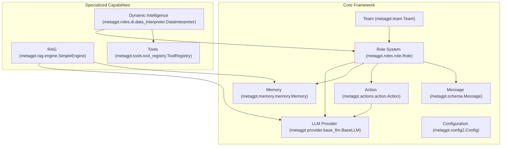
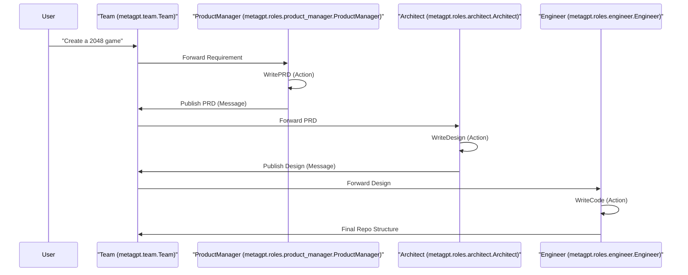

<!-- source: DeepWiki mcp.deepwiki.com · repo geekan/MetaGPT · page 1 Overview · fetched 2026-10-26 -->

# Overview

<details>
<summary>Relevant source files</summary>

The following files were used as context for generating this wiki page:

- [Dockerfile](Dockerfile)
- [MANIFEST.in](MANIFEST.in)
- [README.md](README.md)
- [docs/ACADEMIC_WORK.md](docs/ACADEMIC_WORK.md)
- [docs/FAQ-EN.md](docs/FAQ-EN.md)
- [docs/NEWS.md](docs/NEWS.md)
- [docs/README_CN.md](docs/README_CN.md)
- [docs/README_FR.md](docs/README_FR.md)
- [docs/README_JA.md](docs/README_JA.md)
- [docs/install/cli_install.md](docs/install/cli_install.md)
- [docs/install/cli_install_cn.md](docs/install/cli_install_cn.md)
- [docs/install/docker_install.md](docs/install/docker_install.md)
- [docs/install/docker_install_cn.md](docs/install/docker_install_cn.md)
- [docs/tutorial/usage.md](docs/tutorial/usage.md)
- [docs/tutorial/usage_cn.md](docs/tutorial/usage_cn.md)
- [metagpt/__init__.py](metagpt/__init__.py)
- [metagpt/_compat.py](metagpt/_compat.py)
- [metagpt/utils/mermaid.py](metagpt/utils/mermaid.py)
- [requirements.txt](requirements.txt)
- [setup.py](setup.py)

</details>


MetaGPT is a multi-agent framework that enables coordination among multiple LLM-based agents to tackle complex tasks. By assigning different roles to these agents and establishing structured communication protocols, MetaGPT creates a collaborative system similar to a software company, where specialized roles work together following Standard Operating Procedures (SOPs).

The core philosophy of the framework is summarized by the formula: `Code = SOP(Team)`. This approach materializes SOPs and applies them to teams composed of Large Language Models (LLMs) to produce high-quality, structured outputs from single-line requirements.

Sources: [README.md:40-47](), [docs/README_CN.md:21-23]()

## Core Architecture

MetaGPT's architecture consists of several interconnected systems that enable agent collaboration, communication, and task execution. The framework bridges the gap between natural language requirements and executable code entities.

### System Architecture Diagram
The following diagram illustrates the high-level relationship between the core components, highlighting the code entities that manage them.


Sources: [README.md:40-47](), [metagpt/config2.py:49-102](), [metagpt/utils/mermaid.py:112-144]()

### Role System
The Role system is the foundation of MetaGPT. Each role represents an agent with specific responsibilities. Roles follow an `observe` -> `think` -> `act` cycle. In the context of a software company, MetaGPT includes specialized roles like `ProductManager`, `Architect`, `ProjectManager`, and `Engineer`.

For details, see [Software Company Metaphor](#1.2).

### Software Development Workflow
MetaGPT's flagship capability is its automated Software Development Life Cycle (SDLC). It transforms a one-line requirement into a complete software project (including user stories, competitive analysis, requirements, data structures, APIs, and documents).


Sources: [README.md:41-47](), [metagpt/software_company.py:96-102](), [docs/README_JA.md:20-22]()

## Key Capabilities

### Multi-Agent Collaboration
The `Team` class manages the environment and the interaction rounds. It allows for "hiring" roles and providing "investment" to simulate a startup environment.
Sources: [metagpt/software_company.py:14-77](), [docs/tutorial/usage.md:37-60]()

### Dynamic Intelligence (DI)
MetaGPT features a `DataInterpreter` capable of data science tasks, including writing analysis code and generating plots using specialized tools.
Sources: [README.md:104-116](), [docs/README_FR.md:23-25]()

### RAG & Tool Integration
The framework supports Retrieval-Augmented Generation for document-based QA and a robust tool registry for extending agent capabilities with external APIs (e.g., Google Search, Web Scraping).
Sources: [requirements.txt:69-83](), [setup.py:31-47]()

## Getting Started

MetaGPT can be installed via `pip` and configured using a `config2.yaml` file to specify LLM providers like OpenAI, Azure, or Ollama.

```bash
pip install metagpt
metagpt --init-config
metagpt "Create a 2048 game"
```

For detailed installation and configuration steps, see [Getting Started](#1.1).

## Summary Table

| Feature | Description | Code Pointer |
| --- | --- | --- |
| **SOP Materialization** | Materializing human workflows into agent interactions. | `metagpt/actions/` |
| **Multi-Role Support** | PM, Architect, Engineer, QA, and more. | `metagpt/roles/` |
| **LLM Agnostic** | Support for OpenAI, Anthropic, Gemini, and local models. | `metagpt/provider/` |
| **Artifact Generation** | Outputs PRDs, Designs, and full Code Repositories. | `metagpt/utils/project_repo.py` |

Sources: [README.md:78-84](), [requirements.txt:1-90](), [setup.py:98-122]()

---

