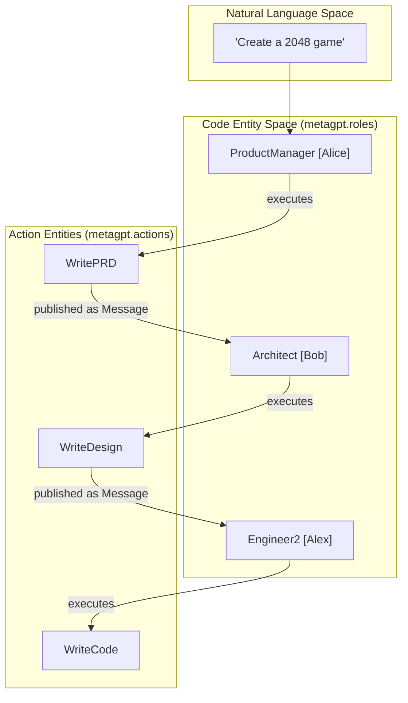
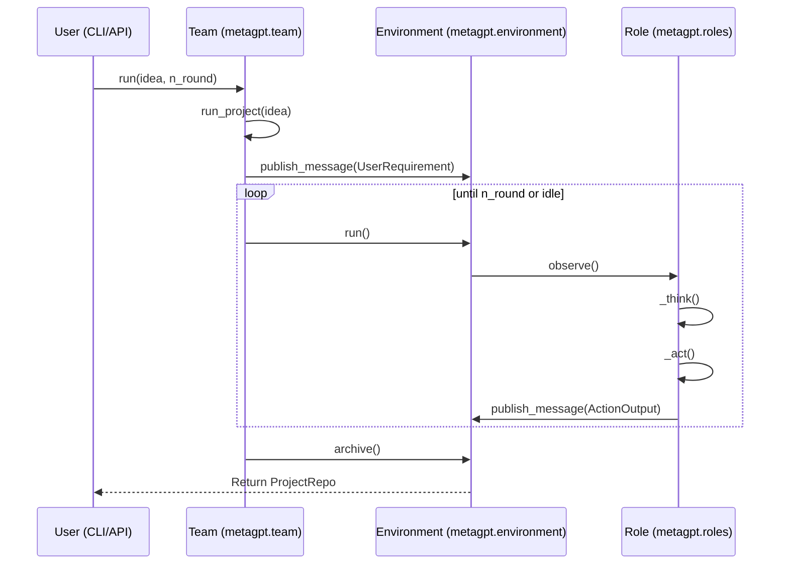

<!-- source: DeepWiki mcp.deepwiki.com · repo geekan/MetaGPT · page 1.2 Software Company Metaphor · fetched 2026-10-26 -->

# Software Company Metaphor

<details>
<summary>Relevant source files</summary>

The following files were used as context for generating this wiki page:

- [Dockerfile](Dockerfile)
- [README.md](README.md)
- [docs/ACADEMIC_WORK.md](docs/ACADEMIC_WORK.md)
- [docs/NEWS.md](docs/NEWS.md)
- [docs/README_CN.md](docs/README_CN.md)
- [docs/README_FR.md](docs/README_FR.md)
- [docs/README_JA.md](docs/README_JA.md)
- [metagpt/config2.py](metagpt/config2.py)
- [metagpt/context.py](metagpt/context.py)
- [metagpt/context_mixin.py](metagpt/context_mixin.py)
- [metagpt/llm.py](metagpt/llm.py)
- [metagpt/roles/architect.py](metagpt/roles/architect.py)
- [metagpt/roles/product_manager.py](metagpt/roles/product_manager.py)
- [metagpt/roles/project_manager.py](metagpt/roles/project_manager.py)
- [metagpt/software_company.py](metagpt/software_company.py)
- [metagpt/team.py](metagpt/team.py)
- [metagpt/utils/mermaid.py](metagpt/utils/mermaid.py)
- [tests/metagpt/test_config.py](tests/metagpt/test_config.py)
- [tests/metagpt/test_context.py](tests/metagpt/test_context.py)

</details>


The core philosophy of MetaGPT is encapsulated in the formula `Code = SOP(Team)` [README.md:44-44](). By materializing Standard Operating Procedures (SOPs) and applying them to teams composed of Large Language Model (LLM) agents, MetaGPT transforms a single natural language requirement into a comprehensive software repository [README.md:42-44]().

## The Team Class

The `Team` class is the primary orchestrator that simulates a software company's operations. It acts as a container for agents (roles), the environment they inhabit, and the financial resources (investment) allocated to a project [metagpt/team.py:32-36]().

### Key Attributes and Initialization
- **Environment (`env`)**: By default, a `Team` uses `MGXEnv` for hierarchical routing or a standard `Environment` for instant messaging between roles [metagpt/team.py:48-51]().
- **Investment**: Manages the budget via a `CostManager`. The system raises a `NoMoneyException` if the total cost of LLM calls exceeds this budget [metagpt/team.py:92-100]().
- **Roles**: Agents are added to the team using the `hire` method, which registers them within the team's environment [metagpt/team.py:83-85]().

### Data Flow: Idea to Project
When `run_project` is called, the initial "idea" is published as a `Message` to the environment [metagpt/team.py:102-108](). This triggers the "Software Company" lifecycle where roles observe the requirement and begin their SOP-driven tasks.

**Sources:** [metagpt/team.py:32-139](), [metagpt/environment/mgx/mgx_env.py]()

## SOP-Driven Lifecycle

MetaGPT mimics a traditional Waterfall-style SDLC (Software Development Life Cycle) through "carefully orchestrated SOPs" [README.md:43-43](). Each role is programmed to "watch" specific message types or previous actions, ensuring a sequential and logical progression.

### Team Execution Logic (`Team.run`)
The team operates in "rounds". In each round, the environment's `run` method is invoked, allowing all active roles to think and act [metagpt/team.py:123-134]().

| Step | Role | Action | Output |
| :--- | :--- | :--- | :--- |
| 1 | `ProductManager` | `WritePRD` | Product Requirement Document |
| 2 | `Architect` | `WriteDesign` | System Design & Data Structures |
| 3 | `ProjectManager` | `WriteTasks` | Task breakdown & Assignment |
| 4 | `Engineer` | `WriteCode` | Executable Code & Files |
| 5 | `QaEngineer` | `RunCode` / `WriteTest` | Test reports & Bug fixes |

**Sources:** [metagpt/team.py:123-139](), [metagpt/software_company.py:43-54](), [metagpt/roles/product_manager.py:41-47]()

## Hiring and Role Configuration

The `generate_repo` function demonstrates how a standard software company is "staffed" [metagpt/software_company.py:14-27]().

### Standard Staffing Pattern
```python
company = Team(context=ctx)
company.hire([
    TeamLeader(),
    ProductManager(),
    Architect(),
    Engineer2(),
    DataAnalyst(),
])
```
[metagpt/software_company.py:44-54]()

### Natural Language Space to Code Entity Space: Role Mapping
The following diagram illustrates how human-readable roles are mapped to specific Python classes and the specific `Action` entities they execute within the SOP.

**Role-Action Mapping Diagram**

**Sources:** [metagpt/roles/product_manager.py:21-47](), [metagpt/roles/architect.py:17-52](), [metagpt/software_company.py:43-54]()

## Multi-Agent Round Execution

The system runs in a loop controlled by `n_round` [metagpt/team.py:128-132](). In each round, the `Environment` facilitates the `observe -> think -> act` cycle for all roles.

### Interaction Logic
1. **Observe**: Roles filter the `MessageQueue` for messages they are configured to `watch` [metagpt/roles/product_manager.py:46-46]().
2. **Think**: Roles decide the next action based on their internal state or `RoleReactMode` [metagpt/roles/product_manager.py:53-64]().
3. **Act**: Roles execute their `todo_action`, often involving LLM calls via `ActionNode` to generate structured documents or code [metagpt/roles/product_manager.py:39-39]().

### Operational Flow Diagram
This diagram bridges the conceptual "Software Company" workflow with the underlying code execution flow in `Team` and `Environment`.

**System Execution Flow**

**Sources:** [metagpt/team.py:102-138](), [metagpt/software_company.py:71-72](), [metagpt/environment/mgx/mgx_env.py]()

## Configuration and Context
The "Company" relies on a `Context` object, which acts as a service locator for the `Config` (LLM settings, API keys) and the `CostManager` [metagpt/context.py:58-66]().

- **Config**: Loaded from `config2.yaml` [metagpt/config2.py:101-123]().
- **LLM Instance**: Created dynamically based on the `api_type` (e.g., OpenAI, Azure, Ollama) defined in the configuration [metagpt/context.py:86-92]().

**Sources:** [metagpt/context.py:58-100](), [metagpt/config2.py:49-100]()

---

