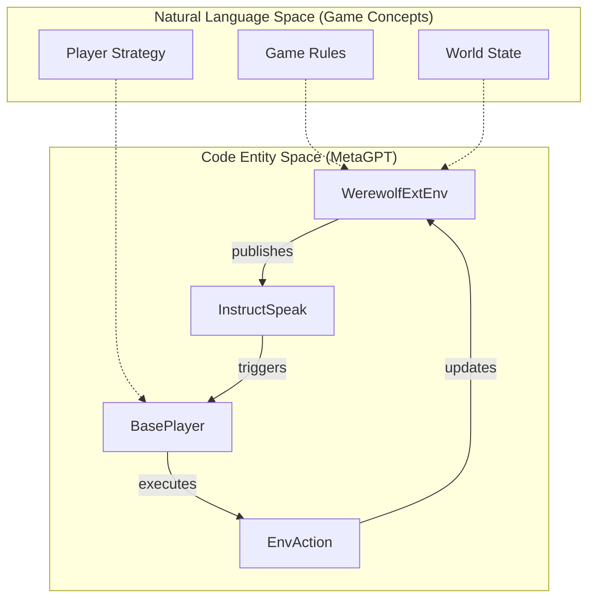
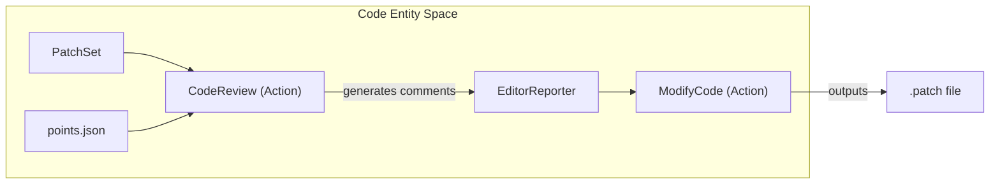

<!-- source: DeepWiki mcp.deepwiki.com · repo geekan/MetaGPT · page 10 Extension Ecosystem · fetched 2026-10-26 -->

# Extension Ecosystem

Relevant source files

The following files were used as context for generating this wiki page:

- [examples/stanford_town/run_st_game.py](examples/stanford_town/run_st_game.py)
- [examples/stanford_town/storage/.gitignore](examples/stanford_town/storage/.gitignore)
- [metagpt/environment/android/env_space.py](metagpt/environment/android/env_space.py)
- [metagpt/environment/minecraft/minecraft_env.py](metagpt/environment/minecraft/minecraft_env.py)
- [metagpt/environment/werewolf/const.py](metagpt/environment/werewolf/const.py)
- [metagpt/environment/werewolf/werewolf_env.py](metagpt/environment/werewolf/werewolf_env.py)
- [metagpt/environment/werewolf/werewolf_ext_env.py](metagpt/environment/werewolf/werewolf_ext_env.py)
- [metagpt/ext/__init__.py](metagpt/ext/__init__.py)
- [metagpt/ext/android_assistant/README.md](metagpt/ext/android_assistant/README.md)
- [metagpt/ext/android_assistant/README_CN.md](metagpt/ext/android_assistant/README_CN.md)
- [metagpt/ext/android_assistant/__init__.py](metagpt/ext/android_assistant/__init__.py)
- [metagpt/ext/android_assistant/actions/__init__.py](metagpt/ext/android_assistant/actions/__init__.py)
- [metagpt/ext/android_assistant/actions/manual_record.py](metagpt/ext/android_assistant/actions/manual_record.py)
- [metagpt/ext/android_assistant/actions/parse_record.py](metagpt/ext/android_assistant/actions/parse_record.py)
- [metagpt/ext/android_assistant/actions/parse_record_an.py](metagpt/ext/android_assistant/actions/parse_record_an.py)
- [metagpt/ext/android_assistant/actions/screenshot_parse.py](metagpt/ext/android_assistant/actions/screenshot_parse.py)
- [metagpt/ext/android_assistant/actions/screenshot_parse_an.py](metagpt/ext/android_assistant/actions/screenshot_parse_an.py)
- [metagpt/ext/android_assistant/actions/self_learn_and_reflect.py](metagpt/ext/android_assistant/actions/self_learn_and_reflect.py)
- [metagpt/ext/android_assistant/prompts/assistant_prompt.py](metagpt/ext/android_assistant/prompts/assistant_prompt.py)
- [metagpt/ext/android_assistant/roles/android_assistant.py](metagpt/ext/android_assistant/roles/android_assistant.py)
- [metagpt/ext/android_assistant/utils/schema.py](metagpt/ext/android_assistant/utils/schema.py)
- [metagpt/ext/android_assistant/utils/utils.py](metagpt/ext/android_assistant/utils/utils.py)
- [metagpt/ext/cr/__init__.py](metagpt/ext/cr/__init__.py)
- [metagpt/ext/cr/actions/code_review.py](metagpt/ext/cr/actions/code_review.py)
- [metagpt/ext/cr/actions/modify_code.py](metagpt/ext/cr/actions/modify_code.py)
- [metagpt/ext/cr/points.json](metagpt/ext/cr/points.json)
- [metagpt/ext/cr/points_cn.json](metagpt/ext/cr/points_cn.json)
- [metagpt/ext/cr/utils/__init__.py](metagpt/ext/cr/utils/__init__.py)
- [metagpt/ext/cr/utils/cleaner.py](metagpt/ext/cr/utils/cleaner.py)
- [metagpt/ext/cr/utils/schema.py](metagpt/ext/cr/utils/schema.py)
- [metagpt/ext/stanford_town/README.md](metagpt/ext/stanford_town/README.md)
- [metagpt/ext/stanford_town/README_CN.md](metagpt/ext/stanford_town/README_CN.md)
- [metagpt/ext/stanford_town/__init__.py](metagpt/ext/stanford_town/__init__.py)
- [metagpt/ext/stanford_town/actions/__init__.py](metagpt/ext/stanford_town/actions/__init__.py)
- [metagpt/ext/stanford_town/actions/agent_chat_sum_rel.py](metagpt/ext/stanford_town/actions/agent_chat_sum_rel.py)
- [metagpt/ext/stanford_town/utils/utils.py](metagpt/ext/stanford_town/utils/utils.py)
- [metagpt/ext/werewolf/actions/common_actions.py](metagpt/ext/werewolf/actions/common_actions.py)
- [metagpt/ext/werewolf/actions/moderator_actions.py](metagpt/ext/werewolf/actions/moderator_actions.py)
- [metagpt/ext/werewolf/roles/base_player.py](metagpt/ext/werewolf/roles/base_player.py)
- [metagpt/ext/werewolf/roles/human_player.py](metagpt/ext/werewolf/roles/human_player.py)
- [metagpt/ext/werewolf/roles/moderator.py](metagpt/ext/werewolf/roles/moderator.py)
- [metagpt/ext/werewolf/roles/werewolf.py](metagpt/ext/werewolf/roles/werewolf.py)
- [metagpt/ext/werewolf/roles/witch.py](metagpt/ext/werewolf/roles/witch.py)
- [metagpt/ext/werewolf/schema.py](metagpt/ext/werewolf/schema.py)
- [metagpt/ext/werewolf/werewolf_game.py](metagpt/ext/werewolf/werewolf_game.py)
- [metagpt/tools/libs/cr.py](metagpt/tools/libs/cr.py)
- [metagpt/utils/report.py](metagpt/utils/report.py)
- [tests/metagpt/environment/werewolf_env/test_werewolf_ext_env.py](tests/metagpt/environment/werewolf_env/test_werewolf_ext_env.py)
- [tests/metagpt/test_reporter.py](tests/metagpt/test_reporter.py)

The MetaGPT Extension Ecosystem provides specialized environments, agents, and tools that extend the core framework into specific domains such as gaming simulations, mobile interaction, and automated software engineering. These extensions leverage the `ExtEnv` [metagpt/environment/base_env.py:12]() and `Role` [metagpt/roles/role.py:22]() abstractions to create complex, multi-agent interactions.

## Simulation Environments

MetaGPT supports high-fidelity simulations where agents interact with external world states. These environments typically extend `ExtEnv` to manage game logic, state transitions, and observation isolation.

### Werewolf Game
The Werewolf simulation implements a multi-agent game involving roles like `Werewolf`, `Witch`, and `Villager`. It uses a `WerewolfExtEnv` [metagpt/environment/werewolf/werewolf_ext_env.py:18]() to manage the game flow, including nighttime actions (hunts, poisons) and daytime voting. Agents use `Reflect` and `RetrieveExperiences` actions [metagpt/ext/werewolf/roles/base_player.py:7-15]() to improve their strategic play over multiple rounds.

### Stanford Town
A reproduction of generative agents in a sandbox environment. It allows agents to host parties, spread information, and interact within a town setting. The system integrates with the `generative_agents` frontend for visualization [metagpt/ext/stanford_town/README.md:4-33]().

### Minecraft Integration
Integration with the Minecraft environment via `MinecraftEnv` [metagpt/environment/minecraft/minecraft_env.py](), enabling agents to perceive the voxel world and execute embodied actions.

For details on game logic, observation spaces, and custom environment creation, see **[Simulation Environments](#10.1)**.

### Environment-Role Interaction Space
The following diagram illustrates how simulation logic in the "Code Entity Space" maps to the conceptual game loop.

**Sources:** [metagpt/environment/werewolf/werewolf_ext_env.py:18-100](), [metagpt/ext/werewolf/roles/base_player.py:22-90]()

---

## Android Assistant

The `AndroidAssistant` [metagpt/ext/android_assistant/roles/android_assistant.py:26]() is a multi-modal agent designed to operate mobile applications. It functions in two primary stages:
1.  **Learning Stage**: The agent learns app functionality through `ManualRecord` (human demonstration) or `SelfLearnAndReflect` (autonomous exploration) [metagpt/ext/android_assistant/actions/self_learn_and_reflect.py]().
2.  **Execution Stage**: The agent performs tasks based on user requirements by parsing screenshots via `ScreenshotParse` [metagpt/ext/android_assistant/actions/screenshot_parse.py]() and sending commands through the `Android Debug Bridge (ADB)` [metagpt/ext/android_assistant/README.md:55]().

**Sources:** [metagpt/ext/android_assistant/roles/android_assistant.py:53-75](), [metagpt/ext/android_assistant/README.md:1-50]()

---

## Code Review (CR) Extension

The CR extension automates the pull-request review process. It uses a specialized `CodeReview` action [metagpt/ext/cr/actions/code_review.py:92]() to compare code patches against a set of `Points` (standards) defined in `points.json` [metagpt/ext/cr/points.json:1]().

### Key Components
*   **Review Action**: Analyzes `PatchSet` objects to identify defects [metagpt/ext/cr/actions/code_review.py:95]().
*   **Modify Code Action**: Automatically generates a standard git patch to fix identified issues using `ModifyCode` [metagpt/ext/cr/actions/modify_code.py:49-53]().
*   **Tool Integration**: Exposed as a tool via `register_tool`, allowing other agents to call `review` and `fix` functions [metagpt/tools/libs/cr.py:19-28]().

### Automated PR Workflow
This diagram maps the code review symbols to the functional pipeline.

**Sources:** [metagpt/ext/cr/actions/code_review.py:92-132](), [metagpt/ext/cr/actions/modify_code.py:53-112](), [metagpt/tools/libs/cr.py:23-75]()

---

## Custom Agents and Multi-Agent Patterns

The ecosystem provides a foundation for building bespoke agents and complex interaction patterns:
*   **Debate Patterns**: Implementing multi-agent debates to refine reasoning.
*   **Research & Search**: Specialized roles like `Researcher` that utilize web search engines and browser engines for deep information retrieval.
*   **Reporter System**: The `ResourceReporter` [metagpt/utils/report.py:49]() and `EditorReporter` [metagpt/utils/report.py:228]() classes allow agents to stream their internal state (thoughts, terminal output, browser activity) to external interfaces.

For details on building custom agents and implementing these patterns, see **[Custom Agents and Multi-Agent Patterns](#10.2)**.

**Sources:** [metagpt/utils/report.py:49-228](), [metagpt/tools/libs/cr.py:16]()

---

