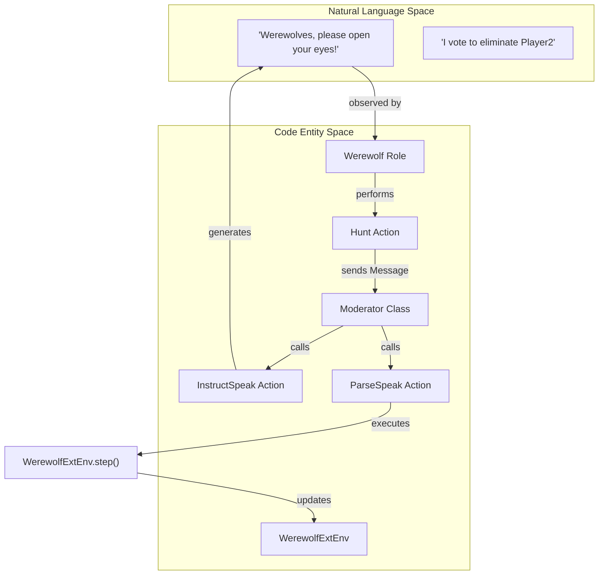
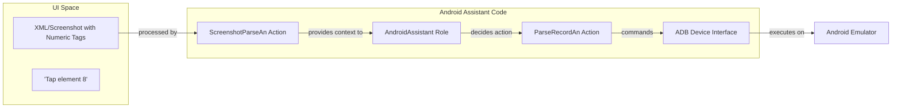

<!-- source: DeepWiki mcp.deepwiki.com · repo geekan/MetaGPT · page 10.1 Simulation Environments · fetched 2026-10-26 -->

# Simulation Environments

Relevant source files

The following files were used as context for generating this wiki page:

- [examples/stanford_town/run_st_game.py](examples/stanford_town/run_st_game.py)
- [examples/stanford_town/storage/.gitignore](examples/stanford_town/storage/.gitignore)
- [metagpt/environment/minecraft/minecraft_env.py](metagpt/environment/minecraft/minecraft_env.py)
- [metagpt/environment/stanford_town/stanford_town_env.py](metagpt/environment/stanford_town/stanford_town_env.py)
- [metagpt/environment/werewolf/const.py](metagpt/environment/werewolf/const.py)
- [metagpt/environment/werewolf/werewolf_env.py](metagpt/environment/werewolf/werewolf_env.py)
- [metagpt/environment/werewolf/werewolf_ext_env.py](metagpt/environment/werewolf/werewolf_ext_env.py)
- [metagpt/ext/__init__.py](metagpt/ext/__init__.py)
- [metagpt/ext/android_assistant/README.md](metagpt/ext/android_assistant/README.md)
- [metagpt/ext/android_assistant/README_CN.md](metagpt/ext/android_assistant/README_CN.md)
- [metagpt/ext/android_assistant/__init__.py](metagpt/ext/android_assistant/__init__.py)
- [metagpt/ext/android_assistant/actions/__init__.py](metagpt/ext/android_assistant/actions/__init__.py)
- [metagpt/ext/android_assistant/actions/parse_record_an.py](metagpt/ext/android_assistant/actions/parse_record_an.py)
- [metagpt/ext/android_assistant/actions/screenshot_parse_an.py](metagpt/ext/android_assistant/actions/screenshot_parse_an.py)
- [metagpt/ext/stanford_town/README.md](metagpt/ext/stanford_town/README.md)
- [metagpt/ext/stanford_town/README_CN.md](metagpt/ext/stanford_town/README_CN.md)
- [metagpt/ext/stanford_town/__init__.py](metagpt/ext/stanford_town/__init__.py)
- [metagpt/ext/stanford_town/actions/__init__.py](metagpt/ext/stanford_town/actions/__init__.py)
- [metagpt/ext/stanford_town/actions/agent_chat_sum_rel.py](metagpt/ext/stanford_town/actions/agent_chat_sum_rel.py)
- [metagpt/ext/stanford_town/actions/gen_action_details.py](metagpt/ext/stanford_town/actions/gen_action_details.py)
- [metagpt/ext/stanford_town/actions/gen_iter_chat_utt.py](metagpt/ext/stanford_town/actions/gen_iter_chat_utt.py)
- [metagpt/ext/stanford_town/actions/task_decomp.py](metagpt/ext/stanford_town/actions/task_decomp.py)
- [metagpt/ext/stanford_town/memory/spatial_memory.py](metagpt/ext/stanford_town/memory/spatial_memory.py)
- [metagpt/ext/stanford_town/plan/st_plan.py](metagpt/ext/stanford_town/plan/st_plan.py)
- [metagpt/ext/stanford_town/utils/utils.py](metagpt/ext/stanford_town/utils/utils.py)
- [metagpt/ext/werewolf/actions/common_actions.py](metagpt/ext/werewolf/actions/common_actions.py)
- [metagpt/ext/werewolf/actions/moderator_actions.py](metagpt/ext/werewolf/actions/moderator_actions.py)
- [metagpt/ext/werewolf/roles/base_player.py](metagpt/ext/werewolf/roles/base_player.py)
- [metagpt/ext/werewolf/roles/human_player.py](metagpt/ext/werewolf/roles/human_player.py)
- [metagpt/ext/werewolf/roles/moderator.py](metagpt/ext/werewolf/roles/moderator.py)
- [metagpt/ext/werewolf/roles/werewolf.py](metagpt/ext/werewolf/roles/werewolf.py)
- [metagpt/ext/werewolf/roles/witch.py](metagpt/ext/werewolf/roles/witch.py)
- [metagpt/ext/werewolf/schema.py](metagpt/ext/werewolf/schema.py)
- [metagpt/ext/werewolf/werewolf_game.py](metagpt/ext/werewolf/werewolf_game.py)
- [tests/metagpt/environment/stanford_town_env/test_stanford_town_ext_env.py](tests/metagpt/environment/stanford_town_env/test_stanford_town_ext_env.py)
- [tests/metagpt/environment/werewolf_env/test_werewolf_ext_env.py](tests/metagpt/environment/werewolf_env/test_werewolf_ext_env.py)
- [tests/metagpt/ext/stanford_town/actions/test_gen_action_details.py](tests/metagpt/ext/stanford_town/actions/test_gen_action_details.py)
- [tests/metagpt/ext/stanford_town/memory/test_agent_memory.py](tests/metagpt/ext/stanford_town/memory/test_agent_memory.py)
- [tests/metagpt/ext/stanford_town/plan/test_st_plan.py](tests/metagpt/ext/stanford_town/plan/test_st_plan.py)

Simulation environments in MetaGPT provide specialized sandboxes for multi-agent interaction, ranging from game-theoretic social simulations to complex digital twins of software or physical worlds. These environments extend the base `Environment` system to handle specific domain logic, state transitions, and observation/action spaces.

## Core Abstractions

The foundation for all simulation environments is the `ExtEnv` class, which provides a standard interface for external integrations.

### ExtEnv Base Class
The `ExtEnv` class (extending `BaseEnv`) serves as the bridge between MetaGPT roles and external simulation engines. It defines the contract for how agents perceive the world (`observe`) and affect it (`step`).

- **`step(action)`**: Executes an action in the environment and returns a tuple of `(observation, reward, terminated, truncated, info)` [metagpt/environment/werewolf/werewolf_ext_env.py:76-100]().
- **`observe(obs_params)`**: Retrieves specific information from the environment state based on provided parameters [metagpt/environment/werewolf/werewolf_ext_env.py:58-60]().

### Action and Observation Spaces
Environments define structured spaces to validate interactions:
- **`EnvAction`**: Encapsulates the type of action and its targets (e.g., `WOLF_KILL` in Werewolf or `ADD_TILE_EVENT` in Stanford Town) [metagpt/environment/werewolf/env_space.py:13-14](), [metagpt/environment/stanford_town/env_space.py:7-12]().
- **`EnvObsParams`**: Defines filters for what an agent wants to see (e.g., specific coordinates or tile paths) [metagpt/environment/stanford_town/env_space.py:10-11]().

**Sources:** [metagpt/environment/base_env.py:12-12](), [metagpt/environment/werewolf/werewolf_ext_env.py:18-100]().

---

## Werewolf Game Simulation

The Werewolf simulation demonstrates social deduction and strategic deception. It uses a `Moderator` role to drive the game loop through `STEP_INSTRUCTIONS` [metagpt/environment/werewolf/const.py:36-121]().

### Environment Logic
`WerewolfExtEnv` tracks the `players_state` (Alive, Dead, Killed, etc.) and manages night/day cycles [metagpt/environment/werewolf/werewolf_ext_env.py:21-48]().

### Game Flow Diagram
This diagram shows how the `Moderator` uses `InstructSpeak` to trigger specific player `Actions`.

**Sources:** [metagpt/ext/werewolf/roles/moderator.py:160-173](), [metagpt/ext/werewolf/roles/base_player.py:79-90](), [metagpt/environment/werewolf/werewolf_ext_env.py:76-95]().

### Key Classes
| Class | Responsibility |
| :--- | :--- |
| `WerewolfExtEnv` | Manages global game state, living players, and win conditions [metagpt/environment/werewolf/werewolf_ext_env.py:18-37](). |
| `Moderator` | Orchestrates the SOP, parses player natural language into environment actions [metagpt/ext/werewolf/roles/moderator.py:26-43](). |
| `BasePlayer` | Base role for all game participants, handles reflection and experience retrieval [metagpt/ext/werewolf/roles/base_player.py:22-34](). |
| `Witch` | Specialized role that routes between `Save` and `Poison` actions [metagpt/ext/werewolf/roles/witch.py:7-29](). |

---

## Stanford Town (Generative Agents)

MetaGPT includes a reproduction of the "Generative Agents" Stanford Town simulation, allowing agents to live in a virtual town called "the Ville".

### Spatial Memory and Environment
The `StanfordTownExtEnv` manages a tile-based maze. It tracks collisions and addresses for locations like "Isabella's apartment" [tests/metagpt/environment/stanford_town_env/test_stanford_town_ext_env.py:25-33]().

- **Tile System**: Converts coordinates to tiles and checks for collisions [tests/metagpt/environment/stanford_town_env/test_stanford_town_ext_env.py:25-29]().
- **Event Management**: Adds or removes events (e.g., "bed", "studio") to specific tiles to simulate object usage [tests/metagpt/environment/stanford_town_env/test_stanford_town_ext_env.py:35-42]().

### Integration with Frontend
The simulation can be docked with the original `generative_agents` frontend by pointing the `temp_storage_path` to the GA project's storage directory [metagpt/ext/stanford_town/README.md:4-18]().

**Sources:** [metagpt/environment/stanford_town/stanford_town_ext_env.py:13-13](), [metagpt/ext/stanford_town/README.md:22-34]().

---

## Android Assistant Simulation

The Android Assistant uses a simulation of a smartphone environment (via ADB and Emulator) to learn and execute app tasks.

### Operation Phases
1.  **Learning Stage (`learn`)**: The agent explores the app via `auto` exploration or `manual` human demonstration to generate operation documents [metagpt/ext/android_assistant/README.md:10-20]().
2.  **Automatic Execution Stage (`act`)**: The agent uses the generated documents to perform complex tasks like "Send a message on Messenger" [metagpt/ext/android_assistant/README.md:44-51]().

### Interaction Mapping
The environment maps UI elements to numeric tags, allowing the LLM to choose elements to `tap`, `text`, `long_press`, or `swipe` [metagpt/ext/android_assistant/README.md:30-42]().

**Sources:** [metagpt/ext/android_assistant/README.md:67-102](), [metagpt/ext/android_assistant/actions/screenshot_parse_an.py:1-5]().

---

## Building Custom Environments

To build a custom environment in MetaGPT, follow this pattern:

1.  **Define Action/Observation Spaces**: Create enums for `EnvActionType` and classes for `EnvAction` and `EnvObsParams`.
2.  **Inherit from `ExtEnv`**: Implement the `step` logic to update your internal state.
3.  **Implement a Moderator/Controller Role**: If the environment requires a specific SOP (like Werewolf), create a role that watches for player messages and calls `env.step()`.
4.  **Register Roles**: Use `env.add_role()` to place agents within the simulation context.

**Sources:** [metagpt/environment/werewolf/werewolf_ext_env.py:18-100](), [metagpt/environment/werewolf/env_space.py:1-20]().

---

