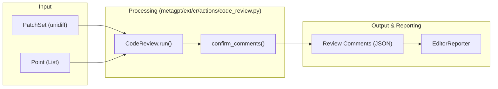

<!-- source: DeepWiki mcp.deepwiki.com · repo geekan/MetaGPT · page 10.2 Custom Agents and Multi-Agent Patterns · fetched 2026-10-26 -->

# Custom Agents and Multi-Agent Patterns

<details>
<summary>Relevant source files</summary>

The following files were used as context for generating this wiki page:

- [examples/agent_creator.py](examples/agent_creator.py)
- [examples/build_customized_agent.py](examples/build_customized_agent.py)
- [examples/build_customized_multi_agents.py](examples/build_customized_multi_agents.py)
- [examples/debate.py](examples/debate.py)
- [examples/debate_simple.py](examples/debate_simple.py)
- [examples/write_tutorial.py](examples/write_tutorial.py)
- [metagpt/actions/design_api_review.py](metagpt/actions/design_api_review.py)
- [metagpt/actions/execute_task.py](metagpt/actions/execute_task.py)
- [metagpt/actions/search_and_summarize.py](metagpt/actions/search_and_summarize.py)
- [metagpt/actions/write_docstring.py](metagpt/actions/write_docstring.py)
- [metagpt/actions/write_review.py](metagpt/actions/write_review.py)
- [metagpt/actions/write_tutorial.py](metagpt/actions/write_tutorial.py)
- [metagpt/ext/cr/__init__.py](metagpt/ext/cr/__init__.py)
- [metagpt/ext/cr/actions/code_review.py](metagpt/ext/cr/actions/code_review.py)
- [metagpt/ext/cr/actions/modify_code.py](metagpt/ext/cr/actions/modify_code.py)
- [metagpt/ext/cr/points.json](metagpt/ext/cr/points.json)
- [metagpt/ext/cr/points_cn.json](metagpt/ext/cr/points_cn.json)
- [metagpt/ext/cr/utils/__init__.py](metagpt/ext/cr/utils/__init__.py)
- [metagpt/ext/cr/utils/cleaner.py](metagpt/ext/cr/utils/cleaner.py)
- [metagpt/ext/cr/utils/schema.py](metagpt/ext/cr/utils/schema.py)
- [metagpt/roles/customer_service.py](metagpt/roles/customer_service.py)
- [metagpt/roles/researcher.py](metagpt/roles/researcher.py)
- [metagpt/roles/sales.py](metagpt/roles/sales.py)
- [metagpt/roles/searcher.py](metagpt/roles/searcher.py)
- [metagpt/roles/tutorial_assistant.py](metagpt/roles/tutorial_assistant.py)
- [metagpt/tools/libs/cr.py](metagpt/tools/libs/cr.py)
- [metagpt/utils/report.py](metagpt/utils/report.py)
- [tests/metagpt/test_reporter.py](tests/metagpt/test_reporter.py)

</details>


This page details the technical implementation of customized agents and sophisticated multi-agent interaction patterns within MetaGPT. It covers the creation of specialized roles, the execution of competitive debate structures, the utility of research-oriented roles, and the automated code review extension.

## 1. Building Customized Agents

Customizing an agent in MetaGPT involves defining a new class inheriting from `Role` and associating it with specific `Action` objects. The agent's behavior is governed by its `react_mode` and how it handles its internal `memory`.

### Single-Action vs. Multi-Action Agents
Agents can be designed for simple, linear tasks or complex, multi-step workflows.

*   **Simple Agents**: Typically perform one action in response to a requirement. For example, a `SimpleCoder` might only perform a `SimpleWriteCode` action [examples/build_customized_agent.py:54-70]().
*   **Sequential Agents**: Use `RoleReactMode.BY_ORDER` to execute a list of actions in a predefined sequence [examples/build_customized_agent.py:73-94](). This is useful for "Think-then-Do" patterns, such as writing code and then immediately running it.
*   **Dynamic Agents**: Can dynamically update their action list during execution. The `TutorialAssistant` demonstrates this by first running `WriteDirectory` and then populating its action queue with multiple `WriteContent` actions based on the generated directory structure [metagpt/roles/tutorial_assistant.py:46-68]().

### Agent Creation Flow
The following diagram bridges the natural language requirement to the code entities involved in agent execution.

**Agent Execution Data Flow**
```mermaid
graph TD
    subgraph "Natural Language Space"
        REQ["User Requirement (str)"]
    end

    subgraph "Code Entity Space"
        Role["Role (e.g., RunnableCoder)"]
        RC["RoleContext (self.rc)"]
        Mem["Memory (MessageQueue)"]
        Act["Action (e.g., SimpleWriteCode)"]
        Todo["rc.todo"]
    end

    REQ -->|role.run(msg)| Mem
    Mem -->|self._observe()| RC
    RC -->|self._think()| Todo
    Todo -->|self._act()| Act
    Act -->|todo.run()| Result["Action Output (str)"]
    Result -->|Message(cause_by=Act)| Mem
```
**Sources:** [examples/build_customized_agent.py:73-94](), [metagpt/roles/role.py:17-17]()

---

## 2. Multi-Agent Debate Patterns

Multi-agent patterns allow roles to interact, compete, or collaborate. A common pattern is the **Debate**, where two or more agents observe each other's outputs and respond based on their specific profiles.

### Implementation Details
*   **Watching**: Roles use `self._watch()` to subscribe to specific message types or actions from other roles [examples/debate.py:54]().
*   **Filtering**: The `_observe` method is often overridden to filter messages specifically sent to the agent (`send_to`) or to ignore their own previous messages [examples/debate.py:56-60]().
*   **Contextual Response**: In `_act`, the agent retrieves recent history from `self.get_memories()` to construct a prompt that includes the opponent's arguments [examples/debate.py:66-70]().

### Debate Orchestration
The `Team` class acts as the environment where these roles are "hired" and initialized with specific goals and opponents [examples/debate.py:84-92]().

**Sources:** [examples/debate.py:22-81](), [examples/debate_simple.py:20-25]()

---

## 3. Researcher and Searcher Roles

MetaGPT provides specialized roles for information gathering and web-based QA, leveraging search engines and browser automation.

### Researcher
The `Researcher` role is a complex agent that executes a three-stage pipeline:
1.  **CollectLinks**: Uses a search engine to find relevant URLs based on a topic [metagpt/roles/researcher.py:54-58]().
2.  **WebBrowseAndSummarize**: Concurrently scrapes and summarizes the content of the collected links [metagpt/roles/researcher.py:59-71]().
3.  **ConductResearch**: Synthesizes the summaries into a final markdown report [metagpt/roles/researcher.py:72-81]().

### Searcher and Sales
The `Searcher` role provides a simpler interface for search-based Q&A using the `SearchAndSummarize` action [metagpt/roles/searcher.py:24-48](). The `Sales` role extends this by integrating a specific knowledge base (store) to answer customer inquiries professionally [metagpt/roles/sales.py:18-41]().

**Sources:** [metagpt/roles/researcher.py:28-83](), [metagpt/roles/searcher.py:24-70](), [metagpt/actions/search_and_summarize.py:104-147]()

---

## 4. Code Review (CR) Extension

The Code Review extension provides automated tools for reviewing Pull Requests (PRs) and suggesting fixes based on predefined coding standards.

### Key Components
*   **CodeReview Action**: The core logic that takes a PR patch and a list of `Point` objects (coding standards) and generates JSON comments [metagpt/ext/cr/actions/code_review.py:92-174]().
*   **Point System**: Standards are defined in `points.json`, including descriptions and examples of correct/incorrect code [metagpt/ext/cr/utils/schema.py:18-18]().
*   **Confirm Mechanism**: A validation step where the LLM acts as a senior engineer to judge if a generated comment is actually valid, reducing false positives [metagpt/ext/cr/actions/code_review.py:132-174]().
*   **ModifyCode Action**: Automatically applies fixes based on the generated review comments [metagpt/tools/libs/cr.py:58-75]().

### Data Flow for Code Review
**CR Extension Entity Mapping**


**Sources:** [metagpt/ext/cr/actions/code_review.py:23-64](), [metagpt/tools/libs/cr.py:19-56](), [metagpt/utils/report.py:49-74]()

---

