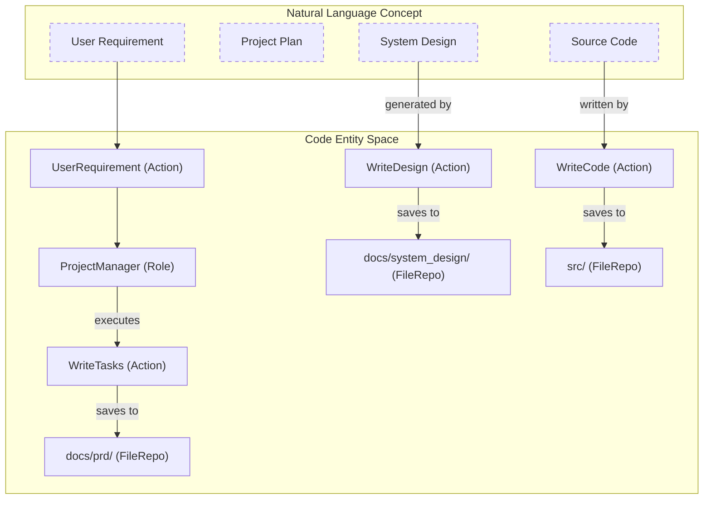
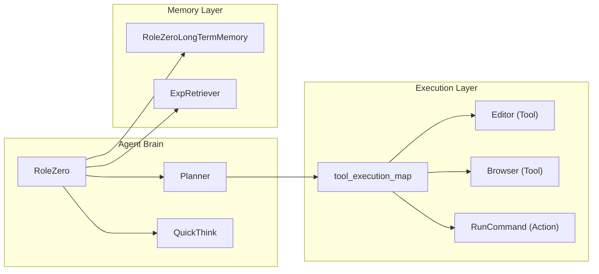

<!-- source: DeepWiki mcp.deepwiki.com · repo geekan/MetaGPT · page 11 Glossary · fetched 2026-10-26 -->

# Glossary

Relevant source files

The following files were used as context for generating this wiki page:

- [Dockerfile](Dockerfile)
- [README.md](README.md)
- [config/config2.example.yaml](config/config2.example.yaml)
- [docs/ACADEMIC_WORK.md](docs/ACADEMIC_WORK.md)
- [docs/NEWS.md](docs/NEWS.md)
- [docs/README_CN.md](docs/README_CN.md)
- [docs/README_FR.md](docs/README_FR.md)
- [docs/README_JA.md](docs/README_JA.md)
- [examples/exp_pool/decorator.py](examples/exp_pool/decorator.py)
- [metagpt/actions/action.py](metagpt/actions/action.py)
- [metagpt/actions/action_node.py](metagpt/actions/action_node.py)
- [metagpt/actions/design_api.py](metagpt/actions/design_api.py)
- [metagpt/actions/design_api_an.py](metagpt/actions/design_api_an.py)
- [metagpt/actions/prepare_documents.py](metagpt/actions/prepare_documents.py)
- [metagpt/actions/project_management.py](metagpt/actions/project_management.py)
- [metagpt/actions/project_management_an.py](metagpt/actions/project_management_an.py)
- [metagpt/actions/summarize_code.py](metagpt/actions/summarize_code.py)
- [metagpt/actions/write_code.py](metagpt/actions/write_code.py)
- [metagpt/actions/write_code_review.py](metagpt/actions/write_code_review.py)
- [metagpt/actions/write_prd.py](metagpt/actions/write_prd.py)
- [metagpt/actions/write_prd_an.py](metagpt/actions/write_prd_an.py)
- [metagpt/config2.py](metagpt/config2.py)
- [metagpt/configs/exp_pool_config.py](metagpt/configs/exp_pool_config.py)
- [metagpt/const.py](metagpt/const.py)
- [metagpt/context.py](metagpt/context.py)
- [metagpt/context_mixin.py](metagpt/context_mixin.py)
- [metagpt/environment/mgx/mgx_env.py](metagpt/environment/mgx/mgx_env.py)
- [metagpt/exp_pool/__init__.py](metagpt/exp_pool/__init__.py)
- [metagpt/exp_pool/decorator.py](metagpt/exp_pool/decorator.py)
- [metagpt/exp_pool/manager.py](metagpt/exp_pool/manager.py)
- [metagpt/exp_pool/schema.py](metagpt/exp_pool/schema.py)
- [metagpt/llm.py](metagpt/llm.py)
- [metagpt/prompts/di/data_analyst.py](metagpt/prompts/di/data_analyst.py)
- [metagpt/prompts/di/engineer2.py](metagpt/prompts/di/engineer2.py)
- [metagpt/prompts/di/role_zero.py](metagpt/prompts/di/role_zero.py)
- [metagpt/prompts/di/swe_agent.py](metagpt/prompts/di/swe_agent.py)
- [metagpt/prompts/di/team_leader.py](metagpt/prompts/di/team_leader.py)
- [metagpt/rag/engines/__init__.py](metagpt/rag/engines/__init__.py)
- [metagpt/rag/engines/simple.py](metagpt/rag/engines/simple.py)
- [metagpt/rag/interface.py](metagpt/rag/interface.py)
- [metagpt/rag/rankers/__init__.py](metagpt/rag/rankers/__init__.py)
- [metagpt/rag/retrievers/__init__.py](metagpt/rag/retrievers/__init__.py)
- [metagpt/rag/retrievers/base.py](metagpt/rag/retrievers/base.py)
- [metagpt/rag/retrievers/bm25_retriever.py](metagpt/rag/retrievers/bm25_retriever.py)
- [metagpt/rag/retrievers/faiss_retriever.py](metagpt/rag/retrievers/faiss_retriever.py)
- [metagpt/rag/retrievers/hybrid_retriever.py](metagpt/rag/retrievers/hybrid_retriever.py)
- [metagpt/roles/di/data_analyst.py](metagpt/roles/di/data_analyst.py)
- [metagpt/roles/di/engineer2.py](metagpt/roles/di/engineer2.py)
- [metagpt/roles/di/role_zero.py](metagpt/roles/di/role_zero.py)
- [metagpt/roles/di/swe_agent.py](metagpt/roles/di/swe_agent.py)
- [metagpt/roles/di/team_leader.py](metagpt/roles/di/team_leader.py)
- [metagpt/roles/engineer.py](metagpt/roles/engineer.py)
- [metagpt/roles/qa_engineer.py](metagpt/roles/qa_engineer.py)
- [metagpt/roles/role.py](metagpt/roles/role.py)
- [metagpt/schema.py](metagpt/schema.py)
- [metagpt/software_company.py](metagpt/software_company.py)
- [metagpt/strategy/experience_retriever.py](metagpt/strategy/experience_retriever.py)
- [metagpt/strategy/thinking_command.py](metagpt/strategy/thinking_command.py)
- [metagpt/tools/libs/data_preprocess.py](metagpt/tools/libs/data_preprocess.py)
- [metagpt/tools/libs/feature_engineering.py](metagpt/tools/libs/feature_engineering.py)
- [metagpt/tools/libs/git.py](metagpt/tools/libs/git.py)
- [metagpt/tools/libs/gpt_v_generator.py](metagpt/tools/libs/gpt_v_generator.py)
- [metagpt/tools/libs/sd_engine.py](metagpt/tools/libs/sd_engine.py)
- [metagpt/tools/libs/web_scraping.py](metagpt/tools/libs/web_scraping.py)
- [metagpt/tools/tool_convert.py](metagpt/tools/tool_convert.py)
- [metagpt/tools/tool_data_type.py](metagpt/tools/tool_data_type.py)
- [metagpt/tools/tool_registry.py](metagpt/tools/tool_registry.py)
- [metagpt/tools/ut_writer.py](metagpt/tools/ut_writer.py)
- [metagpt/utils/common.py](metagpt/utils/common.py)
- [metagpt/utils/file_repository.py](metagpt/utils/file_repository.py)
- [metagpt/utils/git_repository.py](metagpt/utils/git_repository.py)
- [metagpt/utils/human_interaction.py](metagpt/utils/human_interaction.py)
- [metagpt/utils/mermaid.py](metagpt/utils/mermaid.py)
- [metagpt/utils/parse_docstring.py](metagpt/utils/parse_docstring.py)
- [metagpt/utils/reflection.py](metagpt/utils/reflection.py)
- [tests/metagpt/actions/test_action_node.py](tests/metagpt/actions/test_action_node.py)
- [tests/metagpt/environment/mgx_env/run_mgx_env.py](tests/metagpt/environment/mgx_env/run_mgx_env.py)
- [tests/metagpt/exp_pool/test_manager.py](tests/metagpt/exp_pool/test_manager.py)
- [tests/metagpt/roles/di/run_engineer2.py](tests/metagpt/roles/di/run_engineer2.py)
- [tests/metagpt/roles/di/run_swe_agent_for_benchmark.py](tests/metagpt/roles/di/run_swe_agent_for_benchmark.py)
- [tests/metagpt/roles/di/run_swe_agent_open_source_issue.py](tests/metagpt/roles/di/run_swe_agent_open_source_issue.py)
- [tests/metagpt/test_config.py](tests/metagpt/test_config.py)
- [tests/metagpt/test_context.py](tests/metagpt/test_context.py)
- [tests/metagpt/test_document.py](tests/metagpt/test_document.py)
- [tests/metagpt/tools/libs/test_git.py](tests/metagpt/tools/libs/test_git.py)
- [tests/metagpt/tools/libs/test_gpt_v_generator.py](tests/metagpt/tools/libs/test_gpt_v_generator.py)
- [tests/metagpt/tools/libs/test_image_getter.py](tests/metagpt/tools/libs/test_image_getter.py)
- [tests/metagpt/tools/libs/test_sd_engine.py](tests/metagpt/tools/libs/test_sd_engine.py)
- [tests/metagpt/tools/test_tool_convert.py](tests/metagpt/tools/test_tool_convert.py)
- [tests/metagpt/tools/test_tool_registry.py](tests/metagpt/tools/test_tool_registry.py)
- [tests/metagpt/utils/test_common.py](tests/metagpt/utils/test_common.py)
- [tests/metagpt/utils/test_human_interaction.py](tests/metagpt/utils/test_human_interaction.py)

This glossary defines technical terms, jargon, and domain concepts specific to the MetaGPT codebase. It serves as a reference for engineers to map conceptual terminology to concrete code entities.

## Core Concepts

### Role
A **Role** is the fundamental unit of agency in MetaGPT, representing a specific persona (e.g., Product Manager, Engineer). It encapsulates a set of **Actions**, a private **Memory**, and a lifecycle defined by the `observe` -> `think` -> `act` loop [metagpt/roles/role.py:125-152](). Roles interact with each other by publishing and subscribing to **Messages** within an **Environment** [metagpt/roles/role.py:19-21]().

### Action
An **Action** is a discrete task executed by a Role [metagpt/actions/action.py:25](). It typically involves an LLM call to transform inputs into structured outputs. Actions are often organized into a directed graph using **ActionNodes** to handle complex, multi-step generation tasks [metagpt/actions/action_node.py:135-161]().

### Message
The primary data carrier for communication. A `Message` contains the `content`, `role` (sender profile), and metadata for routing such as `cause_by` (the Action that generated it) and `send_to` [metagpt/schema.py:232-260]().

### SOP (Standard Operating Procedure)
In MetaGPT, SOP refers to the orchestrated workflow where Roles execute specific Actions in a predefined sequence to complete complex software engineering tasks [README.md:40-44](). The philosophy is expressed as `Code = SOP(Team)`.

---

## Technical Jargon & Abbreviations

| Term | Definition | Relevant Code Entities |
| :--- | :--- | :--- |
| **DI** | Dynamic Intelligence. Refers to agents capable of runtime planning and tool execution. | `metagpt/roles/di/` |
| **PRD** | Product Requirement Document. The first artifact in the software SOP. | `WritePRD` [metagpt/actions/write_prd.py:76](), `PRDS_FILE_REPO` [metagpt/const.py:91]() |
| **ActionNode** | A structured unit of LLM output, often used to parse Markdown into Pydantic objects. | `ActionNode` [metagpt/actions/action_node.py:135]() |
| **RoleZero** | A base role for dynamic thinking that uses a `Planner` and tool execution map. | `RoleZero` [metagpt/roles/di/role_zero.py:55]() |
| **React Mode** | A Role's behavior logic: `REACT` (think-act loop), `BY_ORDER` (sequential actions), or `PLAN_AND_ACT`. | `RoleReactMode` [metagpt/roles/role.py:82]() |
| **Memory** | Local storage for a Role's past messages and observations. | `Memory` [metagpt/memory/memory.py](), `rc.memory` [metagpt/roles/role.py:103]() |

---

## Code Entity Mapping

### Natural Language Space to Code Space: The SOP Lifecycle
This diagram bridges the conceptual "Software Company" metaphor to the actual classes and file repositories used to store the output.

**Software Development SOP Mapping**

**Sources:** [metagpt/const.py:90-105](), [metagpt/actions/write_prd.py:76-81](), [metagpt/roles/engineer.py:73-100](), [README.md:40-46]()

---

### Dynamic Intelligence Architecture
This diagram maps the components of the "Dynamic Intelligence" (DI) system to the classes responsible for planning, tool execution, and memory.

**DI Agent Components**

**Sources:** [metagpt/roles/di/role_zero.py:55-101](), [metagpt/roles/di/role_zero.py:119-168](), [metagpt/strategy/planner.py](), [metagpt/strategy/experience_retriever.py:6-10]()

---

## Detailed Definitions

### FileRepository
An abstraction for managing files within a project workspace. MetaGPT uses specialized repositories for different artifacts (e.g., `docs`, `prd`, `src`).
- **Implementation:** `FileRepository` class [metagpt/utils/file_repository.py]().
- **Usage:** Used by `ProjectRepo` to organize the `workspace` directory [metagpt/utils/project_repo.py]().

### ActionNode Context & Parsing
A system for structured LLM prompting and output parsing. It allows defining "nodes" that the LLM must fill, which are then parsed into Pydantic models.
- **Key Function:** `ActionNode.fill` executes the LLM call and populates the node tree [metagpt/actions/action_node.py:445-470]().
- **Output Handling:** Uses `OutputParser` to extract code blocks or JSON from Markdown [metagpt/utils/common.py:73-93]().

### Role Context (`RoleContext`)
The runtime state of a Role, including its environment reference, message buffer, and memory.
- **Class:** `RoleContext` [metagpt/roles/role.py:92-114]().
- **Attributes:**
    - `msg_buffer`: A `MessageQueue` for incoming messages [metagpt/roles/role.py:100]().
    - `memory`: The short-term memory of the role [metagpt/roles/role.py:103]().
    - `todo`: The current `Action` the role is performing [metagpt/roles/role.py:107]().

### Experience Retriever
A component within the DI system used to retrieve past successful trajectories or examples to guide the current task.
- **Interface:** `ExpRetriever` [metagpt/strategy/experience_retriever.py:6-10]().
- **RoleZero Integration:** `RoleZero` uses `experience_retriever` to inject past experiences into the prompt via the `<experience>` mask [metagpt/roles/di/role_zero.py:91](), [metagpt/prompts/di/role_zero.py:52-55]().

---
**Sources:** 
- [metagpt/roles/role.py]()
- [metagpt/roles/di/role_zero.py]()
- [metagpt/schema.py]()
- [metagpt/const.py]()
- [metagpt/actions/action_node.py]()
- [metagpt/actions/write_prd.py]()
- [metagpt/utils/common.py]()
- [metagpt/strategy/experience_retriever.py]()