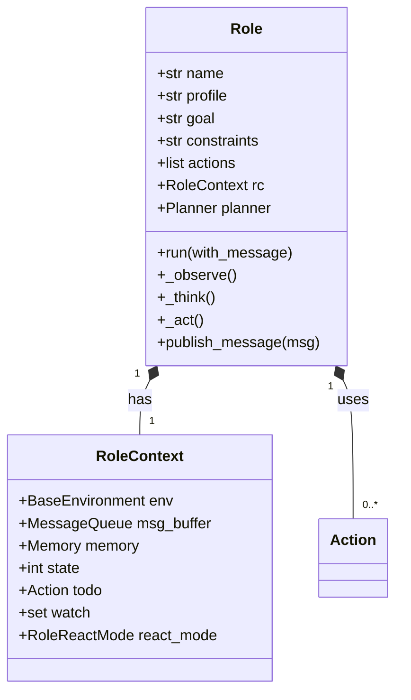

<!-- source: DeepWiki mcp.deepwiki.com · repo geekan/MetaGPT · page 2 Core Architecture · fetched 2026-10-26 -->

# Core Architecture

<details>
<summary>Relevant source files</summary>

The following files were used as context for generating this wiki page:

- [metagpt/actions/action.py](metagpt/actions/action.py)
- [metagpt/actions/design_api.py](metagpt/actions/design_api.py)
- [metagpt/actions/project_management.py](metagpt/actions/project_management.py)
- [metagpt/actions/summarize_code.py](metagpt/actions/summarize_code.py)
- [metagpt/actions/write_code.py](metagpt/actions/write_code.py)
- [metagpt/actions/write_code_review.py](metagpt/actions/write_code_review.py)
- [metagpt/actions/write_prd.py](metagpt/actions/write_prd.py)
- [metagpt/const.py](metagpt/const.py)
- [metagpt/environment/api/__init__.py](metagpt/environment/api/__init__.py)
- [metagpt/environment/api/env_api.py](metagpt/environment/api/env_api.py)
- [metagpt/environment/base_env.py](metagpt/environment/base_env.py)
- [metagpt/roles/engineer.py](metagpt/roles/engineer.py)
- [metagpt/roles/qa_engineer.py](metagpt/roles/qa_engineer.py)
- [metagpt/roles/role.py](metagpt/roles/role.py)
- [metagpt/schema.py](metagpt/schema.py)
- [metagpt/team.py](metagpt/team.py)
- [tests/metagpt/environment/android_env/__init__.py](tests/metagpt/environment/android_env/__init__.py)
- [tests/metagpt/environment/test_base_env.py](tests/metagpt/environment/test_base_env.py)

</details>


This document explains the fundamental architecture of MetaGPT, including its roles, actions, messages, and overall system design. It provides a technical overview of how MetaGPT implements a multi-agent framework for collaborative problem-solving based on Standard Operating Procedures (SOPs).

## High-Level Architecture Overview

MetaGPT follows a role-based architecture where specialized agents (`Role`) collaborate through message passing (`Message`) within a shared environment (`Environment`). The system relies on a flexible action framework, memory systems, and a `Team` class to orchestrate the software development lifecycle (SDLC).

```mermaid
graph TD
    subgraph "Core Components"
        [RoleSystem] -->|uses| [MemorySystem]
        [RoleSystem] -->|executes| [ActionFramework]
        [RoleSystem] -->|sends/receives| [MessageSystem]
        [Environment] -->|routes| [MessageSystem]
        [Environment] -->|contains| [RoleSystem]
        [Team] -->|manages| [Environment]
        [Team] -->|orchestrates| [RoleSystem]
        [ActionFramework] -->|generates| [MessageSystem]
    end
```

Sources:
- [metagpt/roles/role.py:125-153]()
- [metagpt/schema.py:232-240]()
- [metagpt/actions/action.py:29-38]()
- [metagpt/team.py:32-43]()

## Role System

The `Role` class [metagpt/roles/role.py:125]() serves as the foundation of MetaGPT's agent architecture. Roles are autonomous agents defined by a `profile`, `goal`, and `constraints`. They maintain a `RoleContext` [metagpt/roles/role.py:92]() which manages their private message buffer, memory, and current state.

For details, see [Role System](#2.1).

### Role Structure



Sources:
- [metagpt/roles/role.py:125-153]()
- [metagpt/roles/role.py:92-114]()

### Role Lifecycle

Roles follow an observe-think-act cycle driven by the `_react` method [metagpt/roles/role.py:454-470](). The `RoleReactMode` [metagpt/roles/role.py:82]() determines if the agent selects actions dynamically (`REACT`), follows a fixed sequence (`BY_ORDER`), or uses a `Planner` (`PLAN_AND_ACT`).

1. **`_observe()`**: Pulls messages from the `msg_buffer` [metagpt/roles/role.py:399-428]().
2. **`_think()`**: Determines the next `Action` to perform, updating `rc.todo` [metagpt/roles/role.py:340-379]().
3. **`_act()`**: Executes the `Action` and returns a `Message` [metagpt/roles/role.py:381-397]().

Sources:
- [metagpt/roles/role.py:82-86]()
- [metagpt/roles/role.py:340-428]()

## Message Passing System

Messages are the primary communication medium. The `Message` class [metagpt/schema.py:232]() includes metadata for routing: `send_to`, `sent_from`, and `cause_by`.

For details, see [Message Passing System](#2.2).

### Message Routing

Messages are published to the `Environment` via `publish_message` [metagpt/roles/role.py:429](), which then routes them to the `msg_buffer` of subscriber roles based on their `watch` list [metagpt/roles/role.py:108]().

Key routing constants in [metagpt/const.py:77-83]():
- `MESSAGE_ROUTE_TO_ALL`: Broadcast to all roles.
- `MESSAGE_ROUTE_TO_SELF`: Internal feedback loop for a role.

Sources:
- [metagpt/schema.py:232-260]()
- [metagpt/roles/role.py:429-453]()
- [metagpt/const.py:77-83]()

## Action Framework

Actions define the atomic capabilities of agents. The `Action` base class [metagpt/actions/action.py:29]() handles LLM interactions via `_aask` [metagpt/actions/action.py:99]().

For details, see [Action Framework](#2.3).

### SDLC Actions

MetaGPT implements specific actions for the software development lifecycle:
- `WritePRD`: Generates requirements [metagpt/actions/write_prd.py:76]().
- `WriteDesign`: Creates system architecture and API designs [metagpt/actions/design_api.py:53]().
- `WriteTasks`: Breaks designs into a Work Breakdown Structure (WBS) [metagpt/actions/project_management.py:46]().
- `WriteCode`: Produces the actual implementation [metagpt/actions/write_code.py:88]().

Sources:
- [metagpt/actions/action.py:29-114]()
- [metagpt/actions/write_prd.py:76-85]()
- [metagpt/actions/write_code.py:88-92]()

## Environment System

The `Environment` [metagpt/environment/base_env.py]() acts as a container for `Role` objects and manages the message bus. The `Team` class [metagpt/team.py:32]() initializes the environment (often using `MGXEnv` [metagpt/team.py:50]() for hierarchical routing) and drives the execution rounds.

For details, see [Environment System](#2.4).

### Software Development Workflow

The collaboration typically follows this sequence:

```mermaid
graph LR
    [UserRequirement] --> [ProductManager]
    [ProductManager] -->|WritePRD| [PRD_Doc]
    [PRD_Doc] --> [Architect]
    [Architect] -->|WriteDesign| [Design_Doc]
    [Design_Doc] --> [ProjectManager]
    [ProjectManager] -->|WriteTasks| [Tasks_Doc]
    [Tasks_Doc] --> [Engineer]
    [Engineer] -->|WriteCode| [SourceCode]
    [SourceCode] --> [QAEngineer]
    [QAEngineer] -->|WriteTest| [TestResults]
```

Sources:
- [metagpt/team.py:123-138]()
- [metagpt/roles/engineer.py:102-110]()
- [metagpt/roles/qa_engineer.py:52-60]()

## Key Components and Relationships

| Component | Code Entity | Responsibility |
|-----------|-------------|----------------|
| **Agent** | `Role` [metagpt/roles/role.py:125]() | Orchestrates actions based on goal/profile. |
| **Task** | `Action` [metagpt/actions/action.py:29]() | Performs specific logic (e.g., coding, designing). |
| **Data** | `Message` [metagpt/schema.py:232]() | Transfers information between agents. |
| **Bus** | `Environment` [metagpt/environment/base_env.py]() | Manages agent membership and message routing. |
| **Memory** | `Memory` [metagpt/memory/memory.py:20]() | Stores local history for context-aware reasoning. |
| **Orchestrator** | `Team` [metagpt/team.py:32]() | Bootstraps the environment and manages investment/rounds. |

Sources:
- [metagpt/roles/role.py]()
- [metagpt/schema.py]()
- [metagpt/team.py]()
- [metagpt/actions/action.py]()

---

