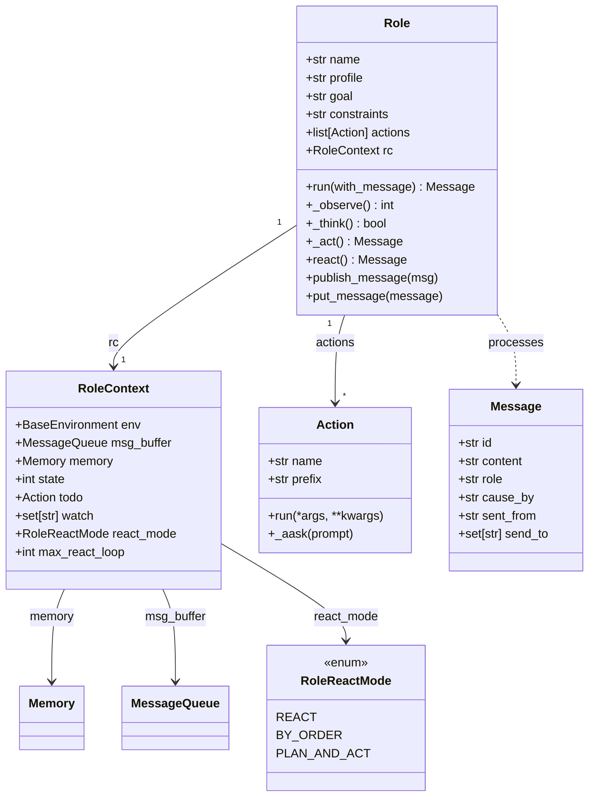
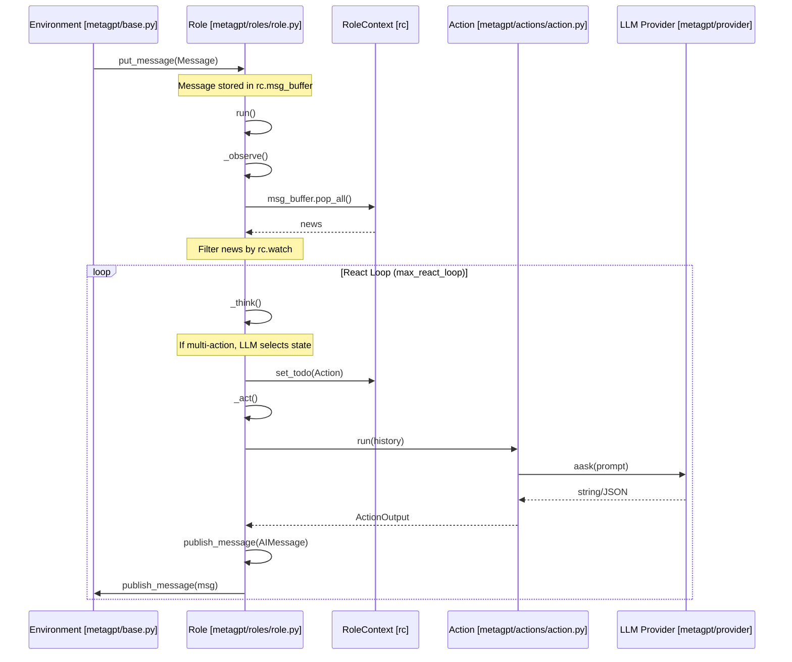

<!-- source: DeepWiki mcp.deepwiki.com · repo geekan/MetaGPT · page 2.1 Role System · fetched 2026-10-26 -->

# Role System

Relevant source files

The following files were used as context for generating this wiki page:

- [examples/di/atomization_capacity_plan.py](examples/di/atomization_capacity_plan.py)
- [examples/di/automated_planning_of_tasks.py](examples/di/automated_planning_of_tasks.py)
- [examples/di/data_analyst_write_code.py](examples/di/data_analyst_write_code.py)
- [examples/di/interacting_with_human.py](examples/di/interacting_with_human.py)
- [examples/use_off_the_shelf_agent.py](examples/use_off_the_shelf_agent.py)
- [examples/write_design.py](examples/write_design.py)
- [examples/write_game_code.py](examples/write_game_code.py)
- [metagpt/actions/action.py](metagpt/actions/action.py)
- [metagpt/actions/design_api.py](metagpt/actions/design_api.py)
- [metagpt/actions/project_management.py](metagpt/actions/project_management.py)
- [metagpt/actions/summarize_code.py](metagpt/actions/summarize_code.py)
- [metagpt/actions/write_code.py](metagpt/actions/write_code.py)
- [metagpt/actions/write_code_review.py](metagpt/actions/write_code_review.py)
- [metagpt/actions/write_prd.py](metagpt/actions/write_prd.py)
- [metagpt/const.py](metagpt/const.py)
- [metagpt/roles/architect.py](metagpt/roles/architect.py)
- [metagpt/roles/engineer.py](metagpt/roles/engineer.py)
- [metagpt/roles/product_manager.py](metagpt/roles/product_manager.py)
- [metagpt/roles/project_manager.py](metagpt/roles/project_manager.py)
- [metagpt/roles/qa_engineer.py](metagpt/roles/qa_engineer.py)
- [metagpt/roles/role.py](metagpt/roles/role.py)
- [metagpt/schema.py](metagpt/schema.py)
- [tests/metagpt/actions/test_action.py](tests/metagpt/actions/test_action.py)
- [tests/metagpt/roles/test_architect.py](tests/metagpt/roles/test_architect.py)
- [tests/metagpt/roles/test_engineer.py](tests/metagpt/roles/test_engineer.py)
- [tests/metagpt/roles/test_role.py](tests/metagpt/roles/test_role.py)
- [tests/metagpt/test_environment.py](tests/metagpt/test_environment.py)
- [tests/metagpt/test_role.py](tests/metagpt/test_role.py)
- [tests/metagpt/test_schema.py](tests/metagpt/test_schema.py)
- [tests/metagpt/test_team.py](tests/metagpt/test_team.py)

The Role System in MetaGPT serves as the foundation for creating intelligent agents with specific capabilities, responsibilities, and behaviors. It provides the architecture for defining how agents perceive their environment, make decisions, and take actions, enabling collaborative problem-solving in multi-agent scenarios.

## Core Architecture

The Role System is built around the concept of agents as specialized entities with distinct responsibilities and capabilities. Each role is defined by its profile, goals, and constraints, and is equipped with specific actions it can perform.

### Role Entity Mapping
The following diagram bridges the conceptual "Role" to its implementation within the code structure.

Sources: [metagpt/roles/role.py:82-153](), [metagpt/schema.py:232-260](), [metagpt/actions/action.py:29-41]()

## Role Lifecycle

The lifecycle of a role follows an **Observe-Think-Act** pattern. This structured loop allows roles to process asynchronous messages, decide on transitions between internal states (actions), and execute those actions.

### Natural Language to Code Entity Space: Lifecycle
This diagram maps the logical stages of an agent's life to the specific function calls and data structures in the MetaGPT codebase.

Sources: [metagpt/roles/role.py:381-429](), [metagpt/roles/role.py:454-523](), [metagpt/roles/role.py:530-554]()

### Observation Phase
During `_observe()`, a role retrieves messages from its private `msg_buffer`. It filters messages where the `cause_by` attribute matches the role's `watch` list or the `send_to` attribute includes the role's name/address [metagpt/roles/role.py:398-429]().

### Thinking Phase
In `_think()`, the role determines the next `Action` to execute. 
- If `react_mode` is `BY_ORDER`, it iterates through the `actions` list sequentially [metagpt/roles/role.py:353-357]().
- If multiple actions exist and no plan is active, it uses `STATE_TEMPLATE` to ask the LLM for a state number corresponding to the next action index [metagpt/roles/role.py:54-69](), [metagpt/roles/role.py:359-379]().

### Acting Phase
In `_act()`, the role calls the `run()` method of the `todo` action. The output (often an `ActionOutput` or `ActionNode`) is wrapped into a `Message` object, added to the role's memory, and prepared for publishing [metagpt/roles/role.py:381-397]().

## Reaction Modes

The `RoleReactMode` enum defines how roles handle the think-act loop:

| Mode | Implementation Logic |
| :--- | :--- |
| `REACT` | A standard loop where the role thinks and acts up to `max_react_loop` times [metagpt/roles/role.py:83](). |
| `BY_ORDER` | Executes actions in the predefined order of the `actions` list [metagpt/roles/role.py:84](). |
| `PLAN_AND_ACT` | Uses a `Planner` to generate a list of tasks, then executes them sequentially, updating the plan based on results [metagpt/roles/role.py:85](), [metagpt/roles/role.py:472-496](). |

Sources: [metagpt/roles/role.py:82-89](), [metagpt/roles/role.py:353-357]()

## Specialized Built-in Roles

MetaGPT provides specialized roles that follow Software Development Life Cycle (SDLC) Standard Operating Procedures (SOPs).

### ProductManager
- **Profile**: "Product Manager"
- **Actions**: `WritePRD`
- **Watch**: `UserRequirement`, `PrepareDocuments`
- **Responsibility**: Translates user requirements into a formal Product Requirement Document (PRD) [metagpt/roles/product_manager.py:21-47]().

### Architect
- **Profile**: "Architect"
- **Actions**: `WriteDesign`
- **Watch**: `WritePRD`
- **Responsibility**: Designs system architecture, APIs, and data structures based on the PRD [metagpt/roles/architect.py:17-58]().

### Engineer
- **Profile**: "Engineer"
- **Actions**: `WriteCode`, `WriteCodeReview`
- **Watch**: `WriteTasks`, `SummarizeCode`, `WriteCodeReview`, `FixBug`
- **Logic**: Operates on a per-file basis. It iterates through tasks provided by the `WriteTasks` action, writing code for each file and optionally performing code reviews [metagpt/roles/engineer.py:73-109]().

### QaEngineer
- **Profile**: "QaEngineer"
- **Actions**: `WriteTest`, `RunCode`, `DebugError`
- **Watch**: `SummarizeCode`, `WriteTest`, `RunCode`, `DebugError`
- **Responsibility**: Generates unit tests for new code, executes them, and provides debug feedback if tests fail [metagpt/roles/qa_engineer.py:39-60]().

Sources: [metagpt/roles/product_manager.py:21-65](), [metagpt/roles/engineer.py:73-109](), [metagpt/roles/qa_engineer.py:39-60](), [metagpt/roles/architect.py:17-58]()

## Message Subscription and Routing

Roles use a subscription model to manage message flow.
- **`_watch(actions)`**: Registers the role to listen for messages produced by specific `Action` classes [metagpt/roles/role.py:284-288]().
- **`publish_message(msg)`**: Sends a message to the `Environment`. If `send_to` contains `<self>`, the message is routed back to the role's own buffer [metagpt/roles/role.py:429-446]().
- **`put_message(msg)`**: Directly places a message into the role's private `msg_buffer` [metagpt/roles/role.py:448-452]().

Sources: [metagpt/roles/role.py:284-292](), [metagpt/roles/role.py:429-452](), [metagpt/const.py:83]()

---

