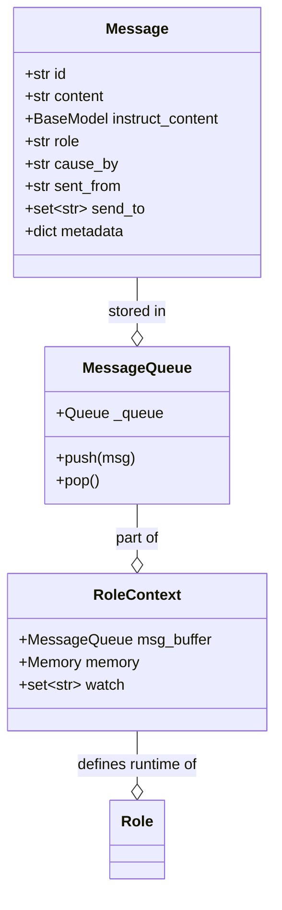
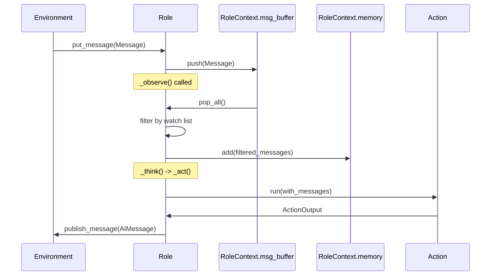

<!-- source: DeepWiki mcp.deepwiki.com · repo geekan/MetaGPT · page 2.2 Message Passing System · fetched 2026-10-26 -->

# Message Passing System

Relevant source files

The following files were used as context for generating this wiki page:

- [metagpt/actions/action.py](metagpt/actions/action.py)
- [metagpt/actions/action_output.py](metagpt/actions/action_output.py)
- [metagpt/actions/design_api.py](metagpt/actions/design_api.py)
- [metagpt/actions/project_management.py](metagpt/actions/project_management.py)
- [metagpt/actions/summarize_code.py](metagpt/actions/summarize_code.py)
- [metagpt/actions/write_code.py](metagpt/actions/write_code.py)
- [metagpt/actions/write_code_review.py](metagpt/actions/write_code_review.py)
- [metagpt/actions/write_prd.py](metagpt/actions/write_prd.py)
- [metagpt/const.py](metagpt/const.py)
- [metagpt/environment/api/__init__.py](metagpt/environment/api/__init__.py)
- [metagpt/environment/api/env_api.py](metagpt/environment/api/env_api.py)
- [metagpt/environment/base_env.py](metagpt/environment/base_env.py)
- [metagpt/memory/__init__.py](metagpt/memory/__init__.py)
- [metagpt/memory/memory.py](metagpt/memory/memory.py)
- [metagpt/roles/engineer.py](metagpt/roles/engineer.py)
- [metagpt/roles/qa_engineer.py](metagpt/roles/qa_engineer.py)
- [metagpt/roles/role.py](metagpt/roles/role.py)
- [metagpt/schema.py](metagpt/schema.py)
- [metagpt/utils/serialize.py](metagpt/utils/serialize.py)
- [tests/metagpt/actions/test_action.py](tests/metagpt/actions/test_action.py)
- [tests/metagpt/environment/android_env/__init__.py](tests/metagpt/environment/android_env/__init__.py)
- [tests/metagpt/environment/test_base_env.py](tests/metagpt/environment/test_base_env.py)
- [tests/metagpt/roles/test_role.py](tests/metagpt/roles/test_role.py)
- [tests/metagpt/test_environment.py](tests/metagpt/test_environment.py)
- [tests/metagpt/test_role.py](tests/metagpt/test_role.py)
- [tests/metagpt/test_schema.py](tests/metagpt/test_schema.py)
- [tests/metagpt/test_team.py](tests/metagpt/test_team.py)
- [tests/metagpt/utils/test_code_parser.py](tests/metagpt/utils/test_code_parser.py)
- [tests/metagpt/utils/test_output_parser.py](tests/metagpt/utils/test_output_parser.py)
- [tests/metagpt/utils/test_serialize.py](tests/metagpt/utils/test_serialize.py)

The Message Passing System is the core communication infrastructure that enables MetaGPT's multi-agent architecture. This system allows different roles (agents) to exchange information, coordinate actions, and collectively solve complex tasks through structured message exchanges. It relies on a subscription-based model where roles "watch" for specific actions or message tags to trigger their internal logic.

## Message Structure

Messages in MetaGPT are represented by the `Message` class, defined in `metagpt/schema.py` [metagpt/schema.py:232-232](). It serves as the fundamental unit of communication between agents.

### Entity Relationship: Natural Language to Code Space

This diagram maps the conceptual communication components to their specific implementation classes and attributes.

Title: Message Entity Mapping

Sources: [metagpt/schema.py:232-284](), [metagpt/schema.py:713-713](), [metagpt/roles/role.py:92-124]()

### Key Message Attributes

| Attribute | Type | Description |
|-----------|------|-------------|
| `id` | str | Unique identifier, defaults to a UUID [metagpt/schema.py:237-237](). |
| `content` | str | The primary text content of the message [metagpt/schema.py:233-233](). |
| `instruct_content` | Optional[BaseModel] | Structured data used for passing complex objects between actions [metagpt/schema.py:234-234](). |
| `role` | str | The role type of the sender (e.g., "user", "assistant") [metagpt/schema.py:235-235](). |
| `cause_by` | str | The class name of the `Action` that generated this message [metagpt/schema.py:238-238](). |
| `sent_from` | str | The name or profile of the role that sent the message [metagpt/schema.py:239-239](). |
| `send_to` | set[str] | Specific recipients. Defaults to `MESSAGE_ROUTE_TO_ALL` [metagpt/schema.py:240-241](). |

Sources: [metagpt/schema.py:232-284](), [metagpt/const.py:77-81]()

### Message Types
MetaGPT provides specialized message classes:
*   **`UserMessage`**: Represents input from the user [metagpt/schema.py:419-423]().
*   **`AIMessage`**: Represents output from an agent, including the agent's name in metadata [metagpt/schema.py:431-455]().

## Message Routing and Filtering

Messages are routed between roles and environments using metadata. The primary mechanism for a role to receive a message is the "subscription" or "watch" mechanism.

### Routing Constants
The system uses reserved strings to control delivery:
*   `MESSAGE_ROUTE_TO_ALL` (`"<all>"`): Broadcasts to every role in the environment [metagpt/const.py:81-81]().
*   `MESSAGE_ROUTE_TO_SELF` (`"<self>"`): Routes the message back to the sender's own buffer [metagpt/const.py:83-83]().
*   `MESSAGE_ROUTE_TO_NONE` (`"<none>"`): Explicitly stops further routing [metagpt/const.py:82-82]().

Sources: [metagpt/const.py:77-83](), [metagpt/roles/role.py:34-34]()

### The Subscription Mechanism
A `Role` determines which messages to process by defining a `watch` list. When a message's `cause_by` attribute matches a string in the role's `watch` set, the message is pulled from the environment into the role's private `msg_buffer` [metagpt/roles/role.py:108-108](), [metagpt/roles/role.py:284-291]().

Title: Message Flow from Environment to Action

Sources: [metagpt/roles/role.py:399-427](), [metagpt/roles/role.py:429-452](), [metagpt/roles/role.py:529-553]()

## Implementation Details

### Message Queue (`MessageQueue`)
The `MessageQueue` class wraps `asyncio.Queue` to provide non-blocking message handling within roles [metagpt/schema.py:713-715]().
*   `push(msg)`: Adds a message to the queue [metagpt/schema.py:730-732]().
*   `pop_all()`: Retrieves all pending messages in the buffer at once [metagpt/schema.py:721-728]().

### Role Observation Logic
The `Role._observe()` method is the gateway for incoming data. It performs the following steps:
1.  Calls `self.rc.msg_buffer.pop_all()` to get new messages [metagpt/roles/role.py:406-406]().
2.  Filters messages based on `self.rc.watch` (which contains `Action` class names as strings) [metagpt/roles/role.py:410-413]().
3.  Adds relevant messages to `self.rc.memory` [metagpt/roles/role.py:414-414]().
4.  Returns the new messages to trigger the `_think` process [metagpt/roles/role.py:427-427]().

Sources: [metagpt/roles/role.py:399-427](), [metagpt/schema.py:713-784]()

### Memory Integration
The `Memory` class in `metagpt/memory/memory.py` maintains a history of messages [metagpt/memory/memory.py:20-20](). It indexes messages by `cause_by` [metagpt/memory/memory.py:35-35](), allowing roles to quickly retrieve context related to specific actions using `get_by_actions` [metagpt/memory/memory.py:99-107]().

## Examples of Message Flow

### Engineer Observation
The `Engineer` role watches for several actions, including `WriteTasks` and `SummarizeCode` [metagpt/roles/engineer.py:106-106](). When an `Architect` publishes a message `cause_by` `WriteTasks`, the `Engineer`'s `_observe` method will identify it and move it to memory for the next `_act` cycle.

### Self-Routing for Iteration
In the `QaEngineer` role, after writing a test, it publishes a message to `MESSAGE_ROUTE_TO_SELF` [metagpt/roles/qa_engineer.py:100-100](). This ensures the `QaEngineer` immediately "observes" its own output to trigger the next logical step (e.g., `RunCode`) in the next loop of `react` [metagpt/roles/qa_engineer.py:59-59]().

Sources: [metagpt/roles/engineer.py:102-110](), [metagpt/roles/qa_engineer.py:99-101](), [metagpt/roles/role.py:34-34]()

## Serialization and Persistence
Messages support JSON serialization through the `SerializationMixin` [metagpt/schema.py:72-72]().
*   `dump()`: Converts the message to a dictionary/JSON [metagpt/schema.py:336-339]().
*   `load()`: Reconstructs a `Message` from serialized data [metagpt/schema.py:341-356]().

This is critical for the `Team` class to save and restore state during long-running software development cycles.

Sources: [metagpt/schema.py:72-131](), [metagpt/schema.py:336-356]()

---

