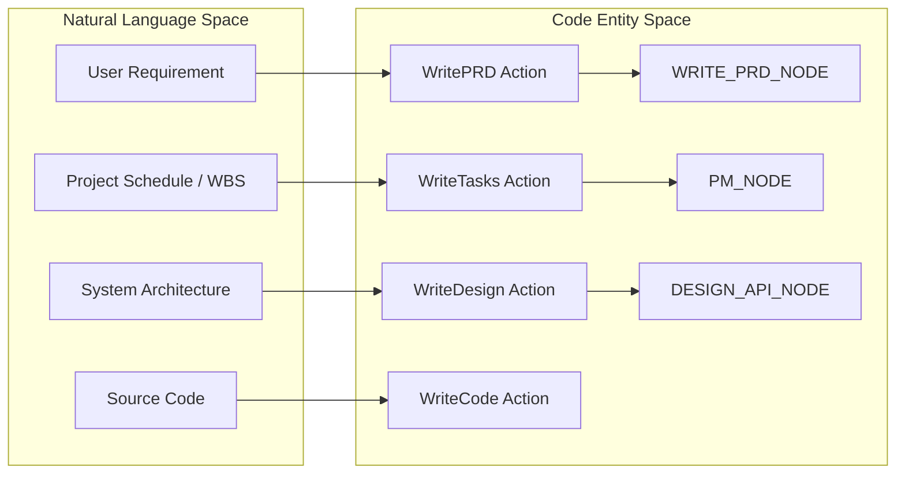
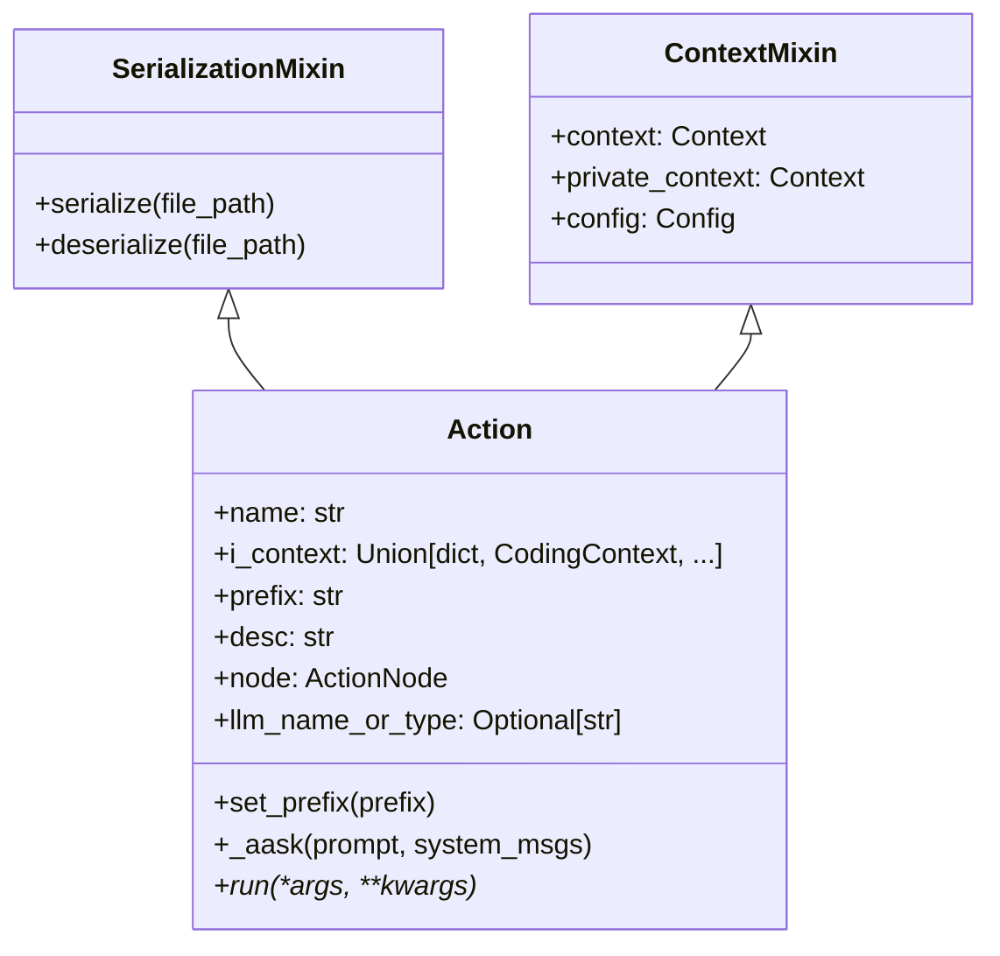
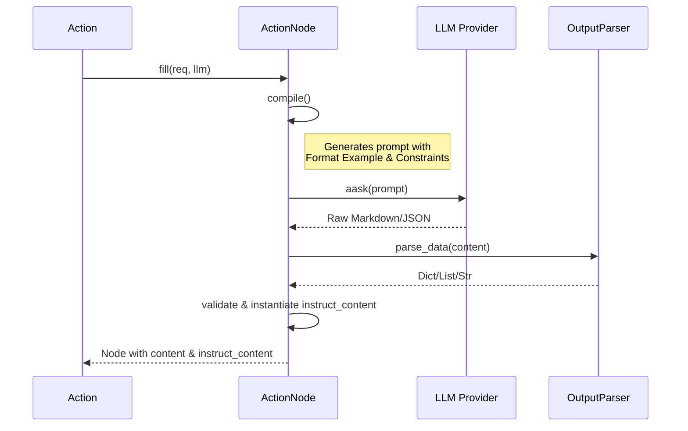
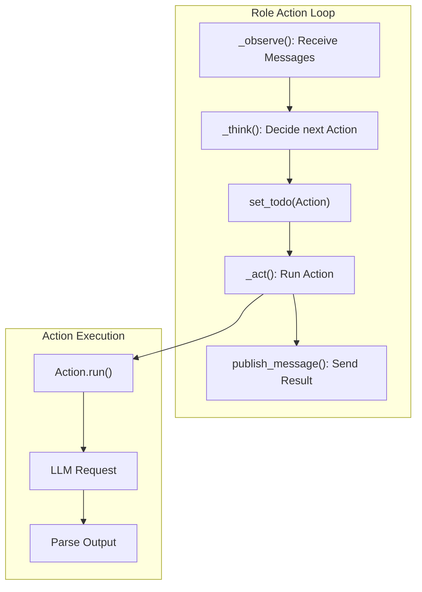

<!-- source: DeepWiki mcp.deepwiki.com · repo geekan/MetaGPT · page 2.3 Action Framework · fetched 2026-10-26 -->

# Action Framework

Relevant source files

The following files were used as context for generating this wiki page:

- [metagpt/actions/__init__.py](metagpt/actions/__init__.py)
- [metagpt/actions/action.py](metagpt/actions/action.py)
- [metagpt/actions/action_node.py](metagpt/actions/action_node.py)
- [metagpt/actions/debug_error.py](metagpt/actions/debug_error.py)
- [metagpt/actions/design_api.py](metagpt/actions/design_api.py)
- [metagpt/actions/design_api_an.py](metagpt/actions/design_api_an.py)
- [metagpt/actions/project_management.py](metagpt/actions/project_management.py)
- [metagpt/actions/project_management_an.py](metagpt/actions/project_management_an.py)
- [metagpt/actions/run_code.py](metagpt/actions/run_code.py)
- [metagpt/actions/summarize_code.py](metagpt/actions/summarize_code.py)
- [metagpt/actions/write_code.py](metagpt/actions/write_code.py)
- [metagpt/actions/write_code_review.py](metagpt/actions/write_code_review.py)
- [metagpt/actions/write_prd.py](metagpt/actions/write_prd.py)
- [metagpt/actions/write_prd_an.py](metagpt/actions/write_prd_an.py)
- [metagpt/actions/write_test.py](metagpt/actions/write_test.py)
- [metagpt/const.py](metagpt/const.py)
- [metagpt/roles/engineer.py](metagpt/roles/engineer.py)
- [metagpt/roles/qa_engineer.py](metagpt/roles/qa_engineer.py)
- [metagpt/roles/role.py](metagpt/roles/role.py)
- [metagpt/schema.py](metagpt/schema.py)
- [metagpt/tools/ut_writer.py](metagpt/tools/ut_writer.py)
- [metagpt/utils/common.py](metagpt/utils/common.py)
- [metagpt/utils/human_interaction.py](metagpt/utils/human_interaction.py)
- [tests/metagpt/actions/test_action_node.py](tests/metagpt/actions/test_action_node.py)
- [tests/metagpt/utils/test_common.py](tests/metagpt/utils/test_common.py)
- [tests/metagpt/utils/test_human_interaction.py](tests/metagpt/utils/test_human_interaction.py)

This section explains the Action Framework in MetaGPT, which defines how actions are structured, executed, and composed within the agent architecture. This framework enables roles (agents) to perform tasks through a structured approach to action definition and execution.

## Overview

The Action Framework provides a way to define executable units of work that can be performed by roles. It consists of two main components:

1.  **Action**: The base class for all executable actions [metagpt/actions/action.py:29-29]().
2.  **ActionNode**: A tree-structured system for complex actions with validation [metagpt/actions/action_node.py:135-135]().

Together, these components enable MetaGPT to create sophisticated, multi-step workflows with strong typing and validation.

### Natural Language to Code Entity Mapping

The following diagram bridges the gap between natural language descriptions of the SDLC and the corresponding code entities within the Action Framework.

**Sources:** [metagpt/actions/write_prd.py:76-76](), [metagpt/actions/design_api.py:53-53](), [metagpt/actions/project_management.py:46-46](), [metagpt/actions/write_code.py:88-88](), [metagpt/actions/write_prd_an.py:32-32](), [metagpt/actions/project_management_an.py:21-21](), [metagpt/actions/design_api_an.py:22-22]()

## The Action Base Class

The `Action` class serves as the foundation for all executable actions in MetaGPT. It inherits from `SerializationMixin` for state persistence and `ContextMixin` for dependency injection [metagpt/actions/action.py:29-29]().

**Sources:** [metagpt/actions/action.py:29-41](), [metagpt/schema.py:72-72](), [metagpt/context_mixin.py:15-15]()

Key features of the `Action` class:
*   **LLM Integration**: Actions use `self.llm.aask()` to interact with models [metagpt/actions/action.py:99-101]().
*   **ActionNode Hosting**: An action can wrap an `ActionNode` via the `node` attribute to delegate execution to a structured node tree [metagpt/actions/action.py:103-108]().
*   **Context Management**: Access to global configurations and shared resources via `self.context` [metagpt/actions/action.py:17-17]().

## The ActionNode System

`ActionNode` is a recursive data structure designed to transform unstructured LLM output into structured data [metagpt/actions/action_node.py:135-135](). It manages a tree of nodes where each node represents a specific field in the expected output.

### Structured Output Flow

The `fill` method is the core of `ActionNode` execution. It compiles instructions, sends them to the LLM, and parses the response into the `expected_type` [metagpt/actions/action_node.py:469-484]().

**Sources:** [metagpt/actions/action_node.py:469-500](), [metagpt/utils/common.py:73-73]()

### Composition and Templates
Nodes can be children of other nodes, allowing for complex schemas like a PRD [metagpt/actions/action_node.py:199-202](). The system uses templates like `SIMPLE_TEMPLATE` to guide the LLM [metagpt/actions/action_node.py:56-74]().

## SDLC Pipeline Actions

MetaGPT implements the standard software development lifecycle through specialized actions.

### WritePRD
Handles requirement analysis. It detects if a requirement is a new feature, a bugfix, or an update [metagpt/actions/write_prd.py:76-81]().
*   **Key Node**: `WRITE_PRD_NODE` contains children like `PROJECT_NAME`, `PRODUCT_GOALS`, and `USER_STORIES` [metagpt/actions/write_prd_an.py:210-294]().
*   **Incremental**: Uses `REFINED_PRD_NODE` for updates [metagpt/actions/write_prd.py:166-168]().

### WriteDesign
Translates PRD requirements into technical specifications [metagpt/actions/design_api.py:53-62]().
*   **Outputs**: Generates Mermaid diagrams for "Data structures and interfaces" and "Program call flow" [metagpt/actions/design_api_an.py:21-27]().
*   **File Storage**: Saves designs to `SYSTEM_DESIGN_FILE_REPO` [metagpt/actions/design_api.py:28-28]().

### WriteTasks
Performs project management by breaking down the design into a Work Breakdown Structure (WBS) [metagpt/actions/project_management.py:46-50]().
*   **Task List**: Produces a `TASK_LIST` or `REFINED_TASK_LIST` [metagpt/actions/project_management_an.py:32-33]().
*   **Dependencies**: Identifies `python_package_dependency` [metagpt/actions/project_management.py:122-122]().

### WriteCode
The final implementation step where an Engineer role writes the actual source code [metagpt/actions/write_code.py:88-92]().
*   **Context**: Takes `CodingContext` which includes design, tasks, and legacy code [metagpt/schema.py:756-764]().
*   **Validation**: Often followed by `WriteCodeReview` for quality assurance [metagpt/roles/engineer.py:128-137]().

## Action Execution in Roles

Roles manage the lifecycle of actions. The `Role._act()` method typically retrieves the `todo` action from `RoleContext` and calls its `run()` method [metagpt/roles/role.py:379-397]().

**Sources:** [metagpt/roles/role.py:340-340](), [metagpt/roles/role.py:356-356](), [metagpt/roles/role.py:379-379](), [metagpt/actions/action.py:110-114]()

### Example: Engineer Workflow
The `Engineer` role watches for `WriteTasks` or `SummarizeCode` messages [metagpt/roles/engineer.py:106-106](). Upon observation, it selects `WriteCode` to implement the tasks defined in the WBS [metagpt/roles/engineer.py:159-161]().

**Sources:** [metagpt/roles/role.py:125-125](), [metagpt/roles/engineer.py:73-73](), [metagpt/actions/action.py:29-29](), [metagpt/actions/action_node.py:135-135](), [metagpt/schema.py:232-232]()

---

