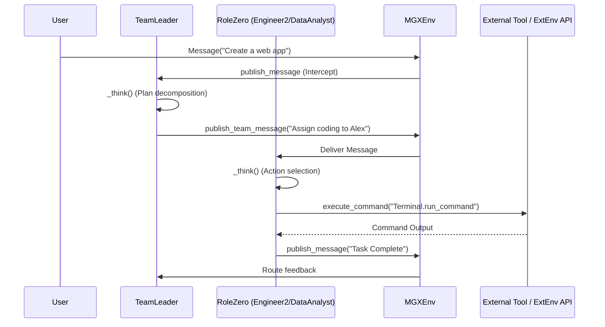

<!-- source: DeepWiki mcp.deepwiki.com · repo geekan/MetaGPT · page 2.4 Environment System · fetched 2026-10-26 -->

# Environment System

<details>
<summary>Relevant source files</summary>

The following files were used as context for generating this wiki page:

- [metagpt/base/__init__.py](metagpt/base/__init__.py)
- [metagpt/base/base_env.py](metagpt/base/base_env.py)
- [metagpt/base/base_env_space.py](metagpt/base/base_env_space.py)
- [metagpt/base/base_role.py](metagpt/base/base_role.py)
- [metagpt/base/base_serialization.py](metagpt/base/base_serialization.py)
- [metagpt/environment/android/android_ext_env.py](metagpt/environment/android/android_ext_env.py)
- [metagpt/environment/android/grounding_dino_config.py](metagpt/environment/android/grounding_dino_config.py)
- [metagpt/environment/android/text_icon_localization.py](metagpt/environment/android/text_icon_localization.py)
- [metagpt/environment/api/__init__.py](metagpt/environment/api/__init__.py)
- [metagpt/environment/api/env_api.py](metagpt/environment/api/env_api.py)
- [metagpt/environment/base_env.py](metagpt/environment/base_env.py)
- [metagpt/environment/mgx/mgx_env.py](metagpt/environment/mgx/mgx_env.py)
- [metagpt/environment/minecraft/minecraft_env.py](metagpt/environment/minecraft/minecraft_env.py)
- [metagpt/environment/minecraft/minecraft_ext_env.py](metagpt/environment/minecraft/minecraft_ext_env.py)
- [metagpt/environment/stanford_town/env_space.py](metagpt/environment/stanford_town/env_space.py)
- [metagpt/environment/werewolf/const.py](metagpt/environment/werewolf/const.py)
- [metagpt/environment/werewolf/werewolf_env.py](metagpt/environment/werewolf/werewolf_env.py)
- [metagpt/environment/werewolf/werewolf_ext_env.py](metagpt/environment/werewolf/werewolf_ext_env.py)
- [metagpt/ext/stanford_town/roles/st_role.py](metagpt/ext/stanford_town/roles/st_role.py)
- [metagpt/ext/stanford_town/utils/utils.py](metagpt/ext/stanford_town/utils/utils.py)
- [metagpt/ext/werewolf/actions/common_actions.py](metagpt/ext/werewolf/actions/common_actions.py)
- [metagpt/ext/werewolf/actions/moderator_actions.py](metagpt/ext/werewolf/actions/moderator_actions.py)
- [metagpt/ext/werewolf/roles/base_player.py](metagpt/ext/werewolf/roles/base_player.py)
- [metagpt/ext/werewolf/roles/human_player.py](metagpt/ext/werewolf/roles/human_player.py)
- [metagpt/ext/werewolf/roles/moderator.py](metagpt/ext/werewolf/roles/moderator.py)
- [metagpt/ext/werewolf/roles/werewolf.py](metagpt/ext/werewolf/roles/werewolf.py)
- [metagpt/ext/werewolf/roles/witch.py](metagpt/ext/werewolf/roles/witch.py)
- [metagpt/ext/werewolf/schema.py](metagpt/ext/werewolf/schema.py)
- [metagpt/ext/werewolf/werewolf_game.py](metagpt/ext/werewolf/werewolf_game.py)
- [metagpt/prompts/di/data_analyst.py](metagpt/prompts/di/data_analyst.py)
- [metagpt/prompts/di/engineer2.py](metagpt/prompts/di/engineer2.py)
- [metagpt/prompts/di/role_zero.py](metagpt/prompts/di/role_zero.py)
- [metagpt/prompts/di/team_leader.py](metagpt/prompts/di/team_leader.py)
- [metagpt/roles/di/data_analyst.py](metagpt/roles/di/data_analyst.py)
- [metagpt/roles/di/engineer2.py](metagpt/roles/di/engineer2.py)
- [metagpt/roles/di/role_zero.py](metagpt/roles/di/role_zero.py)
- [metagpt/roles/di/team_leader.py](metagpt/roles/di/team_leader.py)
- [metagpt/strategy/experience_retriever.py](metagpt/strategy/experience_retriever.py)
- [metagpt/strategy/thinking_command.py](metagpt/strategy/thinking_command.py)
- [tests/metagpt/environment/android_env/__init__.py](tests/metagpt/environment/android_env/__init__.py)
- [tests/metagpt/environment/mgx_env/run_mgx_env.py](tests/metagpt/environment/mgx_env/run_mgx_env.py)
- [tests/metagpt/environment/test_base_env.py](tests/metagpt/environment/test_base_env.py)
- [tests/metagpt/environment/werewolf_env/test_werewolf_ext_env.py](tests/metagpt/environment/werewolf_env/test_werewolf_ext_env.py)
- [tests/metagpt/roles/di/run_engineer2.py](tests/metagpt/roles/di/run_engineer2.py)

</details>


The Environment System in MetaGPT provides the shared space where `Role` entities interact, exchange messages, and interface with external simulations. It evolves from a simple message bus into a complex hierarchical routing and simulation engine capable of supporting diverse domains like software engineering, data science, and interactive games.

## Core Abstractions

The environment architecture is built on two primary base classes: `ExtEnv` and `Environment`.

### ExtEnv
`ExtEnv` is the foundation for integrating MetaGPT with external game engines or platforms (e.g., Android, Minecraft). It defines the interface for standard RL-like interactions:
- **Action/Observation Spaces**: Uses `gymnasium.spaces` to define valid inputs and outputs [metagpt/environment/base_env.py:58-59]().
- **API Registry**: Provides decorators `@mark_as_readable` and `@mark_as_writeable` to expose specific environment functions as accessible APIs for agents [metagpt/environment/base_env.py:41-50]().
- **Lifecycle Methods**: Defines `reset`, `observe`, and `step` for controlling the simulation flow [metagpt/environment/base_env.py:106-121]().

### Environment
Inheriting from `ExtEnv`, the `Environment` class adds multi-agent coordination features:
- **Role Management**: Hosts a collection of `Role` objects via `add_role` and `add_roles` [metagpt/environment/base_env.py:156-174]().
- **Message Distribution**: Implements `publish_message` to route `Message` objects to intended recipients based on their `send_to` metadata [metagpt/environment/base_env.py:175-184]().

**Sources:** [metagpt/environment/base_env.py:29-149]()

---

## Hierarchical Routing: MGXEnv

`MGXEnv` (MetaGPT X Environment) is a specialized environment designed for multi-agent teams, such as those led by a `TeamLeader`. It introduces a hierarchical routing mechanism where a central coordinator manages the flow of information.

### Message Flow in MGXEnv
In `MGXEnv`, messages do not always broadcast to all members. Instead, they are routed through the `TeamLeader` (default name: "Mike") [metagpt/environment/mgx/mgx_env.py:28]().

1.  **Interception**: Every regular message published in the environment is automatically routed to the `TeamLeader` by adding the leader's name to the `send_to` field [metagpt/environment/mgx/mgx_env.py:57-58]().
2.  **Context Conversion**: The environment uses `move_message_info_to_content` to embed sender and recipient metadata directly into the message text. This ensures the LLM-based leader is aware of the conversation context despite API limitations [metagpt/environment/mgx/mgx_env.py:73-89]().
3.  **Direct Chat**: If a user initiates a direct chat with a specific role, the environment tracks this in `direct_chat_roles` to allow the role to respond directly without leader intervention [metagpt/environment/mgx/mgx_env.py:30-47]().

### MGX Message Routing Logic
| Condition | Routing Behavior |
| :--- | :--- |
| **User Direct Chat** | Message sent to specific role; role added to `direct_chat_roles` [metagpt/environment/mgx/mgx_env.py:30-38](). |
| **Leader Output** | If `publicer` is `TeamLeader`, the message is published to the environment for the specified recipients [metagpt/environment/mgx/mgx_env.py:48-53](). |
| **Standard Role Msg** | Sent to `TeamLeader` for processing and further assignment [metagpt/environment/mgx/mgx_env.py:55-58](). |

**Sources:** [metagpt/environment/mgx/mgx_env.py:11-90](), [metagpt/roles/di/team_leader.py:64-74]()

---

## The RoleZero Ecosystem

`RoleZero` is a dynamic agent class that operates within these environments, capable of planning and tool execution. Specialized roles like `Engineer2` and `DataAnalyst` extend `RoleZero` to perform domain-specific tasks.

### Code Entity Space: RoleZero Architecture
The following diagram illustrates how `RoleZero` and its derivatives interact with the environment and tools.

Title: RoleZero and MGXEnv Interaction Architecture
```mermaid
graph TD
    subgraph ["Environment Space (MGXEnv)"]
        Env["MGXEnv"]
        TL["TeamLeader (Mike)"]
    end

    subgraph ["Role Space (metagpt/roles/di/)"]
        RZ["RoleZero"]
        DA["DataAnalyst (David)"]
        E2["Engineer2 (Alex)"]
    end

    subgraph ["Execution Space"]
        Planner["Planner (metagpt/strategy/planner.py)"]
        Tools["ToolRegistry (metagpt/tools/tool_registry.py)"]
        NB["ExecuteNbCode (metagpt/actions/di/execute_nb_code.py)"]
    end

    Env -- "Routes to" --> TL
    TL -- "publish_team_message" --> RZ
    RZ -- "Inherits" --> DA
    RZ -- "Inherits" --> E2
    
    DA -- "write_and_exec_code" --> NB
    RZ -- "Uses" --> Planner
    RZ -- "Executes" --> Tools
    
    E2 -- "terminal.run_command" --> Tools
```
**Sources:** [metagpt/roles/di/role_zero.py:55-116](), [metagpt/roles/di/team_leader.py:23-40](), [metagpt/roles/di/data_analyst.py:26-60](), [metagpt/roles/di/engineer2.py:32-55]()

---

## Specialized Simulation Environments

MetaGPT provides several specialized environments that implement the `ExtEnv` interface for specific domains.

### 1. Android Environment (`AndroidExtEnv`)
Integrates with Android devices via ADB (Android Debug Bridge) [metagpt/environment/android/android_ext_env.py:46]().
- **Capabilities**: Captures screenshots, retrieves XML UI hierarchies, and performs system actions like `tap`, `longpress`, and `swipe` [metagpt/environment/android/android_ext_env.py:103-120]().
- **CV Integration**: Uses OCR (ResNet18) and GroundingDINO for icon and text localization on the screen [metagpt/environment/android/android_ext_env.py:36-43]().

### 2. Werewolf Environment (`WerewolfExtEnv`)
A game environment for the Werewolf social deduction game.
- **Role Interactions**: Manages game states (Day/Night) and specific role actions (e.g., Werewolf kill, Witch save) [metagpt/environment/werewolf/werewolf_env.py]().
- **Moderation**: A `Moderator` role coordinates the sequence of play through the environment [metagpt/ext/werewolf/roles/moderator.py]().

### 3. Minecraft & Stanford Town
- **Minecraft**: Interfaces with the game to allow agents to mine, craft, and explore using structured action spaces [metagpt/environment/minecraft/minecraft_ext_env.py]().
- **Stanford Town**: A simulation of "Generative Agents" in a town setting, focusing on social behaviors and memory-driven interactions [metagpt/ext/stanford_town/roles/st_role.py]().

---

## Data Flow: Action to Environment

The following diagram bridges the "Natural Language Space" (User Requirements) to the "Code Entity Space" (API Calls).

Title: Request to Environment Execution Flow

**Sources:** [metagpt/environment/mgx/mgx_env.py:24-62](), [metagpt/roles/di/role_zero.py:121-168](), [metagpt/roles/di/team_leader.py:75-86]()

---

