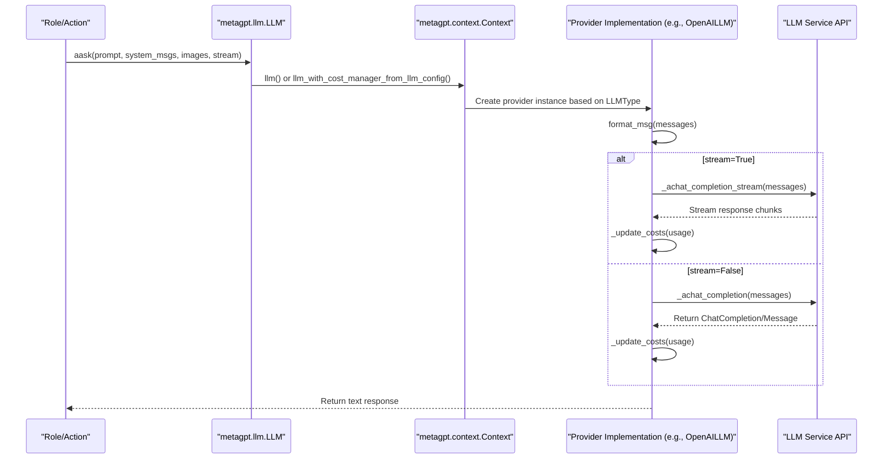

<!-- source: DeepWiki mcp.deepwiki.com · repo geekan/MetaGPT · page 3 LLM Integration · fetched 2026-10-26 -->

# LLM Integration

<details>
<summary>Relevant source files</summary>

The following files were used as context for generating this wiki page:

- [metagpt/configs/llm_config.py](metagpt/configs/llm_config.py)
- [metagpt/provider/__init__.py](metagpt/provider/__init__.py)
- [metagpt/provider/anthropic_api.py](metagpt/provider/anthropic_api.py)
- [metagpt/provider/base_llm.py](metagpt/provider/base_llm.py)
- [metagpt/provider/bedrock/base_provider.py](metagpt/provider/bedrock/base_provider.py)
- [metagpt/provider/bedrock/bedrock_provider.py](metagpt/provider/bedrock/bedrock_provider.py)
- [metagpt/provider/bedrock/utils.py](metagpt/provider/bedrock/utils.py)
- [metagpt/provider/bedrock_api.py](metagpt/provider/bedrock_api.py)
- [metagpt/provider/dashscope_api.py](metagpt/provider/dashscope_api.py)
- [metagpt/provider/human_provider.py](metagpt/provider/human_provider.py)
- [metagpt/provider/openai_api.py](metagpt/provider/openai_api.py)
- [metagpt/provider/qianfan_api.py](metagpt/provider/qianfan_api.py)
- [metagpt/utils/token_counter.py](metagpt/utils/token_counter.py)
- [tests/metagpt/provider/mock_llm_config.py](tests/metagpt/provider/mock_llm_config.py)
- [tests/metagpt/provider/req_resp_const.py](tests/metagpt/provider/req_resp_const.py)
- [tests/metagpt/provider/test_base_llm.py](tests/metagpt/provider/test_base_llm.py)
- [tests/metagpt/provider/test_bedrock_api.py](tests/metagpt/provider/test_bedrock_api.py)
- [tests/metagpt/provider/test_openai.py](tests/metagpt/provider/test_openai.py)
- [tests/metagpt/provider/test_qianfan_api.py](tests/metagpt/provider/test_qianfan_api.py)

</details>


This page explains how MetaGPT integrates with various Language Model providers, including the architecture, configuration options, and supported LLM services. It covers the underlying framework that enables communication with different AI models while maintaining a consistent interface for the rest of the system.

## Architecture Overview

MetaGPT employs a provider-based architecture centered around the `BaseLLM` abstract class, which defines a common interface that all LLM provider implementations must follow. This design allows the framework to easily switch between different LLM services while keeping the same API for higher-level components.

```mermaid
graph TD
    subgraph "Core Components"
        LLMFactory["metagpt.llm.LLM()"]
        BaseLLM["metagpt.provider.base_llm.BaseLLM"]
        LLMConfig["metagpt.configs.llm_config.LLMConfig"]
        TokenCounter["metagpt.utils.token_counter"]
        CostManager["metagpt.utils.cost_manager.CostManager"]
    end
    
    subgraph "Provider Implementations"
        OpenAILLM["metagpt.provider.openai_api.OpenAILLM"]
        AnthropicLLM["metagpt.provider.anthropic_api.AnthropicLLM"]
        BedrockLLM["metagpt.provider.bedrock_api.BedrockLLM"]
        GeminiLLM["metagpt.provider.google_gemini_api.GeminiLLM"]
        QianFanLLM["metagpt.provider.qianfan_api.QianFanLLM"]
        DashScopeLLM["metagpt.provider.dashscope_api.DashScopeLLM"]
    end
    
    subgraph "Framework Usage"
        Role["metagpt.roles.role.Role"]
        Action["metagpt.actions.action.Action"]
    end
    
    Role --"aask(prompt)"---> LLMFactory
    Action --"_aask(prompt)"---> LLMFactory
    
    LLMFactory --"creates"---> BaseLLM
    BaseLLM <|-- OpenAILLM
    BaseLLM <|-- AnthropicLLM
    BaseLLM <|-- BedrockLLM
    BaseLLM <|-- GeminiLLM
    BaseLLM <|-- QianFanLLM
    BaseLLM <|-- DashScopeLLM
    
    LLMConfig --"configures"---> BaseLLM
    CostManager --"tracks costs for"---> BaseLLM
```

Sources: [metagpt/provider/base_llm.py:35-49](), [metagpt/configs/llm_config.py:52-115](), [metagpt/provider/openai_api.py:58-65]()

## Provider Registration and Selection

MetaGPT uses a registry pattern to manage LLM providers. Each provider implementation is registered with its supported LLM types using the `@register_provider` decorator [metagpt/provider/openai_api.py:43-57](). When an LLM is requested, the system selects the appropriate provider based on the `LLMType` defined in the configuration [metagpt/configs/llm_config.py:19-46]().



Sources: [metagpt/provider/openai_api.py:43-56](), [metagpt/provider/base_llm.py:94-116](), [metagpt/provider/base_llm.py:124-140]()

## BaseLLM Interface

The `BaseLLM` abstract base class [metagpt/provider/base_llm.py:35]() defines the common interface that all provider implementations must implement. It provides utility methods for message formatting, cost updating, and multimodal support.

| Method | Description |
|--------|-------------|
| `aask()` | Main method to request completions from an LLM [metagpt/provider/base_llm.py:179]() |
| `acompletion()` | Get raw completion object from the LLM [metagpt/provider/openai_api.py:162]() |
| `acompletion_text()` | Get text completion from the LLM [metagpt/provider/openai_api.py:172]() |
| `_achat_completion()` | Provider-specific implementation for chat completions [metagpt/provider/openai_api.py:156]() |
| `_achat_completion_stream()` | Provider-specific implementation for streaming [metagpt/provider/openai_api.py:92]() |

Sources: [metagpt/provider/base_llm.py:35-411]()

## LLM Configuration

The `LLMConfig` class [metagpt/configs/llm_config.py:52]() provides a flexible way to configure various aspects of LLM interactions, including API keys, model types, and cost control settings.

- **LLMType**: An Enum defining supported providers like `OPENAI`, `ANTHROPIC`, `BEDROCK`, `GEMINI`, etc. [metagpt/configs/llm_config.py:19-46]()
- **CompressType**: Defines strategies for message compression when nearing context limits [metagpt/configs/llm_config.py:107]().

Sources: [metagpt/configs/llm_config.py:9-135]()

## Supported LLM Providers

MetaGPT supports a wide range of LLM providers. For detailed implementation details, see the child pages:

- **OpenAI Integration**: Covers GPT-4o, GPT-4, and O1 series models, including tool calling and image generation. For details, see [OpenAI Integration](#3.1).
- **Alternative LLM Providers**: Explains support for Claude (Anthropic), AWS Bedrock, Google Gemini, and various local or domestic providers like Ollama and ZhiPuAI. For details, see [Alternative LLM Providers](#3.2).

Sources: [metagpt/provider/__init__.py:9-22](), [metagpt/provider/openai_api.py:43-56]()

## Token Management and Cost Tracking

MetaGPT includes a comprehensive system for tracking token usage and costs across different providers and models.

- **Token Counting**: The `metagpt.utils.token_counter` module provides utilities like `count_message_tokens` to estimate usage before sending requests [metagpt/utils/token_counter.py:37]().
- **Cost Tracking**: The `CostManager` class calculates monetary expenditure based on `TOKEN_COSTS` [metagpt/utils/token_counter.py:18-115]().
- **Message Compression**: When context limits are reached, `BaseLLM.compress_messages` can truncate or discard history based on the configured `CompressType` [metagpt/provider/base_llm.py:338-410]().

For details, see [Token Management and Cost Tracking](#3.3).

Sources: [metagpt/utils/token_counter.py:18-115](), [metagpt/provider/base_llm.py:124-140](), [metagpt/provider/base_llm.py:338-410]()

## Advanced Capabilities

### Multimodal and Reasoning
MetaGPT supports advanced model features:
- **Image Input**: Handled via `_user_msg_with_imgs` for models supporting multimodal input [metagpt/provider/base_llm.py:71-83]().
- **Reasoning Mode**: Support for "thinking" tokens in models like DeepSeek or Anthropic Claude 3.7, tracked via `reasoning_content` [metagpt/provider/base_llm.py:52-59](), [metagpt/provider/anthropic_api.py:44-50]().

### Resilience
The framework uses the `tenacity` library to implement retries with exponential backoff for handling API connection errors [metagpt/provider/openai_api.py:165-171]().

Sources: [metagpt/provider/base_llm.py:52-59](), [metagpt/provider/openai_api.py:165-171](), [metagpt/provider/anthropic_api.py:36-38]()

---

