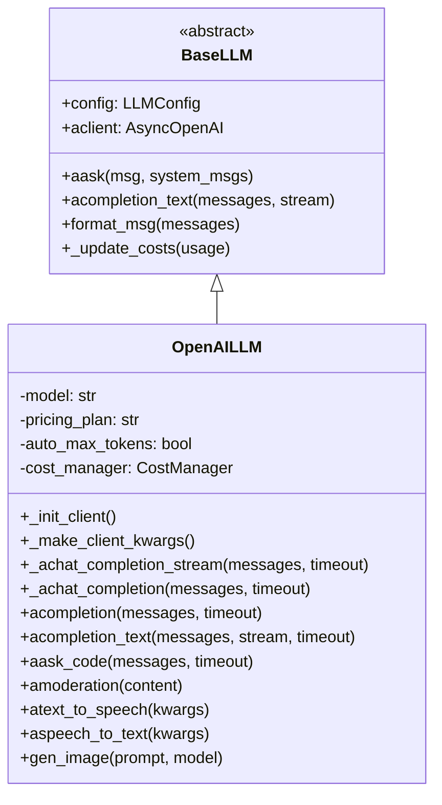
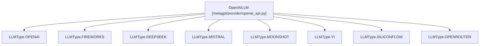
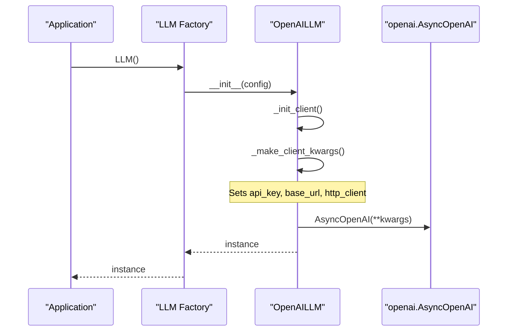

<!-- source: DeepWiki mcp.deepwiki.com · repo geekan/MetaGPT · page 3.1 OpenAI Integration · fetched 2026-10-26 -->

# OpenAI Integration

<details>
<summary>Relevant source files</summary>

The following files were used as context for generating this wiki page:

- [examples/hello_world.py](examples/hello_world.py)
- [examples/ping.py](examples/ping.py)
- [metagpt/provider/base_llm.py](metagpt/provider/base_llm.py)
- [metagpt/provider/dashscope_api.py](metagpt/provider/dashscope_api.py)
- [metagpt/provider/human_provider.py](metagpt/provider/human_provider.py)
- [metagpt/provider/metagpt_api.py](metagpt/provider/metagpt_api.py)
- [metagpt/provider/openai_api.py](metagpt/provider/openai_api.py)
- [metagpt/provider/qianfan_api.py](metagpt/provider/qianfan_api.py)
- [metagpt/utils/cost_manager.py](metagpt/utils/cost_manager.py)
- [tests/metagpt/provider/mock_llm_config.py](tests/metagpt/provider/mock_llm_config.py)
- [tests/metagpt/provider/test_base_llm.py](tests/metagpt/provider/test_base_llm.py)
- [tests/metagpt/provider/test_openai.py](tests/metagpt/provider/test_openai.py)

</details>


This document explains how MetaGPT integrates with OpenAI's API services, including the implementation details of the `OpenAILLM` class, connection handling, request processing, and resilience mechanisms.

## Architecture Overview

The OpenAI integration in MetaGPT is primarily implemented through the `OpenAILLM` class, which inherits from the `BaseLLM` abstract class. This class provides a comprehensive interface to OpenAI's API services while handling authentication, request formatting, response processing, and error management.



Sources: [metagpt/provider/openai_api.py:58-66](), [metagpt/provider/base_llm.py:35-50]()

## Provider Registration and Compatibility

The `OpenAILLM` class is registered as the implementation for multiple LLM providers that use OpenAI-compatible APIs, allowing MetaGPT to treat these services uniformly.



Sources: [metagpt/provider/openai_api.py:43-57]()

## Initialization and Configuration

The `OpenAILLM` is initialized with a `LLMConfig` object. It uses the `_init_client` method to instantiate the `AsyncOpenAI` client, supporting proxy configurations via `AsyncHttpxClientWrapper`.



Sources: [metagpt/provider/openai_api.py:61-81](), [metagpt/provider/base_llm.py:43-44]()

### Configuration Options

| Parameter | Description | Source |
|-----------|-------------|--------|
| `api_key` | OpenAI API key | [metagpt/provider/openai_api.py:75]() |
| `base_url` | API base URL for the provider | [metagpt/provider/openai_api.py:75]() |
| `model` | The specific model identifier (e.g., gpt-4o) | [metagpt/provider/openai_api.py:69]() |
| `proxy` | Proxy URL for HTTP client | [metagpt/provider/openai_api.py:85-90]() |
| `pricing_plan` | Used for cost calculation if different from model | [metagpt/provider/openai_api.py:70]() |

## Core Request Handling

### Streaming and Reasoning
MetaGPT supports streaming responses via `_achat_completion_stream`. It handles specific metadata like `reasoning_content` (used by models like DeepSeek) and ensures usage statistics are captured even when providers return them in different chunk attributes.

```python
async for chunk in response:
    choice0 = chunk.choices[0]
    choice_delta = choice0.delta
    if hasattr(choice_delta, "reasoning_content") and choice_delta.reasoning_content:
        collected_reasoning_messages.append(choice_delta.reasoning_content)
        continue
    # ... handle content chunks ...
```

Sources: [metagpt/provider/openai_api.py:92-136]()

### Resilience and Retries
To handle transient network issues or API failures, MetaGPT uses `tenacity` to implement exponential backoff retries for text completion requests.

```python
@retry(
    wait=wait_random_exponential(min=1, max=60),
    stop=stop_after_attempt(6),
    retry=retry_if_exception_type(APIConnectionError),
    retry_error_callback=log_and_reraise,
)
async def acompletion_text(self, messages: list[dict], stream=False, timeout=USE_CONFIG_TIMEOUT) -> str:
    # ... implementation ...
```

Sources: [metagpt/provider/openai_api.py:165-172]()

## Specialized Capabilities

### Function/Tool Calling
The `aask_code` and `_achat_completion_function` methods leverage OpenAI's tool-calling capabilities. MetaGPT provides a `GENERAL_FUNCTION_SCHEMA` to prompt the model to return structured code blocks.

Sources: [metagpt/provider/openai_api.py:188-202](), [metagpt/provider/openai_api.py:228-262]()

### Multimodal Support
The base class `BaseLLM` includes logic to detect multimodal models via `MULTI_MODAL_MODELS` and formats messages to include `image_url` payloads when images are provided in the `Message` metadata.

Sources: [metagpt/provider/base_llm.py:65-83](), [metagpt/provider/base_llm.py:91-92]()

### Image, Speech, and Moderation
MetaGPT exposes OpenAI's auxiliary endpoints:
- **Image Generation**: `gen_image` calls `self.aclient.images.generate`. [metagpt/provider/openai_api.py:301-320]()
- **Text-to-Speech**: `atext_to_speech` calls `self.aclient.audio.speech.create`. [metagpt/provider/openai_api.py:293-295]()
- **Speech-to-Text**: `aspeech_to_text` calls `self.aclient.audio.transcriptions.create`. [metagpt/provider/openai_api.py:297-299]()
- **Moderation**: `amoderation` calls `self.aclient.moderations.create`. [metagpt/provider/openai_api.py:288-291]()

## Token Management and Cost Tracking

`OpenAILLM` tracks costs by calculating token usage per request. If the API response doesn't provide usage, it estimates it using `count_message_tokens` and `count_output_tokens`.

```python
def _update_costs(self, usage: Union[dict, BaseModel], model: str = None, local_calc_usage: bool = True):
    # ... updates cost_manager ...
    if calc_usage and self.cost_manager and usage:
        self.cost_manager.update_cost(prompt_tokens, completion_tokens, model)
```

Sources: [metagpt/provider/base_llm.py:124-141](), [metagpt/provider/openai_api.py:268-286](), [metagpt/utils/cost_manager.py:35-61]()

## Usage Example

```python
from metagpt.llm import LLM

async def main():
    llm = LLM() # Defaults to OpenAILLM if configured
    
    # Standard question
    response = await llm.aask("What is the SOP for software development?")
    
    # Structured code request
    code_response = await llm.aask_code([{"role": "user", "content": "Write a fast sort in Python"}])
    # Returns {'code': '...', 'language': 'python'}
```

Sources: [examples/hello_world.py:14-20](), [metagpt/provider/openai_api.py:188-202]()

---

