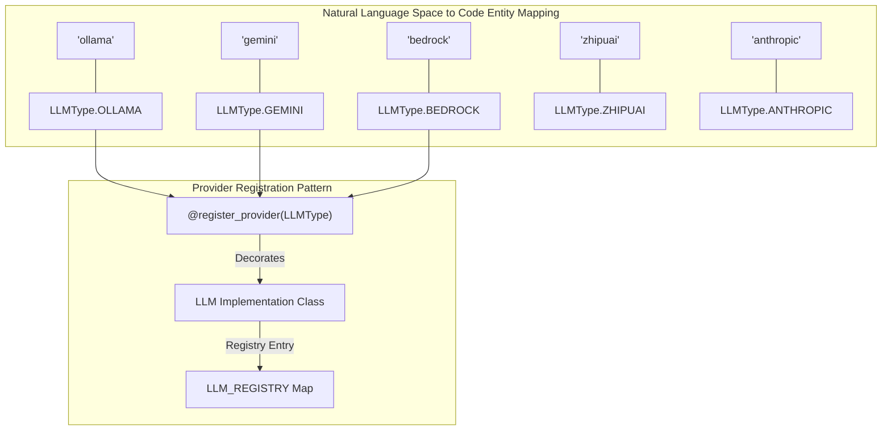
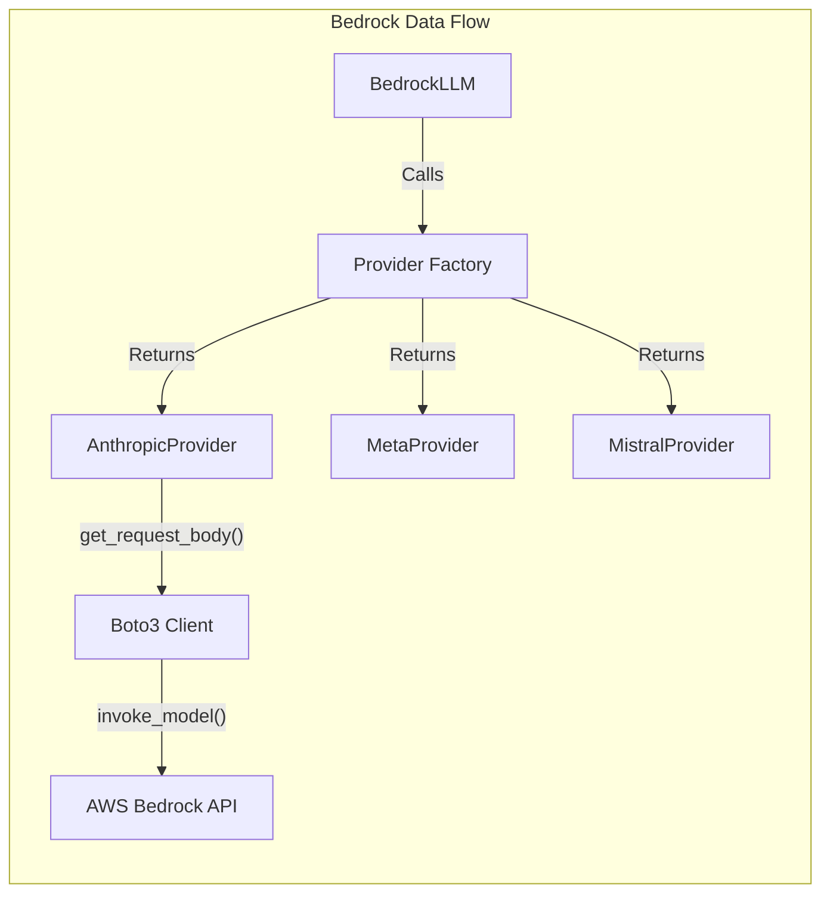

<!-- source: DeepWiki mcp.deepwiki.com · repo geekan/MetaGPT · page 3.2 Alternative LLM Providers · fetched 2026-10-26 -->

# Alternative LLM Providers

<details>
<summary>Relevant source files</summary>

The following files were used as context for generating this wiki page:

- [examples/llm_vision.py](examples/llm_vision.py)
- [metagpt/configs/llm_config.py](metagpt/configs/llm_config.py)
- [metagpt/provider/__init__.py](metagpt/provider/__init__.py)
- [metagpt/provider/anthropic_api.py](metagpt/provider/anthropic_api.py)
- [metagpt/provider/base_llm.py](metagpt/provider/base_llm.py)
- [metagpt/provider/bedrock/base_provider.py](metagpt/provider/bedrock/base_provider.py)
- [metagpt/provider/bedrock/bedrock_provider.py](metagpt/provider/bedrock/bedrock_provider.py)
- [metagpt/provider/bedrock/utils.py](metagpt/provider/bedrock/utils.py)
- [metagpt/provider/bedrock_api.py](metagpt/provider/bedrock_api.py)
- [metagpt/provider/dashscope_api.py](metagpt/provider/dashscope_api.py)
- [metagpt/provider/general_api_base.py](metagpt/provider/general_api_base.py)
- [metagpt/provider/general_api_requestor.py](metagpt/provider/general_api_requestor.py)
- [metagpt/provider/google_gemini_api.py](metagpt/provider/google_gemini_api.py)
- [metagpt/provider/human_provider.py](metagpt/provider/human_provider.py)
- [metagpt/provider/ollama_api.py](metagpt/provider/ollama_api.py)
- [metagpt/provider/openai_api.py](metagpt/provider/openai_api.py)
- [metagpt/provider/qianfan_api.py](metagpt/provider/qianfan_api.py)
- [metagpt/provider/spark_api.py](metagpt/provider/spark_api.py)
- [metagpt/provider/zhipuai/async_sse_client.py](metagpt/provider/zhipuai/async_sse_client.py)
- [metagpt/provider/zhipuai/zhipu_model_api.py](metagpt/provider/zhipuai/zhipu_model_api.py)
- [metagpt/provider/zhipuai_api.py](metagpt/provider/zhipuai_api.py)
- [metagpt/utils/token_counter.py](metagpt/utils/token_counter.py)
- [tests/metagpt/provider/mock_llm_config.py](tests/metagpt/provider/mock_llm_config.py)
- [tests/metagpt/provider/req_resp_const.py](tests/metagpt/provider/req_resp_const.py)
- [tests/metagpt/provider/test_anthropic_api.py](tests/metagpt/provider/test_anthropic_api.py)
- [tests/metagpt/provider/test_base_llm.py](tests/metagpt/provider/test_base_llm.py)
- [tests/metagpt/provider/test_bedrock_api.py](tests/metagpt/provider/test_bedrock_api.py)
- [tests/metagpt/provider/test_google_gemini_api.py](tests/metagpt/provider/test_google_gemini_api.py)
- [tests/metagpt/provider/test_ollama_api.py](tests/metagpt/provider/test_ollama_api.py)
- [tests/metagpt/provider/test_openai.py](tests/metagpt/provider/test_openai.py)
- [tests/metagpt/provider/test_qianfan_api.py](tests/metagpt/provider/test_qianfan_api.py)
- [tests/metagpt/provider/test_spark_api.py](tests/metagpt/provider/test_spark_api.py)
- [tests/metagpt/provider/test_zhipuai_api.py](tests/metagpt/provider/test_zhipuai_api.py)

</details>


This document explains how MetaGPT integrates with alternative large language model (LLM) providers beyond OpenAI. It covers the architecture, implementation details, and usage of LLM providers including Ollama, Google Gemini, ZhiPuAI, Anthropic, AWS Bedrock, and more. For information about OpenAI integration, see [OpenAI Integration](#3.1). For token management and cost tracking across all providers, see [Token Management and Cost Tracking](#3.3).

## Provider Architecture Overview

MetaGPT implements a consistent pattern for integrating with different LLM providers, making it easy to switch between them or add new ones. Each provider inherits from the `BaseLLM` class [metagpt/provider/base_llm.py:35-36]() and is registered with the system using a provider registry pattern [metagpt/provider/llm_provider_registry.py]().

### Class Hierarchy and Key Entities

```mermaid
classDiagram
    class "BaseLLM" {
        +config: LLMConfig
        +aclient: AsyncOpenAI
        +cost_manager: CostManager
        +aask(msg, system_msgs): str
        +acompletion(messages): dict
        +_update_costs(usage, model): void
        +format_msg(messages): list[dict]
    }
    
    class "OpenAILLM" {
        +_init_client()
        +_achat_completion(messages): ChatCompletion
        +_achat_completion_stream(messages): str
    }
    
    class "OllamaLLM" {
        +client: GeneralAPIRequestor
        +__init_ollama(config)
        +_llama_api_inuse: OllamaMessageAPI
    }
    
    class "GeminiLLM" {
        +llm: GeminiGenerativeModel
        +aget_usage(messages, resp_text): dict
        +_achat_completion(messages): AsyncGenerateContentResponse
    }
    
    class "BedrockLLM" {
        +__client: boto3.client
        +__provider: BaseBedrockProvider
        +invoke_model(request_body): dict
    }

    class "ZhiPuAILLM" {
        +llm: ZhiPuModelAPI
        +_achat_completion(messages): dict
    }
    
    "BaseLLM" <|-- "OpenAILLM"
    "BaseLLM" <|-- "OllamaLLM"
    "BaseLLM" <|-- "GeminiLLM"
    "BaseLLM" <|-- "BedrockLLM"
    "BaseLLM" <|-- "ZhiPuAILLM"
```

Sources: [metagpt/provider/base_llm.py:35-178](), [metagpt/provider/openai_api.py:58-163](), [metagpt/provider/ollama_api.py:190-253](), [metagpt/provider/google_gemini_api.py:43-157](), [metagpt/provider/bedrock_api.py:22-137](), [metagpt/provider/zhipuai_api.py:27-89]()

## Provider Registration Mechanism

MetaGPT uses a decorator-based registry pattern to register different LLM providers. The `@register_provider` decorator maps one or more `LLMType` enum values to a specific provider class [metagpt/provider/llm_provider_registry.py]().



Sources: [metagpt/provider/openai_api.py:43-57](), [metagpt/provider/ollama_api.py:189](), [metagpt/provider/google_gemini_api.py:42](), [metagpt/provider/bedrock_api.py:21](), [metagpt/configs/llm_config.py:19-47]()

## Ollama Integration

Ollama provides a self-hosted alternative to cloud LLMs. MetaGPT integrates with Ollama's unique API endpoints (/chat, /generate, /embed) [metagpt/provider/ollama_api.py:18-23]().

### Ollama Message Handling
The implementation uses a `OllamaMessageBase` class and a metaclass `OllamaMessageMeta` to handle different API requirements for chat, generation, and embeddings [metagpt/provider/ollama_api.py:26-75]().

| Class | API Type | Endpoint | Role |
|-------|----------|----------|------|
| `OllamaMessageChat` | CHAT | `/chat` | Standard chat completion [metagpt/provider/ollama_api.py:76-112]() |
| `OllamaMessageGenerate` | GENERATE | `/generate` | Raw text generation [metagpt/provider/ollama_api.py:114-143]() |
| `OllamaMessageEmbed` | EMBED | `/embed` | Vector embedding generation [metagpt/provider/ollama_api.py:167-187]() |

Sources: [metagpt/provider/ollama_api.py:76-187]()

## Google Gemini Integration

`GeminiLLM` leverages the `google-generativeai` SDK. It overrides message formatting because Gemini expects a `parts` structure instead of a simple `content` string [metagpt/provider/google_gemini_api.py:64-99]().

- **System Prompts**: Gemini API typically doesn't support a "system" role in the same way OpenAI does; MetaGPT maps system messages to the "user" role or handles them via internal logic [metagpt/provider/google_gemini_api.py:49-73]().
- **Token Counting**: Uses `GeminiGenerativeModel.count_tokens_async` to accurately track usage [metagpt/provider/google_gemini_api.py:37-40]().

Sources: [metagpt/provider/google_gemini_api.py:27-120]()

## AWS Bedrock Integration

`BedrockLLM` provides a unified interface for models hosted on AWS Bedrock (Claude, Llama, Mistral, etc.) [metagpt/provider/bedrock_api.py:22-33]().

### Bedrock Provider Pattern
Because different models on Bedrock require different request bodies, MetaGPT uses a `get_provider` factory to return a specific provider implementation (e.g., `AnthropicProvider`, `MetaProvider`) [metagpt/provider/bedrock/bedrock_provider.py:11-167]().



Sources: [metagpt/provider/bedrock_api.py:27-29](), [metagpt/provider/bedrock/bedrock_provider.py:11-167]()

## Other Supported Providers

- **Anthropic**: Supports Claude models directly via the Anthropic SDK [metagpt/provider/anthropic_api.py]().
- **ZhiPuAI**: Supports GLM series models using `ZhiPuModelAPI` [metagpt/provider/zhipuai_api.py:27-43]().
- **QianFan**: Integration with Baidu's QianFan platform [metagpt/provider/qianfan_api.py]().
- **DashScope**: Integration with Alibaba's DashScope (Tongyi Qianwen) [metagpt/provider/dashscope_api.py]().
- **Spark AI**: Integration with iFlytek's Spark model [metagpt/provider/spark_api.py]().
- **HumanProvider**: A specialized provider that allows a human to provide responses, enabling human-in-the-loop workflows [metagpt/provider/human_provider.py]().

## Configuration Summary

Alternative providers are configured in `config2.yaml` by setting the `api_type` and relevant credentials in the `llm` section [metagpt/configs/llm_config.py:52-115]().

| Provider | `api_type` | Key Config Fields |
|----------|------------|-------------------|
| Ollama | `ollama` | `base_url`, `model` |
| Gemini | `gemini` | `api_key`, `model` |
| Bedrock | `bedrock` | `access_key`, `secret_key`, `region_name` |
| ZhiPuAI | `zhipuai` | `api_key`, `model` |
| Anthropic| `anthropic`| `api_key`, `model` |

Sources: [metagpt/configs/llm_config.py:19-115](), [metagpt/provider/ollama_api.py:195-202](), [metagpt/provider/bedrock_api.py:34-45]()

---

