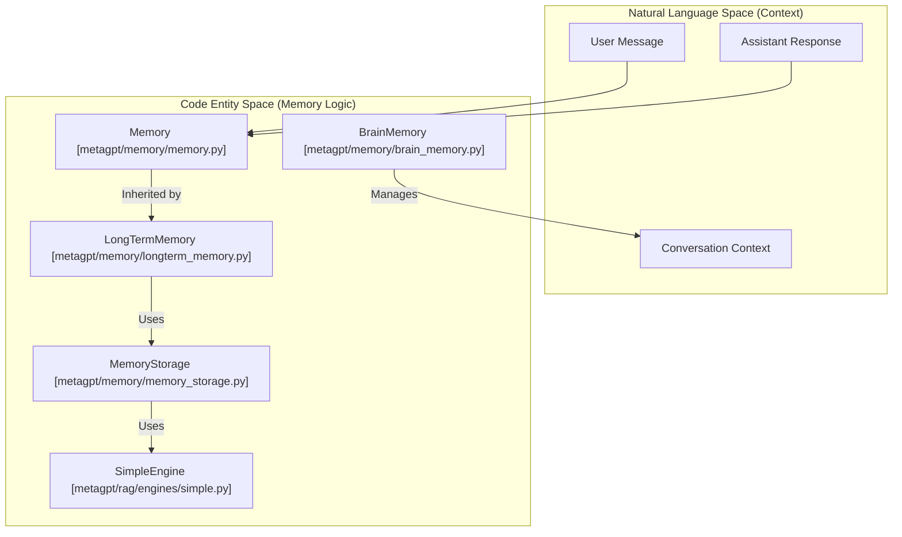
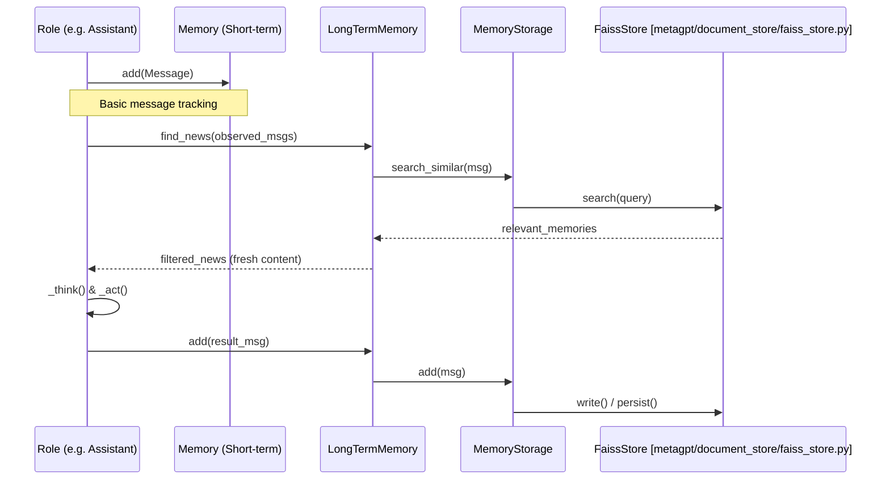

<!-- source: DeepWiki mcp.deepwiki.com · repo geekan/MetaGPT · page 4 Memory Systems · fetched 2026-10-26 -->

# Memory Systems

Relevant source files

The following files were used as context for generating this wiki page:

- [.gitignore](.gitignore)
- [docs/.agent-store-config.yaml.example](docs/.agent-store-config.yaml.example)
- [docs/.well-known/ai-plugin.json](docs/.well-known/ai-plugin.json)
- [metagpt/actions/action_output.py](metagpt/actions/action_output.py)
- [metagpt/actions/skill_action.py](metagpt/actions/skill_action.py)
- [metagpt/actions/talk_action.py](metagpt/actions/talk_action.py)
- [metagpt/document.py](metagpt/document.py)
- [metagpt/document_store/base_store.py](metagpt/document_store/base_store.py)
- [metagpt/document_store/chromadb_store.py](metagpt/document_store/chromadb_store.py)
- [metagpt/document_store/faiss_store.py](metagpt/document_store/faiss_store.py)
- [metagpt/learn/skill_loader.py](metagpt/learn/skill_loader.py)
- [metagpt/memory/__init__.py](metagpt/memory/__init__.py)
- [metagpt/memory/brain_memory.py](metagpt/memory/brain_memory.py)
- [metagpt/memory/longterm_memory.py](metagpt/memory/longterm_memory.py)
- [metagpt/memory/memory.py](metagpt/memory/memory.py)
- [metagpt/memory/memory_storage.py](metagpt/memory/memory_storage.py)
- [metagpt/roles/assistant.py](metagpt/roles/assistant.py)
- [metagpt/utils/embedding.py](metagpt/utils/embedding.py)
- [metagpt/utils/serialize.py](metagpt/utils/serialize.py)
- [tests/metagpt/document_store/test_chromadb_store.py](tests/metagpt/document_store/test_chromadb_store.py)
- [tests/metagpt/document_store/test_faiss_store.py](tests/metagpt/document_store/test_faiss_store.py)
- [tests/metagpt/memory/mock_text_embed.py](tests/metagpt/memory/mock_text_embed.py)
- [tests/metagpt/memory/test_brain_memory.py](tests/metagpt/memory/test_brain_memory.py)
- [tests/metagpt/memory/test_longterm_memory.py](tests/metagpt/memory/test_longterm_memory.py)
- [tests/metagpt/memory/test_memory_storage.py](tests/metagpt/memory/test_memory_storage.py)
- [tests/metagpt/roles/test_assistant.py](tests/metagpt/roles/test_assistant.py)
- [tests/metagpt/test_llm.py](tests/metagpt/test_llm.py)
- [tests/metagpt/utils/test_code_parser.py](tests/metagpt/utils/test_code_parser.py)
- [tests/metagpt/utils/test_output_parser.py](tests/metagpt/utils/test_output_parser.py)
- [tests/metagpt/utils/test_serialize.py](tests/metagpt/utils/test_serialize.py)

MetaGPT manages memory at multiple levels to enable agents to maintain context, store domain knowledge, and improve efficiency through computation reuse. This system spans from basic short-term message storage to sophisticated long-term persistent memory backed by vector databases and specialized conversational memory for interactive agents.

## Memory System Architecture

The memory architecture is designed to bridge natural language interactions with persistent data structures.

Sources: [metagpt/memory/memory.py:20-25](), [metagpt/memory/longterm_memory.py:18-28](), [metagpt/memory/brain_memory.py:26-35](), [metagpt/memory/memory_storage.py:19-33]()

## Core Memory Components

### Basic Memory
The `Memory` class [metagpt/memory/memory.py:20]() is the fundamental storage unit for `Role` objects. It maintains an internal `storage` list of `Message` objects and an `index` for fast retrieval by action type or role [metagpt/memory/memory.py:23-35]().

### Brain Memory
Specialized for conversational agents like the `Assistant` role [metagpt/roles/assistant.py:37](). `BrainMemory` manages:
- **Conversation History**: Tracks user talks and assistant answers [metagpt/memory/brain_memory.py:45-58]().
- **Recursive Summarization**: Automatically compresses long histories using LLMs to fit within context limits [metagpt/memory/brain_memory.py:130-151]().
- **Persistence**: Supports saving and loading from Redis for persistent agent sessions [metagpt/memory/brain_memory.py:63-86]().

For details, see [Brain Memory](#4.1).

### Long-term Memory (LTM)
The `LongTermMemory` class [metagpt/memory/longterm_memory.py:18]() provides persistent storage using vector databases. It integrates with `MemoryStorage` [metagpt/memory/memory_storage.py:19]() to perform:
- **Similarity Search**: Uses FAISS or other document stores to find relevant past experiences [metagpt/memory/memory_storage.py:61-69]().
- **Memory Recovery**: Restores an agent's state based on its `role_id` [metagpt/memory/memory_storage.py:38-54]().

For details, see [Long-term Memory and Document Stores](#4.3).

## Experience Pooling
The Experience Pool is a specialized caching system that allows agents to reuse successful past outputs. It uses the `@exp_cache` decorator to wrap functions, checking if a similar request has been handled before by querying a `SimpleEngine` backend [metagpt/rag/engines/simple.py:13]().

For details, see [Experience Pooling](#4.2).

## Memory Integration Flow

The following diagram illustrates how a `Role` interacts with the memory systems during its lifecycle.

Sources: [metagpt/memory/longterm_memory.py:50-67](), [metagpt/memory/memory_storage.py:56-69](), [metagpt/document_store/faiss_store.py:62-71](), [metagpt/roles/assistant.py:72-83]()

## Child Pages
- [Brain Memory](#4.1) — Detail the BrainMemory system for storing and retrieving conversation history, semantic relevance checking, recursive summarization, Redis persistence, and the Assistant role that uses it.
- [Experience Pooling](#4.2) — Explain the experience pool system for caching and reusing function outputs, the @exp_cache decorator, ExperienceManager, BM25/Chroma retrieval backends, scoring, and the RoleZero context builders.
- [Long-term Memory and Document Stores](#4.3) — Describe the LongTermMemory system backed by FAISS/Chroma/Milvus/Qdrant/LanceDB document stores, MemoryStorage for embedding-based retrieval, and how these integrate with the Role memory system.

Sources: [metagpt/memory/brain_memory.py](), [metagpt/memory/longterm_memory.py](), [metagpt/memory/memory_storage.py](), [metagpt/document_store/faiss_store.py]()

---

