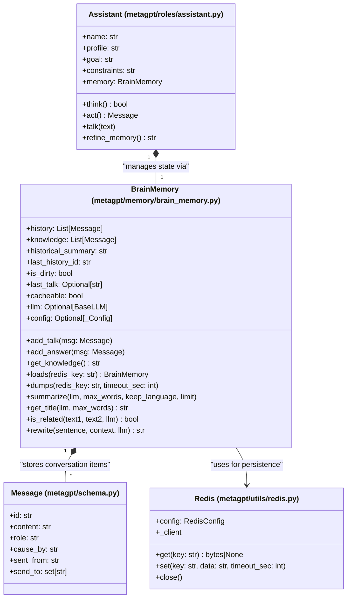
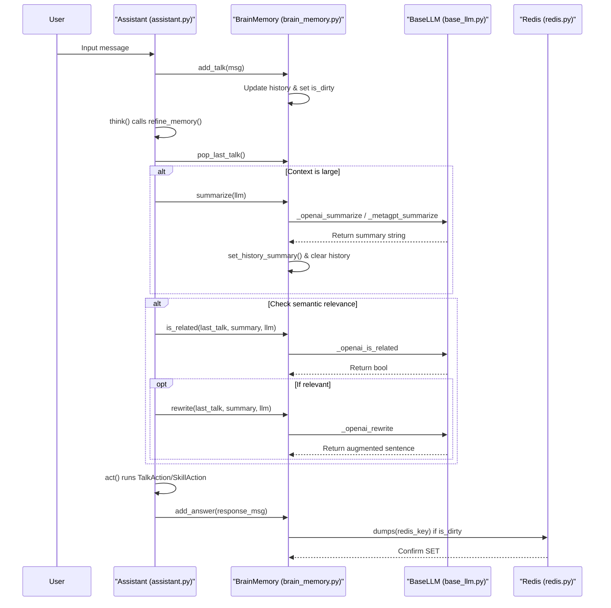

<!-- source: DeepWiki mcp.deepwiki.com · repo geekan/MetaGPT · page 4.1 Brain Memory · fetched 2026-10-26 -->

# Brain Memory

Relevant source files

The following files were used as context for generating this wiki page:

- [docs/.agent-store-config.yaml.example](docs/.agent-store-config.yaml.example)
- [docs/.well-known/ai-plugin.json](docs/.well-known/ai-plugin.json)
- [metagpt/actions/skill_action.py](metagpt/actions/skill_action.py)
- [metagpt/actions/talk_action.py](metagpt/actions/talk_action.py)
- [metagpt/learn/skill_loader.py](metagpt/learn/skill_loader.py)
- [metagpt/memory/brain_memory.py](metagpt/memory/brain_memory.py)
- [metagpt/roles/assistant.py](metagpt/roles/assistant.py)
- [metagpt/utils/redis.py](metagpt/utils/redis.py)
- [metagpt/utils/s3.py](metagpt/utils/s3.py)
- [tests/metagpt/memory/test_brain_memory.py](tests/metagpt/memory/test_brain_memory.py)
- [tests/metagpt/roles/test_assistant.py](tests/metagpt/roles/test_assistant.py)
- [tests/metagpt/test_llm.py](tests/metagpt/test_llm.py)
- [tests/metagpt/utils/test_redis.py](tests/metagpt/utils/test_redis.py)
- [tests/metagpt/utils/test_s3.py](tests/metagpt/utils/test_s3.py)

The Brain Memory system in MetaGPT provides long-term storage and memory management capabilities for agents. It handles conversation history storage, knowledge retention, automatic memory summarization, and persistent storage using Redis. This system enables agents to maintain context across interactions, recall relevant information, and optimize memory usage through intelligent summarization.

For information about Experience Pooling, which is a separate memory system for caching function outputs, see [Experience Pooling](#4.2).

## Architecture Overview

`BrainMemory` is a core memory component defined in [metagpt/memory/brain_memory.py:26-36]() and is primarily used by the `Assistant` role to store conversation history, relevant knowledge, and generate summaries of past interactions.

### Code Entity Space to Natural Language Space

The following diagram bridges the code entities in `metagpt/memory/brain_memory.py` and `metagpt/roles/assistant.py` with their functional roles in the memory system.

Sources: [metagpt/memory/brain_memory.py:26-259](), [metagpt/roles/assistant.py:37-45](), [metagpt/utils/redis.py:19-22]()

## Core Components

The `BrainMemory` class consists of several key components that work together to provide a comprehensive memory system:

| Component | Type | Purpose |
|-----------|------|---------|
| `history` | `List[Message]` | Stores recent conversation messages [metagpt/memory/brain_memory.py:27](). |
| `knowledge` | `List[Message]` | Stores knowledge/facts available to the agent [metagpt/memory/brain_memory.py:28](). |
| `historical_summary` | `str` | Compressed summary of older conversation history [metagpt/memory/brain_memory.py:29](). |
| `last_history_id` | `str` | ID of the most recent message to prevent duplicates [metagpt/memory/brain_memory.py:30](). |
| `is_dirty` | `bool` | Flag indicating if memory has been modified since last save [metagpt/memory/brain_memory.py:31](). |
| `last_talk` | `Optional[str]` | The most recent user message [metagpt/memory/brain_memory.py:32](). |
| `cacheable` | `bool` | Whether memory should be cached in Redis [metagpt/memory/brain_memory.py:33](). |
| `llm` | `Optional[BaseLLM]` | LLM instance used for summarization and semantic checks [metagpt/memory/brain_memory.py:34](). |

Sources: [metagpt/memory/brain_memory.py:26-36]()

## Memory Processing Flow

The interaction between the `Assistant` role and `BrainMemory` ensures that user input is refined and contextualized before being processed by an action.

Sources: [metagpt/memory/brain_memory.py:45-110](), [metagpt/roles/assistant.py:53-70](), [metagpt/roles/assistant.py:118-130]()

## Message Management

### Adding Messages
- `add_talk(msg)`: Adds a message from the user, setting `msg.role = "user"` [metagpt/memory/brain_memory.py:45-51]().
- `add_answer(msg)`: Adds a message from the LLM, setting `msg.role = "assistant"` [metagpt/memory/brain_memory.py:53-57]().
- `add_history(msg)`: The internal method that appends to `self.history` while checking `msg.id` against `self.last_history_id` to ensure order and uniqueness [metagpt/memory/brain_memory.py:103-110]().

### Knowledge Management
The `knowledge` attribute stores facts. The `get_knowledge()` method concatenates all content in `self.knowledge` into a single string for prompt injection [metagpt/memory/brain_memory.py:59-61]().

## Memory Persistence with Redis

`BrainMemory` utilizes a `Redis` utility class for persistence, allowing agent state to survive across process restarts.

- **Dumping**: The `dumps` method serializes the object to JSON using `model_dump_json()` and stores it in Redis if `is_dirty` is `True` [metagpt/memory/brain_memory.py:75-86]().
- **Loading**: The `loads` method retrieves the JSON string from Redis and reconstructs the `BrainMemory` object using `parse_raw` [metagpt/memory/brain_memory.py:63-73]().
- **Key Generation**: Keys are structured as `prefix:user_id:chat_id` via `to_redis_key` [metagpt/memory/brain_memory.py:88-89]().

Sources: [metagpt/memory/brain_memory.py:63-89](), [metagpt/utils/redis.py:40-58]()

## Memory Optimization through Summarization

To stay within LLM context limits, `BrainMemory` implements recursive summarization.

### Summarization Strategies
1. **`_metagpt_summarize`**: A simpler truncation strategy that keeps messages within a `max_words` limit and converts them to a JSON format [metagpt/memory/brain_memory.py:152-175]().
2. **`_openai_summarize`**: A more complex strategy that combines `historical_summary` and current `history`. If the text exceeds the `limit`, it triggers the `_summarize` recursive process [metagpt/memory/brain_memory.py:137-150]().
3. **Recursive Windowing**: The `_summarize` method (referenced in logic) handles text larger than the model's token capacity by splitting it into windows, summarizing them, and re-summarizing the results [metagpt/memory/brain_memory.py:146]().

Sources: [metagpt/memory/brain_memory.py:130-175]()

## Semantic Analysis and Rewriting

The system provides tools to check if a new query is related to past conversations and to rewrite queries to include context.

- **Relevance**: `_openai_is_related` asks the LLM if two paragraphs are semantically relevant, returning a boolean [metagpt/memory/brain_memory.py:206-221]().
- **Rewriting**: `_openai_rewrite` uses the LLM to augment a user's sentence with information from the `historical_summary` to resolve coreferences or missing context [metagpt/memory/brain_memory.py:231-246]().

Sources: [metagpt/memory/brain_memory.py:198-246]()

## Integration in Assistant Role

The `Assistant` role (Lily) is the primary user of `BrainMemory`.

1. **Thinking Phase**: In `think()`, the role calls `refine_memory()` [metagpt/roles/assistant.py:55](). This method pops the `last_talk`, checks if history is available, and optionally merges history with the current query if they are semantically related [metagpt/roles/assistant.py:118-130]().
2. **Action Dispatching**: Based on the refined memory, the Assistant decides whether to use a `TalkAction` or a `SkillAction` [metagpt/roles/assistant.py:88-95]().
3. **Context Injection**: `TalkAction` accesses `memory.get_knowledge()` and `memory.history_text` to build its prompt [metagpt/roles/assistant.py:98-102]().

Sources: [metagpt/roles/assistant.py:53-130](), [metagpt/actions/talk_action.py:86-90]()

---

