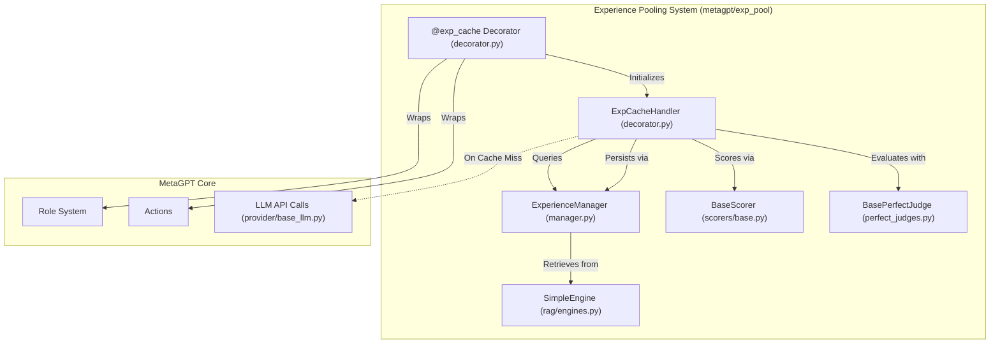
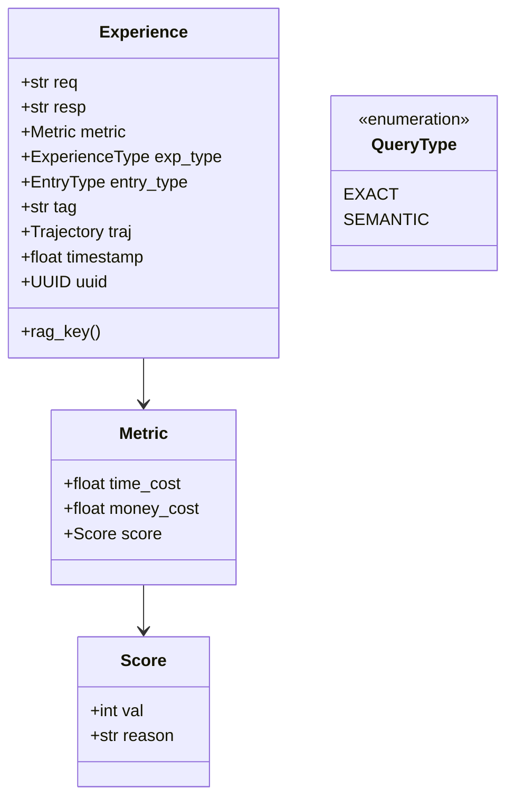
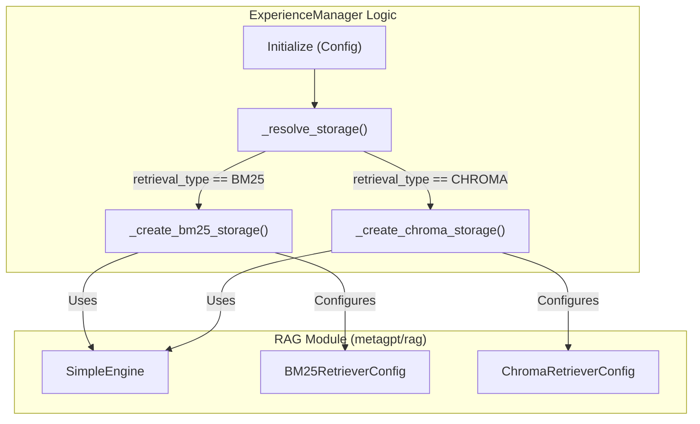

<!-- source: DeepWiki mcp.deepwiki.com · repo geekan/MetaGPT · page 4.2 Experience Pooling · fetched 2026-10-26 -->

# Experience Pooling

<details>
<summary>Relevant source files</summary>

The following files were used as context for generating this wiki page:

- [config/config2.example.yaml](config/config2.example.yaml)
- [examples/data/exp_pool/team_leader_exps.json](examples/data/exp_pool/team_leader_exps.json)
- [examples/exp_pool/decorator.py](examples/exp_pool/decorator.py)
- [examples/exp_pool/manager.py](examples/exp_pool/manager.py)
- [examples/exp_pool/scorer.py](examples/exp_pool/scorer.py)
- [metagpt/configs/exp_pool_config.py](metagpt/configs/exp_pool_config.py)
- [metagpt/exp_pool/__init__.py](metagpt/exp_pool/__init__.py)
- [metagpt/exp_pool/context_builders/action_node.py](metagpt/exp_pool/context_builders/action_node.py)
- [metagpt/exp_pool/context_builders/base.py](metagpt/exp_pool/context_builders/base.py)
- [metagpt/exp_pool/context_builders/role_zero.py](metagpt/exp_pool/context_builders/role_zero.py)
- [metagpt/exp_pool/context_builders/simple.py](metagpt/exp_pool/context_builders/simple.py)
- [metagpt/exp_pool/decorator.py](metagpt/exp_pool/decorator.py)
- [metagpt/exp_pool/manager.py](metagpt/exp_pool/manager.py)
- [metagpt/exp_pool/schema.py](metagpt/exp_pool/schema.py)
- [metagpt/exp_pool/scorers/__init__.py](metagpt/exp_pool/scorers/__init__.py)
- [metagpt/exp_pool/scorers/base.py](metagpt/exp_pool/scorers/base.py)
- [metagpt/exp_pool/scorers/simple.py](metagpt/exp_pool/scorers/simple.py)
- [metagpt/exp_pool/serializers/base.py](metagpt/exp_pool/serializers/base.py)
- [metagpt/exp_pool/serializers/role_zero.py](metagpt/exp_pool/serializers/role_zero.py)
- [metagpt/exp_pool/serializers/simple.py](metagpt/exp_pool/serializers/simple.py)
- [metagpt/utils/reflection.py](metagpt/utils/reflection.py)
- [tests/metagpt/exp_pool/test_context_builders/test_rolezero_context_builder.py](tests/metagpt/exp_pool/test_context_builders/test_rolezero_context_builder.py)
- [tests/metagpt/exp_pool/test_context_builders/test_simple_context_builder.py](tests/metagpt/exp_pool/test_context_builders/test_simple_context_builder.py)
- [tests/metagpt/exp_pool/test_decorator.py](tests/metagpt/exp_pool/test_decorator.py)
- [tests/metagpt/exp_pool/test_manager.py](tests/metagpt/exp_pool/test_manager.py)
- [tests/metagpt/exp_pool/test_scorers/test_simple_scorer.py](tests/metagpt/exp_pool/test_scorers/test_simple_scorer.py)
- [tests/metagpt/exp_pool/test_serializers/test_role_zero.py](tests/metagpt/exp_pool/test_serializers/test_role_zero.py)
- [tests/metagpt/exp_pool/test_serializers/test_simple.py](tests/metagpt/exp_pool/test_serializers/test_simple.py)

</details>


Experience Pooling is a caching and retrieval system in MetaGPT that stores and reuses function outputs, particularly for LLM queries. By intelligently caching previous responses and evaluating their quality, the system can reduce API calls, lower costs, and improve response times while maintaining quality.

## Overview and Purpose

Experience Pooling functions as a sophisticated caching layer for function outputs in MetaGPT. Unlike simple caches that rely on exact matches, Experience Pooling can identify semantically similar requests and return previously successful responses.

### System Architecture

The following diagram bridges the high-level concepts to the specific code entities in the `metagpt.exp_pool` package.



Sources: 
- [metagpt/exp_pool/manager.py:18-233]()
- [metagpt/exp_pool/decorator.py:29-94]()
- [metagpt/exp_pool/schema.py:1-77]()

## Core Data Model

At the heart of Experience Pooling is the `Experience` data structure, which encapsulates request-response pairs and metadata about them.



Sources:
- [metagpt/exp_pool/schema.py:16-77]()

The `Experience` model stores:
- `req`: The original request text, used as the `rag_key` [metagpt/exp_pool/schema.py:75-76]().
- `resp`: The response content (string, JSON, or code).
- `metric`: Performance metrics including time cost, money cost, and a `Score` object [metagpt/exp_pool/schema.py:45-51]().
- `tag`: A categorization label, defaulting to `ClassName.method_name` or `function_name` [metagpt/exp_pool/decorator.py:57-57]().
- `traj`: Optional `Trajectory` for plan-action-observation sequences [metagpt/exp_pool/schema.py:53-60]().

## Experience Manager

The `ExperienceManager` class manages the lifecycle of experiences, including storage, retrieval, and querying. It abstracts the underlying RAG engines.

### Storage Resolution

The manager supports two retrieval backends defined in `ExperiencePoolRetrievalType`:
1. **BM25**: Text-based retrieval with keyword matching [metagpt/exp_pool/manager.py:145-189]().
2. **CHROMA**: Vector-based retrieval for semantic similarity [metagpt/exp_pool/manager.py:191-218]().



Sources:
- [metagpt/exp_pool/manager.py:135-218]()
- [metagpt/configs/exp_pool_config.py:8-26]()

## Experience Cache Decorator

The `@exp_cache` decorator is the primary interface. It uses an `ExpCacheHandler` to manage the logic of checking the pool before executing the wrapped function.

### Execution Flow

1. **Initialization**: The `ExpCacheHandler` serializes the request using a `BaseSerializer` (default `SimpleSerializer`) [metagpt/exp_pool/decorator.py:133-133]().
2. **Retrieval**: It calls `exp_manager.query_exps` to find candidates [metagpt/exp_pool/decorator.py:140-140]().
3. **Judgment**: The `BasePerfectJudge` (default `SimplePerfectJudge`) determines if a retrieved experience is a sufficient match [metagpt/exp_pool/decorator.py:147-147]().
4. **Execution & Scoring**: If no perfect match exists, the function executes. If `enable_write` is true, the `BaseScorer` (default `SimpleScorer`) evaluates the new output [metagpt/exp_pool/decorator.py:173-173]().

Sources:
- [metagpt/exp_pool/decorator.py:29-180]()
- [metagpt/exp_pool/scorers/simple.py:47-65]()

## RoleZero Context Builders

Experience Pooling is also used to inject past experiences directly into LLM prompts via `ContextBuilders`. 

### RoleZeroContextBuilder
The `RoleZeroContextBuilder` is specialized for agentic workflows. It looks for a specific `EXPERIENCE_MASK` (defined in `metagpt.const`) within the prompt text and replaces it with formatted historical experiences [metagpt/exp_pool/context_builders/role_zero.py:33-39]().

### RoleZeroSerializer
To ensure efficient storage, the `RoleZeroSerializer` filters the request content. It specifically looks for "useful" content, such as file read operations (`Command Editor.read executed`), to avoid embedding overly lengthy and irrelevant context [metagpt/exp_pool/serializers/role_zero.py:52-58]().

Sources:
- [metagpt/exp_pool/context_builders/role_zero.py:10-40]()
- [metagpt/exp_pool/serializers/role_zero.py:9-59]()

## Configuration Reference

Experience Pooling is configured via the `exp_pool` section in `config2.yaml`.

| Key | Default | Description |
|-----|---------|-------------|
| `enabled` | `false` | Master switch. If false, decorator is a no-op [metagpt/configs/exp_pool_config.py:14-17](). |
| `enable_read` | `false` | Allows reading from the pool during queries. |
| `enable_write` | `false` | Allows saving new experiences to the pool. |
| `retrieval_type` | `bm25` | `bm25` or `chroma` [metagpt/configs/exp_pool_config.py:21-23](). |
| `use_llm_ranker` | `true` | Uses an LLM to rerank results for better precision [metagpt/configs/exp_pool_config.py:24-24](). |
| `persist_path` | `.chroma_exp_data` | Directory for persistent storage. |

Sources:
- [config/config2.example.yaml:84-91]()
- [metagpt/configs/exp_pool_config.py:13-26]()

## Implementation Example

### Basic Usage
```python
from metagpt.exp_pool import exp_cache

@exp_cache(tag="math_solver")
async def solve_problem(req: str):
    # LLM logic here
    return "result"
```

### Manual Management
You can interact with the `ExperienceManager` directly for CRUD operations.

```python
from metagpt.exp_pool import get_exp_manager
from metagpt.exp_pool.schema import Experience

manager = get_exp_manager()
exp = Experience(req="1+1", resp="2")
manager.create_exp(exp) # Persists to disk [metagpt/exp_pool/manager.py:91]
```

Sources:
- [examples/exp_pool/manager.py:14-27]()
- [metagpt/exp_pool/manager.py:71-92]()

---

