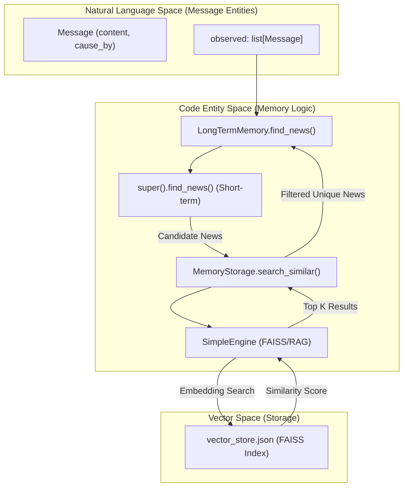
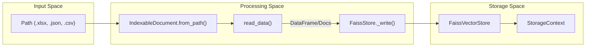

<!-- source: DeepWiki mcp.deepwiki.com · repo geekan/MetaGPT · page 4.3 Long-term Memory and Document Stores · fetched 2026-10-26 -->

# Long-term Memory and Document Stores

Relevant source files

The following files were used as context for generating this wiki page:

- [.gitignore](.gitignore)
- [metagpt/document.py](metagpt/document.py)
- [metagpt/document_store/base_store.py](metagpt/document_store/base_store.py)
- [metagpt/document_store/chromadb_store.py](metagpt/document_store/chromadb_store.py)
- [metagpt/document_store/faiss_store.py](metagpt/document_store/faiss_store.py)
- [metagpt/document_store/lancedb_store.py](metagpt/document_store/lancedb_store.py)
- [metagpt/document_store/milvus_store.py](metagpt/document_store/milvus_store.py)
- [metagpt/document_store/qdrant_store.py](metagpt/document_store/qdrant_store.py)
- [metagpt/memory/longterm_memory.py](metagpt/memory/longterm_memory.py)
- [metagpt/memory/memory_storage.py](metagpt/memory/memory_storage.py)
- [metagpt/prompts/summarize.py](metagpt/prompts/summarize.py)
- [metagpt/utils/embedding.py](metagpt/utils/embedding.py)
- [tests/metagpt/document_store/test_chromadb_store.py](tests/metagpt/document_store/test_chromadb_store.py)
- [tests/metagpt/document_store/test_faiss_store.py](tests/metagpt/document_store/test_faiss_store.py)
- [tests/metagpt/document_store/test_lancedb_store.py](tests/metagpt/document_store/test_lancedb_store.py)
- [tests/metagpt/document_store/test_milvus_store.py](tests/metagpt/document_store/test_milvus_store.py)
- [tests/metagpt/document_store/test_qdrant_store.py](tests/metagpt/document_store/test_qdrant_store.py)
- [tests/metagpt/memory/mock_text_embed.py](tests/metagpt/memory/mock_text_embed.py)
- [tests/metagpt/memory/test_longterm_memory.py](tests/metagpt/memory/test_longterm_memory.py)
- [tests/metagpt/memory/test_memory_storage.py](tests/metagpt/memory/test_memory_storage.py)
- [tests/metagpt/test_message.py](tests/metagpt/test_message.py)

The Long-term Memory (LTM) system in MetaGPT provides agents with persistent, semantic memory capabilities. Unlike short-term memory, which is limited to the immediate context of a conversation, LTM leverages vector databases (Document Stores) to store and retrieve information based on embedding similarity. This allows Roles to maintain consistency over long durations and filter redundant information by checking against historical interactions.

## Long-term Memory Architecture

The `LongTermMemory` class extends the standard `Memory` system by integrating `MemoryStorage`. It acts as a bridge between the reactive message stream of a `Role` and a persistent vector index.

### Key Components

- **LongTermMemory**: Manages the logic for recovering memory on startup and filtering "news" by comparing new messages against stored embeddings `[metagpt/memory/longterm_memory.py:18-30]()`.
- **MemoryStorage**: An abstraction layer that uses `SimpleEngine` (a RAG component) to handle the underlying vector operations, specifically using FAISS by default `[metagpt/memory/memory_storage.py:19-33]()`.
- **RoleContext Integration**: LTM uses the `RoleContext.watch` set to determine which messages are relevant enough to be persisted to long-term storage `[metagpt/memory/longterm_memory.py:44-48]()`.

### Data Flow: Message Observation to LTM
The following diagram illustrates how a `Role` processes an incoming `Message` through the `LongTermMemory` filter.

**Natural Language to Vector Space Flow**

**Sources:** `[metagpt/memory/longterm_memory.py:50-67]()`, `[metagpt/memory/memory_storage.py:61-69]()`.

---

## Document Stores

MetaGPT supports multiple document store backends for persisting embeddings and performing semantic searches. These are categorized into `LocalStore` (filesystem-based) and remote/client-based stores.

### Supported Backends

| Class | Backend | Persistence Method | File Reference |
| :--- | :--- | :--- | :--- |
| `FaissStore` | FAISS | `storage_context.persist()` | `[metagpt/document_store/faiss_store.py:25]()` |
| `ChromaStore` | ChromaDB | Server-mode (recommended) | `[metagpt/document_store/chromadb_store.py:11]()` |
| `MilvusStore` | Milvus | `client.upsert()` | `[metagpt/document_store/milvus_store.py:19]()` |
| `QdrantStore` | Qdrant | Client-based | `[metagpt/document_store/qdrant_store.py]()` |
| `LanceDBStore`| LanceDB | Disk-based | `[metagpt/document_store/lancedb_store.py]()` |

### FaissStore Implementation
`FaissStore` is the primary implementation for local RAG and memory storage. It utilizes `llama-index` to manage `VectorStoreIndex` and `StorageContext` `[metagpt/document_store/faiss_store.py:41-45]()`. It can ingest various data types (JSON, XLSX, CSV) via the `IndexableDocument` utility `[metagpt/document.py:111-123]()`.

**Document Ingestion Process**

**Sources:** `[metagpt/document_store/faiss_store.py:75-84]()`, `[metagpt/document.py:29-47]()`.

---

## MemoryStorage and Retrieval

`MemoryStorage` provides the interface for `LongTermMemory` to interact with vector indices. It defaults to using a `SimpleEngine` configured with a `FAISSIndexConfig` `[metagpt/memory/memory_storage.py:44-54]()`.

### Similarity Filtering
A key feature of the LTM system is the ability to filter out redundant information. When `find_news` is called, `MemoryStorage.search_similar` is invoked with a threshold (default 0.1). If a similar message is found in the vector store with a score below this threshold, the message is considered "seen" and filtered out of the role's current attention `[metagpt/memory/memory_storage.py:61-69]()`.

### Persistence Lifecycle
1.  **Recovery**: On `Role` startup, `recover_memory(role_id)` is called, which attempts to load a FAISS index from `DATA_PATH / role_mem / {role_id}` `[metagpt/memory/memory_storage.py:38-41]()`.
2.  **Addition**: When a `Role` generates or receives a message that matches its `watch` list, `LongTermMemory.add(message)` is triggered, which calls `MemoryStorage.add(message)` to update the index `[metagpt/memory/longterm_memory.py:42-49]()`.
3.  **Persistence**: The `persist()` method ensures that the in-memory vector index is written back to the local `cache_dir` `[metagpt/memory/memory_storage.py:75-78]()`.

**Sources:** `[metagpt/memory/longterm_memory.py:31-41]()`, `[metagpt/memory/memory_storage.py:56-59]()`, `[metagpt/const.py:11]()`.

---

