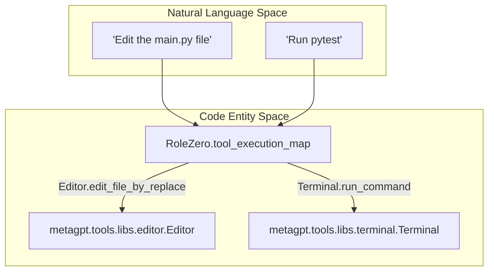

<!-- source: DeepWiki mcp.deepwiki.com · repo geekan/MetaGPT · page 5 Dynamic Intelligence (DI) · fetched 2026-10-26 -->

# Dynamic Intelligence (DI)

<details>
<summary>Relevant source files</summary>

The following files were used as context for generating this wiki page:

- [metagpt/actions/di/write_analysis_code.py](metagpt/actions/di/write_analysis_code.py)
- [metagpt/actions/di/write_plan.py](metagpt/actions/di/write_plan.py)
- [metagpt/environment/mgx/mgx_env.py](metagpt/environment/mgx/mgx_env.py)
- [metagpt/prompts/di/architect.py](metagpt/prompts/di/architect.py)
- [metagpt/prompts/di/data_analyst.py](metagpt/prompts/di/data_analyst.py)
- [metagpt/prompts/di/engineer2.py](metagpt/prompts/di/engineer2.py)
- [metagpt/prompts/di/role_zero.py](metagpt/prompts/di/role_zero.py)
- [metagpt/prompts/di/team_leader.py](metagpt/prompts/di/team_leader.py)
- [metagpt/prompts/di/write_analysis_code.py](metagpt/prompts/di/write_analysis_code.py)
- [metagpt/prompts/task_type.py](metagpt/prompts/task_type.py)
- [metagpt/roles/di/data_analyst.py](metagpt/roles/di/data_analyst.py)
- [metagpt/roles/di/data_interpreter.py](metagpt/roles/di/data_interpreter.py)
- [metagpt/roles/di/engineer2.py](metagpt/roles/di/engineer2.py)
- [metagpt/roles/di/role_zero.py](metagpt/roles/di/role_zero.py)
- [metagpt/roles/di/team_leader.py](metagpt/roles/di/team_leader.py)
- [metagpt/strategy/experience_retriever.py](metagpt/strategy/experience_retriever.py)
- [metagpt/strategy/planner.py](metagpt/strategy/planner.py)
- [metagpt/strategy/task_type.py](metagpt/strategy/task_type.py)
- [metagpt/strategy/thinking_command.py](metagpt/strategy/thinking_command.py)
- [metagpt/tools/libs/email_login.py](metagpt/tools/libs/email_login.py)
- [metagpt/tools/tool_recommend.py](metagpt/tools/tool_recommend.py)
- [tests/metagpt/actions/di/test_write_analysis_code.py](tests/metagpt/actions/di/test_write_analysis_code.py)
- [tests/metagpt/actions/di/test_write_plan.py](tests/metagpt/actions/di/test_write_plan.py)
- [tests/metagpt/environment/mgx_env/run_mgx_env.py](tests/metagpt/environment/mgx_env/run_mgx_env.py)
- [tests/metagpt/roles/di/run_engineer2.py](tests/metagpt/roles/di/run_engineer2.py)
- [tests/metagpt/roles/di/test_data_interpreter.py](tests/metagpt/roles/di/test_data_interpreter.py)
- [tests/metagpt/strategy/test_planner.py](tests/metagpt/strategy/test_planner.py)
- [tests/metagpt/tools/libs/test_email_login.py](tests/metagpt/tools/libs/test_email_login.py)

</details>


Dynamic Intelligence (DI) is a specialized subsystem within MetaGPT that enables roles to think and act dynamically in response to complex tasks. The core of this system is `RoleZero`, a versatile agent capable of adaptive reasoning, tool utilization, and human interaction. DI goes beyond standard predetermined behavior patterns to deliver adaptive problem-solving capabilities through observation, thinking, and action cycles.

For information about specific role implementations built on DI, see [Role System](#2.1).

## Core Architecture

The DI system is built around a central component called `RoleZero`, which serves as the foundation for specialized role implementations. `RoleZero` is designed to dynamically analyze situations, plan responses, execute actions using tools, and interact with humans when necessary.

### DI Class Hierarchy and Entity Mapping
The following diagram maps the high-level DI roles to their corresponding code entities, bridging the gap between natural language descriptions and the `metagpt.roles.di` namespace.

```mermaid
classDiagram
    class "Role" {
        [metagpt.roles.base.Role]
        +run(with_message)
        +_observe()
        +_think()
        +_act()
    }
    
    class "RoleZero" {
        [metagpt.roles.di.role_zero.RoleZero]
        +react_mode: Literal["react"]
        +planner: Planner
        +tool_execution_map: dict
        +_think()
        +_act()
        +_quick_think()
        +ask_human()
        +reply_to_human()
    }
    
    class "Engineer2" {
        [metagpt.roles.di.engineer2.Engineer2]
        +terminal: Terminal
        +editor: Editor
        +write_new_code()
    }
    
    class "DataAnalyst" {
        [metagpt.roles.di.data_analyst.DataAnalyst]
        +write_code: WriteAnalysisCode
        +execute_code: ExecuteNbCode
        +write_and_exec_code()
    }
    
    class "TeamLeader" {
        [metagpt.roles.di.team_leader.TeamLeader]
        +publish_team_message()
        +finish_current_task()
    }
    
    "Role" <|-- "RoleZero" : extends
    "RoleZero" <|-- "Engineer2" : extends
    "RoleZero" <|-- "DataAnalyst" : extends
    "RoleZero" <|-- "TeamLeader" : extends
```

Sources:
- [metagpt/roles/di/role_zero.py:55-56]()
- [metagpt/roles/di/engineer2.py:32-34]()
- [metagpt/roles/di/data_analyst.py:26-28]()
- [metagpt/roles/di/team_leader.py:23-25]()

## RoleZero: The Foundation of DI

`RoleZero` is the base class that provides dynamic intelligence capabilities. It implements the `react` paradigm (observe-think-act) and incorporates several advanced features:

1.  **Quick Thinking vs. Deep Thinking**: Uses `_quick_think` to determine if a response can be handled immediately (category `QUICK`) or requires the full `react` cycle (category `ACT`) [metagpt/roles/di/role_zero.py:372-413]().
2.  **Planner Integration**: Maintains a `Planner` instance to manage multi-step task decomposition and tracking [metagpt/roles/di/role_zero.py:114-114]().
3.  **Command Execution Map**: Maintains a `tool_execution_map` that maps string identifiers (e.g., `Editor.open_file`) to actual methods [metagpt/roles/di/role_zero.py:121-168]().
4.  **Experience Retrieval**: Utilizes an `experience_retriever` to inject relevant past examples into the prompt context [metagpt/roles/di/role_zero.py:91-91]().

For details on the RoleZero architecture, planning, and classification, see [RoleZero](#5.1).

## Tools System

DI agents interact with their environment through a sophisticated tools ecosystem. Tools are registered via the `@register_tool` decorator and converted into schemas that the LLM can understand.

### Tool-to-Code Mapping
This diagram illustrates how Natural Language tool requests are routed to specific code entities within the DI ecosystem.



- **Editor**: Provides `edit_file_by_replace`, `insert_content_at_line`, and `open_file` [metagpt/roles/di/role_zero.py:147-168]().
- **Terminal**: Handled via `RunCommand` action to execute shell instructions [metagpt/roles/di/role_zero.py:111-111]().
- **Browser**: Provides `goto`, `click`, and `type` for web interaction [metagpt/roles/di/role_zero.py:130-146]().

For details on the tool registry and specific utility capabilities, see [Tools System](#5.2).

## Data Interpreter

The `DataInterpreter` (and its variant `DataAnalyst`) is a specialized DI role designed for data science and analytical tasks. It utilizes a notebook-style execution environment to iterate on code.

- **WriteAnalysisCode**: An action to generate Python code for data processing [metagpt/roles/di/data_analyst.py:8-8]().
- **ExecuteNbCode**: Executes the generated code in a Jupyter-like persistent environment [metagpt/roles/di/data_analyst.py:7-7]().
- **TaskType Classification**: Tasks are categorized into types like `DATA_PREPROCESS`, `FEATURE_ENGINEERING`, or `MODEL_TRAIN` to provide specific guidance [metagpt/strategy/task_type.py:7-38]().

For details on the DataInterpreter's notebook execution and analysis flow, see [Data Interpreter](#5.3).

## Team Coordination and Environment

In multi-agent scenarios, the `TeamLeader` role (typically named "Mike") manages the team using `MGXEnv`.

- **Hierarchical Routing**: In `MGXEnv`, regular messages are routed to the `TeamLeader` first [metagpt/environment/mgx/mgx_env.py:56-58]().
- **Task Assignment**: `TeamLeader` uses `publish_team_message` to dispatch instructions to specific roles like `Engineer2` or `DataAnalyst` [metagpt/roles/di/team_leader.py:75-86]().
- **Human-in-the-Loop**: Roles use `ask_human` to pause execution and wait for user input via the environment [metagpt/environment/mgx/mgx_env.py:64-67]().

Sources:
- [metagpt/roles/di/role_zero.py:121-168]()
- [metagpt/roles/di/team_leader.py:75-86]()
- [metagpt/environment/mgx/mgx_env.py:24-62]()
- [metagpt/strategy/planner.py:58-63]()

---

