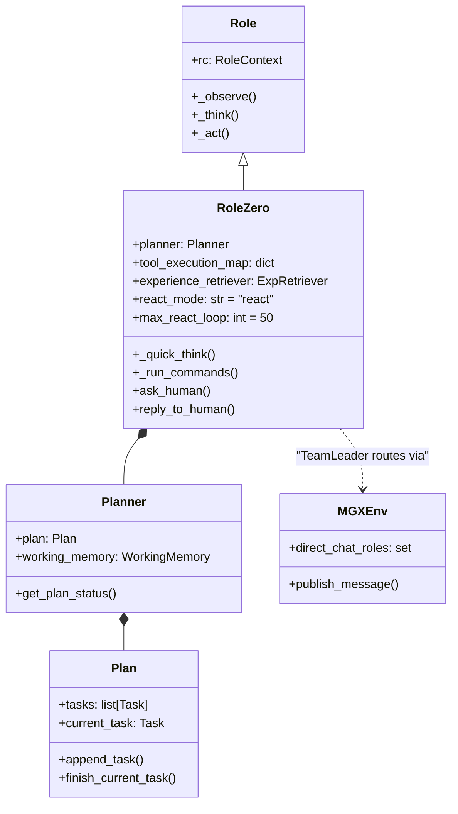
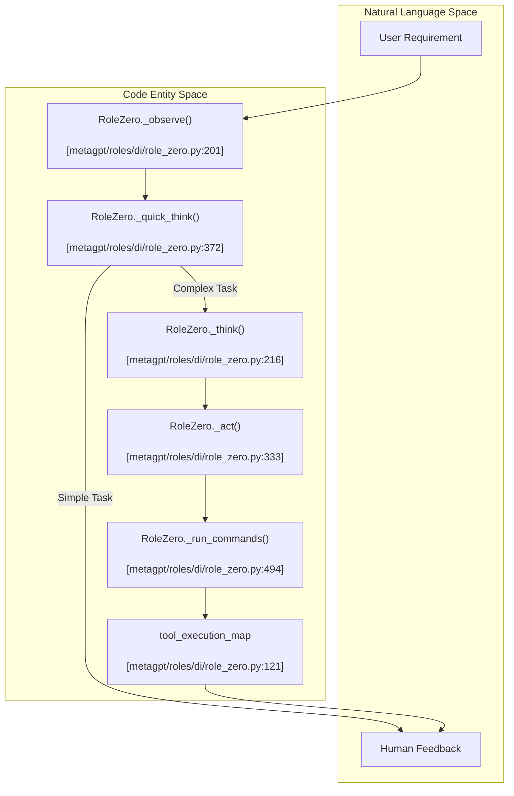

<!-- source: DeepWiki mcp.deepwiki.com · repo geekan/MetaGPT · page 5.1 RoleZero · fetched 2026-10-26 -->

# RoleZero

Relevant source files

The following files were used as context for generating this wiki page:

- [metagpt/configs/role_zero_config.py](metagpt/configs/role_zero_config.py)
- [metagpt/environment/mgx/mgx_env.py](metagpt/environment/mgx/mgx_env.py)
- [metagpt/memory/role_zero_memory.py](metagpt/memory/role_zero_memory.py)
- [metagpt/prompts/di/data_analyst.py](metagpt/prompts/di/data_analyst.py)
- [metagpt/prompts/di/engineer2.py](metagpt/prompts/di/engineer2.py)
- [metagpt/prompts/di/role_zero.py](metagpt/prompts/di/role_zero.py)
- [metagpt/prompts/di/team_leader.py](metagpt/prompts/di/team_leader.py)
- [metagpt/roles/di/data_analyst.py](metagpt/roles/di/data_analyst.py)
- [metagpt/roles/di/engineer2.py](metagpt/roles/di/engineer2.py)
- [metagpt/roles/di/role_zero.py](metagpt/roles/di/role_zero.py)
- [metagpt/roles/di/team_leader.py](metagpt/roles/di/team_leader.py)
- [metagpt/strategy/__init__.py](metagpt/strategy/__init__.py)
- [metagpt/strategy/base.py](metagpt/strategy/base.py)
- [metagpt/strategy/experience_retriever.py](metagpt/strategy/experience_retriever.py)
- [metagpt/strategy/thinking_command.py](metagpt/strategy/thinking_command.py)
- [metagpt/strategy/tot.py](metagpt/strategy/tot.py)
- [metagpt/strategy/tot_schema.py](metagpt/strategy/tot_schema.py)
- [tests/metagpt/environment/mgx_env/run_mgx_env.py](tests/metagpt/environment/mgx_env/run_mgx_env.py)
- [tests/metagpt/memory/test_role_zero_memory.py](tests/metagpt/memory/test_role_zero_memory.py)
- [tests/metagpt/roles/di/run_engineer2.py](tests/metagpt/roles/di/run_engineer2.py)
- [tests/metagpt/roles/di/test_data_analyst.py](tests/metagpt/roles/di/test_data_analyst.py)
- [tests/metagpt/roles/di/test_role_zero.py](tests/metagpt/roles/di/test_role_zero.py)
- [tests/metagpt/roles/di/test_swe_agent.py](tests/metagpt/roles/di/test_swe_agent.py)
- [tests/metagpt/roles/di/test_team_leader.py](tests/metagpt/roles/di/test_team_leader.py)
- [tests/metagpt/roles/test_project_manager.py](tests/metagpt/roles/test_project_manager.py)
- [tests/metagpt/roles/test_qa_engineer.py](tests/metagpt/roles/test_qa_engineer.py)
- [tests/metagpt/strategy/__init__.py](tests/metagpt/strategy/__init__.py)
- [tests/metagpt/strategy/examples/__init__.py](tests/metagpt/strategy/examples/__init__.py)
- [tests/metagpt/strategy/prompt_templates/__init__.py](tests/metagpt/strategy/prompt_templates/__init__.py)
- [tests/metagpt/strategy/prompt_templates/creative_writing.py](tests/metagpt/strategy/prompt_templates/creative_writing.py)
- [tests/metagpt/strategy/prompt_templates/game24.py](tests/metagpt/strategy/prompt_templates/game24.py)

RoleZero is the cornerstone of MetaGPT's Dynamic Intelligence (DI) system. It represents an advanced agent architecture capable of autonomous thinking and action through a reactive observe-think-act cycle. Unlike traditional roles with fixed Standard Operating Procedures (SOPs), RoleZero can dynamically adapt its behavior, use tools, manage plans, and interact with humans based on varying contexts [metagpt/roles/di/role_zero.py:54-56]().

## Architecture Overview

RoleZero extends the base `Role` class, enhancing it with dynamic intelligence capabilities that enable autonomous problem-solving through tool utilization, planning, and adaptive behavior.

### Code Entity Mapping
The following diagram bridges the high-level system concepts to specific classes and attributes in the codebase.

**Sources:**
- [metagpt/roles/di/role_zero.py:54-101]()
- [metagpt/roles/di/role_zero.py:113-115]()
- [metagpt/environment/mgx/mgx_env.py:11-14]()

## Reactive Cycle and Decision Making

RoleZero operates on a reactive architecture centered around the observe-think-act cycle, enhanced with dynamic intelligence capabilities.

**Sources:**
- [metagpt/roles/di/role_zero.py:201-264]()
- [metagpt/roles/di/role_zero.py:372-413]()
- [metagpt/roles/di/role_zero.py:494-522]()

### Quick vs. Deep Thinking
RoleZero employs a two-tiered thinking system via `_quick_think` [metagpt/roles/di/role_zero.py:372-413]():
1.  **QUICK**: For straightforward questions answered directly using `QUICK_RESPONSE_SYSTEM_PROMPT` [metagpt/prompts/di/role_zero.py:23]() and [metagpt/prompts/di/role_zero.py:153]().
2.  **TASK**: For complex requirements requiring the `Planner` and `tool_execution_map` [metagpt/roles/di/role_zero.py:108-115]().
3.  **SEARCH**: Triggers `SearchEnhancedQA` if configured [metagpt/roles/di/role_zero.py:392]().

**Sources:**
- [metagpt/roles/di/role_zero.py:372-413]()
- [metagpt/prompts/di/role_zero.py:148-160]()

## Planning and Tool Execution

RoleZero maintains a `tool_execution_map` that binds string-based command names to internal methods or external tool functions [metagpt/roles/di/role_zero.py:119-171]().

### Command Execution Map
| Command Category | Code Implementation |
| :--- | :--- |
| **Planning** | `Plan.append_task`, `Plan.finish_current_task` via `self.planner` [metagpt/roles/di/role_zero.py:122-124]() |
| **Interaction** | `RoleZero.ask_human`, `RoleZero.reply_to_human` [metagpt/roles/di/role_zero.py:125-126]() |
| **File System** | `Editor.write`, `Editor.read`, `Editor.edit_file_by_replace` [metagpt/roles/di/role_zero.py:148-167]() |
| **Web** | `Browser.goto`, `Browser.click`, `Browser.type` [metagpt/roles/di/role_zero.py:131-146]() |

**Sources:**
- [metagpt/roles/di/role_zero.py:119-171]()
- [metagpt/prompts/di/role_zero.py:80-93]()

## TeamLeader and MGXEnv Routing

In multi-agent scenarios, `TeamLeader` (Mike) manages task routing within `MGXEnv` [metagpt/roles/di/team_leader.py:23-27]().

1.  **Message Takeover**: `MGXEnv.publish_message` routes every regular message to the `TeamLeader` [metagpt/environment/mgx/mgx_env.py:56-58]().
2.  **Team Communication**: `TeamLeader.publish_team_message` explicitly sets `send_to` metadata to trigger specific roles [metagpt/roles/di/team_leader.py:75-86]().
3.  **Instruction Injection**: The `TeamLeader` uses `TL_INSTRUCTION` to decide between assigning tasks to `DataAnalyst` (for data-related tasks) or the standard software pipeline (ProductManager -> Architect -> Engineer) [metagpt/prompts/di/team_leader.py:16-18]().

**Sources:**
- [metagpt/environment/mgx/mgx_env.py:24-62]()
- [metagpt/roles/di/team_leader.py:75-86]()
- [metagpt/prompts/di/team_leader.py:3-40]()

## Specialized Extensions

### Engineer2
`Engineer2` (Alex) extends RoleZero for autonomous programming [metagpt/roles/di/engineer2.py:32]().
-   **New Tools**: Adds `git_create_pull`, `CodeReview`, and `Deployer` [metagpt/roles/di/engineer2.py:39-51]().
-   **Custom Action**: Implements `write_new_code` which uses `WRITE_CODE_PROMPT` to generate entire files [metagpt/roles/di/engineer2.py:112-142]().
-   **State Awareness**: Overrides `_think` to format current terminal and editor state into the prompt [metagpt/roles/di/engineer2.py:57-73]().

### DataAnalyst
`DataAnalyst` (David) extends RoleZero for data science [metagpt/roles/di/data_analyst.py:26]().
-   **Interactive Execution**: Uses `ExecuteNbCode` to run generated Python in a Jupyter-like environment [metagpt/roles/di/data_analyst.py:47]().
-   **Code-Act Cycle**: Implements `write_and_exec_code` which iterates up to 3 times to fix execution errors using reflection [metagpt/roles/di/data_analyst.py:61-125]().
-   **Data Checking**: Automatically triggers `CheckData` to inspect datasets during preprocessing or modeling tasks [metagpt/roles/di/data_analyst.py:127-143]().

**Sources:**
- [metagpt/roles/di/engineer2.py:32-56]()
- [metagpt/roles/di/data_analyst.py:26-48]()
- [metagpt/roles/di/data_analyst.py:93-115]()

## Memory Systems
RoleZero uses `RoleZeroLongTermMemory` which integrates a RAG engine [metagpt/memory/role_zero_memory.py:24-36]().
-   **Short-term Capacity**: Controlled by `memory_k` (default 200) [metagpt/memory/role_zero_memory.py:33]().
-   **RAG Transition**: When short-term memory exceeds `memory_k`, older messages are transferred to long-term storage using `Chroma` [metagpt/memory/role_zero_memory.py:76-79]() and [metagpt/memory/role_zero_memory.py:58-63]().
-   **Experience Retrieval**: Uses `RoleZeroContextBuilder` to inject past successful trajectories into the current prompt [metagpt/roles/di/role_zero.py:16]() and [metagpt/roles/di/role_zero.py:261-269]().

**Sources:**
- [metagpt/memory/role_zero_memory.py:24-95]()
- [metagpt/roles/di/role_zero.py:174-194]()

---

