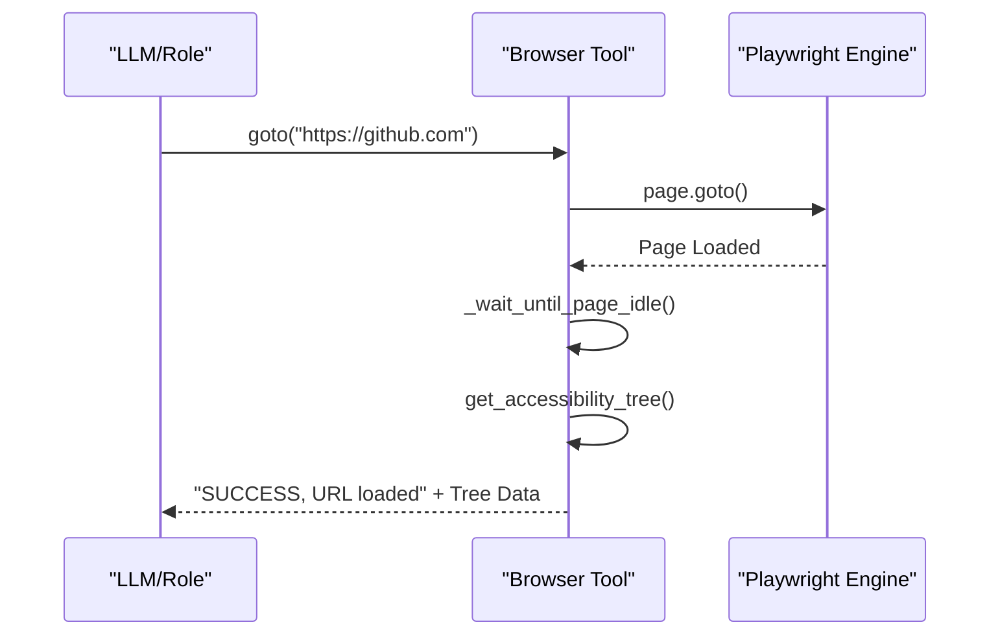
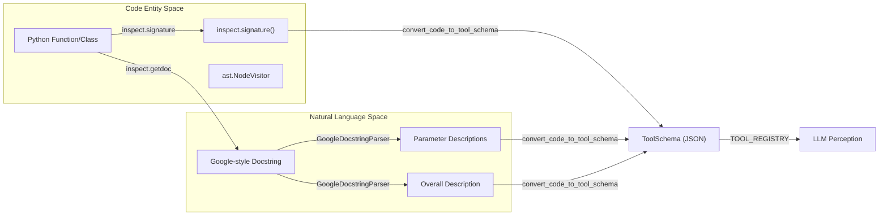

<!-- source: DeepWiki mcp.deepwiki.com · repo geekan/MetaGPT · page 5.2 Tools System · fetched 2026-10-26 -->

# Tools System

<details>
<summary>Relevant source files</summary>

The following files were used as context for generating this wiki page:

- [examples/di/fix_github_issue.py](examples/di/fix_github_issue.py)
- [examples/di/run_flask.py](examples/di/run_flask.py)
- [examples/di/use_github_repo.py](examples/di/use_github_repo.py)
- [metagpt/actions/di/execute_nb_code.py](metagpt/actions/di/execute_nb_code.py)
- [metagpt/actions/di/write_analysis_code.py](metagpt/actions/di/write_analysis_code.py)
- [metagpt/actions/di/write_plan.py](metagpt/actions/di/write_plan.py)
- [metagpt/configs/role_custom_config.py](metagpt/configs/role_custom_config.py)
- [metagpt/logs.py](metagpt/logs.py)
- [metagpt/prompts/di/architect.py](metagpt/prompts/di/architect.py)
- [metagpt/prompts/di/write_analysis_code.py](metagpt/prompts/di/write_analysis_code.py)
- [metagpt/prompts/task_type.py](metagpt/prompts/task_type.py)
- [metagpt/roles/di/data_interpreter.py](metagpt/roles/di/data_interpreter.py)
- [metagpt/strategy/planner.py](metagpt/strategy/planner.py)
- [metagpt/strategy/task_type.py](metagpt/strategy/task_type.py)
- [metagpt/tools/libs/__init__.py](metagpt/tools/libs/__init__.py)
- [metagpt/tools/libs/browser.py](metagpt/tools/libs/browser.py)
- [metagpt/tools/libs/data_preprocess.py](metagpt/tools/libs/data_preprocess.py)
- [metagpt/tools/libs/editor.py](metagpt/tools/libs/editor.py)
- [metagpt/tools/libs/email_login.py](metagpt/tools/libs/email_login.py)
- [metagpt/tools/libs/env.py](metagpt/tools/libs/env.py)
- [metagpt/tools/libs/feature_engineering.py](metagpt/tools/libs/feature_engineering.py)
- [metagpt/tools/libs/gpt_v_generator.py](metagpt/tools/libs/gpt_v_generator.py)
- [metagpt/tools/libs/index_repo.py](metagpt/tools/libs/index_repo.py)
- [metagpt/tools/libs/linter.py](metagpt/tools/libs/linter.py)
- [metagpt/tools/libs/sd_engine.py](metagpt/tools/libs/sd_engine.py)
- [metagpt/tools/libs/terminal.py](metagpt/tools/libs/terminal.py)
- [metagpt/tools/libs/web_scraping.py](metagpt/tools/libs/web_scraping.py)
- [metagpt/tools/swe_agent_commands/setup_default.sh](metagpt/tools/swe_agent_commands/setup_default.sh)
- [metagpt/tools/tool_convert.py](metagpt/tools/tool_convert.py)
- [metagpt/tools/tool_data_type.py](metagpt/tools/tool_data_type.py)
- [metagpt/tools/tool_recommend.py](metagpt/tools/tool_recommend.py)
- [metagpt/tools/tool_registry.py](metagpt/tools/tool_registry.py)
- [metagpt/utils/file.py](metagpt/utils/file.py)
- [metagpt/utils/parse_docstring.py](metagpt/utils/parse_docstring.py)
- [tests/data/tools/test_script_for_file_manager.py](tests/data/tools/test_script_for_file_manager.py)
- [tests/metagpt/actions/di/test_write_analysis_code.py](tests/metagpt/actions/di/test_write_analysis_code.py)
- [tests/metagpt/actions/di/test_write_plan.py](tests/metagpt/actions/di/test_write_plan.py)
- [tests/metagpt/roles/di/test_data_interpreter.py](tests/metagpt/roles/di/test_data_interpreter.py)
- [tests/metagpt/strategy/test_planner.py](tests/metagpt/strategy/test_planner.py)
- [tests/metagpt/tools/libs/test_editor.py](tests/metagpt/tools/libs/test_editor.py)
- [tests/metagpt/tools/libs/test_email_login.py](tests/metagpt/tools/libs/test_email_login.py)
- [tests/metagpt/tools/libs/test_gpt_v_generator.py](tests/metagpt/tools/libs/test_gpt_v_generator.py)
- [tests/metagpt/tools/libs/test_index_repo.py](tests/metagpt/tools/libs/test_index_repo.py)
- [tests/metagpt/tools/libs/test_linter.py](tests/metagpt/tools/libs/test_linter.py)
- [tests/metagpt/tools/libs/test_sd_engine.py](tests/metagpt/tools/libs/test_sd_engine.py)
- [tests/metagpt/tools/libs/test_shell.py](tests/metagpt/tools/libs/test_shell.py)
- [tests/metagpt/tools/libs/test_terminal.py](tests/metagpt/tools/libs/test_terminal.py)
- [tests/metagpt/tools/libs/test_web_scraping.py](tests/metagpt/tools/libs/test_web_scraping.py)
- [tests/metagpt/tools/test_tool_convert.py](tests/metagpt/tools/test_tool_convert.py)
- [tests/metagpt/tools/test_tool_registry.py](tests/metagpt/tools/test_tool_registry.py)

</details>


The Tools System is a core component of MetaGPT that provides roles with capabilities to interact with external systems, manipulate files, browse the web, and execute commands. This system enables roles to perform concrete actions in their environment beyond just thinking and communicating. This page documents the architecture and usage of the Tools System, including the registration pattern, schema conversion, and specific utility libraries.

## Tool Registry and Recommendation

The Tools System is built around a registry pattern that allows tools to be registered, discovered, and recommended to roles based on task context.

### Tool Registration Pattern
Tools are registered using the `@register_tool` decorator [metagpt/tools/tool_registry.py:94-118](). This decorator captures the class/function source code and automatically generates a schema using `convert_code_to_tool_schema` [metagpt/tools/tool_convert.py:9-28]().

```mermaid
classDiagram
    class "ToolRegistry" {
        +tools: dict
        +tools_by_tags: dict
        +register_tool(tool_name, tool_path, schemas, tags)
        +get_tool(key) Tool
        +get_tools_by_tag(tag) dict
    }
    
    class "Tool" {
        +name: str
        +path: str
        +schemas: dict
        +code: str
        +tags: list
    }

    class "ToolSchema" {
        +type: str
        +description: str
        +signature: str
        +parameters: str
    }

    ToolRegistry *-- Tool
    Tool *-- ToolSchema
```
Sources: [metagpt/tools/tool_registry.py:27-88](), [metagpt/tools/tool_data_type.py:1-30]()

### Tool Recommendation System
The `ToolRecommender` [metagpt/tools/tool_recommend.py:54-109]() uses a two-stage process:
1.  **Recall**: Retrieves a subset of relevant tools from the registry (e.g., using `BM25Okapi` for text matching or `TypeMatchToolRecommender` for tag matching) [metagpt/tools/tool_recommend.py:123-127]().
2.  **Rank**: Uses the LLM to select the final candidates from the recalled set based on the `current_task` [metagpt/tools/tool_recommend.py:129-170]().

Sources: [metagpt/tools/tool_recommend.py:54-170](), [metagpt/tools/tool_recommend.py:173-186]()

## Core Tool Libraries

MetaGPT provides several core tools that are essential for roles to interact with their environment:

### Editor (File Management)
The `Editor` tool [metagpt/tools/libs/editor.py:102-702]() provides comprehensive file manipulation. It includes a `Linter` [metagpt/tools/libs/linter.py:28-40]() to validate code edits before applying them.

| Function | Description |
| :--- | :--- |
| `read(path)` | Reads file content, handling large files via `similarity_search` [metagpt/tools/libs/editor.py:133-158](). |
| `write(path, content)` | Writes full content to a file [metagpt/tools/libs/editor.py:116-131](). |
| `edit_file_by_replace` | Replaces specific lines with new content [metagpt/tools/libs/editor.py:343-406](). |
| `insert_content_at_line` | Inserts code at a specific line index [metagpt/tools/libs/editor.py:408-433](). |
| `search_dir(search_term)` | Recursively searches for strings in a directory [metagpt/tools/libs/editor.py:461-512](). |

Sources: [metagpt/tools/libs/editor.py:102-702](), [metagpt/tools/libs/linter.py:28-40]()

### Terminal (Bash/Shell)
The `Terminal` tool [metagpt/tools/libs/terminal.py:17-145]() manages a persistent subprocess (e.g., `bash` or `cmd.exe`).

*   **Persistent State**: Maintains the environment (like `cwd`) across multiple `run_command` calls [metagpt/tools/libs/terminal.py:67-107]().
*   **Conda Integration**: `execute_in_conda_env` allows running commands in specific environments [metagpt/tools/libs/terminal.py:109-132]().
*   **Safety**: Includes a `forbidden_commands` list to prevent dangerous operations [metagpt/tools/libs/terminal.py:41-45]().

Sources: [metagpt/tools/libs/terminal.py:17-145]()

### Browser (Web Interaction)
The `Browser` tool [metagpt/tools/libs/browser.py:47-212]() uses Playwright to interact with web pages. It provides an `accessibility_tree` to the LLM, allowing it to "see" page elements via IDs [metagpt/tools/libs/browser.py:162-167]().


Sources: [metagpt/tools/libs/browser.py:47-212](), [metagpt/utils/a11y_tree.py:1-27]()

## Data Interpreter Tools

For data science and analysis, the system uses specialized execution environments.

### ExecuteNbCode (Jupyter/IPython)
The `ExecuteNbCode` action [metagpt/actions/di/execute_nb_code.py:69-88]() wraps a `RealtimeOutputNotebookClient` [metagpt/actions/di/execute_nb_code.py:40-68]() to execute code in a Jupyter kernel.
*   **Real-time Reporting**: Uses `NotebookReporter` to stream execution results (stdout, stderr, display_data) [metagpt/actions/di/execute_nb_code.py:61-66]().
*   **Image Handling**: Captures `image/png` from `display_data` and encodes it for the LLM [metagpt/actions/di/execute_nb_code.py:171-177]().

Sources: [metagpt/actions/di/execute_nb_code.py:40-186]()

### IndexRepo (Semantic Search)
The `IndexRepo` [metagpt/tools/libs/index_repo.py:47-127]() provides RAG-based search over local files. It uses `FAISS` for indexing and `SimpleEngine` for retrieval [metagpt/tools/libs/index_repo.py:17-21]().

Sources: [metagpt/tools/libs/index_repo.py:47-171]()

## Tool Schema Conversion

The bridge between "Natural Language Space" (where the LLM operates) and "Code Entity Space" (where the Python functions reside) is managed by the `tool_convert` module.


Sources: [metagpt/tools/tool_convert.py:9-65](), [metagpt/utils/parse_docstring.py:4-6]()

## Implementation Details

### Data Flow for Tool Execution
When a Role (like `DataInterpreter`) executes a tool:
1.  **Requirement Analysis**: The `Planner` or `Role` determines the need for a tool [metagpt/strategy/planner.py]().
2.  **Tool Selection**: `ToolRecommender` provides the `ToolSchema` to the LLM [metagpt/tools/tool_recommend.py:111-121]().
3.  **Command Generation**: LLM outputs a code block or structured command.
4.  **Execution**: The command is executed via `Terminal`, `Editor`, or `ExecuteNbCode` [metagpt/actions/di/execute_nb_code.py:200-220]().
5.  **Output Processing**: Results are captured by `TerminalReporter`, `EditorReporter`, or `NotebookReporter` and fed back into the Role's memory [metagpt/utils/report.py]().

Sources: [metagpt/roles/di/data_interpreter.py](), [metagpt/actions/di/execute_nb_code.py:160-186](), [metagpt/tools/libs/terminal.py:147-167]()

---

