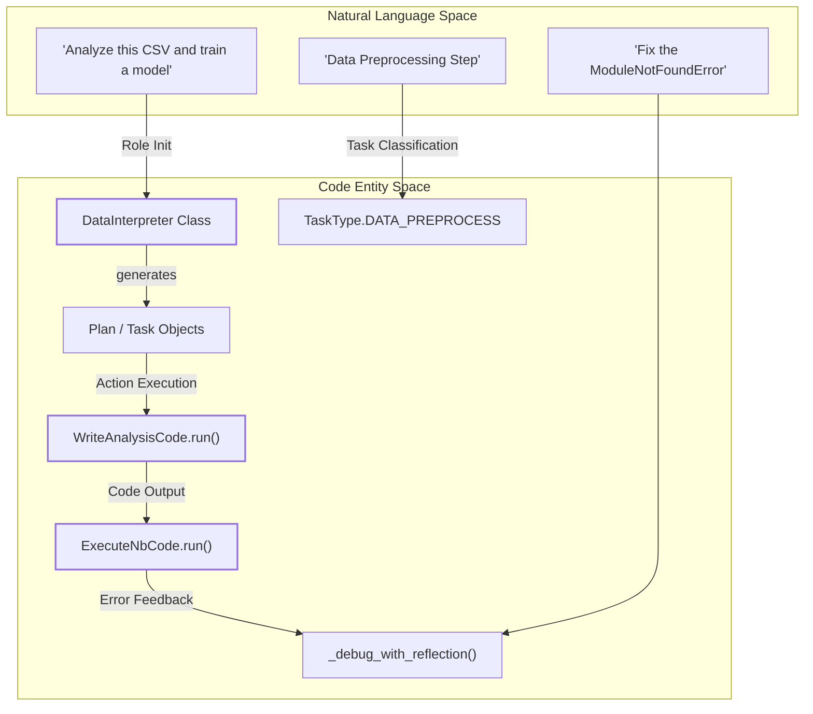
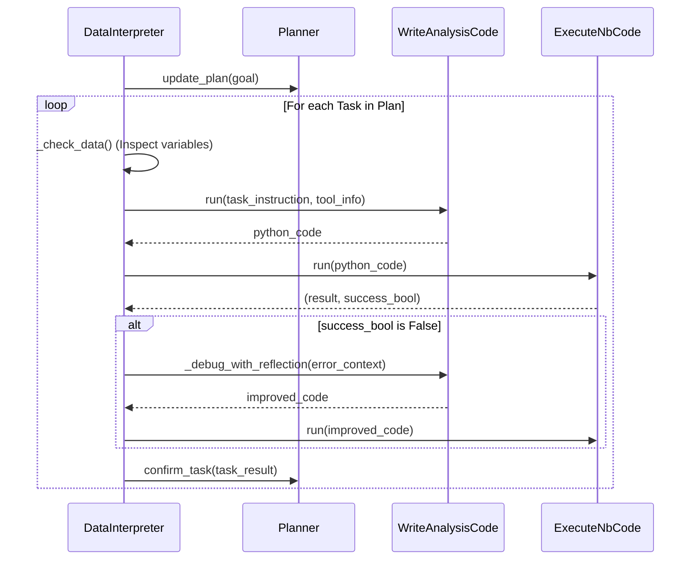

<!-- source: DeepWiki mcp.deepwiki.com · repo geekan/MetaGPT · page 5.3 Data Interpreter · fetched 2026-10-26 -->

# Data Interpreter

Relevant source files

The following files were used as context for generating this wiki page:

- [examples/di/InfiAgent-DABench/DABench.py](examples/di/InfiAgent-DABench/DABench.py)
- [examples/di/InfiAgent-DABench/README.md](examples/di/InfiAgent-DABench/README.md)
- [examples/di/InfiAgent-DABench/run_InfiAgent-DABench.py](examples/di/InfiAgent-DABench/run_InfiAgent-DABench.py)
- [examples/di/InfiAgent-DABench/run_InfiAgent-DABench_all.py](examples/di/InfiAgent-DABench/run_InfiAgent-DABench_all.py)
- [examples/di/InfiAgent-DABench/run_InfiAgent-DABench_single.py](examples/di/InfiAgent-DABench/run_InfiAgent-DABench_single.py)
- [examples/di/README.md](examples/di/README.md)
- [examples/di/machine_learning.py](examples/di/machine_learning.py)
- [examples/di/requirements_prompt.py](examples/di/requirements_prompt.py)
- [examples/di/run_ml_benchmark.py](examples/di/run_ml_benchmark.py)
- [examples/di/run_open_ended_tasks.py](examples/di/run_open_ended_tasks.py)
- [metagpt/actions/di/execute_nb_code.py](metagpt/actions/di/execute_nb_code.py)
- [metagpt/actions/di/write_analysis_code.py](metagpt/actions/di/write_analysis_code.py)
- [metagpt/actions/di/write_plan.py](metagpt/actions/di/write_plan.py)
- [metagpt/prompts/di/architect.py](metagpt/prompts/di/architect.py)
- [metagpt/prompts/di/write_analysis_code.py](metagpt/prompts/di/write_analysis_code.py)
- [metagpt/prompts/task_type.py](metagpt/prompts/task_type.py)
- [metagpt/roles/di/data_interpreter.py](metagpt/roles/di/data_interpreter.py)
- [metagpt/strategy/planner.py](metagpt/strategy/planner.py)
- [metagpt/strategy/task_type.py](metagpt/strategy/task_type.py)
- [metagpt/tools/libs/browser.py](metagpt/tools/libs/browser.py)
- [metagpt/tools/libs/email_login.py](metagpt/tools/libs/email_login.py)
- [metagpt/tools/tool_recommend.py](metagpt/tools/tool_recommend.py)
- [tests/metagpt/actions/di/test_write_analysis_code.py](tests/metagpt/actions/di/test_write_analysis_code.py)
- [tests/metagpt/actions/di/test_write_plan.py](tests/metagpt/actions/di/test_write_plan.py)
- [tests/metagpt/roles/di/test_data_interpreter.py](tests/metagpt/roles/di/test_data_interpreter.py)
- [tests/metagpt/strategy/test_planner.py](tests/metagpt/strategy/test_planner.py)
- [tests/metagpt/tools/libs/test_email_login.py](tests/metagpt/tools/libs/test_email_login.py)

The **Data Interpreter** is a specialized role within MetaGPT designed for autonomous data science and machine learning tasks. It bridges natural language requirements and executable code by combining iterative planning, automated code generation, and real-time execution within a Jupyter notebook environment.

## Overview and Architecture

The Data Interpreter operates by decomposing complex data requirements into a sequence of manageable tasks. It leverages a `Planner` to maintain state across these tasks and an `ExecuteNbCode` action to interact with a live Jupyter kernel.

### Natural Language to Code Entity Mapping

The following diagram illustrates how high-level data science concepts are mapped to specific classes and actions within the Data Interpreter framework.

**Natural Language to Code Mapping**

Sources: `metagpt/roles/di/data_interpreter.py:36-47`(), `metagpt/actions/di/write_analysis_code.py:22-63`(), `metagpt/actions/di/execute_nb_code.py:69-84`()

## Core Components

### 1. DataInterpreter Role
The `DataInterpreter` class (aliased as `David`) manages the lifecycle of a data task. It supports two primary interaction modes:
*   **plan_and_act**: The default mode where the agent first creates a comprehensive `Plan` and then executes tasks sequentially `[metagpt/roles/di/data_interpreter.py:45-54]()`.
*   **react**: A loop-based mode where the agent thinks and acts iteratively until the requirement is met `[metagpt/roles/di/data_interpreter.py:65-89]()`.

### 2. Planning and Task Classification
The `Planner` manages a `Plan` object consisting of multiple `Task` entities. Each task is classified into a `TaskType` to inject specific human priors (guidance) into the LLM prompt.

**Available Task Types and Guidance**
| Task Type | Description | Key Guidance/Priors |
| :--- | :--- | :--- |
| `EDA` | Exploratory Data Analysis | Use `select_dtypes`, import `numpy` `[metagpt/prompts/task_type.py:2-6]()` |
| `DATA_PREPROCESS` | Data Cleaning | Copy DataFrames, handle train/test separately `[metagpt/prompts/task_type.py:9-19]()` |
| `FEATURE_ENGINEERING`| Creating new columns | Avoid ID columns, don't use labels for features `[metagpt/prompts/task_type.py:22-32]()` |
| `MODEL_TRAIN` | Model fitting | Use XGBoost/CatBoost, avoid SVM for speed `[metagpt/prompts/task_type.py:35-45]()` |
| `WEB_SCRAPING` | Web data extraction | Analyze HTML structure before scraping `[metagpt/prompts/task_type.py:62-66]()` |

Sources: `metagpt/strategy/task_type.py:22-76`(), `metagpt/strategy/planner.py:58-76`()

### 3. Execution via ExecuteNbCode
The `ExecuteNbCode` action provides a persistent Jupyter environment. It uses `RealtimeOutputNotebookClient` (extending `nbclient`) to capture stream outputs, errors, and rich media (like PNG plots) in real-time `[metagpt/actions/di/execute_nb_code.py:40-69]()`.

Key features include:
*   **Persistence**: Variables and imports persist across multiple `run()` calls in the same session.
*   **Initialization**: Automatically runs `INI_CODE` to suppress warnings and set logging levels `[metagpt/actions/di/execute_nb_code.py:32-37]()`.
*   **Error Handling**: If execution fails, the traceback is captured and returned to the LLM for reflection `[metagpt/actions/di/execute_nb_code.py:180-185]()`.

## Data Flow and Execution Loop

The Data Interpreter follows a structured loop to ensure code correctness and task completion.

**Data Interpreter Execution Logic**

Sources: `metagpt/roles/di/data_interpreter.py:107-148`(), `metagpt/actions/di/write_analysis_code.py:23-34`(), `metagpt/strategy/planner.py:102-118`()

## Tool Integration

The Data Interpreter can utilize external tools registered in the `TOOL_REGISTRY`. It uses a `ToolRecommender` to select relevant tools based on the current task.

*   **Recall & Rank**: The `ToolRecommender` first recalls a broad set of tools (e.g., via BM25) and then uses the LLM to rank the top-K candidates for the specific task `[metagpt/tools/tool_recommend.py:77-109]()`.
*   **Browser Tool**: For web-related tasks, the `Browser` tool (built on Playwright) allows the agent to navigate URLs, click elements, and retrieve accessibility trees `[metagpt/tools/libs/browser.py:47-81]()`.
*   **Terminal Tool**: Used for environment management, such as `pip install` when a `ModuleNotFoundError` is detected during reflection `[metagpt/prompts/di/write_analysis_code.py:31-34]()`.

## DataAnalyst Variant
While `DataInterpreter` is the primary role, the system also supports a `DataAnalyst` variant (often used in `RoleZero` contexts). The `DataAnalyst` typically focuses on high-level interpretation and reporting, whereas `DataInterpreter` is optimized for the end-to-end "Plan-Code-Execute-Reflect" cycle required for technical data science workflows.

Sources: `metagpt/roles/di/data_interpreter.py:36-38`(), `metagpt/strategy/task_type.py:72-75`()

---

