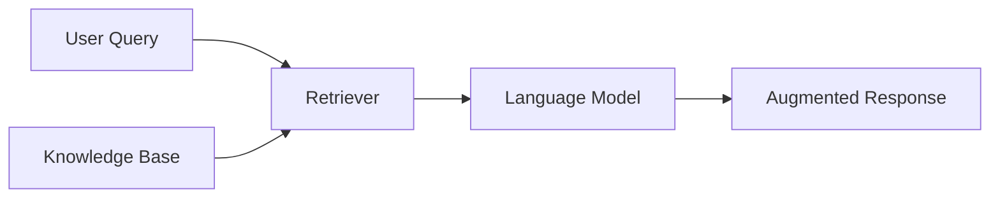
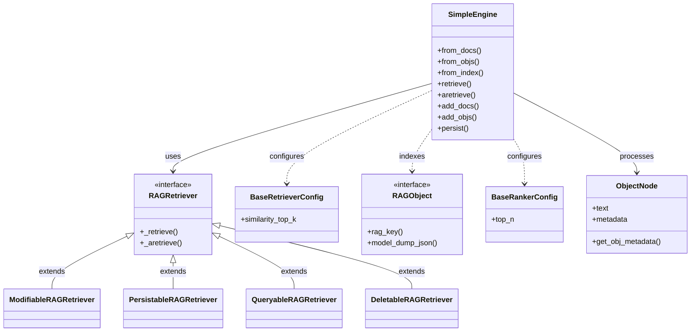
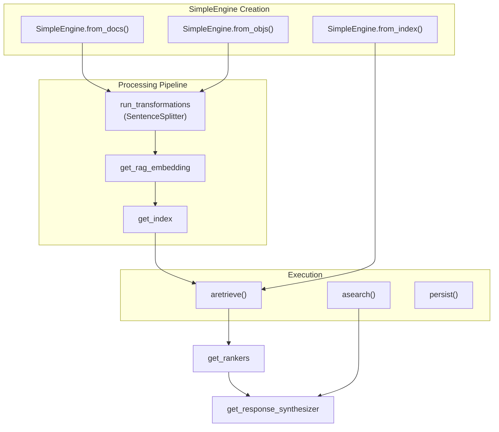
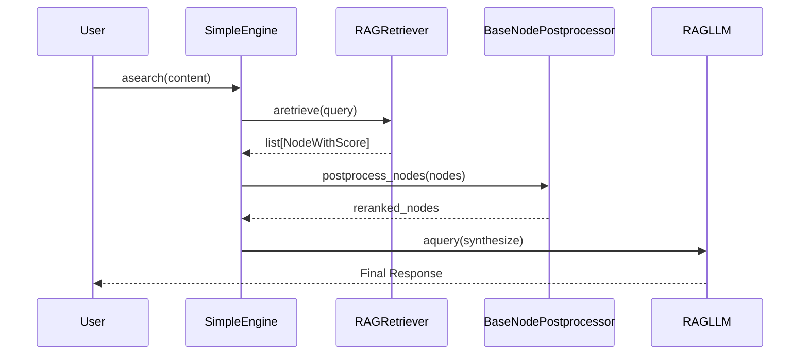

<!-- source: DeepWiki mcp.deepwiki.com · repo geekan/MetaGPT · page 6 Retrieval-Augmented Generation (RAG) · fetched 2026-10-26 -->

# Retrieval-Augmented Generation (RAG)

Relevant source files

The following files were used as context for generating this wiki page:

- [metagpt/rag/benchmark/base.py](metagpt/rag/benchmark/base.py)
- [metagpt/rag/engines/__init__.py](metagpt/rag/engines/__init__.py)
- [metagpt/rag/engines/simple.py](metagpt/rag/engines/simple.py)
- [metagpt/rag/factories/base.py](metagpt/rag/factories/base.py)
- [metagpt/rag/factories/index.py](metagpt/rag/factories/index.py)
- [metagpt/rag/factories/ranker.py](metagpt/rag/factories/ranker.py)
- [metagpt/rag/factories/retriever.py](metagpt/rag/factories/retriever.py)
- [metagpt/rag/interface.py](metagpt/rag/interface.py)
- [metagpt/rag/rankers/__init__.py](metagpt/rag/rankers/__init__.py)
- [metagpt/rag/retrievers/__init__.py](metagpt/rag/retrievers/__init__.py)
- [metagpt/rag/retrievers/base.py](metagpt/rag/retrievers/base.py)
- [metagpt/rag/retrievers/bm25_retriever.py](metagpt/rag/retrievers/bm25_retriever.py)
- [metagpt/rag/retrievers/faiss_retriever.py](metagpt/rag/retrievers/faiss_retriever.py)
- [metagpt/rag/retrievers/hybrid_retriever.py](metagpt/rag/retrievers/hybrid_retriever.py)
- [metagpt/rag/schema.py](metagpt/rag/schema.py)
- [tests/metagpt/rag/engines/test_simple.py](tests/metagpt/rag/engines/test_simple.py)
- [tests/metagpt/rag/factories/test_base.py](tests/metagpt/rag/factories/test_base.py)
- [tests/metagpt/rag/factories/test_index.py](tests/metagpt/rag/factories/test_index.py)
- [tests/metagpt/rag/factories/test_retriever.py](tests/metagpt/rag/factories/test_retriever.py)

This document describes the Retrieval-Augmented Generation (RAG) system of MetaGPT, which enhances language model responses by retrieving relevant information from external knowledge sources. The MetaGPT RAG implementation provides a flexible framework for creating, managing, and using retrieval-enhanced LLM applications.

## Overview

The RAG system in MetaGPT is built on top of LlamaIndex, providing a comprehensive set of tools to:

1. Index and store document collections and data objects.
2. Retrieve the most relevant information for a given query.
3. Augment LLM responses with the retrieved information.
4. Support various retrieval mechanisms and ranking methods.

Sources: [metagpt/rag/engines/simple.py:64-71]()

## Architecture

The core architecture of MetaGPT's RAG system consists of several components that work together to provide a seamless retrieval and augmentation experience.

Sources: [metagpt/rag/engines/simple.py:64-186](), [metagpt/rag/schema.py:21-159](), [metagpt/rag/retrievers/base.py:11-75](), [metagpt/rag/interface.py:7-24]()

### Main Components

The RAG system consists of these primary components:

1.  **SimpleEngine**: The main entry point that integrates document reading, embedding, indexing, and ranking. For details, see [RAG Engines](#6.1).
2.  **Retrievers**: Components that fetch relevant information. Supported types include BM25, FAISS, and Chroma.
3.  **Rankers**: Components that reorder retrieved documents by relevance (e.g., LLM-based or BGE).
4.  **Factories**: The `RetrieverFactory`, `RankerFactory`, and `RAGIndexFactory` manage the dynamic creation of these components based on configuration.
5.  **Schema**: Pydantic-based configuration classes like `BaseRetrieverConfig` and `BaseRankerConfig`. For details, see [RAG Configuration](#6.2).

#### SimpleEngine Workflow

The `SimpleEngine` class extends LlamaIndex's `RetrieverQueryEngine` [metagpt/rag/engines/simple.py:64](). It simplifies the workflow by providing factory methods to initialize from different sources.

Sources: [metagpt/rag/engines/simple.py:91-185](), [metagpt/rag/factories/retriever.py:50-73]()

## Retrievers and Configuration

MetaGPT supports multiple retrieval methods. When multiple configurations are provided, the system defaults to a `SimpleHybridRetriever` [metagpt/rag/factories/retriever.py:73]().

### Supported Retrievers

| Retriever Type | Description | Config Class |
| :--- | :--- | :--- |
| **FAISS** | Vector-based retrieval using `faiss-cpu` | `FAISSRetrieverConfig` |
| **BM25** | Keyword-based retrieval using `rank_bm25` | `BM25RetrieverConfig` |
| **Chroma** | Vector-based retrieval with persistent storage | `ChromaRetrieverConfig` |
| **Elasticsearch** | Supports both vector and keyword text search | `ElasticsearchRetrieverConfig` |

Sources: [metagpt/rag/schema.py:31-109](), [metagpt/rag/factories/retriever.py:54-60]()

### Rankers and Reranking

Rankers are used as post-processors to improve result relevance. Supported rankers include `LLMRerank`, `ColbertRerank`, and `FlagEmbeddingReranker` (BGE) [metagpt/rag/factories/ranker.py:23-29]().

For details on how to configure these, see [RAG Configuration](#6.2).

## RAG Workflow

The typical workflow for using the RAG system involves:

Sources: [metagpt/rag/engines/simple.py:187-204](), [metagpt/rag/retrievers/hybrid_retriever.py:17-38]()

## Performance Evaluation

The `RAGBenchmark` class provides tools to evaluate retrieval and generation quality using standard metrics:
- **Retrieval Metrics**: `recall`, `hit_rate`, and `mean_reciprocal_rank` [metagpt/rag/benchmark/base.py:101-123]().
- **Generation Metrics**: `bleu_score`, `rougel_score`, and `semantic_similarity` [metagpt/rag/benchmark/base.py:75-131]().

## Child Pages

- **[RAG Engines](#6.1)**: Deep dive into `SimpleEngine`, object-based RAG via `RAGObject`, and advanced parsing with `OmniParse`.
- **[RAG Configuration](#6.2)**: Detailed explanation of the configuration schema, factory patterns, and embedding model integration.

---

