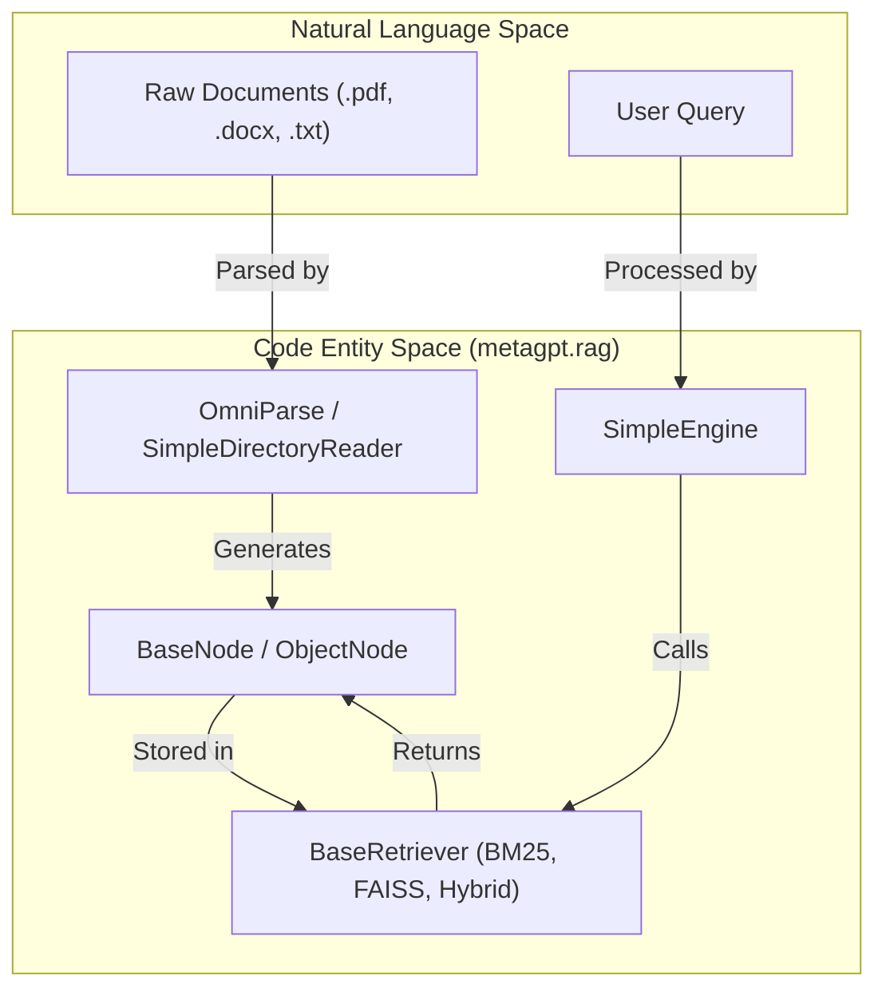
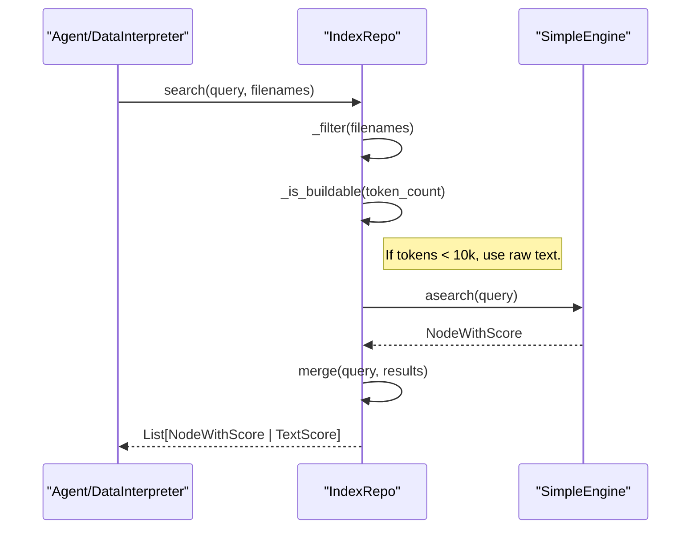

<!-- source: DeepWiki mcp.deepwiki.com · repo geekan/MetaGPT · page 6.1 RAG Engines · fetched 2026-10-26 -->

# RAG Engines

Relevant source files

The following files were used as context for generating this wiki page:

- [metagpt/configs/omniparse_config.py](metagpt/configs/omniparse_config.py)
- [metagpt/rag/engines/__init__.py](metagpt/rag/engines/__init__.py)
- [metagpt/rag/engines/simple.py](metagpt/rag/engines/simple.py)
- [metagpt/rag/interface.py](metagpt/rag/interface.py)
- [metagpt/rag/parsers/__init__.py](metagpt/rag/parsers/__init__.py)
- [metagpt/rag/parsers/omniparse.py](metagpt/rag/parsers/omniparse.py)
- [metagpt/rag/rankers/__init__.py](metagpt/rag/rankers/__init__.py)
- [metagpt/rag/retrievers/__init__.py](metagpt/rag/retrievers/__init__.py)
- [metagpt/rag/retrievers/base.py](metagpt/rag/retrievers/base.py)
- [metagpt/rag/retrievers/bm25_retriever.py](metagpt/rag/retrievers/bm25_retriever.py)
- [metagpt/rag/retrievers/faiss_retriever.py](metagpt/rag/retrievers/faiss_retriever.py)
- [metagpt/rag/retrievers/hybrid_retriever.py](metagpt/rag/retrievers/hybrid_retriever.py)
- [metagpt/tools/libs/editor.py](metagpt/tools/libs/editor.py)
- [metagpt/tools/libs/index_repo.py](metagpt/tools/libs/index_repo.py)
- [metagpt/tools/libs/linter.py](metagpt/tools/libs/linter.py)
- [metagpt/utils/file.py](metagpt/utils/file.py)
- [metagpt/utils/omniparse_client.py](metagpt/utils/omniparse_client.py)
- [tests/metagpt/rag/parser/test_omniparse.py](tests/metagpt/rag/parser/test_omniparse.py)
- [tests/metagpt/tools/libs/test_editor.py](tests/metagpt/tools/libs/test_editor.py)
- [tests/metagpt/tools/libs/test_index_repo.py](tests/metagpt/tools/libs/test_index_repo.py)
- [tests/metagpt/tools/libs/test_linter.py](tests/metagpt/tools/libs/test_linter.py)
- [tests/metagpt/tools/libs/test_shell.py](tests/metagpt/tools/libs/test_shell.py)
- [tests/metagpt/tools/libs/test_web_scraping.py](tests/metagpt/tools/libs/test_web_scraping.py)

This page documents the Retrieval-Augmented Generation (RAG) engine system in MetaGPT, which provides a framework for enhancing language model outputs by retrieving relevant information from a knowledge base. RAG engines coordinate document ingestion, transformation, retrieval, and response synthesis within the overall MetaGPT architecture.

For information about RAG Configuration, see [RAG Configuration](6.2).

## Overview

RAG Engines in MetaGPT serve as the entry point for retrieval-augmented generation functionality. They provide a streamlined interface to:

1. Ingest documents from files or structured objects.
2. Transform documents into searchable nodes.
3. Create and manage indexes for efficient retrieval.
4. Retrieve relevant information based on queries.
5. Synthesize responses that incorporate the retrieved information.

The primary RAG engine implementation is `SimpleEngine`, which leverages `llama-index` components to build robust retrieval pipelines.

Sources: [metagpt/rag/engines/__init__.py:1-7](), [metagpt/rag/engines/simple.py:64-71]()

## Architecture

The RAG system bridges the gap between raw data (Natural Language Space) and structured searchable entities (Code Entity Space).

### RAG Component Mapping

Sources: [metagpt/rag/engines/simple.py:64-135](), [metagpt/rag/retrievers/base.py:11-22](), [metagpt/utils/file.py:109-124]()

## SimpleEngine

`SimpleEngine` is the primary RAG engine in MetaGPT, designed to be a lightweight search engine that integrates document reading, embedding, indexing, retrieving, and ranking functionalities into a single workflow.

### Creation Methods

`SimpleEngine` provides three main factory methods for initialization:

1.  **`from_docs()`**: Creates an engine from document files. It uses `SimpleDirectoryReader` to load data and `run_transformations` to convert documents into nodes [metagpt/rag/engines/simple.py:91-135]().
2.  **`from_objs()`**: Creates an engine from RAG objects. It requires objects to implement the `RAGObject` protocol and uses `get_obj_nodes` for conversion [metagpt/rag/engines/simple.py:138-172]().
3.  **`from_index()`**: Loads an engine from a previously maintained index using `get_index` [metagpt/rag/engines/simple.py:175-185]().

### Core Functionality

- **Retrieval**: Supports both synchronous `retrieve` and asynchronous `aretrieve` methods, returning `NodeWithScore` objects [metagpt/rag/engines/simple.py:187-200]().
- **Persistence**: The `persist` method saves the current index to a directory for later use [metagpt/rag/engines/simple.py:242-246]().
- **Dynamic Updates**: Supports adding new documents via `add_docs` or objects via `add_objs` [metagpt/rag/engines/simple.py:207-224]().

Sources: [metagpt/rag/engines/simple.py:64-271]()

## Retriever Implementations

MetaGPT provides several specialized retrievers that implement the `RAGRetriever` interface.

| Retriever | Implementation Class | Key Feature | Source |
| :--- | :--- | :--- | :--- |
| **BM25** | `DynamicBM25Retriever` | Text-based retrieval without embeddings. | [metagpt/rag/retrievers/bm25_retriever.py:13-36]() |
| **FAISS** | `FAISSRetriever` | Vector-based similarity search using FAISS. | [metagpt/rag/retrievers/faiss_retriever.py:7-17]() |
| **Hybrid** | `SimpleHybridRetriever` | Aggregates results from multiple retrievers. | [metagpt/rag/retrievers/hybrid_retriever.py:10-39]() |
| **Chroma** | `ChromaRetriever` | Integration with ChromaDB vector store. | [metagpt/rag/retrievers/__init__.py]() |

### Retriever Capabilities
Retrievers can implement optional capability interfaces:
- `ModifiableRAGRetriever`: Adds `add_nodes` [metagpt/rag/retrievers/base.py:22-34]().
- `PersistableRAGRetriever`: Adds `persist` [metagpt/rag/retrievers/base.py:36-48]().
- `QueryableRAGRetriever`: Adds `query_total_count` [metagpt/rag/retrievers/base.py:50-62]().
- `DeletableRAGRetriever`: Adds `clear` [metagpt/rag/retrievers/base.py:64-76]().

## OmniParse Integration

MetaGPT integrates with **OmniParse** for high-quality document parsing, especially for complex PDFs and Word documents.

- **Client**: `OmniParseClient` handles requests to the OmniParse server for documents, media, and websites [metagpt/utils/omniparse_client.py:11-42]().
- **Engine Integration**: `SimpleEngine._get_file_extractor` checks for OmniParse configuration. If `base_url` is present, it initializes `OmniParse` as the parser for `.pdf`, `.docx`, and other supported formats [metagpt/rag/engines/simple.py:394-411]().
- **Fallback**: If OmniParse is unavailable, the system falls back to `PDFReader` or standard `docx` parsers [metagpt/utils/file.py:131-147]().

Sources: [metagpt/utils/omniparse_client.py:90-108](), [metagpt/rag/engines/simple.py:394-411](), [metagpt/utils/file.py:150-181]()

## IndexRepo Tool

The `IndexRepo` class is a specialized tool used by agents to perform semantic search over local workspaces or chat histories.

### Search Flow

Sources: [metagpt/tools/libs/index_repo.py:47-127](), [metagpt/tools/libs/index_repo.py:128-171]()

### Key Components of IndexRepo
- **Persistence**: Managed at `DEFAULT_INDEX_ROOT` (`/data/.index/uploads`) [metagpt/tools/libs/index_repo.py:24-27]().
- **Thresholds**: Uses `min_token_count` (default 10k) to decide whether to index a file or just read it directly [metagpt/tools/libs/index_repo.py:32-33]().
- **Fingerprinting**: Tracks file changes using `generate_fingerprint` to determine if re-indexing is required [metagpt/tools/libs/index_repo.py:113-118]().

Sources: [metagpt/tools/libs/index_repo.py:47-74](), [metagpt/tools/libs/index_repo.py:88-126]()

---

