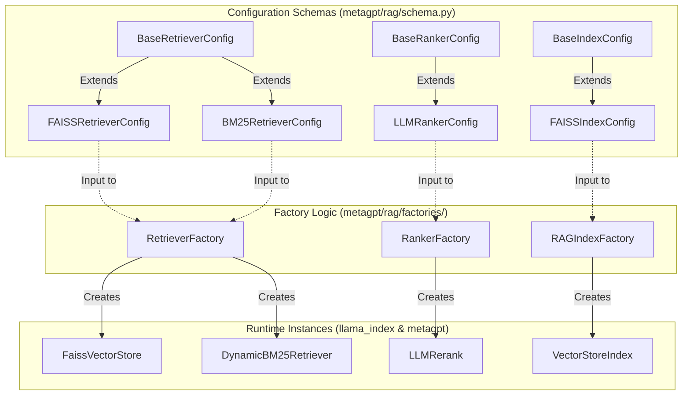
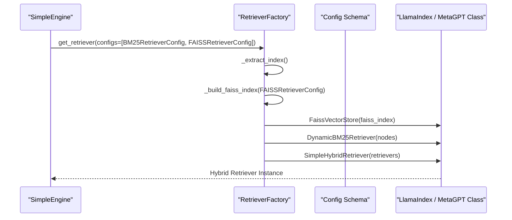

<!-- source: DeepWiki mcp.deepwiki.com · repo geekan/MetaGPT · page 6.2 RAG Configuration · fetched 2026-10-26 -->

# RAG Configuration

Relevant source files

The following files were used as context for generating this wiki page:

- [config/config2.example.yaml](config/config2.example.yaml)
- [examples/exp_pool/decorator.py](examples/exp_pool/decorator.py)
- [metagpt/configs/exp_pool_config.py](metagpt/configs/exp_pool_config.py)
- [metagpt/exp_pool/__init__.py](metagpt/exp_pool/__init__.py)
- [metagpt/exp_pool/decorator.py](metagpt/exp_pool/decorator.py)
- [metagpt/exp_pool/manager.py](metagpt/exp_pool/manager.py)
- [metagpt/exp_pool/schema.py](metagpt/exp_pool/schema.py)
- [metagpt/rag/benchmark/base.py](metagpt/rag/benchmark/base.py)
- [metagpt/rag/factories/__init__.py](metagpt/rag/factories/__init__.py)
- [metagpt/rag/factories/base.py](metagpt/rag/factories/base.py)
- [metagpt/rag/factories/embedding.py](metagpt/rag/factories/embedding.py)
- [metagpt/rag/factories/index.py](metagpt/rag/factories/index.py)
- [metagpt/rag/factories/llm.py](metagpt/rag/factories/llm.py)
- [metagpt/rag/factories/ranker.py](metagpt/rag/factories/ranker.py)
- [metagpt/rag/factories/retriever.py](metagpt/rag/factories/retriever.py)
- [metagpt/rag/retrievers/chroma_retriever.py](metagpt/rag/retrievers/chroma_retriever.py)
- [metagpt/rag/schema.py](metagpt/rag/schema.py)
- [metagpt/utils/reflection.py](metagpt/utils/reflection.py)
- [tests/metagpt/exp_pool/test_manager.py](tests/metagpt/exp_pool/test_manager.py)
- [tests/metagpt/rag/engines/test_simple.py](tests/metagpt/rag/engines/test_simple.py)
- [tests/metagpt/rag/factories/test_base.py](tests/metagpt/rag/factories/test_base.py)
- [tests/metagpt/rag/factories/test_embedding.py](tests/metagpt/rag/factories/test_embedding.py)
- [tests/metagpt/rag/factories/test_index.py](tests/metagpt/rag/factories/test_index.py)
- [tests/metagpt/rag/factories/test_retriever.py](tests/metagpt/rag/factories/test_retriever.py)

This document provides a technical guide to the configuration system for Retrieval-Augmented Generation (RAG) in MetaGPT. The system is built on a modular factory pattern that abstracts the complexities of `llama-index` components, allowing for seamless integration of various retrievers, rankers, and storage backends.

## RAG Configuration Architecture

The RAG configuration system uses Pydantic models to define schemas for every component of the pipeline. These schemas are then consumed by specialized factories to produce functional instances.

### System Components and Code Entities

The following diagram maps the high-level RAG components to their specific class implementations within the codebase.

**Diagram: RAG Configuration to Code Entity Mapping**

Sources: [metagpt/rag/schema.py:21-200](), [metagpt/rag/factories/retriever.py:50-60](), [metagpt/rag/factories/ranker.py:19-30](), [metagpt/rag/factories/index.py:23-32]()

## Configuration Schemas

### Retriever Configurations
Retrievers define how information is fetched. MetaGPT supports both vector-based and keyword-based retrieval.

*   **`BaseRetrieverConfig`**: Defines `similarity_top_k` (default 5) for all retrievers [metagpt/rag/schema.py:21-28]().
*   **`FAISSRetrieverConfig`**: Specifically handles vector dimensionality. It includes a validator `check_dimensions` that automatically assigns dimensions based on the `EmbeddingType` (e.g., 1536 for OpenAI, 768 for Gemini) if not explicitly provided [metagpt/rag/schema.py:37-58]().
*   **`BM25RetrieverConfig`**: Configures the BM25 algorithm. It includes a `create_index` flag to allow data persistence even when using non-vector search [metagpt/rag/schema.py:61-70]().
*   **`ElasticsearchRetrieverConfig`**: Manages connections via `ElasticsearchStoreConfig`, supporting `es_url`, `es_api_key`, and different `vector_store_query_mode` settings (e.g., `TEXT_SEARCH` for keywords) [metagpt/rag/schema.py:82-109]().

### Ranker Configurations
Rankers (or Rerankers) refine the initial retrieval results.

*   **`LLMRankerConfig`**: Uses an LLM to score relevance. It accepts a `choice_select_prompt` to guide the model's decision-making [metagpt/rag/schema.py:121-131]().
*   **`ColbertRerankConfig` / `BGERerankConfig`**: Configuration for specialized local reranking models, allowing settings for `device` (CPU/GPU) and `use_fp16` [metagpt/rag/schema.py:133-148]().
*   **`ObjectRankerConfig`**: A utility ranker that sorts retrieved `RAGObject` instances based on a specific field name and order [metagpt/rag/schema.py:149-153]().

### Index Configurations
Indexes define the persistence layer.

*   **`VectorIndexConfig`**: The base for vector stores, requiring an `embed_model` [metagpt/rag/schema.py:164-168]().
*   **`ChromaIndexConfig`**: Configures `collection_name` and `persist_path` for ChromaDB integration [metagpt/rag/schema.py:174-178]().

## The Factory Pattern

MetaGPT uses a `ConfigBasedFactory` to instantiate components. This allows the system to remain decoupled from specific `llama-index` implementations.

**Diagram: Data Flow in RetrieverFactory**

Sources: [metagpt/rag/factories/retriever.py:63-73](), [metagpt/rag/factories/retriever.py:80-95](), [metagpt/rag/factories/retriever.py:125-129]()

### Key Factory Methods
*   **`RetrieverFactory.get_retriever`**: If multiple configurations are passed, it automatically returns a `SimpleHybridRetriever` [metagpt/rag/factories/retriever.py:63-73]().
*   **`RankerFactory.get_rankers`**: Returns a list of `BaseNodePostprocessor` instances [metagpt/rag/factories/ranker.py:32-37]().
*   **`RAGIndexFactory.get_index`**: Loads or creates an index (e.g., `VectorStoreIndex`) from a `BaseIndexConfig` [metagpt/rag/factories/index.py:34-36]().

## LLM and Embedding Integration

### RAGLLM Wrapper
Since `llama-index` and MetaGPT use different LLM abstractions, the `RAGLLM` class inherits from `llama-index`'s `CustomLLM`. It wraps MetaGPT's `BaseLLM` and handles the `acomplete` method by calling `model_infer.aask` [metagpt/rag/factories/llm.py:21-73]().

### Embedding Configuration
Embeddings are configured globally via `config2.yaml` or passed explicitly. The `get_rag_embedding` function retrieves the configured model, supporting types like OpenAI, Azure, Gemini, and Ollama [metagpt/rag/factories/embedding.py:18-111]().

## Experience Pool Configuration
The `ExperienceManager` uses RAG configurations to manage long-term agent memory. It can be configured to use `BM25` or `Chroma` for storing and retrieving past `Experience` objects [metagpt/exp_pool/manager.py:135-143]().

*   **`exp_cache` Decorator**: Provides a high-level interface to use the RAG-backed experience pool. It uses `ExpCacheHandler` to fetch, evaluate (via `SimpleScorer`), and save experiences [metagpt/exp_pool/decorator.py:29-90]().
*   **`QueryType`**: Experiences can be queried via `EXACT` matching or `SEMANTIC` vector search [metagpt/exp_pool/schema.py:16-21]().

Sources: [metagpt/exp_pool/manager.py:18-40](), [metagpt/exp_pool/decorator.py:97-135](), [metagpt/exp_pool/schema.py:62-77]()

---

