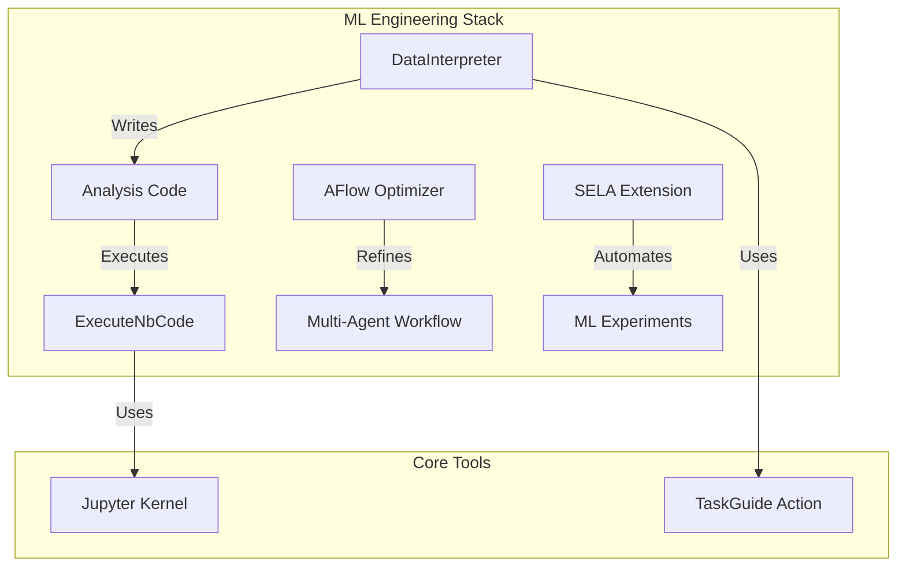
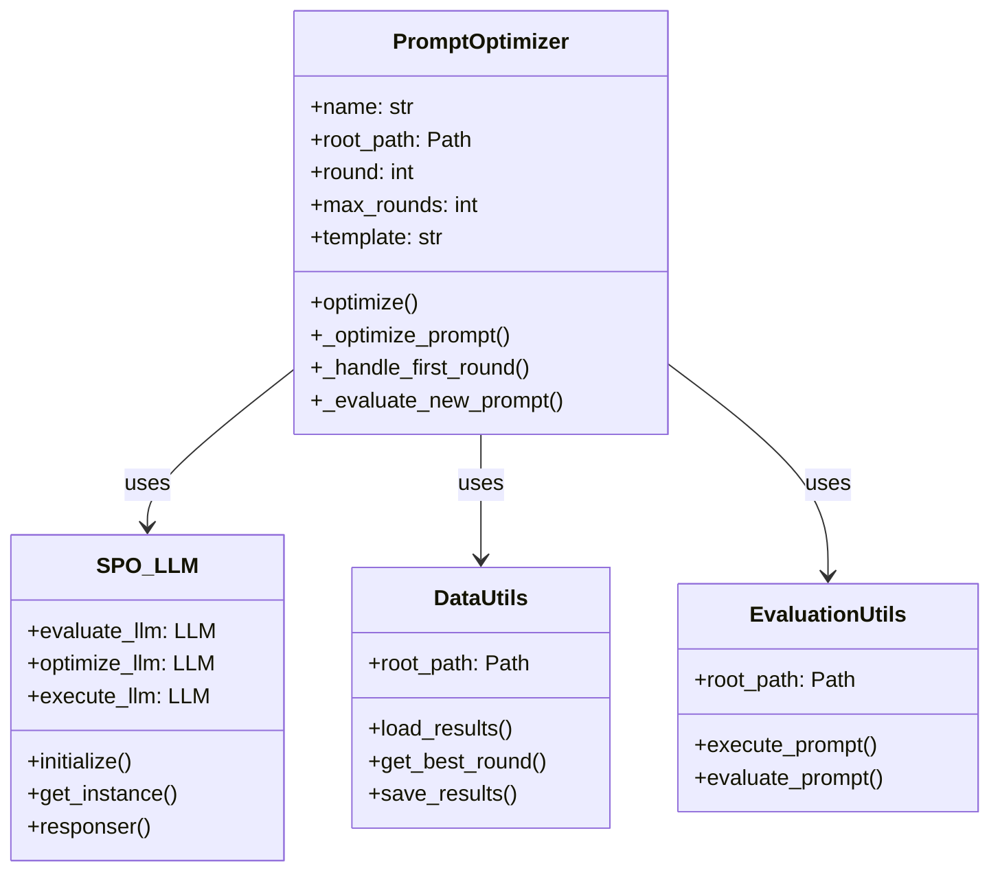
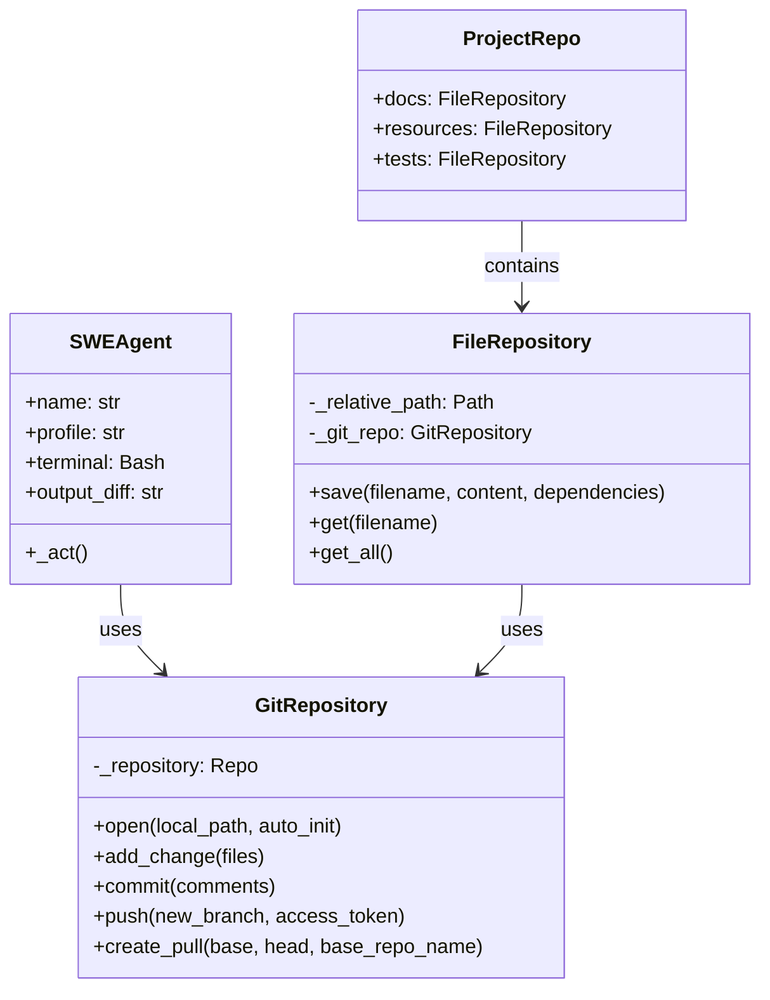

<!-- source: DeepWiki mcp.deepwiki.com · repo geekan/MetaGPT · page 7 Specialized Capabilities · fetched 2026-10-26 -->

# Specialized Capabilities

Relevant source files

The following files were used as context for generating this wiki page:

- [examples/spo/README.md](examples/spo/README.md)
- [examples/spo/optimize.py](examples/spo/optimize.py)
- [metagpt/actions/prepare_documents.py](metagpt/actions/prepare_documents.py)
- [metagpt/actions/rebuild_class_view.py](metagpt/actions/rebuild_class_view.py)
- [metagpt/actions/rebuild_sequence_view.py](metagpt/actions/rebuild_sequence_view.py)
- [metagpt/ext/spo/app.py](metagpt/ext/spo/app.py)
- [metagpt/ext/spo/components/evaluator.py](metagpt/ext/spo/components/evaluator.py)
- [metagpt/ext/spo/components/optimizer.py](metagpt/ext/spo/components/optimizer.py)
- [metagpt/ext/spo/utils/data_utils.py](metagpt/ext/spo/utils/data_utils.py)
- [metagpt/ext/spo/utils/evaluation_utils.py](metagpt/ext/spo/utils/evaluation_utils.py)
- [metagpt/ext/spo/utils/llm_client.py](metagpt/ext/spo/utils/llm_client.py)
- [metagpt/ext/spo/utils/load.py](metagpt/ext/spo/utils/load.py)
- [metagpt/ext/spo/utils/prompt_utils.py](metagpt/ext/spo/utils/prompt_utils.py)
- [metagpt/prompts/di/swe_agent.py](metagpt/prompts/di/swe_agent.py)
- [metagpt/repo_parser.py](metagpt/repo_parser.py)
- [metagpt/roles/di/swe_agent.py](metagpt/roles/di/swe_agent.py)
- [metagpt/startup.py](metagpt/startup.py)
- [metagpt/tools/libs/git.py](metagpt/tools/libs/git.py)
- [metagpt/utils/di_graph_repository.py](metagpt/utils/di_graph_repository.py)
- [metagpt/utils/file_repository.py](metagpt/utils/file_repository.py)
- [metagpt/utils/git_repository.py](metagpt/utils/git_repository.py)
- [metagpt/utils/graph_repository.py](metagpt/utils/graph_repository.py)
- [metagpt/utils/visual_graph_repo.py](metagpt/utils/visual_graph_repo.py)
- [tests/metagpt/actions/test_rebuild_class_view.py](tests/metagpt/actions/test_rebuild_class_view.py)
- [tests/metagpt/actions/test_rebuild_sequence_view.py](tests/metagpt/actions/test_rebuild_sequence_view.py)
- [tests/metagpt/roles/di/run_swe_agent_for_benchmark.py](tests/metagpt/roles/di/run_swe_agent_for_benchmark.py)
- [tests/metagpt/roles/di/run_swe_agent_open_source_issue.py](tests/metagpt/roles/di/run_swe_agent_open_source_issue.py)
- [tests/metagpt/test_document.py](tests/metagpt/test_document.py)
- [tests/metagpt/test_repo_parser.py](tests/metagpt/test_repo_parser.py)
- [tests/metagpt/tools/libs/test_git.py](tests/metagpt/tools/libs/test_git.py)
- [tests/metagpt/tools/libs/test_image_getter.py](tests/metagpt/tools/libs/test_image_getter.py)
- [tests/metagpt/utils/test_visual_graph_repo.py](tests/metagpt/utils/test_visual_graph_repo.py)

This page documents the specialized capabilities within MetaGPT that extend beyond the core framework. These systems provide additional functionality for specific use cases including automated prompt engineering, machine learning workflows, autonomous issue resolution, and deep web research.

For information about the core architecture including roles, actions, and the message passing system, see [Core Architecture](#2).

## 1. Machine Learning Engineering (7.1)

MetaGPT provides specialized support for ML engineering, focusing on data science tasks, automated experimentation, and workflow optimization. This includes the `DataInterpreter` for analysis and the `AFlow` system for workflow optimization.

### ML Capabilities Architecture

For details, see [Machine Learning Engineering](#7.1).

Sources:
- [metagpt/actions/di/execute_nb_code.py:1-20]()
- [metagpt/roles/di/data_interpreter.py:1-50]()

## 2. Self-Supervised Prompt Optimization (SPO) (7.2)

SPO is a framework for automatically optimizing prompts for Large Language Models (LLMs) without requiring human feedback. It implements an iterative optimization approach that significantly improves prompt effectiveness while maintaining ultra-low costs (approx. $0.15 per task).

### SPO Architecture

For details, see [Self-Supervised Prompt Optimization](#7.2).

Sources:
- [metagpt/ext/spo/components/optimizer.py:19-39]()
- [metagpt/ext/spo/utils/llm_client.py:11-30]()
- [examples/spo/README.md:7-21]()

## 3. Git Repository Management (7.3)

MetaGPT includes a comprehensive Git management system that enables automated repository operations, file management, and autonomous issue resolution via the `SWEAgent`.

### Git Integration Architecture

For details, see [Git Repository Management](#7.3).

Sources:
- [metagpt/utils/git_repository.py:61-132]()
- [metagpt/utils/file_repository.py:23-45]()
- [metagpt/roles/di/swe_agent.py:17-31]()
- [metagpt/utils/project_repo.py:1-50]()

## 4. Web Research and Search (7.4)

The framework features advanced web research capabilities centered around the `Researcher` role. It integrates multiple search engines and browser engines to scrape and summarize information from the web.

### Search and Research Components

| Component | Code Entity | Description |
| :--- | :--- | :--- |
| **Role** | `Researcher` | Orchestrates search, browsing, and summarization. |
| **Action** | `SearchEnhancedQA` | Performs RAG-style QA using web search results. |
| **Search Engine** | `SearchEngine` | Abstract interface for Google, SerpAPI, DuckDuckGo, etc. |
| **Browser** | `WebBrowser` | Engine for scraping content using Playwright or Selenium. |

For details, see [Web Research and Search](#7.4).

Sources:
- [metagpt/roles/researcher.py:1-50]()
- [metagpt/tools/search_engine.py:1-30]()
- [metagpt/actions/research.py:1-40]()

## 5. Code Analysis and Visualization

MetaGPT provides tools to parse existing repositories into symbol-based structures, enabling agents to understand complex codebases through class and sequence diagrams.

- **Repo Parser**: The `RepoParser` class [metagpt/repo_parser.py:30-47]() extracts classes, functions, and globals from source files.
- **View Rebuilding**: Actions like `RebuildClassView` [metagpt/actions/rebuild_class_view.py]() and `RebuildSequenceView` [metagpt/actions/rebuild_sequence_view.py]() generate Mermaid diagrams from the parsed symbols to provide a structural overview of the code.

Sources:
- [metagpt/repo_parser.py:30-66]()
- [metagpt/actions/rebuild_class_view.py:1-20]()
- [metagpt/actions/rebuild_sequence_view.py:1-20]()

---

